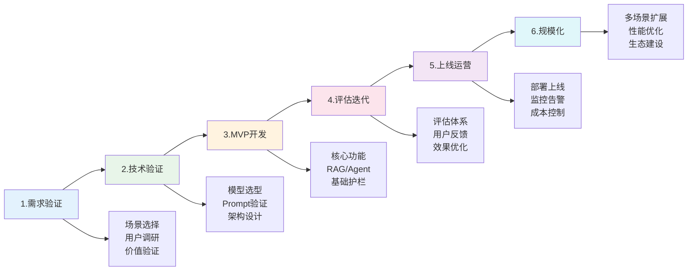

# AI产品实战框架-从0到1

> **文档说明**：系统讲解 AI 产品从 0 到 1 的完整实战框架，包括需求分析、场景选择、技术选型、MVP 开发、Prompt 工程、RAG 系统、Agent 设计、评估迭代、上线运营，以及实战案例和避坑指南。
>
> **适用人群**：AI 产品经理、全栈开发者、创业者、想要构建 AI 产品的开发者
>
> **前置知识**：[[大模型应用开发入门]]、[[Prompt工程高级技巧]]、[[RAG检索增强生成]]

---

## 一、概述

<div style="background:linear-gradient(135deg,#667eea,#764ba2);border-radius:16px;padding:20px;margin:16px 0;font-family:-apple-system,'Segoe UI','PingFang SC','Microsoft YaHei',sans-serif;color:#fff;overflow:hidden;box-shadow:0 8px 28px rgba(0,0,0,.14),0 3px 10px rgba(0,0,0,.08)">
<style>@keyframes highlight{0%,100%{box-shadow:0 0 0 rgba(255,255,255,0)}50%{box-shadow:0 0 20px rgba(255,255,255,.4)}}.hl-box{background:rgba(255,255,255,.2);border-radius:10px;padding:14px 18px;margin:10px 0;animation:highlight 3s ease-in-out infinite;border-left:4px solid rgba(255,255,255,.6)}.hl-formula{font-family:monospace;font-size:14px;text-align:center;background:rgba(0,0,0,.15);border-radius:8px;padding:12px;margin:10px 0}</style>
<div style="text-align:center;font-size:15px;font-weight:700;margin-bottom:14px;padding-bottom:10px;border-bottom:1.5px solid rgba(255,255,255,.22);letter-spacing:1px;text-shadow:0 1px 3px rgba(0,0,0,.12)">📌 AI产品实战框架-从0到1</div>
<div class="hl-box">系统讲解 AI 产品从 0 到 1 的完整实战框架，包括需求分析、场景选择、技术选型、MVP 开发、Prompt 工程、RAG 系统、Agent 设计、评估迭代、上线运营，以及实战案例和避坑指南。</div>
<div class="hl-formula">需求分析 → 技术选型 → 架构设计 → 原型开发 → 测试迭代 → 上线运营</div>
<div style="font-size:13px;opacity:.9;margin-top:8px">💡 工程化思维是从 Demo 到生产系统的关键跨越</div>
</div>

> 🔍 **知识点深度解析**
>
> **作用**：AI产品实战框架-从0到1 是 AI 工程化体系中的关键环节，解决从模型能力到生产应用的转化问题，适用于构建稳定、可扩展、可维护的 AI 应用系统。
>
> **原理**：通过标准化的工程方法论和工具链，将大模型的能力封装为可复用的组件，结合最佳实践和质量保障机制，实现 AI 应用的高效开发和可靠运行。
>
> **用法要点**：① 遵循标准化的开发流程和规范 ② 选择合适的工具和框架提升效率 ③ 建立完善的测试和监控机制 ④ 持续优化性能和成本

### 1. AI 产品的特殊性

```text
AI 产品 vs 传统软件产品：

传统软件：
- 确定性输出：输入 → 固定逻辑 → 确定输出
- 可精确测试：单元测试覆盖所有分支
- 性能可预测：响应时间、资源消耗稳定
- 体验可设计：每个交互都能精确控制

AI 产品（LLM 驱动）：
- 概率性输出：相同输入可能产生不同输出
- 难以穷举测试：需要评估集和抽样评估
- 性能波动：模型推理时间、Token 消耗不稳定
- 体验需引导：通过 Prompt 和上下文引导输出
- 幻觉问题：模型可能生成看似合理但错误的内容
- 成本敏感：Token 消耗直接对应费用

核心挑战：
1. 如何让概率性系统满足确定性需求？
2. 如何评估和保证输出质量？
3. 如何控制成本和延迟？
4. 如何处理幻觉和安全问题？
```

### 2. AI 产品分类

```text
按技术形态分类：

1. Copilot（副驾驶）
   - 辅助人类完成任务
   - 人类在回路中（Human-in-the-loop）
   - 示例：GitHub Copilot、Cursor、Notion AI
   - 特点：建议式、可编辑、低风险

2. Agent（智能体）
   - 自主完成任务
   - 可以调用工具、多步推理
   - 示例：AutoGPT、Devin、客服机器人
   - 特点：自主式、高风险、需护栏

3. Chatbot（对话机器人）
   - 问答式交互
   - 单轮或多轮对话
   - 示例：客服机器人、知识库问答
   - 特点：对话式、中等风险

4. AI 功能模块
   - 嵌入现有产品的 AI 能力
   - 示例：智能搜索、内容生成、数据摘要
   - 特点：功能式、低风险、易集成

按应用场景分类：
- 内容创作：写作、设计、视频
- 知识管理：问答、摘要、检索
- 编程开发：代码生成、调试、审查
- 数据分析：洞察、可视化、报告
- 客户服务：客服、销售、支持
- 办公效率：邮件、会议、文档
```

### 3. 从 0 到 1 的阶段



---

---

> 💡 **深度讲解**：本节围绕，深入剖析其技术原理与实践要点，帮助读者建立系统性的认知框架。
>
> **📝 精简总结**：本节介绍了，掌握这些内容是理解整个知识体系的重要基础。

## 二、需求验证

### 1. 场景选择

```text
好的 AI 场景特征：
1. 高频刚需：用户经常需要，愿意付费
2. 痛点明确：现有方案效率低/成本高/体验差
3. AI 能显著提升：AI 比传统方法好 10 倍，而不是 10%
4. 容错空间：允许一定的不完美，有人类审核环节
5. 数据可获取：有足够的训练/微调/RAG 数据
6. 成本可控：AI 推理成本在可接受范围内

不好的 AI 场景：
- 低容错：医疗诊断、法律判决、金融交易（需要极高准确率）
- 低频小众：用户少，难以支撑商业
- AI 提升有限：传统方法已经很好
- 数据匮乏：没有足够数据支撑
- 成本过高：AI 推理成本超过用户付费意愿

场景评估矩阵：
维度：用户价值 × 技术可行性 × 商业可行性 × 竞争格局
评分：1-5 分，综合排序选择
```

### 2. 用户调研

```text
用户调研方法：
1. 访谈：深度访谈 10-20 个目标用户
   - 了解现有工作流程和痛点
   - 验证需求真实性
   - 探索 AI 能介入的环节

2. 问卷：大规模验证需求普遍性
   - 痛点频率、严重程度
   - 付费意愿
   - 现有解决方案

3. 竞品分析：
   - 现有方案的优缺点
   - AI 产品的差异化机会
   - 定价和商业模式

4. 原型测试：
   - 用 Wizard of Oz（人模拟 AI）测试体验
   - 用简单 Prompt 验证核心价值
   - 快速迭代交互设计

关键问题：
- 用户现在怎么做这件事？花多少时间/钱？
- 最痛的环节是什么？
- 如果 AI 能做到 X，你愿意用/付费吗？
- 你能接受 AI 偶尔出错吗？出错了怎么办？
```

### 3. 价值验证

```text
价值验证方法（从低成本到高成本）：

1. 概念验证（Concept Test）
   - 用 PPT/原型展示产品概念
   - 收集用户反馈和付费意愿
   - 成本：几天

2. Wizard of Oz（绿野仙踪）
   - 前端看起来像 AI，后端是人在操作
   - 验证用户体验和需求
   - 成本：1-2 周

3. Prompt 原型
   - 用简单的 Prompt + API 实现核心功能
   - 不做工程化，验证 AI 能力
   - 成本：1-2 周

4. MVP（最小可行产品）
   - 完整的核心功能，可真实使用
   - 小范围用户测试
   - 成本：1-3 个月

验证指标：
- 核心功能使用率
- 用户留存（次日/7日/30日）
- 用户满意度（NPS/CSAT）
- 付费转化率
- AI 输出采纳率（用户是否使用 AI 生成的内容）
```

---

## 三、技术验证

### 1. 模型选型

```text
模型选型维度：

1. 能力维度
   - 通用能力：GPT-4o、Claude 3.5、Gemini 1.5 Pro
   - 代码能力：GPT-4o、Claude 3.5 Sonnet、DeepSeek-Coder
   - 长上下文：Claude 3.5（200K）、Gemini 1.5（1M+）、GPT-4o（128K）
   - 开源模型：Llama 3、Qwen 2、Mistral、DeepSeek

2. 成本维度
   - 输入/输出 Token 单价
   - 缓存折扣（Prompt 缓存）
   - 批量处理折扣
   - 自部署成本（GPU + 运维）

3. 延迟维度
   - 首 Token 延迟（TTFT）
   - 生成速度（Tokens/sec）
   - 并发能力

4. 安全合规
   - 数据是否用于训练
   - 数据驻留地区
   - 企业合规认证（SOC2、GDPR）
   - 私有化部署能力

选型策略：
- MVP 阶段：用最强的闭源模型（GPT-4o/Claude），快速验证
- 优化阶段：评估模型性价比，可能用小模型+RAG
- 规模化：混合模型（复杂任务大模型，简单任务小模型）
- 特殊场景：自部署开源模型（数据敏感/成本极高）
```

### 2. Prompt 验证

```text
Prompt 验证流程：

1. 定义任务
   - 明确输入输出格式
   - 定义质量标准
   - 准备 20-50 个测试用例

2. 编写基础 Prompt
   - 角色设定
   - 任务描述
   - 输出格式
   - 示例（Few-shot）

3. 迭代优化
   - 在测试集上评估
   - 分析失败案例
   - 优化 Prompt（CoT、Few-shot、约束）
   - 目标：准确率 > 90%（根据场景）

4. 压力测试
   - 边界情况
   - 恶意输入（Prompt 注入）
   - 长文本
   - 多语言

Prompt 工程技巧：
- 清晰的指令和角色
- 结构化输出（JSON/Markdown）
- Few-shot 示例
- 思维链（Chain-of-Thought）
- 自我检查（Self-critique）
- 约束和护栏
```

### 3. 架构设计

```text
AI 产品典型架构：

┌─────────────────────────────────────────┐
│              前端（Web/App）              │
│  对话界面 / 编辑器 / 仪表盘 / 设置        │
└──────────────┬──────────────────────────┘
               │ HTTPS / WebSocket
┌──────────────▼──────────────────────────┐
│            后端服务（API Gateway）         │
│  认证授权 / 限流 / 路由 / 日志            │
└──────┬───────────┬───────────┬──────────┘
       │           │           │
┌──────▼─────┐ ┌──▼──────┐ ┌─▼─────────┐
│  LLM 服务   │ │ RAG 服务 │ │ Agent 服务 │
│ 模型调用    │ │ 检索增强 │ │ 工具调用   │
│ Prompt管理  │ │ 向量数据库│ │ 多步推理   │
│ 缓存/降级   │ │ 文档处理 │ │ 记忆管理   │
└─────────────┘ └─────────┘ └───────────┘
       │
┌──────▼──────────────────────────────────┐
│            数据存储层                      │
│  PostgreSQL / Redis / 对象存储 / 向量库   │
└─────────────────────────────────────────┘

关键组件：
1. LLM 网关：统一模型调用、负载均衡、降级、缓存
2. Prompt 管理：版本管理、A/B 测试、评估
3. RAG 管道：文档解析、分块、嵌入、检索、重排
4. Agent 框架：工具注册、规划、执行、记忆
5. 评估系统：离线评估、在线评估、用户反馈
6. 监控系统：延迟、成本、错误率、质量指标
```

---

## 四、MVP 开发

### 1. 核心功能优先级

```text
MVP 功能优先级（MoSCoW 方法）：

Must Have（必须有）：
- 核心 AI 功能（对话/生成/问答）
- 基本的用户界面
- 认证和用户管理
- 基础的错误处理

Should Have（应该有）：
- 历史记录
- 基本的设置（模型选择、参数调整）
- 导出/分享功能
- 基础的评估和反馈

Could Have（可以有）：
- 高级功能（Agent、多模态）
- 团队协作
- API 接口
- 高级分析

Won't Have（暂不做）：
- 复杂的权限管理
- 企业级 SSO
- 完整的计费系统
- 多语言支持

MVP 原则：
- 只做核心价值，不做完美
- 能用手动操作替代的就不自动化
- 快速上线，获取真实反馈
- 1-3 个月内完成
```

### 2. 技术栈选择

```text
推荐技术栈（全栈 AI 产品）：

前端：
- 框架：Vue3 / React / Next.js
- UI：Element Plus / Ant Design / shadcn/ui
- 状态：Pinia / Zustand
- 流式输出：SSE / WebSocket
- Markdown 渲染：markdown-it / react-markdown

后端：
- 语言：Python（FastAPI）/ Node.js（NestJS）/ Java（Spring Boot）
- API：RESTful + SSE（流式）
- 认证：JWT / OAuth2
- 任务队列：Celery / BullMQ

AI 层：
- LLM 框架：LangChain / LlamaIndex / 自研
- 向量数据库：Milvus / Qdrant / Weaviate / pgvector
- 嵌入模型：text-embedding-3 / BGE / M3E
- 重排模型：bge-reranker / Cohere Rerank

数据存储：
- 关系型：PostgreSQL / MySQL
- 缓存：Redis
- 对象存储：S3 / OSS / MinIO
- 向量库：Milvus / Qdrant

部署：
- 容器：Docker
- 编排：Kubernetes / Docker Compose
- CI/CD：GitHub Actions / GitLab CI
- 监控：Prometheus + Grafana / Langfuse

MVP 简化：
- 用 Vercel/Railway 快速部署
- 用 Supabase 替代自建数据库
- 用 Pinecone 替代自建向量库
- 用 LangSmith 做评估和监控
```

### 3. 核心功能实现

```python
# 核心对话 API（FastAPI 示例）
from fastapi import FastAPI, HTTPException
from fastapi.responses import StreamingResponse
from pydantic import BaseModel
import openai
import asyncio

app = FastAPI()

class ChatRequest(BaseModel):
    message: str
    conversation_id: str = None
    system_prompt: str = "你是一个有帮助的助手"

async def generate_stream(messages, model="gpt-4o"):
    """流式生成响应"""
    try:
        stream = await openai.ChatCompletion.acreate(
            model=model,
            messages=messages,
            stream=True,
            temperature=0.7,
            max_tokens=2000
        )
        async for chunk in stream:
            if chunk.choices[0].delta.content:
                yield f"data: {chunk.choices[0].delta.content}\n\n"
        yield "data: [DONE]\n\n"
    except Exception as e:
        yield f"data: [ERROR] {str(e)}\n\n"

@app.post("/api/chat")
async def chat(request: ChatRequest):
    """对话接口（流式）"""
    # 1. 获取历史对话
    history = get_conversation_history(request.conversation_id)
    
    # 2. 构建消息
    messages = [{"role": "system", "content": request.system_prompt}]
    messages.extend(history)
    messages.append({"role": "user", "content": request.message})
    
    # 3. 限流检查
    if not check_rate_limit(request.conversation_id):
        raise HTTPException(429, "请求过于频繁")
    
    # 4. 保存用户消息
    save_message(request.conversation_id, "user", request.message)
    
    # 5. 流式返回
    return StreamingResponse(
        generate_stream(messages),
        media_type="text/event-stream"
    )
```

---

## 五、RAG 系统

### 1. RAG 架构

```text
RAG（Retrieval-Augmented Generation）：
- 检索增强生成
- 从知识库检索相关文档，作为上下文给 LLM
- 解决幻觉、知识更新、私有知识问题

RAG 流程：
1. 文档处理（离线）
   - 解析：PDF/Word/HTML/Markdown → 纯文本
   - 分块：按语义/固定大小切分（256-1024 tokens）
   - 嵌入：文本 → 向量（Embedding）
   - 存储：向量 + 元数据存入向量数据库

2. 查询处理（在线）
   - 查询改写：用户问题 → 优化的检索查询
   - 检索：向量相似度搜索 Top-K
   - 重排：用 Cross-encoder 重新排序
   - 上下文构建：检索结果 + 问题 → Prompt
   - 生成：LLM 基于上下文回答

3. 后处理
   - 引用标注：答案标注来源
   - 质量检查：检查是否基于上下文
   - 安全过滤：过滤敏感内容
```

### 2. RAG 优化要点

```text
RAG 质量优化：

1. 文档处理
   - 分块策略：语义分块 > 固定大小分块
   - 块大小：256-512 tokens（通用），1024（长文档）
   - 重叠：10-20% 重叠，避免上下文断裂
   - 元数据：标题、章节、来源、时间

2. 嵌入模型
   - 选择：OpenAI text-embedding-3 / BGE / M3E / E5
   - 维度：1536（OpenAI）/ 1024（BGE-large）
   - 多语言：用支持中文的模型（BGE/M3E）
   - 微调：领域数据微调嵌入模型

3. 检索优化
   - 查询改写：HyDE（假设文档）、多查询、子问题分解
   - 混合检索：向量检索 + 关键词检索（BM25）
   - 重排：Cross-encoder 重排 Top-20 → Top-5
   - 元数据过滤：按时间、来源、类型过滤

4. 生成优化
   - Prompt 设计：明确要求基于上下文回答
   - 引用标注：要求标注来源段落
   - 不知道就说不知道：避免幻觉
   - 结构化输出：JSON/Markdown

5. 评估
   - 检索质量：Recall@K、MRR、NDCG
   - 生成质量：忠实度（Faithfulness）、相关性（Relevance）
   - 端到端：人工评估、LLM-as-Judge
```

---

## 六、Agent 设计

### 1. Agent 架构

```text
Agent（智能体）核心组件：

1. 规划（Planning）
   - 任务分解：将复杂任务拆分为子任务
   - 反思：执行后评估结果，调整策略
   - 记忆：短期（对话历史）+ 长期（知识库）

2. 工具（Tools）
   - 搜索：Google/Bing/内部搜索
   - 代码执行：Python/Shell
   - API 调用：天气、地图、数据库
   - 文件操作：读写文件
   - 浏览器：网页访问和操作

3. 记忆（Memory）
   - 短期记忆：当前对话上下文
   - 长期记忆：向量数据库存储历史
   - 工作记忆：当前任务的中间结果

4. 执行（Execution）
   - 选择工具
   - 调用工具
   - 解析结果
   - 循环直到任务完成

Agent 循环：
while not done:
    1. 思考（Thought）：分析当前状态，决定下一步
    2. 行动（Action）：选择工具和参数
    3. 观察（Observation）：获取工具执行结果
    4. 评估：是否完成？是否需要继续？
```

### 2. Agent 框架

```text
主流 Agent 框架：

1. LangChain Agents
   - 最流行，生态丰富
   - 支持多种工具和模型
   - 灵活但复杂

2. AutoGen（微软）
   - 多 Agent 协作
   - 对话式编程
   - 适合复杂任务

3. CrewAI
   - 角色化 Agent
   - 任务分配和协作
   - 简单易用

4. LlamaIndex Agents
   - 专注 RAG + Agent
   - 数据框架强
   - 适合知识密集型任务

5. 自研框架
   - 完全可控
   - 适合生产环境
   - 开发成本高

Agent 设计原则：
- 简单优先：能不用 Agent 就不用（直接 Prompt 或 RAG）
- 明确边界：Agent 能做什么、不能做什么
- 人类审核：高风险操作需要人类确认
- 错误处理：工具失败时的降级策略
- 成本控制：限制最大迭代次数
```

---

## 七、评估与迭代

### 1. 评估体系

```text
AI 产品评估维度：

1. 质量评估
   - 准确性：输出是否正确
   - 相关性：是否回答了问题
   - 完整性：是否覆盖所有要点
   - 连贯性：逻辑是否通顺
   - 安全性：是否有有害内容

2. 性能评估
   - 延迟：TTFT、总响应时间
   - 吞吐量：并发能力
   - 成功率：错误率
   - 稳定性：波动程度

3. 成本评估
   - Token 消耗：输入/输出
   - 单次请求成本
   - 月度成本
   - 单位用户成本

4. 用户评估
   - 采纳率：用户是否使用 AI 输出
   - 编辑率：用户修改 AI 输出的比例
   - 满意度：NPS/CSAT
   - 留存：次日/7日/30日留存

评估方法：
1. 离线评估：固定测试集，自动评分
2. 在线评估：A/B 测试，真实用户
3. 人工评估：专家标注，抽样检查
4. LLM-as-Judge：用大模型评估大模型
```

### 2. 迭代优化

```text
迭代循环：

1. 数据收集
   - 用户反馈（点赞/点踩/评论）
   - 使用数据（采纳率、编辑率）
   - 错误日志（失败案例）
   - 人工标注（Bad Case 收集）

2. 分析问题
   - 分类错误类型（幻觉/不相关/格式错/安全）
   - 定位原因（Prompt/检索/模型/数据）
   - 优先级排序（影响范围 × 严重程度）

3. 优化方案
   - Prompt 优化：调整指令、增加示例、改进约束
   - RAG 优化：改进分块、检索、重排
   - 模型优化：换模型、微调、蒸馏
   - 流程优化：增加检查、人工审核、降级策略

4. 验证效果
   - 离线测试集评估
   - A/B 测试
   - 灰度发布
   - 全量发布

5. 持续监控
   - 质量指标监控
   - 异常告警
   - 定期复盘
```

---

## 八、上线运营

### 1. 部署上线

```text
上线检查清单：

功能：
- [ ] 核心功能完整可用
- [ ] 错误处理完善
- [ ] 边界情况处理
- [ ] 移动端适配

安全：
- [ ] 认证授权完善
- [ ] Prompt 注入防护
- [ ] 敏感信息过滤
- [ ] 数据加密存储
- [ ] 合规审查（隐私政策、用户协议）

性能：
- [ ] 响应时间达标（< 3s 首字）
- [ ] 并发能力达标
- [ ] 降级方案（模型不可用时）
- [ ] 缓存策略

监控：
- [ ] 应用监控（错误率、延迟）
- [ ] AI 监控（Token 消耗、质量指标）
- [ ] 业务监控（活跃用户、留存）
- [ ] 告警机制

运维：
- [ ] CI/CD 流水线
- [ ] 备份恢复方案
- [ ] 灰度发布能力
- [ ] 回滚方案
```

### 2. 成本控制

```text
AI 产品成本控制：

1. 模型选择
   - 任务分级：复杂任务用大模型，简单任务用小模型
   - 路由策略：根据任务类型自动选择模型
   - 开源模型：自部署降低成本（量大时）

2. Prompt 优化
   - 精简 Prompt：去除冗余内容
   - 缓存：Prompt 缓存（OpenAI 缓存折扣 50-90%）
   - 上下文压缩：摘要历史对话，而非全量传入

3. 输出控制
   - max_tokens：限制最大输出长度
   - 结构化输出：避免冗余
   - 停止词：提前终止生成

4. 检索优化
   - Top-K：合理设置检索数量（3-5 篇）
   - 重排：先粗排后精排，减少上下文长度
   - 缓存：高频查询缓存结果

5. 用量管理
   - 限流：按用户/IP 限制请求频率
   - 配额：免费用户限额，付费用户按量
   - 监控：异常用量告警

6. 架构优化
   - 批处理：非实时任务批量处理
   - 异步：长任务异步执行
   - 边缘：简单任务在边缘处理
```

### 3. 增长运营

```text
AI 产品增长策略：

1. 产品驱动增长（PLG）
   - 免费增值（Freemium）：基础功能免费，高级功能付费
   - 病毒传播：分享 AI 生成内容（带水印/链接）
   - 模板市场：用户创建和分享模板
   - 社区：用户交流和互助

2. 内容营销
   - 教程和案例：展示产品能力
   - 最佳实践：行业解决方案
   - SEO：优化搜索关键词
   - 社交媒体：短视频、图文

3. 集成生态
   - API：开放 API，支持第三方集成
   - 插件：浏览器插件、IDE 插件
   - 平台集成：Slack、Notion、飞书
   - Zapier/Make：无代码集成

4. 企业销售
   - 私有化部署：数据敏感客户
   - SSO/SCIM：企业身份管理
   - 专属支持：客户成功经理
   - 定制开发：行业解决方案
```

---

## 九、实战案例

### 案例1：AI 知识库问答

```text
产品：企业内部知识库问答机器人

需求：
- 员工可以用自然语言查询公司制度、产品文档
- 答案需要标注来源，可追溯
- 支持多轮对话和追问

技术方案：
1. 文档处理：
   - 解析 PDF/Word/Markdown/Confluence
   - 语义分块（512 tokens，20% 重叠）
   - BGE-large 嵌入，存入 Milvus

2. 检索：
   - 查询改写（HyDE）
   - 混合检索（向量 + BM25）
   - bge-reranker 重排 Top-20 → Top-5

3. 生成：
   - GPT-4o / Claude 3.5
   - Prompt 要求基于上下文回答，标注来源
   - 不知道就说不知道

4. 评估：
   - 200 条标准问答测试集
   - 忠实度 > 95%，准确率 > 90%
   - 人工抽检 10%

效果：
- 员工查询效率提升 80%
- 客服重复问题减少 60%
- 新员工上手时间缩短 50%
```

### 案例2：AI 编程助手

```python
产品：IDE 中的 AI 编程助手

需求：
- 代码补全、代码生成、代码解释
- Bug 修复、代码审查、重构建议
- 支持多种语言和框架

技术方案：
1. 上下文构建：
   - 当前文件内容
   - 相关文件（import 依赖）
   - 项目结构
   - 语言和框架信息

2. 模型：
   - 代码补全：小模型（CodeLlama/DeepSeek-Coder），低延迟
   - 复杂任务：大模型（GPT-4o/Claude），高质量
   - 自动路由：根据任务复杂度选择

3. Prompt 工程：
   - 代码格式约束
   - 注释和文档生成
   - 最佳实践引导

4. 安全：
   - 代码不发送敏感信息
   - 私有代码可选不上传
   - 企业版私有化部署

效果：
- 编码效率提升 30-50%
- 代码质量提升（Bug 减少 20%）
- 学习成本降低（新人更快上手）
```

---

## 十、最佳实践

- [ ] **场景选择**：选择高频、刚需、AI 能显著提升的场景
- [ ] **快速验证**：用 Prompt 原型/Wizard of Oz 快速验证价值
- [ ] **模型选型**：MVP 用最强模型，后期优化性价比
- [ ] **Prompt 管理**：版本管理、A/B 测试、评估集
- [ ] **RAG 质量**：重视文档处理和检索质量，这是 RAG 的关键
- [ ] **Agent 慎用**：能不用 Agent 就不用，简单任务直接 Prompt
- [ ] **评估体系**：建立离线+在线+人工的评估体系
- [ ] **成本控制**：从第一天就关注成本，模型路由+缓存+限流
- [ ] **安全护栏**：Prompt 注入防护、敏感信息过滤、内容审核
- [ ] **用户反馈**：建立 Bad Case 收集和分析机制
- [ ] **持续迭代**：数据驱动，小步快跑，持续优化
- [ ] **人类在回路**：高风险场景保留人类审核环节

---

## 十一、常见问题与排查

| 问题 | 原因 | 解决方案 |
|------|------|---------|
| **AI 幻觉（编造内容）** | 模型知识不足/过度生成 | RAG 增强、Prompt 约束"不知道就说不知道"、引用标注 |
| **回答不相关** | 检索质量差/Prompt 不清晰 | 优化检索（分块/重排/查询改写）、改进 Prompt |
| **响应太慢** | 模型大/上下文长/网络延迟 | 用小模型、压缩上下文、流式输出、缓存 |
| **成本太高** | 大模型滥用/上下文过长/无缓存 | 模型路由、精简 Prompt、缓存、限流、配额 |
| **Prompt 注入** | 用户输入恶意指令 | 输入过滤、指令分层、输出审核、系统 Prompt 隔离 |
| **多轮对话失忆** | 上下文窗口限制/未管理历史 | 对话摘要、滑动窗口、长期记忆（向量库） |
| **RAG 检索不准** | 分块不合理/嵌入模型不匹配 | 语义分块、领域嵌入模型、混合检索、重排 |
| **输出格式不稳定** | Prompt 约束不够/模型随机性 | 结构化输出（JSON mode）、Few-shot 示例、后处理校验 |
| **并发能力不足** | 单模型 API 限流/资源不足 | 多模型负载均衡、队列削峰、自部署模型 |
| **用户留存低** | 核心价值不足/体验差 | 回归用户调研、优化核心场景、降低使用门槛 |
| **数据安全问题** | 数据发送给第三方模型 | 私有化部署、数据脱敏、合规审查、企业版 |
| **评估困难** | 没有标准/质量主观 | 建立测试集、LLM-as-Judge、人工抽检、多维指标 |
| **Agent 失控** | 无限循环/调用错误工具 | 最大迭代限制、工具白名单、人类审核、错误处理 |
| **上线后质量下降** | 数据分布变化/模型更新 | 持续监控、定期重评估、版本锁定、灰度发布 |
| **新用户不会用** | 功能复杂/缺乏引导 | 新手引导、模板、示例、交互式教程 |

---

## 十二、关联笔记

### AI 应用开发
- [[大模型应用开发入门]] · [[Prompt工程高级技巧]] · [[RAG检索增强生成]]
- [[Python-LangChain应用开发]] · [[Python-多模态AI应用开发]] · [[AI Agent设计与实现]]
- [[AI安全与对齐基础]]

### AI 技术
- [[大模型技术全景]] · [[Transformer架构核心]] · [[位置编码进阶-RoPE-ALiBi]]
- [[KV Cache与推理加速]] · [[模型服务网格与多模型管理]] · [[Weaviate-向量数据库]]

### 产品与工程
- [[n8n-开源自动化平台]] · [[API设计最佳实践]] · [[微服务架构设计]]
- [[CI-CD安全与凭据管理]]

### 导航
- [[MOC-AI与效率工具]] · [[MOC-前端开发]] · [[全栈+AI工程双轨融合学习路线图]]

> **学习路径建议**：先掌握 [[大模型应用开发入门]] LLM 基础 → 学习 [[Prompt工程高级技巧]] Prompt 工程 → 深入 [[RAG检索增强生成]] RAG 系统 → 实践 [[Python-LangChain应用开发]] 框架开发 → 研究本文 AI 产品框架 → 构建完整的从 0 到 1 AI 产品能力。

---

## 📖 前置知识

- [[AI应用开发入门]]
- [[Prompt工程基础入门]]

## 🏷️ 相关标签

`#AI应用` `#AI工程化` `#产品` `#效率工具`

---

[[Home|🏠 返回首页]] · [[MOC-AI工程化-四级展开|📚 返回分类]]

