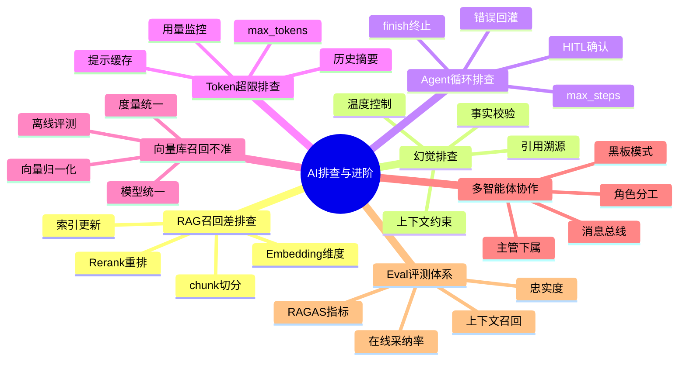

# 🤖 AI 工程化排查与进阶手册（优化版）

> 本手册补齐「维度三：AI 排查」与「维度四：AI 进阶」两块缺口——把 AI 应用上线后最常见的「召回差/幻觉/Agent 死循环/Token 超限/向量不准」做成可操作的排查手册，并扩展多智能体协作与评测(Eval)体系。
> **格式标准**：场景 → 现象/根因/修复 → 要点（💡 + 📝 + 🔍）→ 全文总结。

---

## 🗺️ 知识体系总览

<div style="background:linear-gradient(135deg,#667eea,#764ba2);border-radius:16px;padding:20px;margin:16px 0;font-family:-apple-system,'Segoe UI','PingFang SC','Microsoft YaHei',sans-serif;color:#fff;overflow:hidden;box-shadow:0 8px 28px rgba(0,0,0,.14),0 3px 10px rgba(0,0,0,.08)">
<style>@keyframes highlight{0%,100%{box-shadow:0 0 0 rgba(255,255,255,0)}50%{box-shadow:0 0 20px rgba(255,255,255,.4)}}.hl-box{background:rgba(255,255,255,.2);border-radius:10px;padding:14px 18px;margin:10px 0;animation:highlight 3s ease-in-out infinite;border-left:4px solid rgba(255,255,255,.6)}.hl-formula{font-family:monospace;font-size:14px;text-align:center;background:rgba(0,0,0,.15);border-radius:8px;padding:12px;margin:10px 0}</style>
<div style="text-align:center;font-size:15px;font-weight:700;margin-bottom:14px;padding-bottom:10px;border-bottom:1.5px solid rgba(255,255,255,.22);letter-spacing:1px;text-shadow:0 1px 3px rgba(0,0,0,.12)">📌 🤖 AI 工程化排查与进阶手册（优化版）</div>
<div class="hl-box">🤖 AI 工程化排查与进阶手册（优化版） 是 AI 工程化体系中的重要知识点，涵盖核心概念、技术原理与实践方法。</div>
<div class="hl-formula">标准化 → 模块化 → 自动化 → 可观测 → 持续优化</div>
<div style="font-size:13px;opacity:.9;margin-top:8px">💡 工程化思维是从 Demo 到生产系统的关键跨越</div>
</div>

> 🔍 **知识点深度解析**
>
> **作用**：🤖 AI 工程化排查与进阶手册（优化版） 是 AI 工程化体系中的关键环节，解决从模型能力到生产应用的转化问题，适用于构建稳定、可扩展、可维护的 AI 应用系统。
>
> **原理**：通过标准化的工程方法论和工具链，将大模型的能力封装为可复用的组件，结合最佳实践和质量保障机制，实现 AI 应用的高效开发和可靠运行。
>
> **用法要点**：① 遵循标准化的开发流程和规范 ② 选择合适的工具和框架提升效率 ③ 建立完善的测试和监控机制 ④ 持续优化性能和成本



---

## 目录

1. RAG 召回差排查
2. 幻觉(Hallucination)排查
3. Agent 循环调用排查
4. Token 超限排查
5. 向量库召回不准排查
6. 多智能体协作（进阶）
7. Eval 评测体系（进阶）

---

## 一、RAG 召回差排查

### 1.1 现象 → 根因 → 修复
| 现象 | 根因 | 修复 |
|------|------|------|
| 答非所问 | chunk 过大/过碎 | 按语义切分 + 重叠 10% |
| 漏召回 |  Embedding 维度低 | 换 bge-large/m3e |
| 排序错 | 无 rerank | 加 Cross-Encoder rerank |
| 时效差 | 索引未更新 | 增量建库 + 版本标记 |

### 1.2 排查步骤
```python
# 1) 先脱离生成，单独测检索
hits = vector_db.search(query_embed, top_k=5)
for h in hits: print(h.score, h.text[:80])   # 看 top-k 是否相关
# 2) 调 chunk 大小与 overlap 重测
# 3) 加 rerank 再看 top-1 相关性
```

> 💡 **深度讲解**：RAG 质量 =「检索召回」×「生成遵徇」。多数「答错」其实病在检索——先验证 top-k 文本是否含答案，再怀疑模型。
> 📝 **精简总结**：问题先归到「检索」还是「生成」；检索用 chunk+rerank 双保险；建库前清洗与切片策略决定上限。
🔍 **知识点深度解析**：作用=定位 RAG 失效层；原理=召回率决定生成上限；要点=检索可观测、可单测。

---

## 二、幻觉排查

### 2.1 现象 → 根因 → 修复
| 现象 | 根因 | 修复 |
|------|------|------|
| 编造引用 | 上下文无依据仍生成 | 强制「无依据说不知道」 |
| 张冠李戴 | 多文档混淆 | 引用溯源 + 显式标注来源 |
| 过度延展 | temperature 过高 | 降 temp + 加输出约束 |

### 2.2 修复模板
```text
SYSTEM = """只依据 <context> 回答；若 context 不含答案，回复「知识库未覆盖」。
每条事实后附 [docId] 溯源。"""
```
## 生成时把检索片段拼接进 context，并 prompt 约束

> 💡 **深度讲解**：幻觉本质是「模型按语言先验补全」压过了「依据上下文」。用「上下文约束 + 溯源 + 拒答」三角度压制；RAG 比纯微调更可控。
> 📝 **精简总结**：上下文约束 + 溯源标注 + 拒答兜底；降温度；关键场景加事实校验器。
🔍 **知识点深度解析**：作用=提升可信度；原理=解码偏好 vs 证据；要点=可溯源 + 可验证。

---

## 三、Agent 循环调用排查

### 3.1 现象 → 根因 → 修复
| 现象 | 根因 | 修复 |
|------|------|------|
| 反复调同工具 | 无终止条件 | 设 max_steps + 明确 finish |
| 工具报错重试死 | 错误未消化 | 把错误回灌 + 限重试 |
| 目标漂移 | 计划缺反思 | ReAct + 自我反思 |

### 3.2 代码护栏
```yaml
max_steps = 8
for step in range(max_steps):
    action = planner(ctx)
    if action.is_final: break
    try:
        obs = tool.run(action)
    except Exception as e:
        obs = f"工具失败: {e}"; retries += 1
        if retries > 3: break
    ctx.append(obs)
```

> 💡 **深度讲解**：Agent 失控循环源于「没有显式停止信号」+「错误被吞掉继续空转」。护栏 = 步数上限 + 重试上限 + 把错误作为观察回灌。
> 📝 **精简总结**：永远设 max_steps；工具错误回灌上下文而非忽略；用 finish 动作显式结束；关键动作加 Human-in-the-loop。
🔍 **知识点深度解析**：作用=可控可控的自主代理；原理=ReAct 循环；要点=护栏与可观测。

---

## 四、Token 超限排查

### 4.1 现象 → 根因 → 修复
| 现象 | 根因 | 修复 |
|------|------|------|
| 413 请求过大 | 上下文超模型窗口 | 截断/摘要历史 |
| 输出被切 | max_tokens 小 | 提高或流式续写 |
| 费用暴涨 | 冗余系统提示 | 提示缓存 + 精简 |

### 4.2 处理
## 历史超长则摘要压缩
```text
if len(tokens(history)) > 6000:
    history = [summarize(history)] + history[-2:]
```
## 用 prompt caching 降重复系统提示成本

> 💡 **深度讲解**：Token = 钱 + 延迟。长对话用「滚动摘要 + 保留最近轮」控窗口；厂商的 prompt cache 对稳定系统提示大幅降本。
> 📝 **精简总结**：窗口超限先压缩历史；稳定提示走缓存；输出设合理 max_tokens；监控 token 用量报表。
🔍 **知识点深度解析**：作用=控成本与稳定性；原理=上下文窗口硬限制；要点=摘要 + 缓存。

---

## 五、向量库召回不准排查

### 5.1 现象 → 根因 → 修复
| 现象 | 根因 | 修复 |
|------|------|------|
| 近义不召回 | 归一化缺失 | 向量 L2 归一化 |
| 维度不匹配 | query/doc 用不同模型 | 统一 Embedding |
| 距离异常 | 用错度量 | 余弦距离统一 |

### 5.2 要点
> 💡 **深度讲解**：召回不准常是「query 与 doc 用了不同 Embedding 模型」或「未归一化导致内积≠余弦」。统一模型 + 归一化是底线。
> 📝 **精简总结**：query/doc 同模型；向量归一化；度量统一余弦；定期重算索引质量。
🔍 **知识点深度解析**：作用=检索正确性；原理=向量空间一致性；要点=离线评测 recall@k。

---

## 六、多智能体协作（进阶）

### 6.1 概述
单 Agent 易超窗口、易漂移；多智能体按「角色分工 + 消息总线」协作，适合复杂任务（调研/编码/评审）。

### 6.2 模式
```text
Supervisor(调度) ──> Researcher(检索)
                  ──> Coder(写码)
                  ──> Reviewer(评审) ──> 反馈给 Coder
                汇总 ──> 最终答案
```

| 模式 | 适用 | 注意 |
|------|------|------|
| 流水线 | 线性可拆 | 单点慢则整体慢 |
| 主管-下属 | 需调度 | 主管易成瓶颈 |
| 黑板 | 弱耦合 | 一致性难保 |

> 💡 **深度讲解**：多智能体把「一个超长上下文」拆成「多个短上下文 + 显式交接」，缓解窗口与漂移；代价是协调开销与一致性。
> 📝 **精简总结**：按角色拆 Agent；用消息/共享状态交接；设协调者与终止；每 Agent 短板要护栏。
🔍 **知识点深度解析**：作用=复杂任务分解；原理=分治 + 通信；要点=接口契约 + 可观测。

---

## 七、Eval 评测体系（进阶）

### 7.1 概述
没有评测就没有迭代依据。AI 应用需「离线指标(RAGAS/准确率) + 在线指标(采纳率/满意度)」双轨。

### 7.2 维度
| 维度 | 指标 | 工具 |
|------|------|------|
| 忠实度 | 答案是否贴合上下文 | RAGAS Faithfulness |
| 相关性 | 是否回答所问 | RAGAS Answer Relevancy |
| 上下文召回 | 检索是否有答案 | Context Recall |
| 在线 | 采纳率/耗时 | 业务埋点 |

> 💡 **深度讲解**：Eval 是 AI 工程的「单元测试」。每次改 chunk/rerank/提示后跑回归集，看指标升降，避免「凭感觉调参」。
> 📝 **精简总结**：建固定评测集(≥50 条)；RAGAS 跑离线三指标；线上埋点看采纳；改动必过 Eval 门禁。
🔍 **知识点深度解析**：作用=可量化迭代；原理=参考标准比对；要点=集稳定 + 指标对齐业务。

---

## 📎 原子笔记纵向下钻

> 以下为 `10-四级知识框架` 中对应的 AI 工程化原子笔记，按本篇排查 / 进阶章节归类。

### 一、RAG 召回差排查
- [[RAG架构设计与流程|RAG 架构设计与流程]]
- [[高级RAG-Hybrid检索与重排序|高级 RAG Hybrid 检索与重排序]]
- [[文本分块策略对比|文本分块策略对比]]
- [[GraphRAG知识图谱增强|GraphRAG 知识图谱增强]]
- [[RAG文本分块策略与实践|RAG 文本分块策略与实践]]
- [[GraphRAG知识图谱增强检索|GraphRAG 知识图谱增强检索]]

### 二、幻觉排查
- [[大模型训练范式-PT-SFT-RLHF|大模型训练范式 PT-SFT-RLHF]]
- [[主流开源模型架构对比|主流开源模型架构对比]]
- [[主流大模型对比与选型|主流大模型对比与选型]]
- [[提示词工程方法论|提示词工程方法论]]

### 三、Agent 循环调用排查
- [[自研Agent框架设计|自研 Agent 框架设计]]
- [[FunctionCalling工具生态|FunctionCalling 工具生态]]
- [[LangGraph-状态机Agent|LangGraph 状态机 Agent]]
- [[AutoGen-多Agent框架|AutoGen 多 Agent 框架]]
- [[Agent核心概念-ReAct规划|Agent 核心概念 ReAct 规划]]
- [[Agent工具调用FunctionCalling|Agent 工具调用 FunctionCalling]]
- [[多Agent协作模式|多 Agent 协作模式]]
- [[多Agent协作模式实现|多 Agent 协作模式实现（Java）]]
- [[LangChain4j-Agent与RAG实现|LangChain4j Agent 与 RAG 实现]]

### 四、Token 超限排查
- [[成本控制与Token计费|成本控制与 Token 计费]]
- [[AI成本控制与Token计费优化|AI 成本控制与 Token 计费优化]]
- [[Tokenization与词表|Tokenization 与词表]]

### 五、向量库召回不准排查
- [[Embedding模型选型|Embedding 模型选型]]
- [[向量库选型对比表|向量库选型对比表]]
- [[向量检索算法-HNSW-IVF|向量检索算法 HNSW-IVF]]
- [[Chroma-轻量向量库|Chroma 轻量向量库]]
- [[Milvus-架构与部署|Milvus 架构与部署]]
- [[Qdrant-高性能向量检索|Qdrant 高性能向量检索]]
- [[PgVector-PostgreSQL向量扩展|PgVector PostgreSQL 向量扩展]]
- [[Java-向量数据库客户端|Java 向量数据库客户端]]

### 六、多智能体协作（进阶）
- [[LangGraph-状态机Agent|LangGraph 状态机 Agent]]
- [[AutoGen-多Agent框架|AutoGen 多 Agent 框架]]
- [[Dify-低代码AI应用平台|Dify 低代码 AI 应用平台]]
- [[Coze-工作流编排|Coze 工作流编排]]
- [[LlamaIndex-数据框架|LlamaIndex 数据框架]]
- [[多Agent协作模式|多 Agent 协作模式]]
- [[Agent评测与可观测性|Agent 评测与可观测性]]
- [[AI工作流编排引擎设计|AI 工作流编排引擎设计]]

### 七、Eval 评测体系（进阶）
- [[RAG评估指标与方法|RAG 评估指标与方法]]
- [[AI应用可观测性-Langfuse|AI 应用可观测性 Langfuse]]
- [[AI应用可观测性与Langfuse集成|AI 应用可观测性与 Langfuse 集成]]
- [[AI应用测试与LLM输出评估|AI 应用测试与 LLM 输出评估]]
- [[Agent评测与可观测性|Agent 评测与可观测性]]
- [[Prompt版本管理|Prompt 版本管理]]
- [[Prompt工程与版本管理|Prompt 工程与版本管理]]

### 🗂 相关 MOC
- [[MOC-AI工程化-四级展开|AI 工程化 MOC]]
- [[AI-工程化技术枢纽|AI 工程化技术枢纽]]

## 全文精简总结

AI 工程化的分水岭在「能跑 demo」与「能上线」之间：排查手册把召回/幻觉/循环/超限/向量五大故障变成可操作流程，进阶章把单 Agent 推向多智能体与评测闭环。本手册与「09-AI工程化知识点完整整合大全」互补——大全讲「怎么搭」，本手册讲「搭完怎么稳、怎么测、怎么扩」。

[[知识库学习适配性评估与优化报告|← 六维度评估报告]] | [[MOC-AI与效率工具|🗂 AI MOC]] | [[Home|🏠 返回首页]]

---

## 🔗 关联笔记

- [[AI工程化知识点完整整合大全_优化版]] — AI工程化知识大全
- [[AI-工程化技术枢纽]] — AI工程化枢纽节点
- [[AI安全与对齐基础]] — AI安全防护基础
- [[成本控制与Token计费]] — Token成本控制

## 📖 前置知识

- [[AI工程化知识点完整整合大全_优化版]]
- [[AI应用开发入门]]

## 🏷️ 相关标签

`#AI工程化` `#RAG` `#Agent` `#LLM` `#效率工具`

---

[[Home|🏠 返回首页]] · [[MOC-AI工程化-四级展开|📚 返回分类]]

