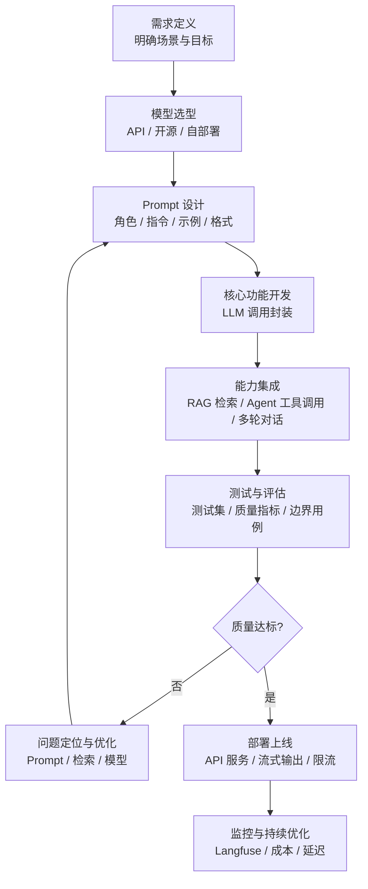

# AI 应用开发入门

> 从零开始构建 AI 应用的完整入门指南：从 LLM API 调用到 RAG 检索增强，从 Prompt 工程到 Agent 开发。

## 概述

<div style="background:linear-gradient(135deg,#667eea,#764ba2);border-radius:16px;padding:20px;margin:16px 0;font-family:-apple-system,'Segoe UI','PingFang SC','Microsoft YaHei',sans-serif;color:#fff;overflow:hidden;box-shadow:0 8px 28px rgba(0,0,0,.14),0 3px 10px rgba(0,0,0,.08)">
<style>@keyframes highlight{0%,100%{box-shadow:0 0 0 rgba(255,255,255,0)}50%{box-shadow:0 0 20px rgba(255,255,255,.4)}}.hl-box{background:rgba(255,255,255,.2);border-radius:10px;padding:14px 18px;margin:10px 0;animation:highlight 3s ease-in-out infinite;border-left:4px solid rgba(255,255,255,.6)}.hl-formula{font-family:monospace;font-size:14px;text-align:center;background:rgba(0,0,0,.15);border-radius:8px;padding:12px;margin:10px 0}</style>
<div style="text-align:center;font-size:15px;font-weight:700;margin-bottom:14px;padding-bottom:10px;border-bottom:1.5px solid rgba(255,255,255,.22);letter-spacing:1px;text-shadow:0 1px 3px rgba(0,0,0,.12)">📌 AI 应用开发入门</div>
<div class="hl-box">AI 应用开发入门 是 AI 工程化体系中的重要知识点，涵盖核心概念、技术原理与实践方法。</div>
<div class="hl-formula">需求定义 → 模型选择 → Prompt设计 → 功能开发 → 测试优化 → 部署上线</div>
<div style="font-size:13px;opacity:.9;margin-top:8px">💡 工程化思维是从 Demo 到生产系统的关键跨越</div>
</div>

> 🔍 **知识点深度解析**
>
> **作用**：AI 应用开发入门 是 AI 工程化体系中的关键环节，解决从模型能力到生产应用的转化问题，适用于构建稳定、可扩展、可维护的 AI 应用系统。
>
> **原理**：通过标准化的工程方法论和工具链，将大模型的能力封装为可复用的组件，结合最佳实践和质量保障机制，实现 AI 应用的高效开发和可靠运行。
>
> **用法要点**：① 遵循标准化的开发流程和规范 ② 选择合适的工具和框架提升效率 ③ 建立完善的测试和监控机制 ④ 持续优化性能和成本

AI 应用开发是指基于大语言模型（LLM）构建智能应用的过程。与传统软件开发不同，AI 应用的核心逻辑由模型驱动，开发者通过 Prompt、上下文、工具调用等方式引导模型完成任务。

**AI 应用的核心能力**：
- 自然语言理解与生成
- 文档问答与知识检索（RAG）
- 内容生成与改写（摘要、翻译、润色）
- 任务自动化（Agent、工作流）
- 代码生成与辅助编程

**技术栈全景**：
```text
应用层：Web应用 / API服务 / 聊天机器人 / 智能客服
框架层：LangChain / LlamaIndex / Spring AI / Dify
能力层：RAG检索 / Agent工具调用 / Prompt管理 / 评估监控
模型层：OpenAI / 通义千问 / 自部署Qwen / vLLM
基础设施：向量数据库 / 对象存储 / 消息队列 / 监控告警
```

## 原理

### AI 应用开发流程



### LLM 调用的基本原理

```text
用户输入 → Prompt组装（系统提示+上下文+用户问题）→ LLM推理 → 输出解析 → 后处理 → 返回用户
```

**关键概念**：
- **System Prompt**：设定模型角色、规则、输出格式
- **Context**：提供给模型的外部信息（RAG检索结果、对话历史）
- **Temperature**：控制随机性（0=确定性，1=创造性）
- **Token**：模型处理文本的基本单位，中文1字≈1-2 token
- **Function Calling**：模型调用外部工具的能力

### RAG（检索增强生成）原理

```text
用户问题 → 查询改写 → 向量检索 → 结果重排 → 上下文组装 → LLM生成 → 带引用的回答
```

RAG 解决了 LLM 的三大问题：
1. **知识过时**：用实时检索的文档替代模型训练数据
2. **幻觉**：回答必须基于检索到的文档，可追溯
3. **领域知识**：企业内部文档不需要微调模型

### Agent（智能体）原理

```text
用户任务 → 规划(Plan) → 选择工具(Tool) → 执行(Act) → 观察(Observe) → 循环直到完成 → 最终回答
```

Agent = LLM + 工具集 + 记忆 + 规划能力。核心是 ReAct 框架：Reasoning（推理）+ Acting（行动）交替进行。

## 实操

### 1. 第一个 LLM 应用（Python）

```python
from openai import OpenAI

client = OpenAI(
    api_key="your-api-key",
    base_url="https://dashscope.aliyuncs.com/compatible-mode/v1"  # 通义千问
)

response = client.chat.completions.create(
    model="qwen-plus",
    messages=[
        {"role": "system", "content": "你是一个专业的技术助手，回答简洁准确。"},
        {"role": "user", "content": "什么是RAG？"}
    ],
    temperature=0.3,
    max_tokens=500
)

print(response.choices[0].message.content)
```

### 2. 简单 RAG 实现

```python
# 安装：pip install langchain langchain-community chromadb sentence-transformers
from langchain.text_splitter import RecursiveCharacterTextSplitter
from langchain.embeddings import HuggingFaceEmbeddings
from langchain.vectorstores import Chroma
from langchain.chat_models import ChatOpenAI
from langchain.chains import RetrievalQA

# 1. 文档加载与分块
documents = [{"text": "RAG（检索增强生成）是一种结合信息检索和大语言模型的技术..."}]
text_splitter = RecursiveCharacterTextSplitter(chunk_size=500, chunk_overlap=50)
chunks = text_splitter.create_documents([d["text"] for d in documents])

# 2. 向量化与存储
embeddings = HuggingFaceEmbeddings(model_name="BAAI/bge-large-zh-v1.5")
vectorstore = Chroma.from_documents(chunks, embeddings, persist_directory="./chroma_db")

# 3. 检索问答
llm = ChatOpenAI(model="qwen-plus", temperature=0.3)
qa_chain = RetrievalQA.from_chain_type(
    llm=llm,
    chain_type="stuff",
    retriever=vectorstore.as_retriever(search_kwargs={"k": 3}),
    return_source_documents=True
)

result = qa_chain("什么是RAG？")
print("回答:", result["result"])
print("来源:", [doc.metadata for doc in result["source_documents"]])
```

### 3. Function Calling 实现工具调用

```json
tools = [
    {
```
        "type": "function",
        "function": {
            "name": "get_weather",
            "description": "获取指定城市的天气",
            "parameters": {
                "type": "object",
                "properties": {
                    "city": {"type": "string", "description": "城市名"}
```json
                },
                "required": ["city"]
            }
        }
    }
]
```

```text
response = client.chat.completions.create(
    model="qwen-plus",
    messages=[{"role": "user", "content": "北京今天天气怎么样？"}],
    tools=tools,
    tool_choice="auto"
```
)

## 模型决定调用工具
```text
if response.choices[0].message.tool_calls:
    tool_call = response.choices[0].message.tool_calls[0]
    city = eval(tool_call.function.arguments)["city"]
    weather = get_weather(city)  # 实际调用天气API
```

```text
    ## # 把工具结果返回给模型
```
```text
    final_response = client.chat.completions.create(
        model="qwen-plus",
        messages=[
```
```json
            {"role": "user", "content": "北京今天天气怎么样？"},
            response.choices[0].message,
            {"role": "tool", "tool_call_id": tool_call.id, "content": weather}
        ]
```
    )
    print(final_response.choices[0].message.content)

### 4. 开发环境搭建

```python
# Python 环境
python -m venv ai-env
source ai-env/bin/activate  # Windows: ai-env\Scripts\activate

# 核心依赖
pip install openai langchain langchain-community chromadb \
    sentence-transformers pypdf python-dotenv fastapi uvicorn

# 项目结构
ai-app/
├── .env                  # API Key 等配置
├── main.py               # 入口
├── config.py             # 配置
├── services/
│   ├── llm.py           # LLM 调用封装
│   ├── rag.py           # RAG 检索
│   └── agent.py         # Agent 逻辑
├── data/
│   ├── documents/       # 原始文档
│   └── vectorstore/     # 向量数据库
└── requirements.txt
```

## 问题

| 问题 | 原因 | 解决方案 |
|------|------|---------|
| 模型回答幻觉 | 没有基于检索结果 / Prompt约束不够 | 用RAG提供上下文 / 强化System Prompt要求引用来源 |
| API调用超时 | 网络问题 / 模型响应慢 | 加超时重试 / 用更快的模型 / 流式输出 |
| 检索结果不相关 | Embedding模型不匹配 / 分块不合理 | 换中文Embedding(bge) / 调整分块大小 / 加Rerank |
| 成本太高 | 调用次数多 / 用了大模型 | 缓存常见问题 / 简单问题用小模型 / 优化Prompt减少Token |
| 长对话上下文溢出 | 对话历史累积超过模型上下文限制 | 对话历史截断 / 用摘要替代早期对话 / 用长上下文模型 |
| Function Calling不生效 | 工具描述不清晰 / 模型不支持 | 优化工具描述和参数说明 / 用支持Function Calling的模型 |
| 流式输出中断 | 网络不稳定 / 服务端断开 | 加重连机制 / 前端处理中断重连 |

## 拓展

**学习路径**：
1. **入门**：LLM API调用 + Prompt基础 → 1周
2. **进阶**：RAG检索 + 文档处理 + 向量数据库 → 2周
3. **高级**：Agent开发 + Function Calling + 多轮对话 → 2周
4. **专家**：模型微调 + 评估体系 + 生产部署 + 性能优化 → 持续

**推荐框架**：
- **LangChain**：最流行的LLM应用框架，生态丰富
- **LlamaIndex**：专注RAG，检索能力强
- **Dify**：低代码AI应用开发平台，可视化编排
- **Spring AI**：Java生态的AI应用框架
- **AutoGen**：微软的多Agent协作框架

**推荐资源**：
- [[大模型应用开发实战]]
- [[Prompt工程进阶]]
- [[RAG架构设计与流程]]
- [[AI Agent开发框架知识点系统梳理_优化版]]
- [[Embedding模型与向量化]]
- [[Langfuse部署与使用]]（监控评估）

**实战项目建议**：
1. 个人知识库问答（RAG入门）
2. 智能客服机器人（多轮对话+知识库）
3. AI代码审查工具（Agent+工具调用）
4. 文档摘要生成器（内容生成）
5. 自动化数据分析助手（Agent+数据工具）

---

[[MOC-AI与效率工具|← 返回板块 MOC]] | [[知识库仪表盘|📊 仪表盘]] | [[Home|🏠 返回首页]]

---


---

> 💡 **深度讲解**：本文系统梳理了AI 应用开发入门 的核心知识体系，从基础概念到进阶实践，覆盖了关键技术点、最佳实践和常见问题。建议读者按照知识体系总览的路径逐步学习，结合实操示例加深理解，并通过关联笔记建立跨领域的知识网络。
>
> **📝 精简总结**：本文涵盖了AI 应用开发入门 的核心概念、技术原理、实践方法和进阶技巧，是该领域知识体系的系统性梳理，适合作为学习路线图和复习参考。

## 🔗 关联笔记

- [[大模型应用开发实战]] — 大模型应用实战
- [[AI-API调用入门实战]] — API调用实战
- [[RAG架构设计与流程]] — RAG架构
- [[AI-工程化技术枢纽]] — AI工程化枢纽

## 📖 前置知识


## 🏷️ 相关标签

`#AI应用` `#LLM` `#RAG` `#入门` `#效率工具`

---

[[Home|🏠 返回首页]] · [[MOC-AI工程化-四级展开|📚 返回分类]]

