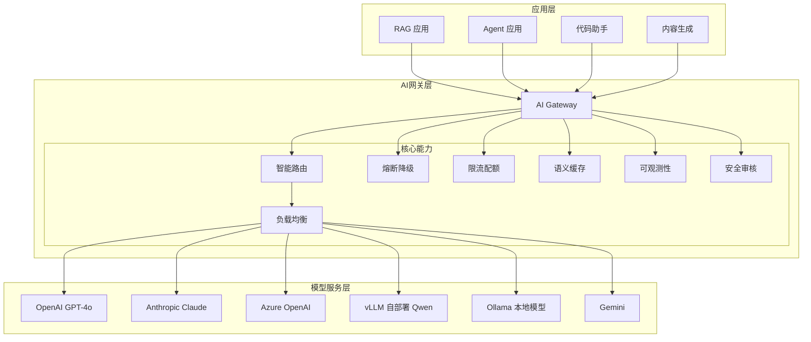
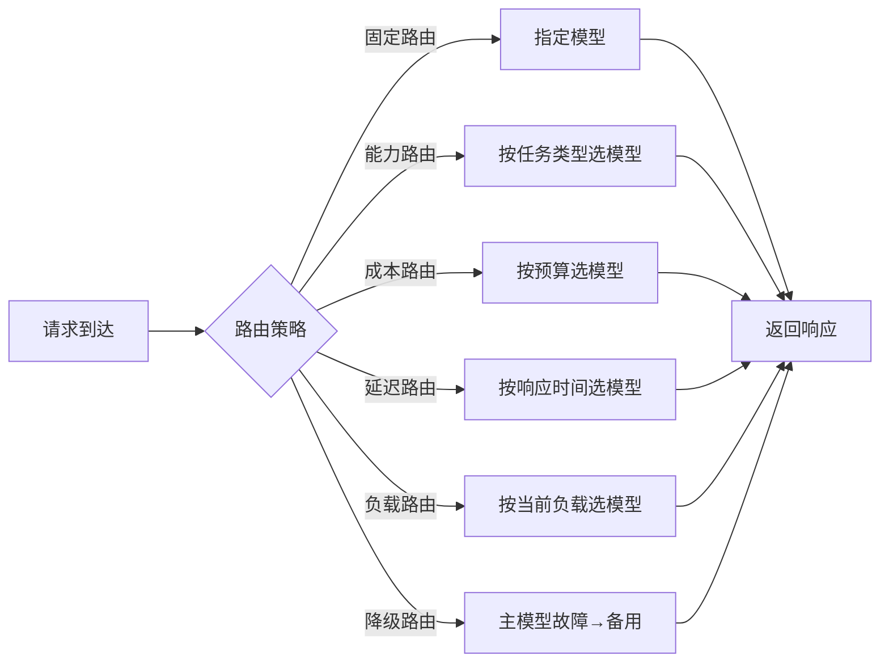
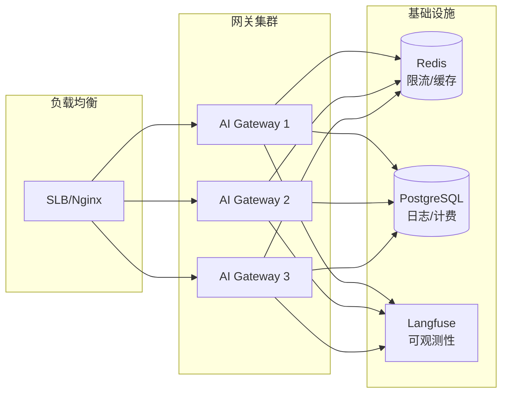

# AI 网关与多模型路由

> **文档说明**：系统讲解 AI 网关的架构设计、多模型路由策略、负载均衡、降级容错、成本优化，以及在生产环境中的部署实践。
>
> **适用人群**：AI 应用架构师、需要管理多模型服务的全栈工程师、MLOps 工程师
>
> **前置知识**：[[LLM接口封装与统一SDK]]、[[Gateway-网关路由与鉴权]]、[[vLLM-高吞吐推理引擎]]

---

## 一、概述

<div style="background:linear-gradient(135deg,#667eea,#764ba2);border-radius:16px;padding:20px;margin:16px 0;font-family:-apple-system,'Segoe UI','PingFang SC','Microsoft YaHei',sans-serif;color:#fff;overflow:hidden;box-shadow:0 8px 28px rgba(0,0,0,.14),0 3px 10px rgba(0,0,0,.08)">
<style>@keyframes highlight{0%,100%{box-shadow:0 0 0 rgba(255,255,255,0)}50%{box-shadow:0 0 20px rgba(255,255,255,.4)}}.hl-box{background:rgba(255,255,255,.2);border-radius:10px;padding:14px 18px;margin:10px 0;animation:highlight 3s ease-in-out infinite;border-left:4px solid rgba(255,255,255,.6)}.hl-formula{font-family:monospace;font-size:14px;text-align:center;background:rgba(0,0,0,.15);border-radius:8px;padding:12px;margin:10px 0}</style>
<div style="text-align:center;font-size:15px;font-weight:700;margin-bottom:14px;padding-bottom:10px;border-bottom:1.5px solid rgba(255,255,255,.22);letter-spacing:1px;text-shadow:0 1px 3px rgba(0,0,0,.12)">📌 AI 网关与多模型路由</div>
<div class="hl-box">系统讲解 AI 网关的架构设计、多模型路由策略、负载均衡、降级容错、成本优化，以及在生产环境中的部署实践。</div>
<div class="hl-formula">请求接入 → 负载均衡 → 模型路由 → 限流熔断 → 监控告警</div>
<div style="font-size:13px;opacity:.9;margin-top:8px">💡 工程化思维是从 Demo 到生产系统的关键跨越</div>
</div>

> 🔍 **知识点深度解析**
>
> **作用**：AI 网关与多模型路由 是 AI 工程化体系中的关键环节，解决从模型能力到生产应用的转化问题，适用于构建稳定、可扩展、可维护的 AI 应用系统。
>
> **原理**：通过标准化的工程方法论和工具链，将大模型的能力封装为可复用的组件，结合最佳实践和质量保障机制，实现 AI 应用的高效开发和可靠运行。
>
> **用法要点**：① 遵循标准化的开发流程和规范 ② 选择合适的工具和框架提升效率 ③ 建立完善的测试和监控机制 ④ 持续优化性能和成本

**AI 网关（AI Gateway）** 是位于 AI 应用与大模型服务之间的统一入口层，负责多模型接入、智能路由、负载均衡、限流熔断、成本控制、日志监控等横切关注点。它使上层应用无需关心底层模型的差异，实现"一次接入，多模型可用"。

### 1. 为什么需要 AI 网关

| 痛点 | 没有 AI 网关 | 有 AI 网关 |
|------|------------|-----------|
| 多模型接入 | 每个模型单独对接，代码重复 | 统一 OpenAI 兼容接口，一次接入 |
| 模型切换 | 改代码、重新部署 | 配置切换，无需改代码 |
| 故障降级 | 单个模型故障 → 整个服务不可用 | 自动降级到备用模型 |
| 成本控制 | 难以统一监控和优化 | 统一计费、预算控制、智能选模型 |
| 限流配额 | 每个模型单独管理 | 统一限流、配额分配 |
| 日志监控 | 分散在各服务 | 统一日志、链路追踪、指标聚合 |
| 安全合规 | 难以统一管控 | 统一鉴权、内容审核、数据脱敏 |

### 2. AI 网关 vs 传统 API 网关

| 维度 | 传统 API 网关 | AI 网关 |
|------|-------------|--------|
| 路由依据 | 路径/方法/头部 | 模型能力/成本/延迟/负载 |
| 负载均衡 | 轮询/权重/一致性哈希 | 按模型能力动态路由 |
| 降级策略 | 服务降级 | 模型降级（大模型→小模型） |
| 计费 | 按调用次数 | 按 Token 计费（输入+输出） |
| 流式响应 | 较少 | 核心能力（SSE/WebSocket） |
| 内容安全 | 一般 | 必须（输入/输出审核） |
| 模型适配 | 无 | 多厂商 API 格式转换 |

### 3. 主流 AI 网关对比

| 网关 | 语言 | 特点 | 适用场景 |
|------|------|------|---------|
| **LiteLLM Proxy** | Python | 100+ 模型统一接口，简单易用 | 快速原型、中小团队 |
| **Portkey** | TypeScript | 企业级，完整可观测性 | 生产环境、企业 |
| **One API** | Go | 开源，渠道管理，计费 | 自建 API 中转 |
| **New API** | Go | One API 增强版，更多模型 | 自建 API 中转 |
| **Kong AI Gateway** | Lua | 基于 Kong，插件生态 | 已有 Kong 基础设施 |
| **自研网关** | 任意 | 完全定制，深度集成 | 大型企业、特殊需求 |

---

---

> 💡 **深度讲解**：本节围绕，深入剖析其技术原理与实践要点，帮助读者建立系统性的认知框架。
>
> **📝 精简总结**：本节介绍了，掌握这些内容是理解整个知识体系的重要基础。

## 二、架构设计

### 1. 整体架构



### 2. 核心模块

| 模块 | 职责 | 关键技术 |
|------|------|---------|
| **模型适配器** | 统一不同厂商 API 格式 | OpenAI 兼容格式转换 |
| **智能路由** | 根据策略选择最优模型 | 规则引擎 / 机器学习 |
| **负载均衡** | 同模型多实例分发 | 轮询/权重/最少连接 |
| **熔断降级** | 故障自动切换备用模型 | 断路器模式 / 降级链 |
| **限流配额** | 控制调用频率和总量 | 令牌桶 / 滑动窗口 |
| **语义缓存** | 相似请求直接返回缓存 | Embedding 相似度匹配 |
| **流式代理** | 透传 SSE 流式响应 | 异步非阻塞 IO |
| **计费统计** | Token 计量和成本分摊 | 精确 Token 计数 |
| **可观测性** | 日志/指标/链路追踪 | OpenTelemetry / Langfuse |
| **安全审核** | 输入输出内容安全 | 敏感词过滤 / 内容审核 API |

---

## 三、多模型路由策略

### 1. 路由策略分类



### 2. 固定路由（最简单）

## 配置文件
routes:
  - name: default
```text
    model: gpt-4o
    fallback: claude-3-5-sonnet
```
  - name: fast-response
```text
    model: gpt-4o-mini
    fallback: qwen2-7b
```

### 3. 能力路由（按任务类型）

```python
# 根据任务类型选择最合适的模型
def route_by_capability(task_type: str, complexity: str) -> str:
    """能力路由：根据任务类型和复杂度选择模型"""
    routing_table = {
        # 代码生成
        ("code_generation", "simple"): "gpt-4o-mini",
        ("code_generation", "complex"): "gpt-4o",
        ("code_generation", "expert"): "claude-3-5-sonnet",
        # 文本摘要
        ("summarization", "simple"): "qwen2-7b",
        ("summarization", "complex"): "gpt-4o-mini",
        # 推理分析
        ("reasoning", "simple"): "gpt-4o-mini",
        ("reasoning", "complex"): "gpt-4o",
        ("reasoning", "expert"): "o1-preview",
        # 多模态
        ("multimodal", "any"): "gpt-4o",
    }
    return routing_table.get((task_type, complexity), "gpt-4o-mini")
```

### 4. 成本路由（智能选模型）

```python
def route_by_cost(budget_per_1k_tokens: float, task_requirements: dict) -> str:
    """成本路由：在满足需求的前提下选择最便宜的模型"""
    # 模型价格表（每 1000 token，输入+输出）
    model_pricing = {
        "gpt-4o": {"input": 0.005, "output": 0.015, "quality": 95},
        "gpt-4o-mini": {"input": 0.00015, "output": 0.0006, "quality": 85},
        "claude-3-5-sonnet": {"input": 0.003, "output": 0.015, "quality": 96},
        "qwen2-72b": {"input": 0.0008, "output": 0.002, "quality": 88},
        "qwen2-7b": {"input": 0.0001, "output": 0.0002, "quality": 75},
    }

    min_quality = task_requirements.get("min_quality", 80)
    candidates = [
        (model, info) for model, info in model_pricing.items()
        if info["quality"] >= min_quality
    ]
    # 选择总成本最低的
    return min(candidates, key=lambda x: x[1]["input"] + x[1]["output"])[0]
```

### 5. 降级路由（故障容错）

```python
# 降级链配置
fallback_chains = {
    "premium": ["gpt-4o", "claude-3-5-sonnet", "gpt-4o-mini", "qwen2-72b"],
    "standard": ["gpt-4o-mini", "claude-3-haiku", "qwen2-72b", "qwen2-7b"],
    "economy": ["qwen2-7b", "qwen2-1.5b", "本地 Ollama"],
}

async def call_with_fallback(messages, chain_name="standard", **kwargs):
    """带降级的模型调用"""
    chain = fallback_chains[chain_name]
    last_error = None

    for model in chain:
        try:
            response = await llm_client.chat.completions.create(
                model=model,
                messages=messages,
                timeout=30,  # 超时快速失败
                **kwargs
            )
            # 记录使用的模型（用于分析降级频率）
            metrics.record_model_usage(model, success=True)
            return response
        except Exception as e:
            last_error = e
            metrics.record_model_failure(model)
            logger.warning(f"模型 {model} 调用失败: {e}，尝试下一个")
            continue

    # 所有模型都失败
    metrics.record_all_failed()
    raise RuntimeError(f"所有模型都不可用，最后错误: {last_error}")
```

### 6. 负载感知路由

```mermaid
class LoadAwareRouter:
    """负载感知路由：选择当前负载最低的模型实例"""

    def __init__(self):
        self.model_loads = {}  # model -> 当前并发请求数
        self.model_latency = {}  # model -> 最近平均延迟

    def select_model(self, candidates: list) -> str:
        """综合负载和延迟选择最优模型"""
        scored = []
        for model in candidates:
            load = self.model_loads.get(model, 0)
            latency = self.model_latency.get(model, 1000)
            # 负载权重 60%，延迟权重 40%
            score = load * 0.6 + (latency / 100) * 0.4
            scored.append((model, score))
        return min(scored, key=lambda x: x[1])[0]

    def update_metrics(self, model: str, latency: float, success: bool):
        """请求完成后更新指标"""
        self.model_loads[model] = max(0, self.model_loads.get(model, 0) - 1)
        if success:
            old = self.model_latency.get(model, latency)
            self.model_latency[model] = old * 0.9 + latency * 0.1  # 滑动平均
```

---

## 四、核心功能实现

### 1. 统一接口适配

```python
# 多厂商 API 统一适配为 OpenAI 格式
from abc import ABC, abstractmethod

class BaseLLMAdapter(ABC):
    @abstractmethod
    async def chat_completions(self, messages, **kwargs) -> dict:
        pass

    @abstractmethod
    async def chat_completions_stream(self, messages, **kwargs):
        pass

class OpenAIAdapter(BaseLLMAdapter):
    def __init__(self, api_key, base_url=None):
        self.client = AsyncOpenAI(api_key=api_key, base_url=base_url)

    async def chat_completions(self, messages, **kwargs):
        resp = await self.client.chat.completions.create(
            messages=messages, **kwargs
        )
        return self._to_standard_format(resp)

    async def chat_completions_stream(self, messages, **kwargs):
        stream = await self.client.chat.completions.create(
            messages=messages, stream=True, **kwargs
        )
        async for chunk in stream:
            yield self._chunk_to_standard_format(chunk)

    def _to_standard_format(self, resp):
        return {
            "id": resp.id,
            "model": resp.model,
            "content": resp.choices[0].message.content,
            "usage": {
                "prompt_tokens": resp.usage.prompt_tokens,
                "completion_tokens": resp.usage.completion_tokens,
                "total_tokens": resp.usage.total_tokens,
            },
        }

# 类似实现 AnthropicAdapter, QwenAdapter, OllamaAdapter 等
```

### 2. 流式响应代理

```python
# AI 网关的流式代理：透传 SSE，同时记录日志和计费
async def stream_proxy(request, model_adapter, request_id):
    """流式响应代理"""
    prompt_tokens = count_tokens(request.messages)
    completion_tokens = 0
    start_time = time.time()

    async def generate():
        nonlocal completion_tokens
        try:
            async for chunk in model_adapter.chat_completions_stream(
                messages=request.messages,
                model=request.model,
                temperature=request.temperature,
                max_tokens=request.max_tokens,
            ):
                completion_tokens += chunk.get("token_count", 0)
                # 透传 SSE 格式
                yield f"data: {json.dumps(chunk)}\n\n"
            yield "data: [DONE]\n\n"
        finally:
            # 请求结束后记录日志和计费
            latency = time.time() - start_time
            await log_request(
                request_id=request_id,
                model=request.model,
                prompt_tokens=prompt_tokens,
                completion_tokens=completion_tokens,
                latency=latency,
            )

    return StreamingResponse(generate(), media_type="text/event-stream")
```

### 3. 语义缓存

```mermaid
# 语义缓存：相似请求直接返回缓存，节省成本和延迟
class SemanticCache:
    def __init__(self, embedder, vector_store, similarity_threshold=0.95):
        self.embedder = embedder
        self.vector_store = vector_store
        self.threshold = similarity_threshold
        self.ttl = 3600  # 缓存1小时

    async def get(self, prompt: str) -> Optional[str]:
        """查找缓存"""
        prompt_vec = await self.embedder.embed(prompt)
        results = await self.vector_store.search(prompt_vec, k=1)
        if results and results[0].score >= self.threshold:
            # 检查是否过期
            if not self.is_expired(results[0].metadata):
                return results[0].content
        return None

    async def set(self, prompt: str, response: str, metadata: dict):
        """写入缓存"""
        prompt_vec = await self.embedder.embed(prompt)
        metadata["cached_at"] = time.time()
        await self.vector_store.upsert(prompt_vec, response, metadata)

# 使用
cache = SemanticCache(embedder, vector_store)

async def handle_request(request):
    cached = await cache.get(request.prompt)
    if cached:
        metrics.record_cache_hit()
        return cached  # 直接返回缓存，延迟 < 10ms

    response = await llm_client.call(request)
    await cache.set(request.prompt, response, {"model": request.model})
    return response
```

### 4. 限流与配额

```mermaid
# 基于 Token 的限流（AI 网关特有）
class TokenRateLimiter:
    def __init__(self, redis_client):
        self.redis = redis_client

    async def check_and_consume(self, api_key: str, estimated_tokens: int):
        """检查并消耗 Token 配额"""
        # 每分钟限额
        minute_key = f"rate:{api_key}:minute:{int(time.time() // 60)}"
        minute_limit = await self.get_limit(api_key, "minute")
        current = await self.redis.get(minute_key) or 0

        if int(current) + estimated_tokens > minute_limit:
            raise RateLimitError(f"每分钟 Token 限额 {minute_limit} 已用尽")

        # 每日限额
        day_key = f"rate:{api_key}:day:{datetime.now().strftime('%Y%m%d')}"
        day_limit = await self.get_limit(api_key, "day")
        day_current = await self.redis.get(day_key) or 0

        if int(day_current) + estimated_tokens > day_limit:
            raise QuotaExceededError(f"每日 Token 配额 {day_limit} 已用尽")

        # 消耗配额
        pipe = self.redis.pipeline()
        pipe.incrby(minute_key, estimated_tokens)
        pipe.expire(minute_key, 120)
        pipe.incrby(day_key, estimated_tokens)
        pipe.expire(day_key, 86400 * 2)
        await pipe.execute()
```

---

## 五、成本优化

### 1. 成本优化策略

| 策略 | 原理 | 节省比例 |
|------|------|---------|
| **模型分级** | 简单任务用小模型，复杂任务用大模型 | 30-70% |
| **语义缓存** | 相似请求返回缓存 | 10-50%（取决于重复率） |
| **输出压缩** | 要求模型简洁输出，减少输出 Token | 20-40% |
| **上下文裁剪** | 移除冗余上下文，减少输入 Token | 10-30% |
| **批量处理** | 合并多个请求批量调用 | 10-20% |
| **自部署模型** | 高频任务用自部署开源模型 | 50-90%（量大时） |
| **降级策略** | 非关键路径用便宜模型 | 20-50% |

### 2. 成本监控仪表盘

```python
# 成本统计与分析
class CostAnalyzer:
    def get_daily_cost(self, date: str) -> dict:
        """按模型、应用、用户维度统计成本"""
        records = self.db.query(
            "SELECT model, app_id, user_id, SUM(prompt_tokens) as prompt_tokens, "
            "SUM(completion_tokens) as completion_tokens, COUNT(*) as calls "
            "FROM request_logs WHERE date = ? GROUP BY model, app_id, user_id",
            date
        )
        result = {"total": 0, "by_model": {}, "by_app": {}}
        for r in records:
            cost = self.calculate_cost(r["model"], r["prompt_tokens"], r["completion_tokens"])
            result["total"] += cost
            result["by_model"][r["model"]] = result["by_model"].get(r["model"], 0) + cost
            result["by_app"][r["app_id"]] = result["by_app"].get(r["app_id"], 0) + cost
        return result

    def calculate_cost(self, model: str, prompt_tokens: int, completion_tokens: int) -> float:
        """计算单次调用成本"""
        pricing = MODEL_PRICING.get(model, {"input": 0.005, "output": 0.015})
        return (prompt_tokens / 1000 * pricing["input"] +
                completion_tokens / 1000 * pricing["output"])
```

---

## 六、部署与运维

### 1. 部署架构



### 2. 关键配置

```yaml
# AI 网关配置示例
server:
  port: 8080
  workers: 4

models:
  - name: gpt-4o
    provider: openai
    api_key: ${OPENAI_API_KEY}
    base_url: https://api.openai.com/v1
    max_concurrent: 50
    timeout: 60

  - name: qwen2-72b
    provider: vllm
    base_url: http://vllm-internal:8000/v1
    max_concurrent: 100
    timeout: 120

routing:
  default_chain: standard
  chains:
    premium: [gpt-4o, claude-3-5-sonnet, gpt-4o-mini]
    standard: [gpt-4o-mini, qwen2-72b, qwen2-7b]
    economy: [qwen2-7b, qwen2-1.5b]

rate_limit:
  enabled: true
  default_per_minute: 100000  # tokens/min
  default_per_day: 10000000    # tokens/day

cache:
  enabled: true
  similarity_threshold: 0.95
  ttl: 3600

observability:
  langfuse:
    enabled: true
    public_key: ${LANGFUSE_PUBLIC_KEY}
    secret_key: ${LANGFUSE_SECRET_KEY}
```

### 3. 常见问题排查

| 问题 | 原因 | 解决方案 |
|------|------|---------|
| 网关延迟高 | 模型响应慢 / 网关处理瓶颈 | 检查模型 P99 延迟，增加网关实例 |
| 频繁降级 | 主模型不稳定 / 配额不足 | 增加备用模型，检查 API Key 配额 |
| Token 计数不准 | 不同模型分词器差异 | 使用模型对应分词器精确计数 |
| 流式中断 | 网络不稳定 / 超时 | 增加超时时间，实现断线重连 |
| 缓存命中率低 | 相似度阈值太高 / 请求差异大 | 降低阈值，优化缓存键 |
| 成本超预算 | 大模型使用过多 / 输出过长 | 启用模型分级，限制 max_tokens |

---

## 七、关联笔记

### AI 工程化
- [[LLM接口封装与统一SDK]] · [[提示词工程方法论]] · [[vLLM-高吞吐推理引擎]]
- [[AI应用可观测性-Langfuse]] · [[成本控制与Token计费]] · [[RAG架构设计与流程]]
- [[Agent核心概念-ReAct规划]] · [[统一AI网关设计与实现]]

### 后端
- [[Gateway-网关路由与鉴权]] · [[Nginx-反向代理与负载均衡]]
- [[Redis-分布式锁与缓存穿透]] · [[高并发系统设计案例]]

### 云原生
- [[K8s-核心概念与架构]] · [[K8s-Ingress与服务暴露]] · [[Prometheus监控体系]]

### 实战
- [[统一AI网关设计与实现]] · [[实战-RAG企业知识库问答系统]]

### 导航
- [[MOC-AI工程化]] · [[全栈+AI工程双轨融合学习路线图]]

> **学习路径建议**：先掌握 [[LLM接口封装与统一SDK]] 基础调用 → 理解本文 AI 网关架构 → 学习 [[vLLM-高吞吐推理引擎]] 模型部署 → 实践 [[统一AI网关设计与实现]] 自建网关 → 研究 [[AI应用可观测性-Langfuse]] 监控运维。

---

## 📖 前置知识

- [[LLM接口封装与统一SDK]]
- [[AI应用开发入门]]

## 🏷️ 相关标签

`#AI工程化` `#LLM` `#架构设计` `#效率工具`

---

[[Home|🏠 返回首页]] · [[MOC-AI工程化-四级展开|📚 返回分类]]

