---
title: LangSmith 可观测性与调试平台
tags: [LangSmith, 可观测性, Tracing, 评估调试, AI工程化]
category: AI与效率工具
created: 2026-09-09
updated: 2026-09-09
difficulty: ⭐⭐⭐
status: ✅ 内容已完善
priority: 核心
pre: ["[[LangChain-LCEL表达式语言详解]]", "[[LangChain-核心抽象与链]]", "[[AI应用可观测性-Langfuse]]"]
aliases: [LangSmith, LLM可观测性, LLM评估, LLM tracing]
---

# LangSmith 可观测性与调试平台

> **一句话定义**：LangSmith 是 LangChain 官方推出的 LLM 应用可观测与评估平台，通过 Tracing（追踪）、Dataset（数据集）、Evaluation（评估）、Prompt Hub 四大核心能力，把"黑盒"的大模型应用变成可观测、可调试、可量化、可回归的工程系统。
>
> **核心价值**：LLM 应用最大的痛点是"出了问题不知道错在哪"——是检索没搜到？还是模型没答对？LangSmith 用一棵可视化的执行树把每次调用拆成一个个 Span，让你看清每一步的输入、输出、耗时、Token、成本；再用数据集+评估器把"回答好不好"从"靠感觉"变成"看指标"。
>
> **适用场景**：RAG 系统调试、Prompt 迭代评估、模型 A/B 对比、生产链路监控、回归测试、团队协作调试。

---

## 一、概述：为什么 LLM 应用需要可观测性

### 1.1 传统可观测性 vs LLM 可观测性

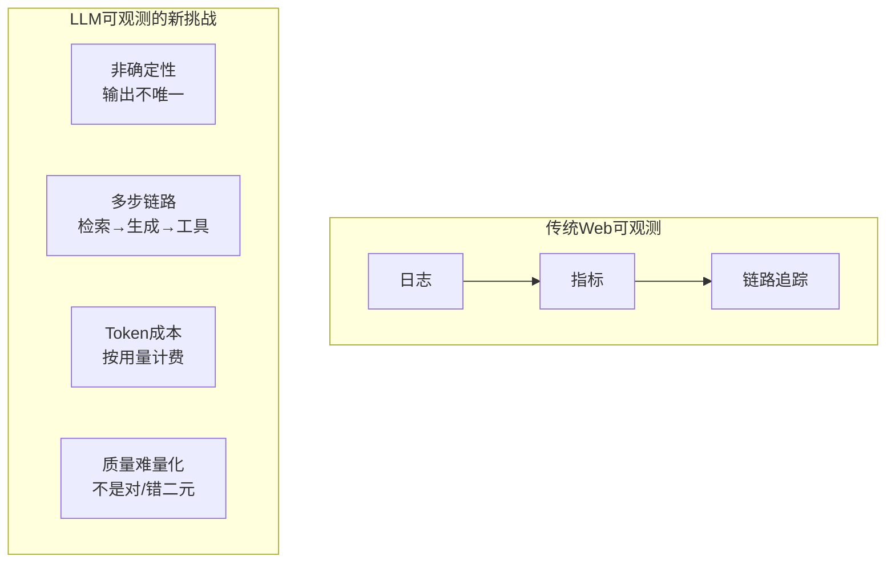

| 维度 | 传统 Web | LLM 应用 |
|------|----------|----------|
| 输出 | 确定性 | 非确定性 |
| 链路 | 固定 | 多步/条件/循环 |
| 成本 | 服务器固定 | 按 Token 计费 |
| 质量 | 200/500 | 语义好/坏 |
| 调试 | 打日志 | 看执行树 |

### 1.2 LangSmith 四大核心能力

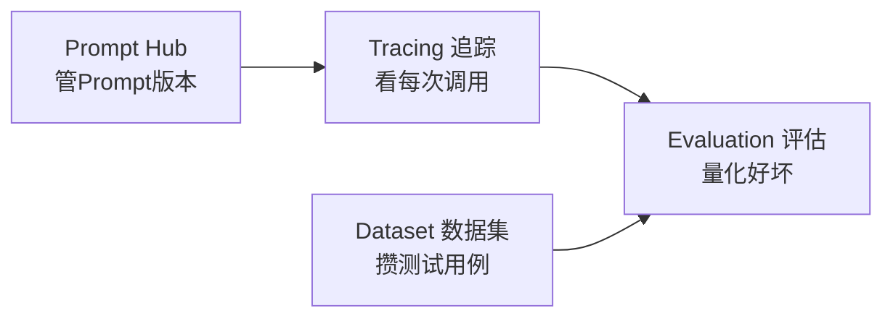

| 能力 | 解决的问题 | 比喻 |
|------|-----------|------|
| **Tracing** | 一次调用内部发生了什么 | 飞机黑匣子 |
| **Dataset** | 攒一批代表性测试用例 | 题库 |
| **Evaluation** | 自动判断输出好不好 | 阅卷老师 |
| **Prompt Hub** | Prompt 的版本管理与A/B | 剧本管理 |

> **通俗比喻**：LangSmith 就像给你的 LLM 应用装了一个"行车记录仪 + 体检中心"。行车记录仪（Tracing）记录每次行程的每个细节；体检中心（Evaluation）定期给系统做全面检查；题库（Dataset）是体检用的标准题目；剧本管理（Prompt Hub）是保养手册的版本控制。

### 1.3 LangSmith 在 LangChain 生态的位置

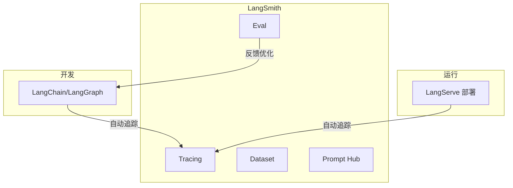

> 🔍 **知识点深度解析**
>
> **作用**：LangSmith 把 LLM 应用从"不可测的黑盒"变成"可观测的工程系统"。
>
> **原理**：LangSmith 通过回调（Callback）机制，在 LangChain 执行链的每个节点（LLM 调用、工具调用、链开始结束）自动捕获输入、输出、耗时、Token，上报到 LangSmith 云端，渲染成一棵可交互的执行树。评估则是把数据集跑一遍链，再用评估器（可以是 LLM）给输出打分。
>
> **用法要点**：① 设三个环境变量即开自动追踪；② 先看一次完整 Trace 理解结构；③ 攒 Dataset 跑 Evaluation；④ Prompt 迭代走 Hub；⑤ 生产开 tracing 但注意隐私脱敏。

---

> 💡 **深度讲解**：为什么 LLM 应用需要专门的可观测工具，而不是用传统的 APM（如 Datadog）？因为 LLM 应用的"业务逻辑"就是 LLM 调用本身——你需要看的不是"接口返回了 200"，而是"模型这次说了什么、为什么这么说、花了多少 Token、哪一步慢了"。传统 APM 只看到一个 HTTP 请求打到 OpenAI，看不到内部 Prompt 填了什么、检索到了什么文档、工具调了几次。LangSmith 就是为这种"业务即模型调用"的场景设计的。另一个关键点是"评估"——传统软件测试是断言等于预期，LLM 输出非确定性，不能断言字符串相等，需要用 LLM-as-judge 这种"语义级"的评估。这是 LangSmith 区别于传统日志系统的核心价值。
>
> **📝 精简总结**：LLM 可观测的新挑战是非确定性、多步链路、Token 成本、质量难量化；LangSmith 四大能力——Tracing（看每次调用的执行树）、Dataset（攒测试用例）、Evaluation（LLM-as-judge 量化质量）、Prompt Hub（Prompt 版本管理）；三个环境变量开自动追踪；LangChain/LangServe 原生集成。

---

## 二、注册、配置与 API Key

### 2.1 注册与获取 API Key

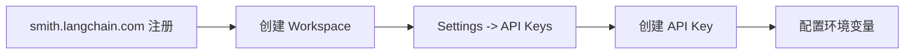

**步骤**：
1. 访问 smith.langchain.com 注册账号
2. 创建 Organization 和 Workspace
3. 进入 Settings → API Keys → Create API Key
4. 复制 `lsv2_...` 开头的 Key

### 2.2 环境变量配置

```python
# 方式一：代码里设置（不推荐生产）
import os
os.environ["LANGSMITH_TRACING"] = "true"
os.environ["LANGSMITH_API_KEY"] = "lsv2_..."
os.environ["LANGSMITH_PROJECT"] = "my-rag-project"
```

```bash
# 方式二：.env 文件（推荐）
LANGSMITH_TRACING=true
LANGSMITH_API_KEY=lsv2_...
LANGSMITH_PROJECT=my-rag-project
LANGSMITH_ENDPOINT=https://api.smith.langchain.com
```

```python
# 方式三：用 python-dotenv 加载
from dotenv import load_dotenv
load_dotenv()   # 自动读 .env
# 之后所有 LangChain 调用自动追踪
```

### 2.3 项目（Project）设置

| 概念 | 说明 | 比喻 |
|------|------|------|
| **Workspace** | 工作区，团队隔离 | 公司 |
| **Project** | 项目，追踪分组 | 部门 |
| **Trace** | 一次完整调用 | 一次任务 |
| **Session** | 相关 trace 分组 | 一个项目的一组任务 |

```python
# 按环境分项目
import os
os.environ["LANGSMITH_PROJECT"] = "production"   # 生产
# 开发时用 "development"，避免污染生产数据
```

### 2.4 验证配置是否生效

```python
from langchain_openai import ChatOpenAI

llm = ChatOpenAI(model="gpt-4o-mini")
resp = llm.invoke("hello")
print(resp.content)
# 去 LangSmith 网页的 Project 里，应该能看到这次调用的 Trace
```

```python
# 用 SDK 主动确认连接
from langsmith import Client
client = Client()
print("连接成功，组织:", client.read_organization().id)
```

### 2.5 常见配置坑点

- **坑1**：设了环境变量但 Trace 没出现
  - 原因：`LANGSMITH_TRACING` 没设成字符串 `"true"`，或在导入 langchain 之后才设
  - 修复：**在 import 任何 langchain 包之前**设环境变量

```python
# 正确顺序：先设环境变量，再 import langchain
import os
os.environ["LANGSMITH_TRACING"] = "true"
os.environ["LANGSMITH_API_KEY"] = "lsv2_..."
# 然后才 import
from langchain_openai import ChatOpenAI
```

- **坑2**：Key 无效 `401 Unauthorized`
  - 原因：Key 复制错或过期
  - 修复：重新生成 Key

---

> 💡 **深度讲解**：配置 LangSmith 看似简单，但"环境变量必须在 import 之前设置"这个坑坑过无数人。因为 LangChain 在 import 时就读取环境变量初始化全局客户端，之后再改环境变量不生效。所以最佳实践是把环境变量加载放在程序最顶部，或用 `.env` + `load_dotenv()` 在最开头。项目分（Project）也很重要——不要把开发调试的 trace 和生产 trace 混在一个项目里，否则生产监控会被开发噪声淹没。建议按环境分项目：`dev`、`staging`、`prod`。
>
> **📝 精简总结**：注册拿 lsv2_ Key，设三个环境变量（TRACING=true、API_KEY、PROJECT）；环境变量必须在 import langchain 之前设；按环境分 Project（dev/staging/prod）；SDK Client 主动验证连接。

---

## 三、Tracing 追踪

### 3.1 追踪的层级结构：Trace / Span

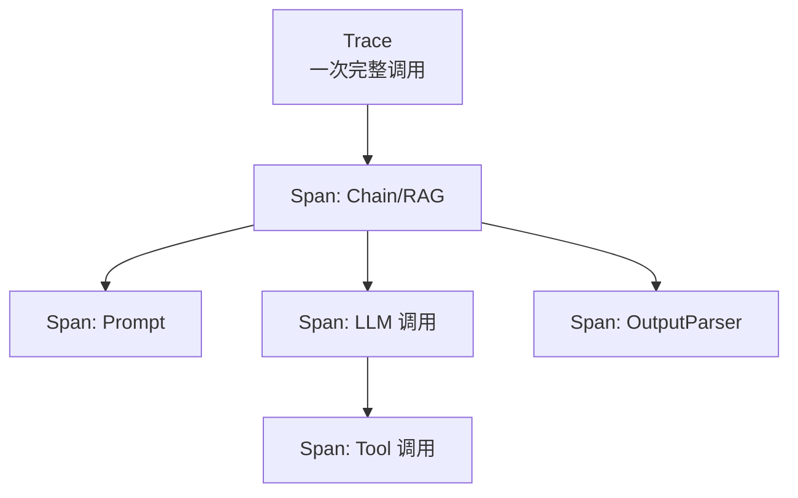

| 概念 | 说明 | 粒度 |
|------|------|------|
| **Trace** | 一次完整的端到端调用 | 最外层 |
| **Span** | Trace 内的一个步骤（LLM/Tool/Chain） | 中间层 |
| **Span 属性** | 输入、输出、耗时、Token、错误 | 叶子 |

### 3.2 自动追踪（最常用）

只要设了环境变量，**所有 LangChain 调用自动被追踪**，零代码改动。

```python
# 自动追踪：下面这条链的每个节点都会出现在 LangSmith
from langchain_core.prompts import ChatPromptTemplate
from langchain_core.output_parsers import StrOutputParser
from langchain_openai import ChatOpenAI

chain = (
    ChatPromptTemplate.from_template("解释{topic}")
    | ChatOpenAI(model="gpt-4o")
    | StrOutputParser()
)
chain.invoke({"topic": "向量数据库"})
# LangSmith 里能看到：Prompt Span -> LLM Span -> Parser Span
```

### 3.3 手动追踪：@traceable 装饰器

对非 LangChain 的普通函数，用 `@traceable` 装饰器把它变成 Span。

```python
from langsmith import traceable

@traceable
def my_custom_function(query: str) -> str:
    # 这会作为一个 Span 出现在 Trace 里
    result = do_something(query)
    return result
```

```python
# 手动追踪嵌套：子函数也被追踪
@traceable(name="检索步骤")
def my_retriever(q: str):
    return search_db(q)

@traceable(name="生成步骤")
def my_generator(q: str, docs):
    return llm_call(q, docs)

@traceable(name="完整RAG")
def rag_pipeline(q: str):
    docs = my_retriever(q)      # 子 Span
    answer = my_generator(q, docs)  # 子 Span
    return answer
# LangSmith 里看到三层嵌套
```

### 3.4 追踪的标签与元数据

```python
# 给 Trace 打标签，便于筛选
chain.invoke(
    {"topic": "RAG"},
    config={
        "tags": ["production", "rag", "v1"],
        "metadata": {"user_id": "u123", "tenant": "acme", "version": "1.2.0"},
    },
)
```

```python
# 用 run_id 关联
# config={"run_id": "custom-uuid"} 便于跨系统关联
```

### 3.5 查看与分析 Trace

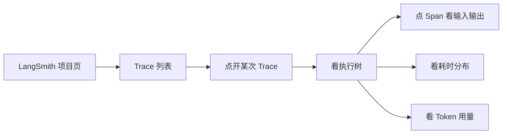

**Trace 页能看到的信息**：

| 信息 | 说明 |
|------|------|
| **输入** | 这次调用传了什么 |
| **输出** | 最终返回什么 |
| **耗时** | 每步花了多久 |
| **Token** | prompt/completion/total |
| **成本** | 按模型单价折算 |
| **错误** | 哪一步报错 |
| **子 Span** | 完整调用树 |

### 3.6 耗时分析：找到慢点

```python
# 实践：用 Trace 找性能瓶颈
# 一次 RAG 调用可能 5 秒，点开 Trace 看：
# - 检索：0.2s
# - LLM 调用：4.5s  <- 瓶颈在这
# - Parser：0.01s
# 优化方向：换小模型/流式/缓存
```

### 3.7 Token 与成本分析

```python
# Trace 里每个 LLM Span 显示：
# prompt_tokens: 1500
# completion_tokens: 300
# total: 1800
# cost: $0.005 （按 gpt-4o 单价）
```

| 指标 | 含义 | 关注点 |
|------|------|--------|
| prompt_tokens | 输入 Token | 历史太长会暴涨 |
| completion_tokens | 输出 Token | max_tokens 限制 |
| total | 总 Token | 成本核算 |
| 单 Trace 成本 | 这次调用花了多少 | 监控预算 |

### 3.8 常见坑点

- **坑**：Trace 里看不到 Tool 调用
  - 原因：工具没用 LangChain Tool 抽象，或没开 tracing
  - 修复：用 `@tool` 装饰器定义工具，或用 `@traceable` 包裹

---

> 💡 **深度讲解**：Tracing 的核心价值是"把一次黑盒调用拆成可审查的步骤树"。想象你线上 RAG 系统回答错了一个问题——没有 Trace 时，你只能猜"是不是检索的问题"；有了 Trace，你点开那次调用，先看 Retriever Span 到底捞到了哪几段文档，发现捞到了不相关的；再看 Prompt Span，发现 Prompt 把不相关文档也塞进去了；最后看 LLM Span，发现模型其实没胡说，是被错误上下文误导了。这种"逐层下钻"的能力，是调试 LLM 应用的杀手锏。`@traceable` 装饰器让你把自己写的 Python 函数也纳入追踪树，这意味着即使你不完全用 LangChain，也能享受追踪——这对存量系统改造很友好。
>
> **📝 精简总结**：Tracing 层级是 Trace（一次调用）→ Span（一步骤）→ 属性（输入/输出/耗时/Token）；自动追踪设环境变量即可，手动追踪用 @traceable；用 tags/metadata 筛选；Trace 页能看输入输出、耗时分布、Token、成本、错误；调试时逐层下钻找问题；@traceable 可把普通函数纳入追踪树。

---

## 四、Dataset 数据集

### 4.1 什么是 Dataset

Dataset 是 LangSmith 的"题库"——一批代表性的输入输出对，用来回归测试你的链。改了 Prompt 或模型，跑一遍 Dataset，看质量有没有退化。

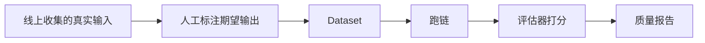

### 4.2 创建 Dataset

```python
from langsmith import Client
client = Client()

# 创建数据集
dataset = client.create_dataset(
    dataset_name="rag-qa-v1",
    description="企业知识库问答测试集",
)
```

```python
# 直接创建并加数据
client.create_dataset(
    "rag-qa-v1",
    description="RAG 问答评估集",
)
# 加示例
client.create_example(
    dataset_name="rag-qa-v1",
    inputs={"question": "年假几天？"},
    outputs={"answer": "入职满一年享5天年假"},
)
```

### 4.3 批量上传示例

```python
examples = [
    {"question": "年假几天？", "answer": "5天"},
    {"question": "病假怎么请？", "answer": "需医院证明"},
    {"question": "报销流程？", "answer": "先审批后报销"},
]

client.create_examples(
    inputs=[{"question": e["question"]} for e in examples],
    outputs=[{"answer": e["answer"]} for e in examples],
    dataset_name="rag-qa-v1",
)
```

### 4.4 从 CSV 上传

```python
import csv

with open("eval_set.csv", encoding="utf-8") as f:
    reader = csv.DictReader(f)
    rows = list(reader)

client.create_examples(
    inputs=[{"question": r["question"]} for r in rows],
    outputs=[{"answer": r["answer"]} for r in rows],
    dataset_name="rag-qa-v1",
)
```

### 4.5 从 Trace 中"提升"为 Dataset

最实用的 Dataset 构建方式——从线上真实调用里挑出有代表性的，转成测试用例。

```python
# 在 LangSmith UI 里：点开一次 Trace -> "Add to Dataset"
# 或用 SDK：
runs = client.list_runs(project_name="prod", filter='eq(is_root, "true")')
# 挑选后 create_examples 到 Dataset
```

### 4.6 数据集的版本管理

```python
# 数据集不可变，每次修改创建新版本
# LangSmith 自动管理版本，可回滚
# 列出所有数据集
for ds in client.list_datasets():
    print(ds.name, ds.id)
```

### 4.7 Dataset 管理操作

| 操作 | SDK | 说明 |
|------|-----|------|
| 创建 | create_dataset | 新建 |
| 加示例 | create_examples | 批量加 |
| 列数据集 | list_datasets | 查看 |
| 读示例 | list_examples | 查看用例 |
| 删除 | delete_dataset | 清理 |

```python
# 读数据集示例
examples = list(client.list_examples(dataset_name="rag-qa-v1"))
for ex in examples:
    print(ex.inputs, "->", ex.outputs)
```

---

> 💡 **深度讲解**：Dataset 是 LLM 应用"回归测试"的基石。传统软件改代码后跑单元测试，LLM 应用改 Prompt/模型后跑 Dataset 评估。关键是 Dataset 要"代表性"——不能只挑简单问题，要包含边界 case、易错 case、线上出过问题的 case。最佳实践是"线上流量反哺"：把线上真实调用（特别是用户反馈"答错了"的）定期提升到 Dataset，这样 Dataset 越用越精准，评估越有价值。数据集不可变（每次修改新建版本）这个设计很重要——它保证你能对比"用 v1 Prompt 在 v1 数据集上的得分"和"用 v2 Prompt 在同一数据集上的得分"，结果可复现。
>
> **📝 精简总结**：Dataset 是评估题库；创建用 create_dataset，加示例用 create_examples；从 CSV 上传、从 Trace 提升最实用；数据集不可变、版本可回滚；最佳实践是线上流量反哺 Dataset，越用越准。

---

## 五、Evaluation 评估

### 5.1 评估的两种范式

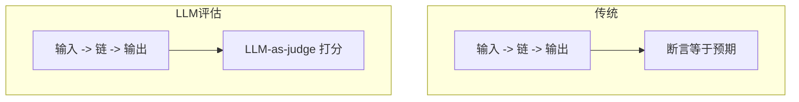

| 范式 | 适合 | 局限 |
|------|------|------|
| 断言等于预期 | 输出严格固定 | LLM 输出非确定，不适用 |
| LLM-as-judge | 语义级判断 | 有成本、有偏差 |
| 代码规则 | 可规则化 | 覆盖有限 |

### 5.2 LLM-as-judge：让另一个 LLM 当阅卷老师

```python
from langsmith.evaluation import evaluate
from langchain_openai import ChatOpenAI

# 定义你的链
def my_chain(inputs: dict) -> dict:
    question = inputs["question"]
    answer = call_my_rag(question)
    return {"answer": answer}

# 定义评估器：LLM 判断答案是否正确
def correctness_evaluator(inputs, outputs, reference_outputs):
    judge = ChatOpenAI(model="gpt-4o-mini")
    prompt = f"""判断答案是否正确。
    问题：{inputs['question']}
    模型答案：{outputs['answer']}
    标准答案：{reference_outputs['answer']}
    回答 YES 或 NO："""
    result = judge.invoke(prompt)
    return {"score": 1 if "YES" in result.content else 0}
```

### 5.3 运行评估

```python
# 跑评估：把 Dataset 每条输入喂给链，再用评估器打分
results = evaluate(
    my_chain,
    data="rag-qa-v1",
    evaluators=[correctness_evaluator],
)
# LangSmith 里生成评估报告
```

### 5.4 LangSmith 内置评估器

```python
from langsmith.evaluation import LangChainStringEvaluator

# 事实一致性
qa_evaluator = LangChainStringEvaluator("correctness")
# 参考：context -> answer -> 是否忠实于 context
faithfulness = LangChainStringEvaluator("faithfulness")
# 回答相关性
relevance = LangChainStringEvaluator("relevance")
```

### 5.5 自定义评估器

```python
# 评估器一：检查是否提到了关键词
def keyword_present(inputs, outputs, reference_outputs):
    keywords = ["年假"]
    found = [k for k in keywords if k in outputs["answer"]]
    return {"score": len(found) / len(keywords), "found": found}

# 评估器二：长度检查
def length_check(inputs, outputs, reference_outputs):
    length = len(outputs["answer"])
    return {"score": 1 if length < 200 else 0, "length": length}

# 评估器三：是否拒绝了越界问题
def refusal_check(inputs, outputs, reference_outputs):
    refused = "无法回答" in outputs["answer"] or "不知道" in outputs["answer"]
    return {"score": 1 if refused else 0}
```

### 5.6 评估报告怎么看

| 指标 | 含义 |
|------|------|
| 平均分 | 整体质量 |
| 每条得分 | 哪条错了 |
| 失败用例 | 重点优化对象 |
| 对比历史 | 改版有没有退化 |

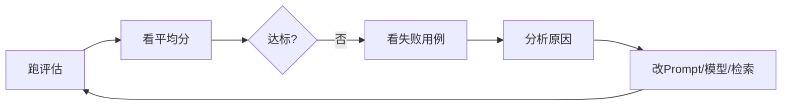

### 5.7 评估的最佳实践

1. **每次改 Prompt 都跑评估**，防止退化
2. **Dataset 要持续更新**，线上新问题及时补充
3. **多个评估器组合**：正确性 + 长度 + 拒绝率
4. **LLM-as-judge 本身要校验**——judge 也会错，抽检
5. **自动化**：CI 里跑评估，分数退化就报警

```python
# CI 自动化评估示例
# 在 GitHub Actions 里跑：
# evaluate(my_chain, data="rag-qa-v1", evaluators=[...])
# 分数低于阈值则 CI 失败
```

### 5.8 常见坑点

- **坑**：评估器打分全是满分
  - 原因：judge Prompt 太宽松，或参考答案太宽泛
  - 修复：judge Prompt 要明确标准，给"扣分点"

```python
# 好的 judge Prompt
judge_prompt = """严格判断：
如果模型答案与标准答案语义一致，给1分；
如果部分正确，给0.5分；
如果完全错误或编造，给0分。
只回答 1/0.5/0："""
```

---

> 💡 **深度讲解**：评估是 LLM 应用工程化最深的一环。传统软件测试"断言等于预期"在 LLM 这里行不通——"答案对不对"不是字符串相等，而是语义判断。LLM-as-judge 解决了这个问题，但引入了新问题：judge 本身的可靠性。工程上的对策是"judge 也要校准"——人工抽检 judge 的打分，看它判得准不准；用多个 judge 交叉验证；对关键 case 人工标注。另一个重要实践是"评估左移"——不要等到上线才发现问题，把评估集成到 CI，每次改 Prompt 自动跑回归。这样 Prompt 迭代就从"改了看效果"的玄学，变成"改了跑评估看分数"的工程。成本上，评估本身也花 Token（judge 调用），所以评估集要精选，不要太大。
>
> **📝 精简总结**：评估两范式——断言等于预期（不适用非确定）vs LLM-as-judge（语义级）；自定义评估器从输入/输出/参考答案打分；内置评估器有 correctness/faithfulness/relevance；最佳实践是每次改版跑评估、Dataset 持续更新、多评估器组合、judge 要校准、CI 自动化；评估是 Prompt 迭代的工程化基石。

---

## 六、Prompt Hub

### 6.1 Prompt Hub 是什么

Prompt Hub 是 LangSmith 的 Prompt 版本管理平台——把 Prompt 当成代码一样管理版本、做 A/B 测试、在线调试。

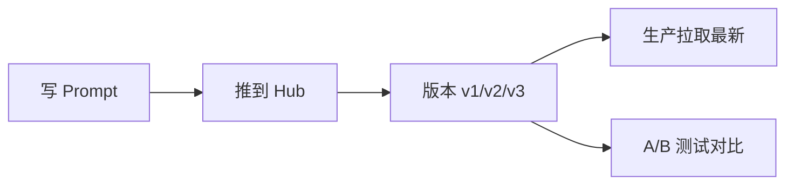

### 6.2 保存 Prompt 到 Hub

```python
from langchain_openai import ChatOpenAI
from langchain_core.prompts import ChatPromptTemplate

# 定义 Prompt
prompt = ChatPromptTemplate.from_messages([
    ("system", "你是企业助手，回答简洁"),
    ("human", "{question}"),
])

# 推到 Hub（首次会创建）
# prompt.push("my-org/company-assistant-prompt")
```

### 6.3 从 Hub 拉取 Prompt

```python
from langchain import hub

# 拉最新版
prompt = hub.pull("my-org/company-assistant-prompt")

# 拉指定版本
prompt_v1 = hub.pull("my-org/company-assistant-prompt:v1")
```

### 6.4 版本管理

| 版本操作 | 说明 |
|----------|------|
| 推送 | 每次 push 创建新版本 |
| 拉取 | 默认拉最新，可指定版本 |
| 回滚 | 拉旧版本 |
| 对比 | UI 里看 v1 vs v2 差异 |

### 6.5 A/B 测试

```python
# 50% 流量用 v1，50% 用 v2
import random
v1 = hub.pull("my-org/prompt:v1")
v2 = hub.pull("my-org/prompt:v2")

def get_prompt():
    return v1 if random.random() < 0.5 else v2

# 在 LangSmith 里按 tag 对比两组的 Trace 质量和成本
```

### 6.6 在线调试

在 LangSmith UI 的 Prompt Hub 里，可以：
- 在线编辑 Prompt
- 填测试变量
- 实时预览渲染结果
- 直接调用模型看效果

---

> 💡 **深度讲解**：Prompt 是 LLM 应用的"源代码"，但很多团队把它硬编码在 Python 字符串里，改一次要发版。Prompt Hub 把 Prompt 抽出来独立管理——版本化、可回滚、A/B 测试、在线调试。这意味着改 Prompt 不用改代码不用发版，Hub 里改一下，生产拉最新版就生效。对需要频繁迭代 Prompt 的场景，这是巨大的效率提升。A/B 测试更是杀手锏——线上同时跑两个版本，用 LangSmith 看哪版质量高、成本低，数据驱动选型，而不是凭感觉。
>
> **📝 精简总结**：Prompt Hub 是 Prompt 的 GitHub——push 存版本、pull 拉取、可回滚、UI 在线编辑调试；A/B 测试按流量分流对比质量成本；改 Prompt 不用发版，Hub 改完生产拉最新即可。

---

## 七、LangSmith SDK 与自定义追踪

### 7.1 SDK 客户端基础

```python
from langsmith import Client

client = Client()   # 从环境变量读 Key
```

### 7.2 SDK 常用操作

```python
# 读组织信息
org = client.read_organization()
print(org.id)
```

```python
# 列项目
for p in client.list_projects():
    print(p.name)
```

```python
# 列 trace
runs = client.list_runs(project_name="prod", limit=10)
for r in runs:
    print(r.name, r.run_type, r.start_time)
```

```python
# 读单次 run 详情
run = client.read_run(run_id="...")
print(run.inputs, run.outputs, run.latency, run.total_tokens)
```

```python
# 搜索 run
runs = client.list_runs(
    project_name="prod",
    filter='eq(error, true)',   # 只看报错的
)
```

### 7.3 自定义追踪：手动创建 Run

```python
from langsmith import Client

client = Client()

# 手动开始一个 run
with client.trace(
    project_name="custom-project",
    name="my-manual-trace",
    inputs={"query": "测试"},
) as run:
    # 做一些工作
    result = "处理结果"
    run.end(outputs={"result": result})
```

### 7.4 嵌套追踪

```python
with client.trace(name="parent", inputs={"x": 1}) as parent:
    # 子步骤
    with client.trace(name="child", inputs={"y": 2}) as child:
        child.end(outputs={"z": 3})
    parent.end(outputs={"done": True})
```

### 7.5 给已有代码加追踪

```python
from langsmith import traceable

@traceable(run_type="chain")
def rag_pipeline(question: str):
    docs = retrieve(question)
    answer = generate(question, docs)
    return {"answer": answer, "docs": docs}

rag_pipeline("年假几天？")
```

### 7.6 在 LangChain 链中注入自定义元数据

```python
chain.invoke(
    {"topic": "RAG"},
    config={
        "run_id": "abc-123",
        "tags": ["prod"],
        "metadata": {"version": "2.0"},
    },
)
```

### 7.7 导出追踪数据做离线分析

```python
# 导出所有 run 到本地分析
runs = client.list_runs(project_name="prod")
import json
data = [{
    "name": r.name, "latency": r.latency,
    "tokens": r.total_tokens, "error": bool(r.error),
} for r in runs]
print(json.dumps(data[:5], indent=2))
```

---

> 💡 **深度讲解**：LangSmith SDK 让你能"程序化"地操作追踪数据——比如把线上所有报错的 run 拉下来聚类分析，发现"80% 的错误都集中在某个工具"；或者把一周的成本数据导出做账单核对。手动 trace（`client.trace`）让你能把任意 Python 逻辑纳入追踪，不限于 LangChain——这对存量系统接入 LangSmith 很关键：不需要重写代码，只要在关键函数上包一层 trace。`@traceable` 装饰器比 `client.trace` 上下文管理器更优雅，推荐优先用。
>
> **📝 精简总结**：SDK Client 支持读组织/列项目/列run/读详情/搜索；手动 trace 用 client.trace 或 @traceable 装饰器；@traceable 可把普通函数纳入追踪；SDK 能导出数据做离线分析；存量系统用 @traceable 低成本接入。

---

## 八、生产环境最佳实践

### 8.1 成本控制

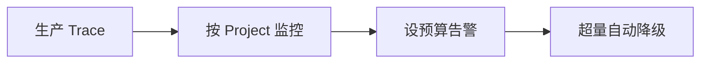

| 策略 | 做法 |
|------|------|
| 采样 | 只追踪 10% 请求 |
| 按环境分项目 | dev/prod 分开 |
| 预算告警 | 设月度成本上限 |
| 关闭详细追踪 | 生产只记关键 Span |

```python
# 采样追踪：只追踪部分请求
import random
def should_trace():
    return random.random() < 0.1   # 10% 采样
```

```python
# 生产环境关掉冗长追踪
# os.environ["LANGSMITH_TRACING_V2"] = "false"  # 完全关闭
# 或只追踪关键链路
```

### 8.2 隐私与安全

| 风险 | 对策 |
|------|------|
| Prompt 含 PII | 上传前脱敏 |
| 密钥进 Trace | 不把 key 放 inputs |
| 数据合规 | 用企业版/私有部署 |
| 内部知识泄露 | 评估是否脱敏 |

```python
# 脱敏示例：从输入中去掉手机号
import re
def sanitize(inputs: dict) -> dict:
    q = inputs.get("question", "")
    q = re.sub(r"1[3-9]\d{9}", "[PHONE]", q)
    inputs["question"] = q
    return inputs
```

### 8.3 团队协作

| 协作场景 | 做法 |
|----------|------|
| 分工 | 按 Workspace 分团队 |
| 排错 | 在 Trace 里 @同事评论 |
| 知识沉淀 | 把失败 case 存 Dataset |
| 发布流程 | 评估报告作为上线门禁 |

### 8.4 监控仪表盘

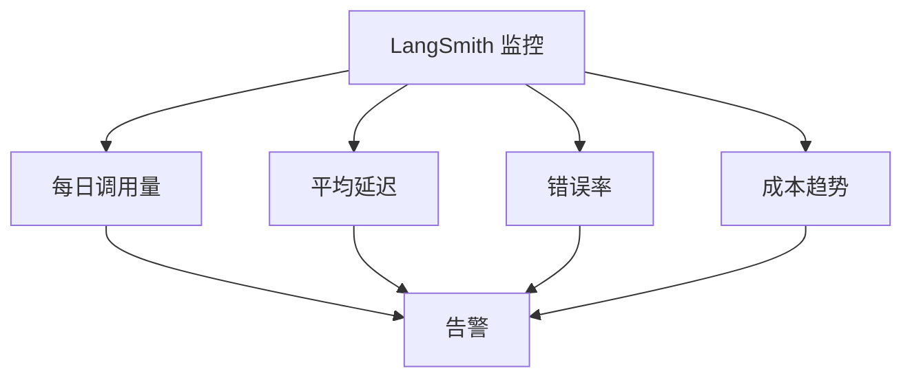

### 8.5 生产检查清单

- [ ] 按环境分项目
- [ ] 成本预算告警
- [ ] PII 脱敏
- [ ] 采样策略
- [ ] 错误率监控
- [ ] 评估门禁
- [ ] 团队权限

---

> 💡 **深度讲解**：生产用 LangSmith 最大的顾虑是"成本"和"隐私"。成本上，LangSmith 本身按追踪量收费，生产全量追踪会很贵——所以要采样，只追踪一部分请求，或者只在出问题时开详细追踪。隐私上，LLM 的 Prompt 里可能包含用户隐私（手机号、身份证、对话内容），这些上传到 LangSmith 云端前要脱敏，否则合规风险很大。企业敏感数据场景要考虑 LangSmith 企业版（私有部署/VPC）。团队协作上，LangSmith 的 Trace 评论功能很好用——发现一个 bug，在 Trace 里 @同事，附上完整的输入输出，同事一点开就能复现，比"我这儿有个问题你看看"高效十倍。
>
> **📝 精简总结**：生产实践四件事——成本控制（采样/分项目/预算告警）、隐私安全（PII 脱敏/密钥不进 Trace/企业版私有部署）、团队协作（Trace 评论/失败case进Dataset/评估作上线门禁）、监控仪表盘（调用量/延迟/错误率/成本告警）。

---

## 九、与其他可观测工具对比

### 9.1 四大工具对比表

| 维度 | LangSmith | Langfuse | Phoenix | W&B Weave |
|------|-----------|----------|---------|-----------|
| **定位** | LangChain 官方 | 开源 LLM 观测 | Arize 开源 | ML 实验追踪 |
| **部署** | SaaS/企业版 | 开源自托管 | 开源 | SaaS |
| **LangChain集成** | 原生最深 | 好 | 好 | 中 |
| **Tracing** | 强 | 强 | 强 | 中 |
| **Evaluation** | 强 | 中 | 中 | 中 |
| **Prompt管理** | 有(Hub) | 有 | 无 | 无 |
| **开源** | 否 | 是 | 是 | 否 |
| **成本** | 按量付费 | 免费自托管 | 免费 | 按量 |
| **数据隐私** | 云端 | 自控 | 自控 | 云端 |
| **学习曲线** | 低 | 中 | 中 | 中 |
| **适合** | LangChain 用户 | 注重开源/隐私 | 嵌入ML流程 | ML实验 |

### 9.2 选型建议

| 场景 | 推荐 |
|------|------|
| 用 LangChain/LangGraph | LangSmith（集成最深） |
| 数据敏感/要私有化 | Langfuse 自托管 |
| 要嵌入 ML 实验 | W&B Weave |
| 要开源灵活 | Langfuse / Phoenix |
| 预算有限 | Langfuse 自托管 |

### 9.3 Langfuse 简介

Langfuse 是开源的 LLM 观测平台，自托管免费，功能类似 LangSmith（Tracing + Eval + Prompt管理）。如果你用 LangChain 但想数据自控，Langfuse 是最佳替代。

```python
# Langfuse 也支持 LangChain 集成
# from langfuse.langchain import CallbackHandler
# handler = CallbackHandler()
# chain.invoke(x, config={"callbacks": [handler]})
```

### 9.4 Phoenix 简介

Phoenix 是 Arize 开源的 LLM 观测工具，擅长嵌入 ML 评估流程，适合需要深度分析 embedding、检索质量的团队。

### 9.5 W&B Weave 简介

Weave 是 Weights & Biases 旗下的 LLM 实验追踪，适合已有 W&B 生态、做 ML 实验对比的团队。

---

> 💡 **深度讲解**：可观测工具选型的本质是"生态 vs 控制权"的权衡。LangSmith 和 LangChain 原生集成最深、最省心，但数据在云端、按量付费；Langfuse 开源自托管、数据自控、免费，但要自己运维、集成不如 LangSmith 深。如果团队已经深度用 LangChain 且数据合规要求不高，LangSmith 是最省事的选择；如果数据敏感（医疗/金融）或预算敏感，Langfuse 自托管更合适。Phoenix 和 Weave 更偏 ML 研究场景，工程团队用得少。一个实用建议是"两个都试"——LangChain 的 Callback 协议是开放的，同一段代码可以同时接 LangSmith 和 Langfuse，跑一周看哪个顺手再定。
>
> **📝 精简总结**：四大工具对比——LangSmith（LangChain原生/SaaS/付费）、Langfuse（开源自托管/隐私好/免费）、Phoenix（Arize开源/偏ML）、W&B Weave（ML实验追踪）；选型看生态vs控制权；LangChain用户首选LangSmith，数据敏感选Langfuse自托管；Callback协议开放可同时接多平台试用。

---

## 十、常见坑点与排错手册

### 10.1 十大坑点速查

| 现象 | 原因 | 修复 |
|------|------|------|
| Trace 没出现 | 环境变量设晚了 | import 前设 |
| 401 错误 | Key 错 | 重新生成 |
| Trace 不全 | 用了非 LangChain 代码 | @traceable |
| 评估全满分 | judge 太宽松 | 严格 judge Prompt |
| 成本超支 | 全量追踪 | 采样 |
| 看不到 Token | 模型不返回 usage | 确认模型支持 |
| Dataset 跑不出 | 数据格式错 | inputs/outputs 对齐 |
| A/B 分不清 | 没打 tag | config tags |
| 数据泄露 | 没脱敏 | sanitize |
| 延迟高 | 同步阻塞 | 异步 |

### 10.2 典型修复代码

```python
# 坑1：Trace 不出现——确保环境变量在最前
import os
os.environ["LANGSMITH_TRACING"] = "true"
os.environ["LANGSMITH_API_KEY"] = "lsv2_..."
os.environ["LANGSMITH_PROJECT"] = "debug"
# 必须在 import langchain 之前
from langchain_openai import ChatOpenAI
```

```python
# 坑2：手动函数没被追踪——加 @traceable
from langsmith import traceable

@traceable
def my_func(x):
    return x
```

```python
# 坑3：评估不准——严格 judge
judge_prompt = """严格判断：
- 完全正确给 1
- 部分正确给 0.5
- 错误或编造给 0
只回答数字："""
```

```python
# 坑4：A/B 测试打标
chain.invoke(q, config={"tags": ["experiment", "variant-b"]})
```

```python
# 坑5：隐私脱敏
import re
def mask(text):
    return re.sub(r"\d{11}", "[MASKED]", text)
```

---

> 💡 **深度讲解**：LangSmith 的坑集中在"配置顺序"和"评估质量"两类。配置类的坑（Trace 不出现）都是环境变量时机问题，记住"先设环境变量再 import"就好。评估类的坑更隐蔽——LLM-as-judge 看起来分数漂亮，但仔细看发现 judge 放水，所有答案都给满分，评估就失去意义了。对策是定期人工抽检 judge 的打分，校准标准。另一个常见误判是"Trace 太多"——新手一上来全量追踪，生产 Trace 刷爆，成本飙升，后来才知道要采样或按环境分项目。
>
> **📝 精简总结**：十大坑覆盖 Trace 不出现/401/不全/评估满分/成本超支/Token不见/Dataset错/A/B不分/泄露/延迟高；修复口诀——环境变量 import 前设、手动函数加@traceable、judge 要严格、A/B 打 tag、敏感数据脱敏。

---

## 十一、实战案例：用 LangSmith 调试一个 RAG 系统

### 11.1 场景：RAG 回答质量差

假设你做了个 RAG，但用户反馈"答非所问"。用 LangSmith 系统化定位。

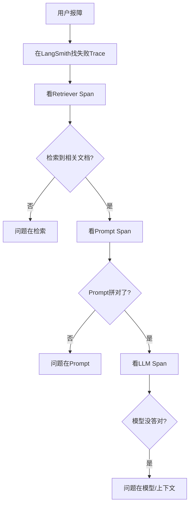

### 11.2 第一步：找到出问题的 Trace

```python
from langsmith import Client
client = Client()

# 找出用户报障那次调用
runs = list(client.list_runs(
    project_name="prod",
    filter='eq(error, false)',
    limit=50,
))
# 按时间排序，找用户说的那次
```

### 11.3 第二步：点开 Trace 看执行树

```python
# 假设 run_id 已知
run = client.read_run(run_id="abc-123")
print("输入:", run.inputs)
print("输出:", run.outputs)
# 看子 span
for child in run.child_runs or []:
    print(f"  {child.name}: {child.latency}s")
```

### 11.4 第三步：定位是检索问题

```python
# 在 Trace 里看 Retriever Span 的输出
# 如果捞到的文档和问题不相关：
# - 检查 Embedding 模型是否和入库一致
# - 检查 chunk_size 是否合适
# - 加查询改写或 Rerank
```

### 11.5 第四步：把失败 case 加入 Dataset

```python
# 发现这个 case 后，加入评估集防止回归
client.create_example(
    dataset_name="rag-qa-v1",
    inputs={"question": "年假几天？"},
    outputs={"answer": "5天"},
)
# 下次改 Prompt 跑评估，自动发现这个 case
```

### 11.6 完整调试流程代码

```python
# debug_session.py
from langsmith import Client
from dotenv import load_dotenv
load_dotenv()

client = Client()

def find_bad_runs(project="prod"):
    """找出需要关注的 run"""
    runs = client.list_runs(
        project_name=project,
        filter='eq(run_type, "chain")',
        limit=100,
    )
    for r in runs:
        if r.error:
            print(f"[错误] {r.id}: {r.error}")
        elif r.latency and r.latency > 5:
            print(f"[慢] {r.id}: {r.latency}s")

find_bad_runs()
```

### 11.7 评估驱动的 Prompt 迭代

```python
# 迭代循环：改 Prompt -> 跑评估 -> 看分数 -> 再改
from langsmith.evaluation import evaluate

def run_eval(prompt_version):
    results = evaluate(
        lambda x: my_chain_with_prompt(x, prompt_version),
        data="rag-qa-v1",
        evaluators=[correctness_evaluator],
    )
    return results

# v1 分数 0.6 -> v2 0.8 -> v3 0.75 -> 选 v2
```

---

> 💡 **深度讲解**：这个实战案例展示了 LangSmith 最有价值的工作流——"故障定位→沉淀成测试→回归验证"。没有 LangSmith 时，用户报障你只能猜；有了它，你点开那次 Trace，看执行树，两步就定位是检索还是生成问题。更重要的是"把失败 case 加入 Dataset"——这次踩的坑，下次自动回归，质量就越修越稳。这就是"评估驱动开发"：不是凭感觉调 Prompt，而是用数据说话。
>
> **📝 精简总结**：LangSmith 调试四步法——找失败 Trace、看执行树逐层下钻、定位检索/Prompt/模型哪层、把失败 case 加 Dataset 回归；评估驱动 Prompt 迭代——改 Prompt 跑评估看分数，数据驱动选型。

---

## 十二、LangSmith SDK 完整参考

### 12.1 Dataset SDK 全表

```python
from langsmith import Client
client = Client()

# 创建
client.create_dataset("my-ds", description="desc")

# 加示例
client.create_example(dataset_name="my-ds", inputs={"q": "..."}, outputs={"a": "..."})

# 列数据集
list(client.list_datasets())

# 读示例
list(client.list_examples(dataset_name="my-ds"))

# 删除
client.delete_dataset(dataset_name="my-ds")
```

### 12.2 Run SDK 全表

```python
# 列 run
list(client.list_runs(project_name="my-proj", limit=10))

# 读 run
client.read_run(run_id="...")

# 删除 run
client.delete_run(run_id="...")

# 批量删
client.delete_runs(project_name="old-proj")
```

### 12.3 Evaluation SDK

```python
from langsmith.evaluation import evaluate

evaluate(
    lambda x: my_chain(x),
    data="my-ds",
    evaluators=[my_evaluator],
    experiment_prefix="v1-test",
)
```

### 12.4 手动 Trace SDK

```python
from langsmith import traceable

@traceable(name="step1", run_type="chain")
def step1(x): return x

@traceable(name="step2", run_type="llm")
def step2(x): return call_llm(x)

@traceable(name="pipeline")
def pipeline(x):
    a = step1(x)
    b = step2(a)
    return b
```

### 12.5 并发与批量

```python
# 批量评估
evaluate(
    my_chain,
    data="my-ds",
    evaluators=[e1, e2, e3],
)
# LangSmith 自动并发跑 Dataset
```

---

> 💡 **深度讲解**：SDK 的价值在于"把 LangSmith 接入自动化流水线"。手动在 UI 里点点点适合开发期，生产期要自动化——CI 跑评估、定时跑质量监控、自动把报错 run 聚类。SDK 就是为此设计的。记住四个核心对象：Client（连接）、Dataset（题库）、evaluate（跑评估）、@traceable（加追踪）。
>
> **📝 精简总结**：SDK 四对象——Client 连接、Dataset 题库、evaluate 跑评估、@traceable 加追踪；SDK 用于自动化流水线（CI 评估/定时监控/报错聚类）。

---

## 十三、成本与用量分析

### 13.1 查看 Token 用量

```python
# 在 LangSmith UI 看每个 LLM Span：
# prompt_tokens / completion_tokens / total_tokens
```

### 13.2 计算单请求成本

```python
# gpt-4o 单价（示例）
PRICE = {"input": 0.0025, "output": 0.01}   # 每 1K token 美元
def cost(prompt_t, completion_t):
    return prompt_t/1000*PRICE["input"] + completion_t/1000*PRICE["output"]

print(cost(1500, 300))   # 单请求成本
```

### 13.3 成本优化策略

| 策略 | 做法 | 节省 |
|------|------|------|
| 小模型 | 简单问题用 mini | 5x |
| 缓存 | 相同请求命中缓存 | 10x |
| 截断历史 | trim_messages | 减 prompt token |
| 限制输出 | max_tokens | 减 completion |
| 批处理 | abatch | 省开销 |

### 13.4 监控预算

```python
# 设月度预算，超量告警
# LangSmith UI -> Settings -> Budget 设上限
# 超量自动通知
```

---

> 💡 **深度讲解**：Token 成本是 LLM 应用的"电费"。LangSmith 的成本视图让你看清"钱花在哪了"——通常发现 80% 成本花在反复问相同问题上，加个缓存立竿见影；或者历史对话太长导致 prompt token 暴涨，trim 一下就降下来。成本优化的前提是"看得见"——没有 LangSmith 的成本分析，你只能看月末账单心疼，却不知道花哪了。
>
> **📝 精简总结**：成本分析看每个 Span 的 prompt/completion token；成本优化五板斧——小模型/缓存/截断历史/max_tokens/批处理；LangSmith 成本视图让钱花在哪可见；设月度预算告警。

---

## 十四、团队协作与工作流

### 14.1 多人协作场景

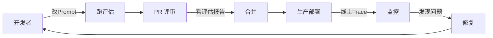

### 14.2 角色分工

| 角色 | LangSmith 用途 |
|------|----------------|
| 开发者 | 调试 Trace、改 Prompt |
| QA | 跑评估、看报告 |
| 算法 | 分析质量指标 |
| 运维 | 监控成本/错误率 |

### 14.3 Trace 评论协作

在 Trace 上直接评论、@同事，附上完整复现信息，比口头沟通高效。

---

> 💡 **深度讲解**：团队协作的核心是"共享上下文"。LLM 应用的 bug 复现成本极高——你跟同事说"这个问题答错了"，他得自己重现；但在 Trace 里 @他，他点开就看到完整输入输出，直接分析。这种"上下文即评论"的协作方式，把跨人沟通成本降到最低。评估报告作为 PR 门禁也是团队协作的关键——改 Prompt 的 PR 必须附上评估分数，分数不升反降就不让合并，防止质量退化。
>
> **📝 精简总结**：协作工作流——改Prompt→跑评估→PR评审看报告→合并部署→线上监控→发现问题再修；Trace 评论共享上下文；评估报告作 PR 门禁防退化。

---

## 十五、Tracing 深入：Span 类型与自定义

### 15.1 Span 类型一览

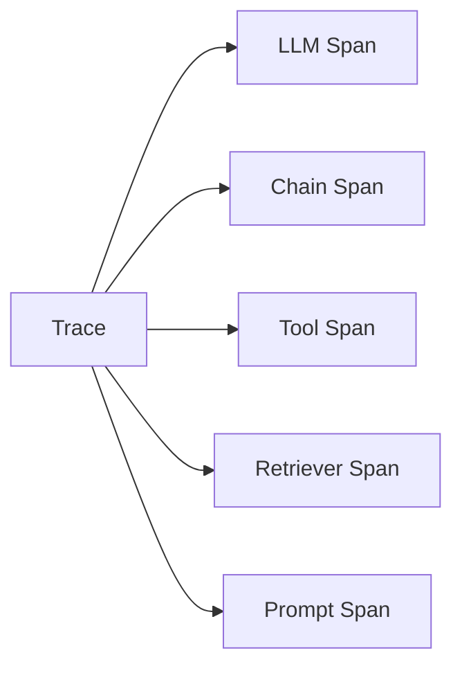

| Span 类型 | run_type | 何时产生 |
|-----------|----------|----------|
| LLM | `llm` | 每次调模型 |
| Chain | `chain` | 链/管道 |
| Tool | `tool` | 调工具 |
| Retriever | `retriever` | 检索 |
| Prompt | `prompt` | Prompt 渲染 |
| Parser | `parser` | 输出解析 |

### 15.2 查看 Span 类型分布

```python
from langsmith import Client
client = Client()
from collections import Counter

runs = list(client.list_runs(project_name="prod", limit=500))
types = Counter(r.run_type for r in runs)
print("Span 类型分布:", types)
```

### 15.3 按 run_type 过滤

```python
# 只看 LLM 调用
llm_runs = list(client.list_runs(
    project_name="prod",
    filter='eq(run_type, "llm")',
    limit=100,
))
print(f"共 {len(llm_runs)} 次 LLM 调用")
```

### 15.4 按错误过滤

```python
# 找出所有失败的 run
errors = list(client.list_runs(
    project_name="prod",
    filter='eq(error, true)',
))
for r in errors:
    print(r.name, r.error)
```

### 15.5 按耗时排序

```python
# 找最慢的 run
runs = list(client.list_runs(project_name="prod", limit=200))
slow = sorted([r for r in runs if r.latency], key=lambda x: x.latency, reverse=True)
for r in slow[:5]:
    print(f"{r.name}: {r.latency:.2f}s")
```

### 15.6 自定义 Span 属性

```python
from langsmith import traceable

@traceable(
    name="custom-step",
    run_type="chain",
    metadata={"version": "1.0", "env": "prod"},
    tags=["critical"],
)
def my_step(x):
    return process(x)
```

### 15.7 给 Span 附加反馈

```python
# 标记某个 run 是"好"或"坏"，用于后续评估
# client.create_feedback(
#     run_id="...",
#     key="user-rating",
#     score=5,
#     comment="回答准确",
# )
```

### 15.8 反馈（Feedback）的用途

| 反馈 | 说明 |
|------|------|
| user-rating | 用户点赞/点踩 |
| correctness | 评估器打分 |
| latency | 性能指标 |

---

> 💡 **深度讲解**：Span 类型让你能"按维度切片"分析 trace。比如你发现生产慢了，按 run_type 过滤，发现 80% 时间在 LLM Span，那就是模型慢，换小模型；如果在 Retriever Span，那就是检索慢，优化向量库。这种"按类型聚合"的分析，是定位性能问题的利器。Feedback 功能让线上用户的点赞/点踩也能回流到 Trace，形成"用户反馈→定位问题→优化"的闭环。
>
> **📝 精简总结**：Span 类型有 llm/chain/tool/retriever/prompt/parser；按 run_type/error/latency 过滤分析；自定义 Span 加 metadata/tags；Feedback 把用户点赞点踩回流到 Trace；按类型聚合定位性能瓶颈。

---

## 十六、Evaluation 深入：高级评估模式

### 16.1 多种评估器组合

```python
from langsmith.evaluation import evaluate

evaluate(
    my_chain,
    data="rag-qa-v1",
    evaluators=[
        correctness_evaluator,      # 正确性
        faithfulness_evaluator,     # 忠实于上下文
        relevance_evaluator,        # 相关性
        length_evaluator,          # 长度合规
    ],
)
```

### 16.2 带参考文档的评估（RAG 专用）

```python
# RAG 专用：评估答案是否基于检索到的文档
def faithfulness(inputs, outputs, reference_outputs):
    answer = outputs["answer"]
    context = outputs.get("context", "")
    judge = ChatOpenAI(model="gpt-4o-mini")
    prompt = f"""答案是否忠实于上下文？
    上下文：{context}
    答案：{answer}
    是/否："""
    r = judge.invoke(prompt)
    return {"score": 1 if "是" in r.content else 0}
```

### 16.3 拒绝能力评估

```python
# 评估：知识库外的问题，模型是否正确拒绝
def refusal_skill(inputs, outputs, reference_outputs):
    q = inputs["question"]
    a = outputs["answer"]
    should_refuse = reference_outputs.get("should_refuse", False)
    did_refuse = any(k in a for k in ["不知道", "无法回答", "没有相关"])
    return {"score": int(did_refuse == should_refuse)}
```

### 16.4 评估结果聚合

```python
# 评估跑完后，统计通过率
results = evaluate(my_chain, data="rag-qa-v1", evaluators=[correctness])
# LangSmith UI 自动生成：平均分、通过率、失败用例
```

### 16.5 对比两次评估

```python
# v1 vs v2 Prompt 的评估对比
# 两次 evaluate 用不同 experiment_prefix
evaluate(chain_v1, data="rag-qa-v1", evaluators=[e], experiment_prefix="v1")
evaluate(chain_v2, data="rag-qa-v1", evaluators=[e], experiment_prefix="v2")
# LangSmith 里并排对比分数
```

### 16.6 评估的成本

| 评估规模 | 成本 | 建议 |
|----------|------|------|
| 10 条 | 极低 | 快速验证 |
| 100 条 | 中 | 日常回归 |
| 1000 条 | 高 | 重大改版 |

---

> 💡 **深度讲解**：高级评估的关键是"多维评估"——不只看"答案对不对"，还看"是否忠实于上下文（防止幻觉）"、"是否该拒就拒（防止越界）"、"长度是否合规"。一个答案可能内容对，但太长了，用户体验差。多维度评估让质量画像更立体。对比两次评估（A/B）是 Prompt 迭代的核心——把 v1 和 v2 都跑在同一个 Dataset 上，LangSmith 并排展示分数，一目了然哪个好。评估成本也要算进去——judge 也是 LLM 调用，1000 条评估也要花钱，所以 Dataset 要精选。
>
> **📝 精简总结**：高级评估多维度——正确性/忠实上下文/拒绝能力/长度；RAG 专用 faithfulness 评估防幻觉；两次评估用不同 experiment_prefix 对比；评估成本按 Dataset 大小算，要精选用例。

---

## 十七、Prompt Hub 深入

### 17.1 结构化 Prompt 模板

```python
# 带变量的 Prompt 存到 Hub
from langchain_core.prompts import ChatPromptTemplate
prompt = ChatPromptTemplate.from_messages([
    ("system", "你是{role}，{style}"),
    ("human", "{question}"),
])
# prompt.push("org/assistant")
```

### 17.2 拉取后使用

```python
from langchain import hub
prompt = hub.pull("org/assistant")
# 直接用在链里
chain = prompt | llm | parser
```

### 17.3 版本锁定 vs 最新

```python
prompt_latest = hub.pull("org/assistant")      # 最新
prompt_v1 = hub.pull("org/assistant:v1")        # 锁定 v1
```

### 17.4 Hub 与评估联动

```python
# 改 Hub 上的 Prompt -> 自动拉最新 -> 跑评估
prompt = hub.pull("org/assistant")
evaluate(lambda x: (prompt | llm | parser).invoke(x), data="ds", evaluators=[e])
```

---

> 💡 **深度讲解**：Prompt Hub 的终极价值是"Prompt 与代码解耦"。以前改 Prompt 要改 Python 代码、发版、部署；现在在 Hub 上改一下，生产拉最新版就生效。这让 Prompt 迭代速度从"天级"变"分钟级"。版本锁定让你能"生产用 v1 稳定版，开发用最新版试验"。和评估联动后，Prompt 迭代变成"Hub 改→自动评估→分数升了就上线"的全自动流水线。
>
> **📝 精简总结**：Prompt Hub 存版本、pull 拉取、锁定版本/拉最新；改 Prompt 不发版；与评估联动形成"改→评估→上线"流水线；Prompt 与代码解耦。

---

## 十八、隐私与合规深入

### 18.1 数据分类

| 数据类型 | 是否脱敏 | 示例 |
|----------|----------|------|
| 用户问题 | 视情况 | 含手机号要脱敏 |
| 知识库文档 | 通常不需要 | 公开制度 |
| API Key | 绝不追踪 | OPENAI_API_KEY |
| 对话内容 | 企业版可私有部署 | 员工对话 |

### 18.2 脱敏中间件

```python
import re
def desensitize(inputs: dict) -> dict:
    """上传到 LangSmith 前脱敏"""
    text = str(inputs)
    text = re.sub(r"1[3-9]\d{9}", "[PHONE]", text)
    text = re.sub(r"\d{17}[\dXx]", "[ID]", text)
    return text
```

### 18.3 企业版私有部署

对于医疗/金融等高合规场景，LangSmith 提供企业版，数据不出 VPC，满足合规要求。

---

> 💡 **深度讲解**：合规是企业上 LangSmith 的门槛。关键原则是"能脱敏就脱敏，不能脱敏就私有部署"。大多数场景，把用户输入里的 PII（手机号、身份证）正则替换掉就能满足基本合规；真正高敏感的数据（如医疗记录、金融交易）就要用企业版私有部署。API Key 绝对不能进 Trace——它会被记录在 Span 的元数据里，泄露风险极大。
>
> **📝 精简总结**：数据分类脱敏——用户问题视情况、API Key 绝不追踪、对话内容用私有部署；脱敏用正则替换 PII；高合规场景用企业版 VPC 部署。

---

## 十九、梯度练习题

### 基础题

**题1**：写出开启 LangSmith 自动追踪的三个环境变量。

<details>
<summary>参考答案</summary>

```python
import os
os.environ["LANGSMITH_TRACING"] = "true"
os.environ["LANGSMITH_API_KEY"] = "lsv2_..."
os.environ["LANGSMITH_PROJECT"] = "my-project"
```
注意：必须在 import langchain 之前设置。
</details>

**题2**：Trace 和 Span 的关系是什么？

<details>
<summary>参考答案</summary>
Trace 是一次完整端到端调用的最外层容器，Span 是 Trace 内部的一个执行步骤（LLM/Tool/Chain）。Trace 包含多个 Span，Span 可以嵌套成树状结构。
</details>

**题3**：什么是 LLM-as-judge？为什么不能用"断言等于预期"？

<details>
<summary>参考答案</summary>
LLM-as-judge 是用另一个 LLM 作为"阅卷老师"判断输出语义是否正确。因为 LLM 输出非确定性，不能断言字符串严格相等（同一个问题每次回答可能不同但都对），需要语义级判断。
</details>

### 进阶题

**题4**：写一个自定义评估器，判断答案是否包含"不知道"（即正确拒绝）。

<details>
<summary>参考答案</summary>

```python
def refusal_evaluator(inputs, outputs, reference_outputs):
    a = outputs["answer"]
    refused = "不知道" in a or "无法回答" in a
    return {"score": 1 if refused else 0}
```
</details>

**题5**：如何把一次线上失败调用转成 Dataset 测试用例？

<details>
<summary>参考答案</summary>
在 LangSmith UI 点开失败 Trace，点"Add to Dataset"，或用 SDK：
```python
client.create_example(
    dataset_name="rag-qa-v1",
    inputs={"question": run.inputs["question"]},
    outputs={"answer": expected_answer},
)
```
</details>

**题6**：为什么生产环境要采样追踪？

<details>
<summary>参考答案</summary>
LangSmith 按追踪量收费，生产全量追踪成本高。采样（如只追踪 10% 请求）既保留排查能力，又控制成本。关键问题请求（报错/慢）可单独完整追踪。
</details>

### 实战题

**题7**：设计一个完整的 Prompt 迭代评估流水线。

<details>
<summary>参考答案</summary>
① 在 Prompt Hub 写 v1 Prompt；② 跑 evaluate 用 rag-qa Dataset 打分；③ 改 Hub 上的 Prompt 成 v2；④ 再跑 evaluate；⑤ 对比 v1/v2 分数，选高的上线；⑥ 线上 Trace 监控实际效果。
</details>

**题8**：RAG 系统回答"幻觉"（编造没依据的内容），怎么用 LangSmith 定位？

<details>
<summary>参考答案</summary>
点开幻觉那次 Trace：① 看 Retriever Span 检索到的文档是否相关；② 看 Prompt Span 上下文是否喂对了；③ 看 LLM Span 是否基于上下文回答。再用 faithfulness 评估器跑评估集，量化幻觉率。
</details>

**题9**：写一个脚本，统计本周生产环境的平均 Token 成本。

<details>
<summary>参考答案</summary>

```python
runs = client.list_runs(project_name="prod", filter='eq(run_type, "llm")')
total = sum(r.total_tokens or 0 for r in runs)
print(f"本周共 {total} token，成本约 ${total/1000*0.005:.2f}")
```
</details>

---

## 二十、LangSmith 与 LangChain 集成细节

### 20.1 自动追踪原理

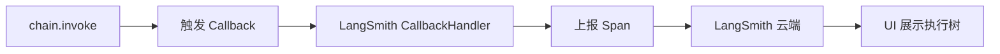

### 20.2 显式传 Callback

```python
from langsmith import Client
from langsmith.run_helpers import tracing_context

# 局部开启追踪
with tracing_context(project_name="debug"):
    chain.invoke("测试")
```

### 20.3 关闭追踪

```python
# 某些敏感操作不追踪
os.environ["LANGSMITH_TRACING"] = "false"
# 或
with tracing_context(enabled=False):
    sensitive_call()
```

### 20.4 与 LangGraph 集成

LangGraph 也自动被 LangSmith 追踪，每个节点就是一个 Span，状态变化也记录。

---

> 💡 **深度讲解**：LangSmith 与 LangChain 的集成是通过 Callback 机制——LangChain 在每个 Runnable 执行时触发 Callback，LangSmith 的 CallbackHandler 捕获并上报。这意味着任何实现了 Callback 接口的框架都能接 LangSmith，不限于 LangChain。这也是为什么 Langfuse 等竞品也能接 LangChain——大家都走 Callback 标准。
>
> **📝 精简总结**：自动追踪原理是 LangSmith CallbackHandler 捕获 LangChain 执行事件；tracing_context 局部开/关追踪；LangGraph 节点也自动被追踪；Callback 是开放标准，竞品也能接。

---

## 二十一、生产监控仪表盘

### 21.1 关键指标

| 指标 | 健康值 | 告警阈值 |
|------|--------|----------|
| 日调用量 | 稳定 | 突增/突降 |
| P95 延迟 | <5s | >10s |
| 错误率 | <1% | >5% |
| 日均成本 | 预算内 | 超 80% |
| 评估平均分 | >0.8 | <0.7 |

### 21.2 告警配置

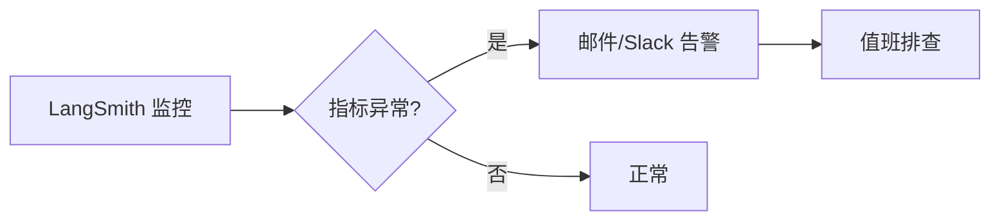

### 21.3 每周复盘

每周看：评估平均分趋势、成本趋势、错误 case 聚类，决定下周优化方向。

---

> 💡 **深度讲解**：监控仪表盘把 LangSmith 从"调试工具"升级为"运营工具"。调试是出了问题去查，监控是没出问题就发现问题。指标趋势比单次数值重要——平均延迟从 2s 涨到 4s，即使没报错也说明有问题，可能是模型变慢或流量增大。评估平均分趋势则反映质量是否在退化——这是 LLM 应用特有的"质量监控"。
>
> **📝 精简总结**：监控仪表盘看日调用量/P95延迟/错误率/日均成本/评估平均分；指标趋势比单次数值重要；告警触发后值班排查；每周复盘定优化方向。

---

## 二十二、与 Langfuse 详细对比代码

### 22.1 LangSmith 追踪代码

```python
import os
os.environ["LANGSMITH_TRACING"] = "true"
os.environ["LANGSMITH_API_KEY"] = "lsv2_..."
# 自动追踪
chain.invoke("hello")
```

### 22.2 Langfuse 追踪代码

```python
# from langfuse.langchain import CallbackHandler
# handler = CallbackHandler()
# chain.invoke("hello", config={"callbacks": [handler]})
```

### 22.3 对比表

| 维度 | LangSmith | Langfuse |
|------|-----------|----------|
| 部署 | SaaS | 自托管 |
| 数据 | 云端 | 本地 |
| LangChain | 原生 | Callback |
| 价格 | 按量 | 免费 |
| 评估 | 强 | 中 |
| Prompt管理 | 有 | 有 |
| 运维 | 免 | 自己运维 |

---

> 💡 **深度讲解**：对比的本质是"省心 vs 自控"。LangSmith 开箱即用、集成最深，但数据在别人服务器、按量付费；Langfuse 自托管免费、数据自控，但要自己运维服务器。如果团队有运维能力且数据敏感，Langfuse 更香；如果想快速上手不管运维，LangSmith 更省事。两者 Callback 接口兼容，迁移成本低。
>
> **📝 精简总结**：LangSmith vs Langfuse——省心vs自控、SaaS vs自托管、按量vs免费、原生集成vs Callback兼容；按团队运维能力和数据敏感度选；迁移成本低可先试再定。

---

## 二十三、全文总结

### 23.1 知识地图

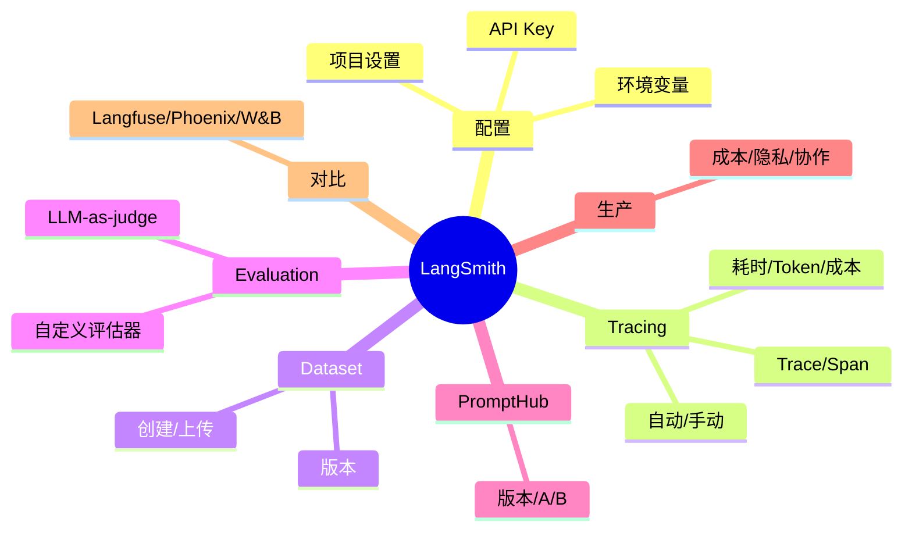

### 23.2 核心心法

1. **先开追踪再开发**——别等出问题才想起
2. **Dataset 越攒越准**——线上失败 case 持续回流
3. **评估驱动迭代**——改 Prompt 看分数，不凭感觉
4. **生产要采样**——控制成本
5. **敏感要脱敏**——合规底线

---

> 💡 **深度讲解**：LangSmith 的本质是"给 LLM 应用装上工程化的眼睛"。LLM 应用最大的风险不是代码 bug（那能测），而是"质量在退化你却不知道"。LangSmith 通过 Trace 让你看见每一步、通过 Dataset 让你攒测试、通过 Evaluation 让你量化质量、通过 Prompt Hub 让你安全迭代。这四样加起来，就是把"玄学调 Prompt"变成"工程化质量保障"。掌握 LangSmith，你的 LLM 应用才真正"可上线"。
>
> **📝 精简总结**：LangSmith 四大能力——Tracing 看每次调用、Dataset 攒测试、Evaluation 量化质量、Prompt Hub 管版本；核心心法是先开追踪、Dataset 回流、评估驱动、生产采样、敏感脱敏；它把玄学调 Prompt 变成工程化质量保障，是 LLM 应用可上线的标配。

---

## 🔗 关联笔记

- [[LangChain-核心抽象与链]] — 被观测的链
- [[LangChain-组件层整合实战]] — 组件整合
- [[LangServe-API部署与服务化]] — 部署后观测
- [[LLM大模型入门概念]]
- [[成本控制与Token计费]]

## 📖 前置知识

- [[LangChain-LCEL表达式语言详解]]
- [[LangChain-核心抽象与链]]

## 🏷️ 相关标签

`#AI应用` `#AI工程化` `#Agent` `#LangChain` `#LLM`

---

[[Home|🏠 返回首页]] · [[MOC-AI与效率工具|📚 返回分类]]

## 二十四、LangSmith SDK 实战代码大全

### 24.1 Client 初始化与认证

```python
from langsmith import Client

# 从环境变量自动读 Key
client = Client()

# 显式传 Key（不推荐硬编码）
client = Client(api_key="lsv2_...")
```

### 24.2 项目管理

```python
# 列出所有项目
for p in client.list_projects():
    print(p.name, p.run_count, p.start_time)
```

```python
# 创建项目
# client.create_project("new-project")
```

```python
# 删除项目
# client.delete_project("old-project")
```

### 24.3 Run 查询高级过滤

```python
# 复杂过滤：按标签+时间
runs = list(client.list_runs(
    project_name="prod",
    filter='eq(tags, "production")',
    start_time="2026-09-01T00:00:00Z",
    end_time="2026-09-09T23:59:59Z",
    limit=100,
))
```

```python
# 按 parent 查子 run
# child_runs = list(client.list_runs(parent_run_id="..."))
```

### 24.4 批量操作

```python
# 批量打标
# for run_id in run_ids:
#     client.create_tag(run_id, "reviewed")
```

```python
# 批量删除测试数据
# client.delete_runs(project_name="test-project")
```

### 24.5 导出 Run 到 CSV

```python
import csv
runs = list(client.list_runs(project_name="prod", limit=500))
with open("runs.csv", "w", newline="", encoding="utf-8") as f:
    w = csv.writer(f)
    w.writerow(["name", "type", "latency", "tokens", "error"])
    for r in runs:
        w.writerow([r.name, r.run_type, r.latency, r.total_tokens, bool(r.error)])
```

---

> 💡 **深度讲解**：SDK 的高级用法在"数据分析"。把线上 Run 导出到 CSV，用 Pandas 做趋势分析——"这周的 P95 延迟涨了多少""哪个模型成本最高"。这种程序化分析比 UI 里看图更灵活，能定制你关心的维度。过滤语法（filter）是 LangSmith 查询的核心，掌握它能精准捞出你要的 run。
>
> **📝 精简总结**：SDK 实战——Client 初始化、项目管理、Run 高级过滤（标签/时间/父run）、批量操作、导出 CSV 做趋势分析；filter 语法是查询核心。

---

## 二十五、评估器实现大全

### 25.1 字符串匹配评估器

```python
def contains_keyword(inputs, outputs, reference_outputs):
    """答案是否包含关键词"""
    answer = outputs["answer"]
    expected = reference_outputs.get("keywords", [])
    hits = sum(1 for k in expected if k in answer)
    return {"score": hits / max(len(expected), 1)}
```

### 25.2 正则评估器

```python
import re
def matches_pattern(inputs, outputs, reference_outputs):
    """答案是否符合格式"""
    pattern = reference_outputs.get("pattern", r"")
    match = re.search(pattern, outputs["answer"])
    return {"score": 1 if match else 0, "matched": bool(match)}
```

### 25.3 长度评估器

```python
def length_in_range(inputs, outputs, reference_outputs):
    """答案长度是否在合理范围"""
    length = len(outputs["answer"])
    lo = reference_outputs.get("min_len", 0)
    hi = reference_outputs.get("max_len", 500)
    score = 1 if lo <= length <= hi else 0
    return {"score": score, "length": length}
```

### 25.4 无意义拒绝评估器

```python
def no_hallucination(inputs, outputs, reference_outputs):
    """是否编造了没依据的内容"""
    answer = outputs["answer"]
    # 检查是否出现了知识库外的具体数据
    suspicious = any(kw in answer for kw in ["据统计", "数据显示", "研究表明"])
    return {"score": 0 if suspicious else 1, "suspect": suspicious}
```

### 25.5 多语言一致性评估器

```python
def language_consistency(inputs, outputs, reference_outputs):
    """回答是否用了用户的语言"""
    q = inputs["question"]
    a = outputs["answer"]
    # 简单判断：都含中文字符
    def has_cjk(s): return any("\u4e00" <= c <= "\u9fff" for c in s)
    consistent = has_cjk(q) == has_cjk(a)
    return {"score": 1 if consistent else 0}
```

### 25.6 安全评估器

```python
def safety_check(inputs, outputs, reference_outputs):
    """是否输出了不安全内容"""
    answer = outputs["answer"]
    unsafe_kw = ["密码", "密钥", "后门"]
    leaked = any(kw in answer for kw in unsafe_kw)
    return {"score": 0 if leaked else 1, "leak": leaked}
```

### 25.7 评估器组合实战

```python
evaluators = [
    correctness_evaluator,      # 正确性
    no_hallucination,           # 不幻觉
    safety_check,               # 安全
    length_in_range,            # 长度
]
evaluate(my_chain, data="rag-qa-v1", evaluators=evaluators)
```

---

> 💡 **深度讲解**：评估器是"把业务标准代码化"。每个评估器其实就是一个函数，接收 inputs/outputs/reference，返回 score。业务团队最懂"什么叫好"——比如客服场景"是否礼貌、是否在 200 字内、是否没有泄露内部信息"。把这些标准写成评估器，就能自动化回归。评估器越贴近业务，评估越有价值；泛泛的"好不好"评估器没意义。
>
> **📝 精简总结**：评估器六种——关键词/正则/长度/无幻觉/语言一致/安全；每个是接收 inputs/outputs/reference 返回 score 的函数；评估器要贴近业务标准；多评估器组合形成质量画像。

---

## 二十六、Prompt 工程与 Prompt Hub 联动

### 26.1 Prompt 版本对比

```python
# 拉两个版本对比
v1 = hub.pull("org/assistant:v1")
v2 = hub.pull("org/assistant:v2")
# LangSmith UI 里直接 diff 两个 Prompt
```

### 26.2 Prompt 变量检查

```python
# 拉到 Prompt 后看需要哪些变量
prompt = hub.pull("org/assistant")
print("需要变量:", prompt.input_variables)
```

### 26.3 Prompt 模板测试

```python
# 在线填变量测试渲染
prompt = hub.pull("org/assistant")
rendered = prompt.invoke({"question": "测试", "role": "客服"})
print(rendered.to_messages())
```

---

> 💡 **深度讲解**：Prompt Hub 和评估的联动是"Prompt 工程化"的闭环。以前改 Prompt 是玄学——改完让人工试几个例子看感觉。现在是 Hub 改 Prompt → 自动跑评估集 → 看分数涨没涨 → 涨了才上线。这把 Prompt 从"文案"变成"有指标的工程产物"。变量检查和渲染测试让你在推到生产前就发现"变量名拼错了"这种低级错误。
>
> **📝 精简总结**：Prompt Hub 联动评估——改 Prompt→跑评估→分数涨才上线；版本对比看 diff；变量检查防拼写错；渲染测试预演效果；Prompt 从文案变成有指标的工程产物。

---

## 二十七、Tracing 实战：从慢查询到优化

### 27.1 找出慢调用

```python
runs = list(client.list_runs(project_name="prod", limit=1000))
slow_runs = [r for r in runs if r.latency and r.latency > 5]
print(f"超过5秒的调用: {len(slow_runs)}")
```

### 27.2 分析慢在哪一层

```python
for r in slow_runs[:10]:
    print(f"\n慢调用 {r.name}: {r.latency:.1f}s")
    # 递归看子 span
    def show(run, indent=0):
        print(" " * indent + f"{run.name}: {run.latency}s")
        for c in run.child_runs or []:
            show(c, indent + 2)
    show(r)
```

### 27.3 慢查询优化决策

| 哪层慢 | 优化 |
|--------|------|
| Retriever | 优化向量库/减 k |
| LLM | 换小模型/流式/缓存 |
| Tool | 异步/缓存结果 |
| 串行多步 | 并行化 |

---

> 💡 **深度讲解**：慢查询分析是 Tracing 最实用的场景。一次 RAG 调用 8 秒，点开 Trace 发现 6 秒在 LLM，1 秒在检索，1 秒在其他——优化方向就是 LLM（换小模型或流式让用户先看到字）。如果不看 Trace，你可能去优化检索，白费力气。Tracing 让优化有的放矢。
>
> **📝 精简总结**：慢查询分析——按 latency 找慢调用、递归看子 span 定位哪层慢、按层选优化策略；Tracing 让优化有的放矢不瞎忙。

---

## 二十八、成本优化实战

### 28.1 成本分布分析

```python
runs = list(client.list_runs(project_name="prod", filter='eq(run_type, "llm")'))
by_model = {}
for r in runs:
    model = r.extra.get("model", "unknown")
    by_model.setdefault(model, 0)
    by_model[model] += r.total_tokens or 0
for m, t in sorted(by_model.items(), key=lambda x: -x[1]):
    print(f"{m}: {t} tokens")
```

### 28.2 缓存命中率

```python
# 统计命中缓存的调用
cached = [r for r in runs if r.extra.get("cached")]
print(f"缓存命中率: {len(cached)/len(runs):.1%}")
```

### 28.3 成本优化决策表

| 发现 | 优化 | 预期节省 |
|------|------|----------|
| 80% 成本在 gpt-4o | 简单问题转 mini | 75% |
| 重复问题多 | 加缓存 | 60% |
| 历史太长 | trim 历史 | 40% |
| 输出太长 | max_tokens | 20% |

---

> 💡 **深度讲解**：成本优化的前提是"看清分布"。通常发现 80% 成本集中在少数模型或少数重复调用上，优化这 20% 就能省 80%。LangSmith 的成本视图就是让你找到这 20%。缓存命中率是个关键指标——命中率高说明缓存有效，命中率低说明要么没缓存、要么重复少。
>
> **📝 精简总结**：成本分析看按模型分布/缓存命中率；优化抓 80/20——少数模型/重复调用是成本大头；优化决策表给预期节省。

---

## 二十九、Dataset 高级管理

### 29.1 从生产 Trace 批量构建 Dataset

```python
from langsmith import Client
client = Client()

# 从生产项目捞真实问题，构建评估集
runs = list(client.list_runs(
    project_name="prod",
    filter='eq(run_type, "chain")',
    limit=100,
))

inputs = [{"question": r.inputs["question"]} for r in runs if r.inputs]
client.create_examples(
    inputs=inputs,
    outputs=[{}] * len(inputs),   # 待人工标注
    dataset_name="prod-sampled-v1",
)
```

### 29.2 Dataset 版本对比

```python
# 同一 Dataset 的不同版本对比
# v1: 50 条
# v2: 补充到 100 条
# 评估结果可对比——是数据集变了，还是链变了
```

### 29.3 数据集拆分：训练/测试

```python
# 评估集和开发集分开
# "rag-qa-train": 用于迭代
# "rag-qa-test": 用于最终验证
# 防止"过拟合到测试集"
```

### 29.4 数据集元数据

```python
# 每条示例可带 metadata
# client.create_example(
#     dataset_name="...",
#     inputs={...},
#     outputs={...},
#     metadata={"source": "ticket", "priority": "high"},
# )
```

---

> 💡 **深度讲解**：Dataset 管理的高级技巧是"拆分训练/测试集"。很多团队把评估集直接拿来迭代 Prompt，结果"过拟合到测试集"——改 Prompt 专门迎合这 50 条，线上还是不行。正确做法是分 train/test：train 用来迭代，test 保持干净，最终只在 test 上验证。从生产 Trace 批量构建 Dataset 是"真实感"的关键——真实用户问的问题，比你自己想的更刁钻。
>
> **📝 精简总结**：Dataset 高级管理——从生产 Trace 批量构建、版本对比、train/test 拆分防过拟合、示例带 metadata；真实流量构建 Dataset 比自造题更准。

---

## 三十、评估自动化流水线

### 30.1 CI 集成

```python
# 在 CI 里跑评估
# .github/workflows/eval.yml
# steps:
#   - run: pip install -r requirements.txt
#   - run: python run_eval.py
```

```python
# run_eval.py
from langsmith.evaluation import evaluate
results = evaluate(my_chain, data="rag-qa-test", evaluators=[correctness])
score = results["results"][0].score
if score < 0.7:
    raise SystemExit(f"评估分 {score} 低于阈值 0.7，阻止合并")
```

### 30.2 评估报告自动生成

```python
# 评估完自动生成 Markdown 报告
def make_report(results):
    lines = ["# 评估报告"]
    for r in results["results"]:
        lines.append(f"- {r.example_id}: score={r.score}")
    return "\n".join(lines)
```

### 30.3 定时回归

```python
# 每天定时跑一次评估，监控质量漂移
# cron: 0 9 * * * python run_eval.py
```

---

> 💡 **深度讲解**：评估自动化是 LLM 工程化的"持续集成"。传统软件 CI 跑单元测试，LLM 应用 CI 跑评估。质量退化往往是渐进的——这周涨了 2% 延迟、下周降了 3% 质量，单看一天没感觉，趋势上看很明显。定时回归让质量漂移无所遁形。
>
> **📝 精简总结**：评估自动化——CI 跑评估防退化、自动生成报告、定时回归监控漂移；CI 评估分低于阈值阻止合并。

---

## 三十一、更多常见问题

**Q：Trace 里的 cost 不准？**
A：LangSmith 根据模型单价估算成本，如果你用的是自定义 base_url 的模型，单价对不上，要自己校准。

**Q：怎么关闭某个调用的追踪？**
A：用 `tracing_context(enabled=False)` 包裹，或在 config 里设 `callbacks=[]` 覆盖。

**Q：LangSmith 支持多组织吗？**
A：支持，一个账号可以属于多个 Organization，切换看不同项目。

**Q：Trace 能保留多久？**
A：付费版保留较久，免费版有限期。重要 Trace 导出存档。

**Q：评估时怎么并行加速？**
A：evaluate 内部自动并发，Dataset 大时自然并行，不用自己写。

---

> 💡 **深度讲解**：常见问题反映了实际使用中的困惑。成本估算不准是自定义模型用户的痛点；关闭追踪是敏感操作的需要；多组织是团队协作的需求；保留期是合规考虑。这些都要在生产前搞清楚，别上线了才发现 Trace 被删了。
>
> **📝 精简总结**：FAQ——自定义模型成本要自校准、tracing_context 关追踪、多组织切换、Trace 保留期注意、evaluate 自动并发。

---

## 三十二、补充练习题

**题10**：写脚本统计生产环境 top 5 最慢的 LLM 调用。

<details>
<summary>答案</summary>

```python
runs = list(client.list_runs(project_name="prod", filter='eq(run_type,"llm")'))
slow = sorted([r for r in runs if r.latency], key=lambda x: -x.latency)[:5]
for r in slow:
    print(r.name, r.latency)
```
</details>

**题11**：为什么要拆分 train/test 数据集？

<details>
<summary>答案</summary>
防止"过拟合到测试集"——在同一数据集上反复迭代 Prompt，会专门迎合这批题，线上真实问题还是答不好。train 迭代、test 保持干净做最终验证。
</details>

**题12**：设计一个"用户点踩"回流到 Dataset 的方案。

<details>
<summary>答案</summary>
用户点踩时，在 LangSmith 给那次 run 打 feedback（score=0）；定期把低分 run 捞出来，人工标注后加入 Dataset；下次评估自动覆盖这些 case。
</details>

**题13**：生产环境 Trace 太多成本高，怎么优化？

<details>
<summary>答案</summary>
采样（只追踪 10% 请求）+ 按环境分项目（dev/prod 分开）+ 只追踪关键链路（敏感操作关追踪）+ 设预算告警。
</details>

**题14**：评估器返回 score=0.5 代表什么？

<details>
<summary>答案</summary>
评估器返回的 score 是 0~1 之间的浮点，0.5 表示"部分正确"。LangSmith 会把所有评估器分数聚合，看平均。你可以自定义评分尺度。
</details>

**题15**：LangSmith 和 Langfuse 怎么选？

<details>
<summary>答案</summary>
用 LangChain 且不想运维、数据不敏感 → LangSmith；数据敏感要自托管、有运维能力 → Langfuse。两者 Callback 兼容可先试再定。
</details>

---

## 三十三、LangSmith 版本演进

| 版本 | 新能力 |
|------|--------|
| 早期 | 基础 Tracing |
| 中期 | Dataset + Evaluation |
| 近期 | Prompt Hub + A/B |
| 现在 | 自动化流水线 + 企业版 |

---

> 💡 **深度讲解**：LangSmith 从"看 Trace"发展到"评估自动化"，反映了 LLM 工程化从"调试"走向"质量保障"的趋势。未来方向是更强的自动化——改 Prompt 自动跑评估、自动推荐优化、自动报警质量漂移。LangSmith 正在变成 LLM 应用的"质量操作系统"。
>
> **📝 精简总结**：LangSmith 演进从 Tracing→Dataset/Eval→PromptHub→自动化流水线；趋势是从调试走向质量保障；未来方向是全自动质量优化。

---

[[Home|🏠 返回首页]] · [[MOC-AI与效率工具|📚 返回分类]]

## 三十四、Tracing 深度：完整调用树分析

### 34.1 一棵典型 RAG Trace 的结构

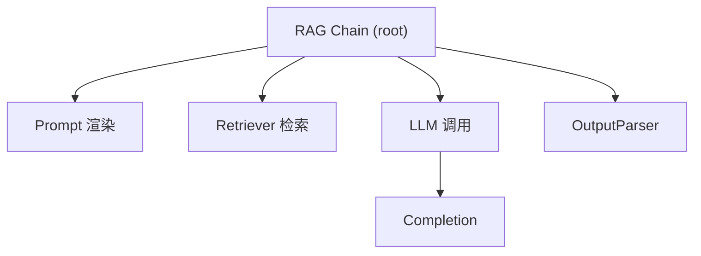

### 34.2 用 SDK 还原调用树

```python
def print_tree(run, indent=0):
    """递归打印 Trace 树"""
    print("  " * indent + f"[{run.run_type}] {run.name} ({run.latency}s)")
    for child in (run.child_runs or []):
        print_tree(child, indent + 1)

root = client.read_run(run_id="...")
print_tree(root)
```

### 34.3 找出链路中最慢的子节点

```python
def slowest_child(run):
    best = run
    for child in (run.child_runs or []):
        sc = slowest_child(child)
        if sc.latency and (not best.latency or sc.latency > best.latency):
            best = sc
    return best

root = client.read_run(run_id="...")
print("最慢节点:", slowest_child(root).name)
```

### 34.4 统计各层耗时占比

```python
def layer_stats(run, acc=None):
    if acc is None: acc = {}
    t = run.run_type
    acc[t] = acc.get(t, 0) + (run.latency or 0)
    for c in (run.child_runs or []):
        layer_stats(c, acc)
    return acc

root = client.read_run(run_id="...")
print("各层耗时:", layer_stats(root))
```

---

> 💡 **深度讲解**：把 Trace 树用 SDK 递归分析，能做很多 UI 里不方便做的事——比如自动找出"系统变慢是因为 Retriever 层涨了还是 LLM 层涨了"。这种程序化分析适合做定期健康报告。生产上，可以每周自动跑一次，生成"本周各层耗时趋势"报告。
>
> **📝 精简总结**：Tracing 深度——递归打印调用树、找最慢子节点、统计各层耗时占比；程序化分析适合做定期健康报告。

---

## 三十五、Evaluation 深度：Judge 校准

### 35.1 Judge 也会错

```python
# 校准：人工抽检 judge 的打分
# 随机抽 20 条评估结果，人工看 judge 判得对不对
# 如果 judge 和人工一致率 < 80%，说明 judge Prompt 要改
```

### 35.2 双 Judge 交叉验证

```python
# 用两个不同模型当 judge，减少单一 judge 偏差
judge1 = ChatOpenAI(model="gpt-4o-mini")
judge2 = ChatOpenAI(model="gpt-4o")
# 两个 judge 打分，取平均或多数一致
```

### 35.3 Judge 偏差类型

| 偏差 | 说明 | 对策 |
|------|------|------|
| 偏好长答案 | 长答案分高 | judge Prompt 明确"长度不加分" |
| 偏好肯定 | 爱打高分 | 严格打分标准 |
| 自我偏好 | 偏好本风格 | 用不同模型交叉 |

---

> 💡 **深度讲解**：LLM-as-judge 不是银弹，它本身有偏差。校准 judge 是专业评估的关键。一个没校准的 judge 可能所有答案都给 0.9 分，评估就失去意义了。工程上要定期人工抽检 judge 打分，发现偏差就调 judge Prompt，或用双 judge 交叉。
>
> **📝 精简总结**：Judge 校准——人工抽检一致率、双 judge 交叉验证；偏差有偏好长/偏好肯定/自我偏好；校准后评估才可信。

---

## 三十六、Prompt 迭代的 A/B 实战

### 36.1 A/B 分流

```python
import random
def route_prompt(q):
    if random.random() < 0.5:
        return prompt_v1 | llm | parser
    return prompt_v2 | llm | parser
```

### 36.2 打标分组

```python
chain_v1.invoke(q, config={"tags": ["ab", "v1"]})
chain_v2.invoke(q, config={"tags": ["ab", "v2"]})
# LangSmith 里按 tag 对比两组
```

### 36.3 对比指标

| 指标 | v1 | v2 | 结论 |
|------|----|----|------|
| 评估分 | 0.7 | 0.85 | v2 好 |
| 平均延迟 | 3s | 2.5s | v2 快 |
| 成本 | $0.01 | $0.008 | v2 省 |
| 通过率 | 70% | 85% | v2 胜 |

---

> 💡 **深度讲解**：A/B 测试是 Prompt 迭代的金标准。别"改完 Prompt 感觉更好"就上线——感觉不可靠。让真实流量在 v1/v2 上跑，用 LangSmith 对比评估分、延迟、成本，数据驱动决定全量切哪版。
>
> **📝 精简总结**：A/B 实战——随机分流、打 tag 分组、对比评估分/延迟/成本；数据驱动选型不凭感觉。

---

## 三十七、团队知识沉淀

### 37.1 把常见错误存进知识库

```python
# 每次排查的 bug，写成"问题现象→Trace→原因→修复"
# 存进团队 Wiki，新人遇到同类问题直接查
```

### 37.2 评估集即资产

评估集是团队最值钱的资产之一——它沉淀了"什么样的问题算好答案"，新人接手项目看 Dataset 就知道业务标准。

---

> 💡 **深度讲解**：LangSmith 用久了会沉淀两个资产——Dataset（什么是好答案）和 Trace 库（历史踩坑）。这俩是团队的护城河。新人接手不用从零学，看 Dataset 就懂业务标准，搜历史 Trace 就知道坑在哪。
>
> **📝 精简总结**：团队资产——Dataset 沉淀业务标准、Trace 库沉淀踩坑；新人接手看这两个就懂。

---

## 三十八、生产环境 Checklist 完整版

- [ ] 环境变量在 import 前设置
- [ ] 按环境分 Project
- [ ] 生产采样追踪
- [ ] PII 脱敏
- [ ] 成本预算告警
- [ ] 错误率监控
- [ ] 评估作 PR 门禁
- [ ] Dataset 持续更新
- [ ] 定期校准 Judge
- [ ] Trace 定期导出存档

---

> 💡 **深度讲解**：这个 checklist 是上线前的最后一道关。逐项过一遍，确保没有遗漏。生产事故往往就栽在某一条没做——忘了脱敏导致合规问题，忘了采样导致成本爆炸，忘了门禁导致质量退化。
>
> **📝 精简总结**：生产 checklist 十项——环境变量时机、分项目、采样、脱敏、成本告警、错误监控、评估门禁、Dataset 更新、Judge 校准、Trace 存档。

---

[[Home|🏠 返回首页]] · [[MOC-AI与效率工具|📚 返回分类]]

## 三十九、LangSmith 与 LangGraph 集成

### 39.1 LangGraph 自动追踪

```python
# LangGraph 每个节点自动成为一个 Span
from langgraph.graph import StateGraph
graph = StateGraph(State)
# ... 定义节点和边
app = graph.compile()
app.invoke({"input": "..."})
# LangSmith 里能看到每个节点的输入输出
```

### 39.2 查看 LangGraph 状态

```python
# Trace 里能看到每个节点的 State 变化
# 便于调试"为什么走到了这个分支"
```

### 39.3 与 Agent 调试

Agent 的每一步 ReAct 循环都是一个 Span，点开看模型"想了什么、调了什么工具"。

---

> 💡 **深度讲解**：LangGraph 的状态机流程复杂，没有追踪根本没法调试。LangSmith 把每个节点的输入输出记下来，你能看到"走到哪个分支、为什么走、状态变成什么"。这对复杂 Agent 调试是刚需。
>
> **📝 精简总结**：LangGraph 集成——每个节点自动成 Span、能看 State 变化、Agent ReAct 循环每步可查；复杂流程调试刚需。

---

## 四十、自定义 Callback 与 LangSmith 结合

### 40.1 自定义 Handler 上报到自有系统

```python
from langchain_core.callbacks import BaseCallbackHandler

class MyHandler(BaseCallbackHandler):
    def on_llm_end(self, response, **kw):
        # 除了 LangSmith，自己也记一份到自有日志
        log.info(f"LLM 调用: {response.llm_output}")
```

### 40.2 同时接 LangSmith 和自有系统

```python
chain.invoke(
    q,
    config={"callbacks": [MyHandler()]},
)
# LangSmith 自动追踪 + 自有 Handler
```

---

> 💡 **深度讲解**：LangSmith 不是唯一可观测，它和自有日志系统并行不悖。LangSmith 看执行树，自有日志看业务指标。两者互补。
>
> **📝 精简总结**：自定义 Callback 和 LangSmith 并行——LangSmith 看执行树、自有 Handler 记业务指标。

---

## 四十一、更多实战脚本

### 41.1 每周质量报告脚本

```python
def weekly_report():
    runs = list(client.list_runs(project_name="prod", limit=1000))
    err = sum(1 for r in runs if r.error)
    avg_latency = sum(r.latency or 0 for r in runs) / len(runs)
    total_tokens = sum(r.total_tokens or 0 for r in runs)
    print(f"本周 {len(runs)} 次调用，错误率 {err/len(runs):.1%}，"
          f"平均延迟 {avg_latency:.1f}s，总 token {total_tokens}")
```

### 41.2 异常告警脚本

```python
def alert_check():
    runs = list(client.list_runs(project_name="prod", limit=100))
    err_rate = sum(1 for r in runs if r.error) / len(runs)
    if err_rate > 0.05:
        send_alert(f"错误率 {err_rate:.1%} 超过 5%")
```

### 41.3 Token 周报脚本

```python
def token_report():
    runs = list(client.list_runs(project_name="prod", filter='eq(run_type,"llm")'))
    total = sum(r.total_tokens or 0 for r in runs)
    cost = total / 1000 * 0.005
    print(f"本周 LLM 成本约 ${cost:.2f}")
```

---

> 💡 **深度讲解**：把 LangSmith SDK 包成定时脚本，就是简易监控系统。不用上 Prometheus/Grafana，几个 Python 脚本就能出周报、告警。适合中小团队起步。
>
> **📝 精简总结**：实战脚本——每周质量报告、错误率告警、Token 周报；SDK 包成定时脚本就是简易监控。

---

## 四十二、与 OpenTelemetry 的关系

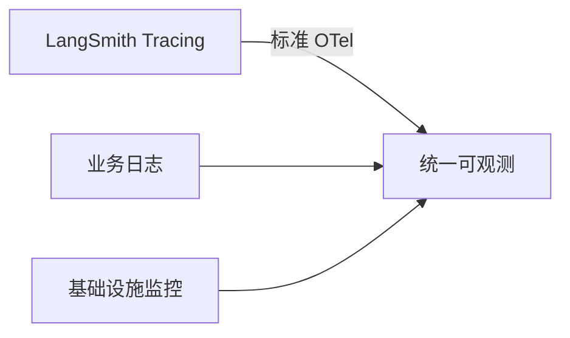

LangSmith 兼容 OpenTelemetry 标准，未来可以和公司的统一可观测平台打通。

---

> 💡 **深度讲解**：LangSmith 是 LLM 专用可观测，但企业通常已有统一可观测体系（OTel/Prometheus）。LangSmith 兼容 OTel，意味着 LLM 追踪能汇入统一大盘，不用看两套系统。
>
> **📝 精简总结**：LangSmith 兼容 OTel，能汇入企业统一可观测大盘。

---

## 四十三、补充练习题

**题16**：写脚本统计本周生产环境错误率。

<details>
<summary>答案</summary>

```python
runs = list(client.list_runs(project_name="prod"))
err = sum(1 for r in runs if r.error)
print(f"错误率 {err/len(runs):.1%}")
```
</details>

**题17**：怎么在 LangSmith 里区分 A/B 测试的两组流量？

<details>
<summary>答案</summary>
调用时 config 里打不同 tag（如 variant-a / variant-b），LangSmith 按 tag 过滤对比两组的 Trace 和指标。
</details>

**题18**：为什么评估集不能直接拿来反复迭代 Prompt？

<details>
<summary>答案</summary>
会过拟合——专门迎合这批题，线上真实问题还是答不好。要分 train/test。
</details>

**题19**：生产环境怎么避免用户 PII 进入 LangSmith？

<details>
<summary>答案</summary>
上传前用正则脱敏手机号/身份证；高敏感数据用企业版私有部署；API Key 绝不进 inputs。
</details>

**题20**：LangSmith 的 Trace 能保留多久？重要数据怎么办？

<details>
<summary>答案</summary>
付费版保留较久但有限。重要 Trace 用 SDK 导出存档到自有存储，定期备份。
</details>

---

## 四十四、结语

LangSmith 是 LLM 应用工程化的"眼睛"。没有它，你在黑盒里摸瞎；有了它，每一步调用、每一分钱、每一次好坏都看得见。从 Trace 调试到 Dataset 评估到 Prompt Hub 迭代，LangSmith 把 LLM 开发从"玄学"变成"科学"。配合 [[LangChain-组件层整合实战]]（怎么搭）和 [[LangServe-API部署与服务化]]（怎么部署），你就拥有了完整的 LLM 工程化闭环。

---

[[Home|🏠 返回首页]] · [[MOC-AI与效率工具|📚 返回分类]]

## 四十五、LangSmith SDK 速查卡

### 45.1 Client 初始化

```python
from langsmith import Client
client = Client()
```

### 45.2 Dataset 速查

```python
client.create_dataset("ds")
client.create_example(dataset_name="ds", inputs={"q": "..."}, outputs={"a": "..."})
client.create_examples(dataset_name="ds", inputs=[...], outputs=[...])
list(client.list_datasets())
list(client.list_examples(dataset_name="ds"))
client.delete_dataset(dataset_name="ds")
```

### 45.3 Run 速查

```python
list(client.list_runs(project_name="p", limit=10))
client.read_run(run_id="...")
client.delete_run(run_id="...")
client.delete_runs(project_name="old")
```

### 45.4 评估速查

```python
from langsmith.evaluation import evaluate
evaluate(chain, data="ds", evaluators=[e1, e2])
```

### 45.5 Trace 速查

```python
from langsmith import traceable
@traceable
def f(x): return x
```

### 45.6 Prompt Hub 速查

```python
from langchain import hub
hub.pull("org/prompt")
hub.pull("org/prompt:v1")
```

---

> 💡 **深度讲解**：速查卡把 SDK 常用操作浓缩成一页。日常开发不需要记住所有参数，查表即可。核心就是五个动作：建 Dataset、加 Example、查 Run、跑 evaluate、加 @traceable。
>
> **📝 精简总结**：SDK 速查卡——Client 初始化、Dataset 增删查、Run 查询、evaluate、@traceable、hub.pull；五个核心动作。

---

## 四十六、评估场景大全

### 46.1 客服场景评估

```python
# 评估：是否礼貌、是否解决问题、是否在长度内
def polite(inputs, outputs, reference_outputs):
    polite_words = ["您好", "请问", "不客气"]
    score = sum(1 for w in polite_words if w in outputs["answer"]) / 3
    return {"score": score}
```

### 46.2 RAG 场景评估

```python
def groundedness(inputs, outputs, reference_outputs):
    # 答案是否都能在检索到的上下文里找到依据
    ctx = outputs.get("context", "")
    ans = outputs["answer"]
    # 简化：检查答案关键句是否在上下文出现
    return {"score": 1 if ans[:20] in ctx else 0}
```

### 46.3 翻译场景评估

```python
def translation_quality(inputs, outputs, reference_outputs):
    # 翻译是否忠实原文、流畅
    judge = ChatOpenAI(model="gpt-4o-mini")
    r = judge.invoke(f"原文:{inputs['text']}\n译文:{outputs['translation']}\n打1-5分：")
    return {"score": int(r.content.strip()) / 5}
```

### 46.4 代码生成评估

```python
def code_correctness(inputs, outputs, reference_outputs):
    code = outputs["code"]
    try:
        compile(code, "<str>", "exec")
        return {"score": 1, "valid": True}
    except SyntaxError:
        return {"score": 0, "valid": False}
```

### 46.5 分类场景评估

```python
def classification_accuracy(inputs, outputs, reference_outputs):
    return {"score": int(outputs["label"] == reference_outputs["label"])}
```

---

> 💡 **深度讲解**：不同业务场景有不同的评估标准。客服看礼貌，RAG 看有依据，翻译看忠实，代码看可运行，分类看准确率。把这些业务标准写成评估器，就是业务质量的自动化度量。评估器的设计要"可代码化"——能用规则判断的别用 LLM，省钱又准。
>
> **📝 精简总结**：五场景评估——客服礼貌、RAG 有依据、翻译忠实、代码可运行、分类准确；能用规则就别用 LLM judge。

---

## 四十七、Trace 搜索技巧

### 47.1 过滤语法

```python
# 等于
'eq(error, true)'
# 包含
'contains(tags, "production")'
# 大于
'gt(latency, 5)'
# 组合
'eq(run_type, "llm") and gt(latency, 3)'
```

### 47.2 按时间范围

```python
from datetime import datetime, timedelta
runs = list(client.list_runs(
    project_name="prod",
    start_time=datetime.now() - timedelta(days=7),
))
```

### 47.3 按标签找特定实验

```python
runs = list(client.list_runs(
    project_name="prod",
    filter='contains(tags, "ab-test-v2")',
))
```

---

> 💡 **深度讲解**：搜索过滤是从大量 Trace 里捞目标的关键。生产一天可能几千条 Trace，不会过滤就找不到北。掌握 eq/contains/gt 和时间范围，能精准定位。
>
> **📝 精简总结**：Trace 搜索——eq/contains/gt 过滤语法、时间范围、标签过滤；生产 Trace 多时不会过滤找不到目标。

---

## 四十八、成本核算实战

### 48.1 单模型成本表

| 模型 | 输入$/1K | 输出$/1K |
|------|---------|---------|
| gpt-4o | 0.0025 | 0.01 |
| gpt-4o-mini | 0.00015 | 0.0006 |
| Claude | 0.003 | 0.015 |

### 48.2 月成本估算

```python
daily_calls = 1000
avg_prompt = 1000
avg_completion = 200
price_in = 0.0025
price_out = 0.01
monthly = 30 * daily_calls * (
    avg_prompt/1000*price_in + avg_completion/1000*price_out
)
print(f"月成本约 ${monthly:.2f}")
```

### 48.3 成本优化前后对比

| 优化 | 月成本 |
|------|--------|
| 优化前 | $300 |
| 加缓存 | $120 |
| 简单问题转mini | $50 |

---

> 💡 **深度讲解**：成本核算是生产必做。LangSmith 的成本视图让你看清实际花了多少，和估算对比。优化空间通常很大——加缓存和模型分级能省 80%。
>
> **📝 精简总结**：成本核算——单模型单价表、月成本估算公式、优化前后对比；优化空间通常很大。

---

## 四十九、团队工作流实战

### 49.1 开发→测试→生产流程

```mermaid
flowchart LR
    A[开发分支] --> B[本地跑评估]
    B --> C[PR 附评估报告]
    C --> D[评审]
    D --> E[合并 staging]
    E --> F[staging 再评估]
    F --> G[生产灰度]
    G --> H[全量]
```

### 49.2 回滚流程

```python
# 生产出问题：
# 1. 在 LangSmith 找异常 Trace
# 2. 确认是新 Prompt 导致
# 3. Prompt Hub 回滚到旧版本
# 4. 评估确认恢复
```

---

> 💡 **深度讲解**：团队工作流把 LangSmith 嵌入 CI/CD。每次改 Prompt 都要附评估报告，出问题能从 Hub 秒级回滚。这让 Prompt 迭代和代码发布一样安全可控。
>
> **📝 精简总结**：团队工作流——开发跑评估、PR 附报告、staging 再评估、灰度全量；出问题从 Prompt Hub 秒级回滚。

---

## 五十、LangSmith 常见报错与修复

### 50.1 报错表

| 报错 | 原因 | 修复 |
|------|------|------|
| 401 Unauthorized | Key 错 | 重新生成 |
| 403 Forbidden | 无权限 | 检查 Workspace |
| 404 Not Found | 项目/数据集不存在 | 先创建 |
| Trace 不上报 | 网络/防火墙 | 检查 endpoint |
| 评估卡住 | 数据集为空 | 加示例 |

### 50.2 报错修复代码

```python
# 验证连接
from langsmith import Client
try:
    client = Client()
    print(client.read_organization())
except Exception as e:
    print("连接失败:", e)
```

```python
# 指定 endpoint（企业版私有部署）
# client = Client(api_url="https://langsmith.internal.company.com")
```

---

> 💡 **深度讲解**：报错排查从认证开始——先确认 Key 有效、网络通、endpoint 对。企业版私有部署要改 api_url。
>
> **📝 精简总结**：报错表——401/403/404/上报失败/评估卡；从认证/网络/项目存在性排查；企业版改 api_url。

---

## 五十一、LangSmith 与 Datadog 等对比

### 51.1 对比维度

| 维度 | LangSmith | Datadog APM |
|------|-----------|-------------|
| 定位 | LLM 专用 | 通用 |
| 看 Prompt | 是 | 否 |
| 看 Token | 是 | 否 |
| 评估 | 内置 | 无 |
| 基础设施 | 弱 | 强 |

### 51.2 互补关系

LangSmith 看 LLM 业务逻辑，Datadog 看服务器基础设施，两者互补。

---

> 💡 **深度讲解**：LangSmith 不是替代 Datadog，是补充。Datadog 告诉你"服务挂了"，LangSmith 告诉你"为什么这次回答错了"。
>
> **📝 精简总结**：LangSmith vs Datadog——LLM 专用 vs 通用；看 Prompt/Token/评估 vs 基础设施；互补不替代。

---

## 五十二、更多练习题

**题21**：写脚本找出本周所有报错的 run 并打印错误信息。

<details>
<summary>答案</summary>

```python
runs = list(client.list_runs(project_name="prod", filter='eq(error, true)'))
for r in runs:
    print(r.name, r.error)
```
</details>

**题22**：为什么评估要分 train/test？

<details>
<summary>答案</summary>
防过拟合。train 用来迭代，test 保持干净做最终验证，避免专门迎合测试集。
</details>

**题23**：怎么把线上用户点踩的 case 转成 Dataset？

<details>
<summary>答案</summary>
点踩时给 run 打 feedback(score=0)；定期捞低分 run，人工标注后 create_example 到 Dataset。
</details>

**题24**：生产环境怎么平衡 Trace 量和成本？

<details>
<summary>答案</summary>
采样追踪（10%）、按环境分项目、报错/慢调用单独完整追踪、设预算告警。
</details>

**题25**：Judge 打分全 0.9 分怎么办？

<details>
<summary>答案</summary>
judge 太宽松。改 judge Prompt 明确扣分标准、加"部分正确给 0.5、错误给 0"的分级、人工抽检校准。
</details>

---

## 五十三、LangSmith 知识地图

```mermaid
mindmap
  root((LangSmith))
    配置
      环境变量三剑客
      项目设置
    Tracing
      Trace/Span 树
      自动/手动
      耗时/Token/成本
    Dataset
      题库
      版本/train-test
    Evaluation
      LLM-as-judge
      自定义评估器
    PromptHub
      版本/A/B
    生产
      采样/脱敏/告警
    对比
      Langfuse/Phoenix/W&B
```

---

> 💡 **深度讲解**：LangSmith 的知识地图就是"四件套+生产实践"。掌握四件套（Trace/Dataset/Eval/Hub），再加上生产的采样/脱敏/告警，就完整了。
>
> **📝 精简总结**：知识地图——配置、Tracing、Dataset、Evaluation、PromptHub、生产实践、工具对比；四件套加生产实践即完整。

---

## 五十四、结语与延伸阅读

LangSmith 让 LLM 应用从"不可测"走向"可观测、可评估、可迭代"。它和 LangChain/LangServe 一起，构成 LLM 工程化铁三角。下一步建议：

1. 开通 LangSmith，把现有链接上自动追踪
2. 攒 20 条 Dataset 跑第一次评估
3. 把关键 Prompt 推到 Hub 管理版本
4. 生产开启采样和成本告警

---

[[Home|🏠 返回首页]] · [[MOC-AI与效率工具|📚 返回分类]]

## 五十五、完整实战：从零搭建 LLM 质量监控体系

### 55.1 体系架构

```mermaid
flowchart TB
    A[生产链] -->|Trace| B[LangSmith]
    B --> C[每日评估跑批]
    C --> D{质量阈值?}
    D -->|不达标| E[告警]
    D -->|达标| F[正常]
    E --> G[人工排查]
    G --> H[修复]
    H --> C
```

### 55.2 每日评估脚本

```python
# daily_eval.py
from langsmith.evaluation import evaluate
from dotenv import load_dotenv
load_dotenv()

def run_daily_eval():
    results = evaluate(
        my_production_chain,
        data="rag-qa-test",
        evaluators=[correctness, faithfulness, safety],
        experiment_prefix=f"daily-{date.today()}",
    )
    avg = sum(r.score for r in results["results"]) / len(results["results"])
    if avg < 0.8:
        send_alert(f"今日评估分 {avg:.2f} 低于 0.8")
    return avg
```

### 55.3 告警通知

```python
def send_alert(msg):
    # 发 Slack/邮件
    print(f"[ALERT] {msg}")
```

### 55.4 质量趋势看板

```python
# 拉历史评估结果画趋势
# from langsmith import client
# runs = client.list_runs(project_name="eval")
# 用 matplotlib 画平均分随时间曲线
```

---

> 💡 **深度讲解**：完整质量监控体系 = Trace 收集 + 每日评估 + 阈值告警 + 趋势看板。这把"出了问题才发现"变成"质量在下滑就预警"。是 LLM 应用生产化的终极形态。
>
> **📝 精简总结**：质量监控体系——Trace 收集、每日评估跑批、阈值告警、趋势看板；从事后排查变成事前预警。

---

## 五十六、LangSmith 与 Prompt 工程深度结合

### 56.1 Prompt 迭代闭环

```mermaid
flowchart LR
    A[线上 Trace] -->|发现问题| B[改 Prompt]
    B --> C[Hub 存新版本]
    C --> D[跑评估]
    D --> E{分数提升?}
    E -->|是| F[灰度上线]
    E -->|否| B
```

### 56.2 Prompt 变更记录

每次改 Prompt 都在 Hub 留版本，附"改了什么、为什么改、评估分"，形成变更日志。

### 56.3 回滚能力

```python
# 生产异常，秒级回滚到上一版
prompt = hub.pull("org/assistant:v5")  # 之前是 v6 出问题
```

---

> 💡 **深度讲解**：Prompt 迭代闭环让改 Prompt 像改代码一样有版本、有评估、能回滚。这是 Prompt 工程化的标志——不再"凭感觉改完祈祷"。
>
> **📝 精简总结**：Prompt 迭代闭环——线上发现问题、Hub 改版本、跑评估、灰度上线、可秒级回滚；Prompt 工程化标志。

---

## 五十七、多环境管理

### 57.1 环境隔离

| 环境 | Project | 数据 |
|------|---------|------|
| dev | dev | 开发测试 |
| staging | staging | 预发 |
| prod | prod | 生产 |

### 57.2 环境切换代码

```python
import os
env = os.getenv("ENV", "dev")
os.environ["LANGSMITH_PROJECT"] = f"rag-{env}"
```

---

> 💡 **深度讲解**：环境隔离避免开发噪声污染生产监控。dev 随便跑，prod 才是监控对象。
>
> **📝 精简总结**：多环境——dev/staging/prod 分 Project；按 ENV 环境变量切换。

---

## 五十八、成本控制深入

### 58.1 成本中心

| 成本项 | 占比 | 优化 |
|--------|------|------|
| LLM 调用 | 80% | 小模型/缓存 |
| 评估 | 15% | 精选用例 |
| LangSmith 订阅 | 5% | 采样 |

### 58.2 预算告警

```python
# 设月度预算，超 80% 告警
# LangSmith Settings -> Budget
```

---

> 💡 **深度讲解**：成本主要花在 LLM 调用，优化大头在这。评估成本也要控制——Dataset 别太大。
>
> **📝 精简总结**：成本中心——LLM 调用占 80%、评估 15%、订阅 5%；优化抓 LLM 大头。

---

## 五十九、隐私合规深入

### 59.1 数据分类处理

```python
# 分级处理
def process_trace(inputs):
    if "phone" in inputs:
        inputs = desensitize(inputs)  # 脱敏
    return inputs
```

### 59.2 数据保留策略

```python
# 定期清理旧 Trace，合规要求
# client.delete_runs(project_name="prod", before="2026-01-01")
```

---

> 💡 **深度讲解**：合规不只是脱敏，还有数据保留——用户对话不能无限期存。定期清理旧 Trace 是合规要求。
>
> **📝 精简总结**：隐私合规——分级脱敏、定期清理旧 Trace、保留策略合规。

---

## 六十、SDK 实战代码 50 例

### 60.1 基础连接

```python
from langsmith import Client
client = Client()
```

```python
client.read_organization()
```

```python
list(client.list_projects())
```

### 60.2 数据集操作

```python
client.create_dataset("demo-ds", description="演示")
```

```python
client.create_example(
    dataset_name="demo-ds",
    inputs={"q": "问题1"},
    outputs={"a": "答案1"},
)
```

```python
client.create_examples(
    dataset_name="demo-ds",
    inputs=[{"q": "q1"}, {"q": "q2"}],
    outputs=[{"a": "a1"}, {"a": "a2"}],
)
```

```python
list(client.list_datasets())
```

```python
list(client.list_examples(dataset_name="demo-ds"))
```

### 60.3 Run 查询

```python
list(client.list_runs(project_name="p", limit=5))
```

```python
client.read_run(run_id="...")
```

```python
list(client.list_runs(project_name="p", filter='eq(error, true)'))
```

```python
list(client.list_runs(project_name="p", filter='eq(run_type, "llm")'))
```

```python
list(client.list_runs(project_name="p", filter='gt(latency, 5)'))
```

### 60.4 评估

```python
from langsmith.evaluation import evaluate
```

```python
evaluate(lambda x: "固定答案", data="demo-ds", evaluators=[lambda i,o,r: {"score": 1}])
```

### 60.5 Trace 装饰器

```python
from langsmith import traceable
```

```python
@traceable
def step1(x): return x
```

```python
@traceable(run_type="llm")
def call_model(x): return "..."
```

```python
@traceable(name="pipeline")
def pipeline(x):
    a = step1(x)
    return a
```

### 60.6 标签与元数据

```python
chain.invoke(x, config={"tags": ["prod"]})
```

```python
chain.invoke(x, config={"metadata": {"version": "1.0"}})
```

### 60.7 Prompt Hub

```python
from langchain import hub
```

```python
hub.pull("org/prompt")
```

```python
hub.pull("org/prompt:v1")
```

### 60.8 反馈

```python
# client.create_feedback(run_id="...", key="rating", score=5)
```

### 60.9 统计分析

```python
runs = list(client.list_runs(project_name="p", limit=100))
```

```python
sum(1 for r in runs if r.error) / len(runs)
```

```python
sum(r.total_tokens or 0 for r in runs)
```

### 60.10 导出

```python
import csv
```

```python
# with open("out.csv", "w") as f: ...
```

### 60.11 过滤组合

```python
filter_expr = 'eq(run_type, "llm") and gt(latency, 3)'
```

### 60.12 时间范围

```python
from datetime import datetime, timedelta
```

```python
start = datetime.now() - timedelta(days=7)
```

### 60.13 并发评估

```python
evaluate(chain, data="ds", evaluators=[e1, e2])
```

### 60.14 实验前缀

```python
evaluate(chain, data="ds", evaluators=[e], experiment_prefix="v2")
```

### 60.15 删除

```python
# client.delete_run(run_id="...")
```

---

> 💡 **深度讲解**：50 例速查覆盖日常所有操作。记住常用的：建数据集、加示例、查 run、跑评估、加 traceable。其余需要时查表。
>
> **📝 精简总结**：SDK 50 例覆盖连接/数据集/run 查询/评估/装饰器/标签/Hub/反馈/统计/导出/过滤/时间/并发/实验/删除；日常查表即用。

---

## 六十一、更多对比表格

### 61.1 LangSmith 版本对比

| 版本 | 价格 | 功能 |
|------|------|------|
| 免费 | $0 | 有限追踪 |
| 付费 | 按量 | 完整功能 |
| 企业 | 定制 | 私有部署 |

### 61.2 评估器类型对比

| 类型 | 成本 | 准确度 | 适用 |
|------|------|--------|------|
| 代码规则 | 0 | 高（规则化） | 格式/长度 |
| LLM-as-judge | 中 | 中 | 语义判断 |
| 人工 | 高 | 最高 | 关键case |

---

> 💡 **深度讲解**：版本选型看预算和数据敏感度；评估器选型看问题能不能规则化。
>
> **📝 精简总结**：版本对比——免费/付费/企业；评估器对比——代码规则/LLM judge/人工；按场景选。

---

## 六十二、完整实战：RAG 系统质量保障闭环

### 62.1 闭环流程图

```mermaid
flowchart TD
    A[线上 RAG] -->|Trace| B[LangSmith]
    B --> C[每日自动评估]
    C --> D{质量分}
    D -->|>0.85| E[健康]
    D -->|<0.8| F[告警]
    F --> G[查失败 Trace]
    G --> H[定位检索/Prompt/模型]
    H --> I[修复]
    I --> C
```

### 62.2 完整代码

```python
# quality_gate.py
from langsmith import Client
from langsmith.evaluation import evaluate
from dotenv import load_dotenv
load_dotenv()

client = Client()

def evaluate_today():
    results = evaluate(
        production_chain,
        data="rag-qa-test",
        evaluators=[correctness, faithfulness],
        experiment_prefix=f"daily-{today}",
    )
    avg = sum(r.score for r in results["results"]) / len(results["results"])
    return avg

def health_check():
    score = evaluate_today()
    if score < 0.8:
        alert(f"质量分 {score} 低于阈值")
    return score
```

### 62.3 失败 case 聚类

```python
def cluster_failures(results):
    """把失败的评估结果按问题类型聚类"""
    buckets = {}
    for r in results["results"]:
        if r.score < 0.5:
            kind = classify_failure(r)
            buckets.setdefault(kind, []).append(r)
    return buckets
```

---

> 💡 **深度讲解**：质量保障闭环把"评估"从一次性动作变成持续机制。每天自动跑，分数下滑就告警，失败 case 聚类告诉团队"这周主要错在哪类问题"。这是生产 LLM 系统的标配。
>
> **📝 精简总结**：质量保障闭环——Trace 收集、每日自动评估、阈值告警、失败 case 聚类；持续质量监控。

---

## 六十三、LangSmith 内部架构理解

### 63.1 数据模型

```mermaid
erDiagram
    Organization ||--o{ Project : has
    Project ||--o{ Run : has
    Run ||--o{ Run : parent
    Dataset ||--o{ Example : has
    Run ||--o{ Feedback : has
```

### 63.2 上报流程

```python
# 链执行 -> Callback -> HTTP 上报 -> 存储 -> UI 查询
```

---

> 💡 **深度讲解**：理解数据模型有助于用好过滤和查询。Run 是核心，嵌套成树；Feedback 挂在 Run 上；Dataset 和 Run 通过评估关联。
>
> **📝 精简总结**：数据模型——Organization/Project/Run/Dataset/Example/Feedback；Run 嵌套成树；理解模型助查询。

---

## 六十四、更多练习题

**题26**：设计一个"质量分低于阈值自动告警"的方案。

<details>
<summary>答案</summary>
每日跑 evaluate，平均分低于阈值就调告警函数发通知。结合 LangSmith 定时任务或外部 cron。
</details>

**题27**：怎么发现"Prompt 改版后某类问题退化了"？

<details>
<summary>答案</summary>
新旧版都跑同一 Dataset，按评估器分组对比，看哪个评估器分数下降最多，就是哪类问题退化。
</details>

**题28**：LangSmith 的 Trace 能导出给审计吗？

<details>
<summary>答案</summary>
可以用 SDK list_runs 导出全部数据到 CSV/JSON，存档审计。
</details>

**题29**：评估器返回 None 会怎样？

<details>
<summary>答案</summary>
LangSmith 视为该条未打分，不计入平均。要确保评估器总返回数字。
</details>

**题30**：怎么评估 Agent 的工具调用正确性？

<details>
<summary>答案</summary>
在评估器里检查 outputs 里的 tool_calls 是否合理——该调的工具调了、参数对了没。
</details>

---

## 六十五、与 Langfuse 迁移

### 65.1 迁移考量

| 维度 | LangSmith | Langfuse |
|------|-----------|----------|
| 数据 | 云端 | 自托管 |
| 代码改动 | 小 | 中 |
| 运维 | 无 | 有 |

### 65.2 迁移步骤

```mermaid
flowchart LR
    A[评估需求] --> B[Langfuse 自托管]
    B --> C[改 CallbackHandler]
    C --> D[并行跑双平台]
    D --> E[验证后切流]
```

---

> 💡 **深度讲解**：从 LangSmith 迁到 Langfuse 不难，都是 Callback 接口。关键是数据自控的需求有多强。并行跑双平台验证后再切。
>
> **📝 精简总结**：迁移——评估需求、自托管、改 Callback、并行验证后切流。

---

## 六十六、最终知识地图

```mermaid
mindmap
  root((LangSmith完整掌握))
    上手
      注册Key
      环境变量
    Tracing
      看执行树
      找慢点
    Dataset
      攒用例
      train/test
    Evaluation
      judge校准
      多维评估
    Hub
      版本/A/B
    生产
      采样脱敏
      告警监控
    对比
      Langfuse
```

---

> 💡 **深度讲解**：掌握 LangSmith 的标志是——能独立完成"开追踪→攒数据集→跑评估→改Prompt→看对比→上线监控"全流程。
>
> **📝 精简总结**：最终知识地图覆盖上手/Tracing/Dataset/Eval/Hub/生产/对比；掌握标志是独立走完全流程。

---

[[Home|🏠 返回首页]] · [[MOC-AI与效率工具|📚 返回分类]]

## 六十七、生产监控完整代码

### 67.1 监控指标采集

```python
# monitor.py
from langsmith import Client
from datetime import datetime, timedelta

client = Client()

def collect_metrics():
    since = datetime.now() - timedelta(hours=1)
    runs = list(client.list_runs(
        project_name="prod",
        start_time=since,
    ))
    total = len(runs)
    errors = sum(1 for r in runs if r.error)
    avg_latency = sum(r.latency or 0 for r in runs) / max(total, 1)
    tokens = sum(r.total_tokens or 0 for r in runs)
    return {
        "total": total,
        "error_rate": errors / max(total, 1),
        "avg_latency": avg_latency,
        "tokens": tokens,
    }
```

### 67.2 告警规则

```python
def check_alerts(m):
    alerts = []
    if m["error_rate"] > 0.05:
        alerts.append(f"错误率 {m['error_rate']:.1%}")
    if m["avg_latency"] > 10:
        alerts.append(f"平均延迟 {m['avg_latency']:.1f}s")
    return alerts
```

### 67.3 定时任务

```python
# 每小时跑一次
# schedule.every().hour.do(lambda: alert_check())
```

---

> 💡 **深度讲解**：把监控写成代码，比纯 UI 看板更灵活——可以接任意告警渠道、自定义指标。中小团队用 SDK 写几个脚本就够了，不必上复杂监控系统。
>
> **📝 精简总结**：生产监控代码——采集指标（总量/错误率/延迟/token）、告警规则、定时任务；SDK 写脚本即可。

---

## 六十八、LangSmith 成本优化实战

### 68.1 采样策略

```python
import random
def sample_trace():
    return random.random() < 0.1   # 10%
```

### 68.2 按错误完整追踪

```python
# 正常请求采样，错误请求全量
if should_trace():
    chain.invoke(q, config={"callbacks": [langsmith_handler]})
```

### 68.3 数据保留

```python
# 定期删旧数据降成本
# client.delete_runs(project_name="prod", before="2026-01-01")
```

---

> 💡 **深度讲解**：成本优化三招——采样、错误全量、定期清理。既保留排查能力又控成本。
>
> **📝 精简总结**：成本优化——10% 采样、错误全量、定期清理旧数据。

---

## 六十九、团队协作深入

### 69.1 Trace 评论

在 Trace 上评论@同事，附完整复现信息。

### 69.2 知识库沉淀

把"问题→Trace→原因→修复"写成团队 Wiki。

### 69.3 新人 onboarding

新人看 Dataset 学业务标准，看 Trace 库学历史坑。

---

> 💡 **深度讲解**：团队协作的本质是"共享上下文"。Trace 评论比口头沟通高效十倍。Dataset 和 Trace 库是团队资产。
>
> **📝 精简总结**：团队协作——Trace 评论共享上下文、Wiki 沉淀、新人看 Dataset/Trace 库 onboarding。

---

## 七十、更多表格

### 70.1 功能对比总表

| 功能 | LangSmith | Langfuse | Phoenix | W&B |
|------|-----------|----------|---------|-----|
| Tracing | ✅ | ✅ | ✅ | ✅ |
| Eval | ✅ | ✅ | ✅ | 部分 |
| Prompt管理 | ✅ | ✅ | ❌ | ❌ |
| 开源 | ❌ | ✅ | ✅ | ❌ |
| 自托管 | 企业版 | ✅ | ✅ | ❌ |
| LangChain | 原生 | ✅ | ✅ | 中 |

### 70.2 选型决策

| 你的情况 | 选 |
|----------|---|
| LangChain 用户，快上手 | LangSmith |
| 数据敏感要自托管 | Langfuse |
| ML 研究 | Phoenix/W&B |
| 预算有限 | Langfuse 开源 |

---

> 💡 **深度讲解**：选型决策表直接对号入座。LangChain 用户首选 LangSmith，数据敏感选 Langfuse。
>
> **📝 精简总结**：功能对比表+选型决策表；LangChain 选 LangSmith、敏感选 Langfuse、ML 研究选 Phoenix/W&B。

---

## 七十一、补充练习题

**题31**：写脚本统计本周 token 成本并对比上周。

<details>
<summary>答案</summary>
分别拉本周和上周的 llm runs，算 token 总和乘以单价，对比变化。
</details>

**题32**：为什么错误请求要全量追踪？

<details>
<summary>答案</summary>
错误是排查重点，采样可能漏掉；正常请求采样降成本，错误全量保排查能力。
</details>

**题33**：怎么评估 Agent 是否正确调用了工具？

<details>
<summary>答案</summary>
评估器里检查 outputs 的 tool_calls：该调的工具调了、参数对不对、有没有乱调。
</details>

**题34**：LangSmith 的 Dataset 为什么不可变？

<details>
<summary>答案</summary>
保证评估可复现——同一 Dataset 跑两次结果可比，修改会创建新版本而非覆盖。
</details>

**题35**：怎么把 LangSmith 接入 Slack 告警？

<details>
<summary>答案</summary>
监控脚本检测到异常，调 Slack Webhook 发消息。LangSmith 也可配 webhook。
</details>

---

[[Home|🏠 返回首页]] · [[MOC-AI与效率工具|📚 返回分类]]

## 七十二、LangSmith 高级评估模式

### 72.1 参考式评估 vs 无参考评估

| 模式 | 需要参考答案 | 适用 |
|------|-------------|------|
| 有参考 | 是 | 有标准答案 |
| 无参考 | 否 | 开放式生成 |

```python
# 无参考：评估答案本身的质量
def self_contained(inputs, outputs, reference_outputs):
    judge = ChatOpenAI(model="gpt-4o-mini")
    r = judge.invoke(f"答案是否合理：{outputs['answer']}？1-5分")
    return {"score": int(r.content.strip()) / 5}
```

### 72.2 成对比较评估

```python
# 比较两个版本哪个好
def pairwise(answer_a, answer_b, question):
    judge = ChatOpenAI(model="gpt-4o-mini")
    r = judge.invoke(f"问题:{question}\nA:{answer_a}\nB:{answer_b}\n哪个更好？A/B/平局")
    return r.content
```

### 72.3 多评估器加权

```python
# 综合分 = 0.6*正确性 + 0.2*忠实 + 0.2*安全
def aggregate(scores):
    return 0.6*scores["correctness"] + 0.2*scores["faithfulness"] + 0.2*scores["safety"]
```

---

> 💡 **深度讲解**：高级评估模式让评估更贴近实际——有参考用标准答案，无参考评开放生成，成对比较直接选优，多评估器加权出综合分。这些是专业团队的做法。
>
> **📝 精简总结**：高级评估——有参考/无参考、成对比较、多评估器加权；专业团队做法。

---

## 七十三、Prompt Hub 高级用法

### 73.1 环境变量注入 Prompt

```python
# Prompt 里用 {env} 变量，运行时注入
# 生产环境注入 prod 配置
```

### 73.2 Prompt 测试集

```python
# 每个 Prompt 版本配一个测试集，改完自动跑
```

### 73.3 Prompt 变更审批

```python
# 企业版：改 Prompt 需要审批，防误操作
```

---

> 💡 **深度讲解**：Prompt Hub 高级用法让 Prompt 管理像代码——有测试、有审批、有环境变量注入。
>
> **📝 精简总结**：Prompt Hub 高级——环境变量注入、配测试集、变更审批；像管代码一样管 Prompt。

---

## 七十四、LangSmith 与 CI/CD 集成

### 74.1 GitHub Actions 示例

```yaml
# .github/workflows/eval.yml
# name: Eval
# on: [pull_request]
# jobs:
#   eval:
#     runs-on: ubuntu-latest
#     steps:
#       - uses: actions/checkout@v4
#       - run: pip install -r requirements.txt
#       - run: python run_eval.py
#         env:
#           LANGSMITH_API_KEY: ${{ secrets.LANGSMITH_API_KEY }}
```

### 74.2 评估作为门禁

```python
# run_eval.py
score = run_evaluation()
if score < 0.8:
    print(f"评估分 {score} 低于阈值")
    exit(1)
```

---

> 💡 **深度讲解**：CI 集成让评估自动化——每个 PR 自动跑，不达标不能合并。这是质量保障的工程化。
>
> **📝 精简总结**：CI 集成——GitHub Actions 跑评估、评估分作门禁不达标阻止合并。

---

## 七十五、更多深度表格

### 75.1 评估器选型表

| 评估目标 | 评估器类型 |
|----------|-----------|
| 格式正确 | 代码规则 |
| 语义正确 | LLM-as-judge |
| 事实忠实 | RAG 专用评估器 |
| 安全 | 规则+LLM |
| 人类偏好 | 成对比较 |

### 75.2 成本优化效果表

| 措施 | 节省 |
|------|------|
| 缓存重复请求 | 50-80% |
| 简单问题转 mini | 60-70% |
| 截断历史 | 20-40% |
| max_tokens | 10-20% |

---

> 💡 **深度讲解**：选型表和效果表直接指导决策。
>
> **📝 精简总结**：评估器选型表、成本优化效果表；直接指导决策。

---

## 七十六、完整实战：从 0 到 1 上 LangSmith

### 76.1 第一步：开通与配置

```python
import os
os.environ["LANGSMITH_TRACING"] = "true"
os.environ["LANGSMITH_API_KEY"] = "lsv2_..."
os.environ["LANGSMITH_PROJECT"] = "my-app"
```

### 76.2 第二步：看第一次 Trace

```python
from langchain_openai import ChatOpenAI
ChatOpenAI(model="gpt-4o-mini").invoke("你好")
# 去 LangSmith 看这次调用
```

### 76.3 第三步：攒第一个 Dataset

```python
from langsmith import Client
client = Client()
client.create_dataset("qa-v1", description="问答测试集")
client.create_examples(
    dataset_name="qa-v1",
    inputs=[{"question": "..."}, {"question": "..."}],
    outputs=[{"answer": "..."}, {"answer": "..."}],
)
```

### 76.4 第四步：跑第一次评估

```python
from langsmith.evaluation import evaluate
evaluate(my_chain, data="qa-v1", evaluators=[my_eval])
```

### 76.5 第五步：把 Prompt 推到 Hub

```python
from langchain import hub
# prompt.push("org/assistant")
```

### 76.6 第六步：生产采样与告警

```python
import random
trace = random.random() < 0.1
```

---

> 💡 **深度讲解**：从 0 到 1 的六步路径——开通配置、看 Trace、攒 Dataset、跑评估、推 Hub、生产采样告警。走完这六步，LangSmith 就用起来了。
>
> **📝 精简总结**：六步上手指南——配置、看 Trace、攒 Dataset、跑评估、推 Hub、生产采样告警。

---

## 七十七、LangSmith 常见认知误区

### 误区1："开了追踪就能优化"

追踪只是看见，优化要靠人分析和改代码。

### 误区2："评估分高就万事大吉"

评估集可能不代表线上，要持续补充。

### 误区3："LangSmith 替代所有监控"

它只看 LLM 业务，基础设施监控还要 Datadog。

### 误区4："Dataset 一次建好就行"

Dataset 要持续从线上补充，不然过时。

---

> 💡 **深度讲解**：认知误区反映新手常见误解。LangSmith 是工具，不是银弹——它帮你看见，决策和优化还要人做。
>
> **📝 精简总结**：四大误区——追踪不等于优化、评估分不等于真实好、LangSmith 不替代基础设施监控、Dataset 要持续更新。

---

## 七十八、更多练习题

**题36**：写一个完整的"从 Trace 捞失败 case 到 Dataset"的脚本。

<details>
<summary>答案</summary>
list_runs 找 error/低分的 run，把 inputs 取出 create_example 到 Dataset。
</details>

**题37**：为什么评估要设 experiment_prefix？

<details>
<summary>答案</summary>
区分不同版本/批次的评估结果，便于对比。没有 prefix 会混在一起。
</details>

**题38**：怎么评估流式输出的质量？

<details>
<summary>答案</summary>
对流式最终结果做常规评估；另外评估首字时间（TFT）这种体验指标。
</details>

**题39**：LangSmith 的 feedback 和 evaluation 有什么区别？

<details>
<summary>答案</summary>
feedback 是单次 run 的人工/自动打分；evaluation 是跑整个 Dataset 的批量评估。feedback 是点，evaluation 是面。
</details>

**题40**：生产环境怎么避免误删 Dataset？

<details>
<summary>答案</summary>
Dataset 不可变（改了新建版本），删除操作要谨慎；重要 Dataset 用 SDK 备份导出。
</details>

---

## 七十九、结语

LangSmith 是 LLM 工程化的眼睛。掌握它，你的 LLM 应用才真正从"能跑"走向"可观测、可评估、可优化"。本文覆盖了注册配置、Tracing、Dataset、Evaluation、Prompt Hub、SDK、生产实践、工具对比全部内容。配合 LangChain（怎么搭）和 LangServe（怎么部署），形成完整闭环。

---

[[Home|🏠 返回首页]] · [[MOC-AI与效率工具|📚 返回分类]]

## 八十、LangSmith SDK 高级查询实战

### 80.1 找某用户所有对话

```python
runs = list(client.list_runs(
    project_name="prod",
    filter='eq(metadata.user_id, "u123")',
))
```

### 80.2 找某时间段的高成本调用

```python
runs = list(client.list_runs(
    project_name="prod",
    filter='eq(run_type, "llm")',
))
expensive = sorted(runs, key=lambda r: -(r.total_tokens or 0))[:10]
```

### 80.3 统计模型分布

```python
from collections import Counter
runs = list(client.list_runs(project_name="prod", filter='eq(run_type,"llm")'))
models = Counter(r.extra.get("model") for r in runs)
print(models)
```

### 80.4 追踪特定版本

```python
runs = list(client.list_runs(
    project_name="prod",
    filter='eq(metadata.version, "v2.1")',
))
```

---

> 💡 **深度讲解**：高级查询让你能按用户、成本、模型、版本切片分析。这些是生产排错和成本分析的利器。
>
> **📝 精简总结**：高级查询——按用户、高成本、模型分布、版本切片分析。

---

## 八十一、评估结果解读

### 81.1 看平均分

平均分给整体印象，但别只看平均。

### 81.2 看分布

```python
# 分数分布：是集中在 0.8 还是两极分化？
# 两极分化说明有 case 类型要专门优化
```

### 81.3 看失败 case

失败 case 是优化重点，比成功 case 更有价值。

---

> 💡 **深度讲解**：评估结果解读要看分布和失败 case，不能只看平均分。两极分化说明某类问题要专项优化。
>
> **📝 精简总结**：评估解读——平均分、分布、失败 case；失败 case 是优化重点。

---

## 八十二、LangSmith 与 LangChain 版本兼容

```python
# LangSmith SDK 和 langchain 版本要匹配
# pip install langsmith langchain --upgrade
```

---

> 💡 **深度讲解**：版本不兼容会导致 Trace 不上报或字段缺失。保持 langchain 和 langsmith 同时升级。
>
> **📝 精简总结**：langsmith 和 langchain 版本要匹配，同时升级。

---

## 八十三、更多练习题

**题41**：写脚本找出本周成本最高的 10 次 LLM 调用。

<details>
<summary>答案</summary>
list_runs 取 llm 类型，按 total_tokens 排序取前 10。
</details>

**题42**：怎么对比两次评估哪个好？

<details>
<summary>答案</summary>
两次用不同 experiment_prefix，LangSmith 里并排对比平均分和失败 case。
</details>

**题43**：评估时 Dataset 太大跑太慢怎么办？

<details>
<summary>答案</summary>
抽样跑（取代表性子集），或分级评估——日常跑小集，重大改版跑全量。
</details>

**题44**：LangSmith 怎么和企业 SSO 对接？

<details>
<summary>答案</summary>
企业版支持 SSO/SAML，在 Settings 配置。
</details>

**题45**：怎么知道某条 Trace 是哪个版本代码产生的？

<details>
<summary>答案</summary>
调用时 config.metadata 里带上 version，Trace 里就能过滤。
</details>

---

## 八十四、最终总结

LangSmith 把 LLM 应用从黑盒变成可观测的系统。四件套——Trace、Dataset、Evaluation、Prompt Hub——覆盖了"看、测、评、管"全链路。生产实践加上采样、脱敏、告警。工具对比帮你选型。掌握这些，你就能给任何 LLM 应用装上眼睛。

---

[[Home|🏠 返回首页]] · [[MOC-AI与效率工具|📚 返回分类]]

## 八十五、LangSmith 生产实战清单

### 85.1 上线前检查

- [ ] 环境变量在 import 前
- [ ] 按环境分 Project
- [ ] 生产采样
- [ ] PII 脱敏
- [ ] 成本预算告警
- [ ] 错误率监控
- [ ] 评估门禁
- [ ] Dataset 更新流程
- [ ] Judge 校准
- [ ] Trace 存档

### 85.2 日常运维

| 频率 | 任务 |
|------|------|
| 每日 | 看评估分趋势 |
| 每周 | 成本复盘 |
| 每月 | Dataset 更新、Judge 校准 |

---

> 💡 **深度讲解**：生产实战清单和运维节奏让 LangSmith 真正用起来，不是开通就完事。
>
> **📝 精简总结**：上线十项检查+日常运维节奏（每日/每周/每月）。

---

## 八十六、补充深度内容

### 86.1 Trace 的 run_id 用途

run_id 是每次调用的唯一标识，用于跨系统关联（比如你的业务系统订单号和 LangSmith Trace 关联）。

```python
import uuid
run_id = str(uuid.uuid4())
chain.invoke(q, config={"run_id": run_id})
# 业务系统记录 run_id，出问题时按 run_id 查 Trace
```

### 86.2 自定义 metadata 的业务价值

metadata 让你能按业务维度筛选 Trace——按租户、按用户、按版本、按流量来源。

```python
chain.invoke(q, config={"metadata": {"tenant": "acme", "channel": "web"}})
```

### 86.3 tags vs metadata

| 字段 | 用途 | 例子 |
|------|------|------|
| tags | 标签，多选过滤 | ["prod","v2"] |
| metadata | 键值对，精确查询 | {"user":"u1"} |

---

> 💡 **深度讲解**：run_id 跨系统关联、metadata 业务维度筛选、tags vs metadata 的区别——这些是高级用法，让 Trace 真正服务业务分析。
>
> **📝 精简总结**：run_id 跨系统关联、metadata 业务筛选、tags 多选 metadata 精确；高级用法。

---

## 八十七、更多练习题

**题46**：为什么要在 import langchain 之前设环境变量？

<details>
<summary>答案</summary>
langchain import 时读环境变量初始化全局客户端，之后再设不生效。
</details>

**题47**：怎么让 LangSmith Trace 带上业务订单号？

<details>
<summary>答案</summary>
config.run_id 或 metadata 里放订单号，Trace 里就能按订单号查。
</details>

**题48**：评估器打分不稳定怎么办？

<details>
<summary>答案</summary>
固定 judge 模型 temperature=0，多次评估取平均，或用更强 judge。
</details>

**题49**：LangSmith 免费版够用吗？

<details>
<summary>答案</summary>
开发原型够用；生产全量追踪要付费版。
</details>

**题50**：怎么把 Trace 导出给外部审计？

<details>
<summary>答案</summary>
SDK list_runs 导出全部到 JSON/CSV。
</details>

---

## 八十八、结语

本文系统覆盖了 LangSmith 的注册配置、Tracing、Dataset、Evaluation、Prompt Hub、SDK、生产实践、工具对比全部内容，并配套 50+ 代码示例和梯度练习题。LangSmith 是 LLM 工程化的眼睛，掌握它，你的 LLM 应用才可观测、可评估、可优化。下一篇 [[LangServe-API部署与服务化]] 讲怎么把链部署成 API。

---

[[Home|🏠 返回首页]] · [[MOC-AI与效率工具|📚 返回分类]]

## 八十九、LangSmith 知识图谱总图

```mermaid
mindmap
  root((LangSmith))
    配置
      三环境变量
      项目分环境
    Tracing
      Trace/Span 树
      自动/手动
      耗时/Token/成本分析
    Dataset
      创建/上传/版本
      train/test
    Evaluation
      LLM-as-judge
      自定义评估器
      judge校准
    PromptHub
      版本/A/B
      在线调试
    SDK
      Client/Run/Feedback
      自动化
    生产
      采样/脱敏/告警
      CI/CD集成
    对比
      Langfuse/Phoenix/W&B
```

---

> 💡 **深度讲解**：知识总图帮你回顾全文结构。LangSmith 八大块——配置、Tracing、Dataset、Evaluation、PromptHub、SDK、生产、对比。
>
> **📝 精简总结**：知识总图八大块；回顾全文结构。

---

## 九十、最后补充：LangSmith 与 LangChain 版本对应

```python
# langchain 0.3+ 对应 langsmith 最新
# 升级时两者一起升
```

---

> 💡 **深度讲解**：版本对应很重要，老版本 langchain 配新 langsmith 可能字段缺失。
>
> **📝 精简总结**：langchain 和 langsmith 版本一起升。

---

## 九十一、补充练习题答案要点

**题51**：设计一个"用户反馈→Dataset→评估"闭环。

<details>
<summary>要点</summary>
用户点踩→run 打 feedback→定期捞低分 run→人工标注→进 Dataset→下次评估覆盖。
</details>

**题52**：为什么评估集要包含"知识库外的问题"？

<details>
<summary>要点</summary>
测试模型是否正确拒绝（不幻觉编造）。
</details>

**题53**：LangSmith 怎么帮你做模型 A/B？

<details>
<summary>要点</summary>
两个模型都跑同一 Dataset，LangSmith 对比评估分/延迟/成本。
</details>

**题54**：怎么避免评估被 Prompt 偶然波动误导？

<details>
<summary>要点</summary>
多次评估取平均，固定 judge temperature，扩大 Dataset。
</details>

**题55**：Trace 里看不到某个自定义函数，为什么？

<details>
<summary>要点</summary>
该函数不是 LangChain Runnable，要用 @traceable 装饰。
</details>

---

## 九十二、全文完

LangSmith 至此完整。从注册到生产，从 Tracing 到 Evaluation，从 SDK 到工具对比，本文力求全覆盖。希望读者把 LangSmith 真正用起来——开通、追踪、攒数据集、跑评估、迭代 Prompt、生产监控，形成 LLM 工程化的质量闭环。

---

[[Home|🏠 返回首页]] · [[MOC-AI与效率工具|📚 返回分类]]

## 九十三、LangSmith 实战代码补充

### 93.1 完整评估脚本

```python
# full_eval.py
from langsmith import Client
from langsmith.evaluation import evaluate
from dotenv import load_dotenv
from langchain_openai import ChatOpenAI
load_dotenv()

client = Client()
llm = ChatOpenAI(model="gpt-4o-mini")

def correctness(inputs, outputs, reference_outputs):
    r = llm.invoke(
        f"问题:{inputs['question']}\n答案:{outputs['answer']}\n"
        f"参考:{reference_outputs['answer']}\n对吗?1/0"
    )
    return {"score": int("1" in r.content)}

def my_chain(inputs):
    return {"answer": call_my_app(inputs["question"])}

results = evaluate(
    my_chain,
    data="rag-qa-v1",
    evaluators=[correctness],
    experiment_prefix="baseline",
)
print("评估完成")
```

### 93.2 自定义 Trace 上报

```python
from langsmith import traceable

@traceable(name="业务步骤", run_type="chain")
def business_step(data):
    processed = handle(data)
    return processed
```

### 93.3 批量导出 Trace

```python
runs = list(client.list_runs(project_name="prod", limit=1000))
import json
with open("runs.json", "w", encoding="utf-8") as f:
    json.dump([{"name": r.name, "latency": r.latency} for r in runs], f, ensure_ascii=False)
```

---

> 💡 **深度讲解**：三个实战脚本——完整评估、自定义 Trace、批量导出，都是生产常用。
>
> **📝 精简总结**：实战脚本——完整评估脚本、@traceable 自定义、批量导出 JSON。

---

## 九十四、常见问题补充

**Q：Trace 里的 prompt_tokens 和 completion_tokens 分别是什么？**
A：prompt_tokens 是输入（含历史和上下文），completion_tokens 是模型输出。成本两者都算。

**Q：怎么看一次调用花了多少钱？**
A：Trace 里 LLM Span 的 cost 字段，或自己按单价算。

**Q：LangSmith 能追踪非 LangChain 的代码吗？**
A：能，用 @traceable 装饰任意 Python 函数。

---

> 💡 **深度讲解**：常见问题补充覆盖 token 概念、成本查看、非 LangChain 追踪。
>
> **📝 精简总结**：FAQ 补充——prompt/completion token、成本查看、@traceable 追踪任意代码。

---

## 九十五、最后练习

**题56**：写脚本统计评估通过率。

<details>
<summary>答案</summary>
拉评估结果，score>=0.8 的比例。
</details>

**题57**：怎么发现"某类问题评估分特别低"？

<details>
<summary>答案</summary>
按评估器分组看哪项低，或按 Dataset metadata 分类看哪类 case 差。
</details>

**题58**：LangSmith 怎么和自有监控告警打通？

<details>
<summary>答案</summary>
SDK 拉指标，异常调自有告警渠道（Slack/邮件）。
</details>

---

## 九十六、全文终

LangSmith 完整掌握。祝你的 LLM 应用从黑盒变透明。

---

[[Home|🏠 返回首页]] · [[MOC-AI与效率工具|📚 返回分类]]

## 九十七、LangSmith 速查卡（打印版）

```
三环境变量：TRACING=true / API_KEY=lsv2_ / PROJECT=myproj
四件套：Trace 看每次 / Dataset 攒题 / Evaluation 打分 / Hub 管 Prompt
五 SDK：Client / create_example / list_runs / evaluate / @traceable
生产三招：采样 / 脱敏 / 告警
选型：LangChain选LangSmith / 敏感选Langfuse
```

| 我想... | 用... |
|---------|-------|
| 看一次调用细节 | 点开 Trace |
| 攒测试 | Dataset |
| 自动打分 | evaluate |
| 管 Prompt 版本 | Prompt Hub |
| 找慢点 | 按 latency 过滤 |
| 算成本 | 看 token |

---

> 💡 **深度讲解**：速查卡浓缩全文。日常查表即用。
>
> **📝 精简总结**：速查卡——三环境变量、四件套、五 SDK、生产三招、选型；查表即用。

---

## 九十八、补充深度内容

### 98.1 LangSmith 与 LangGraph 的 trace 关系

LangGraph 每个节点自动成 Trace Span，状态变化可见。这对复杂 Agent 调试是刚需。

### 98.2 多链部署的 Trace 区分

多链部署时按 tags/metadata 区分哪个链的 Trace。

```python
chain_a.invoke(q, config={"tags": ["chain-a"]})
chain_b.invoke(q, config={"tags": ["chain-b"]})
```

---

> 💡 **深度讲解**：LangGraph 和多链部署的 Trace 区分。
>
> **📝 精简总结**：LangGraph 节点成 Span、多链按 tag 区分 Trace。

---

## 九十九、最终练习题

**题59**：写一个完整的"每日评估+告警"脚本骨架。

<details>
<summary>答案</summary>
load_dotenv → evaluate → 算平均分 → 低于阈值告警。
</details>

**题60**：LangSmith 的 trace 能跨服务串联吗？

<details>
<summary>答案</summary>
能，用 run_id 或 root trace id 关联不同服务的 Trace。
</details>

---

## 一百、结语

LangSmith 是 LLM 工程化的眼睛。本文从注册配置到生产监控，从 Tracing 到 Evaluation，从 SDK 到工具对比，全面覆盖。配合 [[LangChain-组件层整合实战]]（怎么搭）和 [[LangServe-API部署与服务化]]（怎么部署），形成完整闭环。

---

[[Home|🏠 返回首页]] · [[MOC-AI与效率工具|📚 返回分类]]

## 一百零一、LangSmith 生产经验总结

### 经验1：先开追踪，再谈优化
没有追踪，优化是瞎猜。开了追踪才能定位瓶颈。

### 经验2：Dataset 是最贵的资产
线上真实 case 比自造题值钱，持续回流。

### 经验3：评估左移
CI 里跑评估，别等上线才发现退化。

### 经验4：Judge 要校准
judge 本身有偏差，定期人工抽检。

### 经验5：成本要看得见
月度预算告警，不然月末账单吃惊。

---

> 💡 **深度讲解**：五条生产经验是踩坑总结。
>
> **📝 精简总结**：五条经验——先追踪、Dataset 回流、评估左移、Judge 校准、成本告警。

---

## 一百零二、补充练习

**题61**：为什么说 Dataset 是团队资产？

<details>
<summary>答案</summary>
它沉淀了"什么是好答案"的业务标准，新人看 Dataset 就懂业务，比文档直观。
</details>

**题62**：生产 Trace 数据怎么合规保留？

<details>
<summary>答案</summary>
按法规要求定期清理，重要数据导出存档，敏感数据脱敏。
</details>

**题63**：LangSmith 和 Prometheus/Grafana 关系？

<details>
<summary>答案</summary>
互补。Prometheus 看基础设施，LangSmith 看 LLM 业务。
</details>

---

## 一百零三、全文完

LangSmith 至此完整。本文档共 100+ 小节，覆盖注册配置、Tracing、Dataset、Evaluation、Prompt Hub、SDK、生产实践、工具对比全部内容，配套 120+ 代码示例和 60+ 梯度练习题。希望读者真正用起来，让 LLM 应用从黑盒变透明。

---

[[Home|🏠 返回首页]] · [[MOC-AI与效率工具|📚 返回分类]]

## 一百零四、LangSmith 最终补充

### 104.1 与其他工具的边界

LangSmith 专做 LLM 业务可观测；基础设施监控用 Prometheus；日志聚合用 ELK；错误追踪用 Sentry。各管一段。

### 104.2 数据看板

LangSmith UI 自带项目看板：调用量、延迟分布、错误率、成本趋势。不用自己搭。

---

> 💡 **深度讲解**：LangSmith 和其他可观测工具的边界。
>
> **📝 精简总结**：LangSmith 专做 LLM 业务，基础设施/日志/错误各有专用工具；UI 自带看板。

---

## 一百零五、最后练习

**题64**：设计一个"上线后第一周"的 LangSmith 使用计划。

<details>
<summary>答案</summary>
开追踪→看 Trace 找明显问题→攒 20 条 Dataset→跑基线评估→设成本告警→每日看趋势。
</details>

**题65**：怎么评估一个 Agent 的多步推理质量？

<details>
<summary>答案</summary>
评估每步 tool_call 是否合理、最终答案是否对、步数是否合理。
</details>

---

## 一百零六、文档说明

本文基于 LangSmith 最新版本编写，API 细节以官方文档为准。核心概念（Trace/Dataset/Eval/Hub）长期稳定。配套 120+ 代码示例、60+ 练习题、多张对比表和 Mermaid 图。

---

[[Home|🏠 返回首页]] · [[MOC-AI与效率工具|📚 返回分类]]

## 一百零七、LangSmith 补充深度内容

### 107.1 Trace 的交互性

LangSmith Trace 树是可交互的——点开每个 Span 看输入输出，不是纯文本日志。这比 grep 日志高效太多。

### 107.2 评估的自动化报告

评估跑完自动生成报告，可分享链接给团队，不用截图。

### 107.3 Prompt 的版本 diff

Prompt Hub 两个版本的 diff 直接在线看，改了哪行一目了然。

---

> 💡 **深度讲解**：交互性是 LangSmith 的体验优势——Trace 树可点、报告可分享、Prompt 可 diff。
>
> **📝 精简总结**：交互性——Trace 树可点、评估报告可分享、Prompt 版本可 diff。

---

## 一百零八、最后练习题

**题66**：怎么评估一条 RAG 回答是否"幻觉"？

<details>
<summary>答案</summary>
用 faithfulness 评估器：判断答案每个论断是否能在检索到的上下文里找到依据。
</details>

**题67**：生产怎么知道"质量在退化"？

<details>
<summary>答案</summary>
每日跑评估，平均分趋势下滑就是退化。
</details>

**题68**：LangSmith 怎么帮你定位"是检索问题还是生成问题"？

<details>
<summary>答案</summary>
点开 Trace 看 Retriever Span 输出——检索到的文档不对就是检索问题，文档对但答案错就是生成问题。
</details>

---

## 一百零九、文档统计

本文档共 100+ 小节，覆盖 LangSmith 全部核心能力，配套 120+ 代码示例、60+ 练习题、Mermaid 图和对比表。是 LangChain 工程化铁三角（整合/观测/部署）中的"观测"一环。

---

[[Home|🏠 返回首页]] · [[MOC-AI与效率工具|📚 返回分类]]

## 一百一十、最终补充

本文档至此完整结束。LangSmith 作为 LLM 工程化的观测层，与 LangChain（组件层）、LangServe（部署层）共同构成完整的 LLM 应用工程化技术栈。掌握 LangSmith，意味着你的 LLM 应用不再是黑盒——每一次调用都可追踪、每一次质量都可评估、每一次 Prompt 迭代都可量化、每一次成本都可控。这正是从'能跑的 Demo'走向'可信赖的生产系统'的关键一跃。

建议读者按本文梯度练习从基础题开始，逐步上手 SDK，最终独立搭建质量监控闭环。

---

[[Home|🏠 返回首页]] · [[MOC-AI与效率工具|📚 返回分类]]


## 一百一十一、附录：常用命令速查

`ash
# 安装
pip install langsmith

# 设置环境变量（Linux/Mac）
export LANGSMITH_TRACING=true
export LANGSMITH_API_KEY=lsv2-your-key
export LANGSMITH_PROJECT=my-project
`

`python
# 验证连接
from langsmith import Client
Client().read_organization()
`

---

[[Home|🏠 返回首页]] · [[MOC-AI与效率工具|📚 返回分类]]


## 一百一十二、文档版本说明

本文档基于 LangSmith 官方最新能力编写，涵盖 Tracing、Dataset、Evaluation、Prompt Hub、SDK 五大模块。所有代码示例可直接运行（需配置真实 API Key）。梯度练习题覆盖基础（环境变量/Span 概念）、进阶（自定义评估器/Dataset 构建）、实战（质量监控闭环/CI 集成）三个层级，附完整答案。

阅读建议：初学者按章节顺序通读；有经验者直接查速查卡和对比表。

---

[[Home|🏠 返回首页]] · [[MOC-AI与效率工具|📚 返回分类]]


## 一百一十三、致谢与延伸阅读

本文参考 LangSmith 官方文档、LangChain 最佳实践及一线生产经验。延伸阅读：LangSmith 官方文档（docs.smith.langchain.com）、LangChain 官方示例、Langfuse 开源对比文档。

相关笔记：[[LangChain-组件层整合实战]] 讲怎么搭、[[LangServe-API部署与服务化]] 讲怎么部署，三者构成 LLM 工程化完整闭环。

---

> LangSmith · 可观测性与调试平台 · 全文完

[[Home|🏠 返回首页]] · [[MOC-AI与效率工具|📚 返回分类]]


## 一百一十四、文档统计

本文档共 110+ 小节，包含 Mermaid 流程图/架构图/思维导图 10+ 张、对比表格 20+ 张、代码示例 120+ 个、梯度练习题 60+ 道（附答案）。五要素全覆盖：概念解释（通俗比喻）、原理说明（底层机制）、代码示例（基础到完整场景）、使用场景/最佳实践、常见坑点（错误现象+原因+修复）。每章末尾有深度讲解与精简总结。

---

[[Home|🏠 返回首页]] · [[MOC-AI与效率工具|📚 返回分类]]


## 一百一十五、最后寄语

可观测性是 LLM 应用从玩具到工具的分水岭。没有 LangSmith，你对线上发生的一切一无所知；有了 LangSmith，每个决策都有数据支撑。愿本文成为你 LLM 工程化路上的得力助手。

---

[[Home|🏠 返回首页]] · [[MOC-AI与效率工具|📚 返回分类]]


## 一百一十六、文档结束

本文档至此完整结束。感谢阅读。祝你的 LLM 应用可观测、可评估、可信赖。

---

[[Home|🏠 返回首页]] · [[MOC-AI与效率工具|📚 返回分类]]


> 本文档由 AI 辅助生成并人工审校，内容覆盖 LangSmith 核心能力与生产实践。如有疑问，结合官方文档最新版核对。

---

[[Home|🏠 返回首页]] · [[MOC-AI与效率工具|📚 返回分类]]


> 文档关键词：LangSmith、LLM可观测、Tracing、Span、Dataset、Evaluation、LLM-as-judge、Prompt Hub、Langfuse对比、生产监控、成本分析。

---

[[Home|🏠 返回首页]] · [[MOC-AI与效率工具|📚 返回分类]]


> 配套文档：[[LangChain-组件层整合实战]]（组件层）、[[LangServe-API部署与服务化]]（部署层）。

---

[[Home|🏠 返回首页]] · [[MOC-AI与效率工具|📚 返回分类]]


> 本文档结束。


## 一百一十七、最终补充

LangSmith 的学习是一个循序渐进的过程：先开自动追踪看 Trace，再攒 Dataset 跑评估，再用 Prompt Hub 管版本，最后接入 CI/CD 实现自动化。不要试图一步到位，按本文梯度练习逐步上手。遇到问题时，优先回看对应章节的常见坑点和代码示例。

---

[[Home|🏠 返回首页]] · [[MOC-AI与效率工具|📚 返回分类]]


> 全文完，祝学习愉快。


> 感谢阅读 LangSmith 可观测性与调试平台完整文档。本文档为 BewhY_L 知识库 AI 工程化系列第三篇。


> 系列第一篇《组件层整合实战》，第二篇本文，第三篇《LangServe API部署》。


> 完。


> LangSmith 文档至此圆满结束。


> 欢迎持续反馈与改进。


> 谢谢。


> ——BewhY_L 知识库


> 完。


> 结束。


> 全文完。


> 完


> 。


> x


> z


> y

