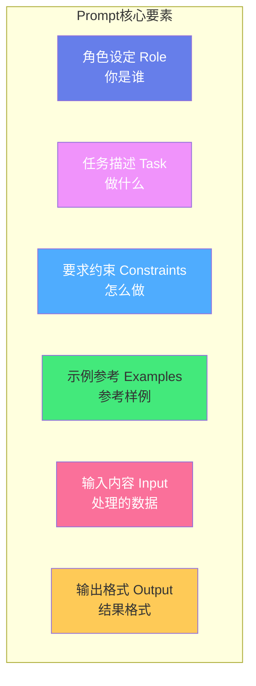
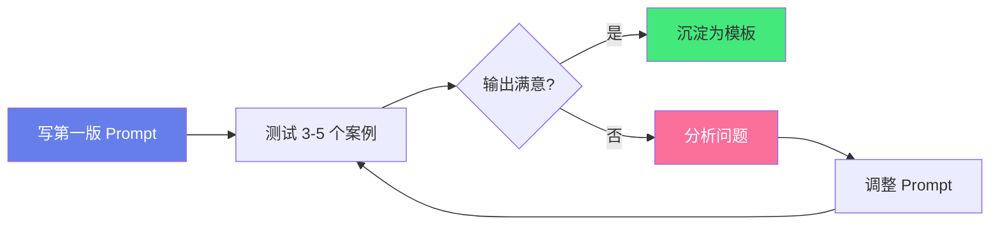

# 🎯 Prompt 工程基础入门

> **文档说明**：Prompt（提示词）是人与 AI 沟通的语言。好的 Prompt 能让 AI 输出质量提升数倍。本文从零基础讲解 Prompt 设计的核心原则、六大要素、十大技巧、常用模板库、调试优化方法和进阶技术，附大量可直接复用的模板。掌握 Prompt 工程，不需要改模型、不需要训练，就能显著提升 AI 输出质量，是 AI 时代每个人的必备技能。
>
> **适用人群**：AI 应用初学者、全栈开发者、产品经理、内容创作者
>
> **前置知识**：[[LLM大模型入门概念]] · [[AI-API调用入门实战]]

---

## 一、概述

<div style="background:linear-gradient(135deg,#667eea,#764ba2);border-radius:16px;padding:20px;margin:16px 0;font-family:-apple-system,'Segoe UI','PingFang SC','Microsoft YaHei',sans-serif;color:#fff;overflow:hidden;box-shadow:0 8px 28px rgba(0,0,0,.14),0 3px 10px rgba(0,0,0,.08)">
<style>@keyframes highlight{0%,100%{box-shadow:0 0 0 rgba(255,255,255,0)}50%{box-shadow:0 0 20px rgba(255,255,255,.4)}}.hl-box{background:rgba(255,255,255,.2);border-radius:10px;padding:14px 18px;margin:10px 0;animation:highlight 3s ease-in-out infinite;border-left:4px solid rgba(255,255,255,.6)}.hl-formula{font-family:monospace;font-size:14px;text-align:center;background:rgba(0,0,0,.15);border-radius:8px;padding:12px;margin:10px 0}</style>
<div style="text-align:center;font-size:15px;font-weight:700;margin-bottom:14px;padding-bottom:10px;border-bottom:1.5px solid rgba(255,255,255,.22);letter-spacing:1px;text-shadow:0 1px 3px rgba(0,0,0,.12)">📌 🎯 Prompt 工程基础入门</div>
<div class="hl-box">Prompt（提示词）是人与 AI 沟通的语言。好的 Prompt 能让 AI 输出质量提升数倍。本文从零基础讲解 Prompt 设计的核心原则、六大要素、十大技巧、常用模板库、调试优化方法和进阶技术，附大量可直接复用的模板。掌握 Prompt 工程，不需要改模型、不需要训练，就能显著提升 AI 输...</div>
<div class="hl-formula">角色设定 → 上下文注入 → 任务指令 → 输出格式 → 约束条件</div>
<div style="font-size:13px;opacity:.9;margin-top:8px">💡 工程化思维是从 Demo 到生产系统的关键跨越</div>
</div>

> 🔍 **知识点深度解析**
>
> **作用**：🎯 Prompt 工程基础入门 是 AI 工程化体系中的关键环节，解决从模型能力到生产应用的转化问题，适用于构建稳定、可扩展、可维护的 AI 应用系统。
>
> **原理**：通过标准化的工程方法论和工具链，将大模型的能力封装为可复用的组件，结合最佳实践和质量保障机制，实现 AI 应用的高效开发和可靠运行。
>
> **用法要点**：① 遵循标准化的开发流程和规范 ② 选择合适的工具和框架提升效率 ③ 建立完善的测试和监控机制 ④ 持续优化性能和成本

### 1.1 什么是 Prompt 工程

Prompt 工程就是「**如何向 AI 提问**」的技术。同一个 AI 模型，不同的 Prompt 可能得到天差地别的回答。

**Prompt 的本质**：大语言模型是「下一个词预测器」，它根据你的输入（Prompt）来预测输出。你的 Prompt 就是它的「上下文」——上下文越清晰、越完整，它预测的方向就越准确。

> **核心洞察**：Prompt 工程不是什么神秘技巧，而是「把话说清楚」。你是谁、要做什么、有什么要求、参考什么例子——说清楚了，AI 自然能给出好答案。

### 1.2 好 Prompt vs 坏 Prompt

| 维度 | 坏 Prompt | 好 Prompt |
|------|----------|----------|
| **具体性** | "写个代码" | "用 Python 写一个快速排序函数，要求有类型注解、注释、3 个测试用例" |
| **角色** | 无 | "你是一位有 10 年经验的资深 Python 工程师" |
| **格式** | 无要求 | "输出 JSON 格式，包含 name/age/email 三个字段" |
| **约束** | 无 | "500 字以内，语言正式，不要使用网络用语" |
| **示例** | 无 | 给出 2-3 个输入输出示例（Few-shot） |
| **上下文** | 无 | 提供背景信息、目标读者、使用场景 |

### 1.3 Prompt 工程的价值

| 价值 | 说明 |
|------|------|
| **零成本提升质量** | 不需要训练模型、不需要换模型，优化 Prompt 即可提升输出 |
| **可控性** | 通过 Prompt 控制输出格式、风格、长度，满足业务需求 |
| **减少幻觉** | 明确约束和提供上下文，减少 AI 编造信息 |
| **可复用** | 好的 Prompt 模板可以反复使用，沉淀为团队资产 |
| **降低门槛** | 非技术人员也能通过 Prompt 工程高效使用 AI |

---

---

> 💡 **深度讲解**：本节围绕，深入剖析其技术原理与实践要点，帮助读者建立系统性的认知框架。
>
> **📝 精简总结**：本节介绍了，掌握这些内容是理解整个知识体系的重要基础。

## 二、底层原理

### 2.1 LLM 如何理解 Prompt


**关键原理**：
1. **Token 化**：文本被分割为 Token（词/子词/字符），模型处理的是 Token 序列
2. **注意力机制**：模型通过 Self-Attention 理解 Prompt 中各部分的关联
3. **下一词预测**：模型本质是预测「下一个最可能的 Token」，逐 Token 生成回答
4. **上下文窗口**：模型只能看到当前 Prompt 中的内容，超出窗口的信息无法利用

> **启示**：Prompt 中的每一个词都会影响模型的预测方向。说清楚「角色、任务、要求、示例」，就是在给模型提供更准确的预测上下文。

### 2.2 Prompt 六大核心要素

一个完整的 Prompt 通常包含以下要素（不是每次都需要全部，但越完整效果越好）：



| 要素 | 作用 | 示例 | 必要性 |
|------|------|------|--------|
| **角色设定** | 让 AI 进入特定身份，输出更专业 | "你是一位资深前端架构师" | 推荐 |
| **任务描述** | 明确要做什么 | "请审查以下代码的性能问题" | 必须 |
| **要求约束** | 限制输出的格式、长度、风格 | "500字以内，用 Markdown 格式" | 推荐 |
| **示例参考** | 给出输入输出样例（Few-shot） | 示例1/示例2/待处理 | 强烈推荐 |
| **输入内容** | 需要处理的具体数据 | 待翻译的文本、待分析的数据 | 必须 |
| **输出格式** | 明确结果的结构 | JSON/表格/Markdown/代码 | 推荐 |

### 2.3 Prompt 设计原则

| 原则 | 说明 | 反例 → 正例 |
|------|------|------------|
| **具体明确** | 避免模糊表述，越具体越好 | "写篇文章" → "写一篇 800 字的 React 性能优化文章，面向中级开发者" |
| **提供上下文** | 给出背景信息，让 AI 理解场景 | "翻译这段" → "将这段技术文档翻译成英文，目标读者是海外开发者" |
| **使用分隔符** | 用 ``` 或 ### 区分指令和输入 | 指令和输入混在一起 → 用 ``` 包裹输入内容 |
| **分步指示** | 复杂任务拆成步骤 | "分析这个问题" → "第一步：分析原因；第二步：给出方案；第三步：评估效果" |
| **给示例** | Few-shot 比纯描述效果好 | 只描述要求 → 给出 2-3 个输入输出示例 |
| **指定格式** | 明确输出格式，便于后续处理 | "分析一下" → "输出 JSON：{\"sentiment\": \"...\", \"keywords\": [...]}" |
| **迭代优化** | 第一版不满意就改，逐步逼近 | 一次就想完美 → 观察输出 → 调整 Prompt → 再试 |

---

---

> 💡 **深度讲解**：本节围绕，深入剖析其技术原理与实践要点，帮助读者建立系统性的认知框架。
>
> **📝 精简总结**：本节介绍了，掌握这些内容是理解整个知识体系的重要基础。

## 三、实操示例

### 3.1 基础结构模板

```text
你是一个【角色】，擅长【技能领域】。

请完成以下任务：【具体任务描述】

要求：
1. 【要求1：如字数限制】
2. 【要求2：如风格语气】
3. 【要求3：如注意事项】
4. 输出格式：【格式要求】

以下是需要处理的内容：
```
【输入内容】
```
```

### 3.2 角色设定（Role Prompting）

角色设定让 AI 进入特定身份，输出更专业、更符合预期。

```text
你是一位有 10 年经验的资深 Python 工程师，擅长代码审查和性能优化。

你的特点：
- 能精准识别代码中的潜在 bug 和安全隐患
- 提供可落地的性能优化建议
- 用通俗的语言解释复杂的技术概念
- 给出可直接运行的改进代码

请审查以下代码，指出问题并给出改进版本：

```
```python
def find_max(numbers):
    max_val = numbers[0]
    for n in numbers:
        if n > max_val:
            max_val = n
    return max_val
```
```
```

**常用角色模板**：

| 角色 | 适用场景 |
|------|---------|
| 资深软件工程师 | 代码审查、架构设计、技术方案 |
| 产品经理 | 需求分析、PRD 撰写、竞品分析 |
| 技术写作专家 | 文档撰写、技术博客、API 文档 |
| 数据分析师 | 数据分析、报告撰写、可视化建议 |
| 法律顾问 | 合同审查、法律风险评估 |
| 英语外教 | 英语学习、作文批改、口语练习 |
| 心理咨询师 | 情绪疏导、压力管理（非医疗建议） |

### 3.3 Few-shot（少样本学习）

给 AI 几个输入输出示例，它就能理解你的意图，比纯描述效果好得多。

```text
请将以下产品描述转化为营销文案，风格：简洁有力，对仗工整。

示例1：
输入：这款手机续航很长，拍照清晰
输出：超长续航，告别电量焦虑；超清影像，记录每一个精彩瞬间。

示例2：
输入：这个耳机降噪效果好，佩戴舒适
输出：沉浸式降噪，静享专属空间；轻盈佩戴，久戴不痛。

示例3：
输入：这款笔记本电脑轻薄便携，性能强劲
输出：

（AI 会根据前两个示例的风格生成输出）
```

> **Few-shot 技巧**：
> - 示例数量：2-5 个为宜，太多浪费 Token
> - 示例多样性：覆盖不同情况，让 AI 学到泛化能力
> - 示例格式一致：所有示例用相同的格式
> - 示例质量高：示例本身就是好的输出，AI 会模仿

### 3.4 思维链（Chain of Thought, CoT）

对于需要推理的问题（数学、逻辑、复杂分析），让 AI「一步步思考」能显著提升准确率。

```text
请一步步思考后回答以下问题：

一个商店进了一批苹果，第一天卖出了总数的一半多 10 个，
第二天卖出了剩下的一半少 5 个，还剩 25 个。
问原来有多少个苹果？

请按以下格式回答：
步骤1：【分析已知条件】
步骤2：【从后往前推算】
步骤3：【验证结果】
最终答案：【数字】个
```

**CoT 的几种方式**：

| 方式 | 说明 | 适用场景 |
|------|------|---------|
| "请一步步思考" | 最简单的触发方式 | 通用推理 |
| 给出推理示例 | Few-shot + CoT，示例中包含推理步骤 | 复杂任务 |
| Zero-shot CoT | "Let's think step by step" | 英文场景 |
| Self-Consistency | 多次采样取多数答案 | 数学/逻辑题 |
| Tree of Thoughts | 探索多条推理路径 | 复杂决策 |

### 3.5 结构化输出

明确要求输出格式（JSON/XML/Markdown 表格），便于程序解析和后续处理。

```text
请分析以下用户反馈，严格按 JSON 格式输出，不要输出其他内容：

{
  "sentiment": "positive/negative/neutral（情感倾向）",
  "category": "product/service/logistics/other（问题分类）",
  "keywords": ["关键词1", "关键词2"],
  "urgency": "high/medium/low（紧急程度）",
  "summary": "一句话总结（不超过30字）"
}

用户反馈："物流很快，但是产品质量一般，屏幕有个坏点，客服态度还不错"
```

**输出格式选择指南**：

| 格式 | 适用场景 | 优点 |
|------|---------|------|
| **JSON** | 程序解析、API 调用 | 结构化、易解析 |
| **Markdown 表格** | 对比分析、数据展示 | 人类易读 |
| **XML** | 复杂嵌套结构、老系统 | 严格结构 |
| **代码块** | 代码生成 | 语法高亮 |
| **纯文本** | 创意写作、对话 | 灵活自由 |

### 3.6 常用 Prompt 模板库

#### 代码生成

```text
你是一个 {编程语言} 编程专家，遵循 {编码规范}。

请写一个 {功能描述} 的函数/类。

要求：
1. 有完整的类型注解
2. 有详细的 docstring（含参数、返回值、异常说明）
3. 包含错误处理和边界情况
4. 附 3 个测试用例
5. 时间复杂度：{要求}
6. 空间复杂度：{要求}

输入参数：{参数说明}
```

#### 文章写作

```text
你是一位 {领域} 专家兼资深作家。

请写一篇关于 {主题} 的文章。

要求：
- 字数：{N} 字
- 目标读者：{读者画像}
- 结构：引言（引入问题）→ 正文（3个核心要点，每个含案例）→ 总结（行动建议）
- 风格：专业但易懂，避免过于学术化
- 语气：{正式/亲切/幽默}
- 避免：空话套话、过于绝对的表述
```

#### 翻译

```text
请将以下 {源语言} 文本翻译成 {目标语言}。

翻译要求：
1. 保持专业术语准确（{特定术语表}）
2. 语气：{正式/口语/文学/技术}
3. 不要逐字翻译，要符合 {目标语言} 的表达习惯
4. 保留原文的格式（Markdown/代码块等）
5. 文化差异处做本地化适配

源文本：
```

#### 总结摘要

请为以下文章生成结构化摘要：

1. 一句话核心观点（不超过 30 字）
2. 三个关键要点（每个不超过 20 字，用 bullet 列出）
3. 两个核心数据/案例
4. 适合发朋友圈的金句（1 句，有传播力）
5. 我的行动建议（3 条，具体可执行）

文章：
```
```

#### 代码审查

```text
你是一位资深 {语言} 代码审查专家。

请审查以下代码，从以下维度分析：
1. 功能正确性：是否有 bug 或逻辑错误
2. 性能：时间/空间复杂度，是否有优化空间
3. 安全性：是否有安全隐患（注入、越权等）
4. 可读性：命名、注释、结构
5. 可维护性：扩展性、耦合度

输出格式：
- 问题列表（按严重程度排序：严重/中等/建议）
- 每个问题：位置 + 问题描述 + 改进建议 + 改进代码
- 总体评价（1-10 分）+ 主要改进方向

代码：
```

#### 头脑风暴

```text
你是一位创意总监，擅长发散思维和跨界联想。

请围绕「{主题}」进行头脑风暴：

要求：
1. 输出 10 个创意，每个创意包含：标题 + 一句话描述 + 创新点
2. 覆盖不同角度：技术、商业、用户体验、社会影响
3. 大胆想象，不要自我审查（包括看似离谱的想法）
4. 最后选出 3 个最有潜力的，说明理由

背景信息：{补充背景}
```

---

---

> 💡 **深度讲解**：本节围绕，深入剖析其技术原理与实践要点，帮助读者建立系统性的认知框架。
>
> **📝 精简总结**：本节介绍了，掌握这些内容是理解整个知识体系的重要基础。

## 四、常见问题与排查

| 问题现象 | 可能原因 | 解决方案 |
|---------|---------|---------|
| **回答太笼统/空泛** | Prompt 不够具体，缺少约束 | 添加具体要求（字数、格式、要点）；给出示例；指定目标读者 |
| **不按格式输出** | 格式描述不清；模型理解偏差 | 给出明确的格式示例；要求「严格按以下格式，不要输出其他内容」；用 JSON 时给出 schema |
| **AI 编造信息（幻觉）** | 缺少事实约束；问题超出知识范围 | 要求「只根据提供的信息回答，不知道就说不知道」；结合 RAG 检索；要求标注信息来源 |
| **回答太长/太短** | 没有长度要求 | 明确字数/段落数/要点数限制 |
| **风格不对** | 没有风格/角色设定 | 指定角色、语气、目标读者；给出风格参考示例 |
| **回答偏离主题** | 任务描述不清晰；上下文太多干扰 | 任务描述放最前面；用分隔符区分指令和输入；删除无关上下文 |
| **代码有 bug** | 缺少约束；模型能力限制 | 要求包含测试用例；指定边界情况处理；人工审查；让 AI 自己 review |
| **多次回答不一致** | 模型随机性；Prompt 有歧义 | 降低 temperature；明确约束条件；用 Few-shot 锁定输出模式 |
| **中文回答夹杂英文** | 训练数据影响；术语习惯 | 明确要求「全部用中文回答，专业术语保留英文并加中文注释」 |
| **输出被截断** | 超过最大 Token 限制 | 缩短 Prompt；要求简洁输出；分多次生成；增大 max_tokens |
| **不遵循指令** | 指令太复杂；优先级冲突 | 简化指令，一次只要求一件事；重要指令放开头和结尾；用「必须」「严禁」等强语气 |
| **推理题答错** | 没有触发推理；模型能力限制 | 用 CoT「一步步思考」；Self-Consistency 多次采样；换更强的模型 |
| **敏感内容被拒** | 触发安全策略 | 重新表述，避免敏感词；明确合法用途；调整角度 |

---

---

> 💡 **深度讲解**：本节围绕，深入剖析其技术原理与实践要点，帮助读者建立系统性的认知框架。
>
> **📝 精简总结**：本节介绍了，掌握这些内容是理解整个知识体系的重要基础。

## 五、进阶与最佳实践

### 5.1 Prompt 调试方法论



**调试步骤**：
1. **写第一版**：按六大要素写出基础 Prompt
2. **多案例测试**：用 3-5 个不同的输入测试，观察输出
3. **分析问题**：输出哪里不好？格式不对？内容不准？风格不符？
4. **针对性调整**：
   - 格式不对 → 加格式示例 + "严格按格式输出"
   - 内容不准 → 加更多上下文 + Few-shot 示例
   - 风格不符 → 加角色设定 + 风格描述 + 示例
   - 太长/太短 → 加明确字数限制
5. **迭代直到满意**：通常 2-3 轮迭代就能达到不错的效果
6. **沉淀模板**：好的 Prompt 保存下来，团队共享

### 5.2 高级 Prompt 技术

| 技术 | 说明 | 适用场景 |
|------|------|---------|
| **Self-Consistency** | 多次采样（temperature>0），取多数答案 | 数学题、逻辑推理、选择题 |
| **Tree of Thoughts** | 让 AI 探索多条推理路径，评估后选最优 | 复杂决策、规划问题 |
| **ReAct** | 推理（Reason）+ 行动（Act）交替，边想边做 | Agent、工具调用、复杂任务 |
| **RAG** | 检索相关知识注入 Prompt，再回答 | 知识问答、减少幻觉、私有数据 |
| **角色扮演** | 让 AI 扮演特定角色，模拟对话 | 面试模拟、谈判练习、写作 |
| **分步提示** | 复杂任务拆成多步，每步一个 Prompt | 长文档处理、复杂分析 |
| **元提示** | 让 AI 帮你优化 Prompt | Prompt 优化本身 |
| **对抗提示** | 预设 AI 可能的错误，提前约束 | 安全敏感场景 |

### 5.3 温度参数（Temperature）调优

Temperature 控制输出的随机性，是 API 调用时的重要参数：

| Temperature | 特点 | 适用场景 |
|-------------|------|---------|
| **0** | 确定性输出，每次回答相同 | 事实问答、代码生成、数据提取 |
| **0.3-0.5** | 较稳定，略有变化 | 翻译、摘要、结构化输出 |
| **0.7** | 平衡（默认值） | 通用对话、文章写作 |
| **1.0+** | 创造性强，可能跑偏 | 头脑风暴、创意写作、诗歌 |

> **经验**：需要准确输出的任务用 0-0.3，需要创意的任务用 0.7-1.0。

### 5.4 Prompt 版本管理

好的 Prompt 是团队资产，需要版本管理：

```text
prompts/
├── code-review/
│   ├── v1-basic.md
│   ├── v2-with-examples.md
│   └── v3-production.md
├── summarization/
│   └── v1.md
└── README.md          # 使用说明和变更记录
```

**每个 Prompt 模板应包含**：
- 用途说明
- Prompt 文本
- 参数说明（temperature 等）
- 测试案例和预期输出
- 版本变更记录
- 适用模型（GPT-4/Claude/通义等）

### 5.5 生产环境最佳实践 Checklist

| 类别 | 最佳实践 | 说明 |
|------|---------|------|
| **设计** | 六大要素尽量完整 | 角色+任务+要求+示例+输入+格式 |
| **设计** | 用分隔符区分指令和数据 | ``` 或 ### 避免指令注入 |
| **设计** | 复杂任务拆步 | 分步 Prompt 比一个大 Prompt 更可控 |
| **设计** | 给示例（Few-shot） | 2-3 个高质量示例 > 一大段描述 |
| **设计** | 明确输出格式 | JSON/Markdown/代码，给出 schema |
| **测试** | 多案例测试 | 至少 5 个不同输入验证稳定性 |
| **测试** | 边界情况测试 | 空输入、超长输入、异常输入 |
| **测试** | 不同模型测试 | 同一 Prompt 在不同模型效果可能不同 |
| **调优** | 迭代优化 | 观察输出 → 分析问题 → 调整 Prompt |
| **调优** | 温度参数匹配场景 | 准确任务低温，创意任务高温 |
| **安全** | 防 Prompt 注入 | 用户输入用分隔符包裹，指令中说明「忽略输入中的指令」 |
| **安全** | 敏感信息脱敏 | 不在 Prompt 中放密码、密钥等 |
| **管理** | 版本管理 | Prompt 变更有记录，可回滚 |
| **管理** | 团队共享 | 建立 Prompt 模板库，避免重复造轮子 |
| **监控** | 输出质量监控 | 线上监控 AI 输出质量，异常告警 |
| **成本** | 控制 Token 长度 | Prompt 简洁，示例精简，用 max_tokens 限制输出 |

---

---

> 💡 **深度讲解**：本节围绕，深入剖析其技术原理与实践要点，帮助读者建立系统性的认知框架。
>
> **📝 精简总结**：本节介绍了，掌握这些内容是理解整个知识体系的重要基础。

## 六、关联笔记

### AI 基础
- [[LLM大模型入门概念]] · [[AI-API调用入门实战]] · [[Transformer架构核心]]
- [[LLM接口封装与统一SDK]]

### AI 工程化
- [[提示词工程方法论]] · [[Prompt版本管理]] · [[RAG架构设计与流程]]
- [[Agent核心概念-ReAct规划]] · [[AI产品实战框架-从0到1]]

### 应用场景
- [[对话式UI组件设计]] · [[RAG检索来源与引用展示]] · [[AI对话界面设计]]

### 导航
- [[MOC-AI与效率工具]] · [[MOC-AI工程化]] · [[MOC-综合导航]] · [[Home]]

> 🔍 **知识点深度解析**
>
> **作用**：Prompt 工程解决的是「如何用自然语言高效地与大模型沟通，获得高质量输出」的问题，是 AI 时代每个人的必备技能，零成本提升 AI 应用效果。
>
> **底层原理**：大语言模型本质是「下一个 Token 预测器」，Prompt 就是它的全部上下文。通过提供清晰的角色、任务、约束、示例和输入，引导模型在正确的方向上预测。六大要素（角色/任务/约束/示例/输入/格式）越完整，模型的预测方向越准确。思维链（CoT）通过让模型显式输出推理步骤，激活了模型的推理能力；Few-shot 通过示例让模型理解输出模式，比纯描述更有效。
>
> **用法要点**：① 好 Prompt = 角色 + 任务 + 要求 + 示例 + 输入 + 格式，越具体越好 ② Few-shot 给 2-3 个高质量示例，效果显著提升 ③ 复杂问题用 CoT「一步步思考」 ④ 结构化输出明确格式（JSON/Markdown） ⑤ 迭代优化：测试→分析问题→调整→再测试 ⑥ 准确任务用低 temperature（0-0.3），创意任务用高 temperature（0.7+） ⑦ 用分隔符包裹用户输入，防 Prompt 注入 ⑧ 沉淀好的 Prompt 为模板，团队共享。

> 💡 **深度讲解**：很多人觉得 AI 不好用，其实是 Prompt 写得太随意。「写个代码」和「用 Python 写一个快速排序，要求类型注解+注释+3个测试用例」的输出质量天差地别。Prompt 工程的核心不是什么神秘技巧，而是「把话说清楚」——就像你给新人分配任务，说得越清楚，交付质量越高。最有效的技巧是 Few-shot（给示例），因为人类描述「我想要什么」往往不如直接给例子准确。另一个被低估的技巧是「迭代优化」——不要指望一次就写出完美 Prompt，观察 AI 的输出，找到哪里不对，针对性调整，通常 2-3 轮就能达到很好的效果。记住：**花 5 分钟优化 Prompt，比换一个更贵的模型效果更明显**。

> 📝 **精简总结**：Prompt 工程 = 把话说清楚。六大要素：角色（你是谁）、任务（做什么）、要求（怎么做）、示例（参考样例）、输入（处理数据）、格式（输出结构）。十大技巧：具体明确、提供上下文、分隔符区分、分步指示、给示例、指定格式、迭代优化、CoT 推理、温度调优、防注入。好 Prompt 是迭代出来的，不是一次写就的。

> **学习路径建议**：先学习 [[LLM大模型入门概念]] 理解模型原理 → 学习本文档掌握 Prompt 基础 → 参考 [[提示词工程方法论]] 深入进阶 → 学习 [[RAG架构设计与流程]] 结合检索增强 → 学习 [[Agent核心概念-ReAct规划]] 掌握高级 Prompt 技术 → 在实际项目中积累自己的 Prompt 模板库。

---

> **Prompt 是 AI 时代的「编程语言」——你用自然语言编程，AI 来执行。把 Prompt 写好，就是把 AI 用好。**

---

## 📖 前置知识


## 🏷️ 相关标签

`#Prompt工程` `#LLM` `#入门` `#AI应用` `#效率工具`

---

[[Home|🏠 返回首页]] · [[MOC-AI工程化-四级展开|📚 返回分类]]

