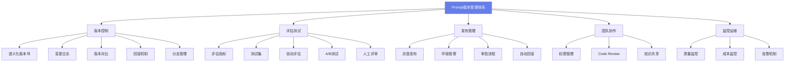
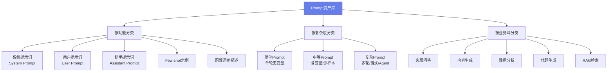
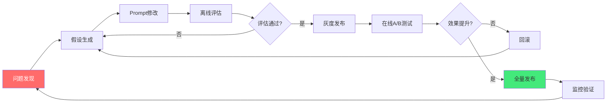

# 📝 Prompt 版本管理

> **文档说明**：系统讲解 AI 应用中 Prompt 的版本管理体系，涵盖 Prompt 版本管理概述（为什么需要版本管理 / 什么是 Prompt 版本管理 / 核心价值 / 与代码版本管理的区别）、Prompt 资产管理（Prompt 分类体系 / 元数据规范 / 模板结构设计 / 变量与参数管理 / 依赖管理）、版本控制策略（语义化版本号 / 变更日志 / 版本对比 / 回滚机制 / 分支管理 / 标签管理）、Prompt 评估体系（评估指标设计 / 测试集构建 / 自动评估方法 / 人工评估流程 / A/B 测试 / 离线评估 vs 在线评估）、Prompt 迭代流程（问题发现 → 假设生成 → Prompt 修改 → 评估验证 → 灰度发布 → 全量上线的完整闭环）、工具与平台（LangSmith / PromptLayer / Weights & Biases / Humanloop / Promptfoo / 自研平台对比与选型）、团队协作（权限管理 / 审批流程 / Prompt Code Review / 知识共享 / 最佳实践沉淀）、CI/CD 集成（自动化测试 / 灰度发布 / 监控告警 / 自动回滚 / 持续优化流水线）、最佳实践（命名规范 / 文档规范 / 变更记录 / 安全管理 / 成本控制 / 性能监控）、常见问题与解决方案（Prompt 漂移 / 模型升级兼容 / 多环境管理 / 性能回退 / 团队协作冲突）、实战案例（电商客服 Prompt 迭代全流程 / RAG 问答 Prompt 版本管理实战）。
>
> **适用人群**：AI 应用开发者、Prompt 工程师、AI 产品经理、技术负责人
>
> **前置知识**：[[Prompt工程进阶]] · [[AI工程化知识点完整整合大全_优化版]] · [[LLM服务架构]]

---

## 一、Prompt 版本管理概述

<div style="background:linear-gradient(135deg,#667eea,#764ba2);border-radius:16px;padding:20px;margin:16px 0;font-family:-apple-system,'Segoe UI','PingFang SC','Microsoft YaHei',sans-serif;color:#fff;overflow:hidden;box-shadow:0 8px 28px rgba(0,0,0,.14),0 3px 10px rgba(0,0,0,.08)">
<style>@keyframes highlight{0%,100%{box-shadow:0 0 0 rgba(255,255,255,0)}50%{box-shadow:0 0 20px rgba(255,255,255,.4)}}.hl-box{background:rgba(255,255,255,.2);border-radius:10px;padding:14px 18px;margin:10px 0;animation:highlight 3s ease-in-out infinite;border-left:4px solid rgba(255,255,255,.6)}.hl-formula{font-family:monospace;font-size:14px;text-align:center;background:rgba(0,0,0,.15);border-radius:8px;padding:12px;margin:10px 0}</style>
<div style="text-align:center;font-size:15px;font-weight:700;margin-bottom:14px;padding-bottom:10px;border-bottom:1.5px solid rgba(255,255,255,.22);letter-spacing:1px;text-shadow:0 1px 3px rgba(0,0,0,.12)">📌 📝 Prompt 版本管理</div>
<div class="hl-box">系统讲解 AI 应用中 Prompt 的版本管理体系，涵盖 Prompt 版本管理概述（为什么需要版本管理 / 什么是 Prompt 版本管理 / 核心价值 / 与代码版本管理的区别）、Prompt 资产管理（Prompt 分类体系 / 元数据规范 / 模板结构设计 / 变量与参数管理 / 依赖管理...</div>
<div class="hl-formula">角色设定 → 上下文注入 → 任务指令 → 输出格式 → 约束条件</div>
<div style="font-size:13px;opacity:.9;margin-top:8px">💡 工程化思维是从 Demo 到生产系统的关键跨越</div>
</div>

> 🔍 **知识点深度解析**
>
> **作用**：📝 Prompt 版本管理 是 AI 工程化体系中的关键环节，解决从模型能力到生产应用的转化问题，适用于构建稳定、可扩展、可维护的 AI 应用系统。
>
> **原理**：通过标准化的工程方法论和工具链，将大模型的能力封装为可复用的组件，结合最佳实践和质量保障机制，实现 AI 应用的高效开发和可靠运行。
>
> **用法要点**：① 遵循标准化的开发流程和规范 ② 选择合适的工具和框架提升效率 ③ 建立完善的测试和监控机制 ④ 持续优化性能和成本

### 1.1 为什么需要版本管理

Prompt 是 AI 应用的核心资产，直接决定应用的输出质量。但在实际开发中，Prompt 往往面临以下问题：

| 问题 | 表现 | 后果 |
|------|------|------|
| **随意修改无记录** | 改了 Prompt 不知道改了什么、为什么改 | 出问题无法回溯，好的修改无法复现 |
| **无法回滚** | 新 Prompt 效果变差，想回到旧版本但找不到 | 应用质量下降，用户体验受损 |
| **缺乏评估** | 修改 Prompt 全凭感觉，不知道效果变好还是变差 | 盲目迭代，可能越改越差 |
| **团队协作混乱** | 多人修改同一个 Prompt，互相覆盖 | 冲突频发，优秀修改丢失 |
| **多环境不一致** | 开发/测试/生产环境的 Prompt 不同步 | 测试通过但生产出问题 |
| **模型升级不兼容** | LLM 升级后旧 Prompt 效果变化，无法快速定位 | 应用质量突然下降，排查困难 |
| **知识无法沉淀** | 优秀的 Prompt 技巧和经验散落在个人手中 | 团队水平参差不齐，新人上手慢 |

> **核心认知**：Prompt 应该像代码一样被管理——有版本控制、有评估测试、有 CI/CD、有 Code Review、有文档记录。这是 AI 应用从「玩具」到「产品」的必经之路。

### 1.2 什么是 Prompt 版本管理

**Prompt 版本管理**是一套系统化的方法和工具，用于管理 Prompt 的创建、修改、评估、发布、回滚全生命周期，确保 Prompt 的变更可追溯、可评估、可回滚、可协作。



### 1.3 核心价值

| 价值 | 说明 |
|------|------|
| **可追溯** | 每次修改都有记录，知道改了什么、为什么改、谁改的 |
| **可评估** | 每次修改都经过评估，用数据验证效果，不凭感觉 |
| **可回滚** | 新版本效果差可以一键回滚到旧版本，保障应用稳定 |
| **可协作** | 多人协作不冲突，优秀修改不丢失，知识可沉淀 |
| **可灰度** | 新版本先小流量验证，效果好再全量，降低风险 |
| **可监控** | 实时监控 Prompt 质量和成本，异常自动告警 |
| **可复用** | Prompt 模板和最佳实践可复用，提升团队效率 |

### 1.4 与代码版本管理的区别

| 维度 | 代码版本管理 (Git) | Prompt 版本管理 |
|------|-------------------|----------------|
| **正确性判定** | 编译通过 + 测试通过 | 评估指标达标 + 人工评审 |
| **变更影响** | 相对确定（逻辑变更） | 不确定（LLM 输出有随机性） |
| **测试方法** | 单元测试 + 集成测试 | 评估集 + A/B 测试 + 人工评审 |
| **回滚成本** | 低（代码回滚） | 中（需重新评估兼容性） |
| **协作方式** | PR + Code Review | Prompt Review + 评估对比 |
| **发布方式** | CI/CD 自动发布 | 灰度发布 + 监控验证 |
| **版本粒度** | 提交（commit） | 版本（version）+ 评估结果 |
| **环境管理** | dev/staging/prod | 多环境 + 模型版本关联 |

> **关键区别**：代码的正确性是确定的（编译/测试通过就是对的），而 Prompt 的效果是概率性的（LLM 输出有随机性，需要统计评估）。因此 Prompt 版本管理更强调「评估驱动」和「灰度验证」，而不是单纯的版本控制。

---

## 二、Prompt 资产管理

### 2.1 Prompt 分类体系

建立清晰的 Prompt 分类体系，便于管理和检索：



### 2.2 元数据规范

每个 Prompt 版本都应包含完整的元数据：

```yaml
# prompt_metadata.yaml
id: customer-service-v1
name: 客服问答系统提示词
version: 2.1.0
author: 张三
created_at: 2026-08-01
updated_at: 2026-08-28
status: active  # draft / testing / active / deprecated / archived

# 分类
category: 客服问答
subcategory: 售前咨询
tags: [客服, 问答, 电商, 售前]

# 模型关联
model: gpt-4o
model_version: gpt-4o-2024-08-06
temperature: 0.7
max_tokens: 2000
top_p: 1.0

# 评估信息
evaluation_score: 0.89
evaluation_set: customer-service-test-v2
last_evaluated_at: 2026-08-27

# 变更信息
changelog:
  - version: 2.1.0
    date: 2026-08-28
    author: 张三
    changes:
      - 优化了产品推荐逻辑，增加了库存检查
      - 增加了退换货政策的引用要求
    evaluation:
      before: 0.82
      after: 0.89
      improvement: +0.07
    approved_by: 李四

# 依赖
dependencies:
  - knowledge_base: product-catalog-v3
  - evaluation_set: customer-service-test-v2

# 环境
environments:
  production: 2.1.0
  staging: 2.2.0-beta
  development: 2.2.0-dev
```

### 2.3 模板结构设计

标准化的 Prompt 模板结构，便于维护和变量管理：

```text
## 客服问答系统 Prompt v2.1.0

## System Prompt

你是一个专业的电商客服助手，负责回答用户的售前咨询问题。

### 角色设定
- 你是{{company_name}}的客服代表
- 语气友好、专业、有耐心
- 使用中文回答

### 回答规则
1. 只根据提供的产品信息和政策回答，不编造信息
2. 涉及价格、库存、退换货等关键信息，必须引用知识库内容
3. 如果信息不足，明确告知用户并建议联系人工客服
4. 回答简洁明了，不超过200字
5. 主动推荐相关产品（如果适用）

### 输出格式
- 直接回答用户问题
- 关键信息用【】标注
- 如果有产品推荐，放在最后用「推荐产品：」开头

## 上下文

### 产品信息
{{product_info}}

### 退换货政策
{{return_policy}}

### 对话历史
{{conversation_history}}

## User Prompt

{{user_question}}
```

### 2.4 变量与参数管理

```mermaid
# Prompt 变量管理
class PromptVariable:
    """Prompt 变量定义"""
    def __init__(self, name, type, required, default=None, description=""):
        self.name = name
        self.type = type  # string / number / boolean / list / dict
        self.required = required
        self.default = default
        self.description = description

# 变量定义
PROMPT_VARIABLES = {
    "company_name": PromptVariable("company_name", "string", True, "示例电商", "公司名称"),
    "product_info": PromptVariable("product_info", "string", True, "", "产品信息（从知识库检索）"),
    "return_policy": PromptVariable("return_policy", "string", False, "7天无理由退换", "退换货政策"),
    "conversation_history": PromptVariable("conversation_history", "list", False, [], "对话历史"),
    "user_question": PromptVariable("user_question", "string", True, "", "用户问题"),
}

# Prompt 渲染
class PromptRenderer:
    def __init__(self, template, variables):
        self.template = template
        self.variables = variables
    
    def render(self, **kwargs) -> str:
        """渲染 Prompt，校验变量"""
        # 1. 校验必填变量
        for name, var in self.variables.items():
            if var.required and name not in kwargs:
                raise ValueError(f"缺少必填变量: {name}")
        
        # 2. 设置默认值
        for name, var in self.variables.items():
            if name not in kwargs and var.default is not None:
                kwargs[name] = var.default
        
        # 3. 渲染模板
        return self.template.format(**kwargs)
```

---

## 三、版本控制策略

### 3.1 语义化版本号

采用语义化版本号（Semantic Versioning），清晰表达变更的影响范围：

```text
主版本号.次版本号.修订号
   │       │       │
   │       │       └── 修订号：小修改、措辞优化、bug修复（向下兼容）
   │       └────────── 次版本号：功能增加、结构调整（向下兼容）
   └────────────────── 主版本号：重大变更、不兼容修改（需重新评估）
```

| 版本类型 | 示例 | 变更内容 | 评估要求 |
|---------|------|---------|---------|
| **修订号** | 2.1.0 → 2.1.1 | 措辞优化、错别字修正、小调整 | 快速评估（核心测试集） |
| **次版本号** | 2.1.0 → 2.2.0 | 增加功能、调整结构、增加规则 | 完整评估（全量测试集 + A/B） |
| **主版本号** | 2.1.0 → 3.0.0 | 重大重构、角色变更、不兼容修改 | 全面评估 + 人工评审 + 灰度 |

### 3.2 变更日志（Changelog）

每次版本变更都必须记录详细的变更日志：

```text
## Changelog

## [2.2.0] - 2026-08-28

### Added
- 增加了库存检查逻辑，推荐产品时检查库存状态
- 增加了促销活动信息的引用

### Changed
- 优化了产品推荐的排序逻辑，优先推荐高评分产品
- 调整了回答长度限制，从200字增加到300字

### Fixed
- 修复了退换货政策引用不准确的问题
- 修复了多轮对话中上下文丢失的问题

### Evaluation
- 评估集：customer-service-test-v2（500条）
- 准确率：0.82 → 0.89（+0.07）
- 满意度：0.78 → 0.85（+0.07）
- 平均 Token：1850 → 1920（+3.8%）
- 评估人：张三
- 审批人：李四

### Migration Notes
- 无破坏性变更，可直接升级
- 建议在 staging 环境验证 24 小时后再发布生产
```

### 3.3 版本对比

快速对比两个版本的差异，评估变更影响：

```python
class PromptVersionComparator:
    """Prompt 版本对比工具"""
    
    def compare(self, v1: str, v2: str) -> dict:
        """对比两个版本"""
        prompt_v1 = self.load_version(v1)
        prompt_v2 = self.load_version(v2)
        
        return {
            "content_diff": self._text_diff(prompt_v1.content, prompt_v2.content),
            "variable_changes": self._compare_variables(prompt_v1, prompt_v2),
            "param_changes": self._compare_params(prompt_v1, prompt_v2),
            "metadata_changes": self._compare_metadata(prompt_v1, prompt_v2),
            "impact_assessment": self._assess_impact(prompt_v1, prompt_v2),
        }
    
    def _text_diff(self, text1: str, text2: str) -> str:
        """文本差异（统一 diff 格式）"""
        import difflib
        diff = difflib.unified_diff(
            text1.splitlines(),
            text2.splitlines(),
            fromfile='v1',
            tofile='v2',
            lineterm=''
        )
        return '\n'.join(diff)
    
    def _assess_impact(self, v1, v2) -> dict:
        """评估变更影响"""
        changes = []
        if v1.system_prompt != v2.system_prompt:
            changes.append({"area": "system_prompt", "impact": "high", "description": "系统提示词变更"})
        if v1.temperature != v2.temperature:
            changes.append({"area": "temperature", "impact": "medium", "description": f"温度参数从 {v1.temperature} 变为 {v2.temperature}"})
        if set(v1.variables.keys()) != set(v2.variables.keys()):
            changes.append({"area": "variables", "impact": "high", "description": "变量结构变更"})
        
        return {
            "overall_impact": "high" if any(c["impact"] == "high" for c in changes) else "medium",
            "changes": changes,
            "recommendation": "需要完整评估" if any(c["impact"] == "high" for c in changes) else "建议快速评估"
        }
```

### 3.4 回滚机制

```mermaid
class PromptRollbackManager:
    """Prompt 回滚管理"""
    
    def __init__(self):
        self.version_history = {}  # prompt_id -> [versions]
        self.active_versions = {}  # prompt_id -> active_version
    
    def rollback(self, prompt_id: str, target_version: str, reason: str = "") -> dict:
        """回滚到指定版本"""
        # 1. 验证目标版本存在
        if target_version not in self.version_history[prompt_id]:
            raise ValueError(f"版本 {target_version} 不存在")
        
        # 2. 记录当前版本（用于再次回滚）
        current_version = self.active_versions[prompt_id]
        
        # 3. 执行回滚
        self.active_versions[prompt_id] = target_version
        
        # 4. 记录回滚日志
        rollback_log = {
            "prompt_id": prompt_id,
            "from_version": current_version,
            "to_version": target_version,
            "reason": reason,
            "timestamp": datetime.now().isoformat(),
            "operator": get_current_user()
        }
        self.log_rollback(rollback_log)
        
        # 5. 触发告警（如果是生产环境）
        if is_production():
            send_alert(f"Prompt {prompt_id} 已回滚到 {target_version}，原因：{reason}")
        
        return {
            "success": True,
            "from": current_version,
            "to": target_version,
            "message": f"已回滚到版本 {target_version}"
        }
    
    def quick_rollback(self, prompt_id: str) -> dict:
        """快速回滚到上一个版本"""
        versions = self.version_history[prompt_id]
        current = self.active_versions[prompt_id]
        current_index = versions.index(current)
        if current_index == 0:
            raise ValueError("已经是第一个版本，无法回滚")
        previous_version = versions[current_index - 1]
        return self.rollback(prompt_id, previous_version, reason="快速回滚")
```

### 3.5 分支管理

类似 Git 的分支管理，支持并行开发和实验：

| 分支类型 | 用途 | 命名规范 | 生命周期 |
|---------|------|---------|---------|
| **main** | 生产环境稳定版本 | `main` | 长期 |
| **staging** | 测试环境版本 | `staging` | 长期 |
| **dev** | 开发环境版本 | `dev` | 长期 |
| **feature** | 新功能开发 | `feature/描述` | 短期，合并后删除 |
| **experiment** | 实验性修改 | `experiment/描述` | 短期，验证后删除或合并 |
| **hotfix** | 紧急修复 | `hotfix/描述` | 短期，修复后合并 |
| **release** | 发布准备 | `release/vX.Y.Z` | 短期，发布后删除 |

---

## 四、Prompt 评估体系

### 4.1 评估指标设计

| 维度 | 指标 | 说明 | 评估方法 |
|------|------|------|---------|
| **准确性** | 准确率 | 答案正确的比例 | 人工标注 + LLM 评判 |
| **准确性** | 事实一致性 | 答案与事实一致的比例 | 事实校验模型 |
| **相关性** | 相关性 | 答案与问题相关的比例 | LLM 评判 + 人工 |
| **完整性** | 完整性 | 答案覆盖问题所有方面的比例 | LLM 评判 |
| **忠实度** | 幻觉率 | 编造信息的比例（越低越好） | 事实校验 + 人工 |
| **安全性** | 违规率 | 输出违规内容的比例（越低越好） | 内容审核模型 |
| **格式** | 格式合规率 | 输出符合要求格式的比例 | 规则校验 |
| **用户体验** | 满意度 | 用户满意度评分 | 用户反馈 |
| **用户体验** | 解决率 | 问题被解决的比例 | 用户反馈 |
| **成本** | 平均 Token | 每次调用的 Token 数 | 日志统计 |
| **成本** | 平均延迟 | 每次调用的响应时间 | 日志统计 |
| **成本** | 单次成本 | 每次调用的费用 | 日志统计 |

### 4.2 测试集构建

```python
# 评估测试集结构
evaluation_set = {
    "id": "customer-service-test-v2",
    "name": "客服问答评估集 v2",
    "version": "2.0",
    "created_at": "2026-08-01",
    "updated_at": "2026-08-28",
    "description": "客服问答系统的标准评估测试集，覆盖售前、售后、退换货等场景",
    
    "categories": {
        "售前咨询": 150,
        "订单查询": 100,
        "退换货": 100,
        "物流查询": 80,
        "投诉建议": 50,
        "其他": 20,
    },
    "total": 500,
    
    "test_cases": [
        {
            "id": "TC001",
            "category": "售前咨询",
            "difficulty": "easy",
            "input": {
                "user_question": "这款手机支持5G吗？",
                "product_info": "产品名称：X手机，支持5G网络，6.7英寸屏幕...",
                "conversation_history": []
            },
            "expected_output": {
                "answer": "是的，X手机支持5G网络。",
                "must_include": ["支持5G"],
                "must_not_include": ["不支持", "4G"],
                "references": ["product_info"]
            },
            "evaluation_criteria": {
                "accuracy": 1.0,
                "relevance": 1.0,
                "completeness": 0.8
            },
            "tags": ["5G", "产品参数"]
        },
        # ... 更多测试用例
    ]
}
```

**测试集构建最佳实践**：
- **覆盖全面**：覆盖所有业务场景、各难度级别、边界情况
- **真实数据**：从真实用户问题中采样，而不是编造
- **定期更新**：每季度更新测试集，覆盖新场景
- **标注质量**：人工标注，多人交叉验证，确保标注准确
- **规模适中**：核心测试集 100-200 条（快速评估），全量测试集 500-2000 条（完整评估）
- **分类管理**：按场景、难度、类型分类，支持针对性评估

### 4.3 自动评估方法

```mermaid
class PromptEvaluator:
    """Prompt 自动评估器"""
    
    def __init__(self, evaluation_llm, test_set):
        self.evaluation_llm = evaluation_llm  # 用于评判的 LLM（建议用更强的模型）
        self.test_set = test_set
    
    async def evaluate(self, prompt_version: str, test_cases: list = None) -> dict:
        """运行评估"""
        cases = test_cases or self.test_set.test_cases
        results = []
        
        for case in cases:
            # 1. 用待评估 Prompt 生成答案
            generated = await self.generate_with_prompt(prompt_version, case["input"])
            
            # 2. 多维度评估
            eval_result = await self._evaluate_case(case, generated)
            results.append(eval_result)
        
        # 3. 汇总指标
        return self._aggregate_results(results)
    
    async def _evaluate_case(self, case: dict, generated: str) -> dict:
        """评估单个测试用例"""
        # 规则校验（必须包含/不能包含的内容）
        rule_check = self._rule_check(case, generated)
        
        # LLM 评判（准确性/相关性/完整性/忠实度）
        llm_score = await self._llm_judge(case, generated)
        
        # 事实校验（是否基于提供的信息）
        fact_check = await self._fact_check(case, generated)
        
        return {
            "case_id": case["id"],
            "generated": generated,
            "rule_check": rule_check,
            "llm_score": llm_score,
            "fact_check": fact_check,
            "overall_score": (rule_check["score"] + llm_score["overall"] + fact_check["score"]) / 3
        }
    
    async def _llm_judge(self, case: dict, generated: str) -> dict:
        """用 LLM 作为评判者（LLM-as-Judge）"""
        judge_prompt = f"""你是一个严格的评审专家。请评估以下 AI 回答的质量。

## 测试用例
问题：{case['input']['user_question']}
参考信息：{case['input'].get('product_info', '')}
期望答案：{case['expected_output']['answer']}

## AI 生成的答案
{generated}

## 评估维度（每项 0-1 分）
1. 准确性：答案是否正确？
2. 相关性：答案是否与问题相关？
3. 完整性：答案是否覆盖了问题的所有方面？
4. 忠实度：答案是否基于提供的参考信息，没有编造？
5. 表达质量：语言是否流畅、专业、符合客服规范？

请以 JSON 格式输出评分和理由。"""
        
        result = await self.evaluation_llm.complete(judge_prompt)
        return json.loads(result)
    
    def _rule_check(self, case: dict, generated: str) -> dict:
        """规则校验"""
        expected = case["expected_output"]
        passed = True
        failures = []
        
        # 必须包含的内容
        for must in expected.get("must_include", []):
            if must not in generated:
                passed = False
                failures.append(f"缺少必须包含的内容：{must}")
        
        # 不能包含的内容
        for must_not in expected.get("must_not_include", []):
            if must_not in generated:
                passed = False
                failures.append(f"包含禁止内容：{must_not}")
        
        return {
            "passed": passed,
            "score": 1.0 if passed else 0.5,
            "failures": failures
        }
```

### 4.4 A/B 测试

```mermaid
class PromptABTest:
    """Prompt A/B 测试管理"""
    
    def __init__(self):
        self.active_tests = {}
    
    def create_test(self, prompt_id: str, version_a: str, version_b: str, 
                     traffic_split: float = 0.5, duration_days: int = 7) -> dict:
        """创建 A/B 测试"""
        test_id = f"abtest_{prompt_id}_{uuid.uuid4().hex[:8]}"
        test = {
            "test_id": test_id,
            "prompt_id": prompt_id,
            "version_a": version_a,
            "version_b": version_b,
            "traffic_split": traffic_split,  # A 的流量比例
            "start_time": datetime.now(),
            "end_time": datetime.now() + timedelta(days=duration_days),
            "status": "active",
            "metrics": {
                "a": {"calls": 0, "satisfaction": [], "resolution_rate": []},
                "b": {"calls": 0, "satisfaction": [], "resolution_rate": []}
            }
        }
        self.active_tests[test_id] = test
        return test
    
    def route_request(self, test_id: str, user_id: str) -> str:
        """路由请求到 A 或 B 版本"""
        test = self.active_tests[test_id]
        # 基于 user_id 哈希分配，确保同一用户始终看到同一版本
        user_hash = hash(user_id) % 100
        if user_hash < test["traffic_split"] * 100:
            return test["version_a"]
        return test["version_b"]
    
    def record_metric(self, test_id: str, version: str, metric: dict):
        """记录指标"""
        test = self.active_tests[test_id]
        v = "a" if version == test["version_a"] else "b"
        test["metrics"][v]["calls"] += 1
        if "satisfaction" in metric:
            test["metrics"][v]["satisfaction"].append(metric["satisfaction"])
        if "resolution_rate" in metric:
            test["metrics"][v]["resolution_rate"].append(metric["resolution_rate"])
    
    def analyze_results(self, test_id: str) -> dict:
        """分析 A/B 测试结果，统计显著性"""
        test = self.active_tests[test_id]
        a = test["metrics"]["a"]
        b = test["metrics"]["b"]
        
        # 计算指标
        a_satisfaction = sum(a["satisfaction"]) / len(a["satisfaction"]) if a["satisfaction"] else 0
        b_satisfaction = sum(b["satisfaction"]) / len(b["satisfaction"]) if b["satisfaction"] else 0
        
        # 统计显著性检验（t-test）
        from scipy import stats
        t_stat, p_value = stats.ttest_ind(a["satisfaction"], b["satisfaction"])
        
        return {
            "test_id": test_id,
            "version_a": test["version_a"],
            "version_b": test["version_b"],
            "sample_size": {"a": a["calls"], "b": b["calls"]},
            "satisfaction": {"a": a_satisfaction, "b": b_satisfaction, "diff": b_satisfaction - a_satisfaction},
            "statistical_significance": {
                "p_value": p_value,
                "significant": p_value < 0.05,
                "winner": "b" if b_satisfaction > a_satisfaction and p_value < 0.05 else "a" if a_satisfaction > b_satisfaction and p_value < 0.05 else "tie"
            },
            "recommendation": "建议全量发布 B 版本" if p_value < 0.05 and b_satisfaction > a_satisfaction else "建议继续测试或调整"
        }
```

### 4.5 离线评估 vs 在线评估

| 维度 | 离线评估 | 在线评估（A/B 测试） |
|------|---------|---------------------|
| **时机** | 发布前 | 发布后（灰度阶段） |
| **数据** | 标准测试集 | 真实用户流量 |
| **成本** | 低（批量调用） | 中（占用真实流量） |
| **速度** | 快（几分钟到几小时） | 慢（几天到几周） |
| **真实性** | 中等（测试集可能不代表真实分布） | 高（真实用户场景） |
| **指标** | 准确率、相关性、忠实度 | 满意度、解决率、留存率 |
| **适用场景** | 日常迭代、快速验证 | 重大变更、全量发布前验证 |
| **建议流程** | 先离线评估通过 → 再在线 A/B 验证 → 全量发布 |

---

## 五、Prompt 迭代流程

### 5.1 完整迭代闭环



### 5.2 各阶段详细说明

| 阶段 | 动作 | 产出 | 验收标准 |
|------|------|------|---------|
| **问题发现** | 分析用户反馈、监控指标、bad case 收集 | 问题清单 + 优先级排序 | 问题有数据支撑，不是凭感觉 |
| **假设生成** | 分析问题根因，提出修改假设 | 假设文档（问题→根因→修改方案→预期效果） | 假设可验证，有明确的预期指标 |
| **Prompt 修改** | 基于假设修改 Prompt，创建新版本 | 新版本 Prompt + 变更日志 | 修改有明确目的，不是随意调整 |
| **离线评估** | 用标准测试集评估新版本 | 评估报告（各指标对比 + 显著性分析） | 核心指标不下降，目标指标提升 |
| **灰度发布** | 小流量（5-10%）发布新版本 | 灰度配置 + 监控看板 | 灰度期间无严重问题 |
| **A/B 测试** | 与旧版本对比，统计显著性 | A/B 测试报告（满意度/解决率/显著性） | p < 0.05，效果提升显著 |
| **全量发布** | 100% 流量切换到新版本 | 发布记录 + 监控配置 | 发布后 24 小时内无回滚 |
| **监控验证** | 持续监控质量和成本指标 | 监控报告 + 告警配置 | 指标稳定，无异常波动 |

### 5.3 Bad Case 分析模板

#### Bad Case 分析报告

##### 基本信息
- Case ID: BC-2026-0828-001
- 发现日期: 2026-08-28
- 发现人: 张三
- Prompt 版本: customer-service-v2.1.0
- 模型: gpt-4o

##### 问题描述
用户问：「我买的衣服洗了一次就掉色了，能退货吗？」
AI 回答：「您好，衣服洗过之后不支持退换货哦。」

##### 问题分析
- **错误类型**: 事实错误（违反了退换货政策）
- **严重程度**: 高（可能导致用户投诉和流失）
- **根因分析**:
  1. Prompt 中没有明确「质量问题」的例外条款
  2. 检索到的退换货政策不完整（缺少质量问题条款）
  3. LLM 过度概括了「洗过不能退」的规则

##### 修改假设
- 假设 1: 在 Prompt 中增加「质量问题不受洗涤限制」的规则
- 假设 2: 优化检索策略，确保检索到完整的退换货政策
- 假设 3: 增加 Few-shot 示例，展示质量问题的正确回答方式

##### 预期效果
- 质量问题类回答准确率从 65% 提升到 90%+
- 整体退换货类回答准确率从 82% 提升到 88%+
- 不影响其他类别的回答质量

##### 验证计划
1. 用退换货专项测试集（50条）离线评估
2. 灰度 10% 流量，A/B 测试 3 天
3. 重点监控退换货类问题的用户满意度

---

## 六、工具与平台

### 6.1 主流平台对比

| 平台 | 类型 | 核心功能 | 优势 | 劣势 | 适用场景 |
|------|------|---------|------|------|---------|
| **LangSmith** | 全链路平台 | 追踪/评估/ Prompt 管理/数据集 | LangChain 生态集成好，功能全 | 需 LangChain，付费 | LangChain 技术栈 |
| **PromptLayer** | Prompt 管理 | Prompt 版本/追踪/评估/搜索 | 简单易用，独立于框架 | 功能相对简单 | 独立 Prompt 管理 |
| **Weights & Biases** | ML 平台 | 实验追踪/评估/Prompt 管理 | ML 生态成熟，可视化强 | Prompt 功能非核心 | ML 团队 |
| **Humanloop** | Prompt 优化 | Prompt 编辑/评估/A-B/反馈 | 专注 Prompt 优化，体验好 | 国内访问可能慢 | 专注 Prompt 优化 |
| **Promptfoo** | 开源工具 | Prompt 测试/评估/红队测试 | 开源免费，CLI 友好 | 无托管服务，需自建 | 开源/自建 |
| **Braintrust** | 评估平台 | 评估/数据集/ Prompt 版本/A-B | 评估能力强，开源 SDK | 相对较新 | 评估驱动 |
| **自研平台** | 定制开发 | 完全定制化 | 完全可控，集成内部系统 | 开发成本高 | 大型企业/特殊需求 |

### 6.2 开源工具：Promptfoo

```mermaid
# 安装
npm install -g promptfoo

# 初始化
promptfoo init

# 配置 promptfooconfig.yaml
cat > promptfooconfig.yaml << EOF
description: "客服问答 Prompt 评估"
prompts:
  - file://prompts/customer-service-v2.1.0.txt
  - file://prompts/customer-service-v2.2.0.txt
providers:
  - openai:gpt-4o
tests: tests/customer-service-test.yaml
EOF

# 运行评估
promptfoo eval

# 查看结果（Web UI）
promptfoo view
```

```yaml
# tests/customer-service-test.yaml
tests:
  - description: "5G 支持查询"
    vars:
      user_question: "这款手机支持5G吗？"
      product_info: "X手机，支持5G网络"
    assert:
      - type: contains
        value: "支持5G"
      - type: llm-rubric
        value: "回答准确且相关"
      - type: latency
        threshold: 3000  # 3秒内
  
  - description: "退换货-质量问题"
    vars:
      user_question: "衣服洗了掉色能退吗？"
      product_info: "7天无理由退换，质量问题30天内可退换"
    assert:
      - type: contains
        value: "质量问题"
      - type: not-contains
        value: "不能退"
```

### 6.3 自研平台核心模块

如果选择自研，核心模块包括：

```mermaid
graph TB
    A[Prompt管理平台] --> B[Prompt仓库]
    A --> C[版本控制]
    A --> D[评估引擎]
    A --> E[发布管理]
    A --> F[监控告警]
    A --> G[团队协作]
    
    B --> B1[模板管理]
    B --> B2[变量管理]
    B --> B3[分类标签]
    B --> B4[搜索检索]
    
    C --> C1[版本历史]
    C --> C2[变更对比]
    C --> C3[回滚机制]
    C --> C4[分支管理]
    
    D --> D1[测试集管理]
    D --> D2[自动评估]
    D --> D3[A/B测试]
    D --> D4[评估报告]
    
    E --> E1[环境管理]
    E --> E2[灰度发布]
    E --> E3[审批流程]
    E --> E4[发布记录]
    
    F --> F1[质量监控]
    F --> F2[成本监控]
    F --> F3[异常告警]
    F --> F4[仪表盘]
    
    G --> G1[权限管理]
    G --> G2[Code Review]
    G --> G3[评论讨论]
    G --> G4[知识沉淀]
    
    style A fill:#667eea,color:#fff
```



---

## 七、团队协作

### 7.1 权限管理

| 角色 | 权限 | 说明 |
|------|------|------|
| **管理员** | 全部权限 | 平台配置、用户管理、所有 Prompt 的管理 |
| **开发者** | 创建/修改/评估自己负责的 Prompt | 日常开发和迭代 |
| **评审者** | 评审/审批/评论 | Prompt Review、发布审批 |
| **观察者** | 查看/评论（不能修改） | 产品经理、业务方查看效果 |
| **运维** | 发布/回滚/监控 | 生产环境操作 |

### 7.2 Prompt Code Review

类似代码的 Code Review，Prompt 修改也需要评审：

#### Prompt Review 检查清单

##### 内容质量
- [ ] Prompt 是否清晰表达了角色和任务？
- [ ] 规则是否完整且无歧义？
- [ ] 是否有遗漏的边界情况？
- [ ] 输出格式要求是否明确？
- [ ] 是否有幻觉控制机制（引用要求/拒答策略）？

##### 工程规范
- [ ] 变量是否都有定义和默认值？
- [ ] 元数据是否完整（版本/作者/分类/标签）？
- [ ] 变更日志是否详细？
- [ ] 是否有对应的评估测试用例？

##### 评估验证
- [ ] 是否通过了核心测试集评估？
- [ ] 关键指标是否有提升（或至少不下降）？
- [ ] 是否有 A/B 测试计划（如果是重大变更）？
- [ ] Token 消耗和延迟是否在可接受范围？

##### 安全合规
- [ ] 是否有 Prompt 注入防护？
- [ ] 是否有内容安全要求？
- [ ] 敏感信息是否有脱敏处理？
- [ ] 是否符合公司 AI 使用规范？

##### 发布准备
- [ ] 是否有回滚方案？
- [ ] 监控告警是否配置？
- [ ] 相关文档是否更新？
- [ ] 团队是否知晓变更？

### 7.3 知识沉淀

- **最佳实践库**：沉淀优秀的 Prompt 模式和技巧
- **Bad Case 库**：收集失败案例和解决方案
- **Prompt 模式库**：常见场景的 Prompt 模板（CoT/Few-shot/ReAct 等）
- **评估方法论**：评估指标设计、测试集构建、A/B 测试方法
- **变更案例库**：成功的迭代案例，记录「问题→修改→效果」的完整链路

---

## 八、CI/CD 集成

### 8.1 自动化测试流水线

```yaml
# .github/workflows/prompt-ci.yml
name: Prompt CI/CD

on:
  pull_request:
    paths:
      - 'prompts/**'
  push:
    branches: [main]

jobs:
  evaluate:
    runs-on: ubuntu-latest
    steps:
      - uses: actions/checkout@v4
      
      - name: 安装依赖
        run: npm install -g promptfoo
      
      - name: 语法检查
        run: |
          # 检查 Prompt 模板语法
          python scripts/validate_prompts.py
      
      - name: 变量完整性检查
        run: |
          # 检查所有变量是否都有定义
          python scripts/check_variables.py
      
      - name: 核心测试集评估
        run: |
          # 用核心测试集（100条）快速评估
          promptfoo eval --config promptfooconfig.core.yaml --yes
      
      - name: 生成评估报告
        run: |
          promptfoo report --output eval-report.html
      
      - name: 上传报告
        uses: actions/upload-artifact@v4
        with:
          name: evaluation-report
          path: eval-report.html
  
  deploy-staging:
    needs: evaluate
    if: github.ref == 'refs/heads/main'
    runs-on: ubuntu-latest
    steps:
      - name: 部署到 Staging
        run: |
          python scripts/deploy.py --environment staging --version ${{ github.sha }}
      
      - name: 冒烟测试
        run: |
          python scripts/smoke_test.py --environment staging
  
  deploy-production:
    needs: deploy-staging
    if: github.ref == 'refs/heads/main'
    runs-on: ubuntu-latest
    environment: production
    steps:
      - name: 灰度发布（10%流量）
        run: |
          python scripts/deploy.py --environment production --version ${{ github.sha }} --traffic 10
      
      - name: 等待监控验证（30分钟）
        run: sleep 1800
      
      - name: 检查监控指标
        run: |
          python scripts/check_metrics.py --threshold 0.95
      
      - name: 全量发布
        run: |
          python scripts/deploy.py --environment production --version ${{ github.sha }} --traffic 100
```

### 8.2 灰度发布策略

| 阶段 | 流量比例 | 持续时间 | 验证重点 | 通过标准 |
|------|---------|---------|---------|---------|
| **金丝雀** | 1-5% | 1-2 小时 | 严重错误、崩溃、延迟 | 无 P0/P1 错误，延迟正常 |
| **小流量** | 10-20% | 6-24 小时 | 质量指标、用户反馈 | 核心指标不下降，无严重投诉 |
| **中流量** | 50% | 24-48 小时 | A/B 对比、统计显著性 | p < 0.05，效果提升或持平 |
| **全量** | 100% | 持续 | 长期监控 | 指标稳定，无异常 |

### 8.3 自动回滚机制

```mermaid
class AutoRollback:
    """自动回滚监控"""
    
    def __init__(self, prompt_id, version, thresholds):
        self.prompt_id = prompt_id
        self.version = version
        self.thresholds = thresholds  # 告警阈值
        self.metrics_history = []
    
    def check_and_rollback(self):
        """检查指标，触发自动回滚"""
        current_metrics = self.get_current_metrics()
        self.metrics_history.append(current_metrics)
        
        # 检查是否触发回滚条件
        rollback_reasons = []
        
        # 1. 错误率过高
        if current_metrics["error_rate"] > self.thresholds["error_rate"]:
            rollback_reasons.append(f"错误率过高: {current_metrics['error_rate']:.2%} > {self.thresholds['error_rate']:.2%}")
        
        # 2. 延迟过高
        if current_metrics["p95_latency"] > self.thresholds["p95_latency"]:
            rollback_reasons.append(f"P95延迟过高: {current_metrics['p95_latency']}ms > {self.thresholds['p95_latency']}ms")
        
        # 3. 用户满意度下降（连续3个周期）
        if len(self.metrics_history) >= 3:
            recent = self.metrics_history[-3:]
            if all(m["satisfaction"] < self.thresholds["satisfaction"] for m in recent):
                rollback_reasons.append(f"用户满意度连续下降: {[m['satisfaction'] for m in recent]}")
        
        # 4. 成本超支
        if current_metrics["avg_tokens"] > self.thresholds["avg_tokens"] * 1.5:
            rollback_reasons.append(f"Token消耗异常: {current_metrics['avg_tokens']} > {self.thresholds['avg_tokens'] * 1.5}")
        
        if rollback_reasons:
            self.execute_rollback(rollback_reasons)
            return True
        return False
    
    def execute_rollback(self, reasons):
        """执行回滚"""
        # 1. 回滚到上一个稳定版本
        rollback_manager.rollback(self.prompt_id, get_previous_version(self.prompt_id))
        
        # 2. 发送告警
        send_alert(
            title=f"Prompt {self.prompt_id} 自动回滚",
            message=f"版本 {self.version} 因以下原因自动回滚：\n" + "\n".join(reasons),
            level="critical"
        )
        
        # 3. 创建事故记录
        create_incident(
            prompt_id=self.prompt_id,
            version=self.version,
            reasons=reasons,
            metrics=self.metrics_history
        )
```

---

## 九、最佳实践

### 9.1 命名规范

| 类型 | 规范 | 示例 |
|------|------|------|
| **Prompt ID** | `{业务域}-{功能}-{序号}` | `customer-service-qna-001` |
| **版本号** | 语义化版本 `vX.Y.Z` | `v2.1.0` |
| **分支名** | `{类型}/{描述}` | `feature/add-return-policy` |
| **测试集** | `{业务域}-test-v{版本}` | `customer-service-test-v2` |
| **变量名** | 小写下划线 | `product_info`, `user_question` |
| **标签** | 小写短横线 | `客服`, `问答`, `电商` |

### 9.2 文档规范

每个 Prompt 都应有完整的文档：

#### Prompt 文档：客服问答系统 v2.1.0

##### 概述
- **用途**：电商客服售前咨询问答
- **负责人**：张三
- **状态**：生产环境活跃
- **模型**：gpt-4o

##### 设计说明
###### 角色设定
专业、友好的电商客服代表

###### 核心规则
1. 只根据产品信息回答，不编造
2. 关键信息必须引用
3. 信息不足时建议转人工

###### 设计决策
- 为什么用 0.7 温度：平衡创造性和稳定性
- 为什么限制 200 字：客服场景需要简洁回答
- 为什么用 Few-shot：提高格式一致性

##### 变量说明
| 变量 | 类型 | 必填 | 说明 |
|------|------|------|------|
| product_info | string | 是 | 产品信息（从知识库检索） |
| user_question | string | 是 | 用户问题 |
| conversation_history | list | 否 | 对话历史 |

##### 评估信息
- 评估集：customer-service-test-v2
- 准确率：0.89
- 满意度：0.85
- 平均 Token：1920
- 最后评估：2026-08-27

##### 变更历史
见 CHANGELOG.md

##### 相关资源
- 评估报告：[链接]
- A/B 测试：[链接]
- 监控看板：[链接]

### 9.3 安全管理

- **Prompt 注入防护**：在 Prompt 中明确指令优先级，对用户输入做清洗
- **敏感信息保护**：不在 Prompt 中硬编码密钥、密码等敏感信息
- **输出内容安全**：配置内容审核，防止生成违规内容
- **访问控制**：Prompt 模板和变量的访问权限控制
- **审计日志**：所有 Prompt 修改、发布、回滚都有完整日志
- **数据脱敏**：评估测试集中的用户数据要脱敏处理

### 9.4 成本控制

| 策略 | 说明 | 预期节省 |
|------|------|---------|
| **模型路由** | 简单问题用小模型，复杂问题用大模型 | 30-50% |
| **缓存** | 相同/相似问题缓存答案 | 20-40% |
| **Token 优化** | 精简 Prompt、限制输出长度、上下文压缩 | 15-30% |
| **批量评估** | 评估时批量调用，降低 overhead | 10-20% |
| **版本清理** | 定期归档旧版本，减少存储和计算 | 视情况 |
| **预算告警** | 设置日/月预算，超支告警 | 防止超额 |

---

## 十、常见问题与解决方案

| 问题 | 原因 | 解决方案 |
|------|------|---------|
| **Prompt 漂移** | 多次小修改后 Prompt 偏离原始设计意图 | 定期回顾 Prompt 设计意图，大版本重构 |
| **模型升级不兼容** | LLM 升级后旧 Prompt 效果变化 | 模型升级时重新评估所有 Prompt，建立模型版本关联 |
| **多环境不一致** | dev/staging/prod 的 Prompt 版本不同步 | 统一发布流程，环境版本追踪，自动同步 |
| **性能回退** | 新版本效果比旧版本差 | 强制评估流程，A/B 验证，自动回滚机制 |
| **团队协作冲突** | 多人同时修改同一个 Prompt | 分支管理 + PR + Code Review，类似 Git 工作流 |
| **评估不可靠** | LLM 评判有偏差，测试集不代表真实分布 | 多人标注交叉验证，定期更新测试集，结合人工抽样 |
| **过度优化测试集** | Prompt 只在测试集上好，真实场景效果差 | 保留独立的验证集，在线 A/B 测试验证，防止过拟合 |
| **变更无记录** | 改了 Prompt 不知道改了什么 | 强制变更日志，版本对比工具，自动记录修改历史 |
| **发布无验证** | 直接全量发布，出问题影响大 | 灰度发布 + 监控 + 自动回滚，禁止直接全量 |
| **知识不沉淀** | 优秀经验散落在个人手中 | 建立最佳实践库、Bad Case 库、变更案例库 |

---

## 十一、实战案例

### 11.1 电商客服 Prompt 迭代全流程

**背景**：某电商平台客服问答系统，用户满意度 72%，解决率 65%，需要提升。

**迭代过程**：

| 版本 | 变更内容 | 准确率 | 满意度 | 解决率 | Token |
|------|---------|--------|--------|--------|-------|
| v1.0.0 | 初始版本，基础问答 | 0.68 | 0.72 | 0.65 | 1500 |
| v1.1.0 | 增加产品信息引用要求 | 0.75 | 0.76 | 0.70 | 1650 |
| v1.2.0 | 增加 Few-shot 示例（3个） | 0.80 | 0.79 | 0.73 | 1800 |
| v1.3.0 | 优化退换货规则，增加质量问题例外 | 0.83 | 0.81 | 0.76 | 1850 |
| v2.0.0 | 重大重构：分场景 Prompt + 动态路由 | 0.87 | 0.85 | 0.80 | 1700 |
| v2.1.0 | 增加库存检查和促销推荐 | 0.89 | 0.87 | 0.82 | 1920 |

**关键经验**：
1. 每次迭代都有明确的问题驱动，不是凭感觉改
2. 每次变更都经过评估验证，用数据说话
3. 大版本变更（v2.0.0）需要更长的灰度和验证周期
4. Token 消耗不是越低越好，要平衡质量和成本

### 11.2 RAG 问答 Prompt 版本管理实战

**挑战**：RAG 系统的 Prompt 需要与检索策略、知识库版本联动管理。

**解决方案**：
- Prompt 版本与知识库版本关联（Prompt v2.1.0 依赖 product-catalog-v3）
- 检索策略变更时同步评估 Prompt 兼容性
- 建立「Prompt + 检索策略 + 知识库」的组合版本管理
- 评估时固定其他变量，只评估 Prompt 变更的影响

---

## 十二、关联笔记

### AI 工程化
- [[Prompt工程进阶]] · [[AI工程化知识点完整整合大全_优化版]] · [[LLM服务架构]]
- [[MCP协议实战指南]] · [[模型部署与推理优化]] · [[AI应用开发入门]]
- [[Prompt版本管理]]

### AI 项目实战
- [[实战-RAG企业知识库问答系统]] · [[实战-Agent自动化办公助手]] · [[实战-AI代码审查工具]]
- [[实战-多模态内容生成平台]]

### 全栈技术
- [[CI-CD持续集成与部署]] · [[Docker容器化]] · [[Kubernetes入门与实践]]
- [[API设计最佳实践]] · [[PostgreSQL实战]] · [[Redis缓存实战]]

### 产品与项目
- [[从0到1产品落地路径]] · [[技术选型决策记录-ADR]] · [[需求分析与用户故事]]
- [[独立开发者IndieHacker思路]]

### 导航
- [[MOC-AI工程化]] · [[MOC-项目实战]] · [[MOC-项目实战]] · [[Home]] · [[学习路线总览]]

> 🔍 **核心认知深度解析**
>
> **作用**：Prompt 版本管理解决的是「AI 应用中 Prompt 作为核心资产，如何系统化地管理其创建、修改、评估、发布、回滚全生命周期，确保变更可追溯、可评估、可回滚、可协作」的核心问题——Prompt 直接决定 AI 应用的输出质量，但在实际开发中往往被当作「随手改的文本」，缺乏版本控制、评估测试和发布流程，导致质量不稳定、问题无法回溯、团队协作混乱。
>
> **底层原理**：①Prompt 版本管理的本质是「将 Prompt 当作代码来管理」——代码有版本控制（Git）、有测试（单元测试/集成测试）、有 CI/CD（自动化发布）、有 Code Review（评审）、有文档（注释/README）。Prompt 作为 AI 应用的「逻辑代码」，同样需要这些工程化实践。但 Prompt 与代码有一个关键区别：代码的正确性是确定的（编译/测试通过就是对的），而 Prompt 的效果是概率性的（LLM 输出有随机性，需要统计评估）。因此 Prompt 版本管理在「版本控制」之外，更强调「评估驱动」和「灰度验证」——每次修改都要用数据验证效果，而不是凭感觉判断。②评估体系是 Prompt 版本管理的核心——没有评估就没有优化。Prompt 评估分为「离线评估」和「在线评估」两个层面：离线评估用标准测试集批量评估，速度快、成本低，适合日常迭代；在线评估用 A/B 测试在真实用户流量上验证，真实性高、成本高、周期长，适合重大变更。评估指标要多维度：准确性（答案对不对）、相关性（答非所问吗）、完整性（覆盖全面吗）、忠实度（有幻觉吗）、安全性（有违规吗）、用户体验（满意度/解决率）、成本（Token/延迟/费用）。只用单一指标（如准确率）优化容易导致「过拟合测试集」——在测试集上效果好但真实场景差，所以需要多维度指标和在线验证。③语义化版本号清晰表达变更影响——主版本号（重大变更/不兼容）、次版本号（功能增加/向下兼容）、修订号（小修改/bug 修复），不同级别的变更对应不同的评估要求和发布流程：修订号只需快速评估（核心测试集），次版本号需要完整评估（全量测试集），主版本号需要全面评估 + 人工评审 + 更长的灰度周期。这种分级管理避免了「所有变更都走完整流程」的效率问题，也避免了「重大变更直接发布」的风险问题。④灰度发布 + 自动回滚是生产安全的保障——Prompt 变更的影响是概率性的，即使离线评估通过，在线上也可能因为真实分布不同而效果下降。灰度发布（1%→10%→50%→100%）让变更先在小流量上验证，降低风险；自动回滚机制在监控到指标异常（错误率高、延迟高、满意度下降、成本超支）时自动回滚到上一个稳定版本，减少影响范围。这两者结合，让 Prompt 发布从「全量赌博」变成「渐进验证」，是生产级 AI 应用的标配。⑤团队协作需要类似 Git 的工作流——多人协作修改 Prompt 时，需要分支管理（feature/experiment/hotfix 分支）、PR（Pull Request，修改申请）、Code Review（Prompt Review，检查内容质量/工程规范/评估验证/安全合规）、审批流程（重大变更需要审批）。这种工作流确保了修改的质量和可追溯性，也促进了知识共享和团队成长。Prompt Review 的检查清单应该标准化，涵盖内容质量、工程规范、评估验证、安全合规、发布准备五个维度，让评审有章可循而不是凭感觉。⑥CI/CD 集成让版本管理自动化——将 Prompt 的语法检查、变量完整性检查、核心测试集评估、部署、冒烟测试、灰度发布、监控验证、全量发布全部自动化，形成「提交 PR → 自动评估 → 评审合并 → 自动部署 staging → 冒烟测试 → 灰度发布 production → 监控验证 → 全量发布」的完整流水线。自动化不仅提升效率，更重要的是「强制流程」——没有人能跳过评估直接发布，没有人能跳过灰度直接全量，从制度上保障了质量和安全。⑦知识沉淀让团队水平持续提升——Prompt 工程的经验和技巧很容易散落在个人手中，团队水平参差不齐。建立最佳实践库（优秀 Prompt 模式和技巧）、Bad Case 库（失败案例和解决方案）、Prompt 模式库（CoT/Few-shot/ReAct 等常见模式）、变更案例库（成功的「问题→修改→效果」完整链路），让个人经验变成团队资产，新人也能快速上手。知识沉淀不是「写完就完」，而是要融入日常工作流——每次 Bad Case 分析都自动入库，每次成功迭代都记录案例，定期回顾和更新最佳实践。
>
> **用法要点**：① Prompt版本管理=将Prompt当作代码管理，核心是评估驱动+灰度验证，涵盖版本控制/评估测试/发布管理/团队协作/监控运维五大模块 ② 资产管理：分类体系(按功能/复杂度/业务域)/元数据规范(id/name/version/author/status/category/tags/model/evaluation_score/changelog/dependencies/environments)/模板结构(System+上下文+User)/变量管理(类型/必填/默认值/描述+渲染校验) ③ 版本控制：语义化版本号(主.次.修订，不同级别不同评估要求)/变更日志(Added/Changed/Fixed/Evaluation/Migration)/版本对比(文本diff+变量变更+参数变更+影响评估)/回滚机制(指定版本回滚+快速回滚+记录+告警)/分支管理(main/staging/dev/feature/experiment/hotfix/release) ④ 评估体系：指标(准确性/事实一致性/相关性/完整性/忠实度/违规率/格式合规/满意度/解决率/Token/延迟/成本)/测试集(覆盖全面+真实数据+定期更新+标注质量+100-200核心+500-2000全量)/自动评估(规则校验+LLM-as-Judge+事实校验+多维度评分)/A-B测试(流量分配+指标统计+显著性检验t-test+p<0.05+winner判定)/离线vs在线(离线快成本低用测试集/在线慢真实用真实流量，先离线通过再在线验证) ⑤ 迭代流程：问题发现(用户反馈+监控+bad case)→假设生成(根因+修改方案+预期)→Prompt修改(新版本+changelog)→离线评估(测试集+对比+显著性)→灰度发布(1-5%→10-20%→50%→100%)→A-B测试(满意度+解决率+显著性)→全量发布→监控验证→持续循环 ⑥ 工具平台：LangSmith(全链路/LangChain生态)/PromptLayer(简单独立)/W&B(ML生态)/Humanloop(专注Prompt优化)/Promptfoo(开源CLI)/Braintrust(评估强)/自研(完全可控但成本高) ⑦ 团队协作：权限(管理员/开发者/评审者/观察者/运维)/Prompt Code Review(检查清单：内容质量+工程规范+评估验证+安全合规+发布准备)/知识沉淀(最佳实践库+Bad Case库+模式库+变更案例库+评估方法论) ⑧ CI/CD：自动化流水线(语法检查+变量检查+核心评估→staging部署+冒烟测试→production灰度+监控+全量)/灰度策略(金丝雀1-5%/小流量10-20%/中流量50%/全量100%，各阶段验证重点和通过标准)/自动回滚(错误率高/P95延迟高/满意度连续下降/Token异常→自动回滚+告警+事故记录) ⑨ 最佳实践：命名规范(Prompt ID/版本号/分支名/测试集/变量名/标签)/文档规范(概述+设计说明+变量说明+评估信息+变更历史+相关资源)/安全管理(Prompt注入防护+敏感信息保护+输出内容安全+访问控制+审计日志+数据脱敏)/成本控制(模型路由+缓存+Token优化+批量评估+版本清理+预算告警) ⑩ 常见问题：Prompt漂移(定期回顾+大版本重构)/模型升级不兼容(重新评估+模型版本关联)/多环境不一致(统一发布+版本追踪)/性能回退(强制评估+A-B+自动回滚)/协作冲突(分支+PR+Review)/评估不可靠(多人标注+更新测试集+人工抽样)/过度优化测试集(独立验证集+在线验证)/变更无记录(强制changelog+版本对比)/发布无验证(灰度+监控+回滚)/知识不沉淀(最佳实践+Bad Case+案例库) ⑪ 开发流程：建立Prompt仓库→定义元数据和模板规范→构建评估测试集→搭建评估引擎→实现版本控制(对比+回滚)→建立CI/CD流水线→配置灰度发布和自动回滚→建立团队协作流程(Review+审批)→持续监控和优化→定期知识沉淀 ⑫ 关键认知：Prompt是AI应用的核心资产应该像代码一样管理/Prompt效果是概率性的需要统计评估而非凭感觉/评估体系是核心没有评估就没有优化/灰度+自动回滚是生产安全保障/团队协作需要类似Git的工作流/知识沉淀让团队水平持续提升。

> 💡 **深度讲解**：Prompt 版本管理最核心的智慧是「Prompt 是 AI 应用的核心资产，应该像代码一样被工程化管理——有版本控制、有评估测试、有 CI/CD、有 Code Review、有文档，但 Prompt 与代码的关键区别是效果的概率性，因此更强调评估驱动和灰度验证」——很多团队做 AI 应用时，把 Prompt 当作「随手改的文本」，改了就上线，出了问题不知道改了什么、为什么改、什么时候改的，想回到旧版本也找不到，这在生产环境是不可接受的。Prompt 直接决定 AI 应用的输出质量，它的变更应该像代码变更一样严谨。评估体系是 Prompt 版本管理的「灵魂」——代码的正确性可以通过编译和测试确定，而 Prompt 的效果是概率性的（LLM 输出有随机性，同一个 Prompt 同一个输入可能产生不同输出），必须通过统计评估来判断效果。评估不是「跑一次看看」，而是「用标准化测试集批量评估，计算多维度指标，做统计显著性检验」。离线评估用标准测试集快速验证，在线 A/B 测试用真实流量验证真实性，两者结合才能全面判断 Prompt 效果。没有评估的 Prompt 优化是「盲飞」——你不知道改了之后效果是变好还是变差，可能越改越差而不自知。灰度发布 + 自动回滚是生产级 AI 应用的「安全带」——即使离线评估通过，线上真实用户的分布可能和测试集不同，新 Prompt 可能在线上效果下降。灰度发布让变更先在 1% 的流量上验证，没问题再逐步扩大到 10%、50%、100%，把风险控制在小范围；自动回滚在监控到异常（错误率飙升、延迟暴增、满意度骤降、成本超支）时自动回滚到上一个稳定版本，不需要人工干预，最大限度减少影响时间。这两者结合，让 Prompt 发布从「全量赌博」变成「渐进验证」，是对用户负责的表现。团队协作的关键是「把个人经验变成团队资产」——Prompt 工程的技巧和经验很容易散落在个人手中，团队里有人 Prompt 写得好有人写得差，新人上手慢。建立最佳实践库（什么场景用什么 Prompt 模式）、Bad Case 库（什么问题导致什么失败，怎么解决）、变更案例库（这次迭代解决了什么问题，改了什么，效果提升了多少），让每次迭代都沉淀知识，团队水平持续提升。知识沉淀不是「额外工作」，而是融入日常工作流——每次 Bad Case 分析都自动入库，每次成功迭代都记录案例，定期回顾更新最佳实践。在 AI 工程化的成熟度模型中，Prompt 版本管理是从「玩具」到「产品」的关键跨越——Level 1（玩具）：Prompt 写死在代码里，随手改；Level 2（可用）：Prompt 抽离到配置文件，有基本版本；Level 3（产品级）：完整的版本管理 + 评估体系 + CI/CD + 灰度发布；Level 4（卓越）：自动化优化 + 主动监控 + 知识沉淀 + 持续进化。大多数团队停留在 Level 1-2，建立 Prompt 版本管理体系就是向 Level 3 迈进的核心一步。如果你在做 AI 应用，强烈建议从第一天就建立 Prompt 版本管理——不要等出了问题才补，前期投入的工程化成本会在后期迭代中十倍百倍地回报。

> 📝 **精简总结**：Prompt版本管理=将Prompt当作代码工程化管理，核心是评估驱动+灰度验证。五大模块：版本控制(语义化版本+变更日志+版本对比+回滚+分支)、评估测试(多维度指标+测试集+自动评估LLM-as-Judge+A-B测试+离线在线结合)、发布管理(灰度1%→10%→50%→100%+自动回滚)、团队协作(权限+Prompt Code Review+知识沉淀)、监控运维(质量+成本+告警)。迭代闭环：问题发现→假设→修改→离线评估→灰度→A-B→全量→监控。工具：LangSmith/PromptLayer/W&B/Humanloop/Promptfoo(开源)/自研。最佳实践：命名规范+文档规范+安全管理+成本控制。常见坑：Prompt漂移/模型升级不兼容/多环境不一致/性能回退/协作冲突/评估不可靠/过度优化测试集/变更无记录。关键认知：Prompt是核心资产应该像代码管理/效果概率性需要统计评估/评估体系是灵魂/灰度+回滚是安全带/知识沉淀让团队提升。

> **学习路径建议**：先学习 [[Prompt工程进阶]] 掌握 Prompt 编写技巧 → 学习本文档理解版本管理体系 → 实践：用 Git 管理 Prompt 文件，建立基本的版本控制 → 构建一个小型评估测试集（50-100条），用 LLM-as-Judge 做自动评估 → 实践：每次修改 Prompt 都跑评估，记录变更日志 → 学习 A/B 测试方法（统计显著性、p-value） → 实践：做一次真实的 A/B 测试 → 学习 CI/CD 集成，搭建自动化评估流水线 → 学习灰度发布和自动回滚机制 → 建立团队协作流程（Prompt Review + 审批） → 探索工具平台（LangSmith/Promptfoo）或自研平台 → 建立知识沉淀体系（最佳实践库 + Bad Case 库 + 变更案例库） → 持续优化和进化。

---

> **Prompt 版本管理最核心的智慧是「Prompt 是 AI 应用的核心资产，应该像代码一样被工程化管理——有版本控制、有评估测试、有 CI/CD、有 Code Review、有文档，但 Prompt 与代码的关键区别是效果的概率性，因此更强调评估驱动和灰度验证」——很多团队做 AI 应用时把 Prompt 当作随手改的文本，改了就上线，出了问题不知道改了什么为什么改什么时候改，想回滚也找不到，这在生产环境不可接受。评估体系是 Prompt 版本管理的灵魂——代码正确性可以通过编译测试确定，而 Prompt 效果是概率性的（LLM 输出有随机性），必须通过统计评估判断，不是跑一次看看而是用标准化测试集批量评估计算多维度指标做统计显著性检验，离线评估快速验证+在线 A/B 真实验证两者结合，没有评估的 Prompt 优化是盲飞。灰度发布+自动回滚是生产级 AI 应用的安全带——即使离线评估通过线上真实分布可能不同，灰度让变更先在 1% 流量验证再逐步扩大，自动回滚在监控异常时自动回滚到稳定版本，两者结合让发布从全量赌博变成渐进验证。团队协作关键是把个人经验变成团队资产——最佳实践库、Bad Case 库、变更案例库让每次迭代都沉淀知识，团队水平持续提升。在 AI 工程化成熟度模型中 Prompt 版本管理是从玩具到产品的关键跨越——Level 1 玩具(Prompt写死随手改)、Level 2 可用(抽离配置基本版本)、Level 3 产品级(完整版本管理+评估+CI/CD+灰度)、Level 4 卓越(自动化优化+主动监控+知识沉淀+持续进化)，大多数团队停留在 1-2，建立版本管理体系就是向 Level 3 迈进的核心一步。如果你在做 AI 应用强烈建议从第一天就建立 Prompt 版本管理——不要等出问题才补，前期工程化投入会在后期迭代中十倍百倍回报。从一个简单的 Git 仓库 + 评估脚本开始，你会发现 Prompt 迭代从此变得有据可依、有迹可循。**

---

## 📖 前置知识

- [[Prompt工程知识点系统梳理_优化版]]
- [[Prompt工程基础入门]]

## 🏷️ 相关标签

`#Prompt工程` `#AI工程化` `#版本控制` `#效率工具`

---

[[Home|🏠 返回首页]] · [[MOC-AI工程化-四级展开|📚 返回分类]]

