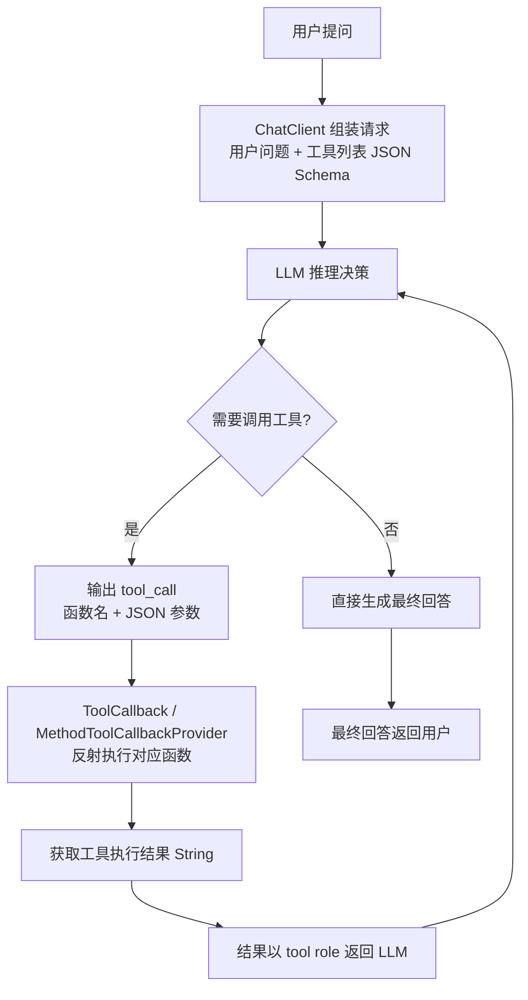

# SpringAI Function Calling工具调用

> Spring AI是Spring官方推出的AI应用开发框架，将LLM能力与Spring生态无缝集成。Function Calling（函数调用）让LLM能够调用外部工具/API，是构建Agent的核心能力。本文从原理到实战，完整讲解Spring AI中的Function Calling实现。
>
> **核心流程**：定义工具函数 → 注册到ChatClient → LLM判断需要调用 → 执行函数 → 结果返回LLM → 生成最终回答。

---

## 一、概述：Function Calling是什么

<div style="background:linear-gradient(135deg,#667eea,#764ba2);border-radius:16px;padding:20px;margin:16px 0;font-family:-apple-system,'Segoe UI','PingFang SC','Microsoft YaHei',sans-serif;color:#fff;overflow:hidden;box-shadow:0 8px 28px rgba(0,0,0,.14),0 3px 10px rgba(0,0,0,.08)">
<style>@keyframes highlight{0%,100%{box-shadow:0 0 0 rgba(255,255,255,0)}50%{box-shadow:0 0 20px rgba(255,255,255,.4)}}.hl-box{background:rgba(255,255,255,.2);border-radius:10px;padding:14px 18px;margin:10px 0;animation:highlight 3s ease-in-out infinite;border-left:4px solid rgba(255,255,255,.6)}.hl-formula{font-family:monospace;font-size:14px;text-align:center;background:rgba(0,0,0,.15);border-radius:8px;padding:12px;margin:10px 0}</style>
<div style="text-align:center;font-size:15px;font-weight:700;margin-bottom:14px;padding-bottom:10px;border-bottom:1.5px solid rgba(255,255,255,.22);letter-spacing:1px;text-shadow:0 1px 3px rgba(0,0,0,.12)">📌 application.yml</div>
<div class="hl-box">application.yml 是 AI 工程化体系中的重要知识点，涵盖核心概念、技术原理与实践方法。</div>
<div class="hl-formula">application.yml 核心机制</div>
<div style="font-size:13px;opacity:.9;margin-top:8px">💡 工程化思维是从 Demo 到生产系统的关键跨越</div>
</div>

> 🔍 **知识点深度解析**
>
> **作用**：application.yml 是 AI 工程化体系中的关键环节，解决从模型能力到生产应用的转化问题，适用于构建稳定、可扩展、可维护的 AI 应用系统。
>
> **原理**：通过标准化的工程方法论和工具链，将大模型的能力封装为可复用的组件，结合最佳实践和质量保障机制，实现 AI 应用的高效开发和可靠运行。
>
> **用法要点**：① 遵循标准化的开发流程和规范 ② 选择合适的工具和框架提升效率 ③ 建立完善的测试和监控机制 ④ 持续优化性能和成本

### 1.1 为什么需要Function Calling

| LLM局限 | Function Calling解决 |
|---------|---------------------|
| 知识截止日期，无法获取实时信息 | 调用搜索API/数据库查询实时数据 |
| 无法执行操作（发邮件、下订单） | 调用业务API执行具体操作 |
| 计算能力弱（数学、单位换算） | 调用计算器/专用工具 |
| 无法访问企业内部数据 | 调用内部服务/数据库 |

### 1.2 Function Calling vs 普通Prompt

```text
普通Prompt：用户问题 → LLM直接回答（可能幻觉、可能过时）

Function Calling：用户问题 → LLM判断是否需要工具
    ├── 不需要 → 直接回答
    └── 需要 → 输出函数名+参数 → 执行函数 → 结果返回LLM → 整合回答
```

### 1.3 Spring AI架构

```text
Spring AI
├── ChatClient（统一聊天客户端）
│   ├── OpenAI
│   ├── Anthropic Claude
│   ├── Azure OpenAI
│   ├── Ollama（本地模型）
│   └── 其他模型
├── Function Calling（工具调用）
│   ├── @Tool注解定义工具
│   ├── FunctionCallback注册
│   └── 自动工具执行
├── RAG（检索增强生成）
│   ├── DocumentReader
│   ├── VectorStore
│   └── RetrievalAugmentor
└── 其他能力
    ├── Embedding
    ├── Image Generation
    ├── Audio Transcription
    └── Prompt Template
```

---

---

> 💡 **深度讲解**：本节围绕，深入剖析其技术原理与实践要点，帮助读者建立系统性的认知框架。
>
> **📝 精简总结**：本节介绍了，掌握这些内容是理解整个知识体系的重要基础。

## 二、底层原理：Function Calling工作机制

### Spring AI Function Calling 流程



### 2.1 完整调用流程

```text
1. 用户提问："北京今天天气怎么样？"
         ↓
2. 应用将用户问题 + 可用工具列表（JSON Schema）发给LLM
         ↓
3. LLM判断需要调用工具，返回：
   {
     "tool_calls": [{
       "function": {"name": "getWeather", "arguments": "{\"city\":\"北京\"}"},
       "id": "call_abc123"
     }]
   }
         ↓
4. 应用解析工具调用，执行 getWeather(city="北京")
         ↓
5. 获取结果：{"temperature": 25, "condition": "晴", "wind": "3级"}
         ↓
6. 将工具结果返回给LLM
         ↓
7. LLM整合工具结果，生成最终回答："北京今天晴，气温25°C，微风3级。"
```

### 2.2 工具定义（JSON Schema）

LLM通过JSON Schema了解工具的名称、描述、参数格式，从而决定是否调用以及如何传参。

```json
{
  "type": "function",
  "function": {
    "name": "getWeather",
    "description": "查询指定城市的实时天气信息",
    "parameters": {
      "type": "object",
      "properties": {
        "city": {
          "type": "string",
          "description": "城市名称，如北京、上海、广州"
        },
        "unit": {
          "type": "string",
          "enum": ["celsius", "fahrenheit"],
          "description": "温度单位"
        }
      },
      "required": ["city"]
    }
  }
}
```

---

---

> 💡 **深度讲解**：本节围绕，深入剖析其技术原理与实践要点，帮助读者建立系统性的认知框架。
>
> **📝 精简总结**：本节介绍了，掌握这些内容是理解整个知识体系的重要基础。

## 三、实操：Spring AI Function Calling完整实现

### 3.1 项目依赖

```html
<!-- pom.xml -->
<dependencies>
    <!-- Spring AI OpenAI -->
    <dependency>
        <groupId>org.springframework.ai</groupId>
        <artifactId>spring-ai-openai-spring-boot-starter</artifactId>
        <version>1.0.0</version>
    </dependency>
    <!-- Web -->
    <dependency>
        <groupId>org.springframework.boot</groupId>
        <artifactId>spring-boot-starter-web</artifactId>
    </dependency>
</dependencies>
```

### 3.2 配置

```yaml
# application.yml
spring:
  ai:
    openai:
      api-key: ${OPENAI_API_KEY}
      chat:
        options:
          model: gpt-4o
          temperature: 0.3
```

### 3.3 定义工具函数（@Tool注解）

```python
// WeatherTools.java
import org.springframework.ai.tool.annotation.Tool;
import org.springframework.ai.tool.annotation.ToolParam;
import org.springframework.stereotype.Component;

@Component
public class WeatherTools {

    private final WeatherService weatherService;

    public WeatherTools(WeatherService weatherService) {
        this.weatherService = weatherService;
    }

    @Tool(description = "查询指定城市的实时天气信息，包括温度、天气状况、风力等")
    public String getWeather(
            @ToolParam(description = "城市名称，如北京、上海、广州") String city,
            @ToolParam(description = "温度单位，celsius或fahrenheit") String unit) {
        WeatherInfo info = weatherService.getCurrentWeather(city, unit);
        return String.format(
            "城市：%s，天气：%s，温度：%.1f°%s，湿度：%d%%，风力：%s",
            city, info.getCondition(), info.getTemperature(),
            unit.equals("fahrenheit") ? "F" : "C",
            info.getHumidity(), info.getWind()
        );
    }

    @Tool(description = "查询指定城市未来几天的天气预报")
    public String getForecast(
            @ToolParam(description = "城市名称") String city,
            @ToolParam(description = "预报天数，1-7天") int days) {
        List<DailyForecast> forecasts = weatherService.getForecast(city, days);
        StringBuilder sb = new StringBuilder(city + "未来" + days + "天预报：\n");
        for (DailyForecast f : forecasts) {
            sb.append(String.format("%s：%s，%s°~%s°\n",
                f.getDate(), f.getCondition(), f.getTempLow(), f.getTempHigh()));
        }
        return sb.toString();
    }
}
```

### 3.4 注册工具并使用ChatClient

```python
// ChatService.java
import org.springframework.ai.chat.client.ChatClient;
import org.springframework.ai.chat.client.advisor.SimpleLoggerAdvisor;
import org.springframework.ai.tool.ToolCallbackProvider;
import org.springframework.ai.tool.method.MethodToolCallbackProvider;
import org.springframework.stereotype.Service;

@Service
public class ChatService {

    private final ChatClient chatClient;

    public ChatService(ChatClient.Builder builder, WeatherTools weatherTools,
                       OrderTools orderTools, UserTools userTools) {
        // 注册所有工具
        ToolCallbackProvider toolProvider = MethodToolCallbackProvider.builder()
                .toolObjects(weatherTools, orderTools, userTools)
                .build();

        this.chatClient = builder
                .defaultAdvisors(new SimpleLoggerAdvisor())
                .defaultTools(toolProvider)
                .build();
    }

    public String chat(String userMessage) {
        return chatClient.prompt()
                .user(userMessage)
                .call()
                .content();
    }
}
```

### 3.5 业务工具示例（订单查询）

```python
// OrderTools.java
@Component
public class OrderTools {

    private final OrderService orderService;

    @Tool(description = "根据订单号查询订单详情，包括订单状态、商品、金额、物流信息")
    public String queryOrder(
            @ToolParam(description = "订单号，如ORD20240101001") String orderId) {
        Order order = orderService.getOrderById(orderId);
        if (order == null) {
            return "未找到订单号为" + orderId + "的订单，请确认订单号是否正确";
        }
        return String.format(
            "订单号：%s\n状态：%s\n商品：%s\n金额：%.2f元\n下单时间：%s\n物流：%s",
            order.getOrderId(), order.getStatus(), order.getProductName(),
            order.getAmount(), order.getCreateTime(), order.getLogistics()
        );
    }

    @Tool(description = "取消指定订单，仅允许取消待支付和已支付未发货的订单")
    public String cancelOrder(
            @ToolParam(description = "订单号") String orderId,
            @ToolParam(description = "取消原因") String reason) {
        try {
            orderService.cancelOrder(orderId, reason);
            return "订单" + orderId + "已成功取消，原因：" + reason;
        } catch (BusinessException e) {
            return "取消失败：" + e.getMessage();
        }
    }
}
```

### 3.6 REST API接口

```python
// ChatController.java
@RestController
@RequestMapping("/api/chat")
public class ChatController {

    private final ChatService chatService;

    @PostMapping
    public ResponseEntity<ChatResponse> chat(@RequestBody ChatRequest request) {
        String answer = chatService.chat(request.getMessage());
        return ResponseEntity.ok(new ChatResponse(answer));
    }

    // 流式输出
    @GetMapping(value = "/stream", produces = MediaType.TEXT_EVENT_STREAM_VALUE)
    public Flux<String> chatStream(@RequestParam String message) {
        return chatClient.prompt()
                .user(message)
                .stream()
                .content();
    }
}
```

---

---

> 💡 **深度讲解**：本节围绕，深入剖析其技术原理与实践要点，帮助读者建立系统性的认知框架。
>
> **📝 精简总结**：本节介绍了，掌握这些内容是理解整个知识体系的重要基础。

## 四、常见问题与排查

### 4.1 工具不被调用

| 原因 | 解决 |
|------|------|
| 工具描述不清晰 | 详细描述工具功能、参数含义、返回格式 |
| 参数描述模糊 | 每个参数都加@ToolParam说明，包含示例 |
| 工具太多LLM选错 | 按场景分组，只注册相关工具 |
| 模型能力不足 | 使用更强的模型（gpt-4o > gpt-3.5-turbo） |
| Prompt引导不够 | 在系统提示中说明何时使用工具 |

### 4.2 工具调用循环

**现象**：LLM反复调用同一个工具，无法结束。

**解决**：
```text
// 限制最大工具调用次数
ChatClient.builder()
    .defaultAdvisors(
        new MaxToolsAdvisor(5)  // 最多调用5次工具
    )
```

### 4.3 工具执行异常处理

```text
@Tool(description = "查询用户信息")
public String getUserInfo(String userId) {
    try {
        User user = userService.getUserById(userId);
        return user.toJson();
    } catch (Exception e) {
        // 返回错误信息给LLM，让LLM知道调用失败
        return "查询用户信息失败：" + e.getMessage() + "。请告知用户稍后重试或联系客服。";
    }
}
```

### 4.4 安全考虑

- **权限控制**：工具执行前校验用户权限（如取消订单只能取消自己的订单）
- **敏感操作确认**：高风险操作（删除、支付）需用户二次确认
- **参数校验**：对LLM传入的参数进行校验和清洗
- **调用审计**：记录所有工具调用日志，便于排查和安全审计
- **速率限制**：防止LLM频繁调用工具导致后端压力

---

---

> 💡 **深度讲解**：本节围绕，深入剖析其技术原理与实践要点，帮助读者建立系统性的认知框架。
>
> **📝 精简总结**：本节介绍了，掌握这些内容是理解整个知识体系的重要基础。

## 五、进阶与最佳实践

### 5.1 工具设计原则

1. **单一职责**：每个工具只做一件事，功能清晰
2. **描述精准**：工具描述和参数描述要详细，包含示例
3. **返回简洁**：返回结果简洁明了，避免冗余信息
4. **错误友好**：异常时返回友好的错误信息，帮助LLM处理
5. **幂等设计**：查询类工具天然幂等，操作类工具需考虑重复调用

### 5.2 工具分组与动态注册

```bash
// 按场景注册不同工具
public String chatWithScenario(String message, String scenario) {
    ToolCallbackProvider tools = switch (scenario) {
        case "weather" -> MethodToolCallbackProvider.builder()
                .toolObjects(weatherTools).build();
        case "order" -> MethodToolCallbackProvider.builder()
                .toolObjects(orderTools, userTools).build();
        default -> MethodToolCallbackProvider.builder()
                .toolObjects(weatherTools, orderTools, userTools).build();
    };
    return chatClient.prompt()
            .user(message)
            .tools(tools)
            .call()
            .content();
}
```

### 5.3 最佳实践清单

- [ ] 每个工具都有清晰的@Tool描述
- [ ] 每个参数都有@ToolParam说明
- [ ] 工具返回字符串（LLM能理解的格式）
- [ ] 异常时返回友好错误信息
- [ ] 敏感操作需用户确认
- [ ] 工具调用有日志审计
- [ ] 限制最大工具调用次数
- [ ] 按场景分组注册工具
- [ ] 定期评估工具调用准确率
- [ ] 工具参数做校验和清洗

---

---

> 💡 **深度讲解**：本节围绕，深入剖析其技术原理与实践要点，帮助读者建立系统性的认知框架。
>
> **📝 精简总结**：本节介绍了，掌握这些内容是理解整个知识体系的重要基础。

## 关联笔记

- [[Agent工具调用FunctionCalling]] — Function Calling原理
- [[Agent记忆机制设计]] — Agent记忆
- [[SpringBoot实战]] — Spring Boot基础
- [[Spring事务管理与传播机制]] — Spring事务
- [[自研Agent框架设计]] — Agent框架设计

---

## 🔗 关联笔记

- [[MCP协议实战指南]] — MCP协议
- [[AI工程化知识点完整整合大全_优化版]] — AI工程化大全
- [[AI应用开发入门]] — AI应用入门

## 📖 前置知识

- [[AI-API调用入门实战]]
- [[AI应用开发入门]]

## 🏷️ 相关标签

`#AI工程化` `#SpringBoot` `#LLM` `#Agent` `#效率工具`

---

[[Home|🏠 返回首页]] · [[MOC-AI工程化-四级展开|📚 返回分类]]

