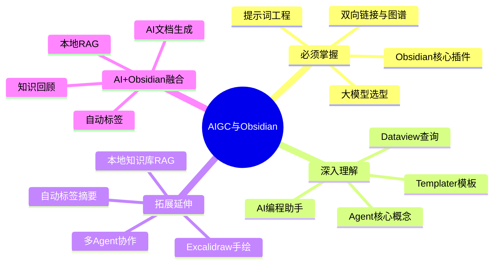

# 🤖 AIGC 与 Obsidian 应用枢纽

> AI 工具应用与 Obsidian 知识管理的融合枢纽，连接大模型工具、Agent 基础、Obsidian 插件生态与 AI+笔记融合。
> **所属板块**：[[MOC-AIGC与Obsidian-四级展开|AIGC与Obsidian]]
> **标签前缀**：`#AIGC应用/`

---

## 🗺️ 知识体系总览

<div style="background:linear-gradient(135deg,#11998e,#38ef7d);border-radius:16px;padding:20px;margin:16px 0;font-family:-apple-system,'Segoe UI','PingFang SC','Microsoft YaHei',sans-serif;color:#fff;overflow:hidden;box-shadow:0 8px 28px rgba(0,0,0,.14),0 3px 10px rgba(0,0,0,.08)">
<style>@keyframes highlight{0%,100%{box-shadow:0 0 0 rgba(255,255,255,0)}50%{box-shadow:0 0 20px rgba(255,255,255,.4)}}.hl-box{background:rgba(255,255,255,.2);border-radius:10px;padding:14px 18px;margin:10px 0;animation:highlight 3s ease-in-out infinite;border-left:4px solid rgba(255,255,255,.6)}.hl-formula{font-family:monospace;font-size:14px;text-align:center;background:rgba(0,0,0,.15);border-radius:8px;padding:12px;margin:10px 0}</style>
<div style="text-align:center;font-size:15px;font-weight:700;margin-bottom:14px;padding-bottom:10px;border-bottom:1.5px solid rgba(255,255,255,.22);letter-spacing:1px;text-shadow:0 1px 3px rgba(0,0,0,.12)">📌 🤖 AIGC 与 Obsidian 应用枢纽</div>
<div class="hl-box">🤖 AIGC 与 Obsidian 应用枢纽 是 Obsidian 效率工具体系中的重要知识点，涵盖配置方法、使用技巧与最佳实践。</div>
<div class="hl-formula">笔记检索 → 上下文注入 → AI生成 → 内容插入 → 人工审核</div>
<div style="font-size:13px;opacity:.9;margin-top:8px">💡 工具是手段，高效的知识管理才是目标</div>
</div>

> 🔍 **知识点深度解析**
>
> **作用**：🤖 AIGC 与 Obsidian 应用枢纽 是 Obsidian 知识管理体系中的重要工具/方法，解决知识采集、组织、检索和利用中的效率问题，适用于构建个人知识管理系统和提升工作效率。
>
> **原理**：通过插件扩展和工作流设计，将 Obsidian 从简单的笔记工具升级为强大的知识管理平台，结合自动化和 AI 能力实现知识的高效处理和价值挖掘。
>
> **用法要点**：① 先掌握基础配置再深入高级功能 ② 建立适合自己的工作流而非照搬他人方案 ③ 善用快捷键和模板提升操作效率 ④ 定期回顾和优化知识管理方法



---

## 📌 枢纽定位

| 维度 | 说明 |
|------|------|
| 定位 | AI 工具应用 + 个人知识管理工具的交汇点 |
| 覆盖范围 | AIGC工具 → Agent基础 → Obsidian基础 → 进阶插件 → AI融合 |
| 上游依赖 | 无（工具应用层，可直接入门） |
| 下游延伸 | [[AI-工程化技术枢纽|AI工程化]]、[[知识管理-方法论枢纽|知识管理]] |
| 核心能力 | 用 AI 工具提升生产力，用 Obsidian 构建个人知识系统 |

---

## 🔑 核心知识节点

### 第一层：必须掌握

- [[主流大模型对比与选型|主流大模型对比]] — 模型生态认知
- [[提示词工程方法论|提示词工程]] — 与大模型高效沟通
- [[Obsidian-核心插件配置|Obsidian 核心插件]] — 笔记工具基础
- [[Obsidian-双向链接与图谱|双向链接与图谱]] — Obsidian 核心特性

### 第二层：深入理解

- [[AI编程助手深度使用|AI 编程助手]] — Cursor/Copilot 深度使用
- [[Agent核心概念-ReAct规划|Agent 核心概念]] — ReAct 规划
- [[Obsidian-Dataview查询语言|Dataview 查询]] — 笔记数据库化
- [[Templater-自动化模板|Templater 模板]] — 高效笔记录入

### 第三层：拓展延伸

- [[本地知识库接入LLM|本地知识库接入 LLM]] — AI + 笔记融合
- [[多Agent协作模式|多 Agent 协作]] — 复杂任务处理
- [[笔记自动标签与摘要|笔记自动标签与摘要]] — AI 辅助整理
- [[Excalidraw-手绘笔记|Excalidraw 手绘]] — 可视化笔记

---

## 🕸️ 知识网络

```text
AIGC工具                    Obsidian
    │                          │
    ├── 大模型选型              ├── 核心插件
    ├── 提示词工程              ├── 双向链接
    ├── AI编程助手              ├── 模板系统
    └── 多模态生成              ├── Dataview
         │                     └── Excalidraw
         │                          │
         └──── Agent基础 ────────────┘
                    │
                    └── AI + Obsidian 融合
                         ├── 本地RAG
                         ├── 自动标签
                         └── 知识回顾
```

---

## 🔗 上下游横向关联

### 入向依赖
- 无严格前置，工具应用可直接入门

### 出向延伸
- [[AI-工程化技术枢纽|AI工程化]] — 从工具使用到深度开发
- [[知识管理-方法论枢纽|知识管理]] — 从工具到方法论
- [[效率工具-枢纽|效率工具]] — 更多生产力工具

---

## 🌐 跨板块枢纽连接

| 连接枢纽 | 关联点 | 关键笔记 |
|----------|--------|----------|
| [[AI-工程化技术枢纽|AI工程化]] | Agent 概念是工程化实现的理论前置 | [[Agent核心概念-ReAct规划]] |
| [[知识管理-方法论枢纽|知识管理]] | Obsidian 是方法论的落地工具 | [[Obsidian-双向链接与图谱]] |
| [[效率工具-枢纽|效率工具]] | Obsidian 插件属于效率工具生态 | [[Cursor-AI编辑器深度使用]] |
| [[项目实战-枢纽|项目实战]] | AI 工具提升项目交付效率 | [[AI编程助手深度使用]] |

---

## 📝 维护日志

| 日期 | 变更 |
|------|------|
| 2026-08-13 | 初始创建 |

---

## ⚠️ 知识边界

- AI 底层原理与工程化归入 [[AI-工程化技术枢纽|AI工程化]]
- 知识管理方法论归入 [[知识管理-方法论枢纽|知识管理]]
- 本枢纽聚焦"工具应用"层面，不深入底层实现

---

[[四级框架总索引|← 返回四级框架总索引]] | [[MOC-AIGC与Obsidian-四级展开|📂 返回板块MOC]] | [[Home|🏠 返回首页]]

---


---

> 💡 **深度讲解**：本文系统梳理了🤖 AIGC 与 Obsidian 应用枢纽 的核心知识体系，从基础概念到进阶实践，覆盖了关键技术点、最佳实践和常见问题。建议读者按照知识体系总览的路径逐步学习，结合实操示例加深理解，并通过关联笔记建立跨领域的知识网络。
>
> **📝 精简总结**：本文涵盖了🤖 AIGC 与 Obsidian 应用枢纽 的核心概念、技术原理、实践方法和进阶技巧，是该领域知识体系的系统性梳理，适合作为学习路线图和复习参考。

## 🔗 关联笔记

- [[AI-工程化技术枢纽]] — AI工程化枢纽
- [[MOC-AIGC与Obsidian-四级展开]] — AIGC与Obsidian MOC
- [[主流大模型对比与选型]] — 大模型选型
- [[Obsidian-核心插件配置]] — Obsidian核心插件

## 📖 前置知识


## 🏷️ 相关标签

`#枢纽笔记` `#Obsidian` `#AI应用` `#知识管理` `#效率工具`

---

[[Home|🏠 返回首页]] · [[MOC-AIGC与Obsidian-四级展开|📚 返回分类]]

