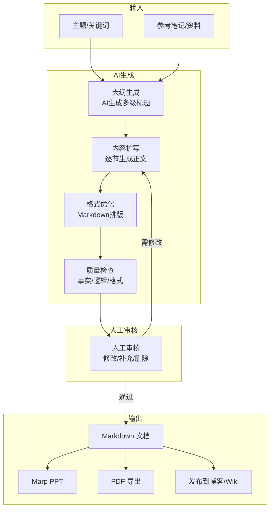
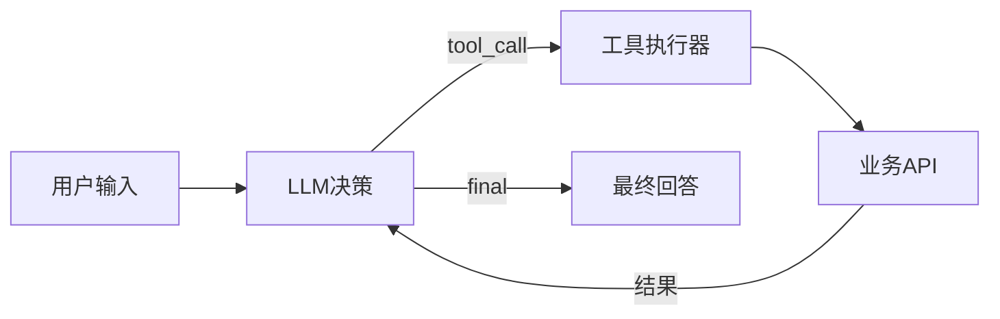

# AI 文档与 PPT 生成工作流

> **文档说明**：系统讲解基于 Obsidian + AI 的文档与 PPT 自动化生成工作流，涵盖从大纲生成、内容扩写、格式排版到 PPT 导出的完整管线，涉及 Smart Connections、Text Generator、Copilot 等 AI 插件的配置，Marp/Reveal.js PPT 生成方案，文档质量检查与人工审核节点，含可运行的 Templater 模板、AI Prompt 模板、Marp PPT 示例和批量生成脚本。
>
> **适用人群**：知识工作者、技术写作者、需要高频产出文档和演示文稿的全栈工程师
>
> **前置知识**：[[Obsidian-AI插件对比]]、[[Obsidian-模板与快速输入]]、[[Templater-自动化模板]]

---

## 一、概述

<div style="background:linear-gradient(135deg,#11998e,#38ef7d);border-radius:16px;padding:20px;margin:16px 0;font-family:-apple-system,'Segoe UI','PingFang SC','Microsoft YaHei',sans-serif;color:#fff;overflow:hidden;box-shadow:0 8px 28px rgba(0,0,0,.14),0 3px 10px rgba(0,0,0,.08)">
<style>@keyframes highlight{0%,100%{box-shadow:0 0 0 rgba(255,255,255,0)}50%{box-shadow:0 0 20px rgba(255,255,255,.4)}}.hl-box{background:rgba(255,255,255,.2);border-radius:10px;padding:14px 18px;margin:10px 0;animation:highlight 3s ease-in-out infinite;border-left:4px solid rgba(255,255,255,.6)}.hl-formula{font-family:monospace;font-size:14px;text-align:center;background:rgba(0,0,0,.15);border-radius:8px;padding:12px;margin:10px 0}</style>
<div style="text-align:center;font-size:15px;font-weight:700;margin-bottom:14px;padding-bottom:10px;border-bottom:1.5px solid rgba(255,255,255,.22);letter-spacing:1px;text-shadow:0 1px 3px rgba(0,0,0,.12)">📌 AI 文档与 PPT 生成工作流</div>
<div class="hl-box">系统讲解基于 Obsidian + AI 的文档与 PPT 自动化生成工作流，涵盖从大纲生成、内容扩写、格式排版到 PPT 导出的完整管线，涉及 Smart Connections、Text Generator、Copilot 等 AI 插件的配置，Marp/Reveal.js PPT 生成方案，文...</div>
<div class="hl-formula">笔记检索 → 上下文注入 → AI生成 → 内容插入 → 人工审核</div>
<div style="font-size:13px;opacity:.9;margin-top:8px">💡 工具是手段，高效的知识管理才是目标</div>
</div>

> 🔍 **知识点深度解析**
>
> **作用**：AI 文档与 PPT 生成工作流 是 Obsidian 知识管理体系中的重要工具/方法，解决知识采集、组织、检索和利用中的效率问题，适用于构建个人知识管理系统和提升工作效率。
>
> **原理**：通过插件扩展和工作流设计，将 Obsidian 从简单的笔记工具升级为强大的知识管理平台，结合自动化和 AI 能力实现知识的高效处理和价值挖掘。
>
> **用法要点**：① 先掌握基础配置再深入高级功能 ② 建立适合自己的工作流而非照搬他人方案 ③ 善用快捷键和模板提升操作效率 ④ 定期回顾和优化知识管理方法

**AI 文档与 PPT 生成工作流**是将 Obsidian 作为内容管理中枢，结合 AI 插件实现"主题输入 → 大纲生成 → 内容扩写 → 排版优化 → PPT 导出"的自动化管线。核心价值是将文档/PPT 生产时间从小时级压缩到分钟级，同时保持内容质量的可控性——AI 负责初稿生成，人负责审核和精修。

### 1. 传统文档/PPT 生产的痛点

| 痛点 | AI 工作流解决的问题 |
|------|-------------------|
| 从零开始写大纲耗时 | AI 根据主题秒级生成结构化大纲 |
| 内容扩写需要大量资料搜集 | AI 基于知识库检索 + 生成，自动引用笔记 |
| 格式排版反复调整 | 模板统一格式，AI 辅助 Markdown 排版 |
| PPT 制作占时最长 | Markdown → Marp/Reveal.js 一键生成 PPT |
| 多份文档风格不统一 | 统一 Prompt 模板 + Templater 保证风格一致 |
| 内容质量不可控 | 人工审核节点 + AI 质量检查（事实/逻辑/格式） |

### 2. 工作流全景



### 3. 核心工具链

| 环节 | 工具 | 说明 |
|------|------|------|
| **笔记管理** | Obsidian | 内容中枢，双链 + 标签 + 搜索 |
| **AI 对话** | Copilot / Smart Connections | 基于本地笔记的 AI 对话和生成 |
| **文本生成** | Text Generator | 模板化文本生成，支持快捷键 |
| **模板** | Templater | 文档模板自动化 |
| **PPT 生成** | Marp / Advanced Slides | Markdown → PPT |
| **导出** | Pandoc / Obsidian Export | Markdown → PDF/Word/HTML |
| **质量检查** | AI Prompt + 人工 | 事实核查、逻辑检查、格式校验 |

---

---

> 💡 **深度讲解**：本节围绕，深入剖析其使用方法与实践技巧，帮助读者建立高效的知识管理工作流。
>
> **📝 精简总结**：本节介绍了，掌握这些内容是提升 Obsidian 使用效率的重要基础。

## 二、底层原理

### 1. AI 文档生成的 Prompt 工程

文档生成的质量取决于 Prompt 设计。核心 Prompt 模板包含：

| 组件 | 作用 | 示例 |
|------|------|------|
| **角色设定** | 定义 AI 的身份和专业领域 | "你是资深技术写作者，擅长 Java 后端架构文档" |
| **上下文注入** | 提供参考资料和知识库 | "参考以下笔记内容：{{notes}}" |
| **输出格式** | 明确文档结构和格式 | "输出 Markdown，包含概述/原理/实操/最佳实践四节" |
| **约束条件** | 限制内容范围和风格 | "字数 2000-3000，代码用 Java，禁止套话" |
| **质量标准** | 定义合格标准 | "每个概念必须有定义+示例，代码必须可运行" |

### 2. 大纲驱动的内容生成

不直接让 AI 写全文，而是**先大纲后内容**，分步生成：

```text
步骤1: 生成大纲（5-8个一级标题）
步骤2: 人工审核大纲（调整/增删/重排）
步骤3: 逐节扩写（每次生成一节，质量可控）
步骤4: 全文整合 + 过渡段生成
步骤5: 格式优化 + 质量检查
```

这种方式比一次性生成全文质量高 30-50%，因为每步都可以人工干预。

### 3. Marp PPT 生成原理

Marp 是将 Markdown 转换为 PPT 的工具，用 `---` 分隔幻灯片：

````text
---
marp: true
theme: default
paginate: true
---

# 标题页
---

## 副标题
作者 | 日期

---

## 第一页标题
- 要点1
- 要点2
- 要点3

---

## 代码页
```text
public class Hello {
    public static void main(String[] args) {
        System.out.println("Hello");
    }
}
```
````

> 💡 **深度讲解**：本节围绕，深入剖析其使用方法与实践技巧，帮助读者建立高效的知识管理工作流。
>
> **📝 精简总结**：本节介绍了，掌握这些内容是提升 Obsidian 使用效率的重要基础。

Marp 支持主题、CSS 自定义、图片、表格、代码高亮，导出 HTML/PDF/PPTX。

---

## 三、实操

### 1. Templater 文档生成模板

````text
<!-- templates/ai_doc_template.md -->
---
title: <% tp.file.title %>
tags: [<% tp.system.prompt("标签（逗号分隔）", "技术") %>]
category: <% tp.system.prompt("分类", "AI与效率工具") %>
created: <% tp.date.now("YYYY-MM-DD") %>
updated: <% tp.date.now("YYYY-MM-DD") %>
difficulty: ⭐⭐⭐
status: 🚧 草稿中
priority: 普通
---

## <% tp.file.title %>

> **文档说明**：<% tp.system.prompt("文档说明（一句话）") %>
>
> **适用人群**：<% tp.system.prompt("适用人群") %>
>
> **前置知识**：<% tp.system.prompt("前置知识（用[[]]）") %>

---

---

> 💡 **深度讲解**：本节围绕，深入剖析其使用方法与实践技巧，帮助读者建立高效的知识管理工作流。
>
> **📝 精简总结**：本节介绍了，掌握这些内容是提升 Obsidian 使用效率的重要基础。

## 一、概述

<!-- AI 生成：定义 + 痛点对比表 + 全景图 -->

## 二、底层原理

<!-- AI 生成：机制 + Mermaid 图 + 对比表 -->

## 三、实操

<!-- AI 生成：可运行代码 + 配置示例 -->

## 四、常见问题与排查

<!-- AI 生成：问题→原因→方案表，≥6行 -->

---

> 💡 **深度讲解**：本节围绕，深入剖析其使用方法与实践技巧，帮助读者建立高效的知识管理工作流。
>
> **📝 精简总结**：本节介绍了，掌握这些内容是提升 Obsidian 使用效率的重要基础。

## 五、进阶与最佳实践

<!-- AI 生成：最佳实践 + 优化建议 -->

---

> 💡 **深度讲解**：本节围绕，深入剖析其使用方法与实践技巧，帮助读者建立高效的知识管理工作流。
>
> **📝 精简总结**：本节介绍了，掌握这些内容是提升 Obsidian 使用效率的重要基础。

## 六、关联笔记

<!-- 自动生成：按领域分组的 [[]] 双链 -->
````

### 2. AI 大纲生成 Prompt

```text
<!-- prompts/generate_outline.md -->
你是一个资深技术文档大纲设计师。请根据以下主题生成一份结构化文档大纲。

主题：{{title}}
目标读者：{{audience}}
文档类型：{{doc_type}}（技术教程/概念解析/实战指南/对比分析）

要求：
1. 生成 5-7 个一级标题（## ），每个标题下 2-4 个二级标题（### ）
2. 遵循"概述→原理→实操→问题→最佳实践"的认知逻辑
3. 每个标题用动宾结构，简洁明确（≤15字）
4. 实操部分必须包含具体代码/配置示例的位置标注
5. 输出纯 Markdown 大纲，不要解释

主题：{{title}}
大纲：
```

### 3. AI 内容扩写 Prompt

```text
<!-- prompts/expand_section.md -->
你是一个专业技术写作者。请根据以下信息扩写文档的一节。

【本节标题】：{{section_title}}
【本节在文档中的位置】：{{section_position}}
【文档主题】：{{doc_title}}
【参考资料】：
{{reference_notes}}

【写作要求】：
1. 字数 400-800 字
2. 先给出核心定义/概念（1-2句）
3. 然后展开讲解机制/原理（可用列表或步骤）
4. 必须包含至少一个具体示例（代码/配置/表格）
5. 语言专业但不晦涩，避免套话（"值得注意的是""综上所述"）
6. 用 Markdown 格式，代码块标注语言
7. 涉及其他概念时用 [[]] 双链标注

请输出本节内容：
```

### 4. Smart Connections 配置

```text
// .obsidian/plugins/smart-connections/data.json
{
  "api_key": "sk-xxx",
  "model": "gpt-4o-mini",
  "embedding_model": "text-embedding-3-small",
  "language": "zh",
  "chat_on_side": true,
  "show_similar_notes": 5,
  "exclude_folders": ["templates", "attachments"],
  "force_embedding_refresh": false
}
```

**使用方式**：
- 选中一段文字 → 右键 → "Smart Connections: Chat about selection"
- 侧边栏自动显示相关笔记
- 在聊天中输入"基于我的笔记生成关于XX的文档大纲"

### 5. Text Generator 模板配置

```text
// .obsidian/plugins/obsidian-textgenerator-plugin/data.json
{
  "templates": [
    {
      "name": "生成文档大纲",
      "prompt": "你是技术文档专家。为主题\"{{title}}\"生成5-7节的Markdown大纲，遵循概述-原理-实操-问题-最佳实践结构。",
      "model": "gpt-4o-mini",
      "temperature": 0.3,
      "max_tokens": 1000
    },
    {
      "name": "扩写当前段落",
      "prompt": "请将以下内容扩写到400-600字，保持专业风格，加入具体示例：\n{{selection}}",
      "model": "gpt-4o-mini",
      "temperature": 0.4,
      "max_tokens": 800
    },
    {
      "name": "质量检查",
      "prompt": "请检查以下文档的：1.事实准确性 2.逻辑连贯性 3.格式规范性 4.是否有套话。输出问题列表和修改建议。\n\n{{content}}",
      "model": "gpt-4o",
      "temperature": 0,
      "max_tokens": 1500
    }
  ],
  "hotkeys": {
    "生成文档大纲": "Ctrl+Shift+O",
    "扩写当前段落": "Ctrl+Shift+E",
    "质量检查": "Ctrl+Shift+Q"
  }
}
```

### 6. Marp PPT 生成完整示例

````text
<!-- presentations/ai_agent_intro.md -->
---
marp: true
theme: uncover
paginate: true
header: "AI Agent 技术分享"
footer: "2026-09-07 | BewhY"
size: 16:9
---

<!-- _class: lead -->
# AI Agent 核心技术
## 从 ReAct 到多 Agent 协作


---

## 议程

1. Agent 是什么
2. ReAct 推理范式
3. 工具调用机制
4. 记忆系统设计
5. 多 Agent 协作
6. 实战案例

---

## Agent 是什么

> Agent = LLM + 记忆 + 工具 + 规划

| 组件 | 作用 |
|------|------|
| LLM | 推理决策大脑 |
| Memory | 短期/长期记忆 |
| Tools | 与外部世界交互 |
| Planner | 任务分解与规划 |

---

## ReAct 推理循环

```text
Thought: 用户想查订单，需要调用 search_orders
Action: search_orders(user_id="u_123")
Observation: 找到3个订单
Thought: 需要汇总订单金额
Action: calculate_total(orders)
Observation: 总金额 ¥1,299
Final Answer: 您的订单总金额为 ¥1,299
```

---

## 工具调用架构



---

## 记忆系统

- **短期记忆**：当前对话上下文（滑动窗口）
- **长期记忆**：向量数据库存储历史交互
- **工作记忆**：Agent 当前任务的中间状态

---

## 实战：智能客服 Agent

- 日均处理 5000+ 对话
- 工具调用准确率 94%
- 人工接管率 < 15%
- 平均响应时间 1.2s

---

<!-- _class: lead -->
# 谢谢
## Q & A
````

**Marp CLI 导出命令**：

```bash
# 安装 Marp CLI
npm install -g @marp-team/marp-cli

# 导出为 PDF
marp presentations/ai_agent_intro.md -o output/ai_agent_intro.pdf

# 导出为 PPTX
marp presentations/ai_agent_intro.md -o output/ai_agent_intro.pptx

# 导出为 HTML（可交互）
marp presentations/ai_agent_intro.md -o output/ai_agent_intro.html

# 预览模式（实时编辑）
marp -s presentations/
```

### 7. 批量文档生成脚本

```python
# scripts/batch_doc_gen.py — 批量生成文档
import openai
import os
import json

client = openai.OpenAI()

def generate_outline(title: str, doc_type: str = "技术教程") -> str:
    """生成文档大纲"""
    resp = client.chat.completions.create(
        model="gpt-4o-mini",
        temperature=0.3,
        messages=[{"role": "user", "content": f"""
为主题"{title}"生成一份{doc_type}的Markdown大纲，5-7个一级标题，遵循概述-原理-实操-问题-最佳实践结构。只输出大纲。
"""}]
    )
    return resp.choices[0].message.content


def generate_section(title: str, section: str, context: str = "") -> str:
    """扩写单节"""
    resp = client.chat.completions.create(
        model="gpt-4o-mini",
        temperature=0.4,
        messages=[{"role": "user", "content": f"""
文档标题：{title}
当前节：{section}
上下文：{context}

请扩写本节，400-800字，包含具体示例，Markdown格式，避免套话。
"""}]
    )
    return resp.choices[0].message.content


def generate_full_doc(title: str, output_dir: str = "output/docs"):
    """生成完整文档"""
    os.makedirs(output_dir, exist_ok=True)

    # 1. 生成大纲
    outline = generate_outline(title)
    print(f"大纲生成完成:\n{outline}")

    # 2. 解析一级标题
    sections = [line.strip() for line in outline.split("\n")
                if line.strip().startswith("## ") and not line.startswith("### ")]

    # 3. 逐节扩写
    full_content = f"# {title}\n\n"
    context = ""
    for section in sections:
        print(f"扩写: {section}")
        content = generate_section(title, section, context)
        full_content += f"\n{section}\n\n{content}\n\n"
        context += f"\n{section}\n{content[:200]}"

    # 4. 保存
    filename = title.replace("/", "-").replace(" ", "_") + ".md"
    filepath = os.path.join(output_dir, filename)
    with open(filepath, "w", encoding="utf-8") as f:
        f.write(full_content)
    print(f"文档已保存: {filepath}")
    return filepath


# 批量生成
topics = [
    "Redis缓存穿透与击穿",
    "Kafka消息可靠性保证",
    "Spring Boot微服务网关设计",
]
for topic in topics:
    generate_full_doc(topic)
```

---

## 四、常见问题与排查

| 问题现象 | 原因分析 | 解决方案 |
|---------|---------|---------|
| AI 生成的大纲结构混乱 | Prompt 未明确结构要求，或主题太宽泛 | 在 Prompt 中明确"概述-原理-实操-问题-最佳实践"结构；主题加限定词（"Java中的XX"而非"XX"） |
| 扩写内容与前后节重复 | 未传入上下文，AI 不知道已写内容 | 每节扩写时传入前文摘要（context）；大纲审核后锁定结构 |
| 生成内容包含套话和空话 | Prompt 未禁止套话，或 temperature 太高 | Prompt 中明确"禁止套话（值得注意的是/综上所述/总而言之）"；temperature 设 0.3-0.4 |
| 代码示例无法运行 | AI 生成的代码有幻觉或依赖缺失 | 人工审核代码；Prompt 要求"代码必须可运行，包含完整 import"；用 AI 质量检查步骤验证 |
| Marp 导出 PPT 格式错乱 | Marp 主题不支持某些 CSS，或图片路径不对 | 用默认主题测试；图片用绝对路径或相对路径；复杂排版用 HTML 幻灯片而非 Marp |
| Smart Connections 找不到相关笔记 | Embedding 未刷新，或笔记在排除目录 | 执行"Refresh Vector Store"；检查 exclude_folders 配置；确认笔记有实质内容 |
| 批量生成后文档风格不统一 | 每次 Prompt 略有差异，或模型随机性 | 用固定的 Templater 模板 + 固定 Prompt；temperature=0.3；统一 system prompt |
| PPT 中文字体显示异常 | Marp 默认字体不支持中文，或导出环境缺字体 | 自定义 CSS 指定中文字体（"Microsoft YaHei"/"PingFang SC"）；导出 PDF 时确保系统有中文字体 |
| AI 生成内容与已有笔记重复 | 未注入知识库上下文，AI 从零生成 | 用 Smart Connections 先检索相关笔记，将笔记内容作为上下文传入 Prompt；标注 [[]] 双链 |
| 文档质量检查流于形式 | 检查 Prompt 太笼统，AI 倾向于说"没问题" | 检查 Prompt 列出具体检查项（事实/逻辑/格式/套话/代码可运行性）；要求输出"问题编号+位置+修改建议"格式 |

---

## 五、进阶与最佳实践

### 1. 文档生成质量保障流程

- **大纲必须人工审核**：大纲决定文档骨架，AI 生成后必须人工调整
- **逐节生成而非全文**：每节 400-800 字，生成后立即审核，避免全文返工
- **代码必须验证**：所有代码示例复制到 IDE 运行验证
- **双链必须真实**：AI 生成的 [[]] 链接需确认目标笔记存在
- **最终通读**：完整文档至少通读一遍，检查逻辑连贯和过渡自然

### 2. PPT 设计原则

- **一页一主题**：每页只讲一个核心观点
- **文字精简**：每页 ≤ 6 行，每行 ≤ 15 字
- **可视化优先**：能用图不用表，能用表不用文字
- **统一风格**：统一配色（≤3色）、字体、图标
- **10/20/30 法则**：10页以内、20分钟讲完、字号≥30pt

### 3. 效率提升技巧

| 技巧 | 效果 |
|------|------|
| 固定 Prompt 模板库 | 减少重复编写，保证质量稳定 |
| Templater 一键创建文档骨架 | 30秒创建标准格式文档 |
| AI 快捷键绑定 | Ctrl+Shift+E 直接扩写选中文字 |
| Marp 实时预览 | 边写边看 PPT 效果 |
| 文档模板复用 | 同类文档复用已验证的结构 |
| 批量生成 + 人工精修 | AI 出初稿，人做终审，效率提升 5-10 倍 |

### 4. 工具链演进路线

| 阶段 | 工具 | 产出效率 |
|------|------|---------|
| **入门** | Obsidian + Copilot 插件 | 文档 2h/篇 |
| **进阶** | + Templater + Text Generator 模板 | 文档 30min/篇 |
| **熟练** | + Smart Connections 知识库 + Marp PPT | 文档 15min/篇，PPT 10min/份 |
| **专家** | + 批量生成脚本 + 自动化质量检查 | 文档 5min/篇（初稿），人工精修 10min |

---

## 六、关联笔记

### Obsidian 效率
- [[Obsidian-AI插件对比]] · [[Obsidian-模板与快速输入]] · [[Templater-自动化模板]]
- [[Obsidian-核心插件配置]] · [[Obsidian-Canvas画布用法]] · [[Obsidian-Dataview查询语言]]
- [[笔记自动标签与摘要]] · [[用AI辅助知识回顾与发现]]

### AI 工具应用
- [[AI编程助手深度使用]] · [[主流大模型对比与选型]]
- [[多模态生成工具链]]

### 导航
- [[MOC-AI与效率工具]] · [[全栈+AI工程双轨融合学习路线图]]

> **学习路径建议**：先掌握 [[Obsidian-核心插件配置]] 搭建基础环境 → 学习 [[Templater-自动化模板]] 创建文档模板 → 深入 [[Obsidian-AI插件对比]] 选择 AI 工具 → 实践本文文档与 PPT 生成工作流 → 参考 [[用AI辅助知识回顾与发现]] 构建知识管理闭环。

---

## 📖 前置知识

- [[提示词工程方法论]]
- [[Obsidian-核心插件配置]]

## 🏷️ 相关标签

`#AI应用` `#效率工具` `#Obsidian` `#Prompt工程`

---

[[Home|🏠 返回首页]] · [[MOC-AIGC与Obsidian-四级展开|📚 返回分类]]

