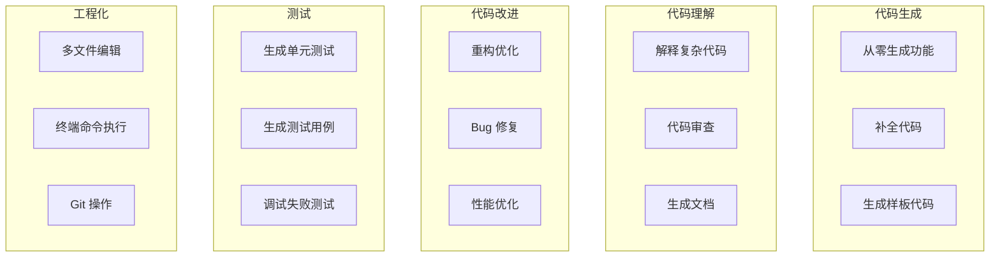
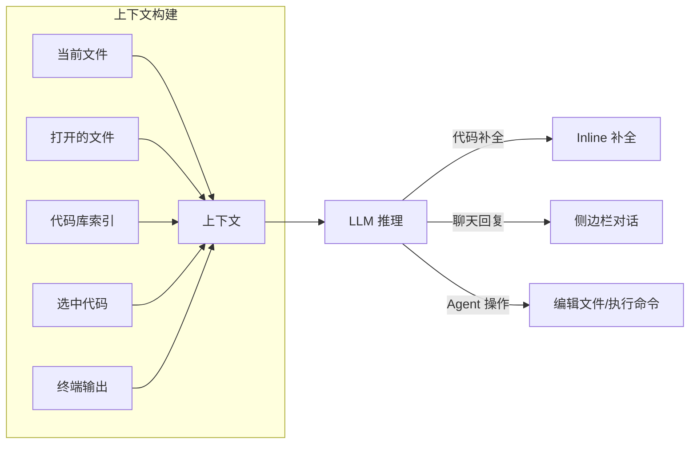

# AI 编程助手深度使用

> **文档说明**：系统讲解 AI 编程助手（Cursor、GitHub Copilot、Claude Code、Windsurf 等）的深度使用方法，涵盖工具对比、Prompt 技巧、上下文管理、代码生成与重构、调试辅助、测试生成、文档生成、多文件编辑、Agent 模式、与现有工作流的集成，含具体的配置方法、Prompt 模板、快捷键和最佳实践。
>
> **适用人群**：全栈开发者、想要最大化 AI 编程提效的工程师、技术团队负责人
>
> **前置知识**：[[主流大模型对比与选型]]、[[提示词工程核心技巧]]、[[上下文工程-Context-Engineering]]

---

## 一、概述

<div style="background:linear-gradient(135deg,#fa709a,#fee140);border-radius:16px;padding:20px;margin:16px 0;font-family:-apple-system,'Segoe UI','PingFang SC','Microsoft YaHei',sans-serif;color:#fff;overflow:hidden;box-shadow:0 8px 28px rgba(0,0,0,.14),0 3px 10px rgba(0,0,0,.08)">
<style>@keyframes highlight{0%,100%{box-shadow:0 0 0 rgba(255,255,255,0)}50%{box-shadow:0 0 20px rgba(255,255,255,.4)}}.hl-box{background:rgba(255,255,255,.2);border-radius:10px;padding:14px 18px;margin:10px 0;animation:highlight 3s ease-in-out infinite;border-left:4px solid rgba(255,255,255,.6)}.hl-formula{font-family:monospace;font-size:14px;text-align:center;background:rgba(0,0,0,.15);border-radius:8px;padding:12px;margin:10px 0}</style>
<div style="text-align:center;font-size:15px;font-weight:700;margin-bottom:14px;padding-bottom:10px;border-bottom:1.5px solid rgba(255,255,255,.22);letter-spacing:1px;text-shadow:0 1px 3px rgba(0,0,0,.12)">📌 AI 编程助手深度使用</div>
<div class="hl-box">系统讲解 AI 编程助手（Cursor、GitHub Copilot、Claude Code、Windsurf 等）的深度使用方法，涵盖工具对比、Prompt 技巧、上下文管理、代码生成与重构、调试辅助、测试生成、文档生成、多文件编辑、Agent 模式、与现有工作流的集成，含具体的配置方法、Prom...</div>
<div class="hl-formula">需求描述 → 代码生成 → 审查修改 → 测试验证 → 迭代优化</div>
<div style="font-size:13px;opacity:.9;margin-top:8px">💡 选对工具、用对方法，效率提升十倍</div>
</div>

> 🔍 **知识点深度解析**
>
> **作用**：AI 编程助手深度使用 是 AI 工具应用领域的重要内容，帮助开发者和知识工作者选择合适的 AI 工具并掌握高效使用方法，适用于提升编程、写作、分析等各类工作的效率。
>
> **原理**：AI 工具通过大模型的理解和生成能力，辅助人类完成复杂的认知工作，关键在于清晰的需求表达、合理的工具选择和有效的人机协作流程。
>
> **用法要点**：① 明确任务需求再选择工具 ② 学习高效的 Prompt 表达技巧 ③ 建立 AI 辅助的工作流而非简单替代 ④ 持续关注工具更新和最佳实践

**AI 编程助手**已经从"代码补全工具"进化为"AI 结对程序员"，能够理解整个代码库、生成多文件功能、调试错误、编写测试、重构代码。2024-2026 年，以 Cursor、Claude Code、Windsurf 为代表的新一代 AI IDE 彻底改变了编程方式——开发者从"写代码"转变为"描述需求 + 审核代码"。

### 1. AI 编程助手的进化

| 阶段 | 代表工具 | 能力 | 交互方式 |
|------|---------|------|---------|
| **V1 补全** | Tabnine, Copilot 早期 | 单行/多行代码补全 | 自动触发，Tab 接受 |
| **V2 聊天** | Copilot Chat, CodeLlama | 选中代码问答、解释、生成 | 侧边栏对话 |
| **V3 Agent** | Cursor, Claude Code, Windsurf | 多文件编辑、终端执行、自主完成任务 | 描述需求，AI 自主执行 |
| **V4 全流程** | Cursor Agent+, Devin | 从需求到 PR 的全流程自动化 | 自然语言描述，AI 端到端完成 |

### 2. 主流工具对比

| 工具 | 模型 | 核心优势 | 价格 | 适合场景 |
|------|------|---------|------|---------|
| **Cursor** | Claude 3.5 Sonnet / GPT-4o | 代码库索引强，多文件编辑，Agent 模式 | $20/月 | 全栈开发，大型项目 |
| **GitHub Copilot** | GPT-4o / GPT-4o-mini | VS Code 原生集成，补全体验好 | $10/月 | 日常编码，补全为主 |
| **Claude Code** | Claude 3.5 Sonnet | 终端交互，长上下文，代码理解深 | $20/月（Claude Pro） | 复杂重构，代码审查 |
| **Windsurf** | Claude 3.5 / GPT-4o | Cascade Agent 模式，流畅 | 免费+付费 | 全栈开发 |
| **Continue.dev** | 多模型（可本地） | 开源，可定制，支持本地模型 | 免费 | 隐私敏感，自托管 |
| **通义灵码** | 通义千问 | 中文好，免费，阿里云生态 | 免费 | 国内开发者 |
| **CodeGeeX** | CodeGeeX4 | 国产，支持多语言 | 免费 | 国内开发者 |

### 3. AI 编程能做什么



---

---

> 💡 **深度讲解**：本节围绕，深入剖析其应用场景与实践技巧，帮助读者充分发挥 AI 工具的价值。
>
> **📝 精简总结**：本节介绍了，掌握这些内容是高效应用 AI 工具的重要基础。

## 二、底层原理

### 1. AI 编程助手的工作原理



核心是**上下文工程**：AI 的回答质量取决于它能看到多少相关代码。新一代工具通过代码库索引（embedding + 符号解析）自动检索相关文件，构建丰富的上下文。

### 2. Agent 模式原理

Agent 模式下，AI 不是一次性回答，而是循环执行：
1. 理解需求
2. 规划步骤
3. 读取相关文件
4. 编辑代码
5. 运行测试/命令
6. 根据结果修正
7. 重复直到完成

这需要工具调用（读文件、写文件、执行终端、搜索代码）能力。

---

---

> 💡 **深度讲解**：本节围绕，深入剖析其应用场景与实践技巧，帮助读者充分发挥 AI 工具的价值。
>
> **📝 精简总结**：本节介绍了，掌握这些内容是高效应用 AI 工具的重要基础。

## 三、实操

### 1. Cursor 配置与使用

**安装**：下载 Cursor（cursor.com），用 VS Code 配置导入（扩展、设置、快捷键）。

**核心快捷键**：

| 快捷键 | 功能 |
|--------|------|
| `Ctrl+K` | 行内编辑（选中代码后修改） |
| `Ctrl+L` | 打开聊天面板 |
| `Ctrl+I` | 打开 Composer（多文件编辑） |
| `Tab` | 接受补全 |
| `Esc` | 拒绝补全 |
| `Ctrl+Shift+L` | 新建聊天 |
| `@` | @提及文件/符号/网页 |
| `#` | #提及代码库符号 |

**Cursor Rules**（`.cursorrules` 文件，放在项目根目录）：

```html
# 项目规则
- 语言：TypeScript + Vue3
- 框架：Vue 3 + Vite + Pinia + Element Plus
- 代码风格：ESLint + Prettier，2空格缩进
- 组件：使用 Composition API + <script setup>
- 状态管理：Pinia，按模块拆分
- API 调用：封装在 src/api/ 下，使用 axios
- 类型：所有函数必须有 TypeScript 类型
- 注释：复杂逻辑加中文注释
- 测试：使用 Vitest，新功能必须有单元测试
- 提交：Conventional Commits 规范
```

**Cursor Composer 使用示例**：

```text
@src/api/user.ts @src/views/user/List.vue

请实现用户管理的列表页面：
1. 调用 getUserList API 获取数据
2. 表格展示用户名、邮箱、角色、创建时间
3. 支持按用户名搜索
4. 支持分页（每页10条）
5. 每行有编辑和删除按钮
6. 使用 Element Plus 组件
```

### 2. GitHub Copilot 配置

```text
// VS Code settings.json
{
  "github.copilot.enable": {
    "*": true,
    "yaml": false,
    "markdown": true
  },
  "github.copilot.editor.enableAutoCompletions": true,
  "github.copilot.chat.enableAgent": true
}
```

**Copilot Chat 技巧**：
- `#selection`：引用选中代码
- `#file`：引用整个文件
- `#terminal`：引用终端输出
- `/explain`：解释代码
- `/fix`：修复问题
- `/tests`：生成测试
- `/doc`：生成文档
- `/optimize`：优化代码

### 3. Prompt 模板库

```html
<!-- 代码生成 Prompt -->
你是一个资深全栈工程师。请根据以下需求生成代码。

技术栈：Vue 3 + TypeScript + Element Plus
需求：{{需求描述}}

要求：
1. 使用 Composition API + <script setup>
2. 所有变量和函数有 TypeScript 类型
3. 包含错误处理
4. 代码简洁，不超过 100 行
5. 复杂逻辑加中文注释

输出完整代码：
```

```text
<!-- 代码审查 Prompt -->
请审查以下代码，从以下维度给出评价：

1. 正确性：是否有 Bug 或逻辑错误
2. 性能：是否有性能问题（循环、内存、异步）
3. 安全：是否有安全隐患（注入、XSS、敏感信息）
4. 可维护性：命名、结构、注释是否清晰
5. 最佳实践：是否符合框架最佳实践

代码：
{{code}}

输出格式：
- 问题列表（严重程度：高/中/低）
- 改进建议
- 优化后的代码（如有必要）
```

```text
<!-- 重构 Prompt -->
请重构以下代码，目标：
1. 提升可读性
2. 减少重复
3. 改善函数职责单一性
4. 保持功能不变

重构前：
{{code}}

重构后：
```

```text
<!-- 测试生成 Prompt -->
为以下函数生成单元测试，使用 Vitest。

要求：
1. 覆盖正常流程
2. 覆盖边界条件
3. 覆盖错误处理
4. 使用 describe/it 结构
5. Mock 外部依赖

函数：
{{code}}
```

### 4. 上下文管理技巧

**@提及文件**：在 Cursor/Copilot 中用 `@文件名` 让 AI 看到特定文件：
```text
@src/utils/auth.ts @src/middleware/auth.ts 请检查这两个文件的认证逻辑是否一致
```

**代码库索引**：Cursor 自动索引整个代码库，用 `#符号名` 快速定位：
```markdown
#UserService 请解释这个服务的设计模式
```

**终端上下文**：AI 可以看到终端输出，用于调试：
```text
终端报错了，请分析原因并修复
```

### 5. 调试工作流

```text
1. 复现 Bug，复制错误信息
2. Ctrl+L 打开聊天
3. 粘贴错误信息 + 相关代码
4. AI 分析原因
5. Ctrl+K 让 AI 直接修改代码
6. 运行验证
7. 如果失败，把新的错误信息贴回去继续
```

### 6. 多文件功能开发（Agent 模式）

```text
需求：实现用户登录功能，包含：
1. 登录页面（表单 + 验证）
2. 登录 API 封装
3. Pinia 用户状态管理
4. 路由守卫（未登录跳转登录页）
5. Token 存储和刷新

请先规划文件结构，然后逐个实现。
```

Cursor Composer / Claude Code 会自动：
1. 规划需要创建/修改的文件
2. 逐个读取现有文件
3. 生成代码并写入
4. 运行构建检查错误
5. 修正错误直到通过

### 7. 与 Git 工作流集成

```bash
# AI 生成 commit message
git diff | cursor --prompt "根据这些变更生成 Conventional Commits 格式的 commit message"

# AI 代码审查 PR
gh pr diff | cursor --prompt "审查这个 PR 的代码质量，给出 LGTM 或修改建议"
```

---

---

> 💡 **深度讲解**：本节围绕，深入剖析其应用场景与实践技巧，帮助读者充分发挥 AI 工具的价值。
>
> **📝 精简总结**：本节介绍了，掌握这些内容是高效应用 AI 工具的重要基础。

## 四、常见问题与排查

| 问题现象 | 原因分析 | 解决方案 |
|---------|---------|---------|
| AI 生成的代码与项目风格不一致 | AI 不知道项目规范 | 创建 `.cursorrules` 或 `.github/copilot-instructions.md` 描述项目规范 |
| AI 看不到相关文件，生成的代码不兼容 | 上下文不足，未索引相关文件 | 用 `@文件名` 手动添加上下文；确认代码库索引已完成；打开相关文件 |
| 补全建议总是不对 | 模型不熟悉该技术栈，或上下文太少 | 切换到更强的模型（Claude/GPT-4o）；在 Prompt 中明确技术栈；写注释引导补全 |
| Agent 模式修改了不该改的文件 | AI 自主操作范围太大 | 使用 Composer 前明确"只修改指定文件"；修改后用 git diff 审查；小步迭代而非一次性大改 |
| 生成的代码有安全漏洞 | AI 不了解安全最佳实践 | Prompt 中要求"考虑安全性"；用 SonarQube/ESLint 扫描；敏感操作人工审核 |
| 大文件/大项目 AI 处理慢 | 上下文窗口限制，索引耗时 | 拆分需求为小任务；用 @提及精确指定文件；关闭不必要的索引目录 |
| 本地模型编程效果差 | 模型代码能力不足 | 用 7B+ 代码专用模型（CodeLlama/DeepSeek-Coder）；或用云端 API |
| AI 编造不存在的 API/函数 | 幻觉问题，模型不了解特定库 | 让 AI 先读取文档或源码；用官方文档作为上下文；人工验证 API 存在性 |
| 团队使用 AI 代码风格混乱 | 每个人用不同的 Prompt 和规则 | 统一 `.cursorrules` 和 Prompt 模板；Code Review 把关；建立 AI 使用规范 |
| 敏感代码泄露到 AI 服务商 | 使用云端 AI 编程工具 | 用 Continue.dev + 本地模型；或自托管 AI 服务；敏感项目禁用 AI 工具 |

---

---

> 💡 **深度讲解**：本节围绕，深入剖析其应用场景与实践技巧，帮助读者充分发挥 AI 工具的价值。
>
> **📝 精简总结**：本节介绍了，掌握这些内容是高效应用 AI 工具的重要基础。

## 五、进阶与最佳实践

### 1. AI 编程效率提升路线

| 阶段 | 能力 | 效率提升 |
|------|------|---------|
| **入门** | 用补全写样板代码 | 20% |
| **熟练** | 用聊天生成函数/组件 | 50% |
| **进阶** | 用 Agent 开发完整功能 | 100% |
| **专家** | 用 AI 做架构设计+代码审查+测试 | 200%+ |

### 2. Prompt 工程要点

- **明确技术栈**：不要让 AI 猜，明确框架、版本、库
- **提供上下文**：@相关文件，粘贴错误信息，描述现有结构
- **约束输出**：指定代码长度、风格、类型要求
- **分步执行**：大需求拆成小步骤，每步验证
- **迭代优化**：第一次输出是起点，通过对话不断优化

### 3. 代码审核清单

AI 生成的代码必须人工审核：
- [ ] 逻辑正确，无明显 Bug
- [ ] 类型完整，无 any
- [ ] 错误处理到位
- [ ] 无安全隐患
- [ ] 符合项目规范
- [ ] 测试覆盖
- [ ] 性能可接受

### 4. 团队 AI 使用规范

- **统一工具**：团队统一使用 Cursor 或 Copilot，便于共享规则
- **共享规则**：项目根目录放 `.cursorrules`，所有人生效
- **Prompt 库**：建立团队 Prompt 模板库
- **代码审查**：AI 生成的代码必须经过 PR Review
- **安全红线**：敏感代码（认证、支付、加密）必须人工写
- **知识沉淀**：AI 解决的问题记录到团队 Wiki

### 5. 成本控制

- 日常补全用便宜模型（GPT-4o-mini）
- 复杂任务用强模型（Claude 3.5 / GPT-4o）
- 利用免费额度（通义灵码、CodeGeeX 免费）
- 本地模型处理简单任务，云端处理复杂任务
- 团队版比个人版更划算

---

---

> 💡 **深度讲解**：本节围绕，深入剖析其应用场景与实践技巧，帮助读者充分发挥 AI 工具的价值。
>
> **📝 精简总结**：本节介绍了，掌握这些内容是高效应用 AI 工具的重要基础。

## 六、关联笔记

### AI 工具应用
- [[主流大模型对比与选型]] · [[提示词工程核心技巧]] · [[上下文工程-Context-Engineering]]
- [[AI编程工具选型对比]] · [[AI应用开发提效]] · [[AI编程提效工作流]]

### AI 工程化
- [[Cursor-IDE深度使用]] · [[GitHub-Copilot实战指南]]
- [[Dify-低代码AI应用平台]] · [[LangChain-核心抽象与链]]

### 导航
- [[MOC-AI与效率工具]] · [[全栈+AI工程双轨融合学习路线图]]

> **学习路径建议**：先掌握 [[提示词工程核心技巧]] 打好 Prompt 基础 → 选择一款 AI 编程助手深入使用（推荐 Cursor）→ 学习本文高级技巧（上下文管理、Agent 模式）→ 参考 [[上下文工程-Context-Engineering]] 优化上下文 → 建立团队 AI 使用规范。

---

## 📖 前置知识

- [[提示词工程方法论]]
- [[AI应用开发入门]]

## 🏷️ 相关标签

`#AI应用` `#效率工具` `#编程` `#LLM`

---

[[Home|🏠 返回首页]] · [[MOC-AI工程化-四级展开|📚 返回分类]]

