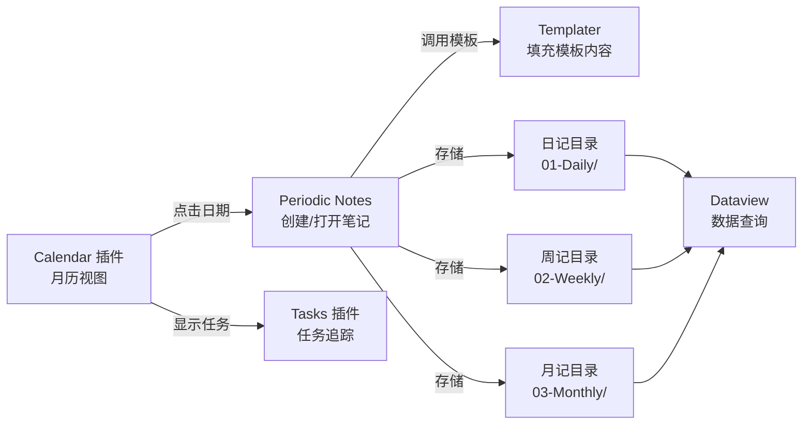

# Calendar 与 Periodic Notes

> **文档说明**：系统讲解 Obsidian 的 Calendar 日历插件和 Periodic Notes 周期性笔记插件的配置与使用，涵盖日记/周记/月记/季记/年记的创建、日历视图导航、Templater 模板联动、日记回顾工作流、任务追踪、习惯打卡、与 Dataview 联动的数据查询，含具体的插件配置 JSON、Templater 模板代码、快捷键设置和 Dataview 查询语句。
>
> **适用人群**：Obsidian 用户、需要建立日记/周期性笔记系统的知识工作者、GTD/时间管理实践者
>
> **前置知识**：[[Obsidian-核心插件配置]]、[[Obsidian-模板与快速输入]]、[[Templater-自动化模板]]

---

## 一、概述

<div style="background:linear-gradient(135deg,#11998e,#38ef7d);border-radius:16px;padding:20px;margin:16px 0;font-family:-apple-system,'Segoe UI','PingFang SC','Microsoft YaHei',sans-serif;color:#fff;overflow:hidden;box-shadow:0 8px 28px rgba(0,0,0,.14),0 3px 10px rgba(0,0,0,.08)">
<style>@keyframes highlight{0%,100%{box-shadow:0 0 0 rgba(255,255,255,0)}50%{box-shadow:0 0 20px rgba(255,255,255,.4)}}.hl-box{background:rgba(255,255,255,.2);border-radius:10px;padding:14px 18px;margin:10px 0;animation:highlight 3s ease-in-out infinite;border-left:4px solid rgba(255,255,255,.6)}.hl-formula{font-family:monospace;font-size:14px;text-align:center;background:rgba(0,0,0,.15);border-radius:8px;padding:12px;margin:10px 0}</style>
<div style="text-align:center;font-size:15px;font-weight:700;margin-bottom:14px;padding-bottom:10px;border-bottom:1.5px solid rgba(255,255,255,.22);letter-spacing:1px;text-shadow:0 1px 3px rgba(0,0,0,.12)">📌 Calendar 与 Periodic Notes</div>
<div class="hl-box">系统讲解 Obsidian 的 Calendar 日历插件和 Periodic Notes 周期性笔记插件的配置与使用，涵盖日记/周记/月记/季记/年记的创建、日历视图导航、Templater 模板联动、日记回顾工作流、任务追踪、习惯打卡、与 Dataview 联动的数据查询，含具体的插件配置 JS...</div>
<div class="hl-formula">日期导航 → 模板插入 → 内容记录 → 回顾汇总 → 周期分析</div>
<div style="font-size:13px;opacity:.9;margin-top:8px">💡 工具是手段，高效的知识管理才是目标</div>
</div>

> 🔍 **知识点深度解析**
>
> **作用**：Calendar 与 Periodic Notes 是 Obsidian 知识管理体系中的重要工具/方法，解决知识采集、组织、检索和利用中的效率问题，适用于构建个人知识管理系统和提升工作效率。
>
> **原理**：通过插件扩展和工作流设计，将 Obsidian 从简单的笔记工具升级为强大的知识管理平台，结合自动化和 AI 能力实现知识的高效处理和价值挖掘。
>
> **用法要点**：① 先掌握基础配置再深入高级功能 ② 建立适合自己的工作流而非照搬他人方案 ③ 善用快捷键和模板提升操作效率 ④ 定期回顾和优化知识管理方法

**Calendar** 和 **Periodic Notes** 是 Obsidian 中构建时间管理系统的两个核心插件。Calendar 提供可视化月历视图，点击日期即可创建/打开当天日记；Periodic Notes 扩展了日记的概念，支持周记、月记、季记、年记等多种周期性笔记，并可自定义笔记的命名格式、存储路径和模板。两者配合 Templater 模板，可以构建一套从每日记录到年度回顾的完整时间管理体系。

### 1. 解决的问题

| 痛点 | 解决方案 |
|------|---------|
| 日记文件名和格式不统一 | Periodic Notes 统一命名格式（YYYY-MM-DD）和存储路径 |
| 创建日记需要手动新建文件 | Calendar 点击日期自动创建，快捷键一键打开 |
| 只有日记没有周/月/年维度 | Periodic Notes 支持 5 种周期笔记，覆盖全时间尺度 |
| 日记模板每次手动复制 | Templater 联动，新建日记自动填充模板 |
| 无法快速跳转某天的笔记 | Calendar 月历视图可视化导航，点击即跳转 |
| 周期性回顾缺乏结构化 | 周记/月记模板预设回顾维度，引导深度复盘 |

### 2. 插件关系



### 3. 周期性笔记体系

| 周期 | 频率 | 核心用途 | 推荐模板重点 |
|------|------|---------|------------|
| **日记 (Daily)** | 每天 | 当日记录、任务、想法 | 3件要事、时间块、感恩、反思 |
| **周记 (Weekly)** | 每周 | 周回顾、下周计划 | 本周成就、未完成、下周3件要事 |
| **月记 (Monthly)** | 每月 | 月度复盘、数据统计 | 目标达成率、习惯统计、月度关键词 |
| **季记 (Quarterly)** | 每季 | 季度战略复盘 | OKR 进度、方向调整 |
| **年记 (Yearly)** | 每年 | 年度总结与规划 | 年度十大事件、来年目标、人生回顾 |

---

---

> 💡 **深度讲解**：本节围绕，深入剖析其使用方法与实践技巧，帮助读者建立高效的知识管理工作流。
>
> **📝 精简总结**：本节介绍了，掌握这些内容是提升 Obsidian 使用效率的重要基础。

## 二、底层原理

### 1. Periodic Notes 工作机制

Periodic Notes 通过**日期格式化字符串**（Moment.js 格式）控制笔记的文件名和路径：

| 格式符 | 含义 | 示例 |
|--------|------|------|
| `YYYY` | 4位年份 | 2026 |
| `MM` | 2位月份 | 09 |
| `DD` | 2位日期 | 07 |
| `dddd` | 星期全称 | Monday |
| `ddd` | 星期缩写 | Mon |
| `ww` | ISO 周数 | 37 |
| `gggg` | ISO 周年 | 2026 |
| `Q` | 季度 | 3 |

典型配置：
- 日记文件名：`YYYY-MM-DD` → `2026-09-07`
- 日记路径：`01-Daily/YYYY/MM/` → `01-Daily/2026/09/`
- 周记文件名：`gggg-[W]ww` → `2026-W37`
- 月记文件名：`YYYY-MM` → `2026-09`

### 2. Calendar 与 Periodic Notes 的集成

Calendar 插件检测到 Periodic Notes 后，会自动使用其配置的日记格式和路径。点击日历上的日期时：
1. 检查该日期的日记文件是否存在
2. 不存在则按 Periodic Notes 配置创建
3. 创建时自动应用 Templater 模板（如果配置了）
4. 在编辑区打开该笔记

---

---

> 💡 **深度讲解**：本节围绕，深入剖析其使用方法与实践技巧，帮助读者建立高效的知识管理工作流。
>
> **📝 精简总结**：本节介绍了，掌握这些内容是提升 Obsidian 使用效率的重要基础。

## 三、实操

### 1. 插件安装与配置

```text
// Periodic Notes 配置 (.obsidian/plugins/periodic-notes/data.json)
{
  "daily": {
    "enabled": true,
    "format": "YYYY-MM-DD",
    "folder": "01-Daily/YYYY/MM",
    "template": "templates/01-Daily-Template.md",
    "autorun": true
  },
  "weekly": {
    "enabled": true,
    "format": "gggg-[W]ww",
    "folder": "02-Weekly",
    "template": "templates/02-Weekly-Template.md",
    "autorun": false
  },
  "monthly": {
    "enabled": true,
    "format": "YYYY-MM",
    "folder": "03-Monthly",
    "template": "templates/03-Monthly-Template.md",
    "autorun": false
  },
  "quarterly": {
    "enabled": true,
    "format": "YYYY-[Q]Q",
    "folder": "04-Quarterly",
    "template": "templates/04-Quarterly-Template.md",
    "autorun": false
  },
  "yearly": {
    "enabled": true,
    "format": "YYYY",
    "folder": "05-Yearly",
    "template": "templates/05-Yearly-Template.md",
    "autorun": false
  },
  "showWeeklyNote": true,
  "weekStart": 1
}
```

```text
// Calendar 配置 (.obsidian/plugins/calendar/data.json)
{
  "wordsForDays": ["日", "一", "二", "三", "四", "五", "六"],
  "shouldConfirmDelete": true,
  "showWeekNumber": true,
  "weekStart": 1,
  "entries": [
    {"id": "daily", "type": "daily", "label": "日记", "color": "#4f46e5"},
    {"id": "weekly", "type": "weekly", "label": "周记", "color": "#059669"}
  ]
}
```

### 2. 日记 Templater 模板

```yaml
<!-- templates/01-Daily-Template.md -->
---
title: <% tp.date.now("YYYY-MM-DD") %> 日记
date: <% tp.date.now("YYYY-MM-DD") %>
weekday: <% tp.date.now("dddd") %>
week: <% tp.date.now("gggg-[W]ww") %>
tags: [日记, <% tp.date.now("YYYY-MM") %>]
mood: 
weather: 
---

# 📅 <% tp.date.now("YYYY年MM月DD日 dddd") %>

---

> 💡 **深度讲解**：本节围绕，深入剖析其使用方法与实践技巧，帮助读者建立高效的知识管理工作流。
>
> **📝 精简总结**：本节介绍了，掌握这些内容是提升 Obsidian 使用效率的重要基础。

## 🎯 今日三件要事
- [ ] 
- [ ] 
- [ ] 

## 🕐 时间块
| 时间 | 事项 | 完成 |
|------|------|------|
| 09:00-12:00 |  | ☐ |
| 14:00-18:00 |  | ☐ |
| 20:00-22:00 | 学习/阅读 | ☐ |

## 📝 记录与想法
- 

## 💡 灵感与待办
- 

## 🙏 今日感恩
1. 
2. 
3. 

## 🔄 今日回顾
- 做得好的：
- 待改进的：
- 明天的重点：

---
[[<% tp.date.now("YYYY-MM-DD", -1) %>|← 昨天]] | [[<% tp.date.now("gggg-[W]ww") %>|本周周记]] | [[<% tp.date.now("YYYY-MM-DD", 1) %>|明天 →]]
```

### 3. 周记模板

<!-- templates/02-Weekly-Template.md -->
---
title: <% tp.date.now("gggg") %>年第<% tp.date.now("ww") %>周周记
date: <% tp.date.now("YYYY-MM-DD") %>
```text
week: <% tp.date.now("gggg-[W]ww") %>
tags: [周记]
```
---

## 📊 第<% tp.date.now("ww") %>周回顾（<% tp.date.now("MM月DD日", -6) %> - <% tp.date.now("MM月DD日") %>）

## 🏆 本周成就
1. 
2. 
3. 

## ❌ 未完成事项
- 

## 📈 数据统计
TABLE length(rows) AS "日记天数"
```python
FROM "01-Daily"
WHERE contains(file.folder, "<% tp.date.now("YYYY/MM") %>")
GROUP BY file.folder
```

## 📚 本周学习
- 阅读：
- 技术：
- 课程：

## 🎯 下周计划
### 三件要事
1. 
2. 
3. 

### 习惯目标
- [ ] 早起 5天
- [ ] 运动 3次
- [ ] 阅读 5小时

## 💭 本周反思
**最大的收获：**
**最大的教训：**
**下周要改变的一件事：**

### 4. 月记模板

<!-- templates/03-Monthly-Template.md -->
---
title: <% tp.date.now("YYYY年MM月") %>月度复盘
date: <% tp.date.now("YYYY-MM") %>
tags: [月记, 复盘]
---

## 🌙 <% tp.date.now("YYYY年MM月") %>月度复盘

## 📊 本月数据
TABLE length(rows) AS "日记数"
```python
FROM "01-Daily/<% tp.date.now("YYYY/MM") %>"
GROUP BY "总计"
```

## 🎯 目标达成
| 目标 | 计划 | 实际 | 达成率 |
|------|------|------|--------|
| 学习 |  |  |  |
| 工作 |  |  |  |
| 健康 |  |  |  |
| 阅读 | 本书 | 本 |  |

## 🏆 月度高光
1. 
2. 
3. 

## 📚 本月输入
- 读完的书：
- 看完的课程：
- 重要的文章：

## 💭 深度反思
**这个月最有价值的一件事：**
**这个月最后悔的一件事：**
**下个月的核心 focus：**

## 🎯 下月计划
### 核心目标（1个）
### 重要目标（2-3个）
### 习惯养成

### 5. 快捷键设置

在 Obsidian 设置 → 快捷键中搜索以下命令并绑定：

| 命令 | 推荐快捷键 | 功能 |
|------|-----------|------|
| `Periodic Notes: Open daily note` | `Ctrl+D` | 打开今天的日记 |
| `Periodic Notes: Open weekly note` | `Ctrl+Shift+W` | 打开本周周记 |
| `Periodic Notes: Open monthly note` | `Ctrl+Shift+M` | 打开本月月记 |
| `Calendar: Open calendar` | `Ctrl+Shift+C` | 打开日历视图 |
| `Calendar: Next day` | `Ctrl+→` | 下一天日记 |
| `Calendar: Previous day` | `Ctrl+←` | 上一天日记 |

### 6. Dataview 联动查询

```python
// 查询本周所有日记中的未完成任务
TASK
FROM "01-Daily"
WHERE contains(file.folder, "2026/09")
WHERE !completed
GROUP BY file.link
```

```python
// 月度习惯统计（从日记 frontmatter 读取）
TABLE mood AS "心情", weather AS "天气", length(file.tasks) AS "任务数"
FROM "01-Daily/2026/09"
SORT file.name ASC
```

```python
// 周记自动汇总本周日记链接
LIST
FROM "01-Daily/2026/09"
WHERE file.day >= date("2026-09-01") AND file.day <= date("2026-09-07")
SORT file.name ASC
```

---

## 四、常见问题与排查

| 问题现象 | 原因分析 | 解决方案 |
|---------|---------|---------|
| Calendar 点击日期不创建日记 | Periodic Notes 未启用或日记格式未配置 | 确认 Periodic Notes 中 daily.enabled=true；设置正确的 format 和 folder；重启 Obsidian |
| 新建日记没有自动填充模板 | Templater 未安装，或模板路径错误，或 autorun 未开启 | 安装 Templater；确认 template 路径指向存在的模板文件；Periodic Notes 中开启 autorun |
| 周记日期计算错误（跨年周） | 用了 YYYY 而非 gggg，ISO 周年可能与日历年不同 | 周记文件名用 `gggg-[W]ww` 而非 `YYYY-[W]ww`；gggg 是 ISO 周年，与 ww 周数配套 |
| Calendar 视图不显示已有日记 | 日记文件路径与 Periodic Notes 配置的 folder 不匹配 | 确保日记文件在配置的 folder 下；文件名格式与 format 一致；Calendar 会自动扫描匹配的文件 |
| Templater 模板中的日期偏移不生效 | 用了 `tp.date.now("YYYY-MM-DD", -1)` 但语法不对 | Templater 日期偏移语法：`tp.date.now("YYYY-MM-DD", -1, "YYYY-MM-DD", tp.file.title)`，第四个参数是参考日期 |
| 月记中 Dataview 查询不到日记 | 日记路径包含年月子目录，查询路径不对 | 确认 FROM 路径正确（如 `"01-Daily/2026/09"`）；用 `contains(file.folder, "2026/09")` 更灵活 |
| 日历视图中文显示乱码 | Calendar 插件的 wordsForDays 未配置中文 | 在 Calendar 设置中设置每周起始日和星期显示文字；或用系统语言 |
| 周期性笔记模板中 Templater 不执行 | Periodic Notes 的 autorun 只对 daily 生效，weekly/monthly 需要手动触发 | 日记设 autorun=true；周记/月记创建后手动运行 Templater（`Templater: Replace templates in the active file`） |
| 任务在日记中勾选后周记不显示 | 任务查询条件不对，或任务未正确格式化为 `- [ ]` | 确保任务用 `- [ ]` 格式；Dataview TASK 查询用 `!completed` 筛选未完成；周记中用 `GROUP BY file.link` 分组 |
| 误删日记后 Calendar 仍显示 | Calendar 有缓存，或文件移到了其他目录 | 重启 Obsidian 刷新缓存；确认文件确实在配置的日记目录中；Calendar 只显示匹配格式的文件 |

---

---

> 💡 **深度讲解**：本节围绕，深入剖析其使用方法与实践技巧，帮助读者建立高效的知识管理工作流。
>
> **📝 精简总结**：本节介绍了，掌握这些内容是提升 Obsidian 使用效率的重要基础。

## 五、进阶与最佳实践

### 1. 日记系统设计原则

- **日记是记录，不是任务清单**：日记核心是记录当天发生的事和想法，任务可以用专门的任务管理
- **模板不要太复杂**：5-8 个区块足够，太复杂会导致坚持不下去
- **回顾比记录更重要**：周记/月记的回顾环节是系统价值的核心
- **双链关联**：日记中提到的概念、项目、人物用 `[[]]` 链接，构建知识网络
- **定期归档**：日记按年月分目录，年末归档到 `Archive/` 目录

### 2. 与其他插件的联动

| 插件 | 联动方式 |
|------|---------|
| **Tasks** | 日记中用 `- [ ] #task` 格式，Tasks 插件全局管理，Calendar 显示任务点 |
| **Dataview** | 周记/月记中自动汇总日记数据、任务完成情况、习惯统计 |
| **Templater** | 新建周期性笔记自动填充模板，支持动态日期和待办 |
| **Tracker** | 从日记 frontmatter 提取心情/睡眠/运动数据，生成趋势图 |
| **Heatmap Calendar** | 在周记中显示日记完成率热力图 |
| **Natural Language Dates** | 日记中输入 `@today`/`@tomorrow` 自动转为日期链接 |

### 3. 日记回顾工作流

```text
每天晚上（5分钟）：
  1. 填写今日回顾（做得好/待改进/明天重点）
  2. 勾选完成的任务
  3. 记录灵感和想法

每周日（20分钟）：
  1. 回顾本周7篇日记
  2. 填写周记模板
  3. 规划下周三件要事
  4. Dataview 自动汇总数据

每月最后一天（30分钟）：
  1. 回顾本月4篇周记
  2. 填写月记模板
  3. 统计目标达成率
  4. 规划下月核心目标

每年12月（1小时）：
  1. 回顾全年月记
  2. 写年度总结
  3. 制定来年目标
```

---

---

> 💡 **深度讲解**：本节围绕，深入剖析其使用方法与实践技巧，帮助读者建立高效的知识管理工作流。
>
> **📝 精简总结**：本节介绍了，掌握这些内容是提升 Obsidian 使用效率的重要基础。

## 六、关联笔记

### Obsidian 效率
- [[Obsidian-核心插件配置]] · [[Obsidian-模板与快速输入]] · [[Templater-自动化模板]]
- [[Obsidian-Dataview查询语言]] · [[Obsidian-双向链接与图谱]] · [[Obsidian-Canvas画布用法]]
- [[Omnisearch-全文搜索增强]] · [[Obsidian-同步与多端方案]]
- [[用AI辅助知识回顾与发现]] · [[笔记自动标签与摘要]]

### 导航
- [[MOC-AI与效率工具]] · [[全栈+AI工程双轨融合学习路线图]]

> **学习路径建议**：先掌握 [[Obsidian-核心插件配置]] 搭建基础环境 → 学习 [[Templater-自动化模板]] 创建日记模板 → 深入本文 Calendar + Periodic Notes 构建时间体系 → 实践 [[Obsidian-Dataview查询语言]] 做数据汇总 → 参考 [[用AI辅助知识回顾与发现]] 做智能回顾。

---

## 📖 前置知识

- [[Obsidian-核心插件配置]]
- [[Obsidian-模板与快速输入]]

## 🏷️ 相关标签

`#Obsidian` `#效率工具` `#知识管理` `#模板`

---

[[Home|🏠 返回首页]] · [[MOC-AIGC与Obsidian-四级展开|📚 返回分类]]

