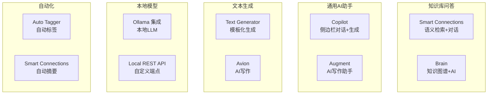
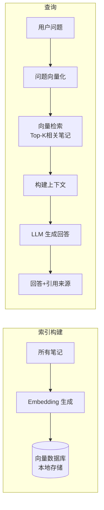
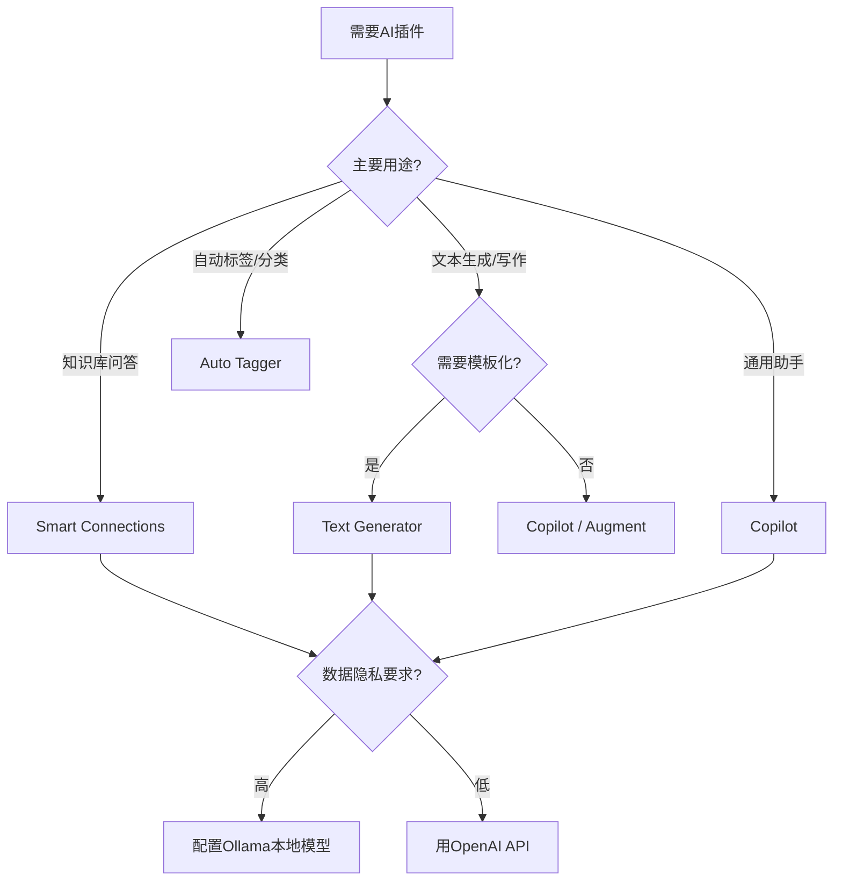

# Obsidian AI 插件对比

> **文档说明**：系统对比 Obsidian 生态中主流 AI 插件的功能、原理、配置和适用场景，涵盖 Copilot、Smart Connections、Text Generator、Brain、Augment、Avion 等核心插件，从知识库问答、文本生成、语义搜索、自动标签、本地模型支持等维度做深度对比，含各插件的配置 JSON、API Key 设置、快捷键绑定、选型决策树和组合使用方案。
>
> **适用人群**：Obsidian 用户、需要在笔记中集成 AI 能力的知识工作者、关注本地 AI 与隐私的用户
>
> **前置知识**：[[Obsidian-核心插件配置]]、[[主流大模型对比与选型]]、[[提示词工程核心技巧]]

---

## 一、概述

<div style="background:linear-gradient(135deg,#11998e,#38ef7d);border-radius:16px;padding:20px;margin:16px 0;font-family:-apple-system,'Segoe UI','PingFang SC','Microsoft YaHei',sans-serif;color:#fff;overflow:hidden;box-shadow:0 8px 28px rgba(0,0,0,.14),0 3px 10px rgba(0,0,0,.08)">
<style>@keyframes highlight{0%,100%{box-shadow:0 0 0 rgba(255,255,255,0)}50%{box-shadow:0 0 20px rgba(255,255,255,.4)}}.hl-box{background:rgba(255,255,255,.2);border-radius:10px;padding:14px 18px;margin:10px 0;animation:highlight 3s ease-in-out infinite;border-left:4px solid rgba(255,255,255,.6)}.hl-formula{font-family:monospace;font-size:14px;text-align:center;background:rgba(0,0,0,.15);border-radius:8px;padding:12px;margin:10px 0}</style>
<div style="text-align:center;font-size:15px;font-weight:700;margin-bottom:14px;padding-bottom:10px;border-bottom:1.5px solid rgba(255,255,255,.22);letter-spacing:1px;text-shadow:0 1px 3px rgba(0,0,0,.12)">📌 Obsidian AI 插件对比</div>
<div class="hl-box">系统对比 Obsidian 生态中主流 AI 插件的功能、原理、配置和适用场景，涵盖 Copilot、Smart Connections、Text Generator、Brain、Augment、Avion 等核心插件，从知识库问答、文本生成、语义搜索、自动标签、本地模型支持等维度做深度对比，含各插...</div>
<div class="hl-formula">笔记检索 → 上下文注入 → AI生成 → 内容插入 → 人工审核</div>
<div style="font-size:13px;opacity:.9;margin-top:8px">💡 工具是手段，高效的知识管理才是目标</div>
</div>

> 🔍 **知识点深度解析**
>
> **作用**：Obsidian AI 插件对比 是 Obsidian 知识管理体系中的重要工具/方法，解决知识采集、组织、检索和利用中的效率问题，适用于构建个人知识管理系统和提升工作效率。
>
> **原理**：通过插件扩展和工作流设计，将 Obsidian 从简单的笔记工具升级为强大的知识管理平台，结合自动化和 AI 能力实现知识的高效处理和价值挖掘。
>
> **用法要点**：① 先掌握基础配置再深入高级功能 ② 建立适合自己的工作流而非照搬他人方案 ③ 善用快捷键和模板提升操作效率 ④ 定期回顾和优化知识管理方法

Obsidian 的 AI 插件生态在 2024-2026 年快速发展，目前已有数十款 AI 相关插件。这些插件各有侧重：有的专注于基于本地知识库的语义问答（Smart Connections），有的提供通用 AI 对话和文本生成（Copilot），有的支持模板化批量生成（Text Generator），有的主打本地模型和隐私（Ollama 集成）。选择合适的插件组合可以大幅提升知识管理效率。

### 1. AI 插件分类



### 2. 核心插件对比总览

| 插件 | 核心功能 | 模型支持 | 本地模型 | 知识库检索 | 文本生成 | 自动标签 | 价格 |
|------|---------|---------|---------|-----------|---------|---------|------|
| **Copilot** | 侧边栏对话、选中文本操作 | OpenAI/Anthropic/本地 | ✅ Ollama | ✅ 基础 | ✅ 强 | ❌ | 免费+API费 |
| **Smart Connections** | 语义搜索、知识库问答、相关笔记 | OpenAI/本地 | ✅ Ollama | ✅ 强（向量库） | ✅ 中 | ✅ | 免费+API费 |
| **Text Generator** | 模板化文本生成、快捷键 | OpenAI/Anthropic/本地 | ✅ | ❌ | ✅ 最强 | ❌ | 免费+API费 |
| **Brain** | 知识图谱、AI问答、概念关联 | OpenAI | ❌ | ✅ 图谱 | ✅ 中 | ❌ | 免费+API费 |
| **Augment** | AI写作助手、改写、续写 | OpenAI | ❌ | ❌ | ✅ 强 | ❌ | 免费+API费 |
| **Avion** | AI写作、多模型切换 | 多模型 | ✅ | ❌ | ✅ 强 | ❌ | 免费+API费 |
| **Auto Tagger** | 自动生成标签和分类 | OpenAI | ❌ | ❌ | ❌ | ✅ | 免费+API费 |

---

---

> 💡 **深度讲解**：本节围绕，深入剖析其使用方法与实践技巧，帮助读者建立高效的知识管理工作流。
>
> **📝 精简总结**：本节介绍了，掌握这些内容是提升 Obsidian 使用效率的重要基础。

## 二、底层原理

### 1. 知识库问答型插件原理（Smart Connections）



Smart Connections 的核心是**本地向量索引**：启动时扫描所有笔记，用 Embedding 模型生成向量，存储在本地向量数据库中。查询时将问题向量化，检索最相关的笔记作为上下文，再调用 LLM 生成回答。所有向量数据存储在本地，笔记内容不上传（仅在生成回答时将相关片段发送给 LLM API）。

### 2. 文本生成型插件原理（Text Generator）

Text Generator 的核心是**模板系统**：用户预定义 Prompt 模板，支持变量插入（如 `{{title}}`、`{{selection}}`），绑定快捷键后一键生成。生成的文本直接插入到当前光标位置或替换选中文本。

### 3. 本地模型支持

支持 Ollama 的插件通过 HTTP 调用本地 Ollama 服务（`http://localhost:11434`），实现完全离线的 AI 能力：
- Embedding：`/api/embeddings` 端点
- Chat：`/api/chat` 端点（OpenAI 兼容格式）
- 优势：数据不出本地、无 API 费用、离线可用
- 劣势：模型质量不如云端、需要 GPU 资源

---

---

> 💡 **深度讲解**：本节围绕，深入剖析其使用方法与实践技巧，帮助读者建立高效的知识管理工作流。
>
> **📝 精简总结**：本节介绍了，掌握这些内容是提升 Obsidian 使用效率的重要基础。

## 三、实操

### 1. Copilot 插件配置

```text
// .obsidian/plugins/copilot/data.json
{
  "apiKey": "sk-xxx",
  "model": "gpt-4o-mini",
  "temperature": 0.3,
  "maxTokens": 2000,
  "systemPrompt": "你是一个知识管理助手，擅长帮助用户整理笔记、生成内容和回答问题。回答简洁专业，用中文。",
  "defaultSaveFolder": "AI生成",
  "showSuggestions": true,
  "embeddingModel": "text-embedding-3-small",
  "useOllama": false,
  "ollamaModel": "qwen2.5:7b",
  "ollamaUrl": "http://localhost:11434"
}
```

**常用功能**：
- 侧边栏对话：`Ctrl+P` → "Copilot: Open Chat"
- 选中文本操作：选中文字 → 右键 → "Copilot" → 翻译/总结/改写/解释
- 基于当前笔记问答：在笔记中打开 Copilot，自动注入当前笔记内容
- 自定义 Prompt：设置 → Copilot → Custom Prompts → 添加

```text
// Copilot 自定义 Prompt 示例
{
  "prompts": [
    {
      "name": "生成原子笔记",
      "prompt": "请将以下内容整理为一篇原子化笔记，包含：定义（1-2句）、核心要点（3-5条）、示例、相关概念[[]]。\n\n内容：{{selection}}",
      "model": "gpt-4o-mini"
    },
    {
      "name": "技术概念解释",
      "prompt": "请用通俗的语言解释以下技术概念，包含：是什么、解决什么问题、核心原理、简单示例。\n\n概念：{{selection}}",
      "model": "gpt-4o"
    }
  ]
}
```

### 2. Smart Connections 配置

```text
// .obsidian/plugins/smart-connections/data.json
{
  "api_key": "sk-xxx",
  "model": "gpt-4o-mini",
  "embedding_model": "text-embedding-3-small",
  "embedding_batch_size": 100,
  "language": "zh",
  "chat_on_side": true,
  "show_similar_notes": 5,
  "exclude_folders": ["templates", "attachments", ".obsidian"],
  "exclude_tags": ["#private"],
  "force_embedding_refresh": false,
  "use_ollama": true,
  "ollama_model": "qwen2.5:7b",
  "ollama_embedding_model": "nomic-embed-text",
  "ollama_url": "http://localhost:11434"
}
```

**使用方式**：
- 侧边栏 "Smart Connections" 视图：显示当前笔记的相关笔记
- 聊天：基于整个知识库问答，自动引用来源
- 命令：`Smart Connections: Find related notes`、`Smart Connections: Chat`
- 自动摘要：右键笔记 → "Smart Connections: Summarize note"

### 3. Text Generator 配置

```text
// .obsidian/plugins/obsidian-textgenerator-plugin/data.json
{
  "api_key": "sk-xxx",
  "model": "gpt-4o-mini",
  "temperature": 0.3,
  "max_tokens": 1500,
  "templates": [
    {
      "name": "续写",
      "prompt": "请继续以下内容，保持相同的风格和语气：\n{{selection}}",
      "insertionMode": "after"
    },
    {
      "name": "总结",
      "prompt": "请用3-5个要点总结以下内容：\n{{selection}}",
      "insertionMode": "replace"
    },
    {
      "name": "生成Mermaid图",
      "prompt": "根据以下内容生成一个Mermaid流程图，只输出代码块：\n{{selection}}",
      "insertionMode": "after"
    },
    {
      "name": "生成Frontmatter",
      "prompt": "为以下笔记生成YAML Frontmatter，包含title/tags/category/difficulty/status/pre/aliases：\n{{content}}",
      "insertionMode": "before"
    }
  ],
  "hotkeys": {
    "续写": "Ctrl+Shift+X",
    "总结": "Ctrl+Shift+S",
    "生成Mermaid图": "Ctrl+Shift+M"
  }
}
```

### 4. 本地 Ollama 集成配置

```text
// 使用 Ollama 替代云端 API（以 Copilot 为例）
{
  "useOllama": true,
  "ollamaUrl": "http://localhost:11434",
  "ollamaModel": "qwen2.5:7b",
  "ollamaEmbeddingModel": "nomic-embed-text",
  "apiKey": "ollama",
  "apiBaseUrl": "http://localhost:11434/v1"
}
```

```bash
# 启动 Ollama 并下载模型
ollama serve
ollama pull qwen2.5:7b
ollama pull nomic-embed-text
```

```bash
# 验证
ollama list
```

### 5. 插件组合推荐方案

| 用户类型 | 推荐组合 | 理由 |
|---------|---------|------|
| **知识管理为主** | Smart Connections + Copilot | Smart Connections 做知识库检索，Copilot 做通用对话 |
| **写作产出为主** | Text Generator + Copilot | Text Generator 模板化生成，Copilot 做改写和润色 |
| **隐私敏感/离线** | Smart Connections (Ollama) + Text Generator (Ollama) | 全部本地模型，数据不出域 |
| **极简用户** | Copilot 一个插件 | 功能全面，覆盖对话+生成+基础检索 |
| **重度自动化** | Text Generator + Templater + Smart Connections | 模板+生成+检索全自动化 |

### 6. 选型决策树



---

---

> 💡 **深度讲解**：本节围绕，深入剖析其使用方法与实践技巧，帮助读者建立高效的知识管理工作流。
>
> **📝 精简总结**：本节介绍了，掌握这些内容是提升 Obsidian 使用效率的重要基础。

## 四、常见问题与排查

| 问题现象 | 原因分析 | 解决方案 |
|---------|---------|---------|
| Smart Connections 相关笔记不更新 | 向量索引未刷新，或笔记在排除目录 | 执行 "Refresh Vector Store"；检查 exclude_folders；新笔记需等待索引完成 |
| Copilot 调用报 401 错误 | API Key 错误或过期 | 检查 api_key 配置；确认 API Key 有余额；重新生成 Key |
| Text Generator 生成的文本插入位置不对 | insertionMode 配置错误 | 确认 insertionMode 为 "before"/"after"/"replace"；光标位置决定插入点 |
| Ollama 模型调用超时 | 模型未加载或 GPU 内存不足 | `ollama list` 确认模型已下载；`ollama run qwen2.5:7b` 预热；降低模型大小（7B→3B） |
| AI 回答不引用我的笔记 | 知识库检索未启用，或上下文窗口太小 | Copilot 中开启 "Use vault context"；Smart Connections 确认向量索引已构建；增大 context tokens |
| 生成内容有幻觉（编造事实） | LLM 基于训练数据回答而非知识库 | Prompt 中明确"仅根据提供的笔记回答，不知道就说不知道"；降低 temperature；增加检索到的笔记数量 |
| 插件冲突（多个AI插件同时触发） | 快捷键冲突或同时调用 API | 检查快捷键设置，避免重复绑定；按需启用/禁用插件；统一用一个插件做主要AI入口 |
| Embedding 生成很慢（首次） | 笔记数量多，批量生成耗时 | 首次索引耐心等待（1000篇约5-10分钟）；后续增量索引很快；用更快的 Embedding 模型 |
| 中文回答质量差 | 模型中文能力不足，或 Prompt 是英文 | 用 Qwen2.5 等中文优化模型；Prompt 用中文；system prompt 明确"用中文回答" |
| 自动标签结果不准确 | 标签 Prompt 太笼统，或笔记内容太少 | 优化标签生成 Prompt（列出候选标签列表供选择）；确保笔记有足够内容；人工审核后再应用 |

---

---

> 💡 **深度讲解**：本节围绕，深入剖析其使用方法与实践技巧，帮助读者建立高效的知识管理工作流。
>
> **📝 精简总结**：本节介绍了，掌握这些内容是提升 Obsidian 使用效率的重要基础。

## 五、进阶与最佳实践

### 1. AI 插件使用原则

- **AI 是助手不是替代**：AI 生成的内容必须人工审核，特别是技术准确性
- **Prompt 是核心资产**：花时间打磨自定义 Prompt 模板，比换插件更能提升质量
- **知识库质量决定 AI 质量**：AI 回答的上限取决于笔记的质量和组织
- **本地优先**：敏感笔记用本地模型，通用任务用云端模型
- **最小插件原则**：不要安装所有 AI 插件，选 2-3 个核心插件深入使用

### 2. Prompt 模板库建设

建立个人 AI Prompt 模板库（存放在 `templates/ai_prompts/`），分类管理：
- 笔记整理类：原子化、总结、提取要点
- 内容生成类：大纲、扩写、改写、翻译
- 知识管理类：生成标签、生成双链、生成 MOC
- 技术类：代码解释、生成 Mermaid、生成示例

### 3. 成本控制

| 优化项 | 方法 | 节省比例 |
|--------|------|---------|
| 模型选择 | 日常用 gpt-4o-mini，复杂任务用 gpt-4o | 60-80% |
| 本地模型 | 非敏感任务用 Ollama 本地模型 | 100%（无API费） |
| 上下文精简 | 只传入相关笔记片段而非全文 | 30-50% |
| 批量处理 | 一次 Prompt 处理多篇笔记 | 20-30% |
| 缓存 | 相同查询缓存结果 | 视重复率 |

### 4. 与 Obsidian 工作流的深度集成

- **Templater + Text Generator**：新建笔记时自动调用 AI 生成大纲
- **Dataview + Smart Connections**：Dataview 查询结果作为 AI 上下文
- **Periodic Notes + Copilot**：周记/月记时 AI 自动汇总本周笔记
- **QuickAdd + AI**：快速捕获想法时 AI 自动分类和打标签

---

---

> 💡 **深度讲解**：本节围绕，深入剖析其使用方法与实践技巧，帮助读者建立高效的知识管理工作流。
>
> **📝 精简总结**：本节介绍了，掌握这些内容是提升 Obsidian 使用效率的重要基础。

## 六、关联笔记

### Obsidian 效率
- [[Obsidian-核心插件配置]] · [[Obsidian-模板与快速输入]] · [[Templater-自动化模板]]
- [[Obsidian-Dataview查询语言]] · [[用AI辅助知识回顾与发现]] · [[笔记自动标签与摘要]]
- [[AI文档与PPT生成工作流]] · [[本地知识库接入LLM]]

### AI 工具应用
- [[主流大模型对比与选型]] · [[AI编程助手深度使用]]
- [[提示词工程核心技巧]] · [[上下文工程-Context-Engineering]]

### 导航
- [[MOC-AI与效率工具]] · [[全栈+AI工程双轨融合学习路线图]]

> **学习路径建议**：先掌握 [[主流大模型对比与选型]] 理解模型差异 → 学习本文选择合适的 AI 插件组合 → 实践 [[提示词工程核心技巧]] 优化 Prompt → 深入 [[用AI辅助知识回顾与发现]] 构建智能知识管理 → 参考 [[本地知识库接入LLM]] 实现私有化部署。

---

## 📖 前置知识

- [[AIGC-Obsidian-应用枢纽]]
- [[Obsidian-核心插件配置]]

## 🏷️ 相关标签

`#Obsidian` `#AI应用` `#效率工具` `#知识管理`

---

[[Home|🏠 返回首页]] · [[MOC-AIGC与Obsidian-四级展开|📚 返回分类]]

