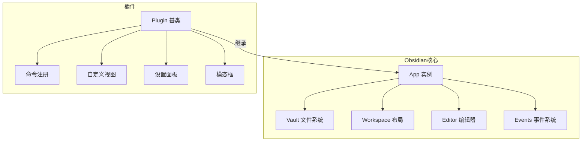
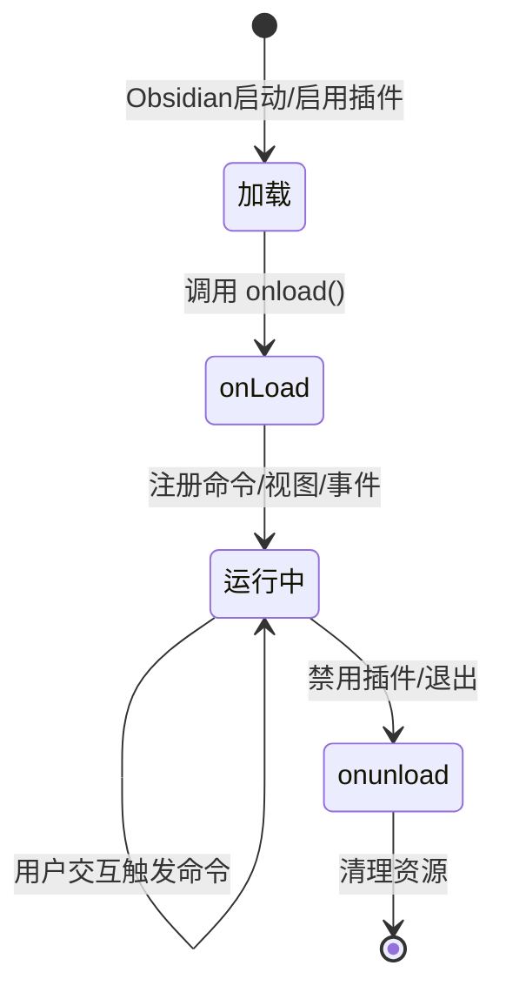

# Obsidian API 插件开发入门

> **文档说明**：系统讲解 Obsidian 插件开发的完整流程，涵盖插件架构、核心 API（Vault/Workspace/Editor/Notice/Modal/Setting）、项目脚手架、TypeScript 类型定义、命令注册、视图创建、设置面板、事件监听、文件操作、发布到社区插件市场，含可运行的示例插件代码、调试方法和最佳实践。
>
> **适用人群**：有 TypeScript/JavaScript 基础的前端开发者、想要定制 Obsidian 功能的高级用户
>
> **前置知识**：[[Obsidian-核心插件配置]]、[[TypeScript基础与类型系统]]、[[Obsidian插件系统详解]]

---

## 一、概述

<div style="background:linear-gradient(135deg,#11998e,#38ef7d);border-radius:16px;padding:20px;margin:16px 0;font-family:-apple-system,'Segoe UI','PingFang SC','Microsoft YaHei',sans-serif;color:#fff;overflow:hidden;box-shadow:0 8px 28px rgba(0,0,0,.14),0 3px 10px rgba(0,0,0,.08)">
<style>@keyframes highlight{0%,100%{box-shadow:0 0 0 rgba(255,255,255,0)}50%{box-shadow:0 0 20px rgba(255,255,255,.4)}}.hl-box{background:rgba(255,255,255,.2);border-radius:10px;padding:14px 18px;margin:10px 0;animation:highlight 3s ease-in-out infinite;border-left:4px solid rgba(255,255,255,.6)}.hl-formula{font-family:monospace;font-size:14px;text-align:center;background:rgba(0,0,0,.15);border-radius:8px;padding:12px;margin:10px 0}</style>
<div style="text-align:center;font-size:15px;font-weight:700;margin-bottom:14px;padding-bottom:10px;border-bottom:1.5px solid rgba(255,255,255,.22);letter-spacing:1px;text-shadow:0 1px 3px rgba(0,0,0,.12)">📌 Obsidian API 插件开发入门</div>
<div class="hl-box">系统讲解 Obsidian 插件开发的完整流程，涵盖插件架构、核心 API（Vault/Workspace/Editor/Notice/Modal/Setting）、项目脚手架、TypeScript 类型定义、命令注册、视图创建、设置面板、事件监听、文件操作、发布到社区插件市场，含可运行的示例插件代...</div>
<div class="hl-formula">环境搭建 → API学习 → 功能开发 → 调试测试 → 打包发布</div>
<div style="font-size:13px;opacity:.9;margin-top:8px">💡 工具是手段，高效的知识管理才是目标</div>
</div>

> 🔍 **知识点深度解析**
>
> **作用**：Obsidian API 插件开发入门 是 Obsidian 知识管理体系中的重要工具/方法，解决知识采集、组织、检索和利用中的效率问题，适用于构建个人知识管理系统和提升工作效率。
>
> **原理**：通过插件扩展和工作流设计，将 Obsidian 从简单的笔记工具升级为强大的知识管理平台，结合自动化和 AI 能力实现知识的高效处理和价值挖掘。
>
> **用法要点**：① 先掌握基础配置再深入高级功能 ② 建立适合自己的工作流而非照搬他人方案 ③ 善用快捷键和模板提升操作效率 ④ 定期回顾和优化知识管理方法

Obsidian 插件基于 Electron + TypeScript 开发，通过 Obsidian 官方 API 与编辑器交互。插件可以注册命令、创建自定义视图、修改编辑器行为、添加设置面板、监听文件变化等。Obsidian 提供了完善的类型定义（`obsidian-typings`）和示例插件（sample-plugin），开发门槛相对较低。

### 1. 插件能做什么

| 能力 | 示例 |
|------|------|
| **注册命令** | 自定义快捷键触发的操作（如"插入当前日期"） |
| **创建视图** | 侧边栏/标签页自定义面板（如日历、看板） |
| **编辑器扩展** | CodeMirror 6 扩展（语法高亮、自动补全、工具栏） |
| **文件操作** | 读取/创建/修改/删除笔记，操作 frontmatter |
| **设置面板** | 插件配置界面（API Key、路径、开关） |
| **模态框** | 自定义弹窗（输入框、确认框、预览） |
| **事件监听** | 文件创建/修改/删除、编辑器变化、布局变化 |
| **菜单扩展** | 右键菜单、文件菜单、编辑器菜单 |
| **状态栏** | 在底部状态栏显示信息 |
| **外部 API** | 调用 HTTP API、本地进程、WebSocket |

### 2. 插件架构



### 3. 开发环境

| 工具 | 用途 | 安装 |
|------|------|------|
| Node.js | 运行时 | ≥ 18.x |
| TypeScript | 开发语言 | `npm i -g typescript` |
| esbuild | 打包 | 项目依赖 |
| Obsidian | 测试运行 | 桌面版 |
| VSCode | 编辑器 | 推荐 |

---

---

> 💡 **深度讲解**：本节围绕，深入剖析其使用方法与实践技巧，帮助读者建立高效的知识管理工作流。
>
> **📝 精简总结**：本节介绍了，掌握这些内容是提升 Obsidian 使用效率的重要基础。

## 二、底层原理

### 1. 插件生命周期



- `onload()`：插件加载时调用，注册命令、视图、事件监听
- `onunload()`：插件卸载时调用，清理资源、移除事件监听

### 2. 核心 API 对象

| API 对象 | 作用 | 关键方法 |
|---------|------|---------|
| `this.app.vault` | 文件系统操作 | `getAbstractFileByPath()`, `create()`, `modify()`, `delete()`, `getMarkdownFiles()` |
| `this.app.workspace` | 布局和视图 | `getLeaf()`, `setActiveLeaf()`, `onLayoutReady()`, `getActiveFile()` |
| `this.app.metadataCache` | 元数据缓存 | `getFileCache()`, `on('changed')`, `getLinks()` |
| `this.app.commands` | 命令系统 | `addCommand()` |
| `this.app.workspace.activeEditor` | 当前编辑器 | `editor`, `editor.replaceSelection()` |
| `Notice` | 通知提示 | `new Notice("消息")` |
| `Modal` | 模态框 | `open()`, `close()`, `onOpen()` |
| `PluginSettingTab` | 设置面板 | `display()` |

---

---

> 💡 **深度讲解**：本节围绕，深入剖析其使用方法与实践技巧，帮助读者建立高效的知识管理工作流。
>
> **📝 精简总结**：本节介绍了，掌握这些内容是提升 Obsidian 使用效率的重要基础。

## 三、实操

### 1. 创建插件项目

```bash
# 克隆官方示例插件
git clone https://github.com/obsidianmd/obsidian-sample-plugin.git my-plugin
cd my-plugin

# 安装依赖
npm install

# 构建（监听模式）
npm run dev
```

### 2. manifest.json 配置

```text
// manifest.json
{
  "id": "my-awesome-plugin",
  "name": "My Awesome Plugin",
  "version": "1.0.0",
  "minAppVersion": "1.4.0",
  "description": "一个示例插件，演示 Obsidian API 用法",
  "author": "BewhY",
  "authorUrl": "https://github.com/yourname",
  "isDesktopOnly": false
}
```

### 3. 完整示例插件

```python
// main.ts
import {
  App,
  Plugin,
  PluginSettingTab,
  Setting,
  Notice,
  Modal,
  TFile,
  MarkdownView,
  Editor,
  ItemView,
  WorkspaceLeaf,
} from "obsidian";

// === 设置接口 ===
interface MyPluginSettings {
  apiKey: string;
  outputFolder: string;
  enableNotification: boolean;
}

const DEFAULT_SETTINGS: MyPluginSettings = {
  apiKey: "",
  outputFolder: "AI生成",
  enableNotification: true,
};

// === 主插件类 ===
export default class MyAwesomePlugin extends Plugin {
  settings: MyPluginSettings;

  async onload() {
    await this.loadSettings();

    // 1. 注册命令：插入当前日期
    this.addCommand({
      id: "insert-current-date",
      name: "插入当前日期",
      editorCallback: (editor: Editor, view: MarkdownView) => {
        const date = new Date().toISOString().split("T")[0];
        editor.replaceSelection(`[[${date}]]`);
        if (this.settings.enableNotification) {
          new Notice(`已插入日期: ${date}`);
        }
      },
    });

    // 2. 注册命令：统计当前笔记字数
    this.addCommand({
      id: "count-words",
      name: "统计当前笔记字数",
      checkCallback: (checking: boolean) => {
        const file = this.app.workspace.getActiveFile();
        if (file instanceof TFile) {
          if (!checking) {
            this.app.vault.read(file).then((content) => {
              const chars = content.length;
              const words = content.split(/\s+/).filter(Boolean).length;
              new Notice(`字符: ${chars} | 单词: ${words}`);
            });
          }
          return true;
        }
        return false;
      },
    });

    // 3. 注册命令：打开自定义模态框
    this.addCommand({
      id: "open-custom-modal",
      name: "打开快速输入框",
      callback: () => {
        new QuickInputModal(this.app, (result) => {
          new Notice(`你输入了: ${result}`);
        }).open();
      },
    });

    // 4. 注册命令：创建新笔记
    this.addCommand({
      id: "create-note-from-template",
      name: "从模板创建笔记",
      callback: async () => {
        const folder = this.settings.outputFolder;
        const title = `新笔记 ${new Date().toISOString().slice(0, 10)}`;
        const path = `${folder}/${title}.md`;

        // 确保文件夹存在
        if (!(await this.app.vault.adapter.exists(folder))) {
          await this.app.vault.createFolder(folder);
        }

        const content = `---
title: ${title}
created: ${new Date().toISOString().split("T")[0]}
tags: []
---

# ${title}

> 由 My Awesome Plugin 自动创建

---

> 💡 **深度讲解**：本节围绕，深入剖析其使用方法与实践技巧，帮助读者建立高效的知识管理工作流。
>
> **📝 精简总结**：本节介绍了，掌握这些内容是提升 Obsidian 使用效率的重要基础。

## 内容

`;
        const file = await this.app.vault.create(path, content);
        const leaf = this.app.workspace.getLeaf();
        await leaf.openFile(file);
        new Notice(`已创建: ${path}`);
      },
    });

    // 5. 注册自定义视图
    this.registerView("my-plugin-view", (leaf) => new MyPluginView(leaf, this));
    this.addRibbonIcon("dice", "打开我的插件视图", () => {
      this.activateView();
    });

    // 6. 监听文件修改事件
    this.registerEvent(
      this.app.vault.on("modify", (file) => {
        if (file instanceof TFile && file.extension === "md") {
          console.log(`文件被修改: ${file.path}`);
        }
      })
    );

    // 7. 添加设置面板
    this.addSettingTab(new MyPluginSettingTab(this.app, this));
  }

  async activateView() {
    const { workspace } = this.app;
    let leaf = workspace.getLeavesOfType("my-plugin-view")[0];
    if (!leaf) {
      leaf = workspace.getRightLeaf(false);
      await leaf.setViewState({ type: "my-plugin-view", active: true });
    }
    workspace.revealLeaf(leaf);
  }

  onunload() {
    // 清理工作（事件监听已由 registerEvent 自动清理）
    console.log("My Awesome Plugin 已卸载");
  }

  async loadSettings() {
    this.settings = Object.assign({}, DEFAULT_SETTINGS, await this.loadData());
  }

  async saveSettings() {
    await this.saveData(this.settings);
  }
}

// === 自定义模态框 ===
class QuickInputModal extends Modal {
  result: string;
  onSubmit: (result: string) => void;

  constructor(app: App, onSubmit: (result: string) => void) {
    super(app);
    this.onSubmit = onSubmit;
  }

  onOpen() {
    const { contentEl } = this;
    contentEl.createEl("h2", { text: "快速输入" });

    const input = contentEl.createEl("input", {
      type: "text",
      placeholder: "输入内容...",
    });
    input.style.width = "100%";
    input.style.marginBottom = "12px";
    input.focus();

    new Setting(contentEl)
      .addButton((btn) =>
        btn
          .setButtonText("确认")
          .setCta()
          .onClick(() => {
            this.result = input.value;
            this.onSubmit(this.result);
            this.close();
          })
      )
      .addButton((btn) =>
        btn.setButtonText("取消").onClick(() => this.close())
      );

    input.addEventListener("keydown", (e) => {
      if (e.key === "Enter") {
        this.result = input.value;
        this.onSubmit(this.result);
        this.close();
      }
    });
  }

  onClose() {
    this.contentEl.empty();
  }
}

// === 自定义视图 ===
class MyPluginView extends ItemView {
  plugin: MyAwesomePlugin;

  constructor(leaf: WorkspaceLeaf, plugin: MyAwesomePlugin) {
    super(leaf);
    this.plugin = plugin;
  }

  getViewType() {
    return "my-plugin-view";
  }

  getDisplayText() {
    return "我的插件面板";
  }

  getIcon() {
    return "dice";
  }

  async onOpen() {
    const container = this.containerEl.children[1];
    container.empty();
    container.createEl("h4", { text: "我的插件面板" });

    // 显示统计信息
    const files = this.app.vault.getMarkdownFiles();
    container.createEl("p", {
      text: `当前知识库共有 ${files.length} 篇笔记`,
    });

    // 按钮
    new Setting(container)
      .setName("刷新统计")
      .addButton((btn) =>
        btn.setButtonText("刷新").onClick(() => {
          const count = this.app.vault.getMarkdownFiles().length;
          container.querySelector("p")!.textContent = `当前知识库共有 ${count} 篇笔记`;
        })
      );
  }

  async onClose() {}
}

// === 设置面板 ===
class MyPluginSettingTab extends PluginSettingTab {
  plugin: MyAwesomePlugin;

  constructor(app: App, plugin: MyAwesomePlugin) {
    super(app, plugin);
    this.plugin = plugin;
  }

  display(): void {
    const { containerEl } = this;
    containerEl.empty();

    containerEl.createEl("h2", { text: "My Awesome Plugin 设置" });

    new Setting(containerEl)
      .setName("API Key")
      .setDesc("输入你的 API Key")
      .addText((text) =>
        text
          .setPlaceholder("sk-xxx")
          .setValue(this.plugin.settings.apiKey)
          .onChange(async (value) => {
            this.plugin.settings.apiKey = value;
            await this.plugin.saveSettings();
          })
      );

    new Setting(containerEl)
      .setName("输出文件夹")
      .setDesc("自动创建笔记的默认文件夹")
      .addText((text) =>
        text
          .setPlaceholder("AI生成")
          .setValue(this.plugin.settings.outputFolder)
          .onChange(async (value) => {
            this.plugin.settings.outputFolder = value;
            await this.plugin.saveSettings();
          })
      );

    new Setting(containerEl)
      .setName("启用通知")
      .setDesc("操作完成后显示通知提示")
      .addToggle((toggle) =>
        toggle
          .setValue(this.plugin.settings.enableNotification)
          .onChange(async (value) => {
            this.plugin.settings.enableNotification = value;
            await this.plugin.saveSettings();
          })
      );
  }
}
```

### 4. esbuild 配置

```python
// esbuild.config.mjs
import esbuild from "esbuild";

const prod = process.argv[2] === "production";

esbuild
  .build({
    entryPoints: ["main.ts"],
    bundle: true,
    external: ["obsidian", "electron", "@codemirror/*"],
    format: "cjs",
    watch: !prod,
    target: "es2018",
    logLevel: "info",
    sourcemap: prod ? false : "inline",
    treeShaking: true,
    outfile: "main.js",
  })
  .catch(() => process.exit(1));
```

### 5. 本地测试

```bash
# 1. 构建
npm run dev

# 2. 链接到 Obsidian 插件目录（Windows）
```
## 将项目文件夹复制到 Vault 的 .obsidian/plugins/ 下
## 或创建符号链接
```css
mklink /D "C:\Users\23981\Documents\ObsidianVault\.obsidian\plugins\my-awesome-plugin" "C:\path\to\my-plugin"

# 3. 在 Obsidian 中启用
# 设置 → 社区插件 → 关闭安全模式 → 启用 "My Awesome Plugin"

# 4. 调试
```
## Ctrl+Shift+I 打开开发者工具，查看 console 输出

### 6. 发布到社区插件市场

```bash
# 1. 更新版本号
# 修改 manifest.json 的 version

# 2. 构建生产版本
npm run build

# 3. 提交代码
git add .
git commit -m "release: v1.0.0"
git tag 1.0.0
git push && git push --tags

# 4. GitHub Release 上传 main.js, manifest.json, styles.css

# 5. 提交 PR 到 obsidian-releases 仓库
# https://github.com/obsidianmd/obsidian-releases
```

---

## 四、常见问题与排查

| 问题现象 | 原因分析 | 解决方案 |
|---------|---------|---------|
| 插件加载后命令不出现 | onload 中 addCommand 未执行，或命令 ID 重复 | 检查 console 是否有报错；确保命令 ID 全局唯一；确认插件已启用 |
| `this.app.workspace.activeEditor` 为 null | 没有活动的 Markdown 编辑器（如在其他视图） | 用 `checkCallback` 检查条件；或用 `this.app.workspace.getActiveFile()` 判断 |
| 修改代码后插件不更新 | esbuild watch 未运行，或未重新加载插件 | 确保 `npm run dev` 在运行；Obsidian 中重新加载插件（设置 → 插件 → 重新加载） |
| TypeScript 类型报错 | obsidian-typings 版本不匹配，或 API 已变更 | `npm update obsidian-typings`；参考官方 API 文档；用 `// @ts-ignore` 临时绕过 |
| 文件操作报 "File already exists" | create 时文件路径已存在 | 先检查 `vault.adapter.exists(path)`；或用 `vault.getAbstractFileByPath()` 判断 |
| 自定义视图不显示 | 视图类型未注册，或 leaf 未正确创建 | 确认 `registerView` 在 onload 中调用；用 `workspace.getLeavesOfType()` 检查；调用 `workspace.revealLeaf()` |
| 设置面板修改不保存 | 未调用 `saveData()`，或 Setting 的 onChange 未正确绑定 | 每个 Setting 的 onChange 中调用 `await this.plugin.saveSettings()`；确认 loadSettings 在 onload 调用 |
| 事件监听器泄漏 | 未用 `registerEvent` 包裹，或 onunload 未清理 | 所有 `app.vault.on()` / `app.workspace.on()` 用 `this.registerEvent()` 包裹；自动在卸载时清理 |
| 编辑器 API 调用不生效 | CodeMirror 6 API 与旧版不同，或未在 editorCallback 中 | Obsidian 1.x 用 CM6；通过 `editor.cm` 访问 CM 实例；简单操作用 `editor.replaceSelection()` / `editor.getValue()` |
| 移动端插件崩溃 | 使用了桌面端专属 API（如 child_process、fs） | `manifest.json` 设 `"isDesktopOnly": true`；或用 `this.app.isMobile` 判断；避免使用 Node.js 专属模块 |

---

---

> 💡 **深度讲解**：本节围绕，深入剖析其使用方法与实践技巧，帮助读者建立高效的知识管理工作流。
>
> **📝 精简总结**：本节介绍了，掌握这些内容是提升 Obsidian 使用效率的重要基础。

## 五、进阶与最佳实践

### 1. 开发规范

- **类型安全**：充分利用 TypeScript 类型，避免 `any`
- **异步处理**：文件操作都是异步的，正确使用 `async/await`
- **错误处理**：用 try-catch 包裹可能失败的操作，用 Notice 提示用户
- **性能**：避免在循环中频繁调用 vault API；批量操作
- **兼容性**：关注 Obsidian 版本更新，及时适配新 API

### 2. 常用开发模式

| 模式 | 适用场景 |
|------|---------|
| **命令 + editorCallback** | 编辑器内文本操作 |
| **命令 + checkCallback** | 有条件显示的命令 |
| **Modal** | 需要用户输入的交互 |
| **ItemView** | 持续显示的面板（侧边栏/标签页） |
| **PluginSettingTab** | 插件配置 |
| **registerEvent** | 监听文件/编辑器变化 |
| **CodeMirror 扩展** | 编辑器行为定制（高亮/补全/工具栏） |

### 3. 调试技巧

- `console.log()` 输出到 Obsidian 开发者工具（Ctrl+Shift+I）
- `new Notice(JSON.stringify(data))` 快速查看数据
- 用 `debugger` 语句断点调试
- 查看 `this.app` 对象结构：`console.log(this.app)`

---

---

> 💡 **深度讲解**：本节围绕，深入剖析其使用方法与实践技巧，帮助读者建立高效的知识管理工作流。
>
> **📝 精简总结**：本节介绍了，掌握这些内容是提升 Obsidian 使用效率的重要基础。

## 六、关联笔记

### Obsidian 效率
- [[Obsidian-核心插件配置]] · [[Obsidian插件系统详解]] · [[Obsidian-双向链接与图谱]]
- [[Templater-自动化模板]] · [[Obsidian-Dataview查询语言]]

### 技术基础
- [[TypeScript基础与类型系统]] · [[Vue3+TypeScript项目实战]]

### 导航
- [[MOC-AI与效率工具]] · [[全栈+AI工程双轨融合学习路线图]]

> **学习路径建议**：先掌握 [[TypeScript基础与类型系统]] → 学习 [[Obsidian插件系统详解]] 理解插件生态 → 实践本文从零开发一个插件 → 参考官方 sample-plugin 和热门插件源码 → 发布到社区插件市场。

---

## 📖 前置知识

- [[Obsidian-核心插件配置]]

## 🏷️ 相关标签

`#Obsidian` `#效率工具` `#JavaScript` `#开发`

---

[[Home|🏠 返回首页]] · [[MOC-AIGC与Obsidian-四级展开|📚 返回分类]]

