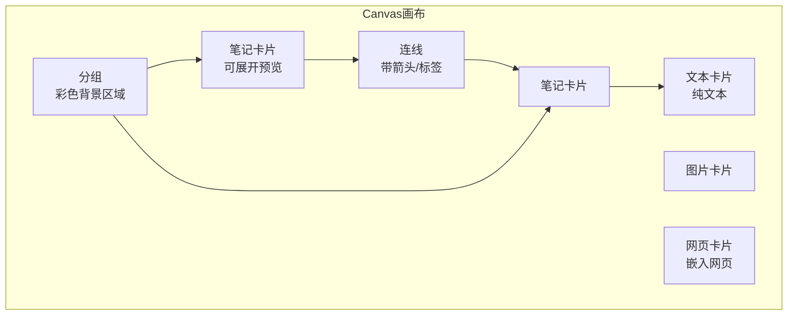

# Obsidian Canvas 画布用法

> **文档说明**：系统讲解 Obsidian Canvas（画布）的使用方法，涵盖画布创建、笔记卡片操作、卡片分组与连线、嵌入外部内容（图片/网页/视频）、模板与预设、快捷键、与 Excalidraw 的区别、在知识管理/项目规划/学习笔记中的应用场景，含具体的操作步骤、快捷键表和最佳实践。
>
> **适用人群**：Obsidian 用户、需要可视化组织笔记的知识工作者、头脑风暴和项目规划者
>
> **前置知识**：[[Obsidian-核心插件配置]]、[[Obsidian-双向链接与图谱]]、[[Excalidraw-手绘笔记]]

---

## 一、概述

<div style="background:linear-gradient(135deg,#11998e,#38ef7d);border-radius:16px;padding:20px;margin:16px 0;font-family:-apple-system,'Segoe UI','PingFang SC','Microsoft YaHei',sans-serif;color:#fff;overflow:hidden;box-shadow:0 8px 28px rgba(0,0,0,.14),0 3px 10px rgba(0,0,0,.08)">
<style>@keyframes highlight{0%,100%{box-shadow:0 0 0 rgba(255,255,255,0)}50%{box-shadow:0 0 20px rgba(255,255,255,.4)}}.hl-box{background:rgba(255,255,255,.2);border-radius:10px;padding:14px 18px;margin:10px 0;animation:highlight 3s ease-in-out infinite;border-left:4px solid rgba(255,255,255,.6)}.hl-formula{font-family:monospace;font-size:14px;text-align:center;background:rgba(0,0,0,.15);border-radius:8px;padding:12px;margin:10px 0}</style>
<div style="text-align:center;font-size:15px;font-weight:700;margin-bottom:14px;padding-bottom:10px;border-bottom:1.5px solid rgba(255,255,255,.22);letter-spacing:1px;text-shadow:0 1px 3px rgba(0,0,0,.12)">📌 Obsidian Canvas 画布用法</div>
<div class="hl-box">系统讲解 Obsidian Canvas（画布）的使用方法，涵盖画布创建、笔记卡片操作、卡片分组与连线、嵌入外部内容（图片/网页/视频）、模板与预设、快捷键、与 Excalidraw 的区别、在知识管理/项目规划/学习笔记中的应用场景，含具体的操作步骤、快捷键表和最佳实践。</div>
<div class="hl-formula">节点创建 → 连线关系 → 分组整理 → 缩放导航 → 导出分享</div>
<div style="font-size:13px;opacity:.9;margin-top:8px">💡 工具是手段，高效的知识管理才是目标</div>
</div>

> 🔍 **知识点深度解析**
>
> **作用**：Obsidian Canvas 画布用法 是 Obsidian 知识管理体系中的重要工具/方法，解决知识采集、组织、检索和利用中的效率问题，适用于构建个人知识管理系统和提升工作效率。
>
> **原理**：通过插件扩展和工作流设计，将 Obsidian 从简单的笔记工具升级为强大的知识管理平台，结合自动化和 AI 能力实现知识的高效处理和价值挖掘。
>
> **用法要点**：① 先掌握基础配置再深入高级功能 ② 建立适合自己的工作流而非照搬他人方案 ③ 善用快捷键和模板提升操作效率 ④ 定期回顾和优化知识管理方法

**Canvas** 是 Obsidian 官方内置的无限画布功能，允许用户在一个无限大的白板上自由排列笔记卡片、图片、网页、视频等内容，并用连线表示关系。Canvas 特别适合头脑风暴、项目规划、知识图谱可视化、故事板、学习路线图等需要空间思维的场景。

### 1. Canvas 解决的问题

| 痛点 | 解决方案 |
|------|---------|
| 笔记是线性的，难以表达空间关系 | 无限画布，自由排列，可视化组织 |
| 头脑风暴需要纸笔或外部白板 | 在 Obsidian 内直接创建画布，笔记即卡片 |
| 项目规划需要全局视图 | 将相关笔记拖到画布，连线表示依赖关系 |
| 学习路线需要可视化路径 | 用卡片+连线展示学习顺序和依赖 |
| 多笔记内容难以同时查看 | 画布上可同时展开多个笔记预览 |

### 2. Canvas 核心概念



### 3. Canvas vs Excalidraw

| 维度 | Canvas | Excalidraw |
|------|--------|-----------|
| **核心用途** | 笔记组织、头脑风暴、项目规划 | 绘制图表、架构图、流程图 |
| **内容类型** | 笔记卡片、文本、图片、网页 | 图形、箭头、文本、便签 |
| **笔记集成** | 原生支持，卡片就是笔记 | 支持双链嵌入，但不是笔记卡片 |
| **手绘风格** | 简洁卡片式 | 手绘风格 |
| **文件格式** | .canvas（JSON） | .excalidraw.md |
| **连线** | 简单连线+标签 | 智能路由箭头 |
| **适用场景** | 知识组织、空间思维 | 技术图表、可视化表达 |

---

---

> 💡 **深度讲解**：本节围绕，深入剖析其使用方法与实践技巧，帮助读者建立高效的知识管理工作流。
>
> **📝 精简总结**：本节介绍了，掌握这些内容是提升 Obsidian 使用效率的重要基础。

## 二、底层原理

### 1. Canvas 文件格式

Canvas 文件是 JSON 格式（`.canvas`），存储画布上所有卡片的位置、大小、内容和连线：

```json
{
  "nodes": [
    {
      "id": "node-1",
      "type": "file",
      "file": "笔记A.md",
      "x": 100,
      "y": 100,
      "width": 300,
      "height": 200,
      "color": "1"
    },
    {
      "id": "node-2",
      "type": "text",
      "text": "这是一个文本卡片",
      "x": 500,
      "y": 100,
      "width": 200,
      "height": 100
    }
  ],
  "edges": [
    {
      "id": "edge-1",
      "fromNode": "node-1",
      "fromSide": "right",
      "toNode": "node-2",
      "toSide": "left",
      "label": "依赖"
    }
  ]
}
```

### 2. 卡片类型

| 类型 | 说明 | 创建方式 |
|------|------|---------|
| **笔记卡片** | 引用已有笔记，显示预览 | 从文件浏览器拖拽，或双击 → 选择笔记 |
| **文本卡片** | 独立文本，不创建笔记文件 | 双击空白处 → 输入文本 |
| **图片卡片** | 嵌入本地或网络图片 | 拖拽图片文件，或粘贴图片 |
| **网页卡片** | 嵌入网页（iframe） | 双击 → 输入 URL |
| **视频卡片** | 嵌入 YouTube/Vimeo | 输入视频 URL |
| **分组** | 彩色背景区域，包含多个卡片 | 选中多个卡片 → 右键 → Group |

---

---

> 💡 **深度讲解**：本节围绕，深入剖析其使用方法与实践技巧，帮助读者建立高效的知识管理工作流。
>
> **📝 精简总结**：本节介绍了，掌握这些内容是提升 Obsidian 使用效率的重要基础。

## 三、实操

### 1. 创建画布

**方法一**：文件浏览器 → 右键 → 新建 → Canvas
**方法二**：命令面板（Ctrl+P）→ "Canvas: Create new canvas"
**方法三**：快捷键（需在设置中绑定）

### 2. 基础操作快捷键

| 快捷键 | 功能 |
|--------|------|
| `双击空白` | 创建新卡片（笔记/文本） |
| `拖拽文件` | 从文件浏览器拖入笔记 |
| `Ctrl+拖拽` | 复制卡片 |
| `滚轮` | 缩放画布 |
| `Space+拖拽` | 平移画布 |
| `Ctrl+A` | 全选卡片 |
| `Ctrl+C/V` | 复制/粘贴卡片 |
| `Delete` | 删除选中卡片 |
| `Ctrl+G` | 分组选中卡片 |
| `Shift+点击` | 多选卡片 |
| `拖拽卡片边缘` | 调整大小 |
| `拖拽卡片标题栏` | 移动卡片 |
| `点击卡片边缘+拖拽` | 创建连线 |
| `Ctrl+Z/Y` | 撤销/重做 |
| `Ctrl+Shift+F` | 适应视图（显示所有卡片） |

### 3. 项目规划画布示例

```text
┌─────────────────────────────────────────────────────────┐
│                    🚀 项目：AI 知识库系统                  │
├──────────────┬──────────────┬───────────────────────────┤
│  📋 需求分析   │  🔧 开发阶段   │    🚀 部署上线            │
│              │              │                           │
│ ┌──────────┐ │ ┌──────────┐ │ ┌─────────────────────┐  │
│ │需求文档   │→││技术选型   │→││部署文档              │  │
│ │.md       │ │ │.md       │ │ │.md                  │  │
│ └──────────┘ │ └──────────┘ │ └─────────────────────┘  │
│              │              │                           │
│ ┌──────────┐ │ ┌──────────┐ │ ┌─────────────────────┐  │
│ │用户故事   │→││架构设计   │→││运维手册              │  │
│ │.md       │ │ │.md       │ │ │.md                  │  │
│ └──────────┘ │ └──────────┘ │ └─────────────────────┘  │
│              │              │                           │
│              │ ┌──────────┐ │                           │
│              │ │API设计   │ │                           │
│              │ │.md       │ │                           │
│              │ └──────────┘ │                           │
└──────────────┴──────────────┴───────────────────────────┘
```

### 4. 学习路线图画布

```text
                    ┌─────────────┐
                    │  前端基础     │
                    │  HTML/CSS   │
                    │  JavaScript │
                    └──────┬──────┘
                           │
                    ┌──────▼──────┐
                    │  前端框架     │
                    │  Vue3 / React│
                    └──────┬──────┘
                           │
              ┌────────────┼────────────┐
              │            │            │
       ┌──────▼─────┐ ┌───▼──────┐ ┌───▼───────┐
       │  工程化     │ │  状态管理 │ │  UI 组件库 │
       │  Vite/Webpack│ │ Pinia   │ │ ElementPlus│
       └──────┬─────┘ └───┬──────┘ └───┬───────┘
              │            │            │
              └────────────┼────────────┘
                           │
                    ┌──────▼──────┐
                    │  全栈项目实战  │
                    │  博客系统     │
                    └─────────────┘
```

### 5. 画布模板创建

1. 创建一个标准画布（如项目规划模板、学习路线模板）
2. 保存到 `templates/canvas/` 目录
3. 使用时复制模板文件到目标目录，重命名后编辑

**常用画布模板**：
- 项目规划画布（需求→设计→开发→测试→部署）
- 学习路线画布（基础→进阶→实战）
- 头脑风暴画布（中心主题→分支想法）
- 知识图谱画布（概念→子概念→示例）
- 书籍笔记画布（章节→要点→感悟）

### 6. 与笔记的联动

<!-- 在笔记中嵌入 Canvas -->
---

> 💡 **深度讲解**：本节围绕，深入剖析其使用方法与实践技巧，帮助读者建立高效的知识管理工作流。
>
> **📝 精简总结**：本节介绍了，掌握这些内容是提升 Obsidian 使用效率的重要基础。

## 项目规划

![[项目规划.canvas]]

```text
<!-- 在 Canvas 中使用笔记 -->
<!-- 拖拽笔记到画布，自动创建卡片，双击展开编辑 -->
<!-- 卡片内容与笔记实时同步 -->
```

### 7. 颜色与分组

Canvas 支持 6 种颜色标记卡片：
- 颜色 1：红色（重要/紧急）
- 颜色 2：橙色（进行中）
- 颜色 3：黄色（待办）
- 颜色 4：绿色（已完成）
- 颜色 5：蓝色（参考）
- 颜色 6：紫色（创意）

**分组操作**：选中多个卡片 → 右键 → "Group selection" → 输入分组名称 → 选择分组颜色

---

## 四、常见问题与排查

| 问题现象 | 原因分析 | 解决方案 |
|---------|---------|---------|
| Canvas 文件在其他设备打不开 | .canvas 是 JSON 格式，旧版 Obsidian 不支持 | 升级 Obsidian 到 1.1+；Canvas 是官方核心功能 |
| 笔记卡片显示空白 | 笔记文件被移动/删除，或路径含特殊字符 | 确认笔记文件存在；卡片右键 → "Reload"；避免文件名含特殊字符 |
| 网页卡片不显示 | 目标网站禁止 iframe 嵌入（X-Frame-Options） | 换用支持嵌入的网站；或用截图代替网页卡片 |
| 画布太大找不到卡片 | 缩放过度或卡片在视口外 | `Ctrl+Shift+F` 适应视图；或用命令 "Zoom to fit" |
| 连线不显示箭头 | 连线样式未设置 | 选中连线 → 右侧属性面板 → 选择箭头样式（单向/双向/无） |
| 分组内卡片无法移动 | 分组锁定或卡片在分组边界外 | 点击分组标题解锁；确认卡片完全在分组区域内 |
| 复制粘贴卡片后位置重叠 | 粘贴到同一位置 | 粘贴后手动调整位置；或用 `Ctrl+V` 后立即拖拽 |
| Canvas 中文字体太小 | 缩放比例太低，或卡片尺寸太小 | 滚轮放大；调整卡片宽度；文本卡片可设置字体大小 |
| 大量卡片时画布卡顿 | 卡片数量过多（>100）或嵌入大图片 | 拆分画布为多个子画布；图片用缩略图；关闭实时预览 |
| 移动端 Canvas 操作不便 | 触屏手势与桌面不同 | 双指缩放、单指平移；长按选中卡片；建议复杂画布在桌面端编辑 |

---

---

> 💡 **深度讲解**：本节围绕，深入剖析其使用方法与实践技巧，帮助读者建立高效的知识管理工作流。
>
> **📝 精简总结**：本节介绍了，掌握这些内容是提升 Obsidian 使用效率的重要基础。

## 五、进阶与最佳实践

### 1. Canvas 使用场景

| 场景 | 用法 |
|------|------|
| **项目管理** | 需求→设计→开发→测试→部署 流水线，每个节点链接对应文档 |
| **学习路线** | 按学习顺序排列知识点卡片，连线表示前置依赖 |
| **头脑风暴** | 中心主题卡片，放射状排列想法，用颜色分类 |
| **知识图谱** | 概念卡片+连线，可视化知识网络 |
| **书籍/课程笔记** | 按章节排列，每章一个卡片展开笔记 |
| **写作大纲** | 章节卡片排列，拖拽调整顺序 |
| **会议记录** | 议题卡片+决议卡片+待办卡片 |

### 2. 最佳实践

- **一个画布一个主题**：不要把所有内容塞进一个画布，按项目/主题拆分
- **用分组组织**：相关卡片用分组框起来，加标题和颜色
- **卡片大小适中**：不要太大（占满屏幕）也不要太小（看不清）
- **连线加标签**：连线标注关系类型（依赖/相关/前置/参考）
- **定期整理**：项目结束后归档画布，提取关键内容到笔记
- **与双链配合**：Canvas 是空间视图，双链是网络视图，两者互补

### 3. 与其他工具的配合

- **Canvas + Tasks**：画布上的待办卡片用 Tasks 插件管理
- **Canvas + Dataview**：在画布笔记中嵌入 Dataview 查询
- **Canvas + Excalidraw**：Canvas 组织笔记，Excalidraw 绘制图表，互相嵌入
- **Canvas + Templater**：用 Templater 自动创建标准画布

---

---

> 💡 **深度讲解**：本节围绕，深入剖析其使用方法与实践技巧，帮助读者建立高效的知识管理工作流。
>
> **📝 精简总结**：本节介绍了，掌握这些内容是提升 Obsidian 使用效率的重要基础。

## 六、关联笔记

### Obsidian 效率
- [[Obsidian-核心插件配置]] · [[Obsidian-双向链接与图谱]] · [[Excalidraw-手绘笔记]]
- [[Obsidian-Dataview查询语言]] · [[Obsidian-模板与快速输入]] · [[Templater-自动化模板]]
- [[用AI辅助知识回顾与发现]]

### 导航
- [[MOC-AI与效率工具]] · [[全栈+AI工程双轨融合学习路线图]]

> **学习路径建议**：先掌握 [[Obsidian-核心插件配置]] → 学习本文 Canvas 基础操作 → 实践项目规划/学习路线画布 → 配合 [[Excalidraw-手绘笔记]] 做图表可视化 → 参考 [[Obsidian-双向链接与图谱]] 理解知识网络。

---

## 📖 前置知识

- [[Obsidian-核心插件配置]]

## 🏷️ 相关标签

`#Obsidian` `#效率工具` `#知识管理` `#可视化`

---

[[Home|🏠 返回首页]] · [[MOC-AIGC与Obsidian-四级展开|📚 返回分类]]

