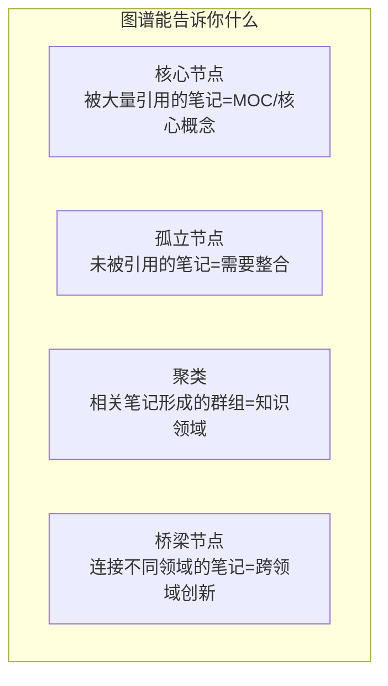

# Obsidian 双向链接与图谱

> **文档说明**：系统讲解 Obsidian 的核心功能——双向链接（[[]]）和知识图谱，涵盖双链语法、别名/锚点/嵌入链接、反向链接面板、图谱视图配置（颜色组/过滤器/力导向布局）、局部图谱、关系图谱、MOC 枢纽笔记设计、双链使用最佳实践、与标签的配合、图谱分析方法，含具体的配置方法、快捷键和真实示例。
>
> **适用人群**：Obsidian 用户、知识管理实践者、想要构建个人知识网络的学习者
>
> **前置知识**：[[Obsidian-核心插件配置]]、[[Obsidian原子化笔记规范]]、[[Frontmatter元数据规范]]

---

## 一、概述

<div style="background:linear-gradient(135deg,#11998e,#38ef7d);border-radius:16px;padding:20px;margin:16px 0;font-family:-apple-system,'Segoe UI','PingFang SC','Microsoft YaHei',sans-serif;color:#fff;overflow:hidden;box-shadow:0 8px 28px rgba(0,0,0,.14),0 3px 10px rgba(0,0,0,.08)">
<style>@keyframes highlight{0%,100%{box-shadow:0 0 0 rgba(255,255,255,0)}50%{box-shadow:0 0 20px rgba(255,255,255,.4)}}.hl-box{background:rgba(255,255,255,.2);border-radius:10px;padding:14px 18px;margin:10px 0;animation:highlight 3s ease-in-out infinite;border-left:4px solid rgba(255,255,255,.6)}.hl-formula{font-family:monospace;font-size:14px;text-align:center;background:rgba(0,0,0,.15);border-radius:8px;padding:12px;margin:10px 0}</style>
<div style="text-align:center;font-size:15px;font-weight:700;margin-bottom:14px;padding-bottom:10px;border-bottom:1.5px solid rgba(255,255,255,.22);letter-spacing:1px;text-shadow:0 1px 3px rgba(0,0,0,.12)">📌 Obsidian 双向链接与图谱</div>
<div class="hl-box">系统讲解 Obsidian 的核心功能——双向链接（[[]]）和知识图谱，涵盖双链语法、别名/锚点/嵌入链接、反向链接面板、图谱视图配置（颜色组/过滤器/力导向布局）、局部图谱、关系图谱、MOC 枢纽笔记设计、双链使用最佳实践、与标签的配合、图谱分析方法，含具体的配置方法、快捷键和真实示例。</div>
<div class="hl-formula">链接创建 → 反向追踪 → 图谱可视化 → 聚类分析 → 知识发现</div>
<div style="font-size:13px;opacity:.9;margin-top:8px">💡 工具是手段，高效的知识管理才是目标</div>
</div>

> 🔍 **知识点深度解析**
>
> **作用**：Obsidian 双向链接与图谱 是 Obsidian 知识管理体系中的重要工具/方法，解决知识采集、组织、检索和利用中的效率问题，适用于构建个人知识管理系统和提升工作效率。
>
> **原理**：通过插件扩展和工作流设计，将 Obsidian 从简单的笔记工具升级为强大的知识管理平台，结合自动化和 AI 能力实现知识的高效处理和价值挖掘。
>
> **用法要点**：① 先掌握基础配置再深入高级功能 ② 建立适合自己的工作流而非照搬他人方案 ③ 善用快捷键和模板提升操作效率 ④ 定期回顾和优化知识管理方法

**双向链接**是 Obsidian 的核心特性，通过 `[[]]` 语法在笔记之间创建链接，与传统网页链接不同的是，双向链接自动在目标笔记中生成反向链接（被哪些笔记引用），从而构建出一个有机的知识网络。**知识图谱**将这个网络可视化，每个节点是一篇笔记，每条连线是一个双链，让你直观看到知识之间的关联和结构。

### 1. 双向链接 vs 传统链接

| 维度 | 传统文件夹/标签 | 双向链接 |
|------|---------------|---------|
| **组织方式** | 层级树状 | 网络状 |
| **关联能力** | 一篇笔记只能在一个文件夹 | 一篇笔记可以链接到任意多笔记 |
| **发现能力** | 只能按目录浏览 | 反向链接发现意外关联 |
| **灵活性** | 移动文件需更新链接 | 链接自动更新，移动不失效 |
| **可视化** | 目录树 | 知识图谱 |
| **思维模型** | 分类思维 | 关联思维 |

### 2. 双链语法

```markdown
<!-- 基础双链 -->
[[笔记标题]]

<!-- 显示别名 -->
[[笔记标题|显示文字]]

<!-- 链接到标题锚点 -->
[[笔记标题#二级标题]]

<!-- 链接到块（^block-id） -->
[[笔记标题^block-id]]

<!-- 嵌入笔记（显示内容而非链接） -->
![[笔记标题]]

<!-- 嵌入图片 -->
![[image.png]]

<!-- 嵌入 PDF 页面 -->
![[document.pdf#page=5]]
```

### 3. 知识图谱价值



---

---

> 💡 **深度讲解**：本节围绕，深入剖析其使用方法与实践技巧，帮助读者建立高效的知识管理工作流。
>
> **📝 精简总结**：本节介绍了，掌握这些内容是提升 Obsidian 使用效率的重要基础。

## 二、底层原理

### 1. 双向链接工作机制

```mermaid
graph LR
    A[笔记A] -->|[[笔记B]]| B[笔记B]
    B -->|反向链接面板<br/>自动显示| A
    C[笔记C] -->|[[笔记B]]| B
    B -->|反向链接面板| C
    
    style A fill:#dbeafe
    style B fill:#dcfce7
    style C fill:#fef3c7
```

当你在笔记 A 中输入 `[[笔记B]]`：
1. Obsidian 解析链接，创建从 A 到 B 的出链（outgoing link）
2. 笔记 B 的反向链接面板自动显示 A（incoming link）
3. 图谱中 A 和 B 之间出现连线
4. 如果笔记 B 不存在，Obsidian 会创建一个"幽灵链接"（灰色），点击可创建

### 2. 图谱布局算法

Obsidian 图谱使用**力导向布局**（Force-Directed Graph）：
- 节点之间有斥力（类似电荷排斥）
- 连线之间有引力（类似弹簧拉力）
- 算法迭代直到系统达到平衡状态
- 结果：关联紧密的笔记聚在一起，不相关的笔记远离

### 3. 图谱颜色组配置

通过 Frontmatter 字段或路径为节点着色：

| 颜色组 | 匹配规则 | 颜色 |
|--------|---------|------|
| AI与效率工具 | `path:09-AI与效率工具` | #4f46e5 |
| Java后端 | `path:01-Java后端` | #059669 |
| 前端开发 | `path:02-前端开发` | #dc2626 |
| MOC笔记 | `tag:#MOC` | #f59e0b |
| 已完善 | `status:✅ 内容已完善` | #10b981 |
| 草稿 | `status:🚧 草稿中` | #f59e0b |

---

---

> 💡 **深度讲解**：本节围绕，深入剖析其使用方法与实践技巧，帮助读者建立高效的知识管理工作流。
>
> **📝 精简总结**：本节介绍了，掌握这些内容是提升 Obsidian 使用效率的重要基础。

## 三、实操

### 1. 双链使用快捷键

| 快捷键 | 功能 |
|--------|------|
| `[[` | 触发双链自动补全 |
| `Ctrl+Click` 链接 | 在新面板打开链接 |
| `Alt+Click` 链接 | 在当前面板打开链接 |
| `Ctrl+Shift+Click` | 在新窗口打开 |
| `Ctrl+Alt+←` | 返回上一页 |
| `Ctrl+Alt+→` | 前进到下一页 |
| `Ctrl+O` | 快速切换笔记（支持模糊搜索） |
| `Ctrl+Shift+F` | 全局搜索 |

### 2. 图谱视图配置

**打开图谱**：左侧工具栏 → 图谱视图图标，或 `Ctrl+P` → "Graph view"

**配置面板设置**：

```text
// 图谱配置（设置 → 核心插件 → 图谱视图）
{
  "collapse-filter": false,
  "search": "",
  "showTags": true,
  "showAttachments": false,
  "hideUnresolved": false,
  "showOrphans": true,
  "collapse-display": false,
  "textFadeMultiplier": 0,
  "nodeSizeMultiplier": 1,
  "lineSizeMultiplier": 1,
  "collapse-forces": false,
  "centerStrength": 0.5,
  "repelStrength": 10,
  "linkStrength": 1,
  "linkDistance": 40,
  "scale": 1,
  "close": true
}
```

**颜色组配置步骤**：
1. 打开图谱视图
2. 点击右上角设置图标
3. 找到 "Color groups"
4. 点击 "Add group"
5. 输入名称（如"AI笔记"）
6. 输入匹配规则（如 `path:09-AI` 或 `tag:#AI`）
7. 选择颜色
8. 重复添加多个颜色组

### 3. 局部图谱

在笔记中打开局部图谱：`Ctrl+P` → "Open local graph"

局部图谱只显示当前笔记的直接关联（1-3跳），适合深入分析某个知识领域：
- 1跳：直接链接的笔记
- 2跳：链接的链接
- 3跳：更大范围的关联

### 4. 反向链接面板

每篇笔记底部默认显示反向链接面板：
- **Linked mentions**：明确用 `[[]]` 链接到当前笔记的
- **Unlinked mentions**：正文中提到了当前笔记名称但未加 `[[]]` 的（可一键转为链接）

**配置**：设置 → 核心插件 → 反向链接 → 显示在笔记底部 / 侧边栏

### 5. MOC 枢纽笔记设计

MOC（Map of Content）是知识网络的枢纽，通过双链组织相关笔记：

---
```text
title: MOC-AI与效率工具
tags: [MOC, AI]
category: MOC
```
---

## 🗺️ MOC - AI与效率工具

---

> 💡 **深度讲解**：本节围绕，深入剖析其使用方法与实践技巧，帮助读者建立高效的知识管理工作流。
>
> **📝 精简总结**：本节介绍了，掌握这些内容是提升 Obsidian 使用效率的重要基础。

## Agent 核心
- [[Agent记忆机制设计]]
- [[Agent评测与可观测性]]
- [[FunctionCalling工具生态]]
- [[自研Agent框架设计]]

## Agent 框架
- [[LangChain-核心抽象与链]]
- [[LangGraph-状态机Agent]]
- [[AutoGen-多Agent框架]]
- [[Dify-低代码AI应用平台]]

## 大模型技术
- [[主流开源模型架构对比]]
- [[大模型训练范式-PT-SFT-RLHF]]
- [[模型量化-GPTQ-AWQ-GGUF]]
- [[多模态生成工具链]]

## 推理与服务
- [[Ollama-本地模型部署]]
- [[vLLM-高吞吐推理引擎]]
- [[Text-Generation-Inference]]
- [[GPU显存优化与批处理]]

## RAG与向量库
- [[RAG架构设计与流程]]
- [[Chroma-轻量向量库]]
- [[Qdrant-高性能向量检索]]
- [[PgVector-PostgreSQL向量扩展]]
- [[向量检索算法-HNSW-IVF]]
- [[RAG评估指标与方法]]
- [[GraphRAG知识图谱增强]]
- [[本地知识库接入LLM]]

## Obsidian效率
- [[Obsidian-核心插件配置]]
- [[Obsidian-双向链接与图谱]]
- [[Obsidian-Dataview查询语言]]
- [[Templater-自动化模板]]
...

### 6. 双链使用模式

| 模式 | 示例 | 用途 |
|------|------|------|
| **概念链接** | `[[RAG架构设计与流程]]` | 链接到核心概念笔记 |
| **上下文链接** | `详见[[向量检索算法-HNSW-IVF]]` | 引用详细解释 |
| **对比链接** | `与[[Chroma-轻量向量库]]不同，Qdrant...` | 建立对比关系 |
| **前置知识** | `前置：[[Embedding模型选型]]` | 标注学习路径 |
| **MOC链接** | MOC 笔记中列出所有相关笔记 | 组织知识网络 |
| **日记链接** | `[[2026-09-07]]` | 链接到日记 |
| **人物链接** | `[[张三]]` | 人物笔记 |
| **项目链接** | `[[项目A]]` | 项目笔记 |

### 7. 图谱分析方法

```text
1. 找孤立节点（orphans）：
   - 图谱中没有连线的节点
   - 这些笔记没有被任何笔记引用
   - 行动：在相关笔记中添加指向它的链接，或整合到 MOC

2. 找核心节点（hubs）：
   - 连线最多的节点（节点最大）
   - 这些是知识库的核心概念
   - 行动：确保这些笔记质量高、内容完善

3. 找聚类（clusters）：
   - 紧密聚集的节点群
   - 代表一个知识领域
   - 行动：为每个聚类创建 MOC 笔记

4. 找桥梁节点（bridges）：
   - 连接不同聚类的节点
   - 代表跨领域知识
   - 行动：这些是创新点，重点维护
```

---

## 四、常见问题与排查

| 问题现象 | 原因分析 | 解决方案 |
|---------|---------|---------|
| 双链显示为灰色（未解析） | 目标笔记不存在，或文件名不匹配 | 点击灰色链接创建笔记；确认 `[[]]` 中的名称与文件名完全一致（含大小写） |
| 反向链接面板不显示 | 未启用反向链接插件，或面板被折叠 | 设置 → 核心插件 → 启用"反向链接"；笔记底部展开反向链接 |
| 图谱中节点太多看不清 | 笔记数量大（>500），未过滤 | 用搜索过滤（输入 `path:文件夹` 或 `tag:#标签`）；隐藏附件和未解析链接；用局部图谱 |
| 双链改名后失效 | 手动改了文件名但未更新链接 | 用 Obsidian 的重命名功能（右键 → 重命名），自动更新所有链接；不要在文件管理器中改名 |
| 图谱颜色不生效 | 颜色组匹配规则错误 | 确认路径/标签拼写正确；路径匹配用 `path:文件夹名`（支持模糊）；标签用 `tag:#标签名` |
| Unlinked mentions 不显示 | 未启用该功能，或名称太短/太常见 | 设置 → 反向链接 → 启用 "Show unlinked mentions"；名称太通用（如"笔记"）会被忽略 |
| 嵌入笔记 `![[]]` 不渲染 | 嵌入的是不存在的笔记，或格式错误 | 确认目标笔记存在；语法是 `![[笔记名]]`（感叹号+双方括号）；嵌入大笔记可能卡顿 |
| 锚点链接 `#标题` 不跳转 | 标题文本不匹配，或标题含特殊字符 | 确认锚点与标题完全一致（含空格和标点）；标题含特殊字符时用 `#标题文本` 精确匹配 |
| 图谱布局混乱 | 力导向参数不合适，或节点太多 | 调整 repelStrength（斥力）和 linkDistance（连线距离）；增加 centerStrength（中心引力） |
| 双链指向了错误的笔记 | 自动补全选错了同名笔记 | `[[]]` 中用完整路径区分：`[[文件夹/笔记名]]`；或给笔记加别名用 `[[别名]]` |

---

---

> 💡 **深度讲解**：本节围绕，深入剖析其使用方法与实践技巧，帮助读者建立高效的知识管理工作流。
>
> **📝 精简总结**：本节介绍了，掌握这些内容是提升 Obsidian 使用效率的重要基础。

## 五、进阶与最佳实践

### 1. 双链使用原则

- **链接概念，不链接词**：`[[RAG架构设计与流程]]` ✅，`[[的]]` ❌
- **适度链接**：一篇笔记 5-15 个双链为宜，过多会稀释关联性
- **双向思考**：写笔记时主动想"这与哪些已有笔记相关"
- **利用未链接提及**：定期检查 Unlinked mentions，将重要提及转为链接
- **MOC 是骨架**：每个知识领域至少有一个 MOC 笔记作为枢纽

### 2. 标签 vs 双链

| 维度 | 标签 `#tag` | 双链 `[[]]` |
|------|------------|------------|
| **用途** | 分类/过滤 | 关联/引用 |
| **目标** | 一组笔记 | 单个笔记 |
| **可视化** | 标签面板 | 图谱 |
| **反向** | 无 | 有（反向链接） |
| **嵌套** | 支持 `#AI/RAG` | 支持锚点 `[[#标题]]` |
| **互补** | 用于批量筛选 | 用于具体关联 |

**最佳实践**：标签用于分类和过滤，双链用于建立具体关联，两者配合使用。

### 3. 图谱维护清单

每周花 10 分钟维护知识网络：
- [ ] 检查新笔记是否已被至少一篇笔记链接
- [ ] 查看图谱中的孤立节点，添加链接
- [ ] 更新 MOC 笔记，加入新笔记
- [ ] 检查 Unlinked mentions，转为双链
- [ ] 删除无效链接（指向已删除笔记的）

### 4. 高级图谱插件

- **Juggl**：更强大的图谱视图，支持样式自定义和交互
- **Graph Analysis**：图谱分析（中心性、聚类系数、最短路径）
- **Excalidraw**：手动绘制知识图谱（比自动图谱更可控）

---

---

> 💡 **深度讲解**：本节围绕，深入剖析其使用方法与实践技巧，帮助读者建立高效的知识管理工作流。
>
> **📝 精简总结**：本节介绍了，掌握这些内容是提升 Obsidian 使用效率的重要基础。

## 六、关联笔记

### Obsidian 效率
- [[Obsidian-核心插件配置]] · [[Obsidian原子化笔记规范]] · [[Frontmatter元数据规范]]
- [[Obsidian-Dataview查询语言]] · [[Obsidian-Canvas画布用法]] · [[Excalidraw-手绘笔记]]
- [[MOC内容地图设计]] · [[双向链接最佳实践]] · [[知识图谱可视化]]

### 导航
- [[MOC-AI与效率工具]] · [[全栈+AI工程双轨融合学习路线图]]

> **学习路径建议**：先掌握 [[Obsidian原子化笔记规范]] 理解原子化笔记 → 学习本文双链语法和图谱 → 实践 MOC 枢纽笔记设计 → 用 [[Obsidian-Dataview查询语言]] 分析知识网络 → 参考 [[知识图谱可视化]] 做深度分析。

---

## 📖 前置知识

- [[Obsidian-核心插件配置]]

## 🏷️ 相关标签

`#Obsidian` `#效率工具` `#知识管理` `#可视化`

---

[[Home|🏠 返回首页]] · [[MOC-AIGC与Obsidian-四级展开|📚 返回分类]]

