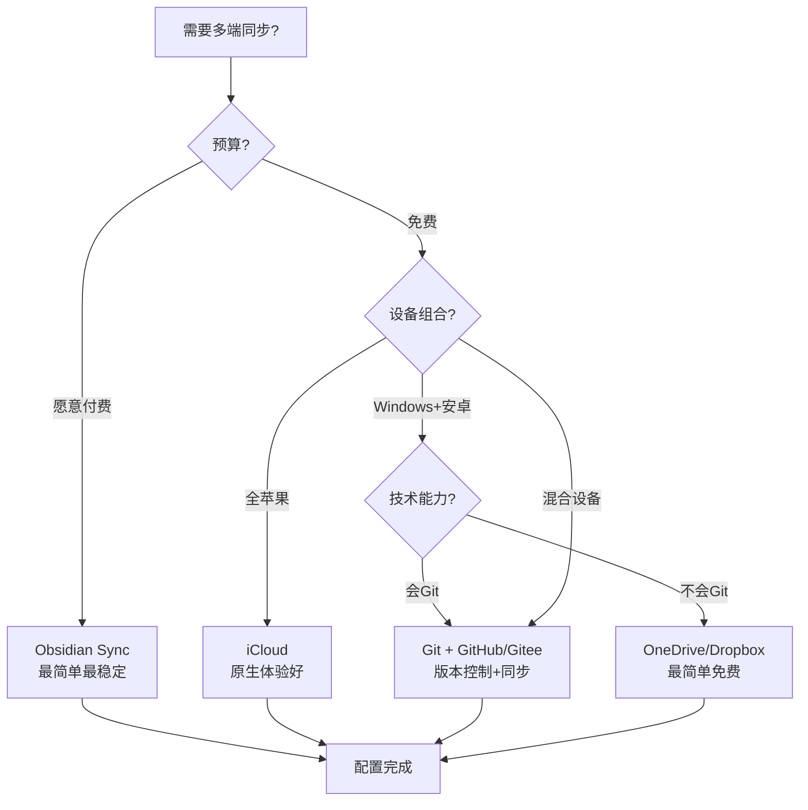
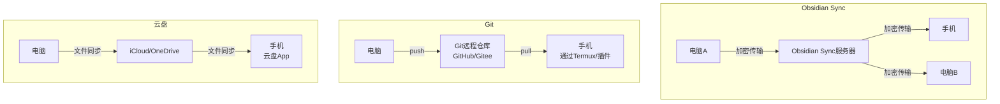

# Obsidian 同步与多端方案

> **文档说明**：系统对比 Obsidian 的多种同步方案（官方 Sync、Git、iCloud、OneDrive/Dropbox、Remotely Save、Syncthing），涵盖各方案的原理、优缺点、配置步骤、冲突处理、移动端适配、安全性，含具体的 Git 配置脚本、iCloud/OneDrive 设置方法、冲突解决策略和选型决策树。
>
> **适用人群**：需要在多设备（电脑/手机/平板）间同步 Obsidian 笔记的用户
>
> **前置知识**：[[Obsidian-核心插件配置]]、[[Obsidian-Git版本管理]]、[[Obsidian-移动端配置]]

---

## 一、概述

<div style="background:linear-gradient(135deg,#11998e,#38ef7d);border-radius:16px;padding:20px;margin:16px 0;font-family:-apple-system,'Segoe UI','PingFang SC','Microsoft YaHei',sans-serif;color:#fff;overflow:hidden;box-shadow:0 8px 28px rgba(0,0,0,.14),0 3px 10px rgba(0,0,0,.08)">
<style>@keyframes highlight{0%,100%{box-shadow:0 0 0 rgba(255,255,255,0)}50%{box-shadow:0 0 20px rgba(255,255,255,.4)}}.hl-box{background:rgba(255,255,255,.2);border-radius:10px;padding:14px 18px;margin:10px 0;animation:highlight 3s ease-in-out infinite;border-left:4px solid rgba(255,255,255,.6)}.hl-formula{font-family:monospace;font-size:14px;text-align:center;background:rgba(0,0,0,.15);border-radius:8px;padding:12px;margin:10px 0}</style>
<div style="text-align:center;font-size:15px;font-weight:700;margin-bottom:14px;padding-bottom:10px;border-bottom:1.5px solid rgba(255,255,255,.22);letter-spacing:1px;text-shadow:0 1px 3px rgba(0,0,0,.12)">📌 Obsidian 同步与多端方案</div>
<div class="hl-box">系统对比 Obsidian 的多种同步方案（官方 Sync、Git、iCloud、OneDrive/Dropbox、Remotely Save、Syncthing），涵盖各方案的原理、优缺点、配置步骤、冲突处理、移动端适配、安全性，含具体的 Git 配置脚本、iCloud/OneDrive 设置方法...</div>
<div class="hl-formula">本地修改 → 冲突检测 → 增量同步 → 端到端加密 → 多端一致</div>
<div style="font-size:13px;opacity:.9;margin-top:8px">💡 工具是手段，高效的知识管理才是目标</div>
</div>

> 🔍 **知识点深度解析**
>
> **作用**：Obsidian 同步与多端方案 是 Obsidian 知识管理体系中的重要工具/方法，解决知识采集、组织、检索和利用中的效率问题，适用于构建个人知识管理系统和提升工作效率。
>
> **原理**：通过插件扩展和工作流设计，将 Obsidian 从简单的笔记工具升级为强大的知识管理平台，结合自动化和 AI 能力实现知识的高效处理和价值挖掘。
>
> **用法要点**：① 先掌握基础配置再深入高级功能 ② 建立适合自己的工作流而非照搬他人方案 ③ 善用快捷键和模板提升操作效率 ④ 定期回顾和优化知识管理方法

Obsidian 笔记以纯文本 Markdown 文件存储在本地，同步的本质是**在多设备间同步这些文件**。Obsidian 不强制使用某种同步方式，而是提供了多种选择：官方付费 Sync、Git 版本控制、云盘（iCloud/OneDrive/Dropbox）、第三方插件（Remotely Save/Syncthing）。选择哪种方案取决于你的设备组合、预算、技术能力和安全需求。

### 1. 同步方案对比

| 方案 | 价格 | 速度 | 冲突处理 | 移动端 | 版本历史 | 安全性 | 推荐度 |
|------|------|------|---------|--------|---------|--------|--------|
| **Obsidian Sync** | $4/月 | 快 | 自动合并 | ✅ 原生 | ✅ 一年 | 端到端加密 | ⭐⭐⭐⭐⭐ |
| **Git** | 免费 | 中 | 手动 merge | ⚠️ 需插件 | ✅ 完整 | 取决于仓库 | ⭐⭐⭐⭐ |
| **iCloud** | 免费(5GB) | 中 | 文件覆盖 | ✅ 原生 | ⚠️ 有限 | Apple 加密 | ⭐⭐⭐⭐ (苹果用户) |
| **OneDrive** | 免费(5GB) | 中 | 文件覆盖 | ✅ | ⚠️ 有限 | 微软加密 | ⭐⭐⭐ |
| **Dropbox** | 免费(2GB) | 快 | 文件覆盖 | ✅ | ✅ 30天 | 加密 | ⭐⭐⭐ |
| **Remotely Save** | 免费 | 中 | 自动合并 | ✅ | ❌ | S3/WebDAV加密 | ⭐⭐⭐ |
| **Syncthing** | 免费 | 快 | 文件覆盖 | ⚠️ 复杂 | ❌ | 端到端加密 | ⭐⭐⭐ |

### 2. 选型决策树



---

---

> 💡 **深度讲解**：本节围绕，深入剖析其使用方法与实践技巧，帮助读者建立高效的知识管理工作流。
>
> **📝 精简总结**：本节介绍了，掌握这些内容是提升 Obsidian 使用效率的重要基础。

## 二、底层原理

### 1. 各方案同步原理



### 2. 冲突产生与处理

冲突发生在：两台设备同时修改了同一篇笔记，且修改未同步。

| 方案 | 冲突处理方式 |
|------|------------|
| **Obsidian Sync** | 自动合并，保留两个版本，标记冲突区域 |
| **Git** | 标记冲突（`<<<<<<<`），手动解决后 commit |
| **云盘** | 后同步的覆盖先同步的，或生成"冲突副本"文件 |
| **Remotely Save** | 自动合并，类似 Obsidian Sync |

**避免冲突的最佳实践**：
- 切换设备前等待同步完成
- 不要在两台设备上同时编辑同一篇笔记
- 大段编辑在一台设备上完成
- Git 方案：编辑前先 pull，编辑后立即 push

---

---

> 💡 **深度讲解**：本节围绕，深入剖析其使用方法与实践技巧，帮助读者建立高效的知识管理工作流。
>
> **📝 精简总结**：本节介绍了，掌握这些内容是提升 Obsidian 使用效率的重要基础。

## 三、实操

### 1. Obsidian Sync 配置（推荐付费用户）

1. 订阅 Obsidian Sync（$4/月或$96/终身）
2. 电脑端：设置 → Sync → 登录账号 → 创建远程 Vault → 选择同步选项
3. 移动端：下载 Obsidian App → 登录 → 连接远程 Vault
4. 同步选项配置：
   - ✅ 同步笔记
   - ✅ 同步设置
   - ✅ 同步插件
   - ✅ 同步主题
   - ❌ 不同步大附件（可选）

### 2. Git 同步配置（推荐技术用户）

```mermaid
# 在 Vault 根目录初始化 Git
cd "C:\Users\23981\Documents\ObsidianVault"
git init

# 创建 .gitignore
cat > .gitignore << 'EOF'
.obsidian/workspace.json
.obsidian/workspace-mobile.json
.trash/
.DS_Store
*.tmp
EOF

# 首次提交
git add .
git commit -m "Initial commit"

# 添加远程仓库（GitHub 或 Gitee）
git remote add origin https://github.com/username/obsidian-vault.git
git branch -M main
git push -u origin main
```

```bash
# Windows 自动同步脚本（sync.ps1）
# 放在 Vault 根目录，双击运行或定时执行
cd "C:\Users\23981\Documents\ObsidianVault"

# 拉取最新
git pull origin main

# 检查是否有变更
$status = git status --porcelain
if ($status) {
    $date = Get-Date -Format "yyyy-MM-dd HH:mm:ss"
    git add .
    git commit -m "Auto sync: $date"
    git push origin main
    Write-Host "同步完成: $date" -ForegroundColor Green
} else {
    Write-Host "无变更，无需同步" -ForegroundColor Yellow
}
```

## Windows 任务计划：每小时自动同步
## 以管理员身份运行 PowerShell
```text
$action = New-ScheduledTaskAction -Execute "powershell.exe" `
    -Argument "-ExecutionPolicy Bypass -File `"C:\Users\23981\Documents\ObsidianVault\sync.ps1`""
$trigger = New-ScheduledTaskTrigger -Once -At (Get-Date) -RepetitionInterval (New-TimeSpan -Hours 1)
```
Register-ScheduledTask -TaskName "Obsidian Git Sync" -Action $action -Trigger $trigger

**移动端 Git 同步**：
- Android：安装 Termux + git，或使用 "Obsidian Git" 插件
- iOS：使用 "Working Copy" App（付费），或 iCloud + Git 混合

### 3. iCloud 同步配置（苹果用户）

**Windows 端**：
1. 安装 iCloud for Windows
2. 登录 Apple ID
3. 启用 iCloud Drive
4. 将 Obsidian Vault 放在 `iCloud Drive\Obsidian\` 目录下
5. Obsidian 中打开该目录作为 Vault

**iPhone/iPad 端**：
1. 安装 Obsidian App
2. 打开 App → "Open folder" → 选择 iCloud Drive 中的 Vault 目录
3. 等待 iCloud 同步完成

**注意事项**：
- iCloud 同步可能有延迟（特别是大文件）
- Windows 上 iCloud 有时会生成"冲突副本"
- 确保 iCloud 有足够空间（Vault 大小）

### 4. OneDrive 同步配置

1. 安装 OneDrive 并登录
2. 将 Vault 放在 OneDrive 目录下（如 `C:\Users\23981\OneDrive\ObsidianVault`）
3. 移动端安装 OneDrive App，将 Vault 设为"离线可用"
4. Obsidian 移动端打开 OneDrive 中的 Vault（Android 需用"文件夹"方式）

**Windows 端优化**：
- 右键 OneDrive 图标 → 设置 → 账户 → 选择文件夹
- 确保 Vault 目录已勾选同步
- 右键 Vault 文件夹 → "始终保留在此设备上"

### 5. Remotely Save 插件配置

Remotely Save 是一个社区插件，支持 S3、WebDAV、OneDrive for Business：

```text
// .obsidian/plugins/remotely-save/data.json
{
  "serviceType": "s3",
  "s3": {
    "endpoint": "https://s3.amazonaws.com",
    "region": "us-east-1",
    "accessKeyId": "AKIAxxx",
    "secretAccessKey": "xxx",
    "bucket": "my-obsidian-vault",
    "prefix": ""
  },
  "autoSync": true,
  "syncOnSaveDelay": 5,
  "syncOnStart": true,
  "password": "可选加密密码",
  "ignorePaths": [".obsidian/workspace.json", ".trash"]
}
```

### 6. 冲突解决指南

**Git 冲突解决**：
```bash
# 拉取时发现冲突
git pull
# CONFLICT (content): Merge conflict in note.md

# 编辑 note.md，找到冲突标记
<<<<<<< HEAD
电脑上的内容
=======
手机上的内容
>>>>>>> branch

# 手动选择保留哪个版本，删除冲突标记
# 然后提交
git add note.md
git commit -m "Resolve conflict"
git push
```

**云盘冲突解决**：
- 云盘会生成 `note (冲突副本 2026-09-07).md`
- 打开两个文件，手动合并内容
- 删除冲突副本文件

---

---

> 💡 **深度讲解**：本节围绕，深入剖析其使用方法与实践技巧，帮助读者建立高效的知识管理工作流。
>
> **📝 精简总结**：本节介绍了，掌握这些内容是提升 Obsidian 使用效率的重要基础。

## 四、常见问题与排查

| 问题现象 | 原因分析 | 解决方案 |
|---------|---------|---------|
| 手机上看不到电脑上的新笔记 | 同步未完成，或 Vault 目录不对 | 等待同步完成（云盘可能延迟几分钟）；确认手机端打开的是同一个 Vault 目录 |
| Git push 被拒绝（non-fast-forward） | 远程有新提交，本地未 pull | 先 `git pull` 解决冲突，再 `git push` |
| iCloud 一直显示"等待同步" | 网络问题，或 iCloud 空间不足 | 检查网络；确认 iCloud 存储空间足够；重启 iCloud 客户端 |
| OneDrive 文件变成云端占位符 | 未设为"始终保留在此设备上" | 右键 Vault 文件夹 → "始终保留在此设备上"；Obsidian 需要本地文件 |
| 同步后 .obsidian 配置丢失 | 不同步 .obsidian 目录，或被 .gitignore 排除 | 确认同步配置包含 .obsidian；Git 方案中 .gitignore 只排除 workspace.json |
| 移动端插件不生效 | 移动端未同步插件，或插件不兼容移动端 | 确认同步了 .obsidian/plugins；检查插件是否支持移动端；移动端手动启用插件 |
| 大附件同步慢/失败 | 附件太大（>100MB），或云盘空间不足 | 用 Git LFS 管理大文件；或排除附件目录；压缩图片 |
| 两台设备同时编辑导致内容丢失 | 云盘方案后写覆盖先写 | 切换设备前等待同步完成；用 Obsidian Sync 或 Git（有版本历史可恢复） |
| Obsidian Sync 连接失败 | 网络问题（国内访问慢），或订阅过期 | 检查网络；确认订阅有效；国内可能需要代理；联系官方支持 |
| Git 仓库泄露隐私 | 公开仓库包含敏感笔记 | 用私有仓库（GitHub Private/Gitee 私有）；敏感信息不要提交；用 .gitignore 排除 |

---

---

> 💡 **深度讲解**：本节围绕，深入剖析其使用方法与实践技巧，帮助读者建立高效的知识管理工作流。
>
> **📝 精简总结**：本节介绍了，掌握这些内容是提升 Obsidian 使用效率的重要基础。

## 五、进阶与最佳实践

### 1. 推荐方案组合

| 用户类型 | 推荐方案 | 理由 |
|---------|---------|------|
| **全苹果用户** | iCloud | 原生体验，零配置，免费 |
| **技术用户** | Git + GitHub/Gitee | 免费、版本历史完整、可控 |
| **Windows+安卓** | OneDrive + Obsidian Git 插件 | 免费、跨平台、有版本控制 |
| **付费用户** | Obsidian Sync | 最简单、最稳定、端到端加密 |
| **隐私敏感** | Syncthing（P2P）或 Git + 自托管 Gitea | 数据不经过第三方服务器 |
| **混合方案** | iCloud/OneDrive 同步文件 + Git 版本控制 | 兼顾易用性和版本安全 |

### 2. 同步安全清单

- [ ] 敏感笔记不使用公开 Git 仓库
- [ ] 云盘开启两步验证
- [ ] Git 仓库设为私有
- [ ] 定期备份 Vault（除同步外，额外备份到移动硬盘）
- [ ] .obsidian 中的 API Key 等敏感信息不提交到 Git
- [ ] 移动端设置密码/生物识别

### 3. 备份策略（3-2-1 原则）

- **3 份副本**：本地 + 同步服务 + 备份
- **2 种介质**：硬盘 + 云存储
- **1 份异地**：云存储或异地硬盘

## Windows 备份脚本（backup.ps1）
```text
$source = "C:\Users\23981\Documents\ObsidianVault"
$dest = "D:\Backup\Obsidian\$(Get-Date -Format 'yyyyMMdd')"
```
Copy-Item -Path $source -Destination $dest -Recurse -Force
Write-Host "备份完成: $dest" -ForegroundColor Green

---

---

> 💡 **深度讲解**：本节围绕，深入剖析其使用方法与实践技巧，帮助读者建立高效的知识管理工作流。
>
> **📝 精简总结**：本节介绍了，掌握这些内容是提升 Obsidian 使用效率的重要基础。

## 六、关联笔记

### Obsidian 效率
- [[Obsidian-核心插件配置]] · [[Obsidian-Git版本管理]] · [[Obsidian-移动端配置]]
- [[Obsidian-双向链接与图谱]] · [[Obsidian-Dataview查询语言]]

### 导航
- [[MOC-AI与效率工具]] · [[全栈+AI工程双轨融合学习路线图]]

> **学习路径建议**：先掌握 [[Obsidian-核心插件配置]] → 根据设备组合选择同步方案 → 技术用户深入 [[Obsidian-Git版本管理]] → 移动端参考 [[Obsidian-移动端配置]] → 建立定期备份习惯。

---

## 📖 前置知识

- [[Obsidian-核心插件配置]]

## 🏷️ 相关标签

`#Obsidian` `#效率工具` `#知识管理` `#同步`

---

[[Home|🏠 返回首页]] · [[MOC-AIGC与Obsidian-四级展开|📚 返回分类]]

