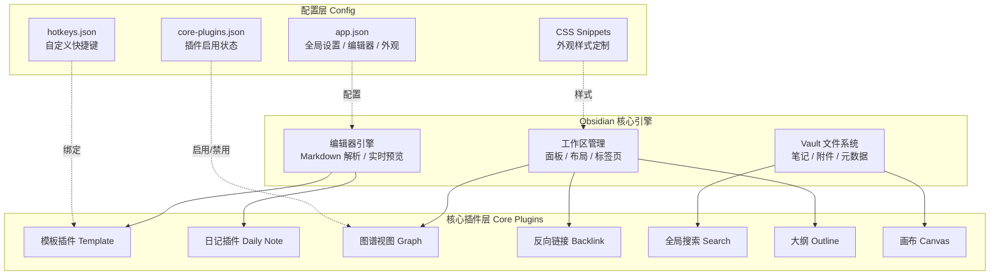

# Obsidian 核心插件配置

> **文档说明**：系统讲解 Obsidian 官方核心插件的配置与使用，涵盖文件编辑器、模板、日记、画布、图谱、反向链接、搜索、标签、书签、命令面板、大纲、字数统计等核心功能的最佳配置，含具体的设置项说明、快捷键绑定表、外观主题推荐、JSON 配置示例和新手到进阶的配置路线。
>
> **适用人群**：Obsidian 新手用户、想要优化配置的进阶用户
>
> **前置知识**：[[Obsidian知识库搭建指南]]、[[Obsidian插件系统详解]]、[[Frontmatter元数据规范]]

---

## 一、概述

<div style="background:linear-gradient(135deg,#11998e,#38ef7d);border-radius:16px;padding:20px;margin:16px 0;font-family:-apple-system,'Segoe UI','PingFang SC','Microsoft YaHei',sans-serif;color:#fff;overflow:hidden;box-shadow:0 8px 28px rgba(0,0,0,.14),0 3px 10px rgba(0,0,0,.08)">
<style>@keyframes highlight{0%,100%{box-shadow:0 0 0 rgba(255,255,255,0)}50%{box-shadow:0 0 20px rgba(255,255,255,.4)}}.hl-box{background:rgba(255,255,255,.2);border-radius:10px;padding:14px 18px;margin:10px 0;animation:highlight 3s ease-in-out infinite;border-left:4px solid rgba(255,255,255,.6)}.hl-formula{font-family:monospace;font-size:14px;text-align:center;background:rgba(0,0,0,.15);border-radius:8px;padding:12px;margin:10px 0}</style>
<div style="text-align:center;font-size:15px;font-weight:700;margin-bottom:14px;padding-bottom:10px;border-bottom:1.5px solid rgba(255,255,255,.22);letter-spacing:1px;text-shadow:0 1px 3px rgba(0,0,0,.12)">📌 Obsidian 核心插件配置</div>
<div class="hl-box">系统讲解 Obsidian 官方核心插件的配置与使用，涵盖文件编辑器、模板、日记、画布、图谱、反向链接、搜索、标签、书签、命令面板、大纲、字数统计等核心功能的最佳配置，含具体的设置项说明、快捷键绑定表、外观主题推荐、JSON 配置示例和新手到进阶的配置路线。</div>
<div class="hl-formula">插件启用 → 参数配置 → 快捷键绑定 → 外观定制 → 性能优化</div>
<div style="font-size:13px;opacity:.9;margin-top:8px">💡 工具是手段，高效的知识管理才是目标</div>
</div>

> 🔍 **知识点深度解析**
>
> **作用**：Obsidian 核心插件配置 是 Obsidian 知识管理体系中的重要工具/方法，解决知识采集、组织、检索和利用中的效率问题，适用于构建个人知识管理系统和提升工作效率。
>
> **原理**：通过插件扩展和工作流设计，将 Obsidian 从简单的笔记工具升级为强大的知识管理平台，结合自动化和 AI 能力实现知识的高效处理和价值挖掘。
>
> **用法要点**：① 先掌握基础配置再深入高级功能 ② 建立适合自己的工作流而非照搬他人方案 ③ 善用快捷键和模板提升操作效率 ④ 定期回顾和优化知识管理方法

Obsidian 自带 20+ 个核心插件（Core Plugins），这些插件由官方开发，与 Obsidian 深度集成，稳定性高。合理配置核心插件可以满足 80% 的知识管理需求，社区插件则用于扩展高级功能。本文系统梳理每个核心插件的作用、配置方法和最佳实践。

### 1. 核心插件清单

| 插件 | 作用 | 推荐状态 |
|------|------|---------|
| **文件编辑器** | Markdown 编辑基础 | ✅ 必开 |
| **文件列表** | 左侧文件浏览器 | ✅ 必开 |
| **搜索** | 全文搜索 | ✅ 必开 |
| **切换器** | 快速切换笔记（Ctrl+O） | ✅ 必开 |
| **图谱视图** | 知识图谱可视化 | ✅ 推荐 |
| **反向链接** | 显示被引用情况 | ✅ 必开 |
| **大纲** | 显示笔记标题结构 | ✅ 推荐 |
| **模板** | 基础模板插入 | ✅ 推荐（或用 Templater） |
| **日记** | 每日笔记 | ✅ 推荐（或用 Periodic Notes） |
| **画布** | 无限白板 | ✅ 推荐 |
| **标签面板** | 标签浏览 | ✅ 必开 |
| **书签** | 重要笔记收藏 | ✅ 推荐 |
| **命令面板** | 命令搜索（Ctrl+P） | ✅ 必开 |
| **字数统计** | 显示字数 | ✅ 推荐 |
| **页面预览** | 悬停预览链接内容 | ✅ 推荐 |
| **Markdown 导入** | 导入 Markdown 文件 | ⚪ 按需 |
| **音频录制** | 录音笔记 | ⚪ 按需 |
| **幻灯片** | Markdown 演示 | ⚪ 按需 |
| **工作区** | 保存/加载布局 | ✅ 推荐 |
| **发布** | 发布到 Obsidian Publish | ⚪ 付费 |

---

---

> 💡 **深度讲解**：本节围绕，深入剖析其使用方法与实践技巧，帮助读者建立高效的知识管理工作流。
>
> **📝 精简总结**：本节介绍了，掌握这些内容是提升 Obsidian 使用效率的重要基础。

## 二、底层原理

### Obsidian 插件架构与配置体系



### 1. 配置存储位置

Obsidian 的配置存储在 Vault 的 `.obsidian/` 目录中：

```text
.obsidian/
├── app.json              # 全局设置（编辑器、外观、快捷键）
├── core-plugins.json     # 核心插件启用状态
├── community-plugins.json # 社区插件列表
├── plugins/              # 各插件配置
│   ├── calendar/data.json
│   ├── templater/data.json
│   └── ...
├── themes/               # 主题文件
├── snippets/             # CSS 片段
└── workspace.json        # 当前布局（不建议同步）
```

### 2. 快捷键系统

Obsidian 的快捷键完全可自定义，存储在 `.obsidian/hotkeys.json`。核心原则：
- 常用操作绑定左手快捷键（Ctrl+字母）
- 避免与系统快捷键冲突
- 同类操作用统一前缀（如 Ctrl+Shift+X 系列）

---

---

> 💡 **深度讲解**：本节围绕，深入剖析其使用方法与实践技巧，帮助读者建立高效的知识管理工作流。
>
> **📝 精简总结**：本节介绍了，掌握这些内容是提升 Obsidian 使用效率的重要基础。

## 三、实操

### 1. 编辑器配置

```text
// .obsidian/app.json 编辑器相关配置
{
  "editor": {
    "showLineNumber": true,
    "spellcheck": true,
    "spellcheckLanguages": ["zh-CN", "en-US"],
    "defaultViewMode": "source",
    "livePreview": true,
    "showFrontmatter": true,
    "foldHeading": true,
    "foldIndent": true,
    "rightToLeft": false,
    "showRuler": false,
    "autoPairMarkdown": true,
    "autoPairBrackets": true,
    "smartIndentLists": true,
    "tabSize": 2,
    "useTab": false
  }
}
```

**关键设置说明**：
- `livePreview: true`：实时预览模式（所见即所得）
- `showLineNumber: true`：显示行号
- `showFrontmatter: true`：编辑时显示 YAML frontmatter
- `foldHeading: true`：标题可折叠
- `spellcheck: true`：拼写检查（中英文）

### 2. 外观配置

```text
// 外观设置
{
  "theme": "obsidian",
  "baseFontSize": 16,
  "fontInterface": "Inter, -apple-system, sans-serif",
  "fontText": "Inter, -apple-system, sans-serif",
  "fontMono": "JetBrains Mono, Consolas, monospace",
  "translucency": false,
  "nativeMenus": false,
  "cssTheme": "Minimal"
}
```

**推荐主题**：
| 主题 | 特点 | 适用 |
|------|------|------|
| **Minimal** | 极简、可定制、卡片式 | 大多数用户 |
| **AnuPpuccin** | 美观、多彩、丰富 | 视觉党 |
| **Things** | 仿 Things 风格、简洁 | 苹果用户 |
| **Prism** | 代码高亮优化 | 技术笔记 |
| **默认主题** | 稳定、轻量 | 追求性能 |

### 3. 核心快捷键配置

| 功能 | 默认快捷键 | 推荐快捷键 | 说明 |
|------|-----------|-----------|------|
| 命令面板 | Ctrl+P | Ctrl+P | 搜索所有命令 |
| 快速切换 | Ctrl+O | Ctrl+O | 模糊搜索打开笔记 |
| 全局搜索 | Ctrl+Shift+F | Ctrl+Shift+F | 全文搜索 |
| 新建笔记 | Ctrl+N | Ctrl+N | 新建笔记 |
| 保存 | Ctrl+S | Ctrl+S | 保存（自动保存可关） |
| 关闭面板 | Ctrl+W | Ctrl+W | 关闭当前面板 |
| 撤销/重做 | Ctrl+Z / Ctrl+Y | 同左 | |
| 加粗 | Ctrl+B | Ctrl+B | |
| 斜体 | Ctrl+I | Ctrl+I | |
| 插入链接 | Ctrl+K | Ctrl+K | |
| 切换编辑/预览 | Ctrl+E | Ctrl+E | |
| 打开日记 | - | Ctrl+D | 需在日记插件设置 |
| 打开图谱 | - | Ctrl+Shift+G | 需手动绑定 |
| 打开画布 | - | Ctrl+Shift+C | 需手动绑定 |

**绑定方法**：设置 → 快捷键 → 搜索命令 → 点击加号 → 按下组合键

### 4. 模板插件配置

核心模板插件（非 Templater）配置：
1. 设置 → 核心插件 → 启用"模板"
2. 设置 → 模板 → 模板文件夹位置：`templates/`
3. 设置 → 模板 → 日期格式：`YYYY-MM-DD`
4. 设置 → 模板 → 时间格式：`HH:mm`

使用：`Ctrl+P` → "模板: 插入模板" → 选择模板

<!-- templates/note-template.md 基础笔记模板 -->
---
```text
title: {{title}}
created: {{date}}
updated: {{date}}
tags: []
```
---

```text
## {{title}}
```

> **文档说明**：
>
> **适用人群**：
>
> **前置知识**：

---

---

### 5. 日记插件配置

1. 设置 → 核心插件 → 启用"日记"
2. 设置 → 日记：
   - 日期格式：`YYYY-MM-DD`
   - 新建日记存放位置：`01-Daily/`
   - 模板文件位置：`templates/daily-template.md`
3. 绑定快捷键：Ctrl+D → "日记: 打开今天的日记"

### 6. 图谱视图配置

1. 设置 → 核心插件 → 启用"图谱视图"
2. 打开图谱（左侧图标）
3. 配置过滤器：
   - 搜索框：`path:09-AI` 只显示 AI 目录
   - 显示标签：开启
   - 显示附件：关闭
   - 隐藏未解析链接：开启
4. 配置颜色组（参考 [[Obsidian-双向链接与图谱]]）

### 7. 工作区布局保存

1. 调整好面板布局（左侧文件列表 + 中间编辑器 + 右侧大纲/反向链接）
2. `Ctrl+P` → "工作区: 保存当前布局为..." → 命名"默认布局"
3. 以后可一键恢复：`Ctrl+P` → "工作区: 加载布局" → 选择"默认布局"

**推荐布局**：
- 左侧：文件列表 + 搜索
- 中间：编辑器（主面板）
- 右侧：大纲 + 反向链接 + 标签
- 底部：无（保持简洁）

### 8. CSS 片段自定义

创建 `.obsidian/snippets/custom.css`：

```css
/* 自定义 CSS 片段示例 */
/* 标题颜色 */
.cm-header-1 { color: #4f46e5; }
.cm-header-2 { color: #059669; }
.cm-header-3 { color: #d97706; }

/* 高亮标记 */
mark {
  background-color: #fef08a;
  padding: 0 2px;
  border-radius: 2px;
}

/* 引用块样式 */
.cm-quote {
  color: #6b7280;
  border-left: 3px solid #4f46e5;
  padding-left: 12px;
}

/* 代码块样式 */
.cm-inline-code {
  background-color: #f3f4f6;
  padding: 2px 6px;
  border-radius: 4px;
  font-family: "JetBrains Mono", monospace;
}

/* 隐藏标题栏（更简洁） */
.titlebar { display: none; }
```

启用：设置 → 外观 → CSS 片段 → 开启 custom.css

---

## 四、常见问题与排查

| 问题现象 | 原因分析 | 解决方案 |
|---------|---------|---------|
| 核心插件列表中找不到某个插件 | Obsidian 版本太旧，或插件已被移除 | 升级 Obsidian 到最新版；检查更新日志 |
| 快捷键绑定不生效 | 与其他插件/系统快捷键冲突 | 设置 → 快捷键中查看冲突提示（黄色警告）；换一个组合键 |
| 主题安装后不生效 | 未在外观中选择该主题 | 设置 → 外观 → 主题 → 下拉选择已安装主题 |
| CSS 片段不生效 | 语法错误，或未启用 | 检查 CSS 语法；设置 → 外观 → CSS 片段 → 开启开关 |
| 实时预览模式下代码显示异常 | 某些主题不兼容实时预览 | 切换到源码模式（Ctrl+E）；更新主题；或用兼容的主题 |
| 配置在多设备间不同步 | 未同步 .obsidian 目录 | 同步方案中包含 .obsidian（排除 workspace.json）；参考 [[Obsidian-同步与多端方案]] |
| 搜索不到中文内容 | 搜索设置未启用中文分词，或索引未刷新 | Obsidian 搜索原生支持中文；等待索引重建；重启 Obsidian |
| 笔记打开很慢 | 笔记太大（>1MB），或嵌入了大量内容 | 拆分大笔记；减少嵌入；关闭实时预览用源码模式 |
| 标签面板不显示嵌套标签 | 标签格式不对，或未启用嵌套 | 标签用 `#父/子` 格式；设置 → 核心插件 → 标签面板 → 启用嵌套 |
| 字数统计不显示 | 未启用字数统计插件 | 设置 → 核心插件 → 启用"字数统计"；状态栏显示 |

---

## 五、进阶与最佳实践

### 1. 配置路线

| 阶段 | 配置重点 |
|------|---------|
| **新手（第1天）** | 启用核心插件、设置模板文件夹、绑定基础快捷键、选择主题 |
| **入门（第1周）** | 配置日记、图谱颜色组、CSS 片段、工作区布局 |
| **进阶（第1月）** | 安装社区插件（Templater/Dataview/Calendar）、优化快捷键、建立模板库 |
| **专家（持续）** | 插件开发、自动化脚本、自定义主题、多 Vault 管理 |

### 2. 配置备份与恢复

## 备份 Obsidian 配置（Windows）
```text
$vault = "C:\Users\23981\Documents\ObsidianVault"
$backup = "D:\Backup\ObsidianConfig\$(Get-Date -Format 'yyyyMMdd')"
```
Copy-Item "$vault\.obsidian" $backup -Recurse -Force
Write-Host "配置已备份到: $backup" -ForegroundColor Green

恢复：将备份的 `.obsidian` 目录复制回 Vault 根目录。

### 3. 性能优化

- 关闭不常用的核心插件
- 社区插件控制在 15 个以内
- 大附件用外部链接而非嵌入
- 定期清理 `.trash` 目录
- 用源码模式编辑大笔记（实时预览更耗资源）

---

## 六、关联笔记

### Obsidian 效率
- [[Obsidian知识库搭建指南]] · [[Obsidian插件系统详解]] · [[Frontmatter元数据规范]]
- [[Obsidian-模板与快速输入]] · [[Templater-自动化模板]] · [[Obsidian-双向链接与图谱]]
- [[Obsidian-Dataview查询语言]] · [[Obsidian-同步与多端方案]] · [[Obsidian-Git版本管理]]

### 导航
- [[MOC-AI与效率工具]] · [[全栈+AI工程双轨融合学习路线图]]

> **学习路径建议**：先掌握 [[Obsidian知识库搭建指南]] 搭建 Vault → 学习本文核心插件配置 → 深入 [[Templater-自动化模板]] 和 [[Obsidian-Dataview查询语言]] → 参考 [[Obsidian-同步与多端方案]] 实现多端同步。

---

## 📖 前置知识

- [[Obsidian知识库搭建指南]]
- [[Obsidian插件系统详解]]
- [[Frontmatter元数据规范]]

## 🏷️ 相关标签

`#Obsidian` `#效率工具` `#知识管理` `#入门`

---

[[Home|🏠 返回首页]] · [[MOC-AIGC与Obsidian-四级展开|📚 返回分类]]

