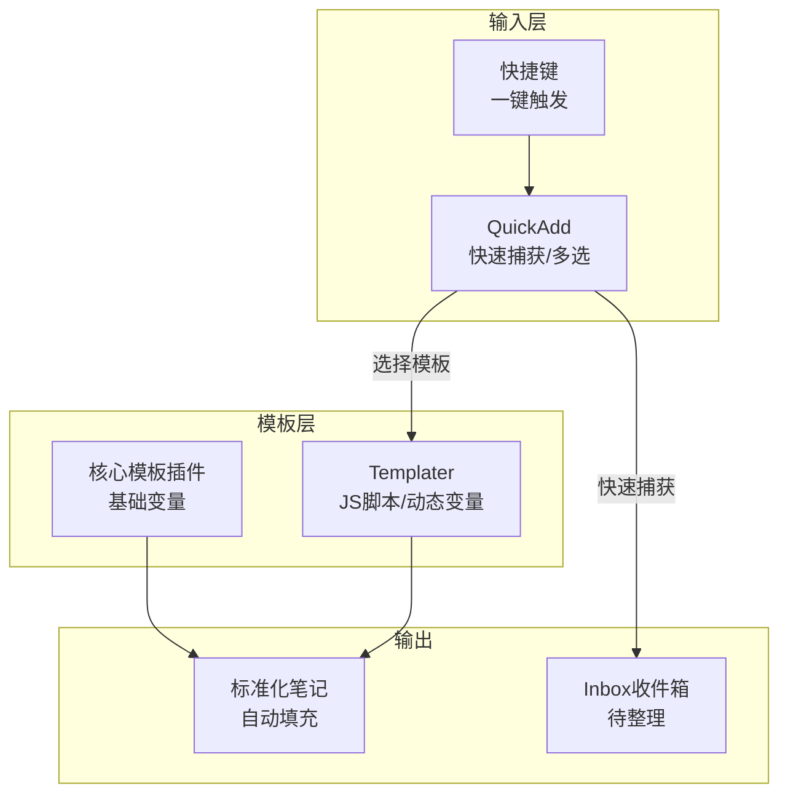

# Obsidian 模板与快速输入

> **文档说明**：系统讲解 Obsidian 的模板系统和快速输入工作流，涵盖核心模板插件、Templater 高级模板、QuickAdd 快速捕获、模板设计原则、常用模板库（笔记/日记/会议/读书/项目）、快捷键绑定、与 AI 插件的联动，含可直接使用的模板代码、QuickAdd 配置和最佳实践。
>
> **适用人群**：Obsidian 用户、需要提升笔记录入效率的知识工作者
>
> **前置知识**：[[Obsidian-核心插件配置]]、[[Templater-自动化模板]]、[[Frontmatter元数据规范]]

---

## 一、概述

<div style="background:linear-gradient(135deg,#11998e,#38ef7d);border-radius:16px;padding:20px;margin:16px 0;font-family:-apple-system,'Segoe UI','PingFang SC','Microsoft YaHei',sans-serif;color:#fff;overflow:hidden;box-shadow:0 8px 28px rgba(0,0,0,.14),0 3px 10px rgba(0,0,0,.08)">
<style>@keyframes highlight{0%,100%{box-shadow:0 0 0 rgba(255,255,255,0)}50%{box-shadow:0 0 20px rgba(255,255,255,.4)}}.hl-box{background:rgba(255,255,255,.2);border-radius:10px;padding:14px 18px;margin:10px 0;animation:highlight 3s ease-in-out infinite;border-left:4px solid rgba(255,255,255,.6)}.hl-formula{font-family:monospace;font-size:14px;text-align:center;background:rgba(0,0,0,.15);border-radius:8px;padding:12px;margin:10px 0}</style>
<div style="text-align:center;font-size:15px;font-weight:700;margin-bottom:14px;padding-bottom:10px;border-bottom:1.5px solid rgba(255,255,255,.22);letter-spacing:1px;text-shadow:0 1px 3px rgba(0,0,0,.12)">📌 Obsidian 模板与快速输入</div>
<div class="hl-box">系统讲解 Obsidian 的模板系统和快速输入工作流，涵盖核心模板插件、Templater 高级模板、QuickAdd 快速捕获、模板设计原则、常用模板库（笔记/日记/会议/读书/项目）、快捷键绑定、与 AI 插件的联动，含可直接使用的模板代码、QuickAdd 配置和最佳实践。</div>
<div class="hl-formula">触发 → 变量解析 → 脚本执行 → 内容插入 → 格式化</div>
<div style="font-size:13px;opacity:.9;margin-top:8px">💡 工具是手段，高效的知识管理才是目标</div>
</div>

> 🔍 **知识点深度解析**
>
> **作用**：Obsidian 模板与快速输入 是 Obsidian 知识管理体系中的重要工具/方法，解决知识采集、组织、检索和利用中的效率问题，适用于构建个人知识管理系统和提升工作效率。
>
> **原理**：通过插件扩展和工作流设计，将 Obsidian 从简单的笔记工具升级为强大的知识管理平台，结合自动化和 AI 能力实现知识的高效处理和价值挖掘。
>
> **用法要点**：① 先掌握基础配置再深入高级功能 ② 建立适合自己的工作流而非照搬他人方案 ③ 善用快捷键和模板提升操作效率 ④ 定期回顾和优化知识管理方法

**模板**是 Obsidian 效率的基石——通过预设的内容结构，一键创建标准化笔记，避免每次从零开始。**快速输入**则解决"灵感稍纵即逝"的问题，通过快捷键和 QuickAdd 插件，在任何界面快速捕获想法并自动归类。两者结合，构建从"快速捕获"到"结构化整理"的完整工作流。

### 1. 模板与快速输入的价值

| 痛点 | 解决方案 |
|------|---------|
| 每次写笔记都要重新写 Frontmatter | 模板自动填充标准 Frontmatter |
| 笔记结构不统一，难以检索 | 模板统一五段式/原子化结构 |
| 灵感出现时打开 Obsidian 太慢 | QuickAdd 全局快捷键，秒级捕获 |
| 捕获的想法散落各处 | QuickAdd 自动归类到指定文件夹 |
| 重复输入日期/标题等信息 | Templater 动态变量自动填充 |
| 不同类型笔记需要不同结构 | 多模板库，按类型选择 |

### 2. 工具链关系



### 3. 核心模板 vs Templater

| 维度 | 核心模板 | Templater |
|------|---------|-----------|
| **变量** | `{{date}}`, `{{title}}` | 支持 JS 表达式、系统命令、用户提示 |
| **复杂度** | 简单 | 高级（条件/循环/函数） |
| **学习曲线** | 平缓 | 中等 |
| **推荐** | 简单模板 | 复杂/动态模板 |
| **共存** | 可同时启用 | 可同时启用 |

---

---

> 💡 **深度讲解**：本节围绕，深入剖析其使用方法与实践技巧，帮助读者建立高效的知识管理工作流。
>
> **📝 精简总结**：本节介绍了，掌握这些内容是提升 Obsidian 使用效率的重要基础。

## 二、底层原理

### 1. 模板插入机制

模板插入的本质是**文本替换**：
1. 用户触发模板插入命令
2. Obsidian 读取模板文件内容
3. 替换变量（`{{date}}` → 当前日期）
4. 将替换后的内容插入到当前光标位置或新文件

Templater 在此基础上增加了 JS 执行引擎，可以运行任意 JavaScript 代码，实现动态内容生成。

### 2. QuickAdd 工作流

QuickAdd 是一个社区插件，提供四种捕获模式：
- **Capture**：捕获文本到指定文件（追加到末尾或指定位置）
- **Template**：从模板创建新笔记
- **Multi**：多选菜单，组合多个操作
- **Macro**：执行自定义 JS 脚本

---

---

> 💡 **深度讲解**：本节围绕，深入剖析其使用方法与实践技巧，帮助读者建立高效的知识管理工作流。
>
> **📝 精简总结**：本节介绍了，掌握这些内容是提升 Obsidian 使用效率的重要基础。

## 三、实操

### 1. 核心模板配置

1. 设置 → 核心插件 → 启用"模板"
2. 设置 → 模板 → 模板文件夹：`templates/`
3. 日期格式：`YYYY-MM-DD`
4. 时间格式：`HH:mm`

**核心模板变量**：
| 变量 | 输出 |
|------|------|
| `{{title}}` | 笔记标题 |
| `{{date}}` | 当前日期（按格式） |
| `{{time}}` | 当前时间 |
| `{{date:YYYY-MM-DD}}` | 指定格式的日期 |

### 2. 常用模板库

````text
<!-- templates/atomic-note.md 原子化笔记模板 -->
---
title: {{title}}
tags: [原子笔记]
category: 
created: {{date}}
updated: {{date}}
difficulty: ⭐⭐⭐
status: 🚧 草稿中
priority: 普通
pre: []
aliases: [{{title}}]
---

## {{title}}

> **一句话定义**：

---

> 💡 **深度讲解**：本节围绕，深入剖析其使用方法与实践技巧，帮助读者建立高效的知识管理工作流。
>
> **📝 精简总结**：本节介绍了，掌握这些内容是提升 Obsidian 使用效率的重要基础。

## 核心要点
1. 
2. 
3. 

## 示例

## 相关概念
- [[]]
- [[]]
````

````text
<!-- templates/meeting-note.md 会议笔记模板 -->
---
title: 会议-{{date}}
tags: [会议]
date: {{date}}
time: {{time}}
attendees: 
---

## 📋 会议记录 {{date}} {{time}}

## 会议信息
- **主题**：
- **参会人**：
- **地点/平台**：

## 议程
1. 

## 讨论内容
### 议题1
- 

## 决议
- [ ] 

## 行动项
| 任务 | 负责人 | 截止日期 | 状态 |
|------|--------|---------|------|
|  |  |  | ☐ |

## 下次会议
- 时间：
- 议题：
````

````text
<!-- templates/book-note.md 读书笔记模板 -->
---
title: 《》读书笔记
tags: [读书笔记, 书籍]
author: 
rating: 
status: 📖 在读
created: {{date}}
---

# 📚 《》读书笔记

## 书籍信息
- **作者**：
- **出版社**：
- **出版年份**：
- **评分**：⭐⭐⭐⭐⭐

## 核心观点
1. 
2. 
3. 

## 章节笔记
### 第一章
- 

## 精彩摘录
> 

## 个人感悟

## 行动清单
- [ ] 
````

````text
<!-- templates/project-note.md 项目笔记模板 -->
---
title: 
tags: [项目]
status: 🚧 进行中
priority: 高
created: {{date}}
deadline: 
---

# 🚀 

## 项目概述
- **目标**：
- **背景**：
- **预期成果**：

## 里程碑
| 阶段 | 目标 | 截止日期 | 状态 |
|------|------|---------|------|
|  |  |  | ☐ |

## 任务清单
- [ ] 

## 相关文档
- [[]]

## 会议记录
- [[会议-]]

## 复盘
````

### 3. Templater 高级模板

````text
<!-- templates/templater-daily.md Templater 日记模板 -->
---
title: <% tp.date.now("YYYY-MM-DD") %> 日记
date: <% tp.date.now("YYYY-MM-DD") %>
weekday: <% tp.date.now("dddd") %>
week: <% tp.date.now("gggg-[W]ww") %>
tags: [日记]
---

## 📅 <% tp.date.now("YYYY年MM月DD日 dddd") %>

## 🌅 晨间计划
### 今日三件要事
- [ ] 
- [ ] 
- [ ]

### 心情/天气
- 心情：<% tp.system.prompt("今天心情如何？", "不错") %>
- 天气：

## 📝 记录
- 

## 🌙 晚间回顾
### 今日成就
1. 
2. 

### 感恩
1. 

### 明日重点
- 

---
[[<% tp.date.now("YYYY-MM-DD", -1) %>|← 昨天]] | [[<% tp.date.now("gggg-[W]ww") %>|本周]] | [[<% tp.date.now("YYYY-MM-DD", 1) %>|明天 →]]
````

### 4. QuickAdd 配置

```text
// .obsidian/plugins/quickadd/data.json 简化配置
{
  "choices": [
    {
      "id": "capture-idea",
      "name": "💡 捕获灵感",
      "type": "capture",
      "capturePath": "Inbox/灵感收集.md",
      "captureFormat": "- {{DATE:YYYY-MM-DD HH:mm}} {{VALUE}}\n",
      "insertAfter": "## 灵感",
      "createFileIfItDoesn'tExist": true
    },
    {
      "id": "create-atomic",
      "name": "📝 新建原子笔记",
      "type": "template",
      "templatePath": "templates/atomic-note.md",
      "fileNameFormat": "{{VALUE}}",
      "folder": "00-AtomicNotes/"
    },
    {
      "id": "create-meeting",
      "name": "📋 新建会议记录",
      "type": "template",
      "templatePath": "templates/meeting-note.md",
      "fileNameFormat": "会议-{{DATE:YYYY-MM-DD}}-{{VALUE}}",
      "folder": "02-Meetings/"
    },
    {
      "id": "quick-menu",
      "name": "⚡ 快速菜单",
      "type": "multi",
      "multiChoices": ["capture-idea", "create-atomic", "create-meeting"]
    }
  ]
}
```

**快捷键绑定**：
- 设置 → 快捷键 → 搜索 "QuickAdd: 快速菜单" → 绑定 `Ctrl+Shift+Q`
- 按下后弹出菜单，选择操作类型，输入内容，自动归档

### 5. QuickAdd Capture 高级用法

````text
<!-- Inbox/灵感收集.md -->
# 📥 灵感收集

## 灵感
<!-- QuickAdd 自动追加到这里 -->

## 待办
<!-- QuickAdd 追加到这里 -->
````

**Capture 格式变量**：
| 变量 | 说明 |
|------|------|
| `{{VALUE}}` | 用户输入的内容 |
| `{{DATE}}` | 当前日期时间 |
| `{{DATE:YYYY-MM-DD}}` | 指定格式日期 |
| `{{TITLE}}` | 当前笔记标题 |
| `{{LINK}}` | 当前笔记链接 |

### 6. 模板 + AI 联动

````text
<!-- templates/ai-assisted-note.md AI 辅助笔记模板 -->
---
title: <% tp.file.title %>
created: <% tp.date.now("YYYY-MM-DD") %>
tags: []
---

## <% tp.file.title %>

> **AI 生成大纲**：
<!-- 使用 Text Generator 或 Copilot 生成大纲 -->

## 概述
<!-- AI 扩写 -->

## 原理
<!-- AI 扩写 -->

## 实操
<!-- AI 生成代码示例 -->

## 问题
<!-- AI 生成常见问题 -->

## 最佳实践
<!-- AI 生成 -->
````

工作流：Templater 创建骨架 → Text Generator 逐节扩写 → 人工审核

---

## 四、常见问题与排查

| 问题现象 | 原因分析 | 解决方案 |
|---------|---------|---------|
| 模板插入后变量未替换 | 用了 Templater 语法但核心模板不支持 | 核心模板只用 `{{date}}` 等基础变量；Templater 语法用 `<% %>`；确认用 Templater 命令插入 |
| QuickAdd 捕获内容到错误位置 | `insertAfter` 文本不匹配 | 确认目标文件中有完全匹配的标题文本；用 `## 灵感` 精确匹配 |
| Templater 日期偏移不生效 | 语法错误，缺少参考日期参数 | 完整语法：`tp.date.now("YYYY-MM-DD", -1, "YYYY-MM-DD", tp.file.title)` |
| 模板创建的笔记文件名乱码 | 文件名含特殊字符或编码问题 | 避免文件名含 `/\:*?"<>|`；用英文或中文标准字符 |
| QuickAdd 快捷键不弹出 | 快捷键冲突或未绑定 | 设置 → 快捷键中搜索 QuickAdd 命令重新绑定；检查冲突警告 |
| 模板中 Frontmatter 被重复插入 | 光标在已有 Frontmatter 中插入模板 | 新建空白笔记后再插入模板；或模板只包含正文部分 |
| Templater 系统提示不弹出 | `tp.system.prompt` 在非编辑状态不工作 | 确保在编辑器中触发 Templater；升级 Templater 到最新版 |
| 捕获的内容格式混乱 | captureFormat 缺少换行符 | 在格式末尾加 `\n`；用 `- {{DATE}} {{VALUE}}\n` 标准格式 |

---

---

> 💡 **深度讲解**：本节围绕，深入剖析其使用方法与实践技巧，帮助读者建立高效的知识管理工作流。
>
> **📝 精简总结**：本节介绍了，掌握这些内容是提升 Obsidian 使用效率的重要基础。

## 五、进阶与最佳实践

### 1. 模板设计原则

- **一个模板一个用途**：不要试图用一个模板覆盖所有笔记类型
- **Frontmatter 齐全**：统一字段，便于 Dataview 查询
- **结构引导思考**：模板的区块设计应引导写作思路
- **留空不填死**：模板是骨架，内容由人填充，不要预设太多内容
- **定期迭代**：使用中发现不合理的地方及时修改模板

### 2. 模板目录结构

```text
templates/
├── atomic-note.md          # 原子化笔记
├── daily-note.md           # 日记
├── weekly-note.md          # 周记
├── meeting-note.md         # 会议记录
├── book-note.md            # 读书笔记
├── project-note.md         # 项目笔记
├── concept-note.md         # 概念笔记
├── tutorial-note.md        # 教程笔记
├── moc-template.md         # MOC 模板
└── ai-assisted.md          # AI 辅助模板
```

### 3. 快速输入工作流

```text
灵感出现 → Ctrl+Shift+Q → 选择"捕获灵感" → 输入内容 → 自动存入 Inbox
         ↓
    周末整理 Inbox → 将灵感转为正式笔记（用模板）→ 删除原始捕获
```

### 4. 效率提升技巧

| 技巧 | 效果 |
|------|------|
| 全局快捷键触发 QuickAdd | 任何应用中都能快速捕获 |
| 模板绑定快捷键 | 一键创建标准笔记 |
| Templater 动态变量 | 自动填充日期/标题/提示输入 |
| Multi 多选菜单 | 一个快捷键打开所有常用操作 |
| 模板 + AI | 骨架由模板，内容由 AI，人工审核 |

---

---

> 💡 **深度讲解**：本节围绕，深入剖析其使用方法与实践技巧，帮助读者建立高效的知识管理工作流。
>
> **📝 精简总结**：本节介绍了，掌握这些内容是提升 Obsidian 使用效率的重要基础。

## 六、关联笔记

### Obsidian 效率
- [[Obsidian-核心插件配置]] · [[Templater-自动化模板]] · [[Frontmatter元数据规范]]
- [[Calendar与PeriodicNotes]] · [[Obsidian-Dataview查询语言]] · [[Obsidian-AI插件对比]]
- [[AI文档与PPT生成工作流]] · [[笔记自动标签与摘要]]

### 导航
- [[MOC-AI与效率工具]] · [[全栈+AI工程双轨融合学习路线图]]

> **学习路径建议**：先掌握 [[Obsidian-核心插件配置]] 启用模板插件 → 学习本文基础模板 → 深入 [[Templater-自动化模板]] 高级模板 → 配置 QuickAdd 快速捕获 → 配合 [[Obsidian-AI插件对比]] 实现 AI 辅助写作。

---

## 📖 前置知识

- [[Obsidian-核心插件配置]]

## 🏷️ 相关标签

`#Obsidian` `#效率工具` `#知识管理` `#模板`

---

[[Home|🏠 返回首页]] · [[MOC-AIGC与Obsidian-四级展开|📚 返回分类]]

