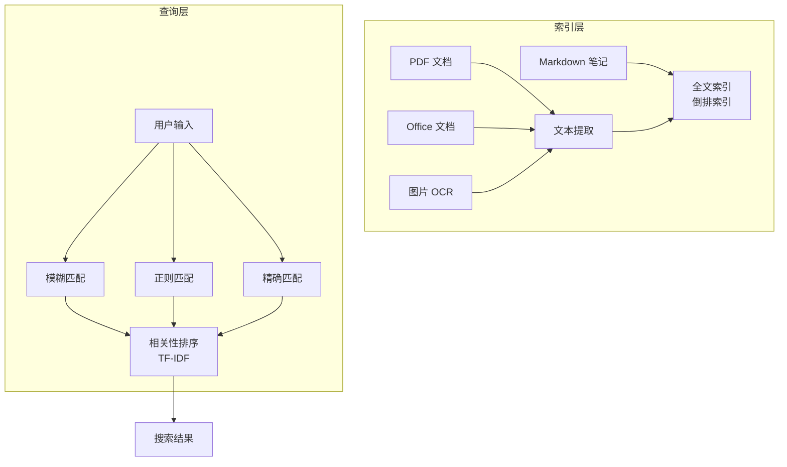

# Omnisearch 全文搜索增强

> **文档说明**：系统讲解 Obsidian Omnisearch 插件的使用与配置，涵盖与默认搜索的对比、索引机制、搜索语法、模糊匹配、PDF/Office 文档搜索、正则表达式、搜索结果排序、快捷键、与其他插件的联动，含具体的配置 JSON、搜索语法示例和最佳实践。
>
> **适用人群**：Obsidian 用户、笔记数量多需要高效搜索的知识工作者
>
> **前置知识**：[[Obsidian-核心插件配置]]、[[Obsidian-Dataview查询语言]]、[[Obsidian-双向链接与图谱]]

---

## 一、概述

<div style="background:linear-gradient(135deg,#11998e,#38ef7d);border-radius:16px;padding:20px;margin:16px 0;font-family:-apple-system,'Segoe UI','PingFang SC','Microsoft YaHei',sans-serif;color:#fff;overflow:hidden;box-shadow:0 8px 28px rgba(0,0,0,.14),0 3px 10px rgba(0,0,0,.08)">
<style>@keyframes highlight{0%,100%{box-shadow:0 0 0 rgba(255,255,255,0)}50%{box-shadow:0 0 20px rgba(255,255,255,.4)}}.hl-box{background:rgba(255,255,255,.2);border-radius:10px;padding:14px 18px;margin:10px 0;animation:highlight 3s ease-in-out infinite;border-left:4px solid rgba(255,255,255,.6)}.hl-formula{font-family:monospace;font-size:14px;text-align:center;background:rgba(0,0,0,.15);border-radius:8px;padding:12px;margin:10px 0}</style>
<div style="text-align:center;font-size:15px;font-weight:700;margin-bottom:14px;padding-bottom:10px;border-bottom:1.5px solid rgba(255,255,255,.22);letter-spacing:1px;text-shadow:0 1px 3px rgba(0,0,0,.12)">📌 Omnisearch 全文搜索增强</div>
<div class="hl-box">系统讲解 Obsidian Omnisearch 插件的使用与配置，涵盖与默认搜索的对比、索引机制、搜索语法、模糊匹配、PDF/Office 文档搜索、正则表达式、搜索结果排序、快捷键、与其他插件的联动，含具体的配置 JSON、搜索语法示例和最佳实践。</div>
<div class="hl-formula">索引构建 → 分词处理 → 模糊匹配 → 结果排序 → 快速跳转</div>
<div style="font-size:13px;opacity:.9;margin-top:8px">💡 工具是手段，高效的知识管理才是目标</div>
</div>

> 🔍 **知识点深度解析**
>
> **作用**：Omnisearch 全文搜索增强 是 Obsidian 知识管理体系中的重要工具/方法，解决知识采集、组织、检索和利用中的效率问题，适用于构建个人知识管理系统和提升工作效率。
>
> **原理**：通过插件扩展和工作流设计，将 Obsidian 从简单的笔记工具升级为强大的知识管理平台，结合自动化和 AI 能力实现知识的高效处理和价值挖掘。
>
> **用法要点**：① 先掌握基础配置再深入高级功能 ② 建立适合自己的工作流而非照搬他人方案 ③ 善用快捷键和模板提升操作效率 ④ 定期回顾和优化知识管理方法

**Omnisearch** 是 Obsidian 社区最受欢迎的搜索增强插件，它在默认搜索基础上增加了模糊匹配、相关性排序、PDF/Office 文档内容搜索、搜索历史、键盘导航等功能。对于笔记数量超过 500 篇的用户，Omnisearch 能显著提升搜索效率和准确性。

### 1. 默认搜索 vs Omnisearch

| 维度 | 默认搜索 | Omnisearch |
|------|---------|-----------|
| **匹配方式** | 精确匹配 | 模糊匹配（拼写容错） |
| **排序** | 按文件名/修改时间 | 按相关性（TF-IDF） |
| **PDF 搜索** | ❌ 不支持 | ✅ 支持（需提取文本） |
| **Office 搜索** | ❌ | ✅ 支持（docx/xlsx/pptx） |
| **搜索历史** | ❌ | ✅ 最近搜索记录 |
| **键盘导航** | 基础 | 完整（Vim 风格） |
| **索引速度** | 实时 | 启动时构建索引（秒级） |
| **正则** | ✅ | ✅ |
| **中文支持** | ✅ | ✅（优化） |

### 2. Omnisearch 核心能力



---

---

> 💡 **深度讲解**：本节围绕，深入剖析其使用方法与实践技巧，帮助读者建立高效的知识管理工作流。
>
> **📝 精简总结**：本节介绍了，掌握这些内容是提升 Obsidian 使用效率的重要基础。

## 二、底层原理

### 1. 索引机制

Omnisearch 在启动时扫描 Vault 中的所有文件，构建**倒排索引**（Inverted Index）：
- 提取每个文件的文本内容（Markdown 直接读取，PDF/Office 提取文本）
- 分词（中文按字符，英文按单词）
- 建立"词 → 文件列表"的映射
- 计算每个词的 TF-IDF 权重
- 索引存储在内存中，查询时毫秒级响应

### 2. 相关性排序（TF-IDF）

- **TF（词频）**：词在文档中出现的次数越多，相关性越高
- **IDF（逆文档频率）**：词在所有文档中越罕见，区分度越高
- **TF-IDF = TF × IDF**：综合评估词对文档的重要性

搜索结果按 TF-IDF 得分排序，最相关的笔记排在最前面。

---

---

> 💡 **深度讲解**：本节围绕，深入剖析其使用方法与实践技巧，帮助读者建立高效的知识管理工作流。
>
> **📝 精简总结**：本节介绍了，掌握这些内容是提升 Obsidian 使用效率的重要基础。

## 三、实操

### 1. 安装与配置

```text
// .obsidian/plugins/omnisearch/data.json
{
  "buildIndexOnStartup": true,
  "indexedFileTypes": ["md", "pdf", "docx", "xlsx", "pptx"],
  "excludeFolders": [".obsidian", ".trash", "attachments"],
  "excludeExtensions": ["png", "jpg", "gif"],
  "showIndexingNotice": true,
  "searchInFilename": true,
  "searchInHeadings": true,
  "weight": {
    "title": 3,
    "headings": 2,
    "content": 1
  },
  "highlightMatchingText": true,
  "showPreviousQueries": 10,
  "maxResults": 50,
  "openMode": "currentTab"
}
```

### 2. 快捷键

| 快捷键 | 功能 |
|--------|------|
| `Ctrl+Shift+O` | 打开 Omnisearch（默认，可修改） |
| `↑/↓` | 上下选择结果 |
| `Enter` | 打开选中结果 |
| `Ctrl+Enter` | 在新面板打开 |
| `Esc` | 关闭搜索 |
| `Ctrl+↑/↓` | 浏览搜索历史 |

### 3. 搜索语法

| 语法 | 说明 | 示例 |
|------|------|------|
| `关键词` | 模糊匹配 | `向量检索` |
| `"精确短语"` | 精确匹配短语 | `"RAG架构设计"` |
| `^开头` | 匹配文件名开头 | `^Agent` |
| `$结尾` | 匹配文件名结尾 | `笔记$` |
| `tag:标签名` | 按标签搜索 | `tag:AI` |
| `path:路径` | 按路径搜索 | `path:09-AI` |
| `ext:扩展名` | 按文件类型 | `ext:pdf` |
| `/正则/` | 正则表达式 | `/向量.*检索/` |
| `关键词1 关键词2` | AND（同时包含） | `RAG 向量` |
| `关键词1 OR 关键词2` | OR（包含任一） | `LangChain OR LangGraph` |
| `-关键词` | NOT（排除） | `Agent -测试` |

### 4. 搜索示例

## 搜索包含"向量检索"的笔记
向量检索

## 搜索标题以"Obsidian"开头的笔记
^Obsidian

```css
# 搜索 AI 目录下包含"模型"的笔记
path:09-AI 模型

# 搜索 PDF 文档中包含"机器学习"的
ext:pdf 机器学习

# 搜索标签为 #RAG 且包含"评估"的
tag:RAG 评估

# 正则搜索：包含"向量"或"嵌入"的
```
/(向量|嵌入)/

## 排除"测试"和"草稿"
RAG -测试 -草稿

### 5. PDF/Office 搜索配置

Omnisearch 可以搜索 PDF 和 Office 文档内容，但需要额外配置：

1. **PDF 文本提取**：Omnisearch 内置 PDF 文本提取，无需额外配置
2. **Office 文档**：需要安装 `textract` 或启用内置提取
3. **图片 OCR**：需要安装 Tesseract OCR（可选）

```text
// 启用 PDF 和 Office 搜索
{
  "indexedFileTypes": ["md", "pdf", "docx", "xlsx", "pptx"],
  "pdfExtractText": true,
  "officeExtractText": true,
  "ocrImages": false,  // 需要 Tesseract
  "excludeFolders": ["attachments/大型PDF"]
}
```

### 6. 与 QuickSwitcher 集成

Omnisearch 可以替代默认的快速切换器（Ctrl+O）：
1. 设置 → Omnisearch → 启用 "Override Quick Switcher"
2. 此后 `Ctrl+O` 打开 Omnisearch 而非默认切换器
3. 支持模糊搜索文件名和内容

### 7. 搜索结果操作

在搜索结果中可以：
- `Enter`：打开笔记
- `Ctrl+Enter`：在新面板打开
- `Alt+Enter`：在新窗口打开
- 右键：更多操作（在文件浏览器中显示、复制链接、插入到当前笔记）

---

---

> 💡 **深度讲解**：本节围绕，深入剖析其使用方法与实践技巧，帮助读者建立高效的知识管理工作流。
>
> **📝 精简总结**：本节介绍了，掌握这些内容是提升 Obsidian 使用效率的重要基础。

## 四、常见问题与排查

| 问题现象 | 原因分析 | 解决方案 |
|---------|---------|---------|
| Omnisearch 搜索不到内容 | 索引未构建完成，或文件在排除目录 | 等待索引构建完成（状态栏显示进度）；检查 excludeFolders；重启 Obsidian |
| 中文搜索结果不准确 | 中文分词问题，或索引未包含中文优化 | Omnisearch 对中文按字符索引，输入完整关键词；重建索引 |
| PDF 搜索不生效 | PDF 是扫描件（图片），或文本提取失败 | 扫描件需要 OCR；用 `pdftotext` 验证 PDF 是否有文本层；排除加密 PDF |
| 搜索很慢（>2秒） | 笔记数量大（>5000），或索引未优化 | 排除不需要的文件夹；减少 indexedFileTypes；升级电脑配置 |
| 快捷键与其他插件冲突 | Ctrl+Shift+O 被其他插件占用 | 设置 → 快捷键 → 修改 Omnisearch 快捷键 |
| 搜索结果排序不合理 | 标题权重设置不当，或内容太短 | 调整 weight 配置（title/headings/content）；重建索引 |
| Office 文档搜索报错 | 缺少 textract 依赖，或文件损坏 | 安装 `pip install textract`；排除损坏的 Office 文件 |
| 索引构建占用大量 CPU | 首次索引大量文件 | 耐心等待（1000篇约10秒）；后续增量索引很快；排除大文件目录 |
| 搜索历史不保存 | 未启用搜索历史，或历史数量设为0 | 确认 showPreviousQueries > 0；升级 Omnisearch 到最新版 |

---

---

> 💡 **深度讲解**：本节围绕，深入剖析其使用方法与实践技巧，帮助读者建立高效的知识管理工作流。
>
> **📝 精简总结**：本节介绍了，掌握这些内容是提升 Obsidian 使用效率的重要基础。

## 五、进阶与最佳实践

### 1. 搜索效率技巧

- **用标签和路径缩小范围**：`tag:AI path:09-AI 模型` 比直接搜 `模型` 精准
- **利用搜索历史**：常用搜索 `Ctrl+↑` 快速重复
- **组合条件**：用 AND/OR/NOT 组合精确搜索
- **标题优先**：知道标题时用 `^标题` 快速定位
- **正则处理复杂模式**：`/(Spring|SpringBoot).*配置/`

### 2. 与其他工具配合

| 工具 | 配合方式 |
|------|---------|
| **Dataview** | Omnisearch 快速定位，Dataview 做结构化查询 |
| **QuickAdd** | 搜索到笔记后快速添加内容 |
| **Templater** | 搜索模板文件快速插入 |
| **Smart Connections** | Omnisearch 精确搜索，Smart Connections 语义搜索 |

### 3. 索引优化

- 排除不需要搜索的目录（`.obsidian`、`attachments`、`node_modules`）
- 大 PDF 单独存放并排除
- 定期重建索引（设置 → Omnisearch → Rebuild Index）
- 笔记数量 >10000 时考虑分 Vault

---

---

> 💡 **深度讲解**：本节围绕，深入剖析其使用方法与实践技巧，帮助读者建立高效的知识管理工作流。
>
> **📝 精简总结**：本节介绍了，掌握这些内容是提升 Obsidian 使用效率的重要基础。

## 六、关联笔记

### Obsidian 效率
- [[Obsidian-核心插件配置]] · [[Obsidian-Dataview查询语言]] · [[Obsidian-双向链接与图谱]]
- [[Obsidian-模板与快速输入]] · [[Templater-自动化模板]] · [[Obsidian-AI插件对比]]

### 导航
- [[MOC-AI与效率工具]] · [[全栈+AI工程双轨融合学习路线图]]

> **学习路径建议**：先掌握 [[Obsidian-核心插件配置]] → 安装 Omnisearch 替代默认搜索 → 学习本文搜索语法 → 配合 [[Obsidian-Dataview查询语言]] 做结构化查询 → 参考 [[Obsidian-AI插件对比]] 用语义搜索补充。

---

## 📖 前置知识

- [[Obsidian-核心插件配置]]

## 🏷️ 相关标签

`#Obsidian` `#效率工具` `#知识管理` `#搜索`

---

[[Home|🏠 返回首页]] · [[MOC-AIGC与Obsidian-四级展开|📚 返回分类]]

