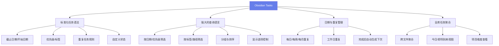
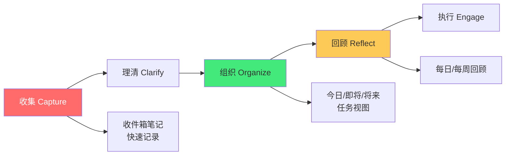

# ✅ Obsidian Tasks 任务管理

> **文档说明**：系统讲解 Obsidian Tasks 插件的完整使用指南，涵盖 Tasks 插件概述（什么是 Tasks 插件 / 为什么用 Obsidian 管理任务 / 核心价值 / 与 Todoist/Notion/Things 等工具对比 / 适用场景）、安装与配置（安装方法 / 启用插件 / 基础设置 / 快捷键配置 / 主题适配 / 移动端设置）、任务语法详解（任务标记格式 / 截止日期 due / 开始日期 start / 计划日期 scheduled / 重复任务 recurrence / 优先级 priority / 标签 tags / 自定义状态 / 创建日期 created / 完成日期 completion）、创建任务的多种方式（快捷键 / 命令面板 / 模板 Templater / 自动生成 / 从文本转换 / 移动端创建）、查询与筛选（Tasks 查询语法 / 按日期筛选 / 按优先级 / 按标签 / 按路径 / 按状态 / 按文本内容 / 组合筛选 / 正则匹配）、任务视图配置（今日任务 / 即将到来 / 已完成 / 按项目分组 / 按优先级排序 / 按截止日期排序 / 显示选项 / 隐藏已完成 / 限制数量）、高级功能（重复任务规则详解 / 依赖关系 depends on / 子任务嵌套 / 时间追踪 / 进度统计 / 自定义状态工作流 / 任务注释 / 多文件任务聚合）、工作流与最佳实践（GTD 方法落地 / 每日回顾流程 / 每周回顾 / 项目管理方法 / 与个人知识管理 PKM 结合 / 任务与笔记关联 / 精力管理 / 时间块方法）、与其他插件配合（Calendar 日历插件 / Dataview 数据查询 / Templater 模板 / Daily Notes 每日笔记 / Periodic Notes 周期笔记 / Kanban 看板 / Reminder 提醒）、常见问题与排错（任务不显示 / 日期格式错误 / 重复任务不生效 / 查询语法错误 / 性能问题 / 同步冲突 / 移动端兼容）、实用模板与示例（每日笔记任务模板 / 项目模板 / GTD 收件箱 / 周回顾模板 / 任务查询代码块大全）。
>
> **适用人群**：Obsidian 用户、想在笔记中管理任务的知识工作者、GTD 实践者、效率工具爱好者
>
> **前置知识**：[[Obsidian入门与配置]] · [[Dataview-数据查询与可视化]] · [[Templater-模板自动化]]

---

## 一、Tasks 插件概述

<div style="background:linear-gradient(135deg,#11998e,#38ef7d);border-radius:16px;padding:20px;margin:16px 0;font-family:-apple-system,'Segoe UI','PingFang SC','Microsoft YaHei',sans-serif;color:#fff;overflow:hidden;box-shadow:0 8px 28px rgba(0,0,0,.14),0 3px 10px rgba(0,0,0,.08)">
<style>@keyframes highlight{0%,100%{box-shadow:0 0 0 rgba(255,255,255,0)}50%{box-shadow:0 0 20px rgba(255,255,255,.4)}}.hl-box{background:rgba(255,255,255,.2);border-radius:10px;padding:14px 18px;margin:10px 0;animation:highlight 3s ease-in-out infinite;border-left:4px solid rgba(255,255,255,.6)}.hl-formula{font-family:monospace;font-size:14px;text-align:center;background:rgba(0,0,0,.15);border-radius:8px;padding:12px;margin:10px 0}</style>
<div style="text-align:center;font-size:15px;font-weight:700;margin-bottom:14px;padding-bottom:10px;border-bottom:1.5px solid rgba(255,255,255,.22);letter-spacing:1px;text-shadow:0 1px 3px rgba(0,0,0,.12)">📌 ✅ Obsidian Tasks 任务管理</div>
<div class="hl-box">系统讲解 Obsidian Tasks 插件的完整使用指南，涵盖 Tasks 插件概述（什么是 Tasks 插件 / 为什么用 Obsidian 管理任务 / 核心价值 / 与 Todoist/Notion/Things 等工具对比 / 适用场景）、安装与配置（安装方法 / 启用插件 / 基础设置 ...</div>
<div class="hl-formula">任务创建 → 标签分类 → 截止日期 → 查询过滤 → 完成追踪</div>
<div style="font-size:13px;opacity:.9;margin-top:8px">💡 工具是手段，高效的知识管理才是目标</div>
</div>

> 🔍 **知识点深度解析**
>
> **作用**：✅ Obsidian Tasks 任务管理 是 Obsidian 知识管理体系中的重要工具/方法，解决知识采集、组织、检索和利用中的效率问题，适用于构建个人知识管理系统和提升工作效率。
>
> **原理**：通过插件扩展和工作流设计，将 Obsidian 从简单的笔记工具升级为强大的知识管理平台，结合自动化和 AI 能力实现知识的高效处理和价值挖掘。
>
> **用法要点**：① 先掌握基础配置再深入高级功能 ② 建立适合自己的工作流而非照搬他人方案 ③ 善用快捷键和模板提升操作效率 ④ 定期回顾和优化知识管理方法

### 1.1 什么是 Tasks 插件

**Tasks** 是 Obsidian 最流行的任务管理插件，让你在 Markdown 笔记中使用标准化的任务语法，并通过强大的查询语言在任意笔记中聚合、筛选、展示来自整个知识库的任务。



### 1.2 为什么用 Obsidian 管理任务

| 优势 | 说明 |
|------|------|
| **任务与笔记一体** | 任务写在相关笔记中，上下文完整，不需要切换工具 |
| **纯文本存储** | 任务是 Markdown 格式，不锁定数据，可随时迁移 |
| **全库聚合** | 一个查询就能看到所有笔记中的今日任务 |
| **高度可定制** | 查询语言灵活，可创建任意视图（今日/项目/标签/优先级） |
| **离线优先** | 不需要网络，不依赖第三方服务 |
| **与 PKM 结合** | 任务关联笔记，完成任务时直接更新相关知识 |
| **插件生态** | 与 Calendar/Dataview/Templater 等插件深度配合 |

### 1.3 与其他任务管理工具对比

| 维度 | Obsidian Tasks | Todoist | Notion | Things 3 |
|------|---------------|---------|--------|----------|
| **数据格式** | Markdown 纯文本 | 云端专有 | 云端专有 | 本地专有 |
| **任务与笔记** | 深度一体 | 分离 | 半一体 | 分离 |
| **查询能力** | 强大灵活 | 中等 | 中等 | 较弱 |
| **离线使用** | ✅ 完全离线 | ❌ 需联网 | ❌ 需联网 | ✅ 离线 |
| **提醒通知** | ⚠️ 需配合插件 | ✅ 原生强大 | ✅ 原生 | ✅ 原生优秀 |
| **协作** | ❌ 不支持 | ✅ 支持 | ✅ 支持 | ❌ 不支持 |
| **移动端** | ✅ 支持 | ✅ 优秀 | ✅ 优秀 | ✅ 仅 iOS |
| **成本** | 免费（Obsidian 免费） | 免费版有限 | 免费版有限 | 付费 |
| **适合场景** | 个人知识管理+任务 | 团队协作+提醒 | 数据库+任务 | 苹果生态个人 |

> **结论**：如果你已经在用 Obsidian 管理知识，Tasks 插件是最佳的任务管理选择——任务和笔记在同一个地方，不需要在多个工具间切换。如果需要强大的提醒通知或团队协作，可以配合 Reminder 插件或使用 Todoist 作为补充。

---

## 二、安装与配置

### 2.1 安装方法

1. 打开 Obsidian → 设置 → 第三方插件
2. 关闭「安全模式」
3. 点击「浏览」→ 搜索「Tasks」
4. 点击「安装」→ 安装完成后点击「启用」

### 手动安装（从 GitHub 下载）

```text
下载最新 release 的 main.js, manifest.json, styles.css
放到 .obsidian/plugins/obsidian-tasks-plugin/ 目录
```

### 2.2 基础设置

| 设置项 | 推荐值 | 说明 |
|--------|--------|------|
| **Global task filter** | `#task` 或留空 | 只有包含此标签的任务才被 Tasks 识别（留空则识别所有任务） |
| **Set due date on click?** | 开启 | 点击日期可以快速修改 |
| **Remove global filter from description?** | 开启 | 显示时隐藏全局过滤标签 |
| **Auto-suggest in edit mode?** | 开启 | 编辑任务时自动提示日期语法 |
| **Show task count?** | 开启 | 查询结果显示任务数量 |

### 2.3 快捷键配置

在 设置 → 快捷键 中搜索「Tasks」，推荐配置：

| 操作 | 推荐快捷键 | 说明 |
|------|-----------|------|
| **Create or edit task** | `Ctrl+Shift+T` | 创建或编辑任务（弹出日期选择器） |
| **Toggle task done** | `Ctrl+Shift+Enter` | 标记任务完成/未完成 |
| **Postpone task** | `Ctrl+Shift+→` | 推迟任务一天 |
| **Edit task date** | `Ctrl+Shift+D` | 编辑截止日期 |

### 2.4 主题适配

Tasks 插件支持大多数主题，部分主题（如 Minimal、Things、AnuPpuccin）有专门的 Tasks 样式优化。如果任务复选框显示异常，可以：

- 在 设置 → 外观 → 主题 中切换到兼容主题
- 或在 CSS snippets 中添加自定义样式：

```css
/* Tasks 自定义样式示例 */
.tasks-backlink {
  font-size: 0.8em;
  color: var(--text-muted);
}

.task-list-item[data-task="x"] {
  text-decoration: line-through;
  opacity: 0.6;
}

.task-list-item[data-task="high"] {
  color: #ff6b6b;
}

.task-list-item[data-task="medium"] {
  color: #feca57;
}

.task-list-item[data-task="low"] {
  color: #48dbfb;
}
```

---

## 三、任务语法详解

### 3.1 基础任务格式

```text
- [ ] 这是一个未完成的任务
- [x] 这是一个已完成的任务
- [-] 这是一个已取消的任务（自定义状态）
- [>] 这是一个已转发的任务（自定义状态）
```

### 3.2 完整任务语法

Tasks 插件使用 `📅 emoji + 日期` 的格式来标记任务属性：

```text
- [ ] 任务描述 📅 2026-08-30 ⏳ 2026-08-28 🛫 2026-08-25 🔁 every day ⏫ 🏷️ #工作 #项目A ✅ 2026-08-29
```

| Emoji | 含义 | 字段名 | 格式 | 示例 |
|-------|------|--------|------|------|
| `📅` | 截止日期 | due | YYYY-MM-DD | `📅 2026-08-30` |
| `⏳` | 计划日期 | scheduled | YYYY-MM-DD | `⏳ 2026-08-28` |
| `🛫` | 开始日期 | start | YYYY-MM-DD | `🛫 2026-08-25` |
| `✅` | 完成日期 | completion | YYYY-MM-DD | `✅ 2026-08-29`（完成时自动添加） |
| `➕` | 创建日期 | created | YYYY-MM-DD | `➕ 2026-08-20`（可选） |
| `🔁` | 重复规则 | recurrence | 见下方 | `🔁 every week` |
| `⏫` | 高优先级 | priority | 固定 emoji | `⏫` 高 / `🔼` 中 / `🔽` 低 |
| `🏷️` | 标签 | tags | `#标签名` | `🏷️ #工作 #紧急` |
| `⛔` | 依赖任务 | depends on | 任务标识 | `⛔ 另一个任务`（高级功能） |

### 3.3 日期格式

Tasks 支持多种日期格式，但推荐使用标准的 `YYYY-MM-DD`：

```text
<!-- 推荐格式 -->
- [ ] 提交周报 📅 2026-08-30

<!-- 也支持的格式 -->
- [ ] 提交周报 📅 2026-08-30
- [ ] 提交周报 📅 30/08/2026
- [ ] 提交周报 📅 August 30, 2026
```

> **最佳实践**：统一使用 `YYYY-MM-DD` 格式，避免混淆，也便于排序和筛选。

### 3.4 优先级

| 优先级 | Emoji | 说明 |
|--------|-------|------|
| **高** | `⏫` | 最重要最紧急，优先处理 |
| **中** | `🔼` | 重要但不紧急，计划处理 |
| **低** | `🔽` | 不重要不紧急，有空处理 |
| **无** | （不写） | 默认优先级 |

```text
- [ ] 完成项目提案 ⏫ 📅 2026-08-30 🏷️ #项目A
- [ ] 回复客户邮件 🔼 📅 2026-08-29 🏷️ #工作
- [ ] 整理书架 🔽 🏷️ #生活
```

### 3.5 重复任务规则

重复任务是 Tasks 插件的强大功能，完成后自动生成下一次任务：

| 规则 | 说明 | 示例 |
|------|------|------|
| `every day` | 每天 | `🔁 every day` |
| `every week` | 每周（同一天） | `🔁 every week` |
| `every month` | 每月（同一天） | `🔁 every month` |
| `every year` | 每年（同一天） | `🔁 every year` |
| `every weekday` | 每个工作日（周一到周五） | `🔁 every weekday` |
| `every N days` | 每 N 天 | `🔁 every 3 days` |
| `every N weeks` | 每 N 周 | `🔁 every 2 weeks` |
| `every N months` | 每 N 个月 | `🔁 every 3 months` |
| `every week on 星期` | 每周指定星期 | `🔁 every week on Monday` |
| `every week on 星期,星期` | 每周多个星期 | `🔁 every week on Monday,Wednesday,Friday` |
| `every month on the Nth 星期` | 每月第 N 个星期几 | `🔁 every month on the 2nd Tuesday` |
| `every month on the Nth` | 每月第 N 天 | `🔁 every month on the 15th` |

```text
<!-- 重复任务示例 -->
- [ ] 每日站会 🔁 every weekday 📅 2026-08-28 🏷️ #工作
- [ ] 周报 🔁 every week on Friday 📅 2026-08-29 🏷️ #工作
- [ ] 月度复盘 🔁 every month on the last Friday 📅 2026-08-29 🏷️ #复盘
- [ ] 生日提醒 🔁 every year 📅 2026-10-01 🏷️ #生活
- [ ] 健身 🔁 every week on Monday,Wednesday,Friday 📅 2026-08-28 🏷️ #健康
```

> **重复任务原理**：完成重复任务时，Tasks 会自动创建一个新的未完成任务，日期更新为下一次，原任务标记为已完成。这样历史记录完整，未来任务自动生成。

### 3.6 自定义状态

除了默认的 `[ ]`（未完成）和 `[x]`（已完成），Tasks 支持自定义任务状态：

```text
<!-- 在设置中配置自定义状态后使用 -->
- [-] 已取消的任务
- [>] 已转发的任务
- [?] 需要进一步信息
- [!] 被阻塞的任务
```

在 设置 → Tasks → Custom statuses 中配置：

| 符号 | 名称 | 类型 | 下一个状态 |
|------|------|------|-----------|
| ` ` | Todo | TODO | `x` |
| `x` | Done | DONE | ` ` |
| `-` | Cancelled | DONE | ` ` |
| `>` | Forwarded | TODO | `x` |
| `?` | Needs Info | TODO | `x` |
| `!` | Blocked | TODO | `x` |

---

## 四、创建任务的多种方式

### 4.1 快捷键创建

最快捷的方式：

1. 将光标放在一行
2. 按 `Ctrl+Shift+T`（或自定义快捷键）
3. 弹出任务编辑面板，输入描述、选择日期、设置优先级
4. 按 Enter 确认

### 4.2 命令面板创建

1. 按 `Ctrl+P` 打开命令面板
2. 输入「Tasks: Create or edit task」
3. 选择命令，弹出编辑面板

### 4.3 手动输入

直接在 Markdown 中输入任务语法：

```text
- [ ] 任务描述 📅 2026-08-30 ⏫ 🏷️ #标签
```

输入 `📅` 后会自动弹出日期选择器（如果开启了自动提示）。

### 4.4 Templater 模板创建

使用 Templater 插件创建任务模板，实现一键插入：

```text
<!-- templates/task-work.md -->
- [ ] <% tp.system.prompt("任务描述") %> 📅 <% tp.date.now("YYYY-MM-DD", 1) %> 🏷️ #工作
```

```text
<!-- 在笔记中使用 -->
<% tp.file.include("[[task-work]]") %>
```

### 4.5 每日笔记自动任务

配合 Daily Notes 插件，在每日笔记模板中预设任务：

```text
<!-- templates/daily-note.md -->
# <% tp.date.now("YYYY-MM-DD dddd") %>

## 今日任务
- [ ] 晨间计划 📅 <% tp.date.now("YYYY-MM-DD") %> 🏷️ #日常
- [ ] 每日站会 🔁 every weekday 📅 <% tp.date.now("YYYY-MM-DD") %> 🏷️ #工作
- [ ] 晚间回顾 📅 <% tp.date.now("YYYY-MM-DD") %> 🏷️ #复盘

## 笔记
```

### 4.6 从文本转换为任务

1. 选中一行文本
2. 按 `Ctrl+Shift+T`
3. 文本自动转换为任务格式，可继续添加日期等属性

---

## 五、查询与筛选

### 5.1 查询语法基础

Tasks 使用代码块 `tasks` 来查询任务：

```text
not done
due today
sort by priority
```

查询结果会实时显示在笔记中，点击复选框可以直接标记完成。

### 5.2 常用筛选条件

#### 按状态筛选

```text
not done          # 未完成（包括进行中、被阻塞等非 DONE 状态）
done              # 已完成
status.name includes Todo  # 按自定义状态名称筛选
```

#### 按日期筛选

```text
due today                 # 今天截止
due tomorrow              # 明天截止
due in 7 days             # 7天内截止
due before today          # 今天之前截止（逾期）
due after tomorrow        # 明天之后截止
due this week             # 本周截止
due this month            # 本月截止
scheduled today           # 今天计划
start today               # 今天开始
created today             # 今天创建
completed today           # 今天完成
no due date               # 没有截止日期
has due date              # 有截止日期
```

#### 按优先级筛选

```text
priority is high          # 高优先级
priority is above medium  # 高于中等（即高）
priority is below high    # 低于高（即中、低、无）
priority is not none      # 有优先级
```

#### 按标签筛选

```text
tags include #工作        # 包含 #工作 标签
tags include #工作 #项目A  # 同时包含两个标签
tags do not include #生活  # 不包含 #生活 标签
no tags                   # 没有标签
```

#### 按路径/文件名筛选

```text
path includes 项目A       # 文件路径包含「项目A」
path does not include 模板  # 路径不包含「模板」
filename includes 每日笔记  # 文件名包含「每日笔记」
root includes Work        # 根目录包含 Work
```

#### 按文本内容筛选

```text
description includes 报告   # 任务描述包含「报告」
description does not include 取消  # 不包含「取消」
description regex matches /^紧急/  # 正则匹配以「紧急」开头
```

#### 组合筛选（AND/OR）

```text
## AND：所有条件都满足（默认）
not done
due today
priority is high

## OR：满足任一条件
(tags include #工作) OR (tags include #紧急)
not done
```

### 5.3 分组与排序

```text
not done
due this week

## 分组
group by priority        # 按优先级分组
group by due date        # 按截止日期分组
group by path            # 按文件路径分组
group by tags            # 按标签分组
group by heading         # 按所在标题分组

## 排序
sort by priority         # 按优先级排序
sort by due date         # 按截止日期排序
sort by scheduled date   # 按计划日期排序
sort by created date     # 按创建日期排序
sort by description      # 按描述字母排序
sort by status           # 按状态排序

## 反向排序
sort by priority reverse
sort by due date reverse
```

### 5.4 显示选项

```text
not done
due this week

## 显示控制
hide backlink            # 隐藏来源笔记链接
hide edit button         # 隐藏编辑按钮
hide postpone button     # 隐藏推迟按钮
hide task count          # 隐藏任务数量
show urgency             # 显示紧急度分数

## 限制数量
limit 10                 # 最多显示10条任务

## 短模式（简洁显示）
short mode
```

---

## 六、任务视图配置

### 6.1 今日任务视图

在每日笔记或专门的「今日」笔记中：

#### 🔴 今日任务

```text
not done
due today
sort by priority
```

#### ⏰ 即将到来（7天内）

```text
not done
due in 7 days
sort by due date
group by due date
hide backlink
```

#### ⚠️ 逾期任务

```text
not done
due before today
sort by due date
hide backlink
```

### 6.2 按项目视图

为每个项目创建一个任务视图：

#### 项目A - 任务看板

##### 待办
```text
not done
path includes 项目A
no due date
sort by priority
```

##### 进行中
```text
not done
path includes 项目A
has due date
due after today
sort by due date
```

##### 今日到期
```text
not done
path includes 项目A
due today
sort by priority
```

##### 已完成
```text
done
path includes 项目A
completed this week
sort by completed date reverse
limit 20
```

### 6.3 按标签视图

#### 🏷️ 按标签查看任务

##### 💼 工作
```text
not done
tags include #工作
sort by due date
group by priority
```

##### 🏠 生活
```text
not done
tags include #生活
sort by due date
```

##### 📚 学习
```text
not done
tags include #学习
sort by priority
```

### 6.4 周回顾视图

#### 📊 本周回顾

##### 本周完成
```text
done
completed this week
sort by completed date
group by path
```

##### 本周逾期未完成
```text
not done
due before today
sort by due date
```

##### 下周计划
```text
not done
due next week
sort by due date
group by due date
```

---

## 七、高级功能

### 7.1 重复任务规则详解

重复任务是 Tasks 最强大的功能之一，支持复杂的重复规则：

<!-- 基础重复 -->
- [ ] 喝水 🔁 every 2 hours 📅 2026-08-28 🏷️ #健康
- [ ] 周会 🔁 every week on Wednesday 📅 2026-08-27 🏷️ #工作
- [ ] 月度报告 🔁 every month on the last workday 📅 2026-08-29 🏷️ #工作

<!-- 高级重复 -->
- [ ] 季度复盘 🔁 every 3 months on the last day 📅 2026-09-30 🏷️ #复盘
- [ ] 交房租 🔁 every month on the 1st 📅 2026-09-01 🏷️ #生活
- [ ] 生日 🔁 every year 📅 2026-10-15 🏷️ #生活

<!-- 完成后从完成日期计算下次 -->
- [ ] 换滤芯 🔁 every 3 months when done 📅 2026-08-28 🏷️ #生活

**重复规则关键词**：
- `when done`：从完成日期计算下次，而不是从截止日期
- `workday`：工作日（周一到周五），遇到周末顺延
- `last day` / `last workday`：每月最后一天/最后一个工作日
- `Nth`：第 N 个（如 `2nd Tuesday` = 第二个星期二）

### 7.2 子任务嵌套

利用 Markdown 列表缩进实现子任务：

- [ ] 完成项目提案 📅 2026-08-30 ⏫ 🏷️ #项目A
  - [ ] 收集需求 📅 2026-08-26 🏷️ #项目A
  - [ ] 撰写初稿 📅 2026-08-27 🏷️ #项目A
  - [ ] 内部评审 📅 2026-08-28 🏷️ #项目A
  - [ ] 修改完善 📅 2026-08-29 🏷️ #项目A
  - [ ] 最终提交 📅 2026-08-30 🏷️ #项目A

Tasks 查询会显示所有层级的任务，可以通过 `group by heading` 或路径来组织。

### 7.3 任务依赖（depends on）

高级功能：标记任务之间的依赖关系：

- [ ] 设计数据库架构 🆔 task-design-db 📅 2026-08-26 🏷️ #项目A
- [ ] 后端开发 ⛔ task-design-db 📅 2026-08-28 🏷️ #项目A
- [ ] 前端开发 ⛔ task-design-db 📅 2026-08-28 🏷️ #项目A
- [ ] 联调测试 ⛔ 后端开发,前端开发 📅 2026-08-30 🏷️ #项目A

> 依赖功能需要在设置中启用，且依赖任务需要有唯一的 ID 标识。

### 7.4 时间追踪与进度统计

配合 Dataview 插件可以实现任务统计：

```python
TABLE length(rows.task) as "任务数",
       sum(rows.completed) as "已完成",
       round(sum(rows.completed) / length(rows.task) * 100) + "%" as "完成率"
FROM "任务"
FLATTEN file.tasks as task
WHERE task.status != " "
GROUP BY file.link
SORT length(rows.task) DESC
```

### 7.5 任务注释

任务描述后可以添加注释（不影响任务匹配）：

- [ ] 提交周报 📅 2026-08-29 🏷️ #工作 %% 记得附上数据图表 %%

`%% %%` 是 Obsidian 的注释语法，渲染时不显示。

---

## 八、工作流与最佳实践

### 8.1 GTD 方法落地

将 Getting Things Done 方法论用 Tasks 实现：



**GTD 工作流**：

1. **收集**：所有想法、任务先记到「收件箱」笔记
2. **理清**：每天早上整理收件箱，判断是否可执行、2分钟能做完吗
3. **组织**：可执行任务加日期/优先级/标签，不可执行的归档到参考资料
4. **回顾**：每日回顾今日任务，每周回顾所有任务和项目
5. **执行**：根据上下文、精力、优先级选择任务执行

```text
<!-- 收件箱模板 -->
# 📥 收件箱

- [ ] （快速记录的任务，待整理）
- [ ] 
- [ ] 
```

### 8.2 每日回顾流程

#### 🌅 晨间计划（5分钟）
1. 查看今日任务视图
2. 确认今日最重要的3件事（MIT）
3. 调整优先级和时间安排
4. 清理收件箱

#### 🌙 晚间回顾（10分钟）
1. 勾选今日完成的任务
2. 未完成的任务：推迟 or 重新安排
3. 记录今日收获和问题
4. 预览明日任务

### 8.3 每周回顾流程

#### 📊 周回顾（30分钟）

##### 1. 回顾上周
- [ ] 查看上周完成的任务
- [ ] 检查逾期未完成的任务
- [ ] 回顾各项目进展

##### 2. 整理任务库
- [ ] 清理收件箱
- [ ] 更新项目状态
- [ ] 删除/取消不再需要的任务
- [ ] 为下周任务设置日期

##### 3. 规划下周
- [ ] 确定下周重点目标
- [ ] 安排关键任务的日期
- [ ] 预留缓冲时间

##### 4. 反思与成长
- [ ] 本周最大的收获是什么？
- [ ] 遇到了什么问题？如何解决？
- [ ] 下周可以改进什么？

### 8.4 项目管理方法

为每个项目创建一个专门的笔记，包含：

#### 项目A - 产品上线

##### 📋 项目信息
- 负责人：张三
- 开始日期：2026-08-01
- 目标日期：2026-09-30
- 状态：进行中

##### 🎯 项目目标
- 完成产品核心功能开发
- 通过测试和验收
- 正式上线发布

##### 📝 任务列表
###### 阶段一：需求与设计
- [x] 需求调研 ✅ 2026-08-05 🏷️ #项目A
- [x] 产品设计 ✅ 2026-08-10 🏷️ #项目A
- [x] 技术方案评审 ✅ 2026-08-15 🏷️ #项目A

###### 阶段二：开发
- [ ] 后端开发 📅 2026-08-28 ⏫ 🏷️ #项目A
- [ ] 前端开发 📅 2026-08-28 ⏫ 🏷️ #项目A
- [ ] 接口联调 📅 2026-09-05 🔼 🏷️ #项目A

###### 阶段三：测试与上线
- [ ] 功能测试 📅 2026-09-10 🔼 🏷️ #项目A
- [ ] 性能优化 📅 2026-09-15 🔼 🏷️ #项目A
- [ ] 正式上线 📅 2026-09-30 ⏫ 🏷️ #项目A

##### 📊 项目任务看板
```text
not done
path includes 项目A
sort by due date
group by priority
```

### 8.5 与个人知识管理结合

任务和笔记深度关联的最佳实践：

1. **任务写在相关笔记中**：项目任务写在项目笔记中，学习任务写在学习笔记中
2. **任务关联参考资料**：任务描述中链接相关笔记 `[[相关笔记]]`
3. **完成任务时更新笔记**：完成研究任务后，把成果更新到知识笔记中
4. **从笔记生成任务**：阅读笔记时，用 `Ctrl+Shift+T` 快速创建待办任务

#### 📚 学习笔记：Vue3 组合式 API

##### 核心概念
- ref 和 reactive 的区别
- computed 和 watch 的使用
- 生命周期钩子

##### 待办任务
- [ ] 阅读 Vue3 官方文档 📅 2026-08-30 🏷️ #学习 #Vue3
- [ ] 实践 Composition API 示例 📅 2026-09-01 🏷️ #学习 #Vue3
- [ ] 整理学习笔记到知识库 📅 2026-09-03 🏷️ #学习 #Vue3

##### 参考资料
- [[Vue3官方文档]]
- [[Vue3组合式API最佳实践]]

---

## 九、与其他插件配合

### 9.1 Calendar 日历插件

Calendar 插件在日历视图中显示每日任务数量，点击日期跳转到每日笔记：

- 安装 Calendar 插件后，在右侧面板显示月历
- 有任务的日期会显示圆点标记
- 点击日期打开当日笔记，查看当日任务

配合 Tasks 查询可以在每日笔记中自动显示当日任务。

### 9.2 Dataview 数据查询

Dataview 可以做更复杂的任务统计和可视化：

<!-- 按项目统计任务完成率 -->
```python
TABLE 
  length(file.tasks) as "总任务",
  length(filter(file.tasks, (t) => t.completed)) as "已完成",
  length(filter(file.tasks, (t) => !t.completed AND t.due && t.due < date(today))) as "逾期"
FROM "项目"
WHERE length(file.tasks) > 0
SORT length(file.tasks) DESC
```

<!-- 任务完成趋势 -->
```python
TABLE length(rows) as "完成数"
FROM ""
FLATTEN file.tasks as task
WHERE task.completed
GROUP BY date(task.completion) as "日期"
SORT 日期 DESC
LIMIT 14
```

### 9.3 Templater 模板自动化

用 Templater 创建任务模板，实现一键插入标准化任务：

```text
<!-- templates/task-project.md -->
- [ ] <% tp.system.prompt("任务描述") %> 📅 <% tp.date.now("YYYY-MM-DD", tp.system.prompt("几天后截止", "7")) %> 🏷️ #<% tp.system.prompt("标签") %>
```

### 9.4 Daily Notes / Periodic Notes

- **Daily Notes**：每日笔记，每天一个文件，记录当日任务和笔记
- **Periodic Notes**：扩展到每周、每月、每季、每年的笔记，用于回顾和规划

在每日笔记模板中嵌入 Tasks 查询，每天打开就能看到今日任务。

### 9.5 Kanban 看板插件

Kanban 插件可以将任务以看板形式展示（待办/进行中/已完成），与 Tasks 插件数据互通：

- 在 Kanban 看板中创建的卡片可以同步为 Tasks 任务
- Tasks 查询可以引用 Kanban 看板中的任务
- 适合敏捷开发和项目管理场景

### 9.6 Reminder 提醒插件

Tasks 本身不支持系统通知，配合 Reminder 插件可以实现：

- 任务到期时弹出系统通知
- 支持设置具体提醒时间
- 移动端推送通知

---

## 十、常见问题与排错

### 10.1 任务不显示在查询中

| 可能原因 | 解决方案 |
|---------|---------|
| 设置了全局过滤标签但任务没有该标签 | 检查 Global task filter 设置，或给任务添加对应标签 |
| 日期格式不正确 | 使用标准 `YYYY-MM-DD` 格式，确保 emoji 和日期之间有空格 |
| 任务在代码块或引用中 | Tasks 不识别代码块中的任务，移到正常文本中 |
| 查询条件太严格 | 简化查询条件，逐步添加筛选 |
| 插件未启用 | 检查第三方插件中 Tasks 是否已启用 |
| 任务语法错误 | 用 `Ctrl+Shift+T` 重新编辑任务，确保语法正确 |

### 10.2 日期格式错误

<!-- ❌ 错误格式 -->
```text
- [ ] 任务 📅2026-08-30       <!-- emoji和日期之间没有空格 -->
- [ ] 任务 📅 2026/08/30       <!-- 斜杠格式可能不识别 -->
- [ ] 任务 📅 8月30日           <!-- 中文格式不识别 -->
```

<!-- ✅ 正确格式 -->
```text
- [ ] 任务 📅 2026-08-30       <!-- 标准格式，空格分隔 -->
```

### 10.3 重复任务不生效

| 问题 | 原因 | 解决方案 |
|------|------|---------|
| 完成后不生成新任务 | 重复规则格式错误 | 用 `Ctrl+Shift+T` 编辑，选择预设的重复规则 |
| 新任务日期不对 | `when done` 和默认规则混淆 | 确认是从截止日期还是完成日期计算下次 |
| 重复任务显示两次 | 手动创建了重复任务 | 删除手动创建的，让 Tasks 自动生成 |

### 10.4 查询语法错误

常见查询语法错误：

<!-- ❌ 错误 -->
```text
due = today           <!-- 不用等号，用 due today -->
priority = high       <!-- 用 priority is high -->
tags = #工作          <!-- 用 tags include #工作 -->
sort priority         <!-- 用 sort by priority -->
```

<!-- ✅ 正确 -->
```text
due today
priority is high
tags include #工作
sort by priority
```

### 10.5 性能问题

当任务数量很大（>1000个）时，可能出现性能问题：

| 优化方法 | 说明 |
|---------|------|
| 限制查询结果 | 使用 `limit 50` 减少单次渲染数量 |
| 隐藏已完成 | 查询中加 `not done`，只显示未完成任务 |
| 拆分查询 | 将一个大查询拆分为多个小查询 |
| 归档旧任务 | 将已完成的旧任务移到归档文件夹，排除在查询外 |
| 使用全局过滤 | 设置 Global task filter，减少扫描的任务数量 |
| 关闭实时预览 | 大文件使用源码模式，减少渲染开销 |

### 10.6 同步冲突

多设备同步时可能出现任务冲突：

- 使用 Obsidian Sync 或 Git 同步，冲突时手动合并
- 避免在多设备同时编辑同一个任务
- 重复任务完成时可能在多设备各生成一次，定期清理重复任务

---

## 十一、实用模板与示例

### 11.1 每日笔记任务模板

````text
## 📅 <% tp.date.now("YYYY-MM-DD dddd") %>

## 🌅 今日重点（MIT）
- [ ] <% tp.system.prompt("今日最重要的事1") %> 📅 <% tp.date.now("YYYY-MM-DD") %> ⏫
- [ ] <% tp.system.prompt("今日最重要的事2") %> 📅 <% tp.date.now("YYYY-MM-DD") %> 🔼
- [ ] <% tp.system.prompt("今日最重要的事3") %> 📅 <% tp.date.now("YYYY-MM-DD") %> 🔼

## ✅ 今日任务
```text
not done
due today
sort by priority
```

## ⏰ 即将到来
```text
not done
due in 7 days
sort by due date
group by due date
hide backlink
limit 15
```

## 📝 笔记
（今日记录和思考）

## 🌙 晚间回顾
- 今日完成：
- 未完成及原因：
- 明日计划：
- 收获与反思：
````

### 11.2 项目任务模板

````text
## 📋 项目：<% tp.system.prompt("项目名称") %>

## 项目信息
- 负责人：<% tp.system.prompt("负责人") %>
- 创建日期：<% tp.date.now("YYYY-MM-DD") %>
- 目标日期：<% tp.date.now("YYYY-MM-DD", tp.system.prompt("多少天后完成", "30")) %>
- 状态：进行中

## 🎯 项目目标
1. 
2. 
3. 

## 📝 任务列表
### 阶段一：启动
- [ ] 需求调研 📅 🏷️ #<% tp.system.prompt("项目标签") %>
- [ ] 方案设计 📅 🏷️ #<% tp.system.prompt("项目标签") %>

### 阶段二：执行
- [ ] 核心开发 📅 🏷️ #<% tp.system.prompt("项目标签") %>
- [ ] 测试验证 📅 🏷️ #<% tp.system.prompt("项目标签") %>

### 阶段三：收尾
- [ ] 文档整理 📅 🏷️ #<% tp.system.prompt("项目标签") %>
- [ ] 项目复盘 📅 🏷️ #<% tp.system.prompt("项目标签") %>

## 📊 任务看板
```text
not done
path includes <% tp.system.prompt("项目名称") %>
sort by due date
group by priority
```

## 📚 参考资料
- 
````

### 11.3 GTD 收件箱模板

````text
## 📥 收件箱

> 快速记录所有待办，每天整理一次

## ⚡ 快速捕获
- [ ] 
- [ ] 
- [ ] 
- [ ] 
- [ ] 

## 🔄 待整理
（从快速捕获移到这里，等待分类）

## 📋 今日待办
```text
not done
path includes 收件箱
sort by priority
```
````

### 11.4 周回顾模板

````text
## 📊 周回顾：<% tp.date.now("YYYY年第WW周") %>

## 📈 本周数据
### 完成任务
```text
done
completed this week
sort by completed date
group by path
```

### 逾期未完成
```text
not done
due before today
sort by due date
```

## ✅ 本周成就
1. 
2. 
3. 

## ❌ 遇到的问题
1. 
2. 

## 🎯 下周目标
1. 
2. 
3. 

## 📅 下周任务
```text
not done
due next week
sort by due date
group by due date
```

## 💡 反思与改进
- 做得好的：
- 需要改进的：
- 下周尝试：
````

### 11.5 任务查询代码块大全

<!-- 今日任务 -->
```text
not done
due today
sort by priority
```

<!-- 逾期任务 -->
```text
not done
due before today
sort by due date
```

<!-- 本周任务 -->
```text
not done
due this week
sort by due date
group by due date
```

<!-- 高优先级任务 -->
```text
not done
priority is high
sort by due date
```

<!-- 无截止日期任务 -->
```text
not done
no due date
sort by priority
```

<!-- 按项目分组 -->
```text
not done
group by path
sort by due date
```

<!-- 按标签分组 -->
```text
not done
group by tags
sort by priority
```

<!-- 今日完成 -->
```text
done
completed today
sort by completed time reverse
```

<!-- 本周完成 -->
```text
done
completed this week
sort by completed date
group by path
```

<!-- 重复任务 -->
```text
not done
has recurrence
sort by due date
```

<!-- 被阻塞的任务 -->
```text
not done
status.name includes Blocked
sort by due date
```

---

## 十二、关联笔记

### Obsidian 效率
- [[Obsidian入门与配置]] · [[Dataview-数据查询与可视化]] · [[Templater-模板自动化]]
- [[Tasks-任务管理]] · [[Obsidian-AI插件对比]] · [[Obsidian工作流设计]]

### 知识管理
- [[个人知识管理方法论]] · [[Zettelkasten-卡片盒笔记法]] · [[GTD时间管理]]
- [[笔记分类与标签体系]] · [[Obsidian关系图谱优化]]

### AI 与效率
- [[AI辅助笔记整理]] · [[AI知识问答系统]] · [[Obsidian-AI插件]]
- [[自动化工作流设计]]

### 导航
- [[MOC-Obsidian效率]] · [[MOC-AI与效率工具]] · [[Home]] · [[学习路线总览]]

> 🔍 **核心认知深度解析**
>
> **作用**：Obsidian Tasks 任务管理解决的是「如何在知识管理工具中高效管理任务，实现任务与笔记的深度融合，避免在多个工具间切换，通过标准化任务语法和强大查询语言实现全库任务聚合与多维度视图」的核心问题——这是个人知识管理（PKM）与任务管理（GTD）结合的最佳实践。
>
> **底层原理**：①Tasks 插件的核心是「标准化任务语法 + 查询语言」的双层设计——任务语法（`- [ ] 描述 📅 日期 🔁 重复 ⏫ 优先级 🏷️ 标签`）让任务以纯文本 Markdown 格式存储在笔记中，不锁定数据；查询语言（`tasks` 代码块）让用户可以在任意笔记中通过筛选条件（日期/优先级/标签/路径/状态）从整个知识库中聚合任务，并支持分组、排序、显示选项。这种「存储与展示分离」的设计是 Tasks 插件强大的根源——任务写在相关笔记中（上下文完整），但可以在任意地方聚合展示（全局视图），两者互不干扰。②任务语法使用「emoji + 日期」的格式是为了「人类可读 + 机器可解析」的平衡——`📅 2026-08-30` 这样的格式在纯文本中一眼就能看懂（截止日期是8月30日），同时插件可以通过正则表达式精确解析出各个属性。相比用 YAML frontmatter 或 JSON 存储任务，这种行内 emoji 格式更轻量、更易读、更易手动编辑，也不破坏 Markdown 的纯文本本质。这是「约定优于配置」的设计哲学——通过统一的 emoji 约定，不需要额外的配置就能让插件识别任务属性。③重复任务的实现原理是「完成时自动生成下一次」——当你完成一个重复任务时，Tasks 插件会：1）将原任务标记为已完成并添加完成日期；2）根据重复规则计算下一次日期；3）创建一个新的未完成任务，日期更新为下一次。这样历史记录完整（已完成的任务保留在笔记中），未来任务自动生成（不需要手动创建）。`when done` 规则的区别在于：默认从「截止日期」计算下次，`when done` 从「完成日期」计算下次——比如「每3个月换滤芯」，如果延迟了一个月才完成，默认规则下次还是从原截止日期算3个月后，`when done` 则从实际完成日期算3个月后，更符合实际需求。④查询语言的设计借鉴了「自然语言查询」的理念——`due today`、`priority is high`、`tags include #工作`、`sort by priority`、`group by due date` 这些查询条件读起来就像英语句子，降低了学习成本。同时它支持组合条件（AND 默认，OR 用括号）、正则匹配、显示选项（hide/limit/short mode），功能足够强大。这种「简单场景易用，复杂场景能做」的查询设计是 Tasks 插件受欢迎的重要原因。⑤Tasks 与 Obsidian 生态的深度配合是其「1+1>2」的关键——Tasks 本身只做任务管理，但配合 Calendar（日历视图）、Dataview（高级统计）、Templater（任务模板）、Daily Notes（每日笔记）、Periodic Notes（周/月回顾）、Kanban（看板视图）、Reminder（系统通知）等插件，可以构建出完整的个人管理系统。这种「核心插件做精，生态插件做全」的模式是 Obsidian 生态的典型特征——每个插件专注做好一件事，通过标准格式（Markdown 任务、Dataview 查询、Templater 模板）互相配合，用户可以按需组合，构建最适合自己的工作流。⑥GTD 方法论在 Tasks 中的落地体现了「工具服务于方法，而非方法束缚于工具」——GTD 的收集、理清、组织、回顾、执行五个步骤可以完全用 Tasks 的功能实现：收集用「收件箱」笔记快速记录任务，理清用每日整理收件箱（加日期/优先级/标签），组织用多维度查询视图（今日/项目/标签/优先级），回顾用周回顾模板（完成任务查询+逾期查询+下周计划），执行用今日任务视图+复选框勾选。但 Tasks 不强制你用 GTD——你可以用任何适合自己的方法（番茄工作法、时间块、OKR 等），工具只是提供能力，方法由用户选择。这是「工具中立」的设计哲学——好的工具不预设用户的工作方式，而是提供灵活的基础能力让用户自己组合。
>
> **用法要点**：① 安装配置：第三方插件搜索Tasks安装启用→设置Global task filter(留空识别所有任务或#task只识别带标签的)→开启自动建议→配置快捷键(Ctrl+Shift+T创建编辑/Ctrl+Shift+Enter完成/Ctrl+Shift+→推迟) ② 任务语法：基础格式 `- [ ] 描述`，属性用emoji+值：📅截止日期/⏳计划日期/🛫开始日期/✅完成日期/➕创建日期/🔁重复规则/⏫高优先级/🔼中/🔽低/🏷️标签/⛔依赖，日期统一用YYYY-MM-DD格式，emoji和值之间有空格 ③ 重复任务规则：every day/week/month/year/weekday，every N days/weeks/months，every week on Monday/Friday，every week on Monday,Wednesday,Friday，every month on the 15th/last day/last workday/2nd Tuesday，when done从完成日期计算，完成时自动生成下次任务 ④ 创建方式：快捷键Ctrl+Shift+T(弹出编辑面板)/命令面板Tasks:Create or edit task/手动输入语法/Templater模板/每日笔记模板预设/选中文本转换 ⑤ 查询语法：用```tasks代码块，筛选条件：not done/done，due today/tomorrow/in 7 days/before today/this week/this month/no due date，priority is high/above medium/below high，tags include #标签，path includes 路径，description includes 文本/正则，组合AND默认/OR用括号；分组group by priority/due date/path/tags/heading；排序sort by priority/due date/created date/description，reverse反向；显示hide backlink/edit button/task count，limit N，short mode ⑥ 常用视图：今日任务(not done due today sort by priority)/逾期(not done due before today)/即将到来(not done due in 7 days group by due date)/按项目(path includes 项目名 group by priority)/按标签(tags include #标签)/周回顾(done completed this week + not done due before today + not done due next week) ⑦ 高级功能：重复任务复杂规则/子任务嵌套(列表缩进)/任务依赖⛔/时间追踪(配合Dataview统计)/任务注释%%注释%%/自定义状态(-取消/>转发/?需信息/!阻塞) ⑧ 工作流：GTD五步法(收件箱收集→每日理清→多视图组织→每日/每周回顾→执行)/每日回顾(晨间5分钟计划+晚间10分钟复盘)/每周回顾(30分钟：回顾上周+整理任务库+规划下周+反思成长)/项目管理(项目笔记+阶段任务+任务看板查询)/PKM结合(任务写在相关笔记+关联参考资料+完成更新笔记+从笔记生成任务) ⑨ 插件配合：Calendar(日历视图+任务标记)/Dataview(高级统计+完成率+趋势)/Templater(任务模板+一键插入)/Daily Notes(每日笔记+任务嵌入)/Periodic Notes(周/月/季/年回顾)/Kanban(看板视图+数据互通)/Reminder(系统通知+到期提醒) ⑩ 常见问题：任务不显示(检查全局过滤标签/日期格式/是否在代码块中/查询条件)/日期格式错误(用标准YYYY-MM-DD+空格)/重复不生效(用编辑面板选预设规则/when done混淆)/查询语法错误(due today不用等号/priority is high/tags include/sort by)/性能问题(limit限制/not done过滤/拆分查询/归档旧任务)/同步冲突(手动合并/避免同时编辑/清理重复) ⑪ 最佳实践：统一日期格式YYYY-MM-DD/任务写在相关笔记中上下文完整/每日整理收件箱/每周做周回顾/用标签分类(工作/生活/学习/项目)/用优先级区分重要性/用重复规则处理周期性任务/用查询创建多维度视图/配合其他插件构建完整系统/定期归档已完成任务 ⑫ 模板大全：每日笔记模板(今日重点+今日任务+即将到来+笔记+晚间回顾)/项目模板(项目信息+目标+阶段任务+任务看板+参考资料)/GTD收件箱(快速捕获+待整理+今日待办)/周回顾(本周数据+成就+问题+下周目标+下周任务+反思)。

> 💡 **深度讲解**：Obsidian Tasks 最核心的智慧是「任务与笔记的深度融合——任务不是孤立的待办列表，而是知识管理的一部分，写在相关笔记中的任务自带完整上下文，完成任务时直接更新知识，形成『学习→思考→任务→执行→更新知识』的闭环」——传统任务管理工具（Todoist、Things、滴答清单）的任务是孤立的，任务和参考资料分离，完成任务后成果散落在各处；而在 Obsidian 中，任务写在相关笔记中，项目任务写在项目笔记里，学习任务写在学习笔记里，每个任务都有完整的上下文（相关资料、思考记录、历史讨论），完成任务时直接在笔记中更新成果，知识和任务在同一个地方，不需要在多个工具间切换。这种「任务即笔记，笔记即任务」的融合是 Obsidian 任务管理最大的优势。Tasks 插件的「存储与展示分离」设计是其强大的技术基础——任务以纯文本 Markdown 格式存储在笔记中（不锁定数据，可随时迁移），但通过查询语言可以在任意笔记中聚合展示（全局视图、项目视图、标签视图、今日视图等），存储和展示互不干扰。你可以把任务写在任何地方（项目笔记、每日笔记、学习笔记），但通过一个查询就能看到所有今日任务，这种灵活性是传统任务工具做不到的。重复任务是 Tasks 插件最实用的功能之一——周期性任务（每日站会、周报、月度复盘、生日提醒）不需要每次手动创建，设置好重复规则后，完成时自动生成下次任务，历史记录完整保留。`when done` 规则是一个贴心的设计——对于「每3个月换滤芯」「每半年洗牙」这种从完成日期算更合理的任务，`when done` 能确保下次任务从实际完成日期算起，而不是原定截止日期，更符合实际生活。GTD 方法论在 Tasks 中的落地体现了「工具服务于方法」的理念——Tasks 不强制你用任何方法，但提供了足够灵活的能力（收件箱、多维度查询、重复任务、标签优先级），让你可以用 GTD、番茄工作法、时间块、OKR 等任何适合自己的方法。好的工具不预设用户的工作方式，而是提供基础能力让用户自己组合——这是「工具中立」的设计哲学，也是 Obsidian 生态的核心精神。与其他插件的深度配合让 Tasks 从「一个任务插件」升级为「个人管理系统」——Calendar 提供日历视图，Dataview 提供高级统计和可视化，Templater 提供任务模板自动化，Daily Notes/Periodic Notes 提供每日/每周/每月的笔记框架，Kanban 提供看板视图，Reminder 提供系统通知。每个插件专注做好一件事，通过标准格式互相配合，用户可以按需组合，构建最适合自己的工作流——这是 Obsidian 生态「1+1>2」的典型体现。如果你已经在用 Obsidian 管理知识，强烈建议用 Tasks 插件管理任务——任务和知识在同一个地方，不需要切换工具，完成任务时直接更新知识，形成完整的个人管理闭环。从一个简单的「今日任务」查询开始，你会发现任务管理变得前所未有的简单和高效。

> 📝 **精简总结**：Obsidian Tasks=Markdown标准化任务语法+强大查询语言，实现任务与笔记深度融合。核心语法：- [ ] 描述 📅截止日期 🔁重复 ⏫优先级 🏷️标签。重复规则：every day/week/month/weekday/N days/week on Monday/month on the 15th/when done。查询：```tasks代码块，筛选not done/due today/priority is high/tags include/path includes，分组group by，排序sort by，显示hide/limit。常用视图：今日/逾期/即将到来/按项目/按标签/周回顾。工作流：GTD五步法+每日回顾+每周回顾+项目管理+PKM融合。插件配合：Calendar/Dataview/Templater/Daily Notes/Periodic Notes/Kanban/Reminder。最佳实践：统一日期格式/任务写在相关笔记/每日整理收件箱/每周回顾/标签分类/优先级区分/重复规则/多维度视图/定期归档。

> **学习路径建议**：先学习 [[Obsidian入门与配置]] 掌握 Obsidian 基础 → 安装并启用 Tasks 插件，配置快捷键 → 学习任务语法（日期/优先级/标签/重复），在笔记中创建任务 → 学习查询语言，创建「今日任务」视图 → 学习更多筛选条件（日期/优先级/标签/路径），创建多维度视图 → 学习重复任务规则，设置周期性任务 → 配合 Templater 创建任务模板 → 配合 Daily Notes 建立每日笔记工作流 → 配合 Dataview 做任务统计和可视化 → 配合 Calendar 查看日历视图 → 学习 GTD 方法论，建立完整的任务管理系统 → 探索更多插件配合（Kanban/Reminder/Periodic Notes）→ 形成适合自己的工作流并持续优化。

---

> **Obsidian Tasks 最核心的智慧是「任务与笔记的深度融合——任务不是孤立的待办列表，而是知识管理的一部分，写在相关笔记中的任务自带完整上下文，完成任务时直接更新知识，形成学习→思考→任务→执行→更新知识的闭环」——传统任务管理工具的任务是孤立的，任务和参考资料分离，完成任务后成果散落各处；而在 Obsidian 中任务写在相关笔记中，项目任务写在项目笔记里，学习任务写在学习笔记里，每个任务都有完整上下文，完成任务时直接在笔记中更新成果，知识和任务在同一个地方，不需要在多个工具间切换，这种任务即笔记、笔记即任务的融合是 Obsidian 任务管理最大的优势。Tasks 插件的存储与展示分离设计是其强大的技术基础——任务以纯文本 Markdown 格式存储在笔记中（不锁定数据可随时迁移），但通过查询语言可以在任意笔记中聚合展示（全局视图、项目视图、标签视图、今日视图等），存储和展示互不干扰，你可以把任务写在任何地方但通过一个查询就能看到所有今日任务，这种灵活性是传统任务工具做不到的。重复任务是 Tasks 最实用的功能之一——周期性任务不需要每次手动创建，设置好重复规则后完成时自动生成下次任务，历史记录完整保留，when done 规则能确保下次任务从实际完成日期算起更符合实际生活。GTD 方法论在 Tasks 中的落地体现了工具服务于方法的理念——Tasks 不强制你用任何方法但提供了足够灵活的能力让你可以用 GTD、番茄工作法、时间块、OKR 等任何适合自己的方法，好的工具不预设用户的工作方式而是提供基础能力让用户自己组合。与其他插件的深度配合让 Tasks 从一个任务插件升级为个人管理系统——Calendar 提供日历视图、Dataview 提供高级统计、Templater 提供模板自动化、Daily Notes 提供每日笔记框架、Kanban 提供看板视图、Reminder 提供系统通知，每个插件专注做好一件事通过标准格式互相配合，用户按需组合构建最适合自己的工作流，这是 Obsidian 生态 1+1>2 的典型体现。如果你已经在用 Obsidian 管理知识强烈建议用 Tasks 插件管理任务——任务和知识在同一个地方不需要切换工具，完成任务时直接更新知识形成完整的个人管理闭环，从一个简单的今日任务查询开始你会发现任务管理变得前所未有的简单和高效。**

---

## 📖 前置知识

- [[Obsidian-核心插件配置]]

## 🏷️ 相关标签

`#Obsidian` `#效率工具` `#知识管理` `#任务管理`

---

[[Home|🏠 返回首页]] · [[MOC-AIGC与Obsidian-四级展开|📚 返回分类]]

