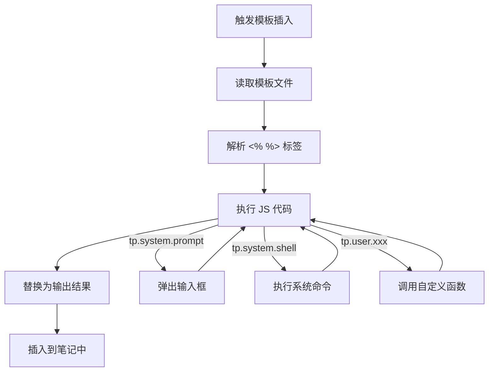

# Templater 自动化模板

> **文档说明**：系统讲解 Obsidian Templater 插件的高级用法，涵盖模板语法（`<% %>` 执行、`<%= %>` 输出）、内置对象（tp.file/tp.date/tp.system/tp.user）、用户自定义函数、JavaScript 脚本、系统命令调用、模板触发方式、与其他插件的联动，含 15+ 个可直接使用的模板代码和脚本示例。
>
> **适用人群**：Obsidian 进阶用户、需要自动化笔记创建的知识工作者、有 JavaScript 基础的技术用户
>
> **前置知识**：[[Obsidian-核心插件配置]]、[[Obsidian-模板与快速输入]]、[[Frontmatter元数据规范]]

---

## 一、概述

<div style="background:linear-gradient(135deg,#11998e,#38ef7d);border-radius:16px;padding:20px;margin:16px 0;font-family:-apple-system,'Segoe UI','PingFang SC','Microsoft YaHei',sans-serif;color:#fff;overflow:hidden;box-shadow:0 8px 28px rgba(0,0,0,.14),0 3px 10px rgba(0,0,0,.08)">
<style>@keyframes highlight{0%,100%{box-shadow:0 0 0 rgba(255,255,255,0)}50%{box-shadow:0 0 20px rgba(255,255,255,.4)}}.hl-box{background:rgba(255,255,255,.2);border-radius:10px;padding:14px 18px;margin:10px 0;animation:highlight 3s ease-in-out infinite;border-left:4px solid rgba(255,255,255,.6)}.hl-formula{font-family:monospace;font-size:14px;text-align:center;background:rgba(0,0,0,.15);border-radius:8px;padding:12px;margin:10px 0}</style>
<div style="text-align:center;font-size:15px;font-weight:700;margin-bottom:14px;padding-bottom:10px;border-bottom:1.5px solid rgba(255,255,255,.22);letter-spacing:1px;text-shadow:0 1px 3px rgba(0,0,0,.12)">📌 Templater 自动化模板</div>
<div class="hl-box">系统讲解 Obsidian Templater 插件的高级用法，涵盖模板语法（`<% %>` 执行、`<%= %>` 输出）、内置对象（tp.file/tp.date/tp.system/tp.user）、用户自定义函数、JavaScript 脚本、系统命令调用、模板触发方式、与其他插件的联动，含 ...</div>
<div class="hl-formula">触发 → 变量解析 → 脚本执行 → 内容插入 → 格式化</div>
<div style="font-size:13px;opacity:.9;margin-top:8px">💡 工具是手段，高效的知识管理才是目标</div>
</div>

> 🔍 **知识点深度解析**
>
> **作用**：Templater 自动化模板 是 Obsidian 知识管理体系中的重要工具/方法，解决知识采集、组织、检索和利用中的效率问题，适用于构建个人知识管理系统和提升工作效率。
>
> **原理**：通过插件扩展和工作流设计，将 Obsidian 从简单的笔记工具升级为强大的知识管理平台，结合自动化和 AI 能力实现知识的高效处理和价值挖掘。
>
> **用法要点**：① 先掌握基础配置再深入高级功能 ② 建立适合自己的工作流而非照搬他人方案 ③ 善用快捷键和模板提升操作效率 ④ 定期回顾和优化知识管理方法

**Templater** 是 Obsidian 最强大的模板插件，它在核心模板插件基础上增加了 JavaScript 执行引擎，可以运行任意 JS 代码、调用系统命令、提示用户输入、操作文件系统，实现真正的**自动化模板**。与核心模板只能替换 `{{date}}` 等简单变量不同，Templater 可以根据条件生成不同内容、循环生成列表、调用外部 API、自动创建关联笔记。

### 1. 核心模板 vs Templater

| 维度 | 核心模板 | Templater |
|------|---------|-----------|
| **语法** | `{{variable}}` | `<% code %>` / `<%= expr %>` |
| **变量** | date/time/title | file/date/system/user + 任意 JS |
| **条件/循环** | ❌ | ✅ if/for |
| **用户输入** | ❌ | ✅ tp.system.prompt |
| **系统命令** | ❌ | ✅ tp.system.shell |
| **文件操作** | ❌ | ✅ tp.file.create_new |
| **自定义函数** | ❌ | ✅ tp.user.xxx |
| **学习曲线** | 平缓 | 中等（需 JS 基础） |

### 2. Templater 语法

```text
<!-- 执行代码（不输出） -->
<% const name = tp.system.prompt("输入名称") %>

<!-- 输出表达式结果 -->
<%= name %>

<!-- 输出转义后的结果（用于代码块中） -->
<%- name %>

<!-- 注释 -->
<%* 这是注释 %>
```

### 3. 内置对象

| 对象 | 作用 | 常用方法 |
|------|------|---------|
| `tp.file` | 文件操作 | `title`, `create_new()`, `rename()`, `move()`, `content` |
| `tp.date` | 日期时间 | `now()`, `tomorrow()`, `yesterday()`, `weekday` |
| `tp.system` | 系统交互 | `prompt()`, `suggest()`, `clipboard`, `shell()` |
| `tp.user` | 用户函数 | 自定义函数（在设置中配置） |
| `tp.config` | 配置 | `active_file`, `templates_folder` |
| `tp.web` | 网络请求 | `request()`（HTTP 请求） |

---

---

> 💡 **深度讲解**：本节围绕，深入剖析其使用方法与实践技巧，帮助读者建立高效的知识管理工作流。
>
> **📝 精简总结**：本节介绍了，掌握这些内容是提升 Obsidian 使用效率的重要基础。

## 二、底层原理

### 1. 模板执行流程



Templater 在插入模板时，将模板内容作为 JavaScript 代码执行，`<%= %>` 中的表达式结果替换到对应位置。

---

---

> 💡 **深度讲解**：本节围绕，深入剖析其使用方法与实践技巧，帮助读者建立高效的知识管理工作流。
>
> **📝 精简总结**：本节介绍了，掌握这些内容是提升 Obsidian 使用效率的重要基础。

## 三、实操

### 1. 基础配置

1. 安装 Templater 社区插件
2. 设置 → Templater：
   - Template folder location: `templates/`
   - Trigger Templater on new file creation: ✅
   - Automatic jump to cursor: ✅
   - Enable System Commands: ✅（需谨慎）

### 2. 日期模板

```css
<!-- templates/templater/date-demo.md -->
# 日期操作示例
```

当前日期：<% tp.date.now("YYYY-MM-DD") %>
当前时间：<% tp.date.now("HH:mm") %>
昨天：<% tp.date.now("YYYY-MM-DD", -1) %>
明天：<% tp.date.now("YYYY-MM-DD", 1) %>
上周今天：<% tp.date.now("YYYY-MM-DD", -7) %>
下个月今天：<% tp.date.now("YYYY-MM-DD", 0, "YYYY-MM-DD", tp.date.now("YYYY-MM-DD"), "months") %>
星期：<% tp.date.now("dddd") %>
ISO 周数：<% tp.date.now("gggg-[W]ww") %>

### 3. 用户输入模板

<!-- templates/templater/with-prompt.md -->
---
title: <% tp.file.title %>
author: <% tp.system.prompt("作者", "BewhY") %>
```text
category: <% tp.system.suggester(["技术", "生活", "工作", "学习"], ["技术", "生活", "工作", "学习"]) %>
priority: <% tp.system.suggester(["核心", "重要", "普通"], ["核心", "重要", "普通"]) %>
difficulty: <% tp.system.suggester(["⭐", "⭐⭐", "⭐⭐⭐", "⭐⭐⭐⭐", "⭐⭐⭐⭐⭐"], [1,2,3,4,5]) %>
```
created: <% tp.date.now("YYYY-MM-DD") %>
---

```text
## <% tp.file.title %>
```

> **文档说明**：<% tp.system.prompt("文档说明（一句话）") %>
>
> **适用人群**：<% tp.system.prompt("适用人群") %>
>
> **前置知识**：<% tp.system.prompt("前置知识（用[[]]）") %>

### 4. 条件与循环模板

```javascript
<!-- templates/templater/conditional.md -->
# 条件与循环示例

<%*
const count = parseInt(tp.system.prompt("生成几个要点？", "3"));
-%>

---

> 💡 **深度讲解**：本节围绕，深入剖析其使用方法与实践技巧，帮助读者建立高效的知识管理工作流。
>
> **📝 精简总结**：本节介绍了，掌握这些内容是提升 Obsidian 使用效率的重要基础。

## 核心要点
<%* for (let i = 1; i <= count; i++) { -%>
<%= i %>. <% tp.system.prompt(`要点 ${i}`) %>
<%* } -%>

<%* if (tp.system.suggester(["是", "否"], [true, false], false, "包含代码示例？")) { -%>
## 代码示例
```
console.log("Hello Templater");
```text
<%* } -%>
```

### 5. 自动创建关联笔记

<!-- templates/templater/create-related.md -->
<%*
// 创建当前笔记时自动创建关联的 MOC
```javascript
const title = tp.file.title;
const mocTitle = `MOC-${title}`;
const mocContent = `---
```
title: ${mocTitle}
tags: [MOC]
---

```text
## ${mocTitle}
```

---
`;
-%>

## 🔗 关联笔记

- [[Obsidian-模板与快速输入]] — 模板与快速输入
- [[Obsidian-核心插件配置]] — 核心插件
- [[Calendar与PeriodicNotes]] — 日历周期笔记
- [[Obsidian-Dataview查询语言]] — Dataview查询

## 📖 前置知识

- [[Obsidian-模板与快速输入]]
- [[Obsidian-核心插件配置]]

## 🏷️ 相关标签

`#Obsidian` `#效率工具` `#知识管理` `#模板` `#自动化`

---

[[Home|🏠 返回首页]] · [[MOC-AIGC与Obsidian-四级展开|📚 返回分类]]

