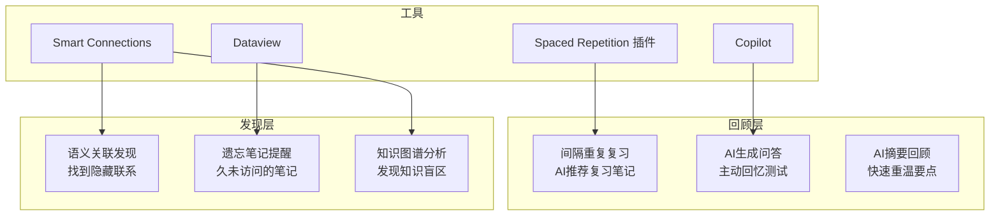

# 用 AI 辅助知识回顾与发现

> **文档说明**：系统讲解如何利用 AI 插件辅助 Obsidian 知识库的回顾与发现，涵盖间隔重复复习、AI 生成知识问答、语义关联发现、遗忘笔记提醒、知识图谱分析、自动生成摘要和标签、与 Anki 联动、AI 导师模式，含具体的 Prompt 模板、插件配置、Dataview 查询和复习工作流。
>
> **适用人群**：Obsidian 用户、终身学习者、需要定期回顾笔记的知识工作者
>
> **前置知识**：[[Obsidian-AI插件对比]]、[[Obsidian-双向链接与图谱]]、[[Obsidian-Dataview查询语言]]

---

## 一、概述

<div style="background:linear-gradient(135deg,#11998e,#38ef7d);border-radius:16px;padding:20px;margin:16px 0;font-family:-apple-system,'Segoe UI','PingFang SC','Microsoft YaHei',sans-serif;color:#fff;overflow:hidden;box-shadow:0 8px 28px rgba(0,0,0,.14),0 3px 10px rgba(0,0,0,.08)">
<style>@keyframes highlight{0%,100%{box-shadow:0 0 0 rgba(255,255,255,0)}50%{box-shadow:0 0 20px rgba(255,255,255,.4)}}.hl-box{background:rgba(255,255,255,.2);border-radius:10px;padding:14px 18px;margin:10px 0;animation:highlight 3s ease-in-out infinite;border-left:4px solid rgba(255,255,255,.6)}.hl-formula{font-family:monospace;font-size:14px;text-align:center;background:rgba(0,0,0,.15);border-radius:8px;padding:12px;margin:10px 0}</style>
<div style="text-align:center;font-size:15px;font-weight:700;margin-bottom:14px;padding-bottom:10px;border-bottom:1.5px solid rgba(255,255,255,.22);letter-spacing:1px;text-shadow:0 1px 3px rgba(0,0,0,.12)">📌 用 AI 辅助知识回顾与发现</div>
<div class="hl-box">系统讲解如何利用 AI 插件辅助 Obsidian 知识库的回顾与发现，涵盖间隔重复复习、AI 生成知识问答、语义关联发现、遗忘笔记提醒、知识图谱分析、自动生成摘要和标签、与 Anki 联动、AI 导师模式，含具体的 Prompt 模板、插件配置、Dataview 查询和复习工作流。</div>
<div class="hl-formula">笔记检索 → 上下文注入 → AI生成 → 内容插入 → 人工审核</div>
<div style="font-size:13px;opacity:.9;margin-top:8px">💡 工具是手段，高效的知识管理才是目标</div>
</div>

> 🔍 **知识点深度解析**
>
> **作用**：用 AI 辅助知识回顾与发现 是 Obsidian 知识管理体系中的重要工具/方法，解决知识采集、组织、检索和利用中的效率问题，适用于构建个人知识管理系统和提升工作效率。
>
> **原理**：通过插件扩展和工作流设计，将 Obsidian 从简单的笔记工具升级为强大的知识管理平台，结合自动化和 AI 能力实现知识的高效处理和价值挖掘。
>
> **用法要点**：① 先掌握基础配置再深入高级功能 ② 建立适合自己的工作流而非照搬他人方案 ③ 善用快捷键和模板提升操作效率 ④ 定期回顾和优化知识管理方法

**知识回顾**是知识管理中最容易被忽视的环节——写了大量笔记但从不回顾，等于没学。**知识发现**则是从已有笔记中找到意外关联和新洞察的过程。AI 可以在这两个环节提供强大辅助：自动生成复习问题、发现语义关联、提醒遗忘笔记、分析知识图谱、生成个性化学习路径。

### 1. 传统复习的痛点

| 痛点 | AI 解决方案 |
|------|------------|
| 不知道该复习什么 | AI 根据艾宾浩斯遗忘曲线推荐复习笔记 |
| 复习就是重读，效率低 | AI 基于笔记生成问答，主动回忆 |
| 笔记之间的关联看不到 | AI 语义搜索发现隐藏关联 |
| 长期不看的笔记被遗忘 | AI 定期提醒"久未访问"的笔记 |
| 无法评估知识掌握程度 | AI 生成测试题并评分 |
| 知识孤岛无法整合 | AI 发现跨领域关联，建议新建双链 |

### 2. AI 辅助回顾体系



---

---

> 💡 **深度讲解**：本节围绕，深入剖析其使用方法与实践技巧，帮助读者建立高效的知识管理工作流。
>
> **📝 精简总结**：本节介绍了，掌握这些内容是提升 Obsidian 使用效率的重要基础。

## 二、底层原理

### 1. 间隔重复原理

艾宾浩斯遗忘曲线：记忆在学习后快速遗忘，定期复习可以延长记忆保持时间。

```text
记忆保持率
100% ┤●
 80% ┤  ●
 60% ┤    ●
 40% ┤      ●    ← 第1次复习
 20% ┤        ●●●●  ← 第2次复习后保持
  0% ┼──────────────────→ 时间
     1天  3天  7天  14天  30天
```

AI 可以根据笔记的创建时间、最后访问时间、重要程度，智能推荐复习时机。

### 2. 语义关联发现原理

Smart Connections 等插件将所有笔记向量化，通过余弦相似度找到语义相近的笔记，即使它们之间没有显式双链。这可以发现：
- 内容相似但未链接的笔记（建议合并或互链）
- 跨领域的意外关联（创新点）
- 重复内容（冗余笔记）

---

---

> 💡 **深度讲解**：本节围绕，深入剖析其使用方法与实践技巧，帮助读者建立高效的知识管理工作流。
>
> **📝 精简总结**：本节介绍了，掌握这些内容是提升 Obsidian 使用效率的重要基础。

## 三、实操

### 1. AI 生成复习问答

```text
<!-- prompts/review-questions.md -->
你是一个知识复习助手。请根据以下笔记内容生成 5 道复习题，帮助用户主动回忆。

要求：
1. 包含 3 道简答题（考察核心概念）
2. 包含 2 道应用题（考察实际运用）
3. 每道题后给出参考答案
4. 题目难度递增

笔记内容：
{{note_content}}

复习题：
```

**使用方式**：
1. 打开一篇笔记
2. 全选内容（Ctrl+A）
3. Copilot 插件 → "Chat about selection"
4. 粘贴上述 Prompt，AI 生成复习题
5. 先自己回答，再看参考答案

### 2. 间隔重复复习配置

使用 "Spaced Repetition" 社区插件：

```text
// .obsidian/plugins/spaced-repetition/data.json
{
  "flashcardTags": ["#flashcard", "#复习"],
  "singleCardSeparator": "?",
  "multiCardSeparator": "??",
  "reviewButton": true,
  "easeBonus": 1.3,
  "lapseInterval": 1,
  "maximumInterval": 365,
  "showContextInCards": true
}
```

**在笔记中标记复习卡片**：
---

> 💡 **深度讲解**：本节围绕，深入剖析其使用方法与实践技巧，帮助读者建立高效的知识管理工作流。
>
> **📝 精简总结**：本节介绍了，掌握这些内容是提升 Obsidian 使用效率的重要基础。

## 复习卡片

什么是 RAG？ ? 检索增强生成（Retrieval-Augmented Generation），通过检索外部知识库增强 LLM 回答。

HNSW 的核心参数有哪些？ ??
- M：每层连接数
- ef_construct：构建搜索宽度
- ef_search：查询搜索宽度
??

### 3. 遗忘笔记提醒（Dataview）

```python
// 超过30天未修改且未被引用的笔记
TABLE file.mtime AS "最后修改", length(file.inlinks) AS "被引用数"
FROM ""
WHERE file.mtime < date(today) - dur(30 days)
  AND length(file.inlinks) = 0
  AND !contains(file.folder, "templates")
  AND !contains(file.folder, "01-Daily")
SORT file.mtime ASC
LIMIT 20
```

```python
// 本周需要复习的笔记（基于创建时间的间隔重复）
TABLE file.ctime AS "创建时间", file.mtime AS "最后复习"
FROM ""
WHERE (file.ctime >= date(today) - dur(7 days) AND file.ctime <= date(today) - dur(6 days))
   OR (file.ctime >= date(today) - dur(14 days) AND file.ctime <= date(today) - dur(13 days))
   OR (file.ctime >= date(today) - dur(30 days) AND file.ctime <= date(today) - dur(29 days))
SORT file.ctime ASC
```

### 4. AI 语义关联发现

**使用 Smart Connections**：
1. 打开任意笔记
2. 右侧 "Smart Connections" 面板自动显示相关笔记
3. 查看未链接的高相似度笔记
4. 手动添加 `[[]]` 双链

**批量发现关联的 Prompt**：
```text
请分析以下两篇笔记的内容，判断它们之间是否存在关联：

笔记A：{{note_a}}
笔记B：{{note_b}}

请回答：
1. 两篇笔记的核心主题分别是什么？
2. 它们之间是否存在概念关联、因果关系或对比关系？
3. 如果有关联，建议在笔记A中如何用一句话链接到笔记B？
4. 关联强度评分（1-10）
```

### 5. AI 知识图谱分析

```text
<!-- prompts/knowledge-graph-analysis.md -->
你是一个知识管理专家。请分析我的知识库结构，给出优化建议。

以下是知识库的分类和笔记数量统计：
{{dataview_stats}}

以下是知识图谱中的孤立节点（未被任何笔记引用）：
{{orphan_notes}}

请分析：
1. 哪些分类笔记数量过多/过少，是否需要拆分/合并？
2. 孤立节点应该如何整合到知识网络中？
3. 哪些领域存在知识盲区（需要补充学习）？
4. 建议创建哪些 MOC 枢纽笔记？
```

### 6. AI 导师模式

```text
<!-- prompts/ai-tutor.md -->
你是我的个人 AI 导师，基于我的 Obsidian 知识库帮助我学习。

规则：
1. 每次我提问时，先检查我的知识库中是否有相关笔记
2. 如果有，基于我的笔记回答，并引用来源
3. 如果我的笔记理解有误，温和指出并纠正
4. 回答后给出 1-2 个延伸问题，引导深入思考
5. 定期（每 5 轮对话）生成一份学习进度评估

我的问题：{{question}}
```

### 7. 每周 AI 回顾工作流

```css
<!-- templates/weekly-ai-review.md -->
# 🤖 AI 辅助周回顾（<% tp.date.now("YYYY-MM-DD") %>）
```

## 1. 本周新增笔记
LIST
```python
FROM ""
WHERE file.ctime >= date(today) - dur(7 days)
```
SORT file.ctime DESC

## 2. AI 生成的本周知识摘要
<!-- Copilot: 基于本周新增笔记生成 200 字摘要 -->

## 3. 需要复习的笔记
TABLE file.mtime AS "最后复习"
```python
FROM ""
WHERE file.mtime < date(today) - dur(7 days)
  AND contains(tags, "#复习")
```
SORT file.mtime ASC
LIMIT 10

## 4. AI 发现的关联
<!-- Smart Connections: 查看本周新笔记的相关笔记，添加双链 -->

## 5. 遗忘笔记提醒
TABLE file.mtime AS "最后修改"
```python
FROM ""
WHERE file.mtime < date(today) - dur(30 days)
  AND length(file.inlinks) = 0
LIMIT 5
```

## 6. 下周学习重点
<!-- AI 基于知识图谱分析建议 -->

### 8. 与 Anki 联动

<!-- 在笔记中标记 Anki 卡片 -->
## Anki 卡片

```text
<!-- 用 Anki 插件同步到 Anki -->
Q: 什么是向量检索的 HNSW 算法？
A: 层次化导航小世界图，通过多层近邻图实现近似最近邻搜索，上层稀疏长连接，下层密集短连接。

Q: RAG 的核心流程是什么？
A: 文档分块 → 向量化 → 向量库存储 → 查询向量化 → 检索 Top-K → 构建 Prompt → LLM 生成。
```

使用 "Obsidian_to_Anki" 插件将标记的卡片同步到 Anki，利用 Anki 的间隔重复算法。

---

## 四、常见问题与排查

| 问题现象 | 原因分析 | 解决方案 |
|---------|---------|---------|
| AI 生成的复习题太简单 | Prompt 未指定难度，或笔记内容本身简单 | 在 Prompt 中指定"难度递增"和"考察深度理解"；选择核心概念笔记复习 |
| Smart Connections 相关笔记不更新 | 向量索引未刷新，或新笔记未索引 | 执行 "Refresh Vector Store"；等待索引完成；检查排除目录 |
| 间隔重复插件不显示复习卡片 | 卡片格式不对，或标签不匹配 | 确保用 `?` 或 `??` 分隔；笔记含 `#flashcard` 标签；打开复习面板 |
| Dataview 遗忘笔记查询结果太多 | 未排除日记/模板等不需要复习的笔记 | 在 WHERE 中加 `!contains(file.folder, "01-Daily")` 和 `!contains(file.folder, "templates")` |
| AI 回答不引用我的笔记 | 未将笔记内容传入 AI，或 AI 忽略了上下文 | 用 Copilot 的 "Chat about current note"；在 Prompt 中明确"仅基于以下笔记回答" |
| Anki 同步失败 | Anki 未运行，或 AnkiConnect 未安装 | 启动 Anki；安装 AnkiConnect 插件；确认端口 8765 可访问 |
| 复习变成了形式主义 | 被动重读而非主动回忆 | 用 AI 生成问答，先回答再看答案；用"费曼技巧"用自己的话解释 |
| AI 发现的关联不准确 | Embedding 模型不适合中文，或笔记内容太短 | 用 bge-m3 等中文 Embedding；笔记内容不足时关联不可靠；人工审核关联 |

---

---

> 💡 **深度讲解**：本节围绕，深入剖析其使用方法与实践技巧，帮助读者建立高效的知识管理工作流。
>
> **📝 精简总结**：本节介绍了，掌握这些内容是提升 Obsidian 使用效率的重要基础。

## 五、进阶与最佳实践

### 1. 复习原则

- **主动回忆优于被动重读**：用问答/测试，不要只是重读
- **间隔重复优于集中复习**：分散在 1天/3天/7天/14天/30天
- **提取练习优于概念图**：自己回忆比看思维导图更有效
- **交错学习优于批量学习**：混合不同主题的笔记复习
- **反馈即时**：答完立即看答案，纠正错误理解

### 2. AI 回顾的边界

- AI 是辅助，不能替代自己的思考
- AI 生成的摘要不能替代对原文的理解
- 关联发现需要人工审核，AI 可能产生虚假关联
- 复习计划需要根据个人情况调整，不要完全依赖算法

### 3. 知识发现的方法

| 方法 | 工具 | 频率 |
|------|------|------|
| 语义相关笔记 | Smart Connections | 每次写新笔记时 |
| 未链接提及 | 反向链接面板 | 每周 |
| 孤立节点 | Dataview + 图谱 | 每月 |
| 跨领域关联 | AI 分析 + 人工 | 每月 |
| 知识盲区 | AI 导师 + 图谱分析 | 每季度 |

---

---

> 💡 **深度讲解**：本节围绕，深入剖析其使用方法与实践技巧，帮助读者建立高效的知识管理工作流。
>
> **📝 精简总结**：本节介绍了，掌握这些内容是提升 Obsidian 使用效率的重要基础。

## 六、关联笔记

### Obsidian 效率
- [[Obsidian-AI插件对比]] · [[Obsidian-双向链接与图谱]] · [[Obsidian-Dataview查询语言]]
- [[Calendar与PeriodicNotes]] · [[笔记自动标签与摘要]] · [[AI文档与PPT生成工作流]]
- [[Obsidian-模板与快速输入]] · [[Templater-自动化模板]]

### 导航
- [[MOC-AI与效率工具]] · [[全栈+AI工程双轨融合学习路线图]]

> **学习路径建议**：先掌握 [[Obsidian-AI插件对比]] 选择 AI 工具 → 学习本文 AI 回顾方法 → 配置间隔重复插件 → 建立每周 AI 回顾工作流 → 用 [[Obsidian-Dataview查询语言]] 做数据驱动的知识管理。

---

## 📖 前置知识

- [[Obsidian-AI插件对比]]
- [[Obsidian-核心插件配置]]

## 🏷️ 相关标签

`#Obsidian` `#AI应用` `#效率工具` `#知识管理` `#学习方法`

---

[[Home|🏠 返回首页]] · [[MOC-AIGC与Obsidian-四级展开|📚 返回分类]]

