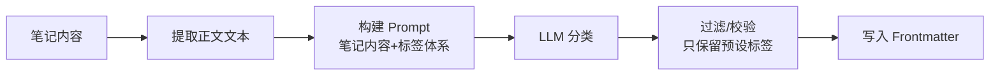

# 笔记自动标签与摘要

> **文档说明**：系统讲解如何利用 AI 为 Obsidian 笔记自动生成标签和摘要，涵盖自动标签生成（基于内容分类）、自动摘要提取（提取核心要点）、Frontmatter 自动填充、批量处理脚本、与 Templater/Dataview 的联动、标签体系设计、质量控制，含可运行的 Python 脚本、AI Prompt 模板和 Obsidian 插件配置。
>
> **适用人群**：Obsidian 用户、有大量笔记需要整理的知识工作者、关注知识库结构化的用户
>
> **前置知识**：[[Obsidian-AI插件对比]]、[[Frontmatter元数据规范]]、[[Obsidian-Dataview查询语言]]

---

## 一、概述

<div style="background:linear-gradient(135deg,#11998e,#38ef7d);border-radius:16px;padding:20px;margin:16px 0;font-family:-apple-system,'Segoe UI','PingFang SC','Microsoft YaHei',sans-serif;color:#fff;overflow:hidden;box-shadow:0 8px 28px rgba(0,0,0,.14),0 3px 10px rgba(0,0,0,.08)">
<style>@keyframes highlight{0%,100%{box-shadow:0 0 0 rgba(255,255,255,0)}50%{box-shadow:0 0 20px rgba(255,255,255,.4)}}.hl-box{background:rgba(255,255,255,.2);border-radius:10px;padding:14px 18px;margin:10px 0;animation:highlight 3s ease-in-out infinite;border-left:4px solid rgba(255,255,255,.6)}.hl-formula{font-family:monospace;font-size:14px;text-align:center;background:rgba(0,0,0,.15);border-radius:8px;padding:12px;margin:10px 0}</style>
<div style="text-align:center;font-size:15px;font-weight:700;margin-bottom:14px;padding-bottom:10px;border-bottom:1.5px solid rgba(255,255,255,.22);letter-spacing:1px;text-shadow:0 1px 3px rgba(0,0,0,.12)">📌 笔记自动标签与摘要</div>
<div class="hl-box">系统讲解如何利用 AI 为 Obsidian 笔记自动生成标签和摘要，涵盖自动标签生成（基于内容分类）、自动摘要提取（提取核心要点）、Frontmatter 自动填充、批量处理脚本、与 Templater/Dataview 的联动、标签体系设计、质量控制，含可运行的 Python 脚本、AI Pro...</div>
<div class="hl-formula">内容分析 → 关键词提取 → 自动标签 → 摘要生成 → 人工确认</div>
<div style="font-size:13px;opacity:.9;margin-top:8px">💡 工具是手段，高效的知识管理才是目标</div>
</div>

> 🔍 **知识点深度解析**
>
> **作用**：笔记自动标签与摘要 是 Obsidian 知识管理体系中的重要工具/方法，解决知识采集、组织、检索和利用中的效率问题，适用于构建个人知识管理系统和提升工作效率。
>
> **原理**：通过插件扩展和工作流设计，将 Obsidian 从简单的笔记工具升级为强大的知识管理平台，结合自动化和 AI 能力实现知识的高效处理和价值挖掘。
>
> **用法要点**：① 先掌握基础配置再深入高级功能 ② 建立适合自己的工作流而非照搬他人方案 ③ 善用快捷键和模板提升操作效率 ④ 定期回顾和优化知识管理方法

**自动标签与摘要**是利用 AI（NLP/LLM）为笔记自动生成分类标签和内容摘要的技术。对于已有大量笔记但缺乏统一标签和摘要的用户，AI 可以快速完成批量整理；对于新笔记，可以在创建时自动填充元数据，保持知识库的一致性和可检索性。

### 1. 手动标签的痛点

| 痛点 | AI 解决方案 |
|------|------------|
| 每篇笔记都要手动想标签 | AI 基于内容自动推荐标签 |
| 标签不统一（有人写"AI"有人写"人工智能"） | AI 从预设标签体系中选择，保证统一 |
| 旧笔记没有标签，批量整理耗时 | AI 批量处理，100篇笔记几分钟完成 |
| 笔记没有摘要，搜索时只能看标题 | AI 自动提取 2-3 句摘要 |
| Frontmatter 字段缺失或不规范 | AI 自动填充标准 Frontmatter |
| 标签太多太杂，无法有效过滤 | AI 从受控词表中选择，控制标签数量 |

### 2. 自动标签 vs 自动摘要

| 维度 | 自动标签 | 自动摘要 |
|------|---------|---------|
| **输出** | 标签列表（tags） | 摘要文本（summary） |
| **用途** | 分类、过滤、检索 | 快速了解内容、搜索预览 |
| **存储位置** | Frontmatter `tags` | Frontmatter `summary` 或正文开头 |
| **AI 任务** | 文本分类 | 文本摘要 |
| **数量** | 3-8 个标签 | 1-3 句话 |

---

---

> 💡 **深度讲解**：本节围绕，深入剖析其使用方法与实践技巧，帮助读者建立高效的知识管理工作流。
>
> **📝 精简总结**：本节介绍了，掌握这些内容是提升 Obsidian 使用效率的重要基础。

## 二、底层原理

### 1. 自动标签生成原理



关键设计：
- **受控词表**：预设标签列表，AI 只能从中选择，避免标签爆炸
- **层级标签**：支持 `#AI/RAG` 嵌套标签
- **置信度**：AI 给出标签时附带置信度，低于阈值的需人工审核

### 2. 自动摘要生成原理

自动摘要有两种方法：
- **抽取式**：从原文中选择最重要的句子组成摘要（TextRank）
- **生成式**：LLM 理解内容后重新生成摘要（质量更高）

Obsidian 场景推荐生成式摘要，因为可以控制摘要风格和长度。

---

---

> 💡 **深度讲解**：本节围绕，深入剖析其使用方法与实践技巧，帮助读者建立高效的知识管理工作流。
>
> **📝 精简总结**：本节介绍了，掌握这些内容是提升 Obsidian 使用效率的重要基础。

## 三、实操

### 1. AI Prompt 模板

```text
<!-- prompts/auto-tag.md 自动标签 Prompt -->
你是一个笔记分类专家。请根据以下笔记内容，从预设标签体系中选择最相关的 3-5 个标签。

预设标签体系：
- AI: AI, RAG, Agent, LLM, Prompt, Embedding, 向量检索
- 前端: Vue, React, TypeScript, CSS, Vite, Webpack
- 后端: Java, SpringBoot, Python, FastAPI, Node.js, 数据库, Redis, Kafka
- 运维: Docker, Kubernetes, CI/CD, Linux, Nginx
- 效率: Obsidian, 笔记方法, 时间管理, 工具
- 概念: 架构设计, 性能优化, 安全, 测试

笔记标题：{{title}}
笔记内容：
{{content}}

请输出 JSON 格式：
{"tags": ["标签1", "标签2", "标签3"], "confidence": 0.9}

要求：
1. 只能从预设标签体系中选择
2. 标签按相关性排序
3. 如果内容不属于任何分类，输出 {"tags": ["未分类"], "confidence": 0.3}
4. 只输出 JSON，不要其他文字
```

```text
<!-- prompts/auto-summary.md 自动摘要 Prompt -->
你是一个笔记摘要专家。请为以下笔记生成 2-3 句话的摘要。

要求：
1. 摘要必须准确反映笔记核心内容
2. 包含关键概念和结论
3. 不超过 100 字
4. 用中文
5. 不要"本文介绍了"之类的套话，直接陈述内容

笔记标题：{{title}}
笔记内容：
{{content}}

摘要：
```

### 2. Python 批量处理脚本

```python
# scripts/auto_tag_and_summarize.py
import os
import re
import json
import openai
from pathlib import Path
from datetime import datetime

client = openai.OpenAI()

VAULT_PATH = r"C:\Users\23981\Documents\ObsidianVault"
TAG_PROMPT = open("prompts/auto-tag.md", encoding="utf-8").read()
SUMMARY_PROMPT = open("prompts/auto-summary.md", encoding="utf-8").read()

# 预设标签体系
ALLOWED_TAGS = {
    "AI", "RAG", "Agent", "LLM", "Prompt", "Embedding", "向量检索",
    "Vue", "React", "TypeScript", "CSS", "Vite",
    "Java", "SpringBoot", "Python", "FastAPI", "Node.js", "数据库", "Redis", "Kafka",
    "Docker", "Kubernetes", "CI/CD", "Linux",
    "Obsidian", "笔记方法", "时间管理", "工具",
    "架构设计", "性能优化", "安全", "测试",
}


def parse_frontmatter(content: str) -> tuple[dict, str]:
    """解析 YAML Frontmatter"""
    match = re.match(r"^---\n(.*?)\n---\n?(.*)", content, re.DOTALL)
    if not match:
        return {}, content
    fm = {}
    for line in match.group(1).split("\n"):
        if ":" in line:
            key, value = line.split(":", 1)
            key = key.strip()
            value = value.strip()
            if value.startswith("[") and value.endswith("]"):
                value = [v.strip().strip("'\"") for v in value[1:-1].split(",") if v.strip()]
            fm[key] = value
    return fm, match.group(2)


def build_frontmatter(fm: dict) -> str:
    """构建 Frontmatter 字符串"""
    lines = ["---"]
    for key, value in fm.items():
        if isinstance(value, list):
            lines.append(f"{key}: [{', '.join(value)}]")
        else:
            lines.append(f"{key}: {value}")
    lines.append("---")
    return "\n".join(lines)


def generate_tags(title: str, content: str) -> list[str]:
    """调用 AI 生成标签"""
    prompt = TAG_PROMPT.replace("{{title}}", title).replace("{{content}}", content[:3000])
    resp = client.chat.completions.create(
        model="gpt-4o-mini",
        temperature=0,
        messages=[{"role": "user", "content": prompt}],
    )
    try:
        result = json.loads(resp.choices[0].message.content.strip())
        tags = [t for t in result["tags"] if t in ALLOWED_TAGS]
        return tags if tags else ["未分类"]
    except:
        return ["未分类"]


def generate_summary(title: str, content: str) -> str:
    """调用 AI 生成摘要"""
    prompt = SUMMARY_PROMPT.replace("{{title}}", title).replace("{{content}}", content[:3000])
    resp = client.chat.completions.create(
        model="gpt-4o-mini",
        temperature=0.3,
        messages=[{"role": "user", "content": prompt}],
    )
    return resp.choices[0].message.content.strip()


def process_file(filepath: str, dry_run: bool = True):
    """处理单个文件"""
    with open(filepath, "r", encoding="utf-8") as f:
        content = f.read()

    fm, body = parse_frontmatter(content)
    title = fm.get("title", os.path.basename(filepath).replace(".md", ""))

    # 已有标签和摘要则跳过
    if fm.get("tags") and fm.get("summary"):
        print(f"跳过（已有标签和摘要）: {filepath}")
        return

    print(f"处理: {filepath}")
    tags = generate_tags(title, body)
    summary = generate_summary(title, body)

    fm["tags"] = tags
    fm["summary"] = summary
    fm["auto_tagged"] = datetime.now().strftime("%Y-%m-%d")

    new_content = build_frontmatter(fm) + "\n\n" + body

    if dry_run:
        print(f"  标签: {tags}")
        print(f"  摘要: {summary[:50]}...")
    else:
        with open(filepath, "w", encoding="utf-8") as f:
            f.write(new_content)
        print(f"  ✓ 已写入")


def batch_process(directory: str, dry_run: bool = True):
    """批量处理目录下所有 Markdown 文件"""
    count = 0
    for root, dirs, files in os.walk(directory):
        dirs[:] = [d for d in dirs if d not in (".obsidian", ".trash", "templates")]
        for f in files:
            if f.endswith(".md"):
                process_file(os.path.join(root, f), dry_run)
                count += 1
    print(f"\n共处理 {count} 篇笔记")


if __name__ == "__main__":
    import sys
    dry_run = "--apply" not in sys.argv
    batch_process(VAULT_PATH, dry_run=dry_run)
    if dry_run:
        print("\n这是预览模式，加 --apply 参数实际写入")
```

```bash
# 预览模式（不修改文件）
python scripts/auto_tag_and_summarize.py
```

```bash
# 实际写入
python scripts/auto_tag_and_summarize.py --apply
```

### 3. Obsidian 插件方案

**Auto Tagger 插件**配置：

```text
// .obsidian/plugins/auto-tagger/data.json
{
  "apiKey": "sk-xxx",
  "model": "gpt-4o-mini",
  "tags": ["AI", "RAG", "Agent", "LLM", "Vue", "React", "Java", "Python", "Obsidian", "架构设计"],
  "maxTags": 5,
  "frontmatterKey": "tags",
  "overwriteExisting": false,
  "language": "zh",
  "excludeFolders": ["templates", ".obsidian"]
}
```

使用：右键笔记 → "Auto Tagger: Generate tags"，或命令面板批量处理。

### 4. Templater 自动标签模板

```python
<!-- templates/auto-frontmatter.md -->
---
title: <% tp.file.title %>
created: <% tp.date.now("YYYY-MM-DD") %>
tags: []
summary: ""
---

<%*
// 创建笔记后用 AI 自动生成标签和摘要
const content = tp.file.content;
const prompt = `为以下笔记生成3-5个标签和1句摘要，输出JSON：\n${content.substring(0, 2000)}`;
// 调用 AI API（需要配置）
// const result = await aiGenerate(prompt);
// tp.file.frontmatter.tags = result.tags;
// tp.file.frontmatter.summary = result.summary;
-%>
```

### 5. 标签体系设计

```yaml
# 推荐的层级标签体系
tags:
  AI:
    - RAG
    - Agent
    - LLM
    - Prompt
    - Embedding
    - 向量检索
    - 微调
  前端:
    - Vue
    - React
    - TypeScript
    - CSS
    - Vite
  后端:
    - Java
    - SpringBoot
    - Python
    - FastAPI
    - 数据库
    - Redis
    - Kafka
  运维:
    - Docker
    - Kubernetes
    - CI/CD
  效率:
    - Obsidian
    - 笔记方法
    - 时间管理
  概念:
    - 架构设计
    - 性能优化
    - 安全
```

**原则**：
- 标签总数控制在 30-50 个
- 每个标签至少被 3 篇笔记使用
- 避免同义词（用"AI"不用"人工智能"）
- 用嵌套标签表达层级（`#AI/RAG`）

### 6. 质量控制

```python
// 检查自动标签质量：标签为"未分类"的笔记
TABLE file.link AS "笔记", summary AS "摘要"
FROM ""
WHERE contains(tags, "未分类")
SORT file.mtime DESC
```

```python
// 检查没有摘要的笔记
TABLE file.link AS "笔记", tags AS "标签"
FROM ""
WHERE !summary OR summary = ""
SORT file.mtime DESC
LIMIT 20
```

---

---

> 💡 **深度讲解**：本节围绕，深入剖析其使用方法与实践技巧，帮助读者建立高效的知识管理工作流。
>
> **📝 精简总结**：本节介绍了，掌握这些内容是提升 Obsidian 使用效率的重要基础。

## 四、常见问题与排查

| 问题现象 | 原因分析 | 解决方案 |
|---------|---------|---------|
| AI 生成的标签不在预设体系中 | Prompt 未严格限制，或模型忽略了约束 | Prompt 中强调"只能从预设标签中选择"；后处理过滤不在 ALLOWED_TAGS 的标签 |
| 摘要包含"本文介绍了"等套话 | Prompt 未禁止套话，或 temperature 太高 | Prompt 中明确"不要套话，直接陈述"；temperature 设 0.3 |
| 批量处理后 Frontmatter 格式错乱 | 手写 YAML 解析不完整 | 用 `pyyaml` 库解析/生成 YAML；或用正则只替换 tags/summary 行 |
| 自动标签不准确 | 笔记内容太短，或 AI 模型能力不足 | 内容 < 200 字时不自动标签，人工处理；用 gpt-4o 替代 gpt-4o-mini |
| 插件自动标签覆盖了手动标签 | overwriteExisting 设为 true | 设为 false，只处理没有标签的笔记；处理前备份 |
| 中文标签搜索不到 | 标签含中文，Obsidian 搜索编码问题 | Obsidian 原生支持中文标签；确认标签格式正确（`#标签` 或 Frontmatter 数组） |
| 摘要太长/太短 | Prompt 未指定长度 | Prompt 中明确"2-3句话，不超过100字"；后处理截断 |
| 批量处理 API 超时 | 并发太高或笔记太长 | 限制并发（每秒 2-3 次）；笔记内容截断到 3000 字；加重试逻辑 |

---

---

> 💡 **深度讲解**：本节围绕，深入剖析其使用方法与实践技巧，帮助读者建立高效的知识管理工作流。
>
> **📝 精简总结**：本节介绍了，掌握这些内容是提升 Obsidian 使用效率的重要基础。

## 五、进阶与最佳实践

### 1. 自动化工作流

```text
新笔记创建 → Templater 模板 → AI 自动生成标签和摘要 → 写入 Frontmatter
         ↓
    人工审核（可选）→ 确认或修改标签/摘要
         ↓
    Dataview 按标签/摘要检索和展示
```

### 2. 标签治理

- **定期审查**：每月用 Dataview 查看标签使用频率，删除使用 < 3 次的标签
- **合并同义词**：AI 辅助发现相似标签，合并为一个
- **标签词典**：维护 `标签词典.md`，记录每个标签的定义和使用规范
- **新标签审批**：新增标签需人工确认，避免标签爆炸

### 3. 摘要的使用

- 搜索结果中显示摘要（Obsidian 搜索默认显示上下文）
- Dataview 表格中展示摘要列
- MOC 笔记中用摘要作为笔记简介
- AI 问答时用摘要快速筛选相关笔记

### 4. 成本控制

| 优化 | 方法 | 节省 |
|------|------|------|
| 内容截断 | 只取前 3000 字 | 50%+ |
| 模型选择 | 标签/摘要用 gpt-4o-mini | 90% |
| 批量处理 | 一次 Prompt 处理多篇笔记 | 30% |
| 缓存 | 相同内容不重复生成 | 视重复率 |
| 本地模型 | 用 Ollama 本地处理 | 100%（无API费） |

---

---

> 💡 **深度讲解**：本节围绕，深入剖析其使用方法与实践技巧，帮助读者建立高效的知识管理工作流。
>
> **📝 精简总结**：本节介绍了，掌握这些内容是提升 Obsidian 使用效率的重要基础。

## 六、关联笔记

### Obsidian 效率
- [[Obsidian-AI插件对比]] · [[Frontmatter元数据规范]] · [[Obsidian-Dataview查询语言]]
- [[Templater-自动化模板]] · [[Obsidian-模板与快速输入]] · [[用AI辅助知识回顾与发现]]
- [[Obsidian-双向链接与图谱]]

### 导航
- [[MOC-AI与效率工具]] · [[全栈+AI工程双轨融合学习路线图]]

> **学习路径建议**：先掌握 [[Frontmatter元数据规范]] 设计标准元数据 → 学习本文 AI 自动标签和摘要 → 用 Python 脚本批量整理旧笔记 → 配置 Templater 实现新笔记自动处理 → 用 [[Obsidian-Dataview查询语言]] 做质量检查。

---

## 📖 前置知识

- [[Obsidian-AI插件对比]]
- [[Obsidian-核心插件配置]]

## 🏷️ 相关标签

`#Obsidian` `#AI应用` `#效率工具` `#知识管理` `#自动化`

---

[[Home|🏠 返回首页]] · [[MOC-AIGC与Obsidian-四级展开|📚 返回分类]]

