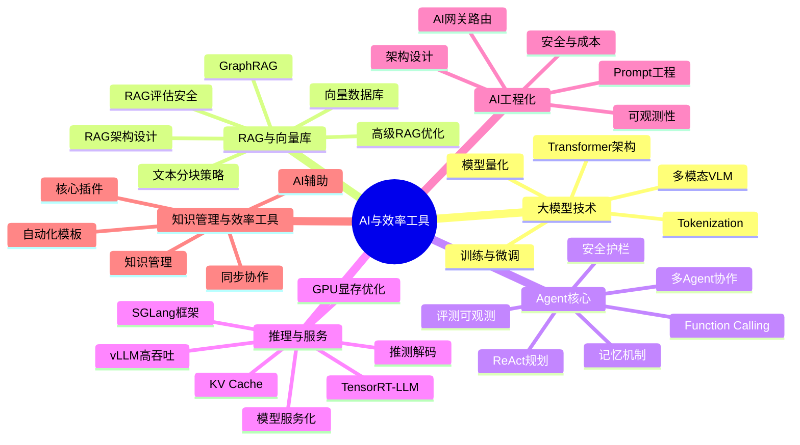

# 🤖 AI与效率工具 MOC

> **内容地图**：AI 时代的核心技术与效率工具体系，涵盖大模型技术、RAG 检索增强、Agent 智能体、推理服务、AI 工程化、Obsidian 知识管理六大领域，共 160+ 篇技术笔记。
>
> **核心理念**：从理解大模型原理，到掌握 RAG 和 Agent 开发，再到 AI 工程化落地和知识管理效率提升，形成"原理→应用→工程→效率"的完整学习闭环。

---

## 📚 知识体系总览



---

## 一、Agent 核心（12篇）

> Agent 是 AI 从"对话"走向"行动"的关键，掌握规划、工具调用、记忆三大核心能力。

### 核心概念

- [[Agent核心概念-ReAct规划]] — ReAct 推理-行动循环、规划策略、思维链
- [[Agent记忆机制设计与实现]] — 短期/长期记忆、记忆检索、记忆管理策略
- [[Agent工具调用FunctionCalling]] — Function Calling 原理、工具定义、调用流程
- [[MCP协议与工具生态]] — Model Context Protocol、工具标准化、跨平台互操作

### 进阶能力

- [[多Agent协作模式实现]] — 角色分工、通信机制、协作模式、任务编排
- [[Agent安全与护栏设计]] — 输出过滤、权限控制、安全审计、防滥用
- [[Agent评测与可观测性]] — Agent 评估指标、Trace 追踪、性能监控
- [[自研Agent框架设计]] — 框架架构设计、核心抽象、扩展机制

### 系统梳理

- [[AI Agent核心概念与架构知识点系统梳理_优化版]] — Agent 定义、三大组件、ReAct、Multi-Agent 全景
- [[AI Agent实战与能力优化知识点系统梳理_优化版]] — RAG 优化、幻觉控制、工具调用、评估安全

### 协议与生态

- [[MCP协议实战指南|MCP 协议实战指南]] — MCP 架构、三大原语、Python/Node.js 服务端开发
- [[AI应用可观测性与Langfuse集成]] — LLM 应用监控、Trace、评估、成本分析

> 💡 **深度讲解**：Agent 核心能力的本质是"LLM + 外部工具 + 状态管理"的闭环系统。ReAct 规划解决"做什么"的问题——通过推理-行动交替循环，让 LLM 能够根据环境反馈动态调整计划；Function Calling 解决"怎么做"的问题——将 LLM 的自然语言意图转化为结构化的工具调用参数，实现与外部系统的可靠交互；记忆机制解决"记得什么"的问题——短期记忆维持对话上下文，长期记忆通过向量检索实现跨会话知识复用。三者构成 Agent 的"大脑-双手-记忆"三位一体。多 Agent 协作则是在此基础上引入"社会分工"，通过角色专业化和通信协议提升复杂任务的处理能力。
>
> **📝 精简总结**：Agent 核心 = ReAct（做什么）+ Function Calling（怎么做）+ 记忆（记得什么），构成"大脑-双手-记忆"闭环；多 Agent 引入社会分工提升复杂任务能力。

---

## 二、Agent 框架（25篇）

> 主流 Agent 开发框架对比与实战，从低代码到自研框架全覆盖。

### LangChain 核心体系（11篇）

- [[LangChain-核心抽象与链]] — Chain/Agent/Tool/Memory 核心抽象、LCEL 表达式、组件全景
- [[LangChain-Core-Runnable接口与执行机制]] — Runnable基类、invoke/batch/stream、RunnableLambda/Parallel/Sequence、回调机制
- [[LangChain-Message消息类型与对话历史]] — HumanMessage/AIMessage/SystemMessage/ToolMessage、消息序列化、ChatMessageHistory
- [[LangChain-PromptTemplate提示词模板]] — PromptTemplate/ChatPromptTemplate/FewShot、模板语法、partial变量、ExampleSelector
- [[LangChain-ChatModel聊天模型接口]] — BaseChatModel、bind_tools、with_structured_output、流式输出、模型回退与路由
- [[LangChain-Retriever检索器接口]] — BaseRetriever、VectorStoreRetriever、EnsembleRetriever、MultiQueryRetriever、ContextualCompressionRetriever
- [[LangChain-Tool工具定义与调用]] — BaseTool、@tool装饰器、StructuredTool、ToolKit、工具错误处理、内置工具
- [[LangChain-Memory记忆机制]] — ConversationBufferMemory、ConversationSummaryMemory、EntityMemory、VectorStoreRetrieverMemory、长期vs短期记忆
- [[LangChain-OutputParser输出解析器]] — StrOutputParser、JsonOutputParser、PydanticOutputParser、OutputFixingParser、RetryOutputParser
- [[LangChain-LCEL表达式语言详解]] — LCEL语法、管道符|、RunnableParallel/Branch、流式输出、调试与回调、LCEL最佳实践
- [[LangChain-组件层整合实战]] — 组件全景图、典型链构建（RAG链/对话链/工具调用链）、完整RAG对话系统实战

### LangGraph 核心体系（7篇）

- [[LangGraph-状态机Agent]] — 状态图、节点/边、循环控制、持久化、Agent编排
- [[LangGraph-State状态管理核心]] — State定义、状态类型、状态更新与传递、状态持久化、reducer函数
- [[LangGraph-Node节点与执行流]] — Node定义、节点函数、节点输入输出、节点编排、并行节点执行
- [[LangGraph-Conditional-Edge条件边与路由]] — 条件边定义、路由函数、分支逻辑、循环、动态路由、边的高级用法
- [[LangGraph-Checkpoint检查点与持久化]] — Checkpoint机制、状态快照、中断恢复、MemorySaver、持久化存储后端
- [[LangGraph-HITL人机交互]] — Human-in-the-loop、interrupt中断点、人工审核、人工输入、审批流设计
- [[LangGraph-Streaming流式输出与事件]] — 流式输出、事件订阅、token级流式、状态流式、astream_events

### 其他主流框架

- [[CrewAI-角色化多Agent]] — 角色定义、任务分配、团队协作、流程编排
- [[AutoGen-多Agent框架]] — 对话式 Agent、GroupChat、代码执行、人类介入
- [[LlamaIndex-数据框架]] — 数据索引、查询引擎、RAG 框架、知识图谱
- [[Semantic Kernel微软框架]] — 技能/规划器/记忆、.NET/Python 多语言

### 低代码平台

- [[Dify-低代码AI应用平台]] — 可视化编排、工作流、插件生态、部署
- [[Coze-工作流编排]] — 字节跳动 Bot 平台、插件、工作流、发布

### 系统梳理

- [[AI Agent开发框架知识点系统梳理_优化版]] — LangChain/LlamaIndex/AutoGen/CrewAI/Dify 全框架对比

> 💡 **深度讲解**：Agent 框架的选型本质是"控制力 vs 开发效率"的权衡。LangChain 提供最灵活的抽象层，适合需要深度定制的场景，但学习曲线陡峭；LangGraph 以状态图为核心，特别适合需要循环、分支、持久化的复杂 Agent 工作流；CrewAI 和 AutoGen 聚焦多 Agent 协作，前者强调角色化分工，后者强调对话式交互；LlamaIndex 以数据为中心，在 RAG 场景下有天然优势；Semantic Kernel 适合 .NET 生态和企业级集成。低代码平台（Dify、Coze）则牺牲控制力换取开发速度，适合快速验证原型和非技术团队。生产环境选型建议：简单 RAG 用 LlamaIndex，复杂工作流用 LangGraph，多 Agent 用 CrewAI/AutoGen，企业 .NET 用 Semantic Kernel。
>
> **📝 精简总结**：框架选型是控制力 vs 开发效率的权衡——LangChain 最灵活、LangGraph 擅长复杂工作流、CrewAI/AutoGen 聚焦多 Agent、LlamaIndex 以数据为中心、Dify/Coze 低代码快速原型。

---

## 三、大模型技术（20篇）

> 大模型是 AI 应用的基础引擎，从 Transformer 原理到训练微调、多模态全覆盖。

### 基础原理

- [[Transformer架构核心]] — 自注意力机制、编码器/解码器、位置编码、前馈网络
- [[注意力机制详解]] — Self-Attention、Multi-Head、交叉注意力、注意力可视化
- [[位置编码进阶-RoPE-ALiBi]] — 旋转位置编码、ALiBi、长度外推
- [[Tokenization与词表]] — BPE/SentencePiece、词表构建、Token 化策略

### 训练与微调

- [[大模型训练范式-PT-SFT-RLHF]] — 预训练/监督微调/人类反馈强化学习全流程
- [[SFT监督微调实战]] — 数据准备、训练配置、LoRA 微调、评估
- [[LoRA-QLoRA参数高效微调]] — 低秩适配、QLoRA 量化微调、参数高效方法
- [[DPO直接偏好优化]] — 偏好对齐、DPO vs PPO、训练实践

### 模型量化

- [[模型量化-GPTQ-AWQ-GGUF]] — 量化原理、GPTQ/AWQ/GGUF 格式、量化工具链

### 多模态

- [[多模态模型原理-VLM]] — 视觉语言模型、图像编码器、跨模态对齐
- [[图像理解与视觉问答]] — VQA 任务、OCR、图表理解、多模态推理
- [[语音识别与语音合成]] — ASR/TTS、Whisper、语音克隆、实时语音
- [[多模态RAG实现]] — 图文混合检索、多模态 Embedding、多模态生成
- [[多模态生成工具链]] — 图像/视频/音乐生成、Stable Diffusion、Sora

### 模型选型

- [[主流大模型对比与选型]] — GPT-4o/Claude 3.5/Gemini/DeepSeek/Qwen 能力对比、价格、选型决策树
- [[主流开源模型架构对比]] — LLaMA/Qwen/Mistral/DeepSeek 架构对比
- [[主流大模型与AI工具知识点系统梳理_优化版]] — GPT/Claude/Gemini/国内大模型全景
- [[生成式AI原理与应用知识点系统梳理_优化版]] — AIGC 全领域原理与应用

### 入门

- [[LLM大模型入门概念]] — 大模型基本概念、发展历程、能力边界、应用场景

> 💡 **深度讲解**：大模型技术体系可以按"表示→训练→压缩→扩展"四条主线理解。表示层解决"模型怎么理解世界"——Transformer 的自注意力机制实现全局依赖建模，位置编码注入序列顺序信息，Tokenization 将文本转化为模型可处理的离散单元。训练层解决"模型怎么获得能力"——PT 学习通用语言建模，SFT 对齐指令跟随，RLHF/DPO 对齐人类偏好，LoRA 等参数高效方法降低微调门槛。压缩层解决"模型怎么落地"——量化（GPTQ/AWQ/GGUF）在精度损失可控的前提下大幅降低显存和计算需求。扩展层解决"模型怎么处理更多模态"——VLM 通过视觉编码器和跨模态对齐实现图文统一理解，多模态 RAG 扩展检索范围到图像和视频。
>
> **📝 精简总结**：大模型技术分四线——表示（Transformer+位置编码+Tokenizer）、训练（PT→SFT→RLHF/DPO+LoRA）、压缩（量化GPTQ/AWQ/GGUF）、扩展（VLM多模态+多模态RAG）。

---

## 四、推理与服务（11篇）

> 模型部署与推理优化，从本地部署到高吞吐生产级服务。

### 推理引擎

- [[vLLM-高吞吐推理引擎]] — PagedAttention、连续批处理、吞吐量优化
- [[SGLang高效推理框架]] — 结构化输出、RadixAttention、前端语言
- [[Text-Generation-Inference]] — HuggingFace 推理服务、Flash Attention、量化
- [[TensorRT-LLM推理加速]] — NVIDIA 推理优化、TensorRT、FP8/INT8

### 推理优化

- [[KV Cache与推理加速]] — KV 缓存原理、Paged KV、缓存共享、前缀缓存
- [[GPU显存优化与批处理]] — 显存管理、批处理策略、梯度检查点、显存碎片
- [[推测解码与Speculative Decoding]] — 草稿模型、验证机制、加速比

### 部署与服务

- [[Ollama-本地模型部署]] — 本地大模型运行、模型管理、API 服务、多模型
- [[模型服务化-OpenAI兼容API]] — OpenAI API 规范、兼容层、多模型统一接口
- [[模型服务网格与多模型管理]] — 模型路由、负载均衡、版本管理、A/B 测试
- [[LLM服务架构]] — LLM 服务架构、模型部署、推理优化、服务化

> 💡 **深度讲解**：推理与服务的核心矛盾是"延迟、吞吐、成本"的三角权衡。推理引擎层（vLLM、SGLang、TGI、TensorRT-LLM）通过系统级优化解决吞吐问题——PagedAttention 消除显存碎片，连续批处理提升 GPU 利用率，RadixAttention 实现前缀缓存共享，TensorRT 通过图优化和低精度计算最大化 NVIDIA GPU 性能。推理优化层（KV Cache、显存优化、推测解码）通过算法级优化解决延迟问题——KV Cache 避免重复计算，推测解码用小模型草稿+大模型验证实现"免费"加速。部署服务层（Ollama、OpenAI 兼容 API、服务网格）解决可用性和标准化问题——Ollama 简化本地部署，OpenAI 兼容 API 实现多模型统一接口，服务网格提供路由、负载均衡、A/B 测试等生产级能力。
>
> **📝 精简总结**：推理服务是延迟-吞吐-成本三角权衡——引擎层（vLLM/SGLang/TGI/TRT-LLM）优化吞吐，优化层（KV Cache/推测解码）降低延迟，服务层（Ollama/API/网格）保障可用性和标准化。

---

## 五、RAG 与向量库（16篇）

> RAG 是大模型落地企业知识场景的核心技术，从基础架构到高级优化全覆盖。

### RAG 架构

- [[RAG检索增强生成]] — RAG 完整知识体系、核心流程、关键技术、评估优化
- [[RAG架构设计与流程]] — 索引/检索/生成全流程、架构设计、组件选型
- [[文本分块策略对比]] — 固定大小/语义/递归/结构感知分块、分块参数调优
- [[RAG评估指标与方法]] — 召回率/精确率/答案相关性、评估框架、自动化评估
- [[RAG安全与防注入]] — Prompt 注入防护、数据脱敏、访问控制、安全审计

### 高级 RAG

- [[高级RAG-Hybrid检索与重排序]] — 混合检索、BM25+向量、Cross-Encoder 重排序
- [[GraphRAG知识图谱增强]] — 知识图谱构建、图检索、社区检测、全局摘要

### 向量数据库

- [[Chroma-轻量向量库]] — 本地向量库、Python API、持久化、快速原型
- [[PgVector-PostgreSQL向量扩展]] — PostgreSQL 向量插件、IVFFlat/HNSW、SQL 查询
- [[Milvus-架构与部署]] — 分布式向量数据库、架构设计、集群部署、性能调优
- [[Qdrant-高性能向量检索]] — Rust 实现、过滤、量化、云原生部署
- [[Weaviate-向量数据库]] — 模块化架构、向量化器、GraphQL、混合搜索
- [[Elasticsearch向量检索]] — ES 向量功能、dense_vector、kNN 搜索、混合检索
- [[向量检索算法-HNSW-IVF]] — HNSW 图索引、IVF 倒排索引、算法对比、参数调优
- [[向量库选型对比表]] — 主流向量库功能/性能/场景对比矩阵

### 实战

- [[本地知识库接入LLM]] — 从 0 搭建本地知识库、文档加载、问答系统

> 💡 **深度讲解**：RAG 技术体系的核心是"检索质量决定生成质量"。基础 RAG 流程（索引→检索→生成）中，每个环节都有质量杠杆：索引环节的分块策略直接影响检索粒度——太粗导致噪声多，太细导致上下文不完整；检索环节的向量相似度计算是基础，但纯向量检索无法处理关键词精确匹配和多义词问题，因此需要 Hybrid 检索（BM25+向量）和 Cross-Encoder 重排序来提升精度；生成环节的 Prompt 构建和引用溯源影响答案的可信度和可解释性。高级 RAG 则在基础流程上引入图结构（GraphRAG）实现全局语义理解和多跳推理。向量数据库是 RAG 的检索底座，选型需考虑规模（Chroma/PgVector 适合小规模，Milvus/Qdrant 适合大规模）、过滤能力、量化支持、云原生部署等因素。
>
> **📝 精简总结**：RAG 核心是"检索质量决定生成质量"——分块策略控制粒度、Hybrid检索+重排序提升精度、GraphRAG实现全局理解；向量库选型按规模和功能需求分层。

---

## 六、AI 工程化（18篇）

> AI 应用从 Demo 到生产的工程化体系，涵盖网关、可观测、安全、成本全链路。

### 核心工程

- [[AI工程化知识点完整整合大全_优化版]] — AI 工程化全景：LLM/RAG/Agent/部署/安全/可观测
- [[LangServe-API部署与服务化]] — add_routes、FastAPI集成、Playground、流式输出SSE、认证授权、Docker/K8s生产部署
- [[AI网关与多模型路由设计]] — 统一 AI 网关、多模型路由、限流熔断、负载均衡
- [[Java-LLM接口封装与降级策略]] — 多模型统一接口、适配器模式、错误重试、流式处理

### Prompt 工程

- [[Prompt工程与版本管理]] — Prompt 设计原则、结构化模板、版本管理、A/B 测试
- [[Prompt工程进阶]] — 复杂推理、自一致性、思维树、自动 Prompt 优化

### 安全与成本

- [[AI应用安全与Prompt注入防护]] — Prompt 注入、越狱攻击、数据泄露、输出过滤、护栏
- [[AI成本控制与Token计费优化]] — Token 计算、成本优化、缓存策略、预算管理
- [[AI工程化排查与进阶手册_优化版]] — RAG 召回差/幻觉/Agent 循环/Token 超限排查手册

### 可观测与测试

- [[LangSmith-可观测性与调试平台]] — Tracing追踪、Dataset数据集、Evaluation评估、Prompt Hub、与LangChain集成、生产最佳实践
- [[AI应用可观测性与Langfuse集成]] — Trace、Span、评估、成本追踪、Prompt 管理
- [[AI应用测试与LLM输出评估]] — 自动化测试、评估指标、回归测试、A/B 测试

### 产品与实战

- [[MOC-AI工程化-四级展开]] — AI 工程化四级知识框架展开（导航 MOC）
- [[SpringAI-FunctionCalling工具调用]] — Spring AI Function Calling、@Tool、函数注册、参数解析
- [[AI应用开发入门]] — 第一个 AI API 调用、流式输出、错误处理、最佳实践
- [[AI应用架构设计]] — 分层架构、服务化、可扩展、高可用、最佳实践

> 💡 **深度讲解**：AI 工程化的本质是将"不确定性"纳入工程管理。传统软件工程的输入输出是确定的，而 LLM 应用的输出具有概率性——这意味着传统的测试、监控、调试方法都需要重新设计。可观测性（Langfuse 等）通过 Trace 记录每次 LLM 调用的完整链路（Prompt、上下文、输出、Token、延迟），使"黑盒"变"白盒"；测试评估通过 LLM-as-Judge 和自动化评估集实现输出质量的量化监控；成本控制通过 Token 计费追踪、缓存命中、模型分级路由实现商业可行性；安全防护通过输入校验、输出过滤、Prompt 注入检测抵御新型攻击面。AI 网关则是所有这些能力的统一入口，提供路由、限流、熔断、日志等横切关注点。
>
> **📝 精简总结**：AI 工程化核心是管理"不确定性"——可观测性让黑盒变白盒、测试评估量化输出质量、成本控制保障商业可行性、安全防护抵御新型攻击、AI网关统一横切关注点。

---

## 七、知识管理与效率工具（21篇）

> 以 Obsidian 为核心的知识管理与效率工具体系，从基础操作到 AI 辅助、编程提效全覆盖。

### 基础与核心

- [[Obsidian软件基础与核心插件知识点系统梳理_优化版]] — Obsidian 基础操作、双向链接、核心插件、必装社区插件
- [[Obsidian知识管理方法论与工作流知识点系统梳理_优化版]] — PARA/Zettelkasten/MOC/标签体系/工作流
- [[Obsidian-核心插件配置]] — 核心插件详解、配置优化、使用技巧
- [[Obsidian-双向链接与图谱]] — 双向链接原理、关系图谱、知识网络构建

### 效率插件

- [[Obsidian-Dataview查询语言]] — Dataview 查询、表格/列表/任务视图、动态数据
- [[Templater-自动化模板]] — 模板语法、自动化脚本、快速输入、工作流
- [[Obsidian-模板与快速输入]] — 模板系统、快速输入、命令面板、快捷键
- [[Tasks-任务管理]] — 任务管理、截止日期、重复任务、查询视图
- [[Calendar与PeriodicNotes]] — 日历视图、每日/每周/每月笔记、周期性笔记
- [[Omnisearch-全文搜索增强]] — 全文搜索、中文搜索、搜索优化、快速导航
- [[Obsidian-Canvas画布用法]] — 无限画布、思维导图、知识可视化、空间笔记

### AI 与自动化

- [[Obsidian-AI插件对比]] — Smart Connections/Text Generator/Copilot 插件对比
- [[Obsidian-API插件开发入门]] — 插件开发基础、API 使用、第一个插件
- [[笔记自动标签与摘要]] — AI 自动标签、内容摘要、知识分类、批量处理
- [[用AI辅助知识回顾与发现]] — AI 知识回顾、关联发现、学习推荐、间隔重复
- [[AI文档与PPT生成工作流]] — AI 生成文档/PPT、工作流设计、模板化输出
- [[AI编程助手深度使用]] — Cursor/GitHub Copilot/Claude Code/Windsurf 深度使用、Prompt 技巧、Agent 模式

### 同步与协作

- [[Obsidian-同步与多端方案]] — 官方同步/iCloud/Git/Remotely Save 多方案对比
- [[Excalidraw-手绘笔记]] — 手绘图表、技术图解、白板笔记、手绘风格

### 枢纽与展开

- [[AIGC-Obsidian-应用枢纽]] — AIGC 与 Obsidian 融合应用枢纽
- [[MOC-AIGC与Obsidian-四级展开]] — AIGC 与 Obsidian 四级知识展开

> 💡 **深度讲解**：Obsidian 效率体系的核心是"本地优先 + 链接驱动 + 插件生态"三位一体。本地优先意味着数据完全掌控在用户手中，纯 Markdown 格式确保长期可访问性，不依赖任何云服务；链接驱动是 Obsidian 区别于传统笔记工具的核心——双向链接和关系图谱将笔记从"文件夹中的孤立文档"转变为"知识网络中的互联节点"，MOC（Map of Content）则为大规模知识库提供导航结构；插件生态是 Obsidian 的生产力放大器——Dataview 实现笔记的动态查询和聚合，Templater 实现模板自动化，Tasks 实现任务管理，Canvas 实现空间化知识组织。AI 与 Obsidian 的融合是最新趋势——AI 自动标签和摘要降低知识整理成本，AI 关联发现打破信息茧房，AI 文档生成加速内容产出。
>
> **📝 精简总结**：Obsidian 效率 = 本地优先（数据掌控）+ 链接驱动（知识网络）+ 插件生态（生产力放大器），AI 融合是最新趋势，降低整理成本并加速产出。

---

## 九、学习路径

### 入门阶段（AI 概念启蒙）

```text
1. [[LLM大模型入门概念]] — 理解大模型基本概念
2. [[主流大模型对比与选型]] — 了解模型生态
3. [[AI应用开发入门]] — 第一次调用 AI API
4. [[Prompt工程与版本管理]] — 掌握基础 Prompt 技巧
```

### 进阶阶段（RAG 与应用开发）

```text
5. [[RAG架构设计与流程]] — 理解 RAG 全流程
6. [[Chroma-轻量向量库]] — 搭建第一个向量检索
7. [[LangChain-核心抽象与链]] — 学习 AI 应用框架
8. [[Prompt工程进阶]] — 进阶 Prompt 工程
```

### 高级阶段（Agent 与工程化）

```text
9. [[Agent核心概念-ReAct规划]] — 理解 Agent 原理
10. [[LangGraph-状态机Agent]] — 构建复杂 Agent
11. [[AI网关与多模型路由设计]] — 工程化架构
12. [[vLLM-高吞吐推理引擎]] — 模型部署优化
```

### 专家阶段（模型与平台）

```text
13. [[Transformer架构核心]] — 深入模型原理
14. [[SFT监督微调实战]] — 模型微调
15. [[模型服务网格与多模型管理]] — 企业级 AI 平台
16. [[AI应用安全与Prompt注入防护]] — AI 安全与治理
```

> 💡 **深度讲解**：四阶段学习路径对应 AI 工程师能力成熟度的四个层级。入门阶段培养"AI 素养"——理解大模型能做什么、不能做什么，掌握基本的 API 调用和 Prompt 编写，这是所有 AI 应用的基础；进阶阶段培养"AI 应用开发能力"——RAG 是最常见的企业 AI 场景，向量数据库是检索底座，框架（LangChain 等）提供开发效率，这个阶段的核心是能独立搭建可用的 AI 应用；高级阶段培养"AI 系统设计能力"——Agent 代表 AI 应用的高阶形态（自主决策+工具调用），工程化（网关、可观测、成本、安全）代表生产级能力，推理优化代表性能调优能力；专家阶段培养"AI 平台架构能力"——深入模型原理、掌握微调技术、设计企业级多模型平台、建立安全治理体系。
>
> **📝 精简总结**：四阶段对应能力成熟度——入门（AI素养）→进阶（应用开发）→高级（系统设计）→专家（平台架构），每阶段核心能力递进。

---

## 十、跨领域关联

| 关联领域 | 关联点 | 对应笔记 |
|---------|--------|---------|
| 前端开发 | AI 前端集成、流式 UI、Agent 可视化 | [[Vue3 AI Agent前端集成知识点系统梳理_优化版]] |
| 后端开发 | AI 后端集成、LLM 封装、向量库 | [[Java-LLM接口封装与降级策略]] |
| Python 全栈 | LangChain、FastAPI、AI 应用 | [[Python-LangChain应用开发]] |
| 项目实战 | RAG 问答、AI 客服、Agent 平台 | [[实战-FastAPI+RAG知识库问答]] |
| 综合导航 | 学习路线、知识管理 | [[全栈+AI工程双轨融合学习路线图]] |

---

## 🔗 关联笔记

- [[MOC-AI工程化]] — AI 工程化专项导航，LLM 服务/RAG/Agent/部署/安全深度索引
- [[RAG检索增强生成]] — RAG 技术体系核心笔记，检索增强生成完整知识图谱
- [[vLLM-高吞吐推理引擎]] — 高吞吐推理引擎核心技术，PagedAttention 与连续批处理
- [[Agent核心概念-ReAct规划]] — Agent 智能体核心原理，推理-行动循环机制
- [[Obsidian知识管理方法论与工作流知识点系统梳理_优化版]] — 知识管理方法论与工作流体系

## 📖 前置知识

- [[LLM大模型入门概念]] — 大模型基本概念、发展历程、能力边界
- [[计算机网络]] — HTTP 协议、API 调用基础

## 🏷️ 相关标签

`#MOC` `#AI应用` `#AI工程化` `#LLM` `#RAG` `#Agent` `#Prompt工程` `#效率工具` `#向量数据库` `#多模态`

---

[[Home|🏠 返回首页]] · [[MOC-AI工程化|🤖 AI工程化]] · [[MOC-综合导航|🧭 综合导航]] · [[全栈+AI工程双轨融合学习路线图|🗺️ 学习路线]]
