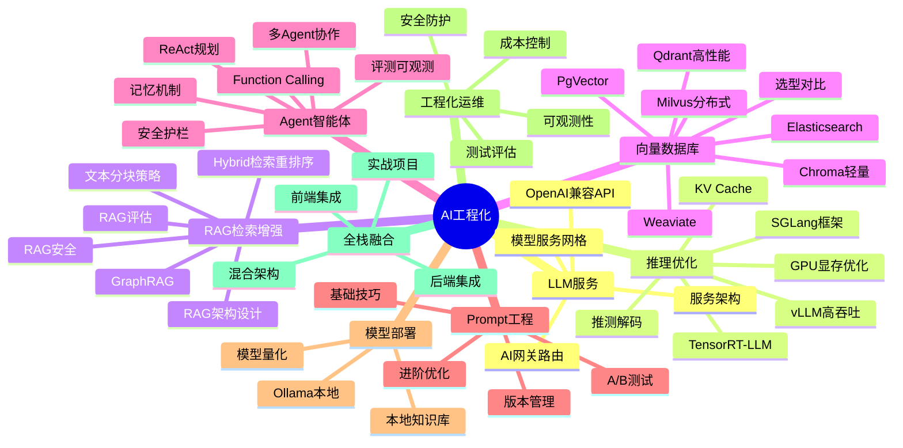

# 🤖 MOC - AI 工程化

> AI 工程化是将大语言模型（LLM）应用从原型开发到生产部署的完整工程体系，覆盖 LLM 服务、RAG 检索增强、Agent 智能体、Prompt 工程、模型部署、可观测性、AI 安全等核心领域，是 AI 应用从 Demo 到生产的必经之路。

---

## 📚 知识体系总览



---

## 一、学习路线

```text
入门阶段：LLM基础 → Prompt工程 → API调用 → 简单应用
进阶阶段：RAG检索增强 → Agent开发 → 模型部署 → 流式输出
高级阶段：AI工程化架构 → 可观测性 → 成本优化 → 多模型路由
专家阶段：AI平台设计 → 多Agent协作 → 模型微调 → AI安全与治理
```

> 💡 **深度讲解**：AI 工程化的学习路径本质上是"从单点技术到系统工程"的演进。入门阶段关注的是"能用"——理解 LLM 能力边界、掌握 API 调用和 Prompt 基础；进阶阶段关注的是"好用"——通过 RAG 解决知识时效性、通过 Agent 实现自主决策、通过模型部署降低延迟成本；高级阶段关注的是"稳用"——可观测性保障质量、成本控制保障商业可行性、多模型路由保障可用性；专家阶段关注的是"善用"——平台化抽象、多 Agent 协作范式、模型微调定制、AI 安全治理体系。每个阶段的核心矛盾不同：入门是认知差，进阶是技术差，高级是工程差，专家是体系差。
>
> **📝 精简总结**：AI 工程化学习分四阶段——入门（LLM+Prompt+API）、进阶（RAG+Agent+部署）、高级（可观测+成本+路由）、专家（平台+多Agent+微调+安全），每阶段解决不同层级的核心矛盾。

---

## 二、文档索引

### 2.1 LLM 基础与服务

| 文档 | 说明 | 难度 |
|------|------|------|
| [[LLM服务架构]] | LLM 服务架构、模型部署、推理优化、服务化 | 🔴高级 |
| [[模型服务化-OpenAI兼容API]] | OpenAI API 规范、兼容层、多模型统一接口 | 🟡进阶 |
| [[模型服务网格与多模型管理]] | 模型路由、负载均衡、版本管理、A/B 测试 | 🔴高级 |
| [[Ollama-本地模型部署]] | 本地大模型运行、模型管理、API 服务、多模型 | 🟡进阶 |

### 2.2 推理优化与引擎

| 文档 | 说明 | 难度 |
|------|------|------|
| [[vLLM-高吞吐推理引擎]] | PagedAttention、连续批处理、吞吐量优化 | 🔴高级 |
| [[SGLang高效推理框架]] | 结构化输出、RadixAttention、批处理、推理优化 | 🔴高级 |
| [[Text-Generation-Inference]] | HuggingFace 推理服务、Flash Attention、量化 | 🟡进阶 |
| [[TensorRT-LLM推理加速]] | NVIDIA 推理优化、TensorRT、FP8/INT8 | 🔴高级 |
| [[KV Cache与推理加速]] | KV 缓存原理、Paged KV、缓存共享、前缀缓存 | 🟡进阶 |
| [[GPU显存优化与批处理]] | 显存管理、批处理策略、梯度检查点、显存碎片 | 🟡进阶 |
| [[推测解码与Speculative Decoding]] | 草稿模型、验证机制、加速比 | 🔴高级 |

### 2.3 RAG 检索增强生成

| 文档 | 说明 | 难度 |
|------|------|------|
| [[RAG检索增强生成]] | RAG 完整知识体系、核心流程、关键技术、评估优化 | 🟡进阶 |
| [[RAG架构设计与流程]] | 索引/检索/生成全流程、架构设计、组件选型 | 🟡进阶 |
| [[文本分块策略对比]] | 固定大小/语义/递归/结构感知分块、分块参数调优 | 🟡进阶 |
| [[高级RAG-Hybrid检索与重排序]] | 混合检索、BM25+向量、Cross-Encoder 重排序 | 🔴高级 |
| [[GraphRAG知识图谱增强]] | 知识图谱构建、图检索、社区检测、全局摘要 | 🔴高级 |
| [[RAG评估指标与方法]] | 召回率/精确率/答案相关性、评估框架、自动化评估 | 🟡进阶 |
| [[RAG安全与防注入]] | Prompt 注入防护、数据脱敏、访问控制、安全审计 | 🔴高级 |
| [[本地知识库接入LLM]] | 从 0 搭建本地知识库、文档加载、问答系统 | 🟢入门 |

### 2.4 向量数据库

| 文档 | 说明 | 难度 |
|------|------|------|
| [[Milvus-架构与部署]] | 分布式向量数据库、架构设计、集群部署、性能调优 | 🔴高级 |
| [[Qdrant-高性能向量检索]] | Rust 实现、过滤、量化、云原生部署 | 🟡进阶 |
| [[Chroma-轻量向量库]] | 本地向量库、Python API、持久化、快速原型 | 🟢入门 |
| [[PgVector-PostgreSQL向量扩展]] | PostgreSQL 向量插件、IVFFlat/HNSW、SQL 查询 | 🟡进阶 |
| [[Weaviate-向量数据库]] | 模块化架构、向量化器、GraphQL、混合搜索 | 🟡进阶 |
| [[Elasticsearch向量检索]] | ES 向量功能、dense_vector、kNN 搜索、混合检索 | 🟡进阶 |
| [[向量检索算法-HNSW-IVF]] | HNSW 图索引、IVF 倒排索引、算法对比、参数调优 | 🔴高级 |
| [[向量库选型对比表]] | 主流向量库功能/性能/场景对比矩阵 | 🟡进阶 |

### 2.5 Agent 智能体

| 文档 | 说明 | 难度 |
|------|------|------|
| [[Agent核心概念-ReAct规划]] | ReAct 推理-行动循环、规划策略、思维链 | 🟡进阶 |
| [[Agent工具调用FunctionCalling]] | Function Calling 原理、工具定义、调用流程 | 🟡进阶 |
| [[Agent记忆机制设计与实现]] | 短期/长期记忆、向量记忆、摘要记忆、记忆管理 | 🟡进阶 |
| [[多Agent协作模式实现]] | 角色分工、通信机制、任务分配、协调策略 | 🔴高级 |
| [[Agent安全与护栏设计]] | 输出过滤、权限控制、安全审计、防滥用 | 🔴高级 |
| [[Agent评测与可观测性]] | Agent 评估指标、Trace 追踪、性能监控 | 🔴高级 |

### 2.6 Prompt 工程

| 文档 | 说明 | 难度 |
|------|------|------|
| [[Prompt工程与版本管理]] | Few-shot、CoT、角色设定、Prompt 模板、版本管理、A/B 测试 | 🟡进阶 |
| [[Prompt工程进阶]] | 复杂推理、自一致性、思维树、自动 Prompt 优化 | 🔴高级 |

### 2.7 AI 工程化与运维

| 文档 | 说明 | 难度 |
|------|------|------|
| [[AI应用可观测性与Langfuse集成]] | Trace、Span、评估、成本追踪、Prompt 管理 | 🟡进阶 |
| [[AI应用测试与LLM输出评估]] | 自动化测试、评估指标、回归测试、A/B 测试 | 🟡进阶 |
| [[AI成本控制与Token计费优化]] | Token 计费、模型选型、缓存、批处理、降级、预算管理 | 🟡进阶 |
| [[AI应用安全与Prompt注入防护]] | Prompt 注入、越狱攻击、数据泄露、输出过滤、护栏 | 🔴高级 |
| [[AI应用架构设计]] | 分层架构、服务化、可扩展、高可用、最佳实践 | 🔴高级 |

> 💡 **深度讲解**：文档索引按"基础设施→核心技术→工程保障"三层组织。LLM 服务和推理优化是基础设施层，解决"模型怎么跑、怎么跑得快"的问题；RAG、向量库、Agent、Prompt 是核心技术层，解决"模型怎么用、怎么用得好"的问题；工程化运维是保障层，解决"系统怎么稳、怎么控成本"的问题。三层之间存在强依赖：没有高效推理服务，RAG 和 Agent 的延迟不可接受；没有可观测性，无法评估 RAG 召回质量和 Agent 决策正确性；没有成本控制，大模型调用的商业可行性无法保障。学习时建议按基础设施→核心技术→工程保障的顺序，避免在底层能力不足时过早陷入上层调优。
>
> **📝 精简总结**：文档分三层——基础设施（LLM服务+推理优化）、核心技术（RAG+向量库+Agent+Prompt）、工程保障（可观测+测试+成本+安全+架构），三层强依赖，建议自底向上学习。

---

## 三、知识关联体系

```text
AI工程化体系
├── LLM服务 ← AI应用的基础
│   ├── 模型部署 → 推理优化、量化、本地部署
│   ├── API服务 → OpenAI兼容、流式输出
│   └── AI网关 → 多模型路由、负载均衡、成本控制
├── RAG检索增强 ← 知识增强
│   ├── 文档处理 → 加载、分块、嵌入
│   ├── 向量检索 → 相似度搜索、重排序
│   └── 生成增强 → Prompt构建、引用溯源
├── Agent智能体 ← 自主决策
│   ├── 规划 → ReAct、思维链、任务分解
│   ├── 工具调用 → Function Calling、外部API
│   ├── 记忆 → 短期/长期/向量记忆
│   └── 多Agent → 协作、通信、协调
├── Prompt工程 ← 交互优化
│   ├── 基础技巧 → 角色设定、Few-shot、CoT
│   ├── 进阶技巧 → 自一致性、思维树、自动优化
│   └── 管理 → 版本控制、A/B测试、评估
├── 推理优化 ← 性能底座
│   ├── 显存优化 → PagedAttention、批处理、量化
│   ├── 缓存机制 → KV Cache、前缀缓存、Paged KV
│   └── 解码加速 → 推测解码、连续批处理、Flash Attention
├── 向量数据库 ← 检索底座
│   ├── 轻量级 → Chroma、PgVector
│   ├── 生产级 → Milvus、Qdrant、Weaviate
│   └── 检索算法 → HNSW、IVF、量化压缩
└── AI工程化运维 ← 生产保障
    ├── 可观测性 → Trace、监控、告警
    ├── 测试评估 → 输出评估、回归测试
    ├── 成本优化 → Token计费、缓存、模型选型
    └── 安全防护 → Prompt注入、数据安全、护栏
```

---

## 四、推荐学习顺序

```text
1. **LLM 基础**：[[RAG检索增强生成|RAG 基础]] → [[模型服务化-OpenAI兼容API|OpenAI API]] → [[Prompt工程与版本管理|Prompt 工程]]
2. **RAG 检索增强**：[[RAG架构设计与流程|RAG 架构]] → [[文本分块策略对比|文本分块]] → [[Chroma-轻量向量库|向量数据库]] → [[高级RAG-Hybrid检索与重排序|Hybrid 检索]]
3. **推理服务**：[[vLLM-高吞吐推理引擎|vLLM]] → [[KV Cache与推理加速|KV Cache]] → [[SGLang高效推理框架|SGLang]] → [[模型服务网格与多模型管理|服务网格]]
4. **Agent 智能体**：[[Agent核心概念-ReAct规划|Agent 核心]] → [[Agent工具调用FunctionCalling|工具调用]] → [[Agent记忆机制设计与实现|记忆机制]] → [[多Agent协作模式实现|多 Agent]]
5. **工程化运维**：[[AI应用可观测性与Langfuse集成|可观测性]] → [[AI应用测试与LLM输出评估|测试评估]] → [[AI成本控制与Token计费优化|成本优化]] → [[AI应用安全与Prompt注入防护|安全防护]]
```

> 💡 **深度讲解**：推荐学习顺序遵循"先会用、再用好、后用稳"的递进逻辑。第一步从 RAG 和 API 入手，因为这是最容易看到效果的切入点——搭建一个知识库问答系统就能直观感受到 AI 工程化的价值。第二步深入 RAG 内部的分块、检索、重排序，理解质量优化的关键杠杆。第三步进入推理服务层，理解模型部署的性能瓶颈和优化手段，这是从"应用开发者"向"AI 工程师"转变的关键一步。第四步学习 Agent，这是 AI 应用的高阶形态，需要 RAG、工具调用、记忆等前置能力的综合运用。第五步工程化运维，这是生产环境的必修课，没有可观测性就无法定位问题，没有成本控制就无法商业化。
>
> **📝 精简总结**：学习顺序为 RAG基础→RAG深化→推理服务→Agent→工程化运维，遵循"会用→用好→用稳"递进，推理服务是从应用开发者到AI工程师的关键跃迁点。

---

## 五、旗舰文档与进阶手册

### 知识域旗舰全集

- [[AI工程化知识点完整整合大全_优化版]] — AI 工程化全景：LLM/RAG/Agent/部署/安全/可观测
- [[全栈AI应用开发知识点完整整合大全_优化版]] — 全栈 AI 应用开发完整知识体系

### 排查与进阶手册

- [[AI应用安全与Prompt注入防护]] — Prompt 注入防护、数据安全、输出过滤、护栏设计
- [[Agent安全与护栏设计]] — Agent 安全、工具调用安全、输出过滤、安全评估
- [[AI工程化排查与进阶手册_优化版]] — RAG 召回差/幻觉/Agent 循环/Token 超限排查手册

---

## 🔗 关联笔记

- [[MOC-AI与效率工具]] — AI 与效率工具总导航，覆盖大模型、RAG、Agent、推理服务、Obsidian 六大领域
- [[RAG检索增强生成]] — RAG 技术体系核心笔记，检索增强生成的完整知识图谱
- [[vLLM-高吞吐推理引擎]] — 高吞吐推理引擎核心技术，PagedAttention 与连续批处理
- [[Agent核心概念-ReAct规划]] — Agent 智能体核心原理，推理-行动循环机制

## 📖 前置知识

- [[LLM大模型入门概念]] — 大模型基本概念、发展历程、能力边界
- [[Transformer架构核心]] — Transformer 架构原理，自注意力机制

## 🏷️ 相关标签

`#AI工程化` `#LLM` `#RAG` `#Agent` `#Prompt工程` `#MOC` `#效率工具` `#向量数据库`

---

[[Home|🏠 返回首页]] · [[MOC-AI与效率工具|📚 AI与效率工具]] · [[MOC-综合导航|🧭 综合导航]]
