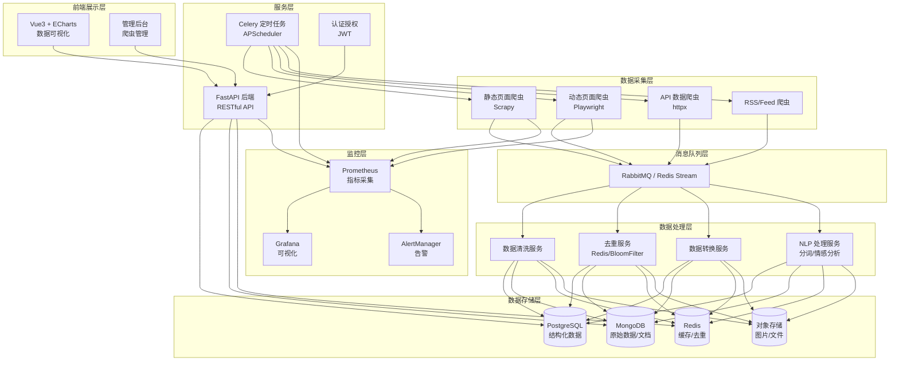

# 实战 - Python 爬虫 + 数据可视化平台

> **文档说明**：完整实战项目文档，讲解如何从零构建一个 Python 爬虫 + 数据可视化平台，涵盖需求分析、技术选型、爬虫设计（requests/Scrapy/Playwright）、数据存储（MySQL/MongoDB/Redis）、后端 API（FastAPI）、前端可视化（Vue3 + ECharts）、定时任务、部署运维，含完整项目结构、核心代码、数据库设计、API 接口和部署方案。
>
> **适用人群**：Python 全栈开发者、需要实战项目经验的学生、想学习爬虫和数据可视化的工程师
>
> **前置知识**：[[Python全栈开发入门]]、[[FastAPI-高性能Web框架]]、[[Vue3-项目工程化搭建]]、SQL 基础

---

## 一、项目概述

### 1. 项目背景

在数据驱动的时代，公开网络上蕴含着大量有价值的数据（商品价格、招聘信息、新闻资讯、社交媒体趋势等）。通过爬虫技术采集这些数据，经过清洗和分析后以可视化的方式展示，可以帮助用户发现趋势、做出决策。

本项目是一个**完整的全栈实战项目**，覆盖从数据采集、存储、处理、API 到前端可视化的完整链路，适合作为 Python 全栈开发者的作品集项目。

### 2. 项目目标

| 目标编号 | 目标描述 | 衡量标准 |
|---------|---------|---------|
| G1 | 实现可配置的爬虫框架，支持多种数据源 | 支持 3+ 种爬虫模板，可通过配置添加新爬虫 |
| G2 | 实现数据清洗和存储管道 | 数据清洗准确率 > 95%，支持 MySQL 和 MongoDB |
| G3 | 实现 RESTful API 服务 | API 响应时间 < 200ms，覆盖 10+ 接口 |
| G4 | 实现数据可视化前端 | 支持 5+ 种图表类型，页面加载 < 2s |
| G5 | 实现定时任务和监控 | 支持定时爬取，爬虫成功率 > 90%，有告警机制 |
| G6 | 完整的部署方案 | Docker Compose 一键部署，支持生产环境部署 |

### 3. 功能范围

**核心功能**：
- 爬虫管理（爬虫配置、启动/停止、日志查看）
- 数据采集（静态页面、动态页面、API 接口）
- 数据清洗（去重、格式化、异常值处理）
- 数据存储（关系型 + NoSQL + 缓存）
- 数据查询 API（RESTful 接口，支持过滤、排序、分页）
- 数据可视化（趋势图、柱状图、饼图、地图、词云）
- 定时任务（定时爬取、数据更新）
- 监控告警（爬虫状态、数据量、异常告警）

**非功能需求**：
- 性能：API P99 < 500ms，前端首屏 < 2s
- 可用性：系统可用性 > 99%
- 可扩展性：爬虫插件化，新增爬虫无需修改核心代码
- 安全性：爬虫遵守 robots.txt，有请求频率控制，API 有认证
- 可维护性：代码覆盖率 > 70%，有完整文档

### 4. 技术选型

| 层级 | 技术选型 | 版本 | 选型理由 |
|------|---------|------|---------|
| **爬虫框架** | Scrapy + Playwright | 2.11+ / 1.40+ | Scrapy 高效异步，Playwright 处理动态页面 |
| **HTTP 请求** | httpx / aiohttp | 0.27+ | 异步 HTTP 客户端，性能优于 requests |
| **数据解析** | BeautifulSoup4 / lxml / parsel | 最新 | 灵活的 HTML/XML 解析 |
| **数据库** | PostgreSQL + MongoDB | 16+ / 7+ | PG 存结构化数据，MongoDB 存原始爬取数据 |
| **缓存** | Redis | 7+ | 缓存、去重、任务队列 |
| **消息队列** | RabbitMQ / Redis Stream | 3.12+ | 爬虫任务分发、解耦 |
| **后端框架** | FastAPI | 0.110+ | 高性能、自动文档、异步支持 |
| **ORM** | SQLAlchemy 2.0 + Alembic | 2.0+ | 成熟的 ORM 和迁移工具 |
| **任务调度** | Celery + APScheduler | 5.3+ | 定时任务和异步任务 |
| **前端框架** | Vue 3 + TypeScript | 3.4+ | 组合式 API、类型安全 |
| **构建工具** | Vite | 5+ | 极速开发体验 |
| **UI 组件库** | Element Plus | 2.5+ | 丰富的企业级组件 |
| **图表库** | ECharts | 5.5+ | 功能强大的可视化库 |
| **状态管理** | Pinia | 2+ | Vue 3 官方推荐 |
| **容器化** | Docker + Docker Compose | 最新 | 一致的开发和部署环境 |
| **反向代理** | Nginx | 1.25+ | 静态资源服务、API 代理 |
| **监控** | Prometheus + Grafana | 最新 | 指标采集和可视化 |

---

## 二、系统架构

### 1. 整体架构图



### 2. 项目目录结构

```text
crawler-visualization-platform/
├── README.md                          # 项目说明
├── docker-compose.yml                 # Docker Compose 配置
├── .env.example                       # 环境变量示例
├── Makefile                           # 常用命令
│
├── backend/                           # 后端服务
│   ├── app/
│   │   ├── main.py                    # FastAPI 入口
│   │   ├── config.py                  # 配置管理
│   │   ├── database.py                # 数据库连接
│   │   ├── dependencies.py            # 依赖注入
│   │   ├── api/                       # API 路由
│   │   │   ├── v1/
│   │   │   │   ├── auth.py            # 认证接口
│   │   │   │   ├── crawler.py         # 爬虫管理接口
│   │   │   │   ├── data.py            # 数据查询接口
│   │   │   │   ├── dashboard.py       # 仪表盘接口
│   │   │   │   └── stats.py           # 统计接口
│   │   │   └── deps.py
│   │   ├── models/                    # 数据模型
│   │   │   ├── user.py
│   │   │   ├── crawler.py
│   │   │   ├── job.py
│   │   │   └── data.py
│   │   ├── schemas/                   # Pydantic 模型
│   │   │   ├── user.py
│   │   │   ├── crawler.py
│   │   │   └── data.py
│   │   ├── services/                  # 业务逻辑
│   │   │   ├── auth_service.py
│   │   │   ├── crawler_service.py
│   │   │   └── data_service.py
│   │   ├── core/                      # 核心工具
│   │   │   ├── security.py            # JWT/密码
│   │   │   ├── cache.py               # 缓存
│   │   │   └── exceptions.py          # 异常处理
│   │   └── tasks/                     # Celery 任务
│   │       ├── celery_app.py
│   │       ├── crawler_tasks.py
│   │       └── data_tasks.py
│   ├── alembic/                       # 数据库迁移
│   │   ├── versions/
│   │   └── env.py
│   ├── tests/                         # 测试
│   ├── requirements.txt
│   ├── pyproject.toml
│   └── Dockerfile
│
├── crawler/                           # 爬虫模块
│   ├── spiders/                       # 爬虫
│   │   ├── base_spider.py             # 爬虫基类
│   │   ├── static_spider.py           # 静态页面爬虫
│   │   ├── dynamic_spider.py          # 动态页面爬虫（Playwright）
│   │   ├── api_spider.py              # API 爬虫
│   │   └── examples/                  # 示例爬虫
│   │       ├── job_spider.py          # 招聘信息爬虫
│   │       ├── news_spider.py         # 新闻爬虫
│   │       └── product_spider.py      # 商品价格爬虫
│   ├── pipelines/                     # 数据管道
│   │   ├── clean_pipeline.py          # 清洗管道
│   │   ├── dedup_pipeline.py          # 去重管道
│   │   └── storage_pipeline.py        # 存储管道
│   ├── middlewares/                   # 中间件
│   │   ├── proxy_middleware.py        # 代理中间件
│   │   ├── retry_middleware.py        # 重试中间件
│   │   └── ua_middleware.py           # User-Agent 中间件
│   ├── utils/                         # 工具
│   │   ├── proxy.py                   # 代理池
│   │   ├── bloomfilter.py             # 布隆过滤器
│   │   └── parser.py                  # 解析工具
│   ├── config/                        # 爬虫配置
│   │   └── settings.py
│   ├── requirements.txt
│   └── Dockerfile
│
├── frontend/                          # 前端项目
│   ├── src/
│   │   ├── main.ts
│   │   ├── App.vue
│   │   ├── api/                       # API 封装
│   │   ├── assets/                    # 静态资源
│   │   ├── components/                # 通用组件
│   │   │   ├── charts/                # 图表组件
│   │   │   │   ├── LineChart.vue
│   │   │   │   ├── BarChart.vue
│   │   │   │   ├── PieChart.vue
│   │   │   │   ├── MapChart.vue
│   │   │   │   └── WordCloud.vue
│   │   │   └── layout/
│   │   ├── views/                     # 页面
│   │   │   ├── Dashboard.vue          # 仪表盘
│   │   │   ├── DataExplorer.vue       # 数据探索
│   │   │   ├── CrawlerManage.vue      # 爬虫管理
│   │   │   ├── JobMonitor.vue         # 任务监控
│   │   │   └── Settings.vue           # 设置
│   │   ├── router/
│   │   ├── stores/                    # Pinia
│   │   ├── utils/
│   │   └── types/
│   ├── public/
│   ├── index.html
│   ├── package.json
│   ├── vite.config.ts
│   ├── tsconfig.json
│   └── Dockerfile
│
├── deploy/                            # 部署配置
│   ├── nginx/
│   │   └── nginx.conf
│   ├── prometheus/
│   │   └── prometheus.yml
│   ├── grafana/
│   │   └── dashboards/
│   └── scripts/
│       ├── init_db.sql
│       └── seed_data.py
│
└── docs/                              # 文档
    ├── architecture.md
    ├── api.md
    ├── crawler-guide.md
    ├── deployment.md
    └── changelog.md
```

---

## 三、数据库设计

### 1. PostgreSQL 核心表

```sql
-- 用户表
CREATE TABLE users (
    id SERIAL PRIMARY KEY,
    username VARCHAR(50) UNIQUE NOT NULL,
    email VARCHAR(100) UNIQUE NOT NULL,
    password_hash VARCHAR(255) NOT NULL,
    role VARCHAR(20) DEFAULT 'user',  -- admin/editor/user
    is_active BOOLEAN DEFAULT true,
    created_at TIMESTAMPTZ DEFAULT NOW(),
    updated_at TIMESTAMPTZ DEFAULT NOW()
);

-- 爬虫配置表
CREATE TABLE crawlers (
    id SERIAL PRIMARY KEY,
    name VARCHAR(100) NOT NULL,
    slug VARCHAR(100) UNIQUE NOT NULL,
    description TEXT,
    spider_type VARCHAR(20) NOT NULL,  -- static/dynamic/api/rss
    config JSONB NOT NULL,              -- 爬虫配置（URL、选择器、频率等）
    schedule VARCHAR(100),              -- cron 表达式
    is_enabled BOOLEAN DEFAULT true,
    last_run_at TIMESTAMPTZ,
    last_status VARCHAR(20),            -- running/success/failed
    last_error TEXT,
    total_runs INTEGER DEFAULT 0,
    success_runs INTEGER DEFAULT 0,
    created_by INTEGER REFERENCES users(id),
    created_at TIMESTAMPTZ DEFAULT NOW(),
    updated_at TIMESTAMPTZ DEFAULT NOW()
);

-- 爬虫任务表
CREATE TABLE crawl_jobs (
    id SERIAL PRIMARY KEY,
    crawler_id INTEGER REFERENCES crawlers(id),
    status VARCHAR(20) NOT NULL,       -- pending/running/success/failed
    started_at TIMESTAMPTZ,
    finished_at TIMESTAMPTZ,
    items_scraped INTEGER DEFAULT 0,
    items_saved INTEGER DEFAULT 0,
    items_failed INTEGER DEFAULT 0,
    error_message TEXT,
    created_at TIMESTAMPTZ DEFAULT NOW()
);

-- 数据表（以招聘信息为例，实际可按数据类型分表）
CREATE TABLE job_postings (
    id SERIAL PRIMARY KEY,
    source VARCHAR(50) NOT NULL,        -- 数据来源
    source_url VARCHAR(500) UNIQUE NOT NULL,
    title VARCHAR(200) NOT NULL,
    company VARCHAR(100),
    location VARCHAR(100),
    salary_min INTEGER,
    salary_max INTEGER,
    salary_unit VARCHAR(10),
    experience VARCHAR(50),
    education VARCHAR(50),
    tags TEXT[],                         -- 标签数组
    description TEXT,
    published_at TIMESTAMPTZ,
    raw_data JSONB,                      -- 原始数据
    crawled_at TIMESTAMPTZ DEFAULT NOW(),
    created_at TIMESTAMPTZ DEFAULT NOW()
);

-- 创建索引
CREATE INDEX idx_job_postings_source ON job_postings(source);
CREATE INDEX idx_job_postings_company ON job_postings(company);
CREATE INDEX idx_job_postings_location ON job_postings(location);
CREATE INDEX idx_job_postings_published_at ON job_postings(published_at);
CREATE INDEX idx_job_postings_tags ON job_postings USING GIN(tags);
CREATE INDEX idx_crawl_jobs_crawler_id ON crawl_jobs(crawler_id);
CREATE INDEX idx_crawl_jobs_status ON crawl_jobs(status);
```

### 2. MongoDB 集合设计

```javascript
// 原始爬取数据（未清洗的原始 HTML/JSON）
db.createCollection("raw_data", {
    validator: {
        $jsonSchema: {
            bsonType: "object",
            required: ["url", "source", "content", "crawled_at"],
            properties: {
                url: { bsonType: "string" },
                source: { bsonType: "string" },
                content: { bsonType: "string" },
                metadata: { bsonType: "object" },
                crawled_at: { bsonType: "date" }
            }
        }
    }
});

db.raw_data.createIndex({ url: 1 }, { unique: true });
db.raw_data.createIndex({ source: 1, crawled_at: -1 });

// 爬虫日志
db.createCollection("crawler_logs");
db.crawler_logs.createIndex({ job_id: 1, timestamp: -1 });
```

### 3. Redis 数据结构

```css
# 爬虫去重（Bloom Filter 或 Set）
SET dedup:{crawler_name}:{url_hash} 1 EX 86400

# 爬虫任务队列
LIST crawler:queue:pending
LIST crawler:queue:processing

# 数据缓存
SET cache:{api_path}:{params_hash} {json_data} EX 300

# 限流计数器
INCR rate_limit:{ip}:{minute}
EXPIRE rate_limit:{ip}:{minute} 60

# 爬虫状态
HASH crawler:{id}:status
  field: status, items_scraped, items_saved, start_time
```

---

## 四、核心代码实现

### 1. 爬虫基类设计

```python
# crawler/spiders/base_spider.py
from abc import ABC, abstractmethod
from typing import List, Dict, Any, Optional
import logging
import time
from datetime import datetime

logger = logging.getLogger(__name__)


class BaseSpider(ABC):
    """爬虫基类，所有爬虫继承此类"""

    def __init__(self, config: Dict[str, Any]):
        self.config = config
        self.name = config.get("name", "unknown")
        self.start_urls = config.get("start_urls", [])
        self.delay = config.get("delay", 1.0)  # 请求间隔（秒）
        self.max_retries = config.get("max_retries", 3)
        self.timeout = config.get("timeout", 30)
        self.items_scraped = 0
        self.items_failed = 0

    @abstractmethod
    def fetch(self, url: str) -> Optional[str]:
        """获取页面内容"""
        pass

    @abstractmethod
    def parse(self, html: str, url: str) -> List[Dict[str, Any]]:
        """解析页面，提取数据"""
        pass

    def clean(self, item: Dict[str, Any]) -> Optional[Dict[str, Any]]:
        """数据清洗，返回 None 表示丢弃"""
        # 去空值
        item = {k: v for k, v in item.items() if v is not None and v != ""}
        # 去首尾空格
        for k, v in item.items():
            if isinstance(v, str):
                item[k] = v.strip()
        return item if item else None

    def validate(self, item: Dict[str, Any]) -> bool:
        """数据校验"""
        required_fields = self.config.get("required_fields", [])
        return all(field in item for field in required_fields)

    def run(self) -> List[Dict[str, Any]]:
        """运行爬虫"""
        logger.info(f"[{self.name}] 开始爬取，共 {len(self.start_urls)} 个 URL")
        all_items = []

        for url in self.start_urls:
            try:
                html = self.fetch(url)
                if not html:
                    self.items_failed += 1
                    continue

                items = self.parse(html, url)
                for item in items:
                    cleaned = self.clean(item)
                    if cleaned and self.validate(cleaned):
                        cleaned["source_url"] = url
                        cleaned["source"] = self.name
                        cleaned["crawled_at"] = datetime.utcnow().isoformat()
                        all_items.append(cleaned)
                        self.items_scraped += 1
                    else:
                        self.items_failed += 1

                time.sleep(self.delay)
            except Exception as e:
                logger.error(f"[{self.name}] 爬取 {url} 失败: {e}")
                self.items_failed += 1

        logger.info(
            f"[{self.name}] 爬取完成，成功 {self.items_scraped} 条，"
            f"失败 {self.items_failed} 条"
        )
        return all_items
```

### 2. 静态页面爬虫

```python
# crawler/spiders/static_spider.py
import httpx
from parsel import Selector
from typing import List, Dict, Any, Optional
from .base_spider import BaseSpider


class StaticSpider(BaseSpider):
    """静态页面爬虫，使用 httpx + parsel"""

    def __init__(self, config: Dict[str, Any]):
        super().__init__(config)
        self.headers = config.get("headers", {
            "User-Agent": "Mozilla/5.0 (Windows NT 10.0; Win64; x64) "
                          "AppleWebKit/537.36 (KHTML, like Gecko) "
                          "Chrome/120.0.0.0 Safari/537.36"
        })
        self.selectors = config.get("selectors", {})

    def fetch(self, url: str) -> Optional[str]:
        """发送 HTTP 请求获取页面"""
        for attempt in range(self.max_retries):
            try:
                with httpx.Client(
                    headers=self.headers,
                    timeout=self.timeout,
                    follow_redirects=True
                ) as client:
                    response = client.get(url)
                    response.raise_for_status()
                    return response.text
            except httpx.HTTPError as e:
                if attempt == self.max_retries - 1:
                    raise
                time.sleep(2 ** attempt)  # 指数退避
        return None

    def parse(self, html: str, url: str) -> List[Dict[str, Any]]:
        """解析页面，基于配置的 CSS 选择器提取数据"""
        selector = Selector(text=html)
        items = []

        # 列表页：提取详情页 URL
        list_selector = self.selectors.get("list_item")
        if list_selector:
            detail_urls = selector.css(list_selector).getall()
            for detail_url in detail_urls:
                # 递归爬取详情页
                full_url = self._build_url(detail_url, url)
                detail_html = self.fetch(full_url)
                if detail_html:
                    item = self._parse_detail(detail_html, full_url)
                    if item:
                        items.append(item)
        else:
            # 详情页：直接提取字段
            item = self._parse_detail(html, url)
            if item:
                items.append(item)

        return items

    def _parse_detail(self, html: str, url: str) -> Dict[str, Any]:
        """解析详情页字段"""
        selector = Selector(text=html)
        item = {}
        fields = self.selectors.get("fields", {})

        for field_name, field_config in fields.items():
            css_selector = field_config.get("css")
            attr = field_config.get("attr")  # text/href/src/...

            if css_selector:
                if attr and attr != "text":
                    value = selector.css(css_selector).attrib.get(attr, "")
                else:
                    value = selector.css(css_selector).get("").strip()
                item[field_name] = value

        return item

    def _build_url(self, relative_url: str, base_url: str) -> str:
        """构建完整 URL"""
        from urllib.parse import urljoin
        return urljoin(base_url, relative_url)
```

### 3. 动态页面爬虫（Playwright）

```python
# crawler/spiders/dynamic_spider.py
from playwright.sync_api import sync_playwright, Page, Browser
from typing import List, Dict, Any, Optional
from .base_spider import BaseSpider
import time


class DynamicSpider(BaseSpider):
    """动态页面爬虫，使用 Playwright 处理 JavaScript 渲染"""

    def __init__(self, config: Dict[str, Any]):
        super().__init__(config)
        self.headless = config.get("headless", True)
        self.wait_for_selector = config.get("wait_for_selector")
        self.scroll_times = config.get("scroll_times", 0)  # 滚动加载次数
        self.proxy = config.get("proxy")
        self._browser: Optional[Browser] = None
        self._playwright = None

    def __enter__(self):
        self._playwright = sync_playwright().start()
        browser_args = {"headless": self.headless}
        if self.proxy:
            browser_args["proxy"] = self.proxy
        self._browser = self._playwright.chromium.launch(**browser_args)
        return self

    def __exit__(self, exc_type, exc_val, exc_tb):
        if self._browser:
            self._browser.close()
        if self._playwright:
            self._playwright.stop()

    def fetch(self, url: str) -> Optional[str]:
        """使用 Playwright 获取渲染后的页面"""
        if not self._browser:
            raise RuntimeError("请使用 with 语句创建 DynamicSpider")

        context = self._browser.new_context(
            user_agent="Mozilla/5.0 (Windows NT 10.0; Win64; x64) "
                       "AppleWebKit/537.36 (KHTML, like Gecko) "
                       "Chrome/120.0.0.0 Safari/537.36",
            viewport={"width": 1920, "height": 1080}
        )
        page = context.new_page()

        try:
            page.goto(url, wait_until="networkidle", timeout=self.timeout * 1000)

            # 等待特定元素加载
            if self.wait_for_selector:
                page.wait_for_selector(self.wait_for_selector, timeout=10000)

            # 滚动加载（无限滚动页面）
            for _ in range(self.scroll_times):
                page.evaluate("window.scrollTo(0, document.body.scrollHeight)")
                time.sleep(1)

            html = page.content()
            return html
        except Exception as e:
            print(f"获取页面失败: {e}")
            return None
        finally:
            context.close()

    def parse(self, html: str, url: str) -> List[Dict[str, Any]]:
        """解析页面（复用 StaticSpider 的解析逻辑）"""
        from .static_spider import StaticSpider
        static = StaticSpider(self.config)
        return static.parse(html, url)
```

### 4. 数据清洗管道

```python
# crawler/pipelines/clean_pipeline.py
import re
from typing import Dict, Any, Optional
from datetime import datetime


class CleanPipeline:
    """数据清洗管道"""

    def process_item(self, item: Dict[str, Any]) -> Optional[Dict[str, Any]]:
        """处理单个数据项"""
        # 1. 去除 HTML 标签
        item = self._strip_html(item)

        # 2. 统一日期格式
        item = self._normalize_dates(item)

        # 3. 解析薪资范围
        item = self._parse_salary(item)

        # 4. 提取标签
        item = self._extract_tags(item)

        # 5. 去除多余空白
        item = self._normalize_whitespace(item)

        return item

    def _strip_html(self, item: Dict[str, Any]) -> Dict[str, Any]:
        """去除 HTML 标签"""
        html_pattern = re.compile(r'<[^>]+>')
        for key, value in item.items():
            if isinstance(value, str):
                item[key] = html_pattern.sub('', value)
        return item

    def _normalize_dates(self, item: Dict[str, Any]) -> Dict[str, Any]:
        """统一日期格式为 ISO 8601"""
        date_fields = ['published_at', 'date', 'created_at']
        for field in date_fields:
            if field in item and isinstance(item[field], str):
                item[field] = self._parse_date(item[field])
        return item

    def _parse_date(self, date_str: str) -> Optional[str]:
        """解析多种日期格式"""
        formats = [
            "%Y-%m-%d", "%Y/%m/%d", "%Y年%m月%d日",
            "%Y-%m-%d %H:%M:%S", "%Y/%m/%d %H:%M:%S",
        ]
        for fmt in formats:
            try:
                return datetime.strptime(date_str.strip(), fmt).isoformat()
            except ValueError:
                continue
        return None

    def _parse_salary(self, item: Dict[str, Any]) -> Dict[str, Any]:
        """解析薪资范围，如 '15-25K' -> {salary_min: 15, salary_max: 25}"""
        if 'salary' in item and isinstance(item['salary'], str):
            match = re.search(r'(\d+)\s*[-~到]\s*(\d+)\s*([Kk万]?)', item['salary'])
            if match:
                min_val = int(match.group(1))
                max_val = int(match.group(2))
                unit = match.group(3).lower()

                if unit == '万':
                    min_val *= 10
                    max_val *= 10

                item['salary_min'] = min_val
                item['salary_max'] = max_val
                item['salary_unit'] = 'K'
        return item

    def _extract_tags(self, item: Dict[str, Any]) -> Dict[str, Any]:
        """从描述中提取技术标签"""
        tech_keywords = [
            'Python', 'Java', 'Go', 'Rust', 'JavaScript', 'TypeScript',
            'React', 'Vue', 'Angular', 'Node.js', 'Django', 'Flask',
            'FastAPI', 'Spring', 'MySQL', 'PostgreSQL', 'MongoDB',
            'Redis', 'Docker', 'Kubernetes', 'AWS', 'Kafka', 'RabbitMQ'
        ]
        if 'description' in item and isinstance(item['description'], str):
            desc = item['description']
            tags = [kw for kw in tech_keywords if kw.lower() in desc.lower()]
            if tags:
                item['extracted_tags'] = list(set(tags))
        return item

    def _normalize_whitespace(self, item: Dict[str, Any]) -> Dict[str, Any]:
        """统一空白字符"""
        for key, value in item.items():
            if isinstance(value, str):
                item[key] = re.sub(r'\s+', ' ', value).strip()
        return item
```

### 5. FastAPI 后端核心

```python
# backend/app/main.py
from fastapi import FastAPI
from fastapi.middleware.cors import CORSMiddleware
from app.api.v1 import auth, crawler, data, dashboard, stats
from app.core.exceptions import add_exception_handlers

app = FastAPI(
    title="爬虫数据可视化平台 API",
    description="提供爬虫管理、数据查询、可视化数据等 API",
    version="1.0.0",
    docs_url="/docs",
    redoc_url="/redoc",
)

# CORS 配置
app.add_middleware(
    CORSMiddleware,
    allow_origins=["http://localhost:5173", "https://yourdomain.com"],
    allow_credentials=True,
    allow_methods=["*"],
    allow_headers=["*"],
)

# 注册路由
app.include_router(auth.router, prefix="/api/v1/auth", tags=["认证"])
app.include_router(crawler.router, prefix="/api/v1/crawlers", tags=["爬虫管理"])
app.include_router(data.router, prefix="/api/v1/data", tags=["数据查询"])
app.include_router(dashboard.router, prefix="/api/v1/dashboard", tags=["仪表盘"])
app.include_router(stats.router, prefix="/api/v1/stats", tags=["统计"])

# 异常处理
add_exception_handlers(app)


@app.get("/health")
async def health_check():
    return {"status": "healthy", "version": "1.0.0"}
```

```python
# backend/app/api/v1/data.py
from fastapi import APIRouter, Query, Depends
from typing import List, Optional
from app.schemas.data import JobPostingResponse, JobPostingListResponse
from app.services.data_service import DataService
from app.dependencies import get_db

router = APIRouter()


@router.get("/jobs", response_model=JobPostingListResponse)
async def list_jobs(
    page: int = Query(1, ge=1),
    page_size: int = Query(20, ge=1, le=100),
    keyword: Optional[str] = Query(None, description="搜索关键词"),
    company: Optional[str] = Query(None),
    location: Optional[str] = Query(None),
    salary_min: Optional[int] = Query(None, ge=0),
    salary_max: Optional[int] = Query(None, ge=0),
    source: Optional[str] = Query(None),
    sort_by: str = Query("published_at", regex="^(published_at|salary_max|created_at)$"),
    sort_order: str = Query("desc", regex="^(asc|desc)$"),
    db=Depends(get_db),
):
    """查询招聘信息列表"""
    service = DataService(db)
    return await service.list_jobs(
        page=page,
        page_size=page_size,
        keyword=keyword,
        company=company,
        location=location,
        salary_min=salary_min,
        salary_max=salary_max,
        source=source,
        sort_by=sort_by,
        sort_order=sort_order,
    )


@router.get("/jobs/{job_id}", response_model=JobPostingResponse)
async def get_job(job_id: int, db=Depends(get_db)):
    """获取单条招聘信息详情"""
    service = DataService(db)
    return await service.get_job(job_id)


@router.get("/jobs/stats/salary-by-city")
async def salary_by_city(db=Depends(get_db)):
    """按城市统计平均薪资（用于图表）"""
    service = DataService(db)
    return await service.salary_by_city()


@router.get("/jobs/stats/position-trend")
async def position_trend(
    days: int = Query(30, ge=1, le=365),
    db=Depends(get_db),
):
    """职位发布趋势（用于折线图）"""
    service = DataService(db)
    return await service.position_trend(days=days)


@router.get("/jobs/stats/tech-distribution")
async def tech_distribution(db=Depends(get_db)):
    """技术栈分布（用于饼图/词云）"""
    service = DataService(db)
    return await service.tech_distribution()
```

### 6. 前端图表组件

```vue
<!-- frontend/src/components/charts/LineChart.vue -->
<template>
  <div ref="chartRef" :style="{ width: width, height: height }"></div>
</template>

<script setup lang="ts">
import { ref, onMounted, onUnmounted, watch } from 'vue'
import * as echarts from 'echarts'

interface ChartData {
  xAxis: string[]
  series: { name: string; data: number[] }[]
}

const props = withDefaults(defineProps<{
  data: ChartData
  title?: string
  width?: string
  height?: string
  smooth?: boolean
}>(), {
  width: '100%',
  height: '400px',
  smooth: true,
})

const chartRef = ref<HTMLDivElement>()
let chartInstance: echarts.ECharts | null = null

const renderChart = () => {
  if (!chartRef.value) return

  if (!chartInstance) {
    chartInstance = echarts.init(chartRef.value)
  }

  const option: echarts.EChartsOption = {
    title: props.title ? { text: props.title, left: 'center' } : undefined,
    tooltip: {
      trigger: 'axis',
      axisPointer: { type: 'cross' },
    },
    legend: {
      data: props.data.series.map(s => s.name),
      bottom: 0,
    },
    grid: {
      left: '3%',
      right: '4%',
      bottom: '10%',
      containLabel: true,
    },
    xAxis: {
      type: 'category',
      boundaryGap: false,
      data: props.data.xAxis,
    },
    yAxis: {
      type: 'value',
    },
    series: props.data.series.map(s => ({
      name: s.name,
      type: 'line',
      smooth: props.smooth,
      data: s.data,
      areaStyle: { opacity: 0.1 },
      emphasis: { focus: 'series' },
    })),
  }

  chartInstance.setOption(option)
}

const handleResize = () => {
  chartInstance?.resize()
}

onMounted(() => {
  renderChart()
  window.addEventListener('resize', handleResize)
})

onUnmounted(() => {
  window.removeEventListener('resize', handleResize)
  chartInstance?.dispose()
})

watch(() => props.data, renderChart, { deep: true })
</script>
```

```vue
<!-- frontend/src/views/Dashboard.vue -->
<template>
  <div class="dashboard">
    <el-row :gutter="20">
      <!-- 统计卡片 -->
      <el-col :span="6" v-for="stat in stats" :key="stat.label">
        <el-card class="stat-card">
          <div class="stat-value">{{ stat.value }}</div>
          <div class="stat-label">{{ stat.label }}</div>
          <div class="stat-trend" :class="stat.trend > 0 ? 'up' : 'down'">
            {{ stat.trend > 0 ? '↑' : '↓' }} {{ Math.abs(stat.trend) }}%
          </div>
        </el-card>
      </el-col>
    </el-row>

    <el-row :gutter="20" style="margin-top: 20px">
      <el-col :span="12">
        <el-card>
          <template #header>职位发布趋势</template>
          <LineChart :data="trendData" height="350px" />
        </el-card>
      </el-col>
      <el-col :span="12">
        <el-card>
          <template #header>技术栈分布</template>
          <PieChart :data="techData" height="350px" />
        </el-card>
      </el-col>
    </el-row>

    <el-row :gutter="20" style="margin-top: 20px">
      <el-col :span="12">
        <el-card>
          <template #header>城市薪资对比</template>
          <BarChart :data="salaryData" height="350px" />
        </el-card>
      </el-col>
      <el-col :span="12">
        <el-card>
          <template #header>热门技能词云</template>
          <WordCloud :data="wordCloudData" height="350px" />
        </el-card>
      </el-col>
    </el-row>
  </div>
</template>

<script setup lang="ts">
import { ref, onMounted } from 'vue'
import LineChart from '@/components/charts/LineChart.vue'
import PieChart from '@/components/charts/PieChart.vue'
import BarChart from '@/components/charts/BarChart.vue'
import WordCloud from '@/components/charts/WordCloud.vue'
import { dashboardApi } from '@/api/dashboard'

const stats = ref([
  { label: '总职位数', value: 0, trend: 0 },
  { label: '今日新增', value: 0, trend: 0 },
  { label: '平均薪资(K)', value: 0, trend: 0 },
  { label: '覆盖城市', value: 0, trend: 0 },
])

const trendData = ref({ xAxis: [], series: [] })
const techData = ref([])
const salaryData = ref({ xAxis: [], series: [] })
const wordCloudData = ref([])

onMounted(async () => {
  const [statsRes, trendRes, techRes, salaryRes, wordRes] = await Promise.all([
    dashboardApi.getStats(),
    dashboardApi.getPositionTrend(30),
    dashboardApi.getTechDistribution(),
    dashboardApi.getSalaryByCity(),
    dashboardApi.getWordCloud(),
  ])

  stats.value = statsRes
  trendData.value = trendRes
  techData.value = techRes
  salaryData.value = salaryRes
  wordCloudData.value = wordRes
})
</script>

<style scoped>
.stat-card {
  text-align: center;
}
.stat-value {
  font-size: 32px;
  font-weight: bold;
  color: #409eff;
}
.stat-label {
  color: #909399;
  margin-top: 8px;
}
.stat-trend.up {
  color: #67c23a;
}
.stat-trend.down {
  color: #f56c6c;
}
</style>
```

---

## 五、部署方案

### 1. Docker Compose 配置

```yaml
# docker-compose.yml
version: '3.8'

services:
  # PostgreSQL 数据库
  postgres:
    image: postgres:16-alpine
    container_name: cvp-postgres
    restart: unless-stopped
    environment:
      POSTGRES_DB: crawler_platform
      POSTGRES_USER: crawler
      POSTGRES_PASSWORD: ${DB_PASSWORD:-crawler123}
    volumes:
      - postgres_data:/var/lib/postgresql/data
      - ./deploy/scripts/init_db.sql:/docker-entrypoint-initdb.d/init.sql
    ports:
      - "5432:5432"
    healthcheck:
      test: ["CMD-SHELL", "pg_isready -U crawler"]
      interval: 10s
      timeout: 5s
      retries: 5

  # MongoDB
  mongodb:
    image: mongo:7
    container_name: cvp-mongodb
    restart: unless-stopped
    environment:
      MONGO_INITDB_ROOT_USERNAME: admin
      MONGO_INITDB_ROOT_PASSWORD: ${MONGO_PASSWORD:-mongo123}
    volumes:
      - mongo_data:/data/db
    ports:
      - "27017:27017"

  # Redis
  redis:
    image: redis:7-alpine
    container_name: cvp-redis
    restart: unless-stopped
    command: redis-server --requirepass ${REDIS_PASSWORD:-redis123} --appendonly yes
    volumes:
      - redis_data:/data
    ports:
      - "6379:6379"

  # RabbitMQ
  rabbitmq:
    image: rabbitmq:3-management-alpine
    container_name: cvp-rabbitmq
    restart: unless-stopped
    environment:
      RABBITMQ_DEFAULT_USER: admin
      RABBITMQ_DEFAULT_PASS: ${RABBITMQ_PASSWORD:-rabbit123}
    volumes:
      - rabbitmq_data:/var/lib/rabbitmq
    ports:
      - "5672:5672"
      - "15672:15672"

  # FastAPI 后端
  backend:
    build:
      context: ./backend
      dockerfile: Dockerfile
    container_name: cvp-backend
    restart: unless-stopped
    environment:
      DATABASE_URL: postgresql+asyncpg://crawler:${DB_PASSWORD:-crawler123}@postgres:5432/crawler_platform
      MONGODB_URL: mongodb://admin:${MONGO_PASSWORD:-mongo123}@mongodb:27017/
      REDIS_URL: redis://:${REDIS_PASSWORD:-redis123}@redis:6379/0
      RABBITMQ_URL: amqp://admin:${RABBITMQ_PASSWORD:-rabbit123}@rabbitmq:5672/
      SECRET_KEY: ${SECRET_KEY:-your-secret-key-change-in-production}
      CORS_ORIGINS: http://localhost:5173,https://yourdomain.com
    ports:
      - "8000:8000"
    depends_on:
      postgres:
        condition: service_healthy
      redis:
        condition: service_started
      mongodb:
        condition: service_started
    command: uvicorn app.main:app --host 0.0.0.0 --port 8000 --workers 4

  # Celery Worker
  celery_worker:
    build:
      context: ./backend
      dockerfile: Dockerfile
    container_name: cvp-celery-worker
    restart: unless-stopped
    environment:
      DATABASE_URL: postgresql+asyncpg://crawler:${DB_PASSWORD:-crawler123}@postgres:5432/crawler_platform
      REDIS_URL: redis://:${REDIS_PASSWORD:-redis123}@redis:6379/0
      RABBITMQ_URL: amqp://admin:${RABBITMQ_PASSWORD:-rabbit123}@rabbitmq:5672/
    depends_on:
      - redis
      - rabbitmq
      - postgres
    command: celery -A app.tasks.celery_app worker --loglevel=info --concurrency=4

  # Celery Beat（定时任务）
  celery_beat:
    build:
      context: ./backend
      dockerfile: Dockerfile
    container_name: cvp-celery-beat
    restart: unless-stopped
    environment:
      REDIS_URL: redis://:${REDIS_PASSWORD:-redis123}@redis:6379/0
    depends_on:
      - redis
    command: celery -A app.tasks.celery_app beat --loglevel=info

  # 前端
  frontend:
    build:
      context: ./frontend
      dockerfile: Dockerfile
      args:
        VITE_API_BASE_URL: /api/v1
    container_name: cvp-frontend
    restart: unless-stopped
    ports:
      - "80:80"
    depends_on:
      - backend

  # Prometheus
  prometheus:
    image: prom/prometheus:latest
    container_name: cvp-prometheus
    restart: unless-stopped
    volumes:
      - ./deploy/prometheus/prometheus.yml:/etc/prometheus/prometheus.yml
      - prometheus_data:/prometheus
    ports:
      - "9090:9090"

  # Grafana
  grafana:
    image: grafana/grafana:latest
    container_name: cvp-grafana
    restart: unless-stopped
    environment:
      GF_SECURITY_ADMIN_PASSWORD: ${GRAFANA_PASSWORD:-admin123}
    volumes:
      - grafana_data:/var/lib/grafana
      - ./deploy/grafana/dashboards:/etc/grafana/provisioning/dashboards
    ports:
      - "3000:3000"
    depends_on:
      - prometheus

volumes:
  postgres_data:
  mongo_data:
  redis_data:
  rabbitmq_data:
  prometheus_data:
  grafana_data:
```

### 2. Nginx 配置

```nginx
# deploy/nginx/nginx.conf
server {
    listen 80;
    server_name yourdomain.com;

    # 前端静态资源
    location / {
        root /usr/share/nginx/html;
        index index.html;
        try_files $uri $uri/ /index.html;

        # 静态资源缓存
        location ~* \.(js|css|png|jpg|jpeg|gif|ico|svg|woff2?)$ {
            expires 30d;
            add_header Cache-Control "public, immutable";
        }
    }

    # API 代理
    location /api/ {
        proxy_pass http://backend:8000;
        proxy_set_header Host $host;
        proxy_set_header X-Real-IP $remote_addr;
        proxy_set_header X-Forwarded-For $proxy_add_x_forwarded_for;
        proxy_set_header X-Forwarded-Proto $scheme;

        # 超时设置
        proxy_connect_timeout 30s;
        proxy_send_timeout 30s;
        proxy_read_timeout 60s;

        # WebSocket 支持
        proxy_http_version 1.1;
        proxy_set_header Upgrade $http_upgrade;
        proxy_set_header Connection "upgrade";
    }

    # 文档
    location /docs {
        proxy_pass http://backend:8000/docs;
        proxy_set_header Host $host;
    }

    # Gzip 压缩
    gzip on;
    gzip_vary on;
    gzip_min_length 1024;
    gzip_types text/plain text/css text/xml text/javascript
               application/javascript application/xml application/json
               application/xml+rss image/svg+xml;
}
```

---

## 六、关键技术点

### 1. 爬虫反反爬策略

| 反爬手段 | 应对策略 | 实现方式 |
|---------|---------|---------|
| User-Agent 检测 | UA 池随机切换 | 维护 UA 列表，每次请求随机选择 |
| IP 封禁 | 代理池 + 请求频率控制 | 接入代理服务，设置请求间隔和并发数 |
| 验证码 | 打码平台 / 机器学习识别 | 接入 2Captcha / 自建 OCR 模型 |
| 登录验证 | Cookie 池 / 模拟登录 | Playwright 模拟登录，维护 Cookie 池 |
| 动态渲染 | Playwright / Selenium | 使用无头浏览器渲染 JavaScript |
| 请求频率限制 | 随机延迟 + 指数退避重试 | 请求间隔随机化，失败后指数退避 |
| 指纹检测 | 浏览器指纹伪装 | Playwright stealth 插件，修改 navigator 属性 |
| robots.txt | 遵守 robots.txt | 解析 robots.txt，不爬取禁止的路径 |

### 2. 数据去重方案

```python
# 方案1：Redis Set（适合中小规模）
import redis

class RedisDedup:
    def __init__(self, redis_client, key_prefix="dedup"):
        self.redis = redis_client
        self.key_prefix = key_prefix

    def is_duplicate(self, crawler_name: str, url: str) -> bool:
        key = f"{self.key_prefix}:{crawler_name}"
        url_hash = hashlib.md5(url.encode()).hexdigest()
        return self.redis.sismember(key, url_hash)

    def mark(self, crawler_name: str, url: str):
        key = f"{self.key_prefix}:{crawler_name}"
        url_hash = hashlib.md5(url.encode()).hexdigest()
        self.redis.sadd(key, url_hash)
        self.redis.expire(key, 86400 * 7)  # 7天过期

# 方案2：布隆过滤器（适合大规模，内存占用小）
from pybloom_live import ScalableBloomFilter

class BloomDedup:
    def __init__(self, capacity=1000000, error_rate=0.001):
        self.bf = ScalableBloomFilter(
            mode=ScalableBloomFilter.SMALL_SET_GROWTH,
            error_rate=error_rate
        )

    def is_duplicate(self, url: str) -> bool:
        return url in self.bf

    def mark(self, url: str):
        self.bf.add(url)
```

### 3. 定时任务设计

```python
# backend/app/tasks/crawler_tasks.py
from celery import Celery
from app.tasks.celery_app import celery_app
from app.services.crawler_service import CrawlerService
import logging

logger = logging.getLogger(__name__)


@celery_app.task(bind=True, max_retries=3)
def run_crawler(self, crawler_id: int):
    """执行单个爬虫任务"""
    try:
        service = CrawlerService()
        result = service.run_crawler(crawler_id)
        logger.info(f"爬虫 {crawler_id} 执行完成: {result}")
        return result
    except Exception as e:
        logger.error(f"爬虫 {crawler_id} 执行失败: {e}")
        self.retry(exc=e, countdown=60 * (2 ** self.request.retries))


@celery_app.task
def schedule_crawlers():
    """调度所有启用的爬虫（每分钟检查一次）"""
    service = CrawlerService()
    due_crawlers = service.get_due_crawlers()
    for crawler in due_crawlers:
        run_crawler.delay(crawler.id)
        logger.info(f"已调度爬虫: {crawler.name} (id={crawler.id})")


# Celery Beat 定时配置
celery_app.conf.beat_schedule = {
    'schedule-crawlers-every-minute': {
        'task': 'app.tasks.crawler_tasks.schedule_crawlers',
        'schedule': 60.0,  # 每分钟
    },
    'clean-old-data-daily': {
        'task': 'app.tasks.data_tasks.clean_old_data',
        'schedule': 86400.0,  # 每天
    },
    'generate-daily-report': {
        'task': 'app.tasks.data_tasks.generate_daily_report',
        'schedule': 86400.0,
    },
}
```

---

## 七、项目扩展方向

| 方向 | 说明 | 技术方案 |
|------|------|---------|
| **更多数据源** | 支持社交媒体、电商、论坛等 | 插件化爬虫框架，配置化添加新爬虫 |
| **AI 分析** | 智能摘要、情感分析、趋势预测 | 接入 LLM API，使用 NLP 模型 |
| **实时数据流** | 实时数据推送和可视化 | WebSocket + Kafka Stream + ECharts 实时更新 |
| **数据导出** | 支持 CSV/Excel/JSON 导出 | 后端生成文件，前端下载 |
| **API 开放平台** | 对外提供数据 API | API Key 管理、限流、计费 |
| **移动端** | 移动端数据查看 | React Native / Flutter / 小程序 |
| **告警系统** | 数据异常告警 | 阈值检测 + 邮件/钉钉/飞书通知 |
| **多租户** | 支持多用户/多组织 | 数据隔离、权限管理、配额限制 |

---

## 八、关联笔记

```text
### Python 全栈
```
- [[Python全栈开发入门]] · [[FastAPI-高性能Web框架]] · [[Python异步编程]]
- [[SQLAlchemy ORM实战]] · [[Pydantic-数据校验]] · [[Python-测试体系pytest]]

### 爬虫
- [[Python爬虫基础]] · [[Scrapy框架实战]] · [[Playwright自动化测试]]
- [[反爬虫与反反爬虫策略]] · [[数据清洗与ETL]]

### 数据可视化
- [[ECharts数据可视化]] · [[Vue3-项目工程化搭建]] · [[前端性能优化]]
- [[Pandas数据分析]] · [[Matplotlib数据可视化]]

### 运维与部署
- [[Docker容器化部署]] · [[DockerCompose容器编排]] · [[CI-CD流水线设计]]
- [[Nginx高性能配置]] · [[Prometheus-指标采集]] · [[Grafana-可视化看板]]

### 导航
- [[MOC-项目实战-四级展开]] · [[MOC-全栈项目]] · [[MOC-Python全栈]]

> **学习路径建议**：先掌握 [[Python全栈开发入门]] 和 [[FastAPI-高性能Web框架]] → 学习 [[Scrapy框架实战]] 和 [[Playwright自动化测试]] 爬虫技术 → 结合 [[ECharts数据可视化]] 和 [[Vue3-项目工程化搭建]] 构建前端 → 使用 [[Docker容器化部署]] 完成部署 → 实践中不断扩展功能和优化性能。

---

## 🔗 关联笔记

- [[MOC-项目实战]] — 返回本分类知识地图，查看更多相关文档

## 📖 前置知识

- [[Python全栈开发入门]]
- [[FastAPI-高性能Web框架]]

## 🏷️ 相关标签

`#项目实战` `#Python` `#爬虫` `#数据可视化` `#全栈项目`

[[Home|🏠 返回首页]] · [[MOC-项目实战|📚 返回分类]]
