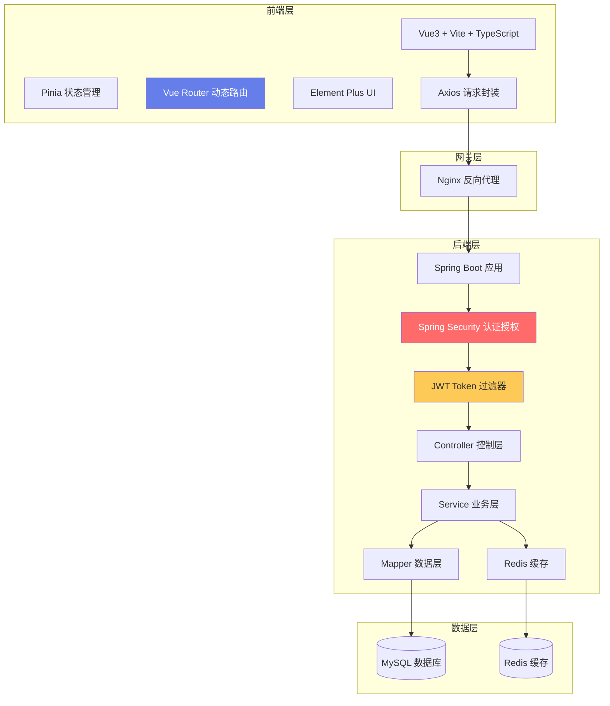
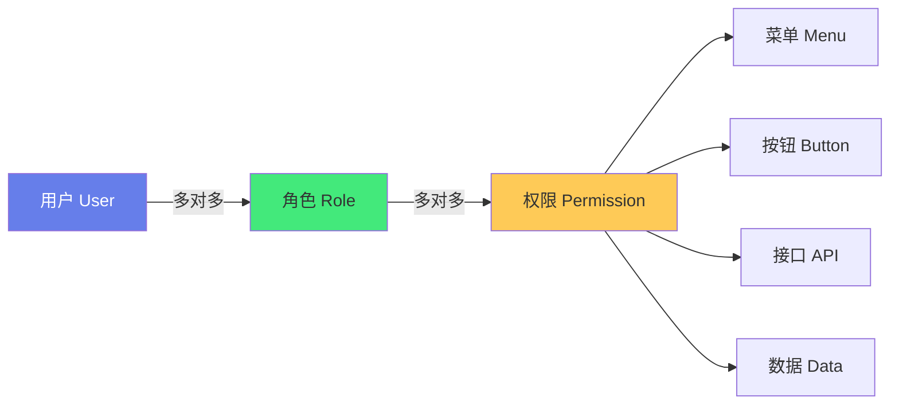

# 🔐 实战：SpringBoot + Vue3 权限管理系统

> **文档说明**：从零到一完整实战指南，讲解如何用 SpringBoot 后端 + Vue3 前端构建企业级权限管理系统，涵盖项目概述（目标定位 / 功能清单 / 技术选型 / 系统架构 / 适用场景）、权限模型设计（RBAC 基于角色的访问控制 / ABAC 基于属性的访问控制 / 用户-角色-权限三级模型 / 菜单权限 / 按钮权限 / 数据权限 / 权限继承与互斥）、数据库设计（用户表 sys_user / 角色表 sys_role / 菜单表 sys_menu / 权限表 sys_permission / 用户角色关联表 sys_user_role / 角色菜单关联表 sys_role_menu / 部门表 sys_dept / 字典表）、后端架构（SpringBoot 3.x / Spring Security 6 / JWT 认证 / MyBatis-Plus / Redis 缓存 / 接口分层 Controller-Service-Mapper / 统一响应体 / 全局异常处理）、认证授权流程（登录认证 / JWT 生成与验证 / Token 刷新 / 登出 / 拦截器 / 过滤器 / Security 配置 / 注解鉴权 @PreAuthorize）、前端架构（Vue3 + Vite + TypeScript / Pinia 状态管理 / Vue Router 4 / Element Plus / Axios 封装 / 路由守卫 / 动态路由 / 权限指令 v-permission）、核心功能实现（登录页 / 用户管理 / 角色管理 / 菜单管理 / 部门管理 / 字典管理 / 操作日志 / 登录日志 / 个人中心）、前端权限控制（路由级权限 / 按钮级权限 / 菜单动态生成 / 权限指令 / 权限工具函数）、后端权限控制（URL 级权限 / 方法级权限 / 数据权限 / 自定义权限注解 / 权限缓存）、安全设计（密码 BCrypt 加密 / 防越权 / XSS 防护 / CSRF 防护 / SQL 注入防护 / 接口限流 / 登录失败锁定 / 敏感数据脱敏）、部署运维（前后端分离部署 / Nginx 反向代理 / Docker 容器化 / 环境配置 / 日志管理 / 监控告警）、常见问题与解决方案（Token 过期 / 权限缓存不一致 / 动态路由刷新丢失 / 越权访问 / 跨域问题 / 密码安全）。
>
> **适用人群**：Java 全栈开发者、前端工程师、想构建权限系统的技术团队、系统设计面试准备者
>
> **前置知识**：[[SpringBoot实战]] · [[Vue3-组合式API]] · [[Java-LTS版本新特性]]

---

## 一、项目概述

### 1.1 项目目标

构建一个功能完整、安全可靠、可扩展的企业级权限管理系统，具备：

- **完整的 RBAC 权限模型**：用户-角色-菜单（权限）三级管理
- **细粒度权限控制**：菜单级、按钮级、接口级、数据级四层权限
- **JWT 无状态认证**：前后端分离，Token 认证，支持刷新
- **动态路由与菜单**：根据用户权限动态生成前端路由和侧边栏菜单
- **系统管理功能**：用户、角色、菜单、部门、字典、日志等完整管理功能
- **安全防护**：密码加密、防越权、XSS/CSRF/SQL 注入防护、接口限流
- **可扩展架构**：模块化设计，易于集成到其他业务系统

### 1.2 功能清单

| 模块 | 功能 |
|------|------|
| **认证模块** | 登录、登出、Token 刷新、验证码、登录失败锁定 |
| **用户管理** | 用户增删改查、重置密码、分配角色、启用/禁用、导入导出 |
| **角色管理** | 角色增删改查、分配菜单权限、分配数据权限、角色编码 |
| **菜单管理** | 菜单增删改查、菜单类型（目录/菜单/按钮）、路由配置、图标排序 |
| **部门管理** | 部门树结构、部门增删改查、部门负责人 |
| **字典管理** | 字典类型、字典项、系统常量管理 |
| **日志管理** | 操作日志、登录日志、日志查询与导出 |
| **个人中心** | 个人信息修改、密码修改、头像上传 |
| **系统监控** | 在线用户、服务监控、缓存监控 |

### 1.3 技术选型

| 层级 | 技术 | 版本 | 说明 |
|------|------|------|------|
| **后端框架** | Spring Boot | 3.2.x | 基础框架 |
| **安全框架** | Spring Security | 6.2.x | 认证授权 |
| **Token** | JWT (jjwt) | 0.12.x | 无状态认证 |
| **ORM** | MyBatis-Plus | 3.5.x | 持久层框架 |
| **数据库** | MySQL | 8.0 | 关系型数据库 |
| **缓存** | Redis | 7.x | 缓存、Token 存储、限流 |
| **接口文档** | Knife4j | 4.4.x | Swagger 增强 |
| **工具库** | Hutool | 5.8.x | Java 工具集 |
| **前端框架** | Vue | 3.4.x | 渐进式框架 |
| **构建工具** | Vite | 5.x | 下一代构建工具 |
| **语言** | TypeScript | 5.x | 类型安全 |
| **状态管理** | Pinia | 2.x | Vue 官方状态管理 |
| **路由** | Vue Router | 4.x | 前端路由 |
| **UI 组件库** | Element Plus | 2.5.x | Vue3 组件库 |
| **HTTP 客户端** | Axios | 1.6.x | HTTP 请求库 |
| **图表** | ECharts | 5.4.x | 数据可视化 |
| **CSS 预处理** | Sass | - | 样式预处理 |

### 1.4 系统架构



---

## 二、权限模型设计

### 2.1 RBAC 模型

**RBAC（Role-Based Access Control，基于角色的访问控制）** 是最常用的权限模型：



**核心原则**：
- 用户不直接关联权限，而是通过角色间接关联
- 一个用户可以有多个角色
- 一个角色可以有多个权限
- 权限分为：菜单权限、按钮权限、接口权限、数据权限

### 2.2 权限粒度

| 权限级别 | 说明 | 实现方式 |
|---------|------|---------|
| **菜单级** | 控制用户能看到哪些菜单/页面 | 动态路由 + 侧边栏菜单过滤 |
| **按钮级** | 控制页面上的按钮是否显示/可用 | 自定义指令 `v-permission` + 按钮隐藏 |
| **接口级** | 控制用户能调用哪些后端接口 | Spring Security + `@PreAuthorize` 注解 |
| **数据级** | 控制用户能看到哪些数据范围 | MyBatis 拦截器 + 数据权限注解 |

### 2.3 数据权限

数据权限控制用户能访问的数据范围，常见范围：

| 范围 | 说明 |
|------|------|
| **全部数据** | 可查看所有数据（超级管理员） |
| **本部门数据** | 可查看本部门的数据 |
| **本部门及以下** | 可查看本部门及子部门的数据 |
| **仅本人数据** | 只能查看自己创建的数据 |
| **自定义部门** | 指定可访问的部门 |

---

## 三、数据库设计

### 3.1 核心表结构

```sql
-- 用户表
CREATE TABLE sys_user (
    id BIGINT PRIMARY KEY AUTO_INCREMENT COMMENT '用户ID',
    username VARCHAR(50) NOT NULL UNIQUE COMMENT '用户名',
    password VARCHAR(100) NOT NULL COMMENT '密码（BCrypt加密）',
    nickname VARCHAR(50) COMMENT '昵称',
    email VARCHAR(100) COMMENT '邮箱',
    phone VARCHAR(20) COMMENT '手机号',
    avatar VARCHAR(255) COMMENT '头像URL',
    dept_id BIGINT COMMENT '部门ID',
    status TINYINT DEFAULT 1 COMMENT '状态（0禁用 1正常）',
    login_ip VARCHAR(50) COMMENT '最后登录IP',
    login_time DATETIME COMMENT '最后登录时间',
    create_time DATETIME DEFAULT CURRENT_TIMESTAMP,
    update_time DATETIME DEFAULT CURRENT_TIMESTAMP ON UPDATE CURRENT_TIMESTAMP,
    deleted TINYINT DEFAULT 0 COMMENT '逻辑删除'
) COMMENT '用户表';

-- 角色表
CREATE TABLE sys_role (
    id BIGINT PRIMARY KEY AUTO_INCREMENT COMMENT '角色ID',
    role_name VARCHAR(50) NOT NULL COMMENT '角色名称',
    role_code VARCHAR(50) NOT NULL UNIQUE COMMENT '角色编码（如 ROLE_ADMIN）',
    description VARCHAR(255) COMMENT '描述',
    data_scope TINYINT DEFAULT 1 COMMENT '数据范围（1全部 2本部门 3本部门及以下 4仅本人 5自定义）',
    status TINYINT DEFAULT 1 COMMENT '状态',
    create_time DATETIME DEFAULT CURRENT_TIMESTAMP,
    update_time DATETIME DEFAULT CURRENT_TIMESTAMP ON UPDATE CURRENT_TIMESTAMP,
    deleted TINYINT DEFAULT 0
) COMMENT '角色表';

-- 菜单表（目录/菜单/按钮）
CREATE TABLE sys_menu (
    id BIGINT PRIMARY KEY AUTO_INCREMENT COMMENT '菜单ID',
    parent_id BIGINT DEFAULT 0 COMMENT '父菜单ID',
    menu_name VARCHAR(50) NOT NULL COMMENT '菜单名称',
    menu_type TINYINT NOT NULL COMMENT '类型（1目录 2菜单 3按钮）',
    path VARCHAR(200) COMMENT '路由路径',
    component VARCHAR(255) COMMENT '前端组件路径',
    perms VARCHAR(100) COMMENT '权限标识（如 system:user:list）',
    icon VARCHAR(50) COMMENT '菜单图标',
    sort_order INT DEFAULT 0 COMMENT '排序',
    visible TINYINT DEFAULT 1 COMMENT '是否显示（0隐藏 1显示）',
    status TINYINT DEFAULT 1 COMMENT '状态',
    create_time DATETIME DEFAULT CURRENT_TIMESTAMP,
    update_time DATETIME DEFAULT CURRENT_TIMESTAMP ON UPDATE CURRENT_TIMESTAMP,
    deleted TINYINT DEFAULT 0
) COMMENT '菜单表';

-- 用户角色关联表
CREATE TABLE sys_user_role (
    id BIGINT PRIMARY KEY AUTO_INCREMENT,
    user_id BIGINT NOT NULL COMMENT '用户ID',
    role_id BIGINT NOT NULL COMMENT '角色ID',
    UNIQUE KEY uk_user_role (user_id, role_id)
) COMMENT '用户角色关联表';

-- 角色菜单关联表
CREATE TABLE sys_role_menu (
    id BIGINT PRIMARY KEY AUTO_INCREMENT,
    role_id BIGINT NOT NULL COMMENT '角色ID',
    menu_id BIGINT NOT NULL COMMENT '菜单ID',
    UNIQUE KEY uk_role_menu (role_id, menu_id)
) COMMENT '角色菜单关联表';

-- 角色部门关联表（自定义数据权限时使用）
CREATE TABLE sys_role_dept (
    id BIGINT PRIMARY KEY AUTO_INCREMENT,
    role_id BIGINT NOT NULL,
    dept_id BIGINT NOT NULL,
    UNIQUE KEY uk_role_dept (role_id, dept_id)
) COMMENT '角色部门关联表';

-- 部门表
CREATE TABLE sys_dept (
    id BIGINT PRIMARY KEY AUTO_INCREMENT,
    parent_id BIGINT DEFAULT 0,
    dept_name VARCHAR(50) NOT NULL,
    leader VARCHAR(50) COMMENT '负责人',
    phone VARCHAR(20),
    sort_order INT DEFAULT 0,
    status TINYINT DEFAULT 1,
    create_time DATETIME DEFAULT CURRENT_TIMESTAMP,
    deleted TINYINT DEFAULT 0
) COMMENT '部门表';
```

### 3.2 表关系说明

```text
用户表 sys_user
  ├── 多对多 → 角色表 sys_role（通过 sys_user_role）
  └── 多对一 → 部门表 sys_dept（dept_id）

角色表 sys_role
  ├── 多对多 → 用户表 sys_user
  ├── 多对多 → 菜单表 sys_menu（通过 sys_role_menu）
  └── 多对多 → 部门表 sys_dept（通过 sys_role_dept，自定义数据权限）

菜单表 sys_menu
  ├── 一对多 → 自身（parent_id 树形结构）
  └── 多对多 → 角色表 sys_role

权限标识 perms 示例：
  system:user:list     —— 用户列表查询
  system:user:add      —— 新增用户
  system:user:edit     —— 编辑用户
  system:user:delete   —— 删除用户
  system:user:export   —— 导出用户
  system:role:list     —— 角色列表
  system:menu:list     —— 菜单列表
```

---

## 四、后端认证授权实现

### 4.1 Spring Security 配置

```java
@Configuration
@EnableWebSecurity
@EnableMethodSecurity  // 启用方法级权限注解（@PreAuthorize）
public class SecurityConfig {

    @Autowired
    private JwtAuthenticationFilter jwtAuthenticationFilter;
    
    @Autowired
    private AuthenticationEntryPoint authenticationEntryPoint;
    
    @Autowired
    private AccessDeniedHandler accessDeniedHandler;

    @Bean
    public SecurityFilterChain filterChain(HttpSecurity http) throws Exception {
        http
            // 禁用 CSRF（前后端分离，JWT 不需要）
            .csrf(csrf -> csrf.disable())
            // 禁用会话（JWT 无状态）
            .sessionManagement(session -> 
                session.sessionCreationPolicy(SessionCreationPolicy.STATELESS))
            // 授权配置
            .authorizeHttpRequests(auth -> auth
                // 公开接口
                .requestMatchers("/auth/login", "/auth/captcha", "/auth/register").permitAll()
                .requestMatchers("/doc.html", "/webjars/**", "/v3/api-docs/**").permitAll()
                // 其他接口需要认证
                .anyRequest().authenticated()
            )
            // 异常处理
            .exceptionHandling(ex -> ex
                .authenticationEntryPoint(authenticationEntryPoint)  // 未认证
                .accessDeniedHandler(accessDeniedHandler)              // 无权限
            )
            // 添加 JWT 过滤器
            .addFilterBefore(jwtAuthenticationFilter, UsernamePasswordAuthenticationFilter.class);
        
        return http.build();
    }

    @Bean
    public PasswordEncoder passwordEncoder() {
        return new BCryptPasswordEncoder();  // BCrypt 密码加密
    }

    @Bean
    public AuthenticationManager authenticationManager(AuthenticationConfiguration config) throws Exception {
        return config.getAuthenticationManager();
    }
}
```

### 4.2 JWT 工具类

```java
@Component
public class JwtUtil {

    @Value("${jwt.secret}")
    private String secret;
    
    @Value("${jwt.expiration}")
    private Long expiration;  // 2小时
    
    @Value("${jwt.refresh-expiration}")
    private Long refreshExpiration;  // 7天

    // 生成 Access Token
    public String generateAccessToken(Long userId, String username) {
        return Jwts.builder()
            .subject(username)
            .claim("userId", userId)
            .claim("type", "access")
            .issuedAt(new Date())
            .expiration(new Date(System.currentTimeMillis() + expiration))
            .signWith(Keys.hmacShaKeyFor(secret.getBytes()))
            .compact();
    }

    // 生成 Refresh Token
    public String generateRefreshToken(Long userId, String username) {
        return Jwts.builder()
            .subject(username)
            .claim("userId", userId)
            .claim("type", "refresh")
            .issuedAt(new Date())
            .expiration(new Date(System.currentTimeMillis() + refreshExpiration))
            .signWith(Keys.hmacShaKeyFor(secret.getBytes()))
            .compact();
    }

    // 解析 Token
    public Claims parseToken(String token) {
        return Jwts.parser()
            .verifyWith(Keys.hmacShaKeyFor(secret.getBytes()))
            .build()
            .parseSignedClaims(token)
            .getPayload();
    }

    // 验证 Token 是否有效
    public boolean validateToken(String token) {
        try {
            parseToken(token);
            return true;
        } catch (Exception e) {
            return false;
        }
    }

    // 从 Token 获取用户名
    public String getUsernameFromToken(String token) {
        return parseToken(token).getSubject();
    }

    // 从 Token 获取用户ID
    public Long getUserIdFromToken(String token) {
        return parseToken(token).get("userId", Long.class);
    }

    // 判断是否是 Refresh Token
    public boolean isRefreshToken(String token) {
        return "refresh".equals(parseToken(token).get("type", String.class));
    }
}
```

### 4.3 JWT 认证过滤器

```java
@Component
public class JwtAuthenticationFilter extends OncePerRequestFilter {

    @Autowired
    private JwtUtil jwtUtil;
    
    @Autowired
    private UserDetailsService userDetailsService;
    
    @Autowired
    private RedisTemplate<String, Object> redisTemplate;

    @Override
    protected void doFilterInternal(HttpServletRequest request,
                                     HttpServletResponse response,
                                     FilterChain filterChain) throws ServletException, IOException {
        // 1. 从请求头获取 Token
        String token = request.getHeader("Authorization");
        if (token != null && token.startsWith("Bearer ")) {
            token = token.substring(7);
        }
        
        // 2. 验证 Token
        if (token != null && jwtUtil.validateToken(token) && !jwtUtil.isRefreshToken(token)) {
            String username = jwtUtil.getUsernameFromToken(token);
            Long userId = jwtUtil.getUserIdFromToken(token);
            
            // 3. 检查 Token 是否在 Redis 中（登出时删除）
            String redisKey = "auth:token:" + userId;
            String storedToken = (String) redisTemplate.opsForValue().get(redisKey);
            
            if (token.equals(storedToken)) {
                // 4. 加载用户信息和权限
                UserDetails userDetails = userDetailsService.loadUserByUsername(username);
                
                // 5. 设置认证信息
                UsernamePasswordAuthenticationToken authentication = 
                    new UsernamePasswordAuthenticationToken(
                        userDetails, null, userDetails.getAuthorities());
                authentication.setDetails(new WebAuthenticationDetailsSource().buildDetails(request));
                
                SecurityContextHolder.getContext().setAuthentication(authentication);
            }
        }
        
        filterChain.doFilter(request, response);
    }
}
```

### 4.4 登录认证

```java
@RestController
@RequestMapping("/auth")
public class AuthController {

    @Autowired
    private AuthenticationManager authenticationManager;
    
    @Autowired
    private JwtUtil jwtUtil;
    
    @Autowired
    private RedisTemplate<String, Object> redisTemplate;
    
    @Autowired
    private UserService userService;

    @PostMapping("/login")
    public Result<LoginVO> login(@RequestBody LoginDTO loginDTO) {
        // 1. 验证码校验
        String captchaKey = "captcha:" + loginDTO.getUuid();
        String captcha = (String) redisTemplate.opsForValue().get(captchaKey);
        if (captcha == null || !captcha.equalsIgnoreCase(loginDTO.getCaptcha())) {
            return Result.error("验证码错误");
        }
        redisTemplate.delete(captchaKey);
        
        // 2. 认证（Spring Security 自动校验用户名密码）
        Authentication authentication = authenticationManager.authenticate(
            new UsernamePasswordAuthenticationToken(
                loginDTO.getUsername(), loginDTO.getPassword())
        );
        
        // 3. 获取用户信息
        LoginUser loginUser = (LoginUser) authentication.getPrincipal();
        SysUser user = loginUser.getUser();
        
        // 4. 检查用户状态
        if (user.getStatus() == 0) {
            return Result.error("账号已被禁用");
        }
        
        // 5. 生成 Token
        String accessToken = jwtUtil.generateAccessToken(user.getId(), user.getUsername());
        String refreshToken = jwtUtil.generateRefreshToken(user.getId(), user.getUsername());
        
        // 6. 存储 Token 到 Redis
        redisTemplate.opsForValue().set("auth:token:" + user.getId(), accessToken, 
            Duration.ofHours(2));
        redisTemplate.opsForValue().set("auth:refresh:" + user.getId(), refreshToken, 
            Duration.ofDays(7));
        
        // 7. 更新登录信息
        userService.updateLoginInfo(user.getId(), getIpAddress());
        
        // 8. 返回 Token 和用户信息
        LoginVO loginVO = new LoginVO();
        loginVO.setAccessToken(accessToken);
        loginVO.setRefreshToken(refreshToken);
        loginVO.setUserInfo(buildUserInfo(user));
        
        return Result.success(loginVO);
    }

    @PostMapping("/refresh")
    public Result<Map<String, String>> refreshToken(@RequestBody Map<String, String> request) {
        String refreshToken = request.get("refreshToken");
        
        if (!jwtUtil.validateToken(refreshToken) || !jwtUtil.isRefreshToken(refreshToken)) {
            return Result.error("Refresh Token 无效");
        }
        
        Long userId = jwtUtil.getUserIdFromToken(refreshToken);
        String username = jwtUtil.getUsernameFromToken(refreshToken);
        
        // 验证 Redis 中的 Refresh Token
        String storedToken = (String) redisTemplate.opsForValue().get("auth:refresh:" + userId);
        if (!refreshToken.equals(storedToken)) {
            return Result.error("Refresh Token 已失效");
        }
        
        // 生成新的 Access Token
        String newAccessToken = jwtUtil.generateAccessToken(userId, username);
        redisTemplate.opsForValue().set("auth:token:" + userId, newAccessToken, Duration.ofHours(2));
        
        Map<String, String> result = new HashMap<>();
        result.put("accessToken", newAccessToken);
        return Result.success(result);
    }

    @PostMapping("/logout")
    public Result<Void> logout() {
        Long userId = SecurityUtils.getCurrentUserId();
        redisTemplate.delete("auth:token:" + userId);
        redisTemplate.delete("auth:refresh:" + userId);
        return Result.success();
    }
}
```

### 4.5 用户权限加载

```java
@Service
public class UserDetailsServiceImpl implements UserDetailsService {

    @Autowired
    private SysUserMapper userMapper;
    
    @Autowired
    private SysRoleMapper roleMapper;
    
    @Autowired
    private SysMenuMapper menuMapper;

    @Override
    public UserDetails loadUserByUsername(String username) throws UsernameNotFoundException {
        // 1. 查询用户
        SysUser user = userMapper.selectOne(
            new LambdaQueryWrapper<SysUser>().eq(SysUser::getUsername, username));
        if (user == null) {
            throw new UsernameNotFoundException("用户不存在");
        }
        
        // 2. 查询用户角色
        List<SysRole> roles = roleMapper.selectRolesByUserId(user.getId());
        
        // 3. 查询用户权限（菜单权限标识）
        List<String> permissions = menuMapper.selectPermsByUserId(user.getId());
        
        // 4. 封装权限（角色 + 权限标识）
        List<SimpleGrantedAuthority> authorities = new ArrayList<>();
        for (SysRole role : roles) {
            authorities.add(new SimpleGrantedAuthority("ROLE_" + role.getRoleCode()));
        }
        for (String perm : permissions) {
            if (StringUtils.hasText(perm)) {
                authorities.add(new SimpleGrantedAuthority(perm));
            }
        }
        
        // 5. 返回 LoginUser（包含用户信息和权限）
        return new LoginUser(user, roles, permissions, authorities);
    }
}
```

### 4.6 方法级权限注解

```java
@RestController
@RequestMapping("/system/user")
public class SysUserController {

    @Autowired
    private SysUserService userService;

    // 权限标识：system:user:list
    @PreAuthorize("hasAuthority('system:user:list')")
    @GetMapping("/list")
    public Result<PageResult<SysUser>> list(SysUserQuery query) {
        return Result.success(userService.selectPage(query));
    }

    @PreAuthorize("hasAuthority('system:user:add')")
    @PostMapping
    public Result<Void> add(@RequestBody SysUser user) {
        userService.addUser(user);
        return Result.success();
    }

    @PreAuthorize("hasAuthority('system:user:edit')")
    @PutMapping
    public Result<Void> edit(@RequestBody SysUser user) {
        userService.updateUser(user);
        return Result.success();
    }

    @PreAuthorize("hasAuthority('system:user:delete')")
    @DeleteMapping("/{ids}")
    public Result<Void> delete(@PathVariable List<Long> ids) {
        userService.deleteUsers(ids);
        return Result.success();
    }

    // 角色级权限
    @PreAuthorize("hasRole('ADMIN')")
    @PutMapping("/reset-password/{id}")
    public Result<Void> resetPassword(@PathVariable Long id) {
        userService.resetPassword(id);
        return Result.success();
    }

    // 组合权限（满足任一即可）
    @PreAuthorize("hasAuthority('system:user:export') or hasRole('ADMIN')")
    @GetMapping("/export")
    public void export(HttpServletResponse response) {
        userService.export(response);
    }
}
```

---

## 五、前端权限控制实现

### 5.1 项目结构

```text
src/
├── api/                    # API 接口
│   ├── auth.ts             # 认证接口
│   ├── user.ts             # 用户接口
│   ├── role.ts             # 角色接口
│   └── menu.ts             # 菜单接口
├── assets/                 # 静态资源
├── components/             # 公共组件
│   ├── PermissionButton.vue  # 权限按钮组件
│   └── Pagination.vue         # 分页组件
├── directives/             # 自定义指令
│   └── permission.ts       # v-permission 指令
├── layout/                 # 布局组件
│   ├── index.vue           # 主布局
│   ├── Sidebar.vue         # 侧边栏
│   ├── Navbar.vue          # 顶部导航
│   └── AppMain.vue         # 主内容区
├── router/                 # 路由
│   ├── index.ts            # 路由配置
│   └── permission.ts       # 路由守卫
├── stores/                 # Pinia 状态管理
│   ├── user.ts             # 用户状态
│   ├── permission.ts       # 权限状态
│   └── app.ts              # 应用状态
├── utils/                  # 工具函数
│   ├── request.ts          # Axios 封装
│   ├── auth.ts             # Token 工具
│   └── permission.ts       # 权限工具
├── views/                  # 页面
│   ├── login/              # 登录页
│   ├── dashboard/          # 仪表盘
│   └── system/             # 系统管理
│       ├── user/           # 用户管理
│       ├── role/           # 角色管理
│       ├── menu/           # 菜单管理
│       └── dept/           # 部门管理
├── App.vue
└── main.ts
```

### 5.2 Axios 请求封装

```typescript
// utils/request.ts
import axios, { type AxiosInstance, type AxiosRequestConfig } from 'axios'
import { useUserStore } from '@/stores/user'
import router from '@/router'
import { ElMessage } from 'element-plus'

const service: AxiosInstance = axios.create({
  baseURL: import.meta.env.VITE_API_BASE_URL,
  timeout: 30000
})

// 请求拦截器
service.interceptors.request.use(
  (config) => {
    const userStore = useUserStore()
    if (userStore.accessToken) {
      config.headers.Authorization = `Bearer ${userStore.accessToken}`
    }
    return config
  },
  (error) => Promise.reject(error)
)

// 响应拦截器
service.interceptors.response.use(
  (response) => {
    const res = response.data
    // 业务错误
    if (res.code !== 200) {
      ElMessage.error(res.message || '请求失败')
      // Token 过期
      if (res.code === 401) {
        handleTokenExpired()
      }
      return Promise.reject(new Error(res.message || 'Error'))
    }
    return res
  },
  async (error) => {
    if (error.response?.status === 401) {
      // 尝试刷新 Token
      const refreshed = await refreshToken()
      if (refreshed) {
        // 重试原请求
        const userStore = useUserStore()
        error.config.headers.Authorization = `Bearer ${userStore.accessToken}`
        return service(error.config)
      } else {
        handleTokenExpired()
      }
    }
    ElMessage.error(error.message || '网络错误')
    return Promise.reject(error)
  }
)

// Token 过期处理
function handleTokenExpired() {
  const userStore = useUserStore()
  userStore.logout()
  router.push('/login')
  ElMessage.warning('登录已过期，请重新登录')
}

// 刷新 Token
async function refreshToken(): Promise<boolean> {
  const userStore = useUserStore()
  if (!userStore.refreshToken) return false
  
  try {
    const res = await service.post('/auth/refresh', {
      refreshToken: userStore.refreshToken
    })
    userStore.setAccessToken(res.data.accessToken)
    return true
  } catch {
    return false
  }
}

export default service
```

### 5.3 Pinia 用户状态

```typescript
// stores/user.ts
import { defineStore } from 'pinia'
import { ref, computed } from 'vue'
import { login as loginApi, getUserInfo, logout as logoutApi } from '@/api/auth'

export const useUserStore = defineStore('user', () => {
  // 状态
  const accessToken = ref<string>(localStorage.getItem('accessToken') || '')
  const refreshToken = ref<string>(localStorage.getItem('refreshToken') || '')
  const userInfo = ref<any>(null)
  const roles = ref<string[]>([])
  const permissions = ref<string[]>([])

  // 计算属性
  const isLoggedIn = computed(() => !!accessToken.value)
  const isAdmin = computed(() => roles.value.includes('ADMIN'))

  // 登录
  async function login(loginForm: any) {
    const res = await loginApi(loginForm)
    accessToken.value = res.data.accessToken
    refreshToken.value = res.data.refreshToken
    userInfo.value = res.data.userInfo
    localStorage.setItem('accessToken', res.data.accessToken)
    localStorage.setItem('refreshToken', res.data.refreshToken)
  }

  // 获取用户信息和权限
  async function fetchUserInfo() {
    const res = await getUserInfo()
    userInfo.value = res.data.user
    roles.value = res.data.roles
    permissions.value = res.data.permissions
  }

  // 登出
  async function logout() {
    try {
      await logoutApi()
    } catch (e) {
      console.error('登出失败', e)
    }
    resetState()
  }

  // 重置状态
  function resetState() {
    accessToken.value = ''
    refreshToken.value = ''
    userInfo.value = null
    roles.value = []
    permissions.value = []
    localStorage.removeItem('accessToken')
    localStorage.removeItem('refreshToken')
  }

  // 设置 Access Token
  function setAccessToken(token: string) {
    accessToken.value = token
    localStorage.setItem('accessToken', token)
  }

  // 检查权限
  function hasPermission(perm: string): boolean {
    if (isAdmin.value) return true
    return permissions.value.includes(perm)
  }

  // 检查角色
  function hasRole(role: string): boolean {
    return roles.value.includes(role)
  }

  return {
    accessToken,
    refreshToken,
    userInfo,
    roles,
    permissions,
    isLoggedIn,
    isAdmin,
    login,
    fetchUserInfo,
    logout,
    resetState,
    setAccessToken,
    hasPermission,
    hasRole
  }
})
```

### 5.4 动态路由与路由守卫

```typescript
// router/permission.ts
import router from './index'
import { useUserStore } from '@/stores/user'
import { usePermissionStore } from '@/stores/permission'
import { ElMessage } from 'element-plus'

// 白名单（不需要登录）
const whiteList = ['/login', '/register', '/404']

router.beforeEach(async (to, from, next) => {
  const userStore = useUserStore()
  const permissionStore = usePermissionStore()

  // 设置页面标题
  document.title = to.meta.title ? `${to.meta.title} - 管理系统` : '管理系统'

  // 已登录
  if (userStore.isLoggedIn) {
    if (to.path === '/login') {
      next({ path: '/' })
      return
    }

    // 如果还没有加载用户信息和权限
    if (userStore.roles.length === 0) {
      try {
        // 1. 获取用户信息和权限
        await userStore.fetchUserInfo()
        
        // 2. 根据权限生成动态路由
        const accessRoutes = await permissionStore.generateRoutes()
        
        // 3. 动态添加路由
        accessRoutes.forEach((route) => {
          router.addRoute(route)
        })
        
        // 4. 重定向到目标路由（确保动态路由已加载）
        next({ ...to, replace: true })
      } catch (error) {
        console.error('加载用户信息失败', error)
        await userStore.logout()
        ElMessage.error('登录已过期，请重新登录')
        next(`/login?redirect=${to.path}`)
      }
    } else {
      next()
    }
  } else {
    // 未登录
    if (whiteList.includes(to.path)) {
      next()
    } else {
      next(`/login?redirect=${to.path}`)
    }
  }
})
```

### 5.5 权限状态与动态路由生成

```typescript
// stores/permission.ts
import { defineStore } from 'pinia'
import { ref } from 'vue'
import type { RouteRecordRaw } from 'vue-router'
import { getMenus } from '@/api/menu'
import Layout from '@/layout/index.vue'

// 组件映射（后端返回的组件路径 → 前端组件）
const componentMap: Record<string, any> = {
  'system/user/index': () => import('@/views/system/user/index.vue'),
  'system/role/index': () => import('@/views/system/role/index.vue'),
  'system/menu/index': () => import('@/views/system/menu/index.vue'),
  'system/dept/index': () => import('@/views/system/dept/index.vue'),
  'system/dict/index': () => import('@/views/system/dict/index.vue'),
  'dashboard/index': () => import('@/views/dashboard/index.vue'),
  // ... 其他组件
}

export const usePermissionStore = defineStore('permission', () => {
  const routes = ref<RouteRecordRaw[]>([])
  const menus = ref<any[]>([])

  // 生成动态路由
  async function generateRoutes(): Promise<RouteRecordRaw[]> {
    // 1. 从后端获取菜单数据
    const res = await getMenus()
    const menuData = res.data
    
    // 2. 转换为路由
    const accessRoutes = transformRoutes(menuData)
    
    // 3. 添加 404 路由（必须在最后）
    accessRoutes.push({
      path: '/:pathMatch(.*)*',
      redirect: '/404',
      meta: { hidden: true }
    })
    
    routes.value = accessRoutes
    menus.value = menuData
    return accessRoutes
  }

  // 递归转换菜单为路由
  function transformRoutes(menus: any[]): RouteRecordRaw[] {
    return menus
      .filter(menu => menu.menuType !== 3)  // 过滤按钮类型
      .map(menu => {
        const route: RouteRecordRaw = {
          path: menu.path,
          name: menu.menuName,
          meta: {
            title: menu.menuName,
            icon: menu.icon,
            hidden: menu.visible === 0,
            perms: menu.perms
          },
          children: []
        }

        // 目录类型：使用 Layout 组件
        if (menu.menuType === 1) {
          route.component = Layout
          route.redirect = menu.children?.[0]?.path
        }
        // 菜单类型：使用具体组件
        else if (menu.menuType === 2) {
          route.component = componentMap[menu.component]
        }

        // 递归处理子菜单
        if (menu.children && menu.children.length > 0) {
          route.children = transformRoutes(menu.children)
        }

        return route
      })
  }

  // 重置
  function reset() {
    routes.value = []
    menus.value = []
  }

  return {
    routes,
    menus,
    generateRoutes,
    reset
  }
})
```

### 5.6 权限指令 v-permission

```typescript
// directives/permission.ts
import type { Directive, DirectiveBinding } from 'vue'
import { useUserStore } from '@/stores/user'

/**
 * v-permission 指令
 * 用法：
 *   <button v-permission="'system:user:add'">新增</button>
 *   <button v-permission="['system:user:add', 'system:user:edit']">编辑</button>
 *   <button v-permission:role="'ADMIN'">管理员按钮</button>
 */
export const permission: Directive = {
  mounted(el: HTMLElement, binding: DirectiveBinding) {
    const userStore = useUserStore()
    const { value, arg } = binding
    
    // 超级管理员直接显示
    if (userStore.isAdmin) return

    if (arg === 'role') {
      // 角色判断
      const roles = Array.isArray(value) ? value : [value]
      const hasRole = roles.some(role => userStore.hasRole(role))
      if (!hasRole) {
        el.parentNode?.removeChild(el)
      }
    } else {
      // 权限判断
      const permissions = Array.isArray(value) ? value : [value]
      const hasPermission = permissions.some(perm => userStore.hasPermission(perm))
      if (!hasPermission) {
        el.parentNode?.removeChild(el)
      }
    }
  }
}

// 全局注册
// main.ts
import { permission } from './directives/permission'
app.directive('permission', permission)
```

### 5.7 权限按钮组件

```vue
<!-- components/PermissionButton.vue -->
<template>
  <el-button
    v-if="hasPerm"
    :type="type"
    :icon="icon"
    :size="size"
    @click="$emit('click')"
  >
    <slot />
  </el-button>
</template>

<script setup lang="ts">
import { computed } from 'vue'
import { useUserStore } from '@/stores/user'

const props = defineProps<{
  perm: string
  type?: string
  icon?: any
  size?: string
}>()

defineEmits(['click'])

const userStore = useUserStore()

const hasPerm = computed(() => {
  return userStore.hasPermission(props.perm)
})
</script>

<!-- 使用 -->
<PermissionButton perm="system:user:add" type="primary" @click="handleAdd">
  新增用户
</PermissionButton>
```

---

## 六、数据权限实现

### 6.1 数据权限注解

```java
/**
 * 数据权限注解
 * 标注在需要数据权限控制的方法上
 */
@Target(ElementType.METHOD)
@Retention(RetentionPolicy.RUNTIME)
public @interface DataScope {
    /**
     * 部门表的别名
     */
    String deptAlias() default "";
    
    /**
     * 用户表的别名
     */
    String userAlias() default "";
}
```

### 6.2 数据权限拦截器

```java
@Component
@Intercepts({
    @Signature(type = StatementHandler.class, method = "prepare", 
               args = {Connection.class, Integer.class})
})
public class DataScopeInterceptor implements Interceptor {

    @Override
    public Object intercept(Invocation invocation) throws Throwable {
        // 1. 获取 MappedStatement
        StatementHandler statementHandler = (StatementHandler) invocation.getTarget();
        MetaObject metaObject = SystemMetaObject.forObject(statementHandler);
        MappedStatement mappedStatement = (MappedStatement) metaObject.getValue("delegate.mappedStatement");
        
        // 2. 获取方法上的 @DataScope 注解
        String id = mappedStatement.getId();
        String className = id.substring(0, id.lastIndexOf("."));
        String methodName = id.substring(id.lastIndexOf(".") + 1);
        Class<?> clazz = Class.forName(className);
        Method method = Arrays.stream(clazz.getMethods())
            .filter(m -> m.getName().equals(methodName))
            .findFirst().orElse(null);
        
        if (method == null || !method.isAnnotationPresent(DataScope.class)) {
            return invocation.proceed();
        }
        
        DataScope dataScope = method.getAnnotation(DataScope.class);
        
        // 3. 获取当前用户的数据权限范围
        LoginUser loginUser = SecurityUtils.getCurrentUser();
        if (loginUser == null || loginUser.isAdmin()) {
            return invocation.proceed();  // 管理员不过滤
        }
        
        // 4. 获取用户最大数据范围
        Integer dataScopeType = loginUser.getDataScope();
        
        // 5. 构建数据权限 SQL
        String sqlFilter = buildDataScopeSql(dataScopeType, loginUser, dataScope);
        
        // 6. 拼接 SQL
        BoundSql boundSql = statementHandler.getBoundSql();
        String originalSql = boundSql.getSql();
        String newSql = originalSql + " AND " + sqlFilter;
        
        metaObject.setValue("delegate.boundSql.sql", newSql);
        
        return invocation.proceed();
    }

    private String buildDataScopeSql(Integer dataScopeType, LoginUser user, DataScope annotation) {
        String deptAlias = annotation.deptAlias();
        String userAlias = annotation.userAlias();
        
        return switch (dataScopeType) {
            case 1 -> "1=1";  // 全部数据
            case 2 -> String.format("%s.dept_id = %d", deptAlias, user.getDeptId());  // 本部门
            case 3 -> String.format("%s.dept_id IN (SELECT id FROM sys_dept WHERE id = %d OR find_in_set(%d, ancestors))", 
                deptAlias, user.getDeptId(), user.getDeptId());  // 本部门及以下
            case 4 -> String.format("%s.create_by = %d", userAlias, user.getUserId());  // 仅本人
            case 5 -> {
                // 自定义部门
                List<Long> deptIds = user.getCustomDeptIds();
                yield String.format("%s.dept_id IN (%s)", deptAlias, 
                    deptIds.stream().map(String::valueOf).collect(Collectors.joining(",")));
            }
            default -> "1=0";
        };
    }
}
```

### 6.3 使用数据权限

```java
@Service
public class SysUserService {

    @DataScope(deptAlias = "u", userAlias = "u")
    public PageResult<SysUser> selectUserList(SysUserQuery query) {
        // SQL 中需要给表起别名 u
        // SELECT * FROM sys_user u WHERE ...
        // 拦截器会自动追加数据权限条件
        return userMapper.selectPage(query);
    }
}
```

---

## 七、安全设计

### 7.1 密码安全

```java
// 注册/修改密码时使用 BCrypt 加密
@Service
public class SysUserService {

    @Autowired
    private PasswordEncoder passwordEncoder;

    public void addUser(SysUser user) {
        // BCrypt 加密（每次加密结果不同，自带盐值）
        String encodedPassword = passwordEncoder.encode(user.getPassword());
        user.setPassword(encodedPassword);
        userMapper.insert(user);
    }

    public boolean checkPassword(String rawPassword, String encodedPassword) {
        // BCrypt 验证（自动提取盐值）
        return passwordEncoder.matches(rawPassword, encodedPassword);
    }
}

// BCrypt 特点：
// - 自带盐值（每次加密结果不同）
// - 计算成本可调（strength 参数，默认 10）
// - 验证安全（constant-time 比较，防时序攻击）
// - 无法逆向解密
```

### 7.2 登录安全

```java
// 登录失败锁定
@Component
public class LoginAttemptService {

    @Autowired
    private RedisTemplate<String, Object> redisTemplate;

    private static final int MAX_ATTEMPTS = 5;
    private static final long LOCK_DURATION = 30;  // 30分钟

    // 登录失败时调用
    public void loginFailed(String username) {
        String key = "login:attempt:" + username;
        Long attempts = redisTemplate.opsForValue().increment(key);
        if (attempts != null && attempts >= MAX_ATTEMPTS) {
            redisTemplate.expire(key, LOCK_DURATION, TimeUnit.MINUTES);
        }
    }

    // 登录成功时调用
    public void loginSucceeded(String username) {
        redisTemplate.delete("login:attempt:" + username);
    }

    // 检查是否被锁定
    public boolean isLocked(String username) {
        String key = "login:attempt:" + username;
        Long attempts = (Long) redisTemplate.opsForValue().get(key);
        return attempts != null && attempts >= MAX_ATTEMPTS;
    }
}

// 接口限流（防暴力破解）
@Configuration
public class RateLimitConfig {
    // 使用 Redis + 拦截器实现接口限流
    // 登录接口：每分钟最多 10 次
    // 其他接口：根据用户/IP 限流
}
```

### 7.3 防越权

```text
越权类型与防护：

1. 水平越权（用户A访问用户B的数据）
   - 数据权限控制（DataScope 拦截器）
   - 查询时校验数据归属（create_by = 当前用户）
   - 接口参数校验（不能通过修改 ID 访问他人数据）

2. 垂直越权（普通用户访问管理员接口）
   - URL 级权限（Spring Security 配置）
   - 方法级权限（@PreAuthorize 注解）
   - 前端菜单/按钮隐藏（但后端必须校验，不能只靠前端）

3. 防护原则：
   - 永远不要信任前端传参
   - 后端每个接口都要做权限校验
   - 数据查询必须带数据权限条件
   - 敏感操作记录操作日志
   - 定期审计权限配置
```

### 7.4 XSS / CSRF / SQL 注入防护

| 攻击 | 防护措施 |
|------|---------|
| **XSS** | 前端输出转义（Vue 自动转义）、后端输入过滤、富文本使用白名单过滤（Jsoup）、设置 CSP 响应头 |
| **CSRF** | 前后端分离 + JWT 天然防护（Token 不在 Cookie 中自动携带）、SameSite Cookie、关键操作二次验证 |
| **SQL 注入** | 使用 MyBatis #{} 预编译（不用 ${}）、参数校验、最小权限数据库账号、ORM 框架 |

---

## 八、部署与运维

### 8.1 前端部署

```bash
# 构建
npm run build  # 生成 dist 目录

# Nginx 配置
server {
    listen 80;
    server_name admin.example.com;
    root /usr/share/nginx/html;
    index index.html;

    # 前端路由 history 模式（刷新不 404）
    location / {
        try_files $uri $uri/ /index.html;
    }

    # 静态资源缓存
    location /assets/ {
        expires 7d;
        add_header Cache-Control "public, immutable";
    }

    # API 反向代理
    location /api/ {
        proxy_pass http://backend:8080/;
        proxy_set_header Host $host;
        proxy_set_header X-Real-IP $remote_addr;
        proxy_set_header X-Forwarded-For $proxy_add_x_forwarded_for;
    }
}
```

### 8.2 后端部署

```dockerfile
# Dockerfile
FROM eclipse-temurin:17-jre-alpine
WORKDIR /app
COPY target/admin-system.jar app.jar
EXPOSE 8080
ENV JAVA_OPTS="-Xms512m -Xmx1024m -XX:+UseG1GC"
ENTRYPOINT ["sh", "-c", "java $JAVA_OPTS -jar app.jar"]
```

```yaml
# docker-compose.yml
version: '3.8'
services:
  mysql:
    image: mysql:8.0
    environment:
      MYSQL_ROOT_PASSWORD: password
      MYSQL_DATABASE: admin_system
    ports:
      - "3306:3306"
    volumes:
      - mysql_data:/var/lib/mysql

  redis:
    image: redis:7-alpine
    ports:
      - "6379:6379"

  backend:
    build: ./backend
    ports:
      - "8080:8080"
    depends_on:
      - mysql
      - redis
    environment:
      SPRING_DATASOURCE_URL: jdbc:mysql://mysql:3306/admin_system
      SPRING_REDIS_HOST: redis

  nginx:
    image: nginx:alpine
    ports:
      - "80:80"
    volumes:
      - ./nginx.conf:/etc/nginx/conf.d/default.conf
      - ./dist:/usr/share/nginx/html
    depends_on:
      - backend

volumes:
  mysql_data:
```

---

## 九、常见问题与解决方案

| 问题 | 原因 | 解决方案 |
|------|------|---------|
| **Token 过期频繁** | Access Token 有效期太短 | 延长有效期（2-4小时）+ Refresh Token 自动刷新 |
| **刷新 Token 失效** | Redis 中 Refresh Token 被删除或过期 | 检查 Redis 配置，延长 Refresh Token 有效期（7天） |
| **动态路由刷新丢失** | 页面刷新后动态路由未重新加载 | 路由守卫中检查权限是否加载，未加载则重新获取 |
| **菜单不显示** | 用户角色未分配菜单权限 | 检查角色菜单关联表，确认菜单 visible=1 |
| **按钮不显示** | 权限标识不匹配 | 检查 v-permission 指令的权限标识与后端 perms 字段是否一致 |
| **越权访问** | 后端接口未做权限校验 | 每个接口加 @PreAuthorize，不要只靠前端隐藏 |
| **数据权限不生效** | SQL 未使用表别名 / 拦截器未配置 | 确保 @DataScope 的别名与 SQL 别名一致，拦截器已注册 |
| **跨域问题** | 前后端分离跨域 | Nginx 反向代理（推荐）或后端配置 CORS |
| **密码验证失败** | 加密方式不匹配 | 统一使用 BCrypt，检查 PasswordEncoder 配置 |
| **登录验证码错误** | Redis 验证码过期或 Key 不一致 | 检查 Redis 连接，验证码 Key 生成规则 |
| **Spring Security 6 配置报错** | 版本升级 API 变化 | 使用新的 lambda DSL 配置，移除 WebSecurityConfigurerAdapter |

---

## 十、关联笔记

### 后端开发
- [[SpringBoot实战]] · [[SpringCloud-Alibaba组件体系]] · [[微服务架构设计]]
- [[Java-LTS版本新特性]] · [[MySQL问题排查手册]] · [[Redis缓存实战]]
- [[RocketMQ-事务消息]]

### 前端开发
- [[Vue3-组合式API]] · [[TypeScript入门与进阶]] · [[Pinia-状态管理核心]]
- [[Vue-Router路由管理]] · [[ElementPlus组件库]] · [[Axios网络请求封装]]

### 全栈项目
- [[实战-SpringCloud微服务电商系统]] · [[实战-SpringBoot+Vue3权限管理系统]]
- [[实战-FastAPI+Vue3后台管理系统]] · [[实战-RAG企业知识库问答系统]]

### 安全与运维
- [[Web安全防护]] · [[Docker容器化]] · [[Nginx反向代理与负载均衡]]
- [[CI-CD持续集成与部署]] · [[应用监控与告警]]

### 导航
- [[MOC-项目实战]] · [[MOC-后端开发]] · [[MOC-前端开发]] · [[Home]] · [[学习路线总览]]

> 🔍 **核心认知深度解析**
>
> **作用**：SpringBoot + Vue3 权限管理系统解决的是「企业级应用中如何安全、灵活、细粒度地管理用户访问权限，包括认证（你是谁）、授权（你能做什么）、数据权限（你能看到什么数据）」的核心问题——这是几乎所有企业系统的基础模块，也是系统设计面试的高频考点。
>
> **底层原理**：①RBAC（基于角色的访问控制）是权限管理的标准模型——核心思想是「用户不直接关联权限，而是通过角色间接关联」：用户（User）→ 角色（Role）→ 权限（Permission），一个用户可以有多个角色，一个角色可以有多个权限。这种设计的优势是：权限管理灵活（修改角色权限即可影响所有该角色的用户）、易于理解和维护（角色对应业务岗位，如「管理员」「运营」「财务」）、可扩展性好（新增角色不需要修改代码）。权限分为四个粒度：菜单级（能看到哪些页面）、按钮级（页面上的按钮是否显示）、接口级（能调用哪些后端 API）、数据级（能看到哪些数据范围）。菜单级和按钮级在前端控制（动态路由、v-permission 指令），接口级和数据级在后端控制（Spring Security、@PreAuthorize、数据权限拦截器）。关键原则：前端权限控制只是提升用户体验（隐藏无权限的菜单/按钮），后端权限控制才是安全保障（每个接口必须校验权限，不能信任前端）。②JWT（JSON Web Token）是前后端分离架构下的主流认证方案——JWT 由三部分组成：Header（算法类型）、Payload（用户信息、过期时间等声明）、Signature（签名，防篡改）。用户登录成功后，服务器生成 JWT 返回给前端，前端在后续请求的 Authorization 头中携带 Token，服务器验证 Token 签名和有效性后识别用户身份。JWT 的优势是：无状态（服务器不需要存储 Session，Token 自包含用户信息）、跨域友好（Token 在 Header 中，不受 Cookie 跨域限制）、适合微服务（每个服务都可以独立验证 Token）。但 JWT 也有缺点：无法主动失效（Token 签发后在过期前一直有效，登出需要黑名单机制）、Token 体积较大（包含用户信息）、Payload 不能存敏感信息（Base64 编码不是加密）。因此实际项目中通常使用「Access Token + Refresh Token」双 Token 机制：Access Token 有效期短（2小时），用于日常接口调用；Refresh Token 有效期长（7天），用于刷新 Access Token。登出时将 Token 加入 Redis 黑名单（或直接删除 Redis 中存储的 Token），这样即使 Token 未过期也无法使用。Access Token 过期时，前端用 Refresh Token 自动刷新，用户无感知。③Spring Security 是 Java 生态最成熟的安全框架——核心是「过滤器链（Filter Chain）」：请求经过一系列过滤器，每个过滤器负责一项安全功能（认证、授权、CSRF、会话管理等）。关键组件：Authentication（认证信息，包含用户身份和权限）、AuthenticationManager（认证管理器，验证用户名密码）、UserDetailsService（加载用户信息和权限）、PasswordEncoder（密码加密验证）、SecurityContext（安全上下文，存储当前用户认证信息）。Spring Security 6（Spring Boot 3）使用新的 lambda DSL 配置（`HttpSecurity.authorizeHttpRequests()`），废弃了旧的 `WebSecurityConfigurerAdapter`。方法级权限通过 `@EnableMethodSecurity` 启用，使用 `@PreAuthorize("hasAuthority('system:user:list')")` 注解在 Controller 或 Service 方法上，Spring Security 会在方法调用前校验当前用户是否有权限，无权限则抛出 `AccessDeniedException`。权限标识（如 `system:user:list`）在用户登录时从数据库加载，封装为 `SimpleGrantedAuthority` 存入 Authentication，后续校验时直接从 SecurityContext 获取。④动态路由是前端权限控制的核心——传统前端路由是静态配置的（所有路由都在路由表中，通过 meta 标记是否需要权限），但权限管理系统需要「根据用户权限动态生成路由」：用户登录后，从后端获取该用户有权限的菜单列表，将菜单数据转换为 Vue Router 的路由配置，通过 `router.addRoute()` 动态添加到路由表中。这样用户只能访问有权限的页面，未授权的路由根本不存在（访问会 404）。动态路由的关键是「路由守卫（beforeEach）」：在每次路由跳转前检查用户是否已登录、是否已加载权限信息，如果未加载则先调用接口获取用户信息和菜单、生成动态路由、再跳转目标路由。页面刷新时，内存中的动态路由会丢失，所以路由守卫中必须检查「权限是否已加载」（如 `userStore.roles.length === 0`），未加载则重新获取，这样刷新页面不会丢失权限。侧边栏菜单也根据动态路由或菜单数据渲染，确保用户只看到有权限的菜单。⑤数据权限是权限管理中最复杂的部分——菜单/按钮/接口权限控制的是「功能访问」，数据权限控制的是「数据范围」：同样是查询用户列表，管理员能看到所有用户，部门经理只能看到本部门用户，普通员工只能看到自己。数据权限的常见范围：全部数据、本部门、本部门及以下、仅本人、自定义部门。实现方式通常是「MyBatis 拦截器 + 自定义注解」：在需要数据权限的查询方法上标注 `@DataScope(deptAlias = "u")`，MyBatis 拦截器在 SQL 执行前获取当前用户的数据范围，根据范围自动在 SQL 后追加 WHERE 条件（如 `AND u.dept_id = 100` 或 `AND u.create_by = 1`）。这样业务代码不需要关心数据权限逻辑，由拦截器统一处理。关键是 SQL 中必须给表起别名（与注解中的 deptAlias 一致），拦截器才能正确拼接条件。管理员（超级管理员）通常跳过数据权限过滤（查询全部数据）。⑥安全设计是权限系统的生命线——权限系统本身是安全基础设施，如果被攻破整个系统就裸奔了。关键安全措施：密码安全（BCrypt 加密，自带盐值，无法逆向，防彩虹表）、登录安全（验证码防机器人、登录失败锁定防暴力破解、接口限流防枚举）、防越权（水平越权防用户A访问用户B数据、垂直越权防普通用户访问管理员接口，核心原则是「永远不要信任前端传参，后端每个接口都要校验」）、XSS 防护（前端输出转义、富文本白名单过滤、CSP 响应头）、CSRF 防护（JWT 不在 Cookie 中自动携带，天然防护）、SQL 注入防护（MyBatis #{} 预编译，不用 ${}）、敏感数据脱敏（手机号、身份证、邮箱等部分显示）、操作日志（记录谁在什么时间做了什么操作，便于审计和追溯）。这些安全措施不是可选的，而是权限系统的基本要求。⑦前后端分离架构下的权限系统协作——后端负责「认证（验证身份）+ 授权（接口权限 + 数据权限）」，前端负责「路由控制（动态路由）+ UI 控制（菜单/按钮显示）」。后端是安全底线，前端是用户体验。关键协作点：登录接口返回 Token + 用户信息 + 权限标识列表；用户信息接口返回用户详情 + 角色 + 权限；菜单接口返回树形菜单数据（含路由路径、组件路径、权限标识、图标、排序）；后端每个接口通过 `@PreAuthorize` 校验权限；前端通过路由守卫 + 动态路由控制页面访问，通过 v-permission 指令控制按钮显示。Token 管理：前端存储 Token（localStorage），Axios 拦截器自动携带，401 时自动刷新 Token，刷新失败则跳转登录。这种前后端协作模式是企业级权限系统的标准架构。
>
> **用法要点**：① 权限模型：RBAC用户-角色-权限三级、权限四粒度(菜单/按钮/接口/数据)、前端控制体验后端保障安全、角色编码ROLE_XXX、权限标识system:module:action ② 数据库：sys_user用户表/sys_role角色表/sys_menu菜单表(目录1/菜单2/按钮3)/sys_user_role用户角色关联/sys_role_menu角色菜单关联/sys_dept部门表/sys_role_dept角色部门(自定义数据权限)、菜单含path/component/perms/icon/sort/visible ③ 后端认证：SpringSecurity6 lambda DSL配置、JWT过滤器(从Header取Token→验证→Redis校验→加载用户权限→设置SecurityContext)、登录(验证码→AuthenticationManager认证→生成Access+Refresh Token→存Redis→更新登录信息)、UserDetailsService加载用户角色和权限标识 ④ 后端授权：URL级(authorizeHttpRequests配置白名单)、方法级(@EnableMethodSecurity+@PreAuthorize("hasAuthority('system:user:list')")或hasRole('ADMIN'))、数据级(@DataScope注解+MyBatis拦截器自动拼接SQL条件) ⑤ Token机制：Access Token 2小时+Refresh Token 7天、Redis存储Token(登出删除)、401自动刷新Token重试原请求、Refresh Token接口验证Redis一致性 ⑥ 前端架构：Vue3+Vite+TS+Pinia+VueRouter4+ElementPlus+Axios、stores/user(Token/用户/角色/权限/hasPermission)、stores/permission(菜单→动态路由转换)、router/permission(路由守卫+白名单+动态路由加载)、directives/permission(v-permission指令移除无权限元素) ⑦ 动态路由：登录后获取菜单→componentMap映射组件路径→递归转换菜单为RouteRecordRaw→router.addRoute动态添加→路由守卫检查roles是否加载未加载则重新获取→404路由放最后 ⑧ 前端权限：路由级(动态路由+路由守卫)、菜单级(根据菜单数据渲染侧边栏)、按钮级(v-permission="'system:user:add'"或PermissionButton组件)、权限工具函数hasPermission/hasRole ⑨ 数据权限：@DataScope(deptAlias,userAlias)注解、MyBatis Interceptor拦截SQL、获取用户dataScope(1全部/2本部门/3本部门及以下/4仅本人/5自定义)、拼接WHERE条件(部门ID/部门树/创建人/自定义部门列表)、管理员跳过、SQL必须起别名 ⑩ 安全设计：密码BCrypt加密、验证码+登录失败5次锁定30分钟+接口限流、防越权(后端每个接口校验+数据归属校验)、XSS(转义+富文本白名单+CSP)、CSRF(JWT天然防护)、SQL注入(#{}预编译)、敏感数据脱敏、操作日志审计 ⑪ 部署：前端npm run build+Nginx(history模式try_files+静态资源缓存+API反向代理)、后端Docker(17JRE+G1GC)+docker-compose(mysql+redis+backend+nginx)、环境变量配置、日志管理、监控告警 ⑫ 常见问题：Token过期(双Token自动刷新)、动态路由刷新丢失(路由守卫重新加载)、菜单不显示(角色菜单关联+visible)、越权(后端@PreAuthorize)、数据权限不生效(SQL别名+拦截器注册)、跨域(Nginx代理或CORS)、SpringSecurity6 API变化(lambda DSL) ⑬ 开发流程：需求分析→权限模型设计→数据库设计→后端认证授权(Security+JWT+权限注解)→前端基础框架(路由+状态+请求封装)→登录功能→用户/角色/菜单管理→动态路由→按钮权限→数据权限→安全加固→测试→部署 ⑭ 最佳实践：权限标识命名规范(system:module:action)、角色编码大写(ROLE_ADMIN)、菜单树形结构(parent_id)、超级管理员跳过所有权限校验、前端权限只做体验后端必须校验、Token不存敏感信息、密码强度校验、定期权限审计、操作日志不可删除。

> 💡 **深度讲解**：SpringBoot + Vue3 权限管理系统最核心的智慧是「RBAC 权限模型 + JWT 无状态认证 + 前后端分离协作 + 多层级权限控制，构建安全、灵活、可扩展的企业级权限基础设施」——权限管理是几乎所有企业系统的基础模块，它的质量直接决定整个系统的安全性和可维护性。RBAC 是权限管理的标准模型——用户不直接关联权限而是通过角色间接关联，用户→角色→权限三级结构，一个用户多角色一个角色多权限，这种设计灵活易维护（修改角色权限即影响所有该角色用户）、角色对应业务岗位（管理员/运营/财务）、可扩展性好。权限分四个粒度：菜单级（能看到哪些页面）、按钮级（页面按钮是否显示）、接口级（能调用哪些API）、数据级（能看到哪些数据范围），菜单和按钮在前端控制（动态路由+v-permission），接口和数据在后端控制（Spring Security+@PreAuthorize+数据权限拦截器），关键原则是「前端权限只是体验，后端权限才是安全保障，每个接口必须校验不能信任前端」。JWT 是前后端分离架构下的主流认证方案——Header+Payload+Signature三部分，无状态（服务器不存Session）、跨域友好、适合微服务，但无法主动失效（需黑名单）、Payload不能存敏感信息（Base64不是加密），实际项目用Access Token(2h)+Refresh Token(7天)双Token机制，登出删Redis Token，401自动刷新Token用户无感知。Spring Security 是 Java 最成熟的安全框架——核心是过滤器链，AuthenticationManager认证、UserDetailsService加载权限、PasswordEncoder加密、@PreAuthorize方法级权限，Spring Security 6用新的lambda DSL废弃了WebSecurityConfigurerAdapter。动态路由是前端权限控制的核心——用户登录后从后端获取有权限的菜单，转换为Vue Router配置通过addRoute动态添加，用户只能访问有权限页面，路由守卫在每次跳转前检查权限是否加载未加载则重新获取（解决刷新丢失问题），侧边栏根据菜单数据渲染。数据权限是最复杂的部分——控制数据范围（全部/本部门/本部门及以下/仅本人/自定义），用@DataScope注解+MyBatis拦截器在SQL执行前自动拼接WHERE条件，业务代码不需要关心，SQL必须起别名与注解一致，管理员跳过过滤。安全设计是权限系统的生命线——密码BCrypt加密、登录失败锁定+验证码+接口限流、防越权（水平+垂直）、XSS/CSRF/SQL注入防护、敏感数据脱敏、操作日志审计，这些不是可选而是基本要求。前后端分离协作模式——后端负责认证+授权（接口+数据），前端负责路由+UI控制，登录返回Token+用户信息+权限，菜单接口返回树形菜单，后端@PreAuthorize校验，前端动态路由+v-permission，Axios拦截器自动携带Token+401自动刷新。掌握权限系统设计是全栈开发者的必备能力——从RBAC模型到JWT认证，从Spring Security到动态路由，从数据权限到安全设计，每个环节都有明确的最佳实践和常见陷阱，理解了「为什么这么设计」比记住「怎么做」更重要，这也是系统设计面试的核心考点。

> 📝 **精简总结**：SpringBoot+Vue3权限系统=RBAC模型+JWT认证+前后端分离+多层权限控制。后端：SpringSecurity6+JWT过滤器+登录认证+@PreAuthorize接口权限+@DataScope数据权限+Redis Token存储。前端：Vue3+Pinia+动态路由+路由守卫+v-permission按钮权限+Axios封装+自动刷新Token。权限四粒度：菜单/按钮/接口/数据。数据库：user/role/menu/user_role/role_menu/dept。安全：BCrypt密码+登录锁定+防越权+XSS/CSRF/SQL注入防护。部署：Nginx反向代理+Docker容器化。

> **学习路径建议**：先学习 [[SpringBoot实战]] 掌握后端基础 → 学习 [[Vue3-组合式API]] 掌握前端基础 → 学习本文档掌握权限系统整体架构 → 学习 Spring Security 官方文档深入安全框架 → 学习 JWT 原理和最佳实践 → 学习 MyBatis 拦截器原理（数据权限） → 动手实践：从零搭建一个简化版权限系统（登录+用户管理+角色管理+菜单管理+动态路由）→ 学习数据权限实现 → 学习安全加固（密码、限流、防越权）→ 学习部署运维（Nginx、Docker）→ 在实际项目中应用和优化。

---

> **SpringBoot + Vue3 权限管理系统最核心的智慧是「RBAC 权限模型+JWT 无状态认证+前后端分离协作+多层级权限控制构建安全灵活可扩展的企业级权限基础设施」——权限管理是几乎所有企业系统的基础模块它的质量直接决定整个系统的安全性和可维护性。RBAC 是权限管理的标准模型——用户不直接关联权限而是通过角色间接关联用户→角色→权限三级结构一个用户多角色一个角色多权限这种设计灵活易维护（修改角色权限即影响所有该角色用户）角色对应业务岗位（管理员/运营/财务）可扩展性好。权限分四个粒度菜单级（能看到哪些页面）按钮级（页面按钮是否显示）接口级（能调用哪些API）数据级（能看到哪些数据范围）菜单和按钮在前端控制（动态路由+v-permission）接口和数据在后端控制（Spring Security+@PreAuthorize+数据权限拦截器）关键原则是前端权限只是体验后端权限才是安全保障每个接口必须校验不能信任前端。JWT 是前后端分离架构下的主流认证方案——Header+Payload+Signature三部分无状态（服务器不存Session）跨域友好适合微服务但无法主动失效（需黑名单）Payload不能存敏感信息（Base64不是加密）实际项目用Access Token(2h)+Refresh Token(7天)双Token机制登出删Redis Token401自动刷新Token用户无感知。Spring Security 是 Java 最成熟的安全框架——核心是过滤器链AuthenticationManager认证UserDetailsService加载权限PasswordEncoder加密@PreAuthorize方法级权限Spring Security 6用新的lambda DSL废弃了WebSecurityConfigurerAdapter。动态路由是前端权限控制的核心——用户登录后从后端获取有权限的菜单转换为Vue Router配置通过addRoute动态添加用户只能访问有权限页面路由守卫在每次跳转前检查权限是否加载未加载则重新获取（解决刷新丢失问题）侧边栏根据菜单数据渲染。数据权限是最复杂的部分——控制数据范围（全部/本部门/本部门及以下/仅本人/自定义）用@DataScope注解+MyBatis拦截器在SQL执行前自动拼接WHERE条件业务代码不需要关心SQL必须起别名与注解一致管理员跳过过滤。安全设计是权限系统的生命线——密码BCrypt加密登录失败锁定+验证码+接口限流防越权（水平+垂直）XSS/CSRF/SQL注入防护敏感数据脱敏操作日志审计这些不是可选而是基本要求。前后端分离协作模式——后端负责认证+授权（接口+数据）前端负责路由+UI控制登录返回Token+用户信息+权限菜单接口返回树形菜单后端@PreAuthorize校验前端动态路由+v-permissionAxios拦截器自动携带Token+401自动刷新。掌握权限系统设计是全栈开发者的必备能力——从RBAC模型到JWT认证从Spring Security到动态路由从数据权限到安全设计每个环节都有明确的最佳实践和常见陷阱理解了为什么这么设计比记住怎么做更重要这也是系统设计面试的核心考点。**

---

## 🔗 关联笔记

- [[MOC-项目实战]] — 返回本分类知识地图，查看更多相关文档

## 📖 前置知识

- [[SpringBoot实战]]
- [[Vue3-组合式API与工程化]]
- [[Java-LTS版本新特性]]

## 🏷️ 相关标签

`#SpringBoot` `#Vue3` `#权限管理` `#RBAC` `#JWT` `#SpringSecurity`

[[Home|🏠 返回首页]] · [[MOC-项目实战|📚 返回分类]]
