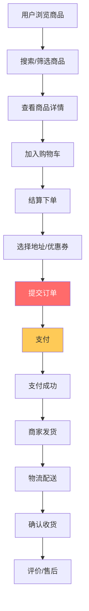
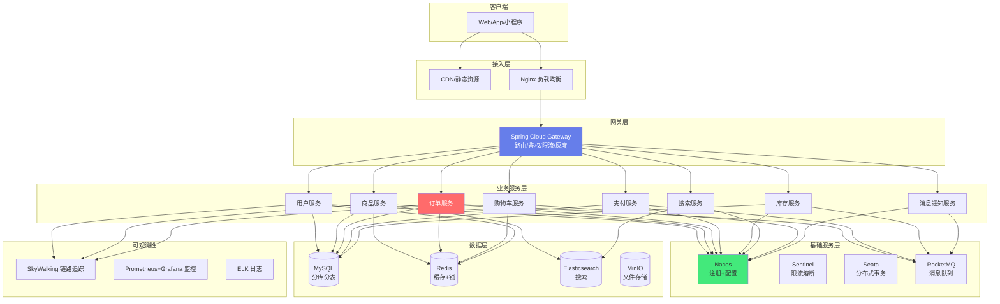
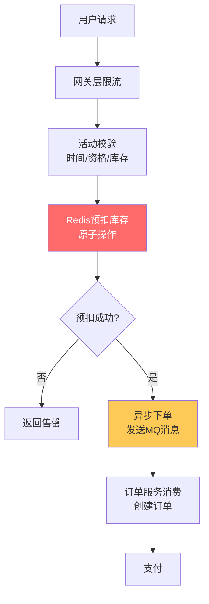

# 🛒 实战：SpringCloud 微服务电商系统

> **文档说明**：从零到一完整实战指南，讲解如何用 Spring Cloud Alibaba 技术栈构建企业级微服务电商系统，涵盖项目概述（目标定位 / 业务场景 / 技术选型 / 架构设计 / 功能清单）、微服务架构设计（服务拆分原则 / 领域驱动设计 DDD / 服务边界划分 / API 网关 / 服务注册发现 / 配置中心 / 服务间通信）、技术栈详解（Spring Boot / Spring Cloud Alibaba / Nacos 注册配置中心 / Sentinel 限流熔断 / Seata 分布式事务 / Gateway 网关 / OpenFeign 声明式调用 / RocketMQ 消息队列 / MySQL / Redis / Elasticsearch / ShardingSphere 分库分表）、核心服务设计（用户服务 / 商品服务 / 订单服务 / 支付服务 / 库存服务 / 搜索服务 / 消息通知服务 / 网关服务）、关键业务流程（下单全流程 / 支付流程 / 库存扣减 / 分布式事务处理 / 秒杀场景设计 / 退款流程）、服务间通信（OpenFeign 声明式调用 / 异步消息解耦 / 事件驱动架构 / 服务降级与容错）、分布式事务（CAP 理论 / BASE 理论 / Seata AT 模式 / TCC 模式 / 可靠消息最终一致性 / 最大努力通知 / 场景选型）、服务治理（Sentinel 限流降级熔断 / 服务监控 Actuator / 链路追踪 SkyWalking / 日志聚合 ELK / 服务网格）、数据存储策略（分库分表 ShardingSphere / 读写分离 / 多级缓存 / 搜索 Elasticsearch / 数据一致性）、部署与运维（Docker 容器化 / Kubernetes 编排 / CI/CD 流水线 / 蓝绿发布 / 弹性伸缩 / 配置管理）、性能优化（缓存策略 / 异步化 / 并发优化 / 数据库优化 / JVM 调优）、安全设计（JWT 认证授权 / 接口鉴权 / 数据加密 / 防刷限流 / 敏感数据脱敏）、高可用设计（服务冗余 / 多机房部署 / 故障转移 / 降级预案 / 容量规划）、常见问题与解决方案（分布式事务失败 / 服务雪崩 / 数据不一致 / 缓存穿透击穿雪崩 / 消息丢失重复 / 接口超时）。
>
> **适用人群**：Java 后端开发者、微服务架构师、想构建电商系统的技术团队、系统设计面试准备者
>
> **前置知识**：[[SpringBoot实战]] · [[SpringCloud-Alibaba组件体系]] · [[微服务架构设计]]

---

## 一、项目概述

### 1.1 项目目标

构建一个高可用、高并发、可扩展的企业级微服务电商系统，具备：

- **完整电商功能**：商品浏览、购物车、下单、支付、物流、售后
- **高并发支撑**：秒杀、大促场景下万级 QPS
- **高可用**：99.99% 可用性，服务冗余、故障自动转移
- **可扩展**：微服务架构，服务独立部署、独立扩展
- **数据一致性**：分布式事务保障订单、库存、支付数据一致
- **可观测性**：全链路追踪、监控告警、日志聚合

### 1.2 业务场景



### 1.3 技术选型

| 层级 | 技术 | 版本 | 说明 |
|------|------|------|------|
| **基础框架** | Spring Boot | 3.2.x | 微服务基础框架 |
| **微服务框架** | Spring Cloud Alibaba | 2023.0.x | 微服务全家桶 |
| **注册/配置中心** | Nacos | 2.3.x | 服务注册发现 + 配置管理 |
| **网关** | Spring Cloud Gateway | 4.1.x | API 网关、路由、限流 |
| **服务调用** | OpenFeign | 4.1.x | 声明式 HTTP 客户端 |
| **限流熔断** | Sentinel | 1.8.x | 流量控制、熔断降级 |
| **分布式事务** | Seata | 2.0.x | 分布式事务解决方案 |
| **消息队列** | RocketMQ | 5.x | 异步消息、事务消息、延迟消息 |
| **数据库** | MySQL | 8.0 | 关系型数据库 |
| **缓存** | Redis | 7.x | 缓存、分布式锁、限流 |
| **搜索** | Elasticsearch | 8.x | 商品搜索、日志存储 |
| **分库分表** | ShardingSphere-JDBC | 5.4.x | 数据分片、读写分离 |
| **链路追踪** | SkyWalking | 9.x | 分布式链路追踪 |
| **日志** | ELK (Elasticsearch+Logstash+Kibana) | 8.x | 日志收集分析 |
| **监控** | Prometheus + Grafana | - | 指标监控告警 |
| **容器化** | Docker + Kubernetes | - | 容器编排部署 |
| **认证** | JWT + Spring Security | - | 无状态认证授权 |

### 1.4 系统架构



---

## 二、微服务架构设计

### 2.1 服务拆分原则

| 原则 | 说明 |
|------|------|
| **单一职责** | 每个服务只负责一个业务领域 |
| **高内聚低耦合** | 服务内部紧密相关，服务之间松耦合 |
| **独立部署** | 每个服务可以独立构建、部署、扩展 |
| **数据独立** | 每个服务拥有自己的数据库，不直接访问其他服务的库 |
| **团队对齐** | 服务边界与团队组织结构对齐（康威定律） |
| **演进式拆分** | 先单体再微服务，逐步拆分，不要过度拆分 |

### 2.2 领域驱动设计（DDD）

```text
电商系统领域划分：

1. 用户域（User Domain）
   - 用户注册/登录/信息管理
   - 收货地址管理
   - 会员等级/积分

2. 商品域（Product Domain）
   - 商品SPU/SKU管理
   - 商品分类/品牌
   - 商品评价
   - 商品搜索

3. 交易域（Trade Domain）
   - 购物车
   - 订单创建/管理
   - 订单状态机
   - 优惠券/促销

4. 支付域（Payment Domain）
   - 支付渠道对接（微信/支付宝）
   - 支付流水
   - 退款

5. 库存域（Inventory Domain）
   - 库存查询/扣减/回滚
   - 库存预警
   - 仓库管理

6. 履约域（Fulfillment Domain）
   - 物流对接
   - 发货/收货
   - 售后/退换货
```

### 2.3 服务清单

| 服务 | 职责 | 核心表 | 端口 |
|------|------|--------|------|
| **gateway-service** | API网关、路由、鉴权、限流 | - | 8080 |
| **user-service** | 用户、地址、会员 | user, user_address | 8081 |
| **product-service** | 商品、分类、品牌、评价 | product_spu, product_sku, category | 8082 |
| **cart-service** | 购物车 | cart_item（Redis） | 8083 |
| **order-service** | 订单、订单项、订单状态 | order, order_item, order_log | 8084 |
| **payment-service** | 支付、退款、支付流水 | payment, refund, payment_log | 8085 |
| **inventory-service** | 库存、仓库、库存流水 | inventory, inventory_log | 8086 |
| **search-service** | 商品搜索、搜索建议 | ES索引 | 8087 |
| **message-service** | 短信、邮件、站内信 | message_record | 8088 |
| **promotion-service** | 优惠券、促销活动、秒杀 | coupon, promotion, seckill | 8089 |

---

## 三、核心服务设计

### 3.1 网关服务（Gateway）

```yaml
# gateway-service application.yml
spring:
  cloud:
    gateway:
      routes:
        - id: user-service
          uri: lb://user-service
          predicates:
            - Path=/api/user/**
          filters:
            - StripPrefix=1
            - name: RequestRateLimiter
              args:
                redis-rate-limiter.replenishRate: 10
                redis-rate-limiter.burstCapacity: 20
        
        - id: order-service
          uri: lb://order-service
          predicates:
            - Path=/api/order/**
          filters:
            - StripPrefix=1
            - name: Retry
              args:
                retries: 3
                statuses: BAD_GATEWAY,SERVICE_UNAVAILABLE
```

```java
// 全局鉴权过滤器
@Component
public class AuthGlobalFilter implements GlobalFilter, Ordered {
    
    @Autowired
    private RedisTemplate<String, String> redisTemplate;
    
    // 白名单路径
    private static final List<String> WHITE_LIST = Arrays.asList(
        "/api/user/login", "/api/user/register", 
        "/api/product/list", "/api/product/detail"
    );
    
    @Override
    public Mono<Void> filter(ServerWebExchange exchange, GatewayFilterChain chain) {
        String path = exchange.getRequest().getURI().getPath();
        
        // 白名单放行
        if (WHITE_LIST.stream().anyMatch(path::startsWith)) {
            return chain.filter(exchange);
        }
        
        // 校验 Token
        String token = exchange.getRequest().getHeaders().getFirst("Authorization");
        if (token == null || !token.startsWith("Bearer ")) {
            return unauthorized(exchange);
        }
        
        token = token.substring(7);
        String userId = JwtUtil.getUserId(token);
        if (userId == null) {
            return unauthorized(exchange);
        }
        
        // 将用户信息传递给下游服务
        ServerHttpRequest request = exchange.getRequest().mutate()
                .header("X-User-Id", userId)
                .build();
        
        return chain.filter(exchange.mutate().request(request).build());
    }
    
    private Mono<Void> unauthorized(ServerWebExchange exchange) {
        exchange.getResponse().setStatusCode(HttpStatus.UNAUTHORIZED);
        return exchange.getResponse().setComplete();
    }
    
    @Override
    public int getOrder() {
        return -100;
    }
}
```

### 3.2 订单服务（核心）

```java
// 订单状态机
public enum OrderStatus {
    PENDING_PAYMENT(0, "待支付"),
    PAID(1, "已支付"),
    SHIPPED(2, "已发货"),
    COMPLETED(3, "已完成"),
    CANCELLED(4, "已取消"),
    REFUNDING(5, "退款中"),
    REFUNDED(6, "已退款");
    
    private final int code;
    private final String desc;
    
    // 状态流转规则
    public boolean canTransitionTo(OrderStatus target) {
        return switch (this) {
            case PENDING_PAYMENT -> target == PAID || target == CANCELLED;
            case PAID -> target == SHIPPED || target == REFUNDING;
            case SHIPPED -> target == COMPLETED || target == REFUNDING;
            case REFUNDING -> target == REFUNDED || target == PAID;
            default -> false;
        };
    }
}
```

```java
// 下单服务（核心流程）
@Service
@Slf4j
public class OrderService {
    
    @Autowired
    private OrderRepository orderRepository;
    @Autowired
    private InventoryFeignClient inventoryClient;
    @Autowired
    private CartFeignClient cartClient;
    @Autowired
    private RocketMQTemplate rocketMQTemplate;
    @Autowired
    private IdGenerator idGenerator;
    
    /**
     * 提交订单（分布式事务：Seata AT 模式）
     */
    @GlobalTransactional(rollbackFor = Exception.class)
    public OrderResult createOrder(OrderCreateRequest request) {
        Long userId = request.getUserId();
        log.info("开始创建订单, userId={}", userId);
        
        // 1. 校验商品和价格
        List<OrderItem> items = validateAndBuildItems(request.getItems());
        
        // 2. 计算金额（商品金额 + 运费 - 优惠）
        BigDecimal totalAmount = calculateTotalAmount(items, request.getCouponId());
        
        // 3. 扣减库存（远程调用库存服务）
        for (OrderItem item : items) {
            Result<Boolean> result = inventoryClient.deductStock(
                item.getSkuId(), item.getQuantity());
            if (!result.isSuccess() || !result.getData()) {
                throw new BusinessException("库存不足: " + item.getSkuId());
            }
        }
        
        // 4. 创建订单
        Order order = Order.builder()
                .orderNo(idGenerator.nextId())
                .userId(userId)
                .totalAmount(totalAmount)
                .status(OrderStatus.PENDING_PAYMENT.getCode())
                .receiverName(request.getReceiverName())
                .receiverPhone(request.getReceiverPhone())
                .receiverAddress(request.getReceiverAddress())
                .build();
        orderRepository.save(order);
        orderRepository.saveItems(order.getId(), items);
        
        // 5. 清空购物车
        cartClient.clearCheckedItems(userId);
        
        // 6. 发送延迟消息（30分钟未支付自动取消）
        rocketMQTemplate.syncSend("order-timeout-topic", 
            MessageBuilder.withPayload(order.getOrderNo())
                .build(), 3000, 16); // 16级延迟 = 30分钟
        
        // 7. 发送订单创建事件
        rocketMQTemplate.convertAndSend("order-created-topic", 
            new OrderCreatedEvent(order.getOrderNo(), userId, totalAmount));
        
        log.info("订单创建成功, orderNo={}", order.getOrderNo());
        return new OrderResult(order.getOrderNo(), totalAmount);
    }
    
    /**
     * 订单超时取消（消费延迟消息）
     */
    @RocketMQMessageListener(topic = "order-timeout-topic", consumerGroup = "order-timeout-group")
    public class OrderTimeoutConsumer implements RocketMQListener<String> {
        @Override
        public void onMessage(String orderNo) {
            Order order = orderRepository.findByOrderNo(orderNo);
            if (order != null && order.getStatus() == OrderStatus.PENDING_PAYMENT.getCode()) {
                log.info("订单超时未支付, 自动取消: {}", orderNo);
                cancelOrder(orderNo, "超时未支付");
            }
        }
    }
}
```

### 3.3 库存服务

```java
@Service
@Slf4j
public class InventoryService {
    
    @Autowired
    private InventoryRepository inventoryRepository;
    @Autowired
    private RedisTemplate<String, String> redisTemplate;
    
    private static final String STOCK_KEY_PREFIX = "inventory:stock:";
    private static final String STOCK_LOCK_PREFIX = "inventory:lock:";
    
    /**
     * 扣减库存（Redis 预扣 + DB 最终一致）
     */
    public boolean deductStock(Long skuId, Integer quantity) {
        String lockKey = STOCK_LOCK_PREFIX + skuId;
        RLock lock = redissonClient.getLock(lockKey);
        
        try {
            lock.lock(10, TimeUnit.SECONDS);
            
            // 1. Redis 预扣减
            String stockKey = STOCK_KEY_PREFIX + skuId;
            Long remain = redisTemplate.opsForValue().decrement(stockKey, quantity);
            
            if (remain == null || remain < 0) {
                // 库存不足，回滚
                redisTemplate.opsForValue().increment(stockKey, quantity);
                log.warn("库存不足, skuId={}, 申请数量={}", skuId, quantity);
                return false;
            }
            
            // 2. 异步扣减数据库（最终一致性）
            inventoryRepository.deductStock(skuId, quantity);
            
            // 3. 记录库存流水
            inventoryRepository.saveLog(skuId, quantity, "DEDUCT", "订单扣减");
            
            return true;
        } finally {
            if (lock.isHeldByCurrentThread()) {
                lock.unlock();
            }
        }
    }
    
    /**
     * 回滚库存
     */
    public boolean rollbackStock(Long skuId, Integer quantity) {
        String stockKey = STOCK_KEY_PREFIX + skuId;
        redisTemplate.opsForValue().increment(stockKey, quantity);
        inventoryRepository.increaseStock(skuId, quantity);
        inventoryRepository.saveLog(skuId, quantity, "ROLLBACK", "订单取消回滚");
        return true;
    }
}
```

### 3.4 支付服务

```java
@Service
@Slf4j
public class PaymentService {
    
    @Autowired
    private PaymentRepository paymentRepository;
    @Autowired
    private RocketMQTemplate rocketMQTemplate;
    @Autowired
    private OrderFeignClient orderClient;
    
    /**
     * 创建支付
     */
    public PaymentResult createPayment(PaymentRequest request) {
        // 1. 创建支付流水
        Payment payment = Payment.builder()
                .paymentNo(IdUtil.simpleUUID())
                .orderNo(request.getOrderNo())
                .amount(request.getAmount())
                .channel(request.getChannel()) // ALIPAY/WECHAT
                .status("PENDING")
                .build();
        paymentRepository.save(payment);
        
        // 2. 调用第三方支付（微信/支付宝）
        String payUrl = callThirdPartyPay(payment);
        
        return new PaymentResult(payment.getPaymentNo(), payUrl);
    }
    
    /**
     * 支付回调（异步通知）
     */
    @Transactional
    public String handlePayCallback(PayCallbackRequest callback) {
        // 1. 验签
        if (!verifySignature(callback)) {
            return "FAIL";
        }
        
        // 2. 幂等校验
        Payment payment = paymentRepository.findByPaymentNo(callback.getPaymentNo());
        if (payment == null || "SUCCESS".equals(payment.getStatus())) {
            return "SUCCESS"; // 已处理，直接返回成功
        }
        
        // 3. 更新支付状态
        payment.setStatus("SUCCESS");
        payment.setPayTime(LocalDateTime.now());
        payment.setTransactionId(callback.getTransactionId());
        paymentRepository.update(payment);
        
        // 4. 发送支付成功消息（订单服务消费，更新订单状态）
        rocketMQTemplate.convertAndSend("payment-success-topic",
            new PaymentSuccessEvent(payment.getOrderNo(), payment.getPaymentNo(), payment.getAmount()));
        
        log.info("支付成功, orderNo={}, amount={}", payment.getOrderNo(), payment.getAmount());
        return "SUCCESS";
    }
}
```

---

## 四、分布式事务

### 4.1 分布式事务方案对比

| 方案 | 原理 | 一致性 | 性能 | 复杂度 | 适用场景 |
|------|------|--------|------|--------|---------|
| **Seata AT** | 二阶段提交，自动生成回滚日志 | 强一致 | 中 | 低 | 大多数业务场景（下单、支付） |
| **Seata TCC** | Try-Confirm-Cancel，业务层面实现 | 强一致 | 高 | 高 | 资金、库存等核心场景 |
| **可靠消息最终一致** | 消息队列 + 本地消息表 | 最终一致 | 高 | 中 | 异步解耦场景（通知、日志） |
| **最大努力通知** | 发起方多次通知，接收方幂等 | 最终一致 | 高 | 低 | 支付回调、第三方通知 |
| **Saga** | 长事务拆分，补偿机制 | 最终一致 | 高 | 高 | 长流程业务（跨多个服务） |

### 4.2 Seata AT 模式（下单场景）

```text
Seata AT 模式流程：

1. TM（事务管理器）开启全局事务 @GlobalTransactional
2. 各服务 RM（资源管理器）执行本地事务
   - 注册分支事务到 TC（事务协调器）
   - 执行 SQL 前：查询前镜像（before image）
   - 执行 SQL
   - 执行 SQL 后：查询后镜像（after image）
   - 生成回滚日志（undo_log）
   - 提交本地事务，释放本地锁
3. TM 提交全局事务
   - 所有分支成功 → TC 通知各 RM 删除 undo_log
   - 有分支失败 → TC 通知各 RM 根据 undo_log 回滚
```

```java
// 下单服务使用 Seata AT
@GlobalTransactional(name = "create-order", rollbackFor = Exception.class)
public OrderResult createOrder(OrderCreateRequest request) {
    // 1. 创建订单（本地事务）
    orderRepository.save(order);
    
    // 2. 扣减库存（远程调用，Seata 自动传播 XID）
    inventoryClient.deductStock(skuId, quantity);
    
    // 3. 扣减优惠券（远程调用）
    couponClient.useCoupon(couponId, userId);
    
    // 任何一步异常，全局事务自动回滚
    return result;
}
```

### 4.3 可靠消息最终一致性（支付成功→订单更新）

```text
可靠消息最终一致性流程：

1. 支付服务：
   - 支付成功 → 写入本地消息表（状态=待发送）
   - 发送消息到 RocketMQ（半消息/事务消息）
   - 收到 MQ 确认 → 更新消息状态=已发送

2. 订单服务：
   - 消费支付成功消息
   - 幂等校验（订单号唯一）
   - 更新订单状态=已支付
   - 确认消费（ACK）

3. 补偿机制：
   - 定时任务扫描本地消息表，重发未确认消息
   - 消费方幂等，保证不重复处理
```

```java
// RocketMQ 事务消息
@Service
public class PaymentTransactionService {
    
    @Autowired
    private RocketMQTemplate rocketMQTemplate;
    @Autowired
    private PaymentRepository paymentRepository;
    
    /**
     * 发送事务消息（半消息）
     */
    public void sendPaymentSuccessMessage(Payment payment) {
        rocketMQTemplate.sendMessageInTransaction(
            "payment-success-topic",
            MessageBuilder.withPayload(
                new PaymentSuccessEvent(payment.getOrderNo(), payment.getAmount()))
                .setHeader("paymentNo", payment.getPaymentNo())
                .build(),
            payment  // 用于本地事务回查
        );
    }
}

// 事务消息监听器
@RocketMQTransactionListener
public class PaymentTransactionListener implements RocketMQLocalTransactionListener {
    
    @Autowired
    private PaymentRepository paymentRepository;
    
    @Override
    public RocketMQLocalTransactionState executeLocalTransaction(Message msg, Object arg) {
        try {
            Payment payment = (Payment) arg;
            // 执行本地事务：更新支付状态
            paymentRepository.updateStatus(payment.getPaymentNo(), "SUCCESS");
            return RocketMQLocalTransactionState.COMMIT;
        } catch (Exception e) {
            return RocketMQLocalTransactionState.ROLLBACK;
        }
    }
    
    @Override
    public RocketMQLocalTransactionState checkLocalTransaction(Message msg) {
        // 事务回查：检查本地事务是否执行成功
        String paymentNo = (String) msg.getHeaders().get("paymentNo");
        Payment payment = paymentRepository.findByPaymentNo(paymentNo);
        if (payment != null && "SUCCESS".equals(payment.getStatus())) {
            return RocketMQLocalTransactionState.COMMIT;
        }
        return RocketMQLocalTransactionState.ROLLBACK;
    }
}
```

---

## 五、服务治理

### 5.1 Sentinel 限流熔断

```java
// 限流配置（代码方式）
@Configuration
public class SentinelConfig {
    
    @PostConstruct
    public void initRules() {
        // 限流规则：QPS 限流
        List<FlowRule> flowRules = new ArrayList<>();
        FlowRule orderRule = new FlowRule();
        orderRule.setResource("createOrder");
        orderRule.setGrade(RuleConstant.FLOW_GRADE_QPS);
        orderRule.setCount(100); // 每秒 100 次
        orderRule.setControlBehavior(RuleConstant.CONTROL_BEHAVIOR_RATE_LIMITER);
        flowRules.add(orderRule);
        FlowRuleManager.loadRules(flowRules);
        
        // 熔断规则：慢调用比例
        List<DegradeRule> degradeRules = new ArrayList<>();
        DegradeRule degradeRule = new DegradeRule();
        degradeRule.setResource("inventoryService");
        degradeRule.setGrade(RuleConstant.DEGRADE_GRADE_RT);
        degradeRule.setCount(1000); // RT 超过 1s
        degradeRule.setTimeWindow(30); // 熔断 30s
        degradeRule.setMinRequestAmount(10);
        degradeRules.add(degradeRule);
        DegradeRuleManager.loadRules(degradeRules);
    }
}

// 使用注解
@Service
public class OrderService {
    
    @SentinelResource(value = "createOrder", 
        blockHandler = "createOrderBlock", 
        fallback = "createOrderFallback")
    public OrderResult createOrder(OrderCreateRequest request) {
        // 业务逻辑
    }
    
    // 限流降级
    public OrderResult createOrderBlock(OrderCreateRequest request, BlockException ex) {
        throw new BusinessException("系统繁忙，请稍后重试");
    }
    
    // 异常降级
    public OrderResult createOrderFallback(OrderCreateRequest request, Throwable ex) {
        log.error("创建订单失败", ex);
        throw new BusinessException("下单失败，请稍后重试");
    }
}
```

### 5.2 Feign 服务调用与容错

```java
// Feign 客户端
@FeignClient(name = "inventory-service", fallback = InventoryFeignFallback.class)
public interface InventoryFeignClient {
    
    @PostMapping("/inventory/deduct")
    Result<Boolean> deductStock(@RequestParam("skuId") Long skuId, 
                                  @RequestParam("quantity") Integer quantity);
    
    @GetMapping("/inventory/{skuId}")
    Result<InventoryVO> getStock(@PathVariable("skuId") Long skuId);
}

// Fallback 降级
@Component
@Slf4j
public class InventoryFeignFallback implements InventoryFeignClient {
    
    @Override
    public Result<Boolean> deductStock(Long skuId, Integer quantity) {
        log.error("库存服务调用失败, skuId={}", skuId);
        return Result.error("库存服务暂不可用");
    }
    
    @Override
    public Result<InventoryVO> getStock(Long skuId) {
        return Result.error("库存服务暂不可用");
    }
}
```

---

## 六、高并发与秒杀设计

### 6.1 秒杀架构



### 6.2 秒杀核心代码

```java
@Service
@Slf4j
public class SeckillService {
    
    @Autowired
    private RedisTemplate<String, String> redisTemplate;
    @Autowired
    private RocketMQTemplate rocketMQTemplate;
    @Autowired
    private RedissonClient redissonClient;
    
    private static final String SECKILL_STOCK_KEY = "seckill:stock:";
    private static final String SECKILL_USER_KEY = "seckill:user:";
    
    /**
     * 秒杀下单（Redis 预扣 + 异步下单）
     */
    public Result<String> seckill(Long activityId, Long skuId, Long userId) {
        // 1. 校验活动时间
        if (!isActivityActive(activityId)) {
            return Result.error("活动未开始或已结束");
        }
        
        // 2. 防重复购买（Set 集合）
        Long isNew = redisTemplate.opsForSet().add(
            SECKILL_USER_KEY + activityId, userId.toString());
        if (isNew != null && isNew == 0) {
            return Result.error("您已参与过本次秒杀");
        }
        
        // 3. Redis 原子预扣库存（Lua 脚本保证原子性）
        String stockKey = SECKILL_STOCK_KEY + skuId;
        Long remain = redisTemplate.execute(
            new DefaultRedisScript<Long>(DEDUCT_STOCK_LUA, Long.class),
            Collections.singletonList(stockKey));
        
        if (remain == null || remain < 0) {
            // 回滚用户标记
            redisTemplate.opsForSet().remove(SECKILL_USER_KEY + activityId, userId.toString());
            return Result.error("商品已售罄");
        }
        
        // 4. 异步下单（发送 MQ）
        rocketMQTemplate.asyncSend("seckill-order-topic",
            MessageBuilder.withPayload(
                new SeckillOrderMessage(activityId, skuId, userId)).build(),
            new SendCallback() {
                @Override
                public void onSuccess(SendResult sendResult) {
                    log.info("秒杀消息发送成功, userId={}", userId);
                }
                @Override
                public void onException(Throwable e) {
                    log.error("秒杀消息发送失败", e);
                    // 回滚库存
                    redisTemplate.opsForValue().increment(stockKey);
                }
            });
        
        return Result.success("排队中，请稍后查看订单");
    }
    
    // Lua 脚本：原子扣减库存
    private static final String DEDUCT_STOCK_LUA = 
        "local stock = tonumber(redis.call('get', KEYS[1])) " +
        "if stock == nil then return -1 end " +
        "if stock <= 0 then return -1 end " +
        "redis.call('decr', KEYS[1]) " +
        "return stock - 1";
}
```

---

## 七、数据存储策略

### 7.1 分库分表（ShardingSphere）

```yaml
# 订单分库分表配置
spring:
  shardingsphere:
    datasource:
      names: ds0,ds1
      ds0:
        type: com.zaxxer.hikari.HikariDataSource
        jdbc-url: jdbc:mysql://localhost:3306/order_db_0
        username: root
        password: password
      ds1:
        type: com.zaxxer.hikari.HikariDataSource
        jdbc-url: jdbc:mysql://localhost:3306/order_db_1
        username: root
        password: password
    rules:
      sharding:
        tables:
          t_order:
            actual-data-nodes: ds${0..1}.t_order_${0..3}
            database-strategy:
              standard:
                sharding-column: user_id
                sharding-algorithm-name: order-db-inline
            table-strategy:
              standard:
                sharding-column: order_id
                sharding-algorithm-name: order-table-inline
        sharding-algorithms:
          order-db-inline:
            type: INLINE
            props:
              algorithm-expression: ds${user_id % 2}
          order-table-inline:
            type: INLINE
            props:
              algorithm-expression: t_order_${order_id % 4}
```

### 7.2 多级缓存

```text
缓存层级：

1. 本地缓存（Caffeine）
   - 热点商品信息、分类数据
   - 容量小、速度极快（ns级）
   - 有数据不一致风险，设置短过期时间

2. 分布式缓存（Redis）
   - 商品详情、库存、用户信息、购物车
   - 容量大、速度快（ms级）
   - 主从+哨兵，高可用

3. 数据库（MySQL）
   - 持久化存储
   - 读写分离，一主多从
   - 分库分表，水平扩展

缓存策略：
- Cache-Aside：先查缓存，没有查数据库，再写缓存
- 写策略：更新数据库后删除缓存（延迟双删）
- 过期时间：随机化，防止缓存雪崩
- 空值缓存：防止缓存穿透
- 布隆过滤器：防止缓存穿透
```

---

## 八、部署与运维

### 8.1 Docker 部署

```dockerfile
# 通用 Dockerfile
FROM eclipse-temurin:17-jre-alpine
WORKDIR /app
COPY target/*.jar app.jar
EXPOSE 8080
ENV JAVA_OPTS="-Xms512m -Xmx1024m -XX:+UseG1GC"
ENTRYPOINT ["sh", "-c", "java $JAVA_OPTS -jar app.jar"]
```

```yaml
# docker-compose.yml（基础组件）
version: '3.8'
services:
  nacos:
    image: nacos/nacos-server:v2.3.0
    environment:
      - MODE=standalone
    ports:
      - "8848:8848"
  
  mysql:
    image: mysql:8.0
    environment:
      MYSQL_ROOT_PASSWORD: password
    ports:
      - "3306:3306"
    volumes:
      - mysql_data:/var/lib/mysql
  
  redis:
    image: redis:7-alpine
    ports:
      - "6379:6379"
  
  rocketmq:
    image: apache/rocketmq:5.1.4
    ports:
      - "9876:9876"
  
  sentinel-dashboard:
    image: bladex/sentinel-dashboard:1.8.6
    ports:
      - "8858:8858"
  
  elasticsearch:
    image: elasticsearch:8.11.0
    environment:
      - discovery.type=single-node
      - xpack.security.enabled=false
    ports:
      - "9200:9200"

volumes:
  mysql_data:
```

### 8.2 Kubernetes 部署要点

- **HPA 弹性伸缩**：根据 CPU/内存/自定义指标自动扩缩容
- **滚动更新**：零停机部署，maxSurge=1, maxUnavailable=0
- **健康检查**：livenessProbe + readinessProbe
- **配置管理**：ConfigMap + Secret，Nacos 配置中心
- **服务发现**：K8s Service + Nacos 双注册
- **资源限制**：requests + limits，防止资源争抢
- **日志收集**：Filebeat → Kafka → Logstash → Elasticsearch
- **监控告警**：Prometheus + Grafana + AlertManager

---

## 九、常见问题与解决方案

| 问题 | 原因 | 解决方案 |
|------|------|---------|
| **分布式事务失败** | 网络超时/服务宕机/数据冲突 | Seata AT 自动回滚；TCC 业务补偿；可靠消息+定时补偿 |
| **服务雪崩** | 某个服务故障导致级联失败 | Sentinel 熔断降级；线程池隔离；超时控制；降级预案 |
| **数据不一致** | 分布式事务未完全保证/缓存与DB不一致 | 最终一致性+定时对账；缓存延迟双删；Binlog同步缓存 |
| **缓存穿透** | 查询不存在的数据，请求直达DB | 布隆过滤器；空值缓存（短过期） |
| **缓存击穿** | 热点key过期，大量请求同时打DB | 互斥锁（Redis分布式锁）；永不过期+异步更新 |
| **缓存雪崩** | 大量key同时过期 | 过期时间随机化；多级缓存；服务降级 |
| **消息丢失** | MQ宕机/生产者发送失败/消费者未ACK | 生产者确认机制；MQ持久化；消费者手动ACK+幂等 |
| **消息重复消费** | 网络重传/消费者重启 | 消费端幂等（唯一ID+去重表/Redis Set） |
| **接口超时** | 下游服务慢/数据库慢/网络延迟 | 超时控制；异步化；缓存；读写分离；SQL优化 |
| **库存超卖** | 并发扣减无锁/分布式锁失效 | Redis原子操作（Lua脚本）；分布式锁（Redisson）；DB乐观锁 |
| **分布式锁失效** | 锁过期但业务未完成/主从切换 | Redisson看门狗自动续期；锁主从延迟；RedLock算法 |
| **分库分表后查询难** | 跨库JOIN/分页/排序 | 冗余字段；宽表设计；ES联合查询；数据同步 |

---

## 十、关联笔记

```text
### Java 后端
```
- [[SpringBoot实战]] · [[SpringCloud-Alibaba组件体系]] · [[微服务架构设计]]
- [[注册中心对比与选型]] · [[MySQL问题排查手册]] · [[Redis缓存实战]]

### 分布式与中间件
- [[RocketMQ-事务消息]] · [[分布式事务详解]] · [[分布式锁原理与实践]]
- [[Sentinel限流熔断实战]] · [[Seata-分布式事务]] · [[分库分表实战指南]]

### 全栈项目
- [[实战-SpringCloud微服务电商系统]] · [[实战-SpringBoot+Vue3权限管理系统]]
- [[实战-FastAPI+Vue3后台管理系统]] · [[实战-RAG企业知识库问答系统]]

### 运维部署
- [[Docker容器化]] · [[Kubernetes入门与实践]] · [[CI-CD持续集成与部署]]
- [[Prometheus监控体系]] · [[ELK日志分析]] · [[SkyWalking链路追踪]]

### 导航
- [[MOC-项目实战]] · [[MOC-后端开发]] · [[MOC-分布式与中间件]] · [[Home]] · [[学习路线总览]]

> 🔍 **核心认知深度解析**
>
> **作用**：SpringCloud 微服务电商系统实战解决的是「如何用 Spring Cloud Alibaba 技术栈构建一个高可用、高并发、可扩展的企业级电商系统，涵盖服务拆分、分布式事务、服务治理、数据存储、部署运维全链路」的核心问题——这是 Java 后端从「CRUD 工程师」到「架构师」的关键跨越，也是系统设计面试的核心考点。
>
> **底层原理**：①微服务架构的核心是「分而治之」——将庞大的单体应用按业务领域拆分为多个独立部署、独立扩展的小服务，每个服务专注一个业务能力，服务之间通过轻量级协议（HTTP/REST 或消息队列）通信。这种架构的优势是：技术栈灵活（每个服务可以用最合适的技术）、独立部署（修改一个服务不需要重新部署整个系统）、独立扩展（热点服务可以单独扩容）、故障隔离（一个服务挂了不影响其他服务）、团队自治（每个团队负责一个服务）。但代价是：分布式复杂度（网络延迟、数据一致性、服务发现）、运维成本高（需要容器编排、监控告警、链路追踪）、数据一致性难（跨服务事务需要分布式事务方案）。微服务不是银弹，小团队/小项目用单体更高效，只有当团队规模、业务复杂度、并发量达到一定程度时，微服务的收益才会超过成本。②服务拆分的核心原则是「高内聚低耦合 + 单一职责 + 数据独立」——按业务领域（DDD 限界上下文）拆分，而不是按技术层拆分（不要拆成用户Controller服务、用户Service服务、用户DAO服务）。每个服务应该拥有自己的数据库，服务之间不直接访问对方的数据库，只通过 API 或消息通信。服务拆分的粒度是一个权衡：太粗（几个大服务）失去了微服务的意义，太细（几百个小服务）运维成本爆炸、调用链太长延迟高。经验法则是「两个披萨团队」——一个服务能被一个6-10人的团队完全负责。电商系统的经典拆分是：用户、商品、订单、支付、库存、搜索、购物车、消息通知，8-10个核心服务是比较合理的粒度。③分布式事务是微服务最大的技术挑战——单体应用中一个数据库事务就能保证一致性，微服务中一个业务操作可能跨多个服务（下单要扣库存、扣优惠券、创建订单），每个服务有自己的数据库，无法用本地事务保证一致性。分布式事务的核心矛盾是「CAP 定理」——一致性（C）、可用性（A）、分区容错性（P）三者不可兼得，分布式系统必须满足 P，所以只能在 C 和 A 之间权衡。强一致性方案（Seata AT/TCC、2PC）保证 C 但牺牲 A（性能低、阻塞、可用性差），最终一致性方案（可靠消息、Saga、最大努力通知）保证 A 但牺牲 C（短暂不一致，最终一致）。电商系统的实践是：核心资金操作（支付、退款）用强一致性（TCC/Seata AT），非核心操作（通知、日志、统计）用最终一致性（可靠消息）。下单场景通常用 Seata AT（自动回滚，开发成本低）或 TCC（性能高，开发成本高），支付成功→订单更新用可靠消息最终一致性。④服务治理是微服务可运维的保障——微服务数量多、调用关系复杂，没有治理就是「分布式单体」甚至更糟。服务治理包括：服务注册发现（Nacos/Eureka，服务启动时注册，消费方从注册中心获取地址）、配置中心（Nacos/Apollo，集中管理配置，动态刷新）、API 网关（Gateway，统一入口、路由、鉴权、限流、灰度）、限流熔断降级（Sentinel/Hystrix，防止服务雪崩，保护系统）、负载均衡（Ribbon/LB，消费方多实例负载均衡）、链路追踪（SkyWalking/Zipkin，追踪请求在多个服务间的调用链路，定位问题）、日志聚合（ELK，集中收集分析日志）、监控告警（Prometheus+Grafana，指标监控和告警）。这些组件构成了微服务的「基础设施」，没有这些基础设施，微服务就是灾难。⑤高并发秒杀是微服务架构的「试金石」——秒杀场景的特点是：瞬时流量巨大（平时100QPS，秒杀瞬间10万QPS）、库存有限（先到先得）、用户体验要求高（不能让用户等太久）。秒杀的核心优化思路是「层层过滤 + 异步化」：网关层限流（只放10%流量进来）→ 活动校验（时间/资格/黑名单）→ Redis 预扣库存（原子操作，Lua脚本保证，挡住99%请求）→ 异步下单（发送MQ，订单服务慢慢消费，用户看到「排队中」）→ 最终创建订单。这样数据库的压力从10万QPS降到了几百QPS，系统能扛住。关键技术点：Redis 原子扣减（Lua脚本，防止超卖）、防重复购买（Redis Set）、异步解耦（MQ削峰填谷）、最终一致性（Redis预扣+DB最终一致+对账补偿）。⑥数据存储策略是微服务性能的基础——电商系统数据量大、并发高，单一数据库扛不住。策略包括：读写分离（一主多从，写主库读从库，提升读性能）、分库分表（ShardingSphere，按用户ID分库、按订单ID分表，水平扩展存储和并发）、多级缓存（本地缓存Caffeine+分布式缓存Redis+数据库，热点数据走缓存，挡住大部分读请求）、搜索引擎（Elasticsearch，商品搜索、复杂查询、日志存储，不适合用MySQL做的查询用ES）、NoSQL（Redis做缓存/分布式锁/限流，MongoDB做非结构化数据，MinIO做文件存储）。数据一致性是难点：缓存与数据库一致性用「更新数据库后删除缓存+延迟双删」，分库分表后跨库查询用「冗余字段+宽表+ES联合查询」，读写分离延迟用「强制走主库+缓存」。⑦部署运维是微服务落地的最后一公里——微服务数量多（十几个到几十个服务）、实例多（每个服务多实例）、依赖复杂，手动部署不可行。容器化（Docker）是基础——每个服务打包成镜像，环境一致，快速部署。容器编排（Kubernetes）是核心——自动调度、弹性伸缩（HPA根据CPU/内存自动扩缩容）、滚动更新（零停机）、健康检查（自动重启故障实例）、服务发现（K8s Service）、配置管理（ConfigMap/Secret）。CI/CD 流水线（Jenkins/GitLab CI）实现代码提交→自动构建→自动测试→自动部署。蓝绿发布/金丝雀发布实现零风险上线。可观测性三支柱（日志、指标、链路追踪）是排查问题的基础。这些运维能力是微服务从「能跑」到「能在生产稳定跑」的关键。
>
> **用法要点**：① 技术栈：SpringBoot3.2+SpringCloudAlibaba2023+Nacos(注册配置)+Sentinel(限流熔断)+Seata(分布式事务)+Gateway(网关)+OpenFeign(服务调用)+RocketMQ(消息)+MySQL8+Redis7+Elasticsearch8+ShardingSphere(分库分表)+SkyWalking(链路追踪)+Prometheus+Grafana+Docker+K8s ② 服务拆分：按业务领域DDD拆分(用户/商品/订单/支付/库存/搜索/购物车/消息/促销)，单一职责+高内聚低耦合+数据独立+独立部署，8-10个核心服务合理粒度，每个服务6-10人团队 ③ 核心流程：下单(校验→计算金额→Seata全局事务扣库存→创建订单→清购物车→延迟消息超时取消→发送事件)、支付(创建支付流水→第三方支付→回调验签→幂等→更新状态→事务消息通知订单)、库存(Redis预扣+分布式锁+DB最终一致+流水记录+回滚) ④ 分布式事务：Seata AT(自动回滚日志，大多数场景)、TCC(业务层面Try-Confirm-Cancel，资金核心)、可靠消息最终一致性(RocketMQ事务消息+本地消息表+定时补偿，异步解耦)、最大努力通知(支付回调)；选型：核心资金用强一致，非核心用最终一致 ⑤ 服务治理：Nacos注册发现+配置中心、Gateway网关(路由/鉴权/限流JWT/灰度)、Sentinel限流熔断(QPS限流+慢调用熔断+降级fallback)、OpenFeign声明式调用+fallback降级、SkyWalking链路追踪、ELK日志、Prometheus+Grafana监控告警 ⑥ 高并发秒杀：网关限流→活动校验→Redis防重复(Set)→Redis原子预扣(Lua脚本)→异步MQ下单→订单服务消费→支付；核心：Redis原子操作防超卖、MQ削峰填谷、异步化用户体验(排队中) ⑦ 数据存储：读写分离(一主多从)、分库分表(ShardingSphere按user_id分库按order_id分表)、多级缓存(Caffeine本地+Redis分布式+MySQL，Cache-Aside+延迟双删)、ES搜索(商品搜索/复杂查询)、缓存问题解决(穿透布隆过滤器+空值、击穿互斥锁+永不过期、雪崩随机过期+多级缓存) ⑧ 部署运维：Docker镜像(17JRE+G1GC)、K8s编排(HPA弹性伸缩+滚动更新+健康检查+资源限制)、CI/CD(Jenkins/GitLab CI自动构建部署)、蓝绿/金丝雀发布、可观测性(日志ELK+指标Prometheus+链路SkyWalking) ⑨ 安全：JWT无状态认证+网关鉴权、接口权限、数据加密传输HTTPS、敏感数据脱敏、防刷限流(Sentinel+Redis)、SQL注入防护(ORM参数化)、XSS防护 ⑩ 高可用：服务多实例+反亲和部署、多机房多活、故障自动转移(K8s重启)、降级预案(核心链路保活非核心降级)、容量规划(压测+30%冗余)、熔断隔离(线程池隔离) ⑪ 常见问题：分布式事务失败(Seata回滚+TCC补偿+消息补偿)、服务雪崩(Sentinel熔断+线程池隔离+超时)、数据不一致(最终一致+定时对账+延迟双删+Binlog同步)、消息丢失(生产者确认+MQ持久化+手动ACK)、消息重复(消费端幂等唯一ID)、库存超卖(Redis Lua原子+分布式锁+DB乐观锁)、分库分表查询难(冗余字段+宽表+ES联合查询) ⑫ 开发流程：需求分析→领域建模DDD→服务拆分→接口设计→数据库设计→核心服务开发→分布式事务接入→服务治理接入→联调测试→压测优化→容器化部署→监控告警→持续迭代。

> 💡 **深度讲解**：SpringCloud 微服务电商系统最核心的智慧是「分而治之的架构思想 + 工程化的服务治理 + 务实的分布式一致性方案」——微服务不是目的，而是手段，目的是支撑复杂业务和高并发场景下的快速迭代和高可用。微服务架构的核心是「分而治之」——将庞大的单体按业务领域拆分为独立小服务，每个服务专注一个业务能力，独立部署独立扩展，故障隔离团队自治，但代价是分布式复杂度（网络延迟、数据一致性、服务发现）和运维成本，微服务不是银弹，小团队小项目用单体更高效，只有团队规模业务复杂度并发量达到一定程度时微服务收益才超过成本。服务拆分的核心原则是「高内聚低耦合+单一职责+数据独立」——按业务领域（DDD限界上下文）拆分而不是按技术层拆分，每个服务拥有自己的数据库，服务之间不直接访问对方数据库只通过API或消息通信，拆分粒度是权衡，太粗失去意义太细运维爆炸，经验法则是「两个披萨团队」（6-10人负责一个服务），电商经典拆分是用户/商品/订单/支付/库存/搜索/购物车/消息8-10个核心服务。分布式事务是微服务最大的技术挑战——CAP定理决定了分布式系统只能在一致性和可用性之间权衡，强一致性方案（Seata AT/TCC/2PC）保证C牺牲A（性能低阻塞），最终一致性方案（可靠消息/Saga/最大努力通知）保证A牺牲C（短暂不一致最终一致），电商实践是核心资金操作（支付退款）用强一致性，非核心操作（通知日志统计）用最终一致性，下单用Seata AT或TCC，支付成功→订单更新用可靠消息。服务治理是微服务可运维的保障——服务注册发现（Nacos）、配置中心（Nacos）、API网关（Gateway统一入口鉴权限流灰度）、限流熔断降级（Sentinel防止雪崩）、负载均衡、链路追踪（SkyWalking定位跨服务问题）、日志聚合（ELK）、监控告警（Prometheus+Grafana），这些构成微服务的「基础设施」，没有这些微服务就是灾难。高并发秒杀是微服务架构的「试金石」——核心思路是「层层过滤+异步化」：网关限流放10%流量→活动校验→Redis预扣库存（Lua原子操作挡住99%请求）→异步MQ下单（削峰填谷用户看到排队中）→订单服务消费创建订单，数据库压力从10万QPS降到几百QPS，关键技术是Redis原子扣减防超卖、防重复购买、异步解耦、最终一致性。数据存储策略是性能基础——读写分离（一主多从）、分库分表（ShardingSphere水平扩展）、多级缓存（Caffeine本地+Redis分布式+MySQL，Cache-Aside+延迟双删）、ES搜索（复杂查询）、缓存问题三件套（穿透布隆过滤器+空值、击穿互斥锁+永不过期、雪崩随机过期+多级缓存）。部署运维是落地最后一公里——Docker容器化+K8s编排（HPA弹性伸缩+滚动更新+健康检查）+CI/CD自动化+蓝绿/金丝雀发布+可观测性三支柱（日志/指标/链路追踪），这些让微服务从「能跑」到「能在生产稳定跑」。如果你在准备系统设计面试或想从CRUD工程师进阶到架构师，深入理解这个电商系统的设计思路和技术选型是最佳路径——从服务拆分原则到分布式事务选型，从服务治理组件到高并发优化，从数据存储策略到部署运维，每一个决策背后都有明确的权衡和理由，理解了「为什么这么做」比记住「怎么做」更重要。

> 📝 **精简总结**：SpringCloud微服务电商=分而治之架构+工程化治理+务实一致性。技术栈：SpringBoot+SpringCloudAlibaba+Nacos+Sentinel+Seata+Gateway+Feign+RocketMQ+MySQL+Redis+ES+ShardingSphere+SkyWalking+Docker+K8s。核心：服务拆分(DDD领域8-10服务)、下单流程(Seata全局事务)、支付回调(事务消息)、库存(Redis预扣+最终一致)。分布式事务：Seata AT(自动回滚)/TCC(资金核心)/可靠消息(异步解耦)。高并发秒杀：网关限流→Redis预扣(Lua)→MQ异步下单。服务治理：注册配置+网关+限流熔断+链路追踪+监控日志。数据：读写分离+分库分表+多级缓存+ES。部署：Docker+K8s+CI/CD+可观测性。

> **学习路径建议**：先学习 [[SpringBoot实战]] 掌握后端基础 → 学习 [[SpringCloud-Alibaba组件体系]] 掌握微服务组件 → 学习 [[微服务架构设计]] 理解架构思想 → 学习 [[MySQL问题排查手册]] 和 [[Redis缓存实战]] 掌握数据层 → 学习 [[RocketMQ-事务消息]] 和 [[分布式事务详解]] 掌握分布式一致性 → 学习 [[Sentinel限流熔断实战]] 和 [[注册中心对比与选型]] 掌握服务治理 → 学习 [[Docker容器化]] 和 [[Kubernetes入门与实践]] 掌握部署 → 按照本文档从零构建电商系统（先核心服务：用户/商品/订单/支付/库存，再服务治理接入，再高并发优化，最后部署运维）→ 学习系统设计面试题，深入理解每个技术选型的权衡 → 在实际项目中积累经验，持续优化。

---

> **SpringCloud 微服务电商系统最核心的智慧是「分而治之的架构思想 + 工程化的服务治理 + 务实的分布式一致性方案」——微服务不是目的而是手段，目的是支撑复杂业务和高并发场景下的快速迭代和高可用。微服务架构的核心是分而治之——将庞大的单体按业务领域拆分为独立小服务，每个服务专注一个业务能力独立部署独立扩展故障隔离团队自治，但代价是分布式复杂度（网络延迟/数据一致性/服务发现）和运维成本，微服务不是银弹小团队小项目用单体更高效，只有团队规模业务复杂度并发量达到一定程度时微服务收益才超过成本。服务拆分的核心原则是高内聚低耦合+单一职责+数据独立——按业务领域（DDD限界上下文）拆分而不是按技术层拆分，每个服务拥有自己的数据库服务之间不直接访问对方数据库只通过API或消息通信，拆分粒度是权衡太粗失去意义太细运维爆炸，经验法则是两个披萨团队（6-10人负责一个服务），电商经典拆分是用户/商品/订单/支付/库存/搜索/购物车/消息8-10个核心服务。分布式事务是微服务最大的技术挑战——CAP定理决定了分布式系统只能在一致性和可用性之间权衡，强一致性方案（Seata AT/TCC/2PC）保证C牺牲A（性能低阻塞），最终一致性方案（可靠消息/Saga/最大努力通知）保证A牺牲C（短暂不一致最终一致），电商实践是核心资金操作（支付退款）用强一致性非核心操作（通知日志统计）用最终一致性，下单用Seata AT或TCC支付成功→订单更新用可靠消息。服务治理是微服务可运维的保障——服务注册发现（Nacos）、配置中心（Nacos）、API网关（Gateway统一入口鉴权限流灰度）、限流熔断降级（Sentinel防止雪崩）、负载均衡、链路追踪（SkyWalking定位跨服务问题）、日志聚合（ELK）、监控告警（Prometheus+Grafana），这些构成微服务的基础设施没有这些微服务就是灾难。高并发秒杀是微服务架构的试金石——核心思路是层层过滤+异步化：网关限流放10%流量→活动校验→Redis预扣库存（Lua原子操作挡住99%请求）→异步MQ下单（削峰填谷用户看到排队中）→订单服务消费创建订单，数据库压力从10万QPS降到几百QPS，关键技术是Redis原子扣减防超卖、防重复购买、异步解耦、最终一致性。数据存储策略是性能基础——读写分离（一主多从）、分库分表（ShardingSphere水平扩展）、多级缓存（Caffeine本地+Redis分布式+MySQL Cache-Aside+延迟双删）、ES搜索（复杂查询）、缓存问题三件套（穿透布隆过滤器+空值/击穿互斥锁+永不过期/雪崩随机过期+多级缓存）。部署运维是落地最后一公里——Docker容器化+K8s编排（HPA弹性伸缩+滚动更新+健康检查）+CI/CD自动化+蓝绿/金丝雀发布+可观测性三支柱（日志/指标/链路追踪），这些让微服务从能跑到能在生产稳定跑。如果你在准备系统设计面试或想从CRUD工程师进阶到架构师，深入理解这个电商系统的设计思路和技术选型是最佳路径——从服务拆分原则到分布式事务选型从服务治理组件到高并发优化从数据存储策略到部署运维，每一个决策背后都有明确的权衡和理由，理解了为什么这么做比记住怎么做更重要。**

---

## 🔗 关联笔记

- [[MOC-项目实战]] — 返回本分类知识地图，查看更多相关文档

## 📖 前置知识

- [[SpringBoot实战]]
- [[SpringCloudAlibaba入门]]
- [[微服务架构设计]]

## 🏷️ 相关标签

`#SpringCloud` `#微服务` `#电商系统` `#SpringBoot` `#Nacos` `#Sentinel`

[[Home|🏠 返回首页]] · [[MOC-项目实战|📚 返回分类]]
