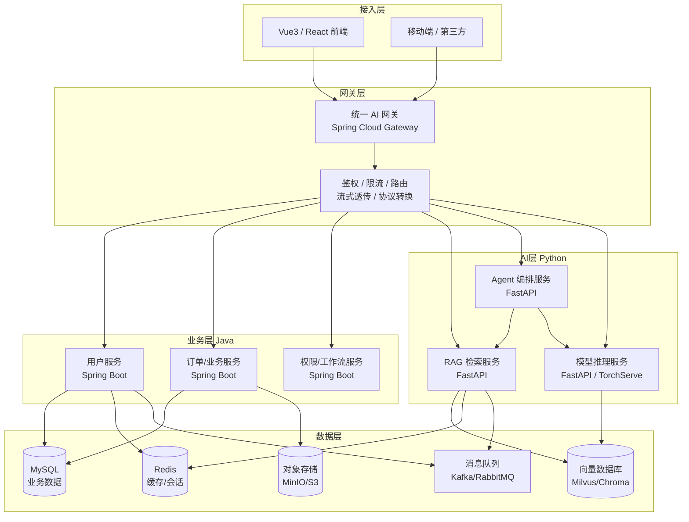
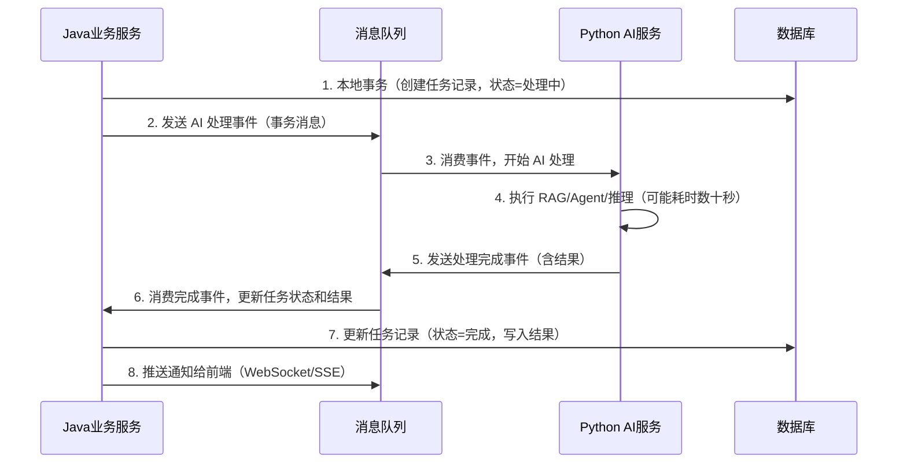

# 🏗️ Python + Java 混合 AI 架构实战

> **文档说明**：系统讲解企业级 AI 应用中 Python + Java 混合架构的设计与实现，涵盖架构分层、服务拆分、跨语言通信、流式透传、服务发现、数据一致性、全链路追踪、可观测性和生产级部署。Python 擅长 AI 模型处理（RAG/Agent/推理），Java 擅长业务逻辑（事务/高并发/微服务），混合架构发挥各自优势，是企业级 AI 应用的主流架构模式。
>
> **适用人群**：全栈架构师、AI 应用后端工程师、需要设计企业级 AI 系统的技术负责人
>
> **前置知识**：[[统一AI网关设计与实现]] · [[多模型路由与流式响应跨语言传递]] · [[FastAPI-封装LLM流式接口]]

---

## 一、概述

### 1.1 为什么需要混合架构

在企业级 AI 应用中，单一技术栈往往无法同时满足所有需求：

| 维度 | Python 优势 | Java 优势 |
|------|------------|----------|
| **AI/ML 生态** | PyTorch/TensorFlow/LangChain/HuggingFace，AI 领域事实标准 | 生态较弱，AI 库支持有限 |
| **业务系统** | 快速开发，但大型企业系统生态不如 Java | Spring 生态成熟，事务/安全/微服务完善 |
| **性能** | 异步 IO 快，但 CPU 密集型慢 | JVM 高性能，多线程并发强 |
| **并发模型** | asyncio 单线程异步，适合 IO 密集 | 多线程+虚拟线程，适合高并发业务 |
| **企业集成** | 需自行对接 ERP/CRM/支付等 | Spring Integration 开箱即用 |
| **人才储备** | AI/数据科学家多 | 企业后端工程师多 |

**结论**：AI 推理和数据处理用 Python，业务逻辑和系统集成用 Java，通过微服务架构组合，是企业级 AI 应用的最优解。

### 1.2 核心应用场景

| 场景 | 说明 | 典型企业 |
|------|------|---------|
| **企业智能客服** | Java 处理用户/订单/工单业务，Python 做 RAG 问答和意图识别 | 银行、电商、运营商 |
| **AI 辅助办公** | Java 处理文档/权限/工作流，Python 做文档摘要/翻译/生成 | 企业 SaaS、OA 系统 |
| **智能风控** | Java 处理交易/账户/规则引擎，Python 做欺诈检测模型推理 | 金融、支付 |
| **AI 代码平台** | Java 处理项目/权限/CI/CD，Python 做代码补全/审查模型 | 开发者工具 |
| **医疗 AI** | Java 处理病历/挂号/处方，Python 做影像识别/辅助诊断 | 医院、医疗 SaaS |
| **智能制造** | Java 处理 MES/ERP/设备管理，Python 做缺陷检测/预测性维护 | 制造业 |

### 1.3 架构核心原则

1. **职责单一**：Python 服务只做 AI 相关（推理/RAG/Agent），Java 服务只做业务逻辑
2. **松耦合**：服务间通过标准 API（HTTP/gRPC）通信，不共享数据库
3. **无状态**：所有服务无状态，支持水平扩展，状态存在 Redis/数据库
4. **统一网关**：AI 网关统一鉴权、限流、路由、流式透传
5. **最终一致性**：跨服务数据通过消息队列保证最终一致性
6. **可观测性**：全链路 Trace 跨语言传递，统一日志/指标/告警

---

## 二、底层原理

### 2.1 架构分层设计



### 2.2 各层职责详解

| 层级 | 技术栈 | 核心职责 | 关键组件 |
|------|--------|---------|---------|
| **接入层** | Vue3/React、移动端 | 用户交互、SSE 流式接收、打字机渲染 | EventSource/fetch ReadableStream |
| **网关层** | Spring Cloud Gateway | 统一入口、鉴权、限流、路由、流式透传、协议转换 | JWT 鉴权、Redis 限流、路由断言 |
| **业务层（Java）** | Spring Boot + Spring Cloud | 用户/订单/权限/工作流等业务逻辑、事务管理、企业集成 | MyBatis/JPA、Spring Security、Spring Transaction |
| **AI 层（Python）** | FastAPI + LangChain + PyTorch | RAG 检索、Agent 编排、模型推理、多模态处理 | LangChain、LlamaIndex、vLLM、TorchServe |
| **数据层** | MySQL + Redis + 向量库 + MQ + 对象存储 | 数据持久化、缓存、向量检索、异步通信、文件存储 | MySQL 8.0、Redis 7、Milvus、Kafka、MinIO |

### 2.3 跨语言通信原理

Python 与 Java 服务间有三种通信方式，各有适用场景：

| 通信方式 | 协议 | 适用场景 | 优点 | 缺点 |
|---------|------|---------|------|------|
| **同步 HTTP/REST** | HTTP + JSON | 请求-响应模式，如 Java 调用 Python 做文本分析 | 简单通用，调试方便 | 延迟较高，不适合大流量 |
| **同步 gRPC** | HTTP/2 + Protobuf | 高性能内部调用，如 Python 调用 Java 获取用户信息 | 高性能，强类型，流式支持 | 需定义 proto，调试复杂 |
| **异步消息队列** | Kafka/RabbitMQ | 长耗时 AI 任务、事件驱动、最终一致性 | 解耦、削峰、可靠 | 增加复杂度，需处理幂等 |

**流式响应跨服务透传原理**：
```text
前端 ←SSE← AI网关 ←WebClient(Flux)← Java业务服务 ←WebClient(Flux)← Python AI服务
```
关键是每一层都使用流式响应（非阻塞），不缓冲完整响应，实现端到端的流式透传。

### 2.4 服务发现与注册

混合架构中，Python 和 Java 服务都需要注册到统一的注册中心：

- **Java 服务**：Spring Cloud Alibaba Nacos（原生支持）
- **Python 服务**：使用 `nacos-sdk-python` 手动注册，或通过 Sidecar 模式
- **网关路由**：Spring Cloud Gateway 通过 Nacos 发现服务，按路径路由

### 2.5 数据一致性原理

跨服务数据一致性采用**最终一致性 + 消息队列补偿**模式：



---

## 三、实操示例

### 3.1 项目结构

```text
ai-platform/
├── gateway/                    # 统一 AI 网关（Java）
│   ├── pom.xml
│   └── src/main/java/com/ai/gateway/
│       ├── GatewayApplication.java
│       ├── config/             # 网关配置、限流、CORS
│       ├── filter/             # 鉴权过滤器、Trace 过滤器
│       └── router/             # 路由规则
├── business-services/          # Java 业务服务
│   ├── user-service/           # 用户服务
│   ├── order-service/          # 订单服务
│   └── auth-service/           # 认证授权服务
├── ai-services/                # Python AI 服务
│   ├── rag-service/            # RAG 检索服务（FastAPI）
│   ├── agent-service/          # Agent 编排服务（FastAPI）
│   └── inference-service/      # 模型推理服务（FastAPI + vLLM）
├── common/                     # 共享定义
│   ├── proto/                  # gRPC Protobuf 定义
│   └── api-contract/           # API 契约文档
├── docker/                     # Docker Compose 部署
│   ├── docker-compose.yml
│   └── .env
├── k8s/                        # Kubernetes 部署清单
└── docs/                       # 架构文档、API 文档
```

```text
### 3.2 统一 AI 网关（Java - Spring Cloud Gateway）
```

```java
/**
 * AI 网关主类
 * 职责：统一鉴权、限流、路由、流式透传
 */
@SpringBootApplication
@EnableDiscoveryClient
public class AiGatewayApplication {
    public static void main(String[] args) {
        SpringApplication.run(AiGatewayApplication.class, args);
    }
}

/**
 * 网关配置：路由规则
 * 将 /api/ai/** 路由到 Python AI 服务
 * 将 /api/business/** 路由到 Java 业务服务
 */
@Configuration
public class GatewayConfig {

    @Bean
    public RouteLocator customRouteLocator(RouteLocatorBuilder builder) {
        return builder.routes()
            // Python AI 服务路由（支持流式透传）
            .route("ai-rag-service", r -> r
                .path("/api/ai/rag/**")
                .filters(f -> f
                    .stripPrefix(2)
                    .removeResponseHeader("Content-Length")  // 流式必须移除
                    .setResponseHeader("X-Accel-Buffering", "no")
                )
                .uri("lb://rag-service")  // Nacos 服务发现
            )
            .route("ai-agent-service", r -> r
                .path("/api/ai/agent/**")
                .filters(f -> f.stripPrefix(2)
                    .removeResponseHeader("Content-Length"))
                .uri("lb://agent-service")
            )
            // Java 业务服务路由
            .route("user-service", r -> r
                .path("/api/user/**")
                .filters(f -> f.stripPrefix(2))
                .uri("lb://user-service")
            )
            .route("order-service", r -> r
                .path("/api/order/**")
                .filters(f -> f.stripPrefix(2))
                .uri("lb://order-service")
            )
            .build();
    }
}

/**
 * 鉴权过滤器：JWT Token 验证
 */
@Component
public class AuthFilter implements GlobalFilter, Ordered {

    @Autowired
    private RedisTemplate<String, String> redisTemplate;

    @Override
    public Mono<Void> filter(ServerWebExchange exchange, GatewayFilterChain chain) {
        ServerHttpRequest request = exchange.getRequest();
        String path = request.getURI().getPath();

        // 白名单：登录接口不需要鉴权
        if (path.contains("/api/auth/login")) {
            return chain.filter(exchange);
        }

        String token = request.getHeaders().getFirst("Authorization");
        if (token == null || !token.startsWith("Bearer ")) {
            return unauthorized(exchange, "缺少 Token");
        }

        try {
            // 验证 JWT 并解析用户信息
            String userId = JwtUtil.parseToken(token.substring(7));
            // 将用户信息传递给下游服务
            ServerHttpRequest modifiedRequest = request.mutate()
                .header("X-User-Id", userId)
                .build();
            return chain.filter(exchange.mutate().request(modifiedRequest).build());
        } catch (Exception e) {
            return unauthorized(exchange, "Token 无效或已过期");
        }
    }

    private Mono<Void> unauthorized(ServerWebExchange exchange, String msg) {
        exchange.getResponse().setStatusCode(HttpStatus.UNAUTHORIZED);
        exchange.getResponse().getHeaders().setContentType(MediaType.APPLICATION_JSON);
        String body = "{\"code\":401,\"message\":\"" + msg + "\"}";
        return exchange.getResponse().writeWith(
            Mono.just(exchange.getResponse().bufferFactory().wrap(body.getBytes()))
        );
    }

    @Override
    public int getOrder() {
        return -100;  // 优先级高，先执行
    }
}

/**
 * 全链路 Trace 过滤器：跨语言传递 TraceId
 * 使用 W3C TraceContext 标准，Python 和 Java 都能识别
 */
@Component
public class TraceFilter implements GlobalFilter, Ordered {

    private static final String TRACE_PARENT = "traceparent";

    @Override
    public Mono<Void> filter(ServerWebExchange exchange, GatewayFilterChain chain) {
        ServerHttpRequest request = exchange.getRequest();
        String traceParent = request.getHeaders().getFirst(TRACE_PARENT);

        // 如果没有 TraceId，生成新的
        if (traceParent == null) {
            String traceId = UUID.randomUUID().toString().replace("-", "");
            String spanId = UUID.randomUUID().toString().replace("-", "").substring(0, 16);
            traceParent = "00-" + traceId + "-" + spanId + "-01";
        }

        // 将 TraceId 传递给下游（Python 服务通过 header 接收）
        ServerHttpRequest modifiedRequest = request.mutate()
            .header(TRACE_PARENT, traceParent)
            .build();

        // 响应中也返回 TraceId，便于前端排查
        exchange.getResponse().getHeaders().add("X-Trace-Id", traceParent);

        return chain.filter(exchange.mutate().request(modifiedRequest).build());
    }

    @Override
    public int getOrder() {
        return -200;  // 最优先执行
    }
}
```

### 3.3 Java 业务服务调用 Python AI 服务（流式）

```java
/**
 * Java 调用 Python AI 服务（WebClient 流式调用）
 * 关键：使用 Flux<String> 接收 SSE 流，不缓冲
 */
@Service
@Slf4j
public class AiServiceClient {

    private final WebClient webClient;

    public AiServiceClient(@Value("${ai.service.url}") String aiServiceUrl) {
        this.webClient = WebClient.builder()
            .baseUrl(aiServiceUrl)
            .defaultHeader("Content-Type", "application/json")
            .codecs(config -> config.defaultCodecs().maxInMemorySize(16 * 1024 * 1024))
            .build();
    }

    /**
     * 流式对话：将 Python 的 SSE 流转给前端
     * 返回 Flux<String>，Spring WebFlux 自动作为流式响应
     */
    public Flux<String> chatStream(ChatRequest request, String traceParent) {
        return webClient.post()
            .uri("/api/chat/stream")
            .header("traceparent", traceParent)  // 传递 TraceId
            .bodyValue(request)
            .retrieve()
            .bodyToFlux(String.class)  // 关键：bodyToFlux 逐行接收
            .doOnNext(chunk -> log.debug("AI chunk: {}", chunk))
            .doOnError(e -> log.error("AI 流式调用失败", e))
            .onErrorResume(e -> Flux.just(
                "data: {\"error\":\"AI服务异常: " + e.getMessage() + "\"}\n\n"
            ));
    }

    /**
     * 非流式调用：等待完整结果
     */
    public Mono<String> chat(ChatRequest request, String traceParent) {
        return webClient.post()
            .uri("/api/chat")
            .header("traceparent", traceParent)
            .bodyValue(request)
            .retrieve()
            .bodyToMono(String.class);
    }

    /**
     * 异步长任务：提交任务到消息队列，不等待结果
     */
    public Mono<String> submitAsyncTask(AiTaskRequest request) {
        // 1. 保存任务记录到数据库（状态=处理中）
        Task task = taskRepository.save(new Task(request, "PROCESSING"));

        // 2. 发送消息到 Kafka，Python 服务消费
        kafkaTemplate.send("ai-tasks", task.getId(), 
            JsonUtil.toJson(new AiTaskEvent(task.getId(), request)));

        return Mono.just(task.getId());  // 立即返回任务 ID
    }
}

/**
 * Java Controller：暴露流式接口给前端
 */
@RestController
@RequestMapping("/api/chat")
@Slf4j
public class ChatController {

    @Autowired
    private AiServiceClient aiServiceClient;

    /**
     * 流式对话接口
     *  produces = MediaType.TEXT_EVENT_STREAM_VALUE 是关键
     */
    @PostMapping(value = "/stream", produces = MediaType.TEXT_EVENT_STREAM_VALUE)
    public Flux<String> chatStream(
            @RequestBody ChatRequest request,
            @RequestHeader("traceparent") String traceParent,
            @RequestHeader("X-User-Id") String userId) {

        log.info("用户 {} 请求流式对话, traceId={}", userId, traceParent);
        request.setUserId(userId);

        return aiServiceClient.chatStream(request, traceParent);
    }
}
```

### 3.4 Python AI 服务（FastAPI）调用 Java 业务服务

```python
"""
Python AI 服务（FastAPI）
职责：RAG 检索、Agent 编排、模型推理
调用 Java 业务服务获取用户信息、保存结果
"""
from fastapi import FastAPI, Request, HTTPException
from fastapi.responses import StreamingResponse
from fastapi.middleware.cors import CORSMiddleware
import httpx
import json
import asyncio
import logging
from typing import AsyncGenerator

logging.basicConfig(level=logging.INFO)
logger = logging.getLogger(__name__)

app = FastAPI(title="AI RAG Service", version="1.0.0")

app.add_middleware(
    CORSMiddleware,
    allow_origins=["*"],
    allow_credentials=True,
    allow_methods=["*"],
    allow_headers=["*"],
)

# Java 业务服务地址（通过 Nacos 服务发现或环境变量）
JAVA_SERVICE_URL = "http://user-service:8080"

# 异步 HTTP 客户端（单例复用）
java_client = httpx.AsyncClient(
    base_url=JAVA_SERVICE_URL,
    timeout=httpx.Timeout(connect=5.0, read=30.0),
    limits=httpx.Limits(max_connections=100, max_keepalive_connections=20),
)


async def get_user_info(user_id: str, trace_parent: str) -> dict:
    """
    调用 Java 用户服务获取用户信息
    传递 traceparent header，实现全链路追踪
    """
    try:
        resp = await java_client.get(
            f"/api/users/{user_id}",
            headers={"traceparent": trace_parent},
        )
        resp.raise_for_status()
        return resp.json()
    except httpx.HTTPError as e:
        logger.error(f"调用 Java 用户服务失败: {e}")
        # 降级：返回默认用户信息，不阻断 AI 服务
        return {"user_id": user_id, "name": "未知用户", "role": "user"}


async def save_ai_result(task_id: str, result: dict, trace_parent: str):
    """调用 Java 服务保存 AI 处理结果"""
    try:
        await java_client.post(
            f"/api/tasks/{task_id}/result",
            json=result,
            headers={"traceparent": trace_parent},
        )
    except httpx.HTTPError as e:
        logger.error(f"保存 AI 结果失败: {e}")


async def rag_chain_stream(message: str, user_context: dict) -> AsyncGenerator[str, None]:
    """
    RAG 检索增强生成流式链
    1. 检索相关文档
    2. 构建 Prompt
    3. 调用 LLM 流式生成
    """
    # 步骤1：向量检索（简化示例）
    retrieved_docs = await vector_search(message, top_k=5)
    context = "\n".join([doc["content"] for doc in retrieved_docs])

    # 步骤2：构建 Prompt
    system_prompt = f"""你是一个专业的AI助手。请根据以下参考资料回答用户问题。
参考资料：
{context}

用户信息：{json.dumps(user_context, ensure_ascii=False)}
"""

    # 步骤3：调用 LLM 流式生成
    from openai import AsyncOpenAI
    client = AsyncOpenAI()

    stream = await client.chat.completions.create(
        model="gpt-4o-mini",
        messages=[
            {"role": "system", "content": system_prompt},
            {"role": "user", "content": message},
        ],
        stream=True,
    )

    full_content = ""
    async for chunk in stream:
        if chunk.choices and chunk.choices[0].delta.content:
            content = chunk.choices[0].delta.content
            full_content += content
            yield f"data: {json.dumps({'content': content}, ensure_ascii=False)}\n\n"

    # 发送引用来源
    yield f"data: {json.dumps({
        'sources': [{'title': doc['title'], 'score': doc['score']} for doc in retrieved_docs]
    }, ensure_ascii=False)}\n\n"

    yield f"data: {json.dumps({'done': True}, ensure_ascii=False)}\n\n"


@app.post("/api/chat/stream")
async def chat_stream(request: Request):
    """
    流式对话接口
    1. 从 header 获取 TraceId 和 UserId
    2. 调用 Java 服务获取用户信息
    3. 执行 RAG 流式生成
    """
    body = await request.json()
    message = body.get("message", "")
    trace_parent = request.headers.get("traceparent", "")
    user_id = request.headers.get("x-user-id", "")

    logger.info(f"RAG 流式请求, user={user_id}, trace={trace_parent}")

    # 调用 Java 服务获取用户上下文
    user_context = await get_user_info(user_id, trace_parent)

    return StreamingResponse(
        rag_chain_stream(message, user_context),
        media_type="text/event-stream",
        headers={
            "Cache-Control": "no-cache",
            "Connection": "keep-alive",
            "X-Accel-Buffering": "no",
        },
    )


@app.on_event("shutdown")
async def shutdown():
    """优雅关闭：关闭 HTTP 客户端"""
    await java_client.aclose()
```

### 3.5 Python 服务注册到 Nacos

```python
"""
Python 服务注册到 Nacos（与 Java 服务共用注册中心）
使用 nacos-sdk-python
"""
import nacos
import socket
import atexit

# Nacos 配置
NACOS_SERVER = "127.0.0.1:8848"
NACOS_NAMESPACE = "ai-platform"
SERVICE_NAME = "rag-service"
SERVICE_IP = socket.gethostbyname(socket.gethostname())
SERVICE_PORT = 8000

# 创建 Nacos 客户端
client = nacos.NacosClient(
    NACOS_SERVER,
    namespace=NACOS_NAMESPACE,
    username="nacos",
    password="nacos",
)


def register_service():
    """注册服务到 Nacos"""
    client.add_naming_instance(
        service_name=SERVICE_NAME,
        ip=SERVICE_IP,
        port=SERVICE_PORT,
        weight=1.0,
        healthy=True,
        metadata={"language": "python", "framework": "fastapi", "version": "1.0.0"},
    )
    print(f"服务 {SERVICE_NAME} 已注册到 Nacos: {SERVICE_IP}:{SERVICE_PORT}")


def deregister_service():
    """注销服务（优雅关闭时调用）"""
    client.remove_naming_instance(
        service_name=SERVICE_NAME,
        ip=SERVICE_IP,
        port=SERVICE_PORT,
    )
    print(f"服务 {SERVICE_NAME} 已从 Nacos 注销")


# 启动时注册
register_service()

# 关闭时注销
atexit.register(deregister_service)

# 发送心跳（Nacos SDK 内部自动处理，这里显式启动）
client.send_heartbeat(SERVICE_NAME, SERVICE_IP, SERVICE_PORT)
```

### 3.6 Docker Compose 本地部署

```yaml
# docker-compose.yml
version: '3.8'

services:
  # 基础设施
  nacos:
    image: nacos/nacos-server:v2.3.0
    environment:
      - MODE=standalone
      - SPRING_DATASOURCE_PLATFORM=mysql
      - MYSQL_SERVICE_HOST=mysql
      - MYSQL_SERVICE_USER=root
      - MYSQL_SERVICE_PASSWORD=root
    ports:
      - "8848:8848"
    depends_on:
      - mysql

  mysql:
    image: mysql:8.0
    environment:
      - MYSQL_ROOT_PASSWORD=root
      - MYSQL_DATABASE=ai_platform
    ports:
      - "3306:3306"
    volumes:
      - mysql_data:/var/lib/mysql

  redis:
    image: redis:7-alpine
    ports:
      - "6379:6379"

  kafka:
    image: bitnami/kafka:3.6
    environment:
      - KAFKA_CFG_NODE_ID=0
      - KAFKA_CFG_PROCESS_ROLES=controller,broker
      - KAFKA_CFG_LISTENERS=PLAINTEXT://:9092,CONTROLLER://:9093
      - KAFKA_CFG_ADVERTISED_LISTENERS=PLAINTEXT://kafka:9092
    ports:
      - "9092:9092"

  milvus:
    image: milvusdb/milvus:v2.3
    command: ["milvus", "run", "standalone"]
    environment:
      - ETCD_ENDPOINTS=etcd:2379
    ports:
      - "19530:19530"
    depends_on:
      - etcd

  etcd:
    image: quay.io/coreos/etcd:v3.5
    command: etcd -advertise-client-urls=http://127.0.0.1:2379 -listen-client-urls http://0.0.0.0:2379

  # 应用服务
  ai-gateway:
    build: ./gateway
    ports:
      - "8080:8080"
    environment:
      - NACOS_SERVER=nacos:8848
      - REDIS_HOST=redis
    depends_on:
      - nacos
      - redis

  user-service:
    build: ./business-services/user-service
    environment:
      - NACOS_SERVER=nacos:8848
      - MYSQL_HOST=mysql
      - REDIS_HOST=redis
    depends_on:
      - nacos
      - mysql
      - redis

  rag-service:
    build: ./ai-services/rag-service
    ports:
      - "8001:8000"
    environment:
      - NACOS_SERVER=nacos:8848
      - MILVUS_HOST=milvus
      - JAVA_SERVICE_URL=http://user-service:8080
      - OPENAI_API_KEY=${OPENAI_API_KEY}
    depends_on:
      - nacos
      - milvus

volumes:
  mysql_data:
```

---

## 四、常见问题与排查

| 问题现象 | 可能原因 | 解决方案 |
|---------|---------|---------|
| **流式响应跨服务中断** | 网关/Nginx 缓冲了响应；`Content-Length` 头未移除；超时设置太短 | 网关配置 `removeResponseHeader("Content-Length")`；Nginx `proxy_buffering off`；增加 `proxy_read_timeout 300s`；设置 `X-Accel-Buffering: no` |
| **服务发现不一致** | Python 服务未注册到 Nacos；注册 IP 是容器内部 IP；心跳失败 | Python 用 `nacos-sdk-python` 注册；注册时用宿主机 IP 或容器网络 IP；确保心跳正常；检查 Nacos 控制台服务列表 |
| **跨服务数据不一致** | 分布式事务未处理；消息队列消费失败未重试；幂等性未保证 | 采用最终一致性 + 消息队列补偿；消息消费失败自动重试（死信队列）；消费端保证幂等（按任务 ID 去重）；定时任务对账 |
| **TraceId 跨语言断链** | Python 服务未接收/传递 traceparent header；日志格式不统一 | Python 中间件从 header 读取 traceparent 并传递给下游；统一日志格式（JSON，含 traceId/spanId）；接入统一 APM（SkyWalking/Jaeger） |
| **Python 服务调用 Java 超时** | Java 服务响应慢；网络延迟；连接池耗尽 | 增加超时时间；Java 服务优化性能；HTTP 客户端连接池调大；异步非阻塞调用；必要时加熔断降级 |
| **高并发下 Python 服务瓶颈** | GIL 限制 CPU 密集型；asyncio 事件循环阻塞；单实例性能有限 | CPU 密集型用多进程（uvicorn workers）或 TorchServe；避免在 async 中调用同步阻塞代码（用 `asyncio.to_thread`）；水平扩展多实例；考虑用 vLLM 等高性能推理引擎 |
| **消息队列消息丢失** | 生产者未确认发送成功；消费者未手动 ACK；队列未持久化 | 生产者用事务消息或确认机制；消费者手动 ACK（处理成功后才确认）；Kafka 设置 `acks=all`，RabbitMQ 开启持久化；消费失败进入死信队列人工处理 |
| **网关路由不生效** | Nacos 服务未注册；路由路径匹配错误；负载均衡器配置问题 | 检查 Nacos 服务列表；确认路径前缀和 `stripPrefix` 配置；检查服务名大小写；查看网关日志定位路由匹配过程 |
| **CORS 跨域问题** | 网关未配置 CORS；Python 服务 CORS 与网关冲突；credentials 配置错误 | 在网关层统一配置 CORS（推荐）；Python 服务也配置 CORSMiddleware；带 cookie 时 `allow_origins` 不能用 `*`；确保 `allow_credentials=True` |
| **容器间网络不通** | Docker 网络未配置；服务名解析失败；端口映射错误 | 所有服务在同一个 Docker network；用服务名（非 localhost）互调；检查容器端口是否正确映射；`docker exec` 进入容器 `curl` 测试连通性 |
| **K8s 部署后流式失效** | Ingress Controller 缓冲；Service 会话保持；资源限制导致 OOM | Ingress 注解 `nginx.ingress.kubernetes.io/proxy-buffering: "off"`；流式接口不需要会话保持；合理设置 resources requests/limits；检查 Pod 日志是否 OOMKilled |
| **AI 任务耗时太长超时** | 模型推理慢；RAG 检索慢；同步等待超时 | 长耗时任务改用异步消息队列模式（提交任务→轮询/推送结果）；优化模型推理（vLLM、量化、批处理）；优化检索（向量索引、缓存）；同步接口设置合理超时（300s） |

---

## 五、进阶与最佳实践

### 5.1 全链路可观测性

```text
可观测性三支柱：
├── 日志（Logging）：结构化 JSON 日志，含 traceId/spanId/userId
│   ├── Java：Logback + JSON encoder → ELK/Loki
│   └── Python：structlog + json → ELK/Loki
├── 指标（Metrics）：Prometheus 指标采集
│   ├── Java：Micrometer + Prometheus
│   └── Python：prometheus-client / FastAPI Instrumentator
└── 追踪（Tracing）：W3C TraceContext 跨语言传递
    ├── Java：SkyWalking / Jaeger Java Agent
    └── Python：OpenTelemetry Python SDK
```

**关键指标监控**：
- AI 服务：QPS、首字延迟（TTFT）、生成速度（tokens/s）、Token 用量、错误率
- 业务服务：QPS、响应时间（P50/P95/P99）、错误率、事务成功率
- 网关：路由命中率、限流次数、并发连接数
- 基础设施：CPU/内存/磁盘/网络、数据库连接池、消息队列积压

### 5.2 灰度发布与流量切换

混合架构中，AI 模型迭代频繁，需要灰度发布能力：

1. **Nacos 权重路由**：新版本服务注册时设置低权重（如 10%），逐步调高
2. **网关按 Header 路由**：通过 `X-Use-New-Version: true` 路由到新版本
3. **A/B 测试**：按用户 ID 哈希分流，对比新旧版本效果
4. **蓝绿部署**：K8s 中维护两套 Deployment，通过 Service 切换流量

### 5.3 成本优化策略

| 优化方向 | 具体措施 | 预期效果 |
|---------|---------|---------|
| **模型选型** | 简单任务用小模型（gpt-4o-mini），复杂任务用大模型（gpt-4o） | 成本降低 50-70% |
| **缓存** | 相同问题缓存结果，高频问题命中率可达 30% | 成本降低 20-30% |
| **Token 优化** | Prompt 压缩、检索结果去重、max_tokens 合理设置 | 成本降低 10-20% |
| **批处理** | 非实时任务批量推理，提高 GPU 利用率 | 成本降低 30-50% |
| **本地模型** | 通用任务用本地开源模型（Qwen/Llama），敏感数据不出域 | 成本降低 60-80% |
| **自动伸缩** | K8s HPA 根据 QPS 自动扩缩容，闲时缩容到 0 | 成本降低 40-60% |

### 5.4 安全最佳实践

1. **API Key 管理**：大模型 API Key 存在 K8s Secret / 配置中心，不硬编码，不提交 Git
2. **数据脱敏**：用户数据传入 AI 模型前脱敏（手机号、身份证、银行卡）
3. **内容审核**：输入审核（防 Prompt 注入）+ 输出审核（防有害内容生成）
4. **权限隔离**：AI 服务调用 Java 业务 API 使用专用服务账号，最小权限原则
5. **网络隔离**：AI 服务部署在独立命名空间，通过 NetworkPolicy 限制访问
6. **审计日志**：所有 AI 调用记录用户、输入、输出、Token 用量，便于合规审计

### 5.5 生产环境部署清单

| 类别 | 检查项 | 状态 |
|------|--------|------|
| **配置** | API Key/密码通过环境变量/Secret 注入，不硬编码 | ☐ |
| **配置** | 多环境配置分离（dev/staging/prod） | ☐ |
| **鉴权** | 所有接口需要鉴权（除登录等白名单） | ☐ |
| **鉴权** | 服务间调用使用服务账号，最小权限 | ☐ |
| **限流** | 网关层按用户/IP 限流，防止滥用 | ☐ |
| **限流** | AI 服务按 Token 用量限流，控制成本 | ☐ |
| **超时** | 所有跨服务调用设置合理超时（连接/读取） | ☐ |
| **重试** | 网络错误指数退避重试，最多 3 次 | ☐ |
| **熔断** | 下游服务异常时熔断降级，防止级联故障 | ☐ |
| **日志** | 结构化 JSON 日志，含 traceId/userId | ☐ |
| **日志** | 日志级别可动态调整，生产环境 INFO | ☐ |
| **监控** | 关键指标（QPS/延迟/错误率/Token）接入 Prometheus | ☐ |
| **监控** | 设置告警阈值（错误率>5%、P99>5s） | ☐ |
| **追踪** | 全链路 Trace 跨语言传递，接入 APM | ☐ |
| **部署** | 无状态设计，支持水平扩展 | ☐ |
| **部署** | 健康检查端点（liveness/readiness） | ☐ |
| **部署** | 优雅关闭（等待进行中请求完成） | ☐ |
| **部署** | 资源限制（CPU/内存 requests/limits） | ☐ |
| **数据** | 数据库连接池合理配置 | ☐ |
| **数据** | 消息队列消费失败有死信队列和重试机制 | ☐ |
| **安全** | HTTPS 传输，内部服务 mTLS（可选） | ☐ |
| **安全** | 敏感数据加密存储，传输脱敏 | ☐ |
| **备份** | 数据库定期备份，向量库索引备份 | ☐ |

---

## 六、关联笔记

### AI 架构与网关
- [[统一AI网关设计与实现]] · [[多模型路由与流式响应跨语言传递]] · [[FastAPI-封装LLM流式接口]]
- [[SSE-流式响应对接LLM]] · [[LLM接口封装与统一SDK]]

### 微服务与分布式
- [[微服务架构设计]] · [[Spring Cloud Gateway]] · [[Nacos服务注册与发现]]
- [[Seata-分布式事务]] · [[消息队列-Kafka与RabbitMQ]] · [[API网关设计]]

### AI 应用开发
- [[RAG检索增强生成]] · [[Java AI Agent开发知识点系统梳理_优化版]] · [[LangChain基础]]
- [[Python-多模态AI应用开发]] · [[Elasticsearch向量检索]]

### 项目实战
- [[多模型路由与流式响应跨语言传递]] · [[前后端联调规范与流程]]

### 导航
- [[MOC-项目实战]] · [[MOC-AI与效率工具]] · [[MOC-综合导航]] · [[Home]]

> 💡 **深度讲解**：Python+Java 混合架构的本质是**让专业的语言做专业的事**。Python 在 AI/ML 领域的生态优势是 Java 无法替代的（PyTorch、HuggingFace、LangChain），而 Java 在企业级业务系统的成熟度也是 Python 无法比拟的（Spring 生态、事务管理、高并发）。混合架构的关键挑战不在于"能不能通信"（HTTP/gRPC 都很成熟），而在于**跨语言的工程化治理**：统一的服务发现、全链路追踪、数据一致性、可观测性、部署运维。掌握了这些横切关注点，混合架构就能发挥 1+1>2 的效果。

> 📝 **精简总结**：Python 做 AI（RAG/Agent/推理），Java 做业务（用户/订单/权限），Spring Cloud Gateway 做统一网关（鉴权/限流/路由/流式透传），Nacos 做服务发现，Kafka 做异步通信，MySQL+Redis+Milvus 做数据层。关键技术点：① WebClient Flux 实现 Java→Python 流式透传；② traceparent header 实现跨语言全链路追踪；③ 最终一致性+消息队列处理跨服务数据；④ Python 用 nacos-sdk 注册服务。生产级需加限流、熔断、缓存、监控、灰度、安全。

> **学习路径建议**：先掌握 [[FastAPI-封装LLM流式接口]] 理解 Python AI 服务 → 学习 [[多模型路由与流式响应跨语言传递]] 理解跨语言流式 → 学习 [[统一AI网关设计与实现]] 掌握网关层 → 用本文档的架构设计和代码示例搭建完整系统 → 在真实项目中实践生产级最佳实践。

---

> **混合架构不是技术堆砌，而是各司其职。Python 的 AI 能力 + Java 的企业级能力 + 微服务的灵活性 = 企业级 AI 应用的最优解。**

---

## 🔗 关联笔记

- [[MOC-项目实战]] — 返回本分类知识地图，查看更多相关文档

## 📖 前置知识

- 无特殊前置知识要求，具备基础编程概念即可

## 🏷️ 相关标签

`#Java` `#Python` `#微服务` `#AI应用` `#混合架构` `#架构设计`

[[Home|🏠 返回首页]] · [[MOC-项目实战|📚 返回分类]]
