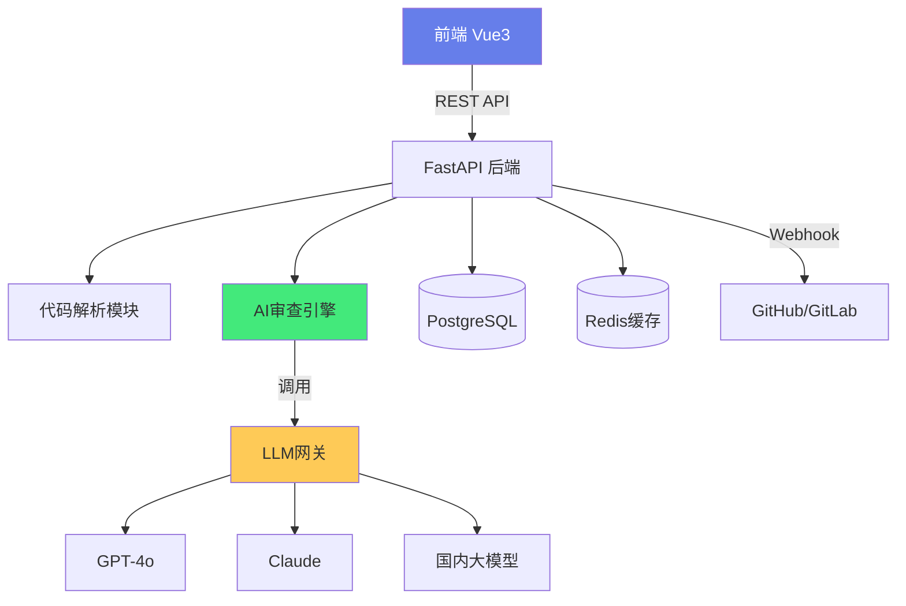
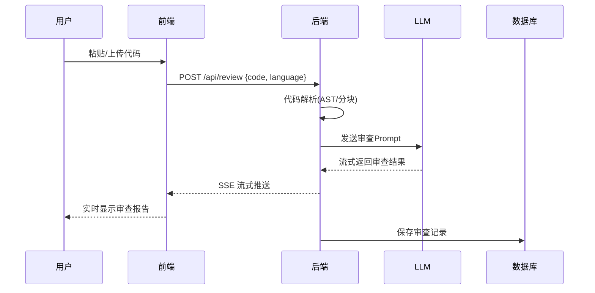

# 🤖 实战：AI 代码审查工具

> **文档说明**：完整讲解如何从 0 到 1 构建一个 AI 代码审查工具，涵盖项目概述（什么是 AI 代码审查工具 / 核心价值 / 目标用户）、需求分析（核心功能 / 用户故事 / 验收标准）、技术选型（前端 Vue3 / 后端 FastAPI / LLM GPT-4o / 数据库 PostgreSQL / 部署 Docker）、系统架构设计（整体架构图 / 数据流 / 模块划分）、核心功能实现（代码上传与解析 / AI 审查引擎 / Prompt 设计 / 审查报告生成 / 历史记录）、AI Prompt 工程（代码审查 Prompt 模板 / 审查维度设计 / 输出格式约束 /  few-shot 示例）、代码解析技术（AST 抽象语法树 / 语言识别 / Git diff 差异分析 / 代码分块）、审查维度详解（安全性 / 性能 / 可读性 / 最佳实践 / 潜在 Bug / 代码规范）、报告生成（结构化 JSON / 分级建议 / 代码定位 / 修复建议）、前后端实现（REST API 设计 / 前端界面 / 流式输出 / WebSocket）、与 Git 集成（GitHub PR 审查 / Git Hook 提交前检查 / CI/CD 集成）、部署方案（Docker Compose / 环境变量 / 模型配置）、项目里程碑与开发计划、扩展方向（多语言支持 / 团队协作 / IDE 插件 / 自定义规则）、常见问题与最佳实践。
>
> **适用人群**：全栈开发者、AI 应用开发者、想做 AI 编程工具的独立开发者
>
> **前置知识**：[[AI应用开发入门]] · [[LLM服务架构]] · [[从0到1产品落地路径]]

---

## 一、项目概述

### 1.1 什么是 AI 代码审查工具

**AI 代码审查工具**是利用大语言模型（LLM）自动分析代码、发现问题、给出改进建议的工具。它可以替代部分人工 Code Review 工作，提高代码质量和开发效率。


### 1.2 核心价值

| 价值 | 说明 |
|------|------|
| ⚡ **提高效率** | 秒级完成代码审查，人工需要几十分钟 |
| 🔍 **发现隐藏问题** | AI 能发现人工容易忽略的边界情况 |
| 📚 **知识传递** | 新人也能获得资深工程师级别的审查建议 |
| 🔄 **一致性** | 统一审查标准，不受个人偏好影响 |
| 💡 **学习辅助** | 审查建议本身就是最好的学习材料 |

### 1.3 目标用户

- 👨‍💻 **独立开发者**：没有团队做 Code Review
- 🏢 **小团队**：人力有限，需要自动化辅助
- 🎓 **编程学习者**：获得即时反馈和学习建议
- 🏗️ **企业团队**：作为人工 Code Review 的前置过滤

---

## 二、需求分析

### 2.1 核心功能

| 功能 | 优先级 | 说明 |
|------|--------|------|
| **代码上传** | P0 | 支持粘贴代码、上传文件、Git 仓库 |
| **AI 审查** | P0 | 多维度分析代码，给出分级建议 |
| **审查报告** | P0 | 结构化展示问题、位置、修复建议 |
| **历史记录** | P1 | 保存审查历史，可回溯对比 |
| **Git 集成** | P1 | GitHub PR 自动审查、提交钩子 |
| **多语言** | P1 | 支持 Python/JavaScript/TypeScript/Java/Go |
| **自定义规则** | P2 | 团队可配置审查规则和关注点 |
| **IDE 插件** | P2 | VSCode/JetBrains 插件实时审查 |
| **团队协作** | P2 | 团队共享审查记录和规则 |

### 2.2 用户故事

```text
作为一名独立开发者，
我希望粘贴代码后 AI 能自动审查，
以便在没有团队的情况下也能保证代码质量。

作为一名技术负责人，
我希望 AI 能在 PR 提交时自动审查并评论，
以便减少人工 Code Review 的工作量。

作为一名编程初学者，
我希望 AI 能解释代码中的问题并给出修复示例，
以便从审查中学习最佳实践。
```

### 2.3 验收标准

- 代码审查响应时间 < 10 秒（500 行以内）
- 能识别至少 5 类常见问题（安全、性能、Bug、规范、可读性）
- 审查报告包含问题位置、严重程度、描述、修复建议
- 支持至少 3 种编程语言
- 审查历史可保存和检索

---

## 三、技术选型

### 3.1 技术栈

| 层面 | 技术 | 选型理由 |
|------|------|---------|
| **前端** | Vue 3 + TypeScript + Vite + Element Plus | 开发快、组件丰富、团队熟悉 |
| **后端** | Python FastAPI | AI 生态好、异步支持、自动文档 |
| **LLM** | GPT-4o / Claude 3.5 / 通义千问 | 代码理解能力强、支持多模型切换 |
| **数据库** | PostgreSQL | 存储审查历史、用户数据、JSON 支持好 |
| **缓存** | Redis | 缓存审查结果、限流、会话 |
| **代码解析** | tree-sitter | 多语言 AST 解析、性能好 |
| **部署** | Docker + Docker Compose | 一键部署、环境一致 |
| **AI 网关** | 统一 SDK 封装 | 支持多模型切换、降级、限流 |

### 3.2 为什么选 FastAPI

- Python 是 AI 生态最成熟的语言
- FastAPI 异步性能好，自动生成 API 文档
- 与 LLM SDK（OpenAI、LangChain）集成方便
- tree-sitter Python 绑定成熟

---

## 四、系统架构设计

### 4.1 整体架构



### 4.2 数据流



### 4.3 模块划分

| 模块 | 职责 |
|------|------|
| **API 层** | REST 接口、请求校验、认证 |
| **代码解析** | 语言识别、AST 解析、代码分块、diff 分析 |
| **AI 审查引擎** | Prompt 构建、LLM 调用、结果解析、流式输出 |
| **报告生成** | 结构化报告、分级、代码定位、修复建议 |
| **历史管理** | 审查记录 CRUD、搜索、对比 |
| **Git 集成** | Webhook 处理、PR 评论、状态检查 |
| **用户系统** | 注册登录、配额管理、团队 |

---

## 五、核心功能实现

### 5.1 代码上传与解析

```python
# backend/app/services/code_parser.py
import tree_sitter
from tree_sitter_languages import get_parser

class CodeParser:
    def __init__(self):
        self.parsers = {}
    
    def _get_parser(self, language: str):
        if language not in self.parsers:
            self.parsers[language] = get_parser(language)
        return self.parsers[language]
    
    def detect_language(self, code: str, filename: str = None) -> str:
        """根据文件名或内容识别编程语言"""
        if filename:
            ext = filename.rsplit('.', 1)[-1].lower()
            mapping = {
                'py': 'python', 'js': 'javascript', 'ts': 'typescript',
                'java': 'java', 'go': 'go', 'rs': 'rust', 'cpp': 'cpp'
            }
            if ext in mapping:
                return mapping[ext]
        # 简单的内容启发式检测
        if 'def ' in code and 'import ' in code:
            return 'python'
        if 'function ' in code or 'const ' in code:
            return 'javascript'
        return 'unknown'
    
    def parse_to_ast(self, code: str, language: str):
        """解析为 AST"""
        parser = self._get_parser(language)
        return parser.parse(bytes(code, 'utf8'))
    
    def extract_functions(self, code: str, language: str) -> list[dict]:
        """提取函数列表（用于分块审查）"""
        tree = self.parse_to_ast(code, language)
        functions = []
        # 遍历 AST 提取函数节点
        # ...
        return functions
    
    def split_code(self, code: str, max_lines: int = 200) -> list[str]:
        """将大文件分块，避免超过 LLM 上下文限制"""
        lines = code.split('\n')
        chunks = []
        for i in range(0, len(lines), max_lines):
            chunks.append('\n'.join(lines[i:i+max_lines]))
        return chunks
```

### 5.2 AI 审查引擎

```python
# backend/app/services/review_engine.py
from openai import AsyncOpenAI
from app.config import settings

class ReviewEngine:
    def __init__(self):
        self.client = AsyncOpenAI(
            api_key=settings.llm_api_key,
            base_url=settings.llm_base_url
        )
    
    async def review_code(self, code: str, language: str, context: dict = None):
        """执行代码审查，返回流式结果"""
        prompt = self._build_prompt(code, language, context)
        
        stream = await self.client.chat.completions.create(
            model=settings.llm_model,
            messages=prompt,
            temperature=0.3,  # 低温度保证一致性
            stream=True,
            response_format={"type": "json_object"}  # 强制 JSON 输出
        )
        
        async for chunk in stream:
            if chunk.choices[0].delta.content:
                yield chunk.choices[0].delta.content
    
    def _build_prompt(self, code: str, language: str, context: dict = None) -> list[dict]:
        """构建审查 Prompt"""
        system_prompt = """你是一位资深代码审查专家。请从以下维度审查代码：
1. 安全性：SQL注入、XSS、权限问题、敏感信息泄露
2. 性能：时间复杂度、内存使用、不必要的计算
3. 潜在Bug：空指针、边界条件、异常处理
4. 代码规范：命名、格式、注释、最佳实践
5. 可读性：复杂度、重复代码、结构清晰度

输出严格的JSON格式：
{
  "summary": "整体评价",
  "score": 0-100,
  "issues": [
    {
      "severity": "critical|warning|info",
      "category": "security|performance|bug|style|readability",
      "line": 行号,
      "code": "有问题的代码片段",
      "description": "问题描述",
      "suggestion": "修复建议",
      "fixed_code": "修复后的代码"
    }
  ],
  "positive": ["做得好的地方"]
}"""
        
        user_prompt = f"请审查以下 {language} 代码：\n\n```\n{code}\n```"
        
        return [
            {"role": "system", "content": system_prompt},
            {"role": "user", "content": user_prompt}
        ]
```

### 5.3 报告生成与解析

```python
# backend/app/services/report_generator.py
import json
from pydantic import BaseModel

class Issue(BaseModel):
    severity: str  # critical / warning / info
    category: str
    line: int
    code: str
    description: str
    suggestion: str
    fixed_code: str

class ReviewReport(BaseModel):
    summary: str
    score: int
    issues: list[Issue]
    positive: list[str]

class ReportGenerator:
    def parse_report(self, raw_json: str) -> ReviewReport:
        """解析 LLM 返回的 JSON 为结构化报告"""
        try:
            data = json.loads(raw_json)
            return ReviewReport(**data)
        except json.JSONDecodeError:
            # JSON 解析失败时的降级处理
            return ReviewReport(
                summary="审查结果解析失败，请重试",
                score=0,
                issues=[],
                positive=[]
            )
    
    def get_severity_count(self, report: ReviewReport) -> dict:
        """统计各严重程度问题数量"""
        counts = {"critical": 0, "warning": 0, "info": 0}
        for issue in report.issues:
            counts[issue.severity] = counts.get(issue.severity, 0) + 1
        return counts
```

### 5.4 API 设计

```python
# backend/app/api/review.py
from fastapi import APIRouter, UploadFile, File
from fastapi.responses import StreamingResponse
from app.services.review_engine import ReviewEngine
from app.services.code_parser import CodeParser

router = APIRouter(prefix="/api/review", tags=["审查"])

@router.post("/text")
async def review_text(request: ReviewRequest):
    """审查粘贴的代码文本"""
    engine = ReviewEngine()
    return StreamingResponse(
        engine.review_code(request.code, request.language),
        media_type="text/event-stream"
    )

@router.post("/file")
async def review_file(file: UploadFile = File(...)):
    """审查上传的文件"""
    content = await file.read()
    code = content.decode('utf-8')
    parser = CodeParser()
    language = parser.detect_language(code, file.filename)
    engine = ReviewEngine()
    return StreamingResponse(
        engine.review_code(code, language),
        media_type="text/event-stream"
    )

@router.get("/history")
async def review_history(user_id: str, page: int = 1, size: int = 20):
    """获取审查历史"""
    # 从数据库查询
    pass
```

---

## 六、AI Prompt 工程

### 6.1 审查 Prompt 设计要点

| 要点 | 说明 |
|------|------|
| **角色设定** | 明确「资深代码审查专家」身份 |
| **审查维度** | 列出具体的审查维度（安全/性能/Bug/规范/可读性） |
| **输出格式** | 强制 JSON 格式，定义清晰的字段结构 |
| **严重程度** | 分级（critical/warning/info），便于优先处理 |
| **代码定位** | 要求给出具体行号和代码片段 |
| **修复建议** | 不仅说问题，还要给修复后的代码 |
| **正面反馈** | 也要指出做得好的地方，避免只批评 |
| **低温度** | temperature=0.3，保证审查一致性 |

```text
### 6.2 进阶 Prompt：带 few-shot 示例
```

```python
SYSTEM_PROMPT = """你是一位资深代码审查专家，有10年全栈开发经验。
你审查代码时既严格又建设性，既能发现严重问题，也认可好的实践。

## 审查维度
1. 🔴 安全性：注入攻击、权限绕过、敏感信息泄露、不安全的依赖
2. 🟡 性能：O(n²)复杂度、内存泄漏、不必要的数据库查询、N+1问题
3. 🔴 潜在Bug：空指针、越界、竞态条件、异常未处理
4. 🟡 代码规范：命名不规范、魔法数字、缺少类型、重复代码
5 🔵 可读性：函数过长、嵌套过深、注释不足、副作用不明确

## 输出格式（严格JSON）
{
  "summary": "一句话整体评价",
  "score": 0-100整数,
  "issues": [
    {
      "severity": "critical|warning|info",
      "category": "security|performance|bug|style|readability",
      "line": 整数行号,
      "code": "有问题的代码",
      "description": "具体问题描述",
      "suggestion": "如何修复",
      "fixed_code": "修复后的完整代码"
    }
  ],
  "positive": ["做得好的1-3点"]
}

## 示例
输入：
```
def get_user(user_id):
    conn = sqlite3.connect('db.sqlite')
    cursor = conn.cursor()
    cursor.execute(f"SELECT * FROM users WHERE id = {user_id}")
    return cursor.fetchone()
```json

输出：
{
  "summary": "存在严重的SQL注入漏洞，且缺少异常处理和连接关闭",
  "score": 35,
  "issues": [
    {
      "severity": "critical",
      "category": "security",
      "line": 4,
      "code": "cursor.execute(f\"SELECT * FROM users WHERE id = {user_id}\")",
      "description": "使用f-string拼接SQL，存在SQL注入漏洞",
      "suggestion": "使用参数化查询",
      "fixed_code": "cursor.execute(\"SELECT * FROM users WHERE id = ?\", (user_id,))"
    }
  ],
  "positive": ["函数命名清晰"]
}"""
```

### 6.3 多轮审查优化

```python
# 第一轮：全面审查
# 第二轮：针对 critical 问题深入分析
# 第三轮：生成完整修复后的代码

async def deep_review(code, language):
    engine = ReviewEngine()
    # 第一轮
    report = await engine.review_code(code, language)
    # 提取 critical 问题
    critical = [i for i in report.issues if i.severity == 'critical']
    if critical:
        # 第二轮：针对 critical 问题的修复方案
        fix_prompt = f"针对以下问题给出完整的修复代码：{critical}"
        fixed = await engine.fix_code(code, fix_prompt)
        report.fixed_code = fixed
    return report
```

---

## 七、审查维度详解

### 7.1 安全性检查清单

| 检查项 | 说明 | 语言 |
|--------|------|------|
| SQL 注入 | 字符串拼接 SQL | 所有 |
| XSS | 未转义的用户输入渲染到 HTML | 前端 |
| 硬编码密钥 | API Key、密码写在代码里 | 所有 |
| 不安全的反序列化 | pickle、eval | Python/JS |
| 路径遍历 | `../` 用户输入拼接路径 | 所有 |
| 弱加密 | MD5/SHA1 用于密码 | 所有 |
| CORS 配置 | `Access-Control-Allow-Origin: *` | 后端 |
| 权限校验 | 缺少登录/权限检查 | 后端 |

### 7.2 性能检查清单

| 检查项 | 说明 |
|--------|------|
| N+1 查询 | 循环中查询数据库 |
| 缺失索引 | 大表查询无索引 |
| 同步阻塞 | 异步代码中用同步调用 |
| 内存泄漏 | 未清理的定时器/监听器 |
| 大文件全量加载 | 应该用流式处理 |
| 不必要的重渲染 | 前端组件缺少 memo |

### 7.3 代码规范检查清单

| 检查项 | 说明 |
|--------|------|
| 命名规范 | 变量/函数/类命名不清晰 |
| 魔法数字 | 未命名的常量 |
| 函数过长 | 超过 50 行的函数 |
| 嵌套过深 | 超过 3 层 if 嵌套 |
| 重复代码 | 复制粘贴的代码块 |
| 缺少类型 | 动态语言缺少类型标注 |
| 缺少注释 | 复杂逻辑无注释 |

---

## 八、前端实现

### 8.1 审查页面组件

```vue
<!-- views/Review.vue -->
<script setup lang="ts">
import { ref } from 'vue'
import { ElMessage } from 'element-plus'

const code = ref('')
const language = ref('python')
const reviewing = ref(false)
const report = ref(null)
const resultText = ref('')

async function startReview() {
  if (!code.value.trim()) {
    ElMessage.warning('请输入代码')
    return
  }
  
  reviewing.value = true
  resultText.value = ''
  
  try {
    const response = await fetch('/api/review/text', {
      method: 'POST',
      headers: { 'Content-Type': 'application/json' },
      body: JSON.stringify({ code: code.value, language: language.value })
    })
    
    const reader = response.body!.getReader()
    const decoder = new TextDecoder()
    
    while (true) {
      const { done, value } = await reader.read()
      if (done) break
      resultText.value += decoder.decode(value)
      // 尝试解析增量 JSON
      tryParseReport()
    }
    
    report.value = JSON.parse(resultText.value)
  } catch (error) {
    ElMessage.error('审查失败')
  } finally {
    reviewing.value = false
  }
}

function tryParseReport() {
  try {
    report.value = JSON.parse(resultText.value)
  } catch {
    // JSON 不完整，等待更多数据
  }
}
</script>

<template>
  <div class="review-page">
    <div class="input-section">
      <el-select v-model="language">
        <el-option label="Python" value="python" />
        <el-option label="JavaScript" value="javascript" />
        <el-option label="TypeScript" value="typescript" />
        <el-option label="Java" value="java" />
      </el-select>
      <el-input
        v-model="code"
        type="textarea"
        :rows="20"
        placeholder="粘贴代码到此处..."
        font-family="monospace"
      />
      <el-button type="primary" :loading="reviewing" @click="startReview">
        开始审查
      </el-button>
    </div>
    
    <div class="report-section" v-if="report">
      <el-card>
        <template #header>
          <div class="report-header">
            <span>审查评分：{{ report.score }}/100</span>
            <el-tag :type="report.score >= 80 ? 'success' : report.score >= 60 ? 'warning' : 'danger'">
              {{ report.score >= 80 ? '优秀' : report.score >= 60 ? '良好' : '需改进' }}
            </el-tag>
          </div>
        </template>
        <p>{{ report.summary }}</p>
        
        <div v-for="issue in report.issues" :key="issue.line" class="issue">
          <el-tag :type="issue.severity === 'critical' ? 'danger' : issue.severity === 'warning' ? 'warning' : 'info'">
            {{ issue.severity }}
          </el-tag>
          <span class="line">第 {{ issue.line }} 行</span>
          <p class="desc">{{ issue.description }}</p>
          <pre><code>{{ issue.fixed_code }}</code></pre>
        </div>
      </el-card>
    </div>
  </div>
</template>
```

---

## 九、Git 集成

### 9.1 GitHub PR 自动审查

```python
# backend/app/services/github_integration.py
import httpx

class GitHubIntegration:
    async def handle_pr_webhook(self, payload: dict):
        """处理 GitHub PR Webhook"""
        action = payload.get('action')
        pr = payload.get('pull_request')
        
        if action in ['opened', 'synchronize']:
            # 获取 PR 变更的文件
            files = await self.get_pr_files(payload['repository']['full_name'], pr['number'])
            # 逐个文件审查
            for file in files:
                if file['filename'].endswith(('.py', '.js', '.ts', '.java')):
                    report = await self.review_file(file['patch'], file['filename'])
                    # 在 PR 上评论
                    await self.comment_on_pr(
                        payload['repository']['full_name'],
                        pr['number'],
                        self.format_comment(report, file['filename'])
                    )
    
    async def get_pr_files(self, repo: str, pr_number: int):
        async with httpx.AsyncClient() as client:
            resp = await client.get(
                f"https://api.github.com/repos/{repo}/pulls/{pr_number}/files",
                headers={"Authorization": f"token {settings.github_token}"}
            )
            return resp.json()
```

### 9.2 Git Hook 提交前检查

```bash
# .git/hooks/pre-commit
#!/bin/bash
# 提交前自动审查暂存的代码文件

STAGED_FILES=$(git diff --cached --name-only --diff-filter=ACM | grep -E '\.(py|js|ts|java)$')

if [ -n "$STAGED_FILES" ]; then
  echo "正在进行 AI 代码审查..."
  for file in $STAGED_FILES; do
    RESULT=$(curl -s -X POST http://localhost:8000/api/review/file \
      -F "file=@$file")
    SCORE=$(echo "$RESULT" | jq -r '.score')
    if [ "$SCORE" -lt 60 ]; then
      echo "❌ $file 审查评分: $score，低于 60 分，提交被阻止"
      echo "$RESULT" | jq '.issues[] | select(.severity=="critical") | .description'
      exit 1
    fi
  done
fi

exit 0
```

---

## 十、部署方案

### 10.1 Docker Compose

```yaml
# docker-compose.yml
version: '3.8'
services:
  frontend:
    build: ./frontend
    ports:
      - "80:80"
    depends_on:
      - backend
  
  backend:
    build: ./backend
    ports:
      - "8000:8000"
    environment:
      - LLM_API_KEY=${LLM_API_KEY}
      - LLM_BASE_URL=${LLM_BASE_URL}
      - LLM_MODEL=gpt-4o
      - DATABASE_URL=postgresql://user:pass@db:5432/review
      - REDIS_URL=redis://redis:6379
    depends_on:
      - db
      - redis
  
  db:
    image: postgres:16
    environment:
      POSTGRES_USER: user
      POSTGRES_PASSWORD: pass
      POSTGRES_DB: review
    volumes:
      - pgdata:/var/lib/postgresql/data
  
  redis:
    image: redis:7-alpine

volumes:
  pgdata:
```

### 10.2 环境变量

```bash
# .env
LLM_API_KEY=sk-xxx
LLM_BASE_URL=https://api.openai.com/v1
LLM_MODEL=gpt-4o
GITHUB_TOKEN=ghp_xxx
MAX_REVIEW_LENGTH=5000
RATE_LIMIT_PER_MINUTE=10
```

---

## 十一、项目里程碑

| 阶段 | 时间 | 目标 | 交付物 |
|------|------|------|--------|
| **MVP** | 第 1-2 周 | 核心审查功能 | 代码粘贴审查 + 报告展示 |
| **V1.0** | 第 3-4 周 | 完善功能 | 文件上传 + 历史记录 + 多语言 |
| **V1.5** | 第 5-6 周 | Git 集成 | GitHub PR 审查 + Git Hook |
| **V2.0** | 第 7-8 周 | 团队功能 | 用户系统 + 团队协作 + 自定义规则 |
| **V2.5** | 第 9-10 周 | IDE 插件 | VSCode 插件 + JetBrains 插件 |

---

## 十二、扩展方向

- 🌐 **IDE 插件**：VSCode / JetBrains 实时审查
- 📚 **自定义规则**：团队可配置审查规则和关注点
- 🔄 **自动修复**：AI 直接生成 PR 修复代码
- 📊 **质量趋势**：团队代码质量趋势分析
- 🏢 **企业部署**：私有化部署、自托管模型
- 🌍 **多语言**：支持 20+ 编程语言
- 🤖 **Agent 模式**：AI 自动修复 + 测试 + 提交

---

## 十三、常见问题

| 问题 | 解决方案 |
|------|---------|
| **大文件超过上下文** | 代码分块审查，最后合并报告 |
| **LLM 输出不是 JSON** | 用 response_format 强制 + 容错解析 |
| **审查结果不一致** | 低 temperature + 固定 Prompt 模板 |
| **误报太多** | 增加 few-shot 示例 + 自定义规则过滤 |
| **成本太高** | 用小模型做初筛，大模型做深度审查 |
| **私有代码安全** | 支持自部署模型 / 不存储代码 |

---

## 十四、最佳实践

1. **先做 MVP**：粘贴代码 → 审查 → 报告，跑通核心流程
2. **Prompt 是核心**：花时间优化 Prompt，比优化代码更有价值
3. **强制 JSON 输出**：用 response_format + 容错解析
4. **低温度**：代码审查需要一致性，temperature=0.2-0.3
5. **代码分块**：大文件分块审查，避免超过上下文
6. **多模型降级**：主模型不可用时自动切换备用模型
7. **缓存结果**：相同代码的审查结果缓存，降低成本
8. **用户反馈闭环**：让用户标记「有用/无用」的建议，优化 Prompt
9. **安全第一**：用户代码不持久化存储，或加密存储
10. **成本控制**：设置用户配额、模型路由（简单问题用小模型）

---

## 十五、关联笔记

### AI 项目实战
- [[AI应用开发入门]] · [[LLM服务架构]] · [[RAG知识库系统]]
- [[AI聊天机器人开发]] · [[Java AI Agent开发知识点系统梳理_优化版]]

### 技术实现
- [[FastAPI快速入门]] · [[Vue3-组合式API]] · [[流式响应与SSE]]
- [[PostgreSQL进阶]] · [[Docker容器化]] · [[GitHub Actions自动化]]

### 产品与项目
- [[从0到1产品落地路径]] · [[技术选型决策记录-ADR]] · [[独立开发者IndieHacker思路]]

### 导航
- [[MOC-项目实战]] · [[MOC-项目实战]] · [[Home]] · [[学习路线总览]]

> 🔍 **项目核心认知**
>
> **作用**：AI 代码审查工具项目解决的是「如何利用 LLM 自动分析代码质量、发现问题、给出修复建议，替代部分人工 Code Review 工作，提高开发效率和代码质量」的核心问题——这是一个典型的 AI 应用落地项目，涵盖了 LLM 集成、Prompt 工程、前后端开发、Git 集成等全栈技能。
>
> **底层原理**：①AI 代码审查的本质是「代码 → LLM 理解 → 结构化问题报告」的转换——将代码文本发送给 LLM，通过精心设计的 Prompt 引导 LLM 从多个维度（安全、性能、Bug、规范、可读性）分析代码，输出结构化的 JSON 报告。LLM 的代码理解能力来自于其在大量代码上的预训练，它能识别常见的编程错误、安全漏洞和不良实践。②Prompt 工程是这个项目的核心竞争力——同样的代码，不同的 Prompt 得到的审查质量天差地别。好的 Prompt 需要：明确角色设定（资深审查专家）、列出具体审查维度、定义严格的输出格式（JSON schema）、提供 few-shot 示例（输入输出样例）、设置低 temperature（保证一致性）。Prompt 的迭代优化是这个项目最有价值的工作。③代码分块是处理大文件的关键——LLM 有上下文长度限制（如 GPT-4o 是 128K token），大文件需要分块审查。分块策略有：按函数分块（AST 解析提取函数）、按行数固定分块（简单但可能切断函数）、语义分块（保持代码完整性）。分块审查后需要合并报告，去重和排序。④流式输出提升用户体验——代码审查可能需要 10-30 秒，用户不喜欢白屏等待。通过 SSE（Server-Sent Events）流式输出 LLM 的响应，前端实时显示审查进度和部分结果，让用户感觉「AI 在思考」而不是「卡住了」。⑤多模型路由是成本优化的关键——不是所有代码都需要 GPT-4o 审查。简单的代码规范问题可以用小模型（如 GPT-3.5），复杂的安全和架构问题才用大模型。通过分类器先判断问题类型，再路由到合适的模型，可以降低 50-70% 的成本。⑥Git 集成是产品化的关键——独立的审查工具用户粘性低，但集成到 Git 工作流（PR 自动审查、提交前检查）后，就成为了开发流程的一部分，用户粘性大大提高。GitHub App / GitLab Webhook 是主要的集成方式。
>
> **用法要点**：① 技术栈：Vue3+TS前端/FastAPI后端/PostgreSQL+Redis/GPT-4o或Claude/tree-sitter代码解析/Docker部署 ② 核心功能：代码上传(粘贴/文件/Git)/AI审查(多维度)/结构化报告(分级+定位+修复建议)/历史记录 ③ Prompt设计：角色设定+审查维度(安全/性能/Bug/规范/可读性)+JSON输出格式+严重程度分级+few-shot示例+低temperature(0.3) ④ 代码解析：tree-sitter多语言AST/语言识别(扩展名+启发式)/函数提取/代码分块(≤200行) ⑤ 审查维度：安全性(SQL注入/XSS/硬编码密钥/路径遍历)/性能(N+1/内存泄漏/同步阻塞)/潜在Bug(空指针/越界/竞态)/规范(命名/魔法数字/函数过长)/可读性(嵌套过深/重复代码) ⑥ 前端：代码输入区+语言选择+流式报告展示+评分标签+问题列表+修复代码 ⑦ Git集成：GitHub PR Webhook自动审查+pre-commit钩子提交前检查 ⑧ 部署：Docker Compose(frontend+backend+db+redis)/环境变量配置LLM密钥 ⑨ 里程碑：MVP(2周核心审查)→V1.0(文件+历史+多语言)→V1.5(Git集成)→V2.0(团队+自定义规则) ⑩ 扩展：IDE插件/自动修复PR/质量趋势/私有化部署/Agent模式 ⑪ 常见问题：大文件分块/JSON解析容错/低温度保一致/误报过滤(few-shot+规则)/成本控制(模型路由+缓存)/私有代码安全(自部署+不存储) ⑫ 最佳实践：先MVP/Prompt是核心/强制JSON/低温度/代码分块/多模型降级/缓存结果/用户反馈闭环/安全第一/成本控制。

> 💡 **深度讲解**：AI 代码审查工具是一个非常适合全栈开发者练手的 AI 项目——它涵盖了前端界面、后端 API、LLM 集成、Prompt 工程、Git 集成、Docker 部署，是一个「麻雀虽小五脏俱全」的全栈 AI 应用。这个项目的核心竞争力不是代码，而是 Prompt——同样调用 GPT-4o，好的 Prompt 能给出资深工程师级别的审查建议，差的 Prompt 只能给出泛泛而谈的评论。Prompt 优化是这个项目最有价值的工作：定义清晰的审查维度、提供具体的 few-shot 示例、强制结构化 JSON 输出、设置合适的 temperature。建议花 30% 的时间在 Prompt 迭代上。代码审查工具的产品化关键是「集成到开发流程」——独立的网页工具用户用完就走，但集成到 GitHub PR（自动评论）、Git Hook（提交前检查）、IDE 插件（实时审查）后，就成为了开发流程的一部分，用户粘性和付费意愿大大提高。成本控制是另一个关键点——GPT-4o 审查 500 行代码大约需要 $0.05-0.1，如果用户量上来，成本会很高。优化策略包括：代码分块（只审查变更的代码而非整个文件）、模型路由（简单问题用小模型）、结果缓存（相同代码不重复审查）、用户配额（免费用户限制次数）。在 AI 时代，代码审查工具的终极形态是「AI Agent」——不只是审查代码，还能自动修复问题、运行测试、提交 PR。但作为入门项目，先做好「审查 + 报告」的核心功能，再逐步扩展。这个项目的学习价值在于：你会真正理解 LLM 应用的开发流程——从 Prompt 设计到 API 封装，从流式输出到错误处理，从成本控制到产品化集成。这些技能可以迁移到任何 AI 应用开发中。

> 📝 **精简总结**：AI代码审查工具=LLM驱动的自动化Code Review。技术栈：Vue3+FastAPI+PostgreSQL+GPT-4o+tree-sitter+Docker。核心：代码上传→AI多维度审查→结构化报告(分级+定位+修复建议)。Prompt是核心：角色+维度+JSON格式+few-shot+低温度。代码解析：AST+语言识别+分块。审查维度：安全/性能/Bug/规范/可读性。Git集成：PR自动审查+pre-commit钩子。部署：Docker Compose。扩展：IDE插件/自动修复/团队功能。最佳实践：先MVP/Prompt优先/强制JSON/代码分块/模型路由降本/缓存/安全第一。

> **学习路径建议**：先学习 [[AI应用开发入门]] 和 [[LLM服务架构]] → 学习 Prompt 工程（[[提示词工程方法论]]） → 实践：用 Python 写一个最简单的代码审查脚本（调用 OpenAI API） → 学习 FastAPI 后端开发 → 实践：搭建审查 API，支持流式输出 → 学习 Vue3 前端 → 实践：做审查页面，展示流式报告 → 学习 tree-sitter 代码解析 → 实践：添加多语言支持和代码分块 → 学习 GitHub API / Webhook → 实践：PR 自动审查功能 → 学习 Docker 部署 → 实践：一键部署 → 考虑商业化和扩展方向。

---

> **AI 代码审查工具是一个非常适合全栈开发者练手的 AI 项目——涵盖前端界面、后端 API、LLM 集成、Prompt 工程、Git 集成、Docker 部署，麻雀虽小五脏俱全。这个项目的核心竞争力不是代码，而是 Prompt——同样调用 GPT-4o，好的 Prompt 能给出资深工程师级别的审查建议，差的 Prompt 只能泛泛而谈。Prompt 优化是最有价值的工作：定义清晰审查维度、提供具体 few-shot 示例、强制结构化 JSON、设置合适 temperature，建议花 30% 时间在 Prompt 迭代上。产品化关键是集成到开发流程——独立网页工具用户用完就走，但集成到 GitHub PR（自动评论）、Git Hook（提交前检查）、IDE 插件（实时审查）后，就成为开发流程一部分，用户粘性和付费意愿大大提高。成本控制是另一个关键点——GPT-4o 审查 500 行约 $0.05-0.1，用户量上来成本很高。优化策略：代码分块（只审查变更）、模型路由（简单问题用小模型）、结果缓存（相同代码不重复审查）、用户配额。AI 时代代码审查工具的终极形态是 AI Agent——不只是审查，还能自动修复、运行测试、提交 PR，但入门项目先做好审查+报告核心功能再扩展。这个项目的学习价值在于真正理解 LLM 应用开发流程——从 Prompt 设计到 API 封装，从流式输出到错误处理，从成本控制到产品化集成，这些技能可迁移到任何 AI 应用。如果你想做一个 AI 项目练手，代码审查工具是绝佳选择——需求明确、技术全面、能快速看到成果，而且自己每天都能用。**

---

## 🔗 关联笔记

- [[MOC-项目实战]] — 返回本分类知识地图，查看更多相关文档

## 📖 前置知识

- [[AI应用开发入门]]
- [[LLM服务架构]]
- [[从0到1产品落地路径]]

## 🏷️ 相关标签

`#AI应用` `#代码审查` `#AI编程` `#LLM应用` `#全栈项目` `#Prompt工程`

[[Home|🏠 返回首页]] · [[MOC-项目实战|📚 返回分类]]
