# 实战：Agent 自动化办公助手

> **文档定位**：本篇是 P0 级 Agent 应用实战，从 ReAct 架构到工具系统、MCP 集成、任务规划、自动化工作流、办公场景落地，覆盖生产级 Agent 的全部工程要点。
>
> **学习目标**：掌握 Agent 架构设计、工具系统设计、MCP 集成、任务规划、多轮记忆、自动化工作流、人机协作、错误重试、部署运维。
>
> **前置知识**：[[LLM应用架构]] · [[ToolUse工具调用]] · [[MCP协议]]

---

## 一、项目概述与需求分析

### 1.1 什么是 Agent

**概念解释**：Agent 是以 LLM 为大脑、以工具为手脚、能自主规划并执行任务的智能体。生活化比喻：RAG 像百科全书——你问它答；Agent 像实习生——你说目标，它自己拆任务、调工具、出结果。核心区别是 RAG 被动检索，Agent 主动行动。

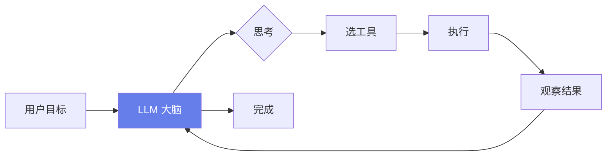

### 1.2 Agent vs RAG

| 维度 | RAG | Agent |
|------|-----|-------|
| 能力 | 检索+生成 | 规划+工具+行动 |
| 交互 | 一问一答 | 多步任务 |
| 工具 | 无 | 调用 API/文件/DB |
| 自主性 | 被动 | 主动规划 |
| 适用 | 知识问答 | 任务自动化 |

```python
# 代码1：Agent 基类
from pydantic_settings import BaseSettings
class AgentSettings(BaseSettings):
    llm_model: str = "gpt-4o"
    max_steps: int = 10
    tools: list[str] = ["file", "email", "calendar", "search"]
    approval_required: bool = True
```

### 1.3 办公助手场景

```python
# 代码2：核心场景
SCENARIOS = [
    {"name": "邮件处理", "task": "分类/回复/摘要"},
    {"name": "报告生成", "task": "数据收集+撰写+排版"},
    {"name": "数据整理", "task": "清洗+统计+可视化"},
    {"name": "会议纪要", "task": "录音转写+提炼+待办"},
    {"name": "日程管理", "task": "排会+提醒+协调"},
]
```

> 💡 **本章深度讲解**：Agent 的本质是"LLM+工具+循环"。LLM 负责决策，工具负责执行，循环负责多步。办公场景的价值是把重复劳动自动化——每天 2 小时的邮件处理、报告撰写，Agent 能压到 10 分钟。

> 📝 **本章精简总结**：Agent = LLM+工具+规划；vs RAG 的区别；五大办公场景。

> 🎯 **梯度练习题**
> - ⭐ 基础：Agent 和 RAG 的区别？答：RAG 检索，Agent 行动。
> - ⭐⭐ 进阶：为什么办公需要 Agent？答：任务多步+工具调用。
> - ⭐⭐⭐ 实战：列一个你工作中的 Agent 场景。

---

## 二、Agent架构设计（ReAct/规划-执行）

### 2.1 ReAct 模式

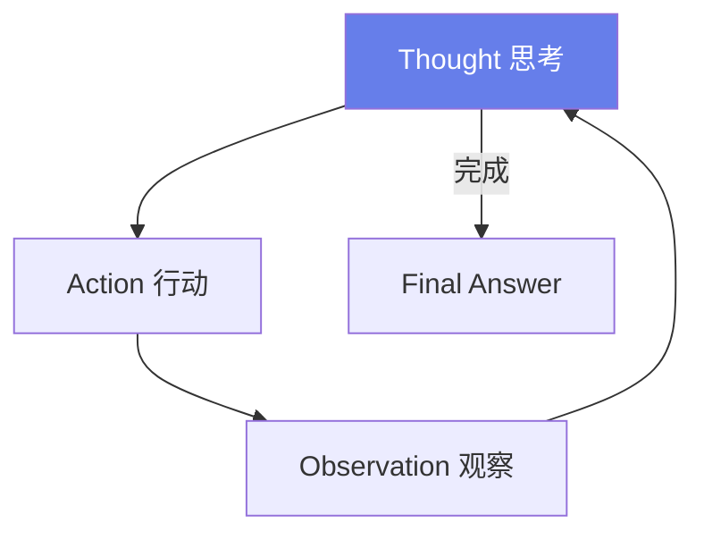

```python
# 代码3：ReAct 循环
class ReActAgent:
    def __init__(self, llm, tools):
        self.llm = llm
        self.tools = tools
    async def run(self, goal):
        history = []
        for step in range(10):
            thought = await self.llm.think(goal, history)
            if thought["action"] == "final":
                return thought["answer"]
            tool = self.tools[thought["tool"]]
            obs = await tool.execute(**thought["args"])
            history.append({"thought": thought, "observation": obs})
```

### 2.2 规划-执行模式

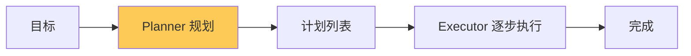

```python
# 代码4：规划-执行
class PlanExecuteAgent:
    async def plan(self, goal):
        return await self.llm.breakdown(goal)
    async def execute(self, plan):
        results = []
        for step in plan:
            r = await self.run_step(step)
            results.append(r)
        return results
```

### 2.3 两种模式对比

| 模式 | 优势 | 劣势 | 适用 |
|------|------|------|------|
| ReAct | 灵活 | 步数不可控 | 探索性任务 |
| 规划-执行 | 可控 | 不够灵活 | 流程性任务 |

> 💡 **本章深度讲解**：ReAct 是"走一步看一步"，规划-执行是"先列计划再执行"。办公场景多用规划-执行（流程明确），开放探索用 ReAct。

> 📝 **本章精简总结**：ReAct 循环；规划-执行；两种模式对比。

> 🎯 **梯度练习题**
> - ⭐ 基础：ReAct 三步？答：思考-行动-观察。
> - ⭐⭐ 进阶：什么时候用规划-执行？答：流程明确。
> - ⭐⭐⭐ 实战：实现一个 ReAct 循环。

---

## 三、工具系统设计

### 3.1 工具接口

```python
# 代码5：工具基类
class BaseTool:
    name: str
    description: str
    async def execute(self, **kwargs):
        raise NotImplementedError
    def schema(self):
        return {"name": self.name, "description": self.description}
```

### 3.2 文件工具

```python
# 代码6：文件读写工具
class FileTool(BaseTool):
    name = "file"
    description = "读写本地文件"
    async def read(self, path):
        with open(path, encoding="utf-8") as f:
            return f.read()
    async def write(self, path, content):
        with open(path, "w", encoding="utf-8") as f:
            f.write(content)
```

### 3.3 邮件工具

```python
# 代码7：邮件工具
class EmailTool(BaseTool):
    name = "email"
    description = "发送邮件"
    async def send(self, to, subject, body):
        await smtp.send(to, subject, body)
        return {"sent": True, "to": to}
```

### 3.4 日历工具

```python
# 代码8：日历工具
class CalendarTool(BaseTool):
    name = "calendar"
    description = "查询/创建日程"
    async def list_events(self, date):
        return await google_calendar.list(date)
    async def create_event(self, title, start, end):
        return await google_calendar.create(title, start, end)
```

### 3.5 数据库工具

```python
# 代码9：数据库查询
class DBTool(BaseTool):
    name = "db"
    description = "查询业务数据库"
    async def query(self, sql):
        return await pg.fetch(sql)
```

### 3.6 API 调用工具

```python
# 代码10：通用 API 调用
class APITool(BaseTool):
    name = "api"
    description = "调用外部 API"
    async def call(self, url, method="GET", body=None):
        async with httpx.AsyncClient() as c:
            r = await c.request(method, url, json=body)
            return r.json()
```

### 3.7 Web 浏览工具

```python
# 代码11：Web 搜索
class WebTool(BaseTool):
    name = "web"
    description = "搜索网页"
    async def search(self, query):
        return await bing.search(query)
```

> 💡 **本章深度讲解**：工具是 Agent 的手脚。设计原则：单一职责、明确描述、参数校验、错误处理。每个工具都要有清晰的 description，LLM 靠它决定用哪个。

> 📝 **本章精简总结**：工具基类；文件/邮件/日历/DB/API/Web 工具。

> 🎯 **梯度练习题**
> - ⭐ 基础：工具为什么要 description？答：LLM 据此选择。
> - ⭐⭐ 进阶：工具设计原则？答：单一职责+校验+错误。
> - ⭐⭐⭐ 实战：实现一个文件工具。

---

## 四、MCP工具集成

### 4.1 MCP 概念

**概念解释**：MCP（Model Context Protocol）是让 LLM 统一接入外部工具的协议。生活化比喻：MCP 像 USB-C 接口——不管是什么设备，插上就能用。不用每个工具单独写适配器。

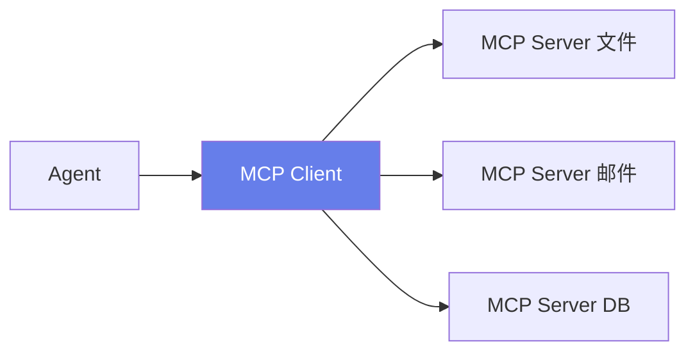

### 4.2 MCP Server 示例

```python
# 代码12：MCP Server
# from mcp.server import Server
# server = Server("office-tools")
# @server.tool()
# async def read_file(path: str):
#     """读取文件"""
#     return open(path).read()
```

### 4.3 MCP Client

```python
# 代码13：MCP Client
# from mcp.client import Client
# async with Client("file-server") as client:
#     tools = await client.list_tools()
#     result = await client.call_tool("read_file", {"path": "x.txt"})
```

> 💡 **本章深度讲解**：MCP 解决"工具碎片化"问题。传统做法每个工具写适配器，MCP 标准化后，任何 Agent 都能接任何 MCP Server。这是工具生态的接口协议。

> 📝 **本章精简总结**：MCP 概念；Server；Client；USB-C 比喻。

> 🎯 **梯度练习题**
> - ⭐ 基础：MCP 解决什么？答：工具碎片化。
> - ⭐⭐ 进阶：为什么需要标准协议？答：生态可复用。
> - ⭐⭐⭐ 实战：写一个 MCP Server。

---

## 五、任务规划与分解

### 5.1 目标分解

```python
# 代码14：目标分解
async def decompose(goal, llm):
    prompt = f"把目标拆成可执行步骤：{goal}"
    return json.loads(await llm.chat([{"role": "user", "content": prompt}]))
```

```python
# 代码15：示例分解
PLAN_EXAMPLE = {
    "goal": "写本周销售周报",
    "steps": [
        "1. 查询本周销售数据",
        "2. 统计关键指标",
        "3. 对比上周",
        "4. 生成图表",
        "5. 撰写分析",
        "6. 排版成文档",
    ],
}
```

### 5.2 依赖管理

```python
# 代码16：步骤依赖
class TaskNode:
    def __init__(self, step, deps=None):
        self.step = step
        self.deps = deps or []
        self.result = None
```

> 💡 **本章深度讲解**：任务规划是 Agent 的核心。好的规划把模糊目标变成明确步骤，每步有输入输出、依赖关系。差的规划会让 Agent 乱跑。

> 📝 **本章精简总结**：目标分解；示例；依赖管理。

> 🎯 **梯度练习题**
> - ⭐ 基础：为什么要分解？答：LLM 一次做复杂任务易出错。
> - ⭐⭐ 进阶：怎么处理步骤依赖？答：DAG。
> - ⭐⭐⭐ 实战：分解一个真实任务。

---

## 六、多轮对话与记忆

### 6.1 短期记忆

```python
# 代码17：对话历史
class ShortTermMemory:
    def __init__(self):
        self.messages = []
    def add(self, role, content):
        self.messages.append({"role": role, "content": content})
    def recent(self, n=10):
        return self.messages[-n:]
```

### 6.2 长期记忆

```python
# 代码18：用户偏好
async def long_term_memory(user_id):
    return await pg.fetch("SELECT pref FROM user_prefs WHERE user_id=$1", user_id)
```

### 6.3 工作记忆

```python
# 代码19：中间结果
class WorkMemory:
    def __init__(self):
        self.results = {}
    def set(self, step, result):
        self.results[step] = result
    def get(self, step):
        return self.results.get(step)
```

> 💡 **本章深度讲解**：Agent 记忆分三层——短期（对话历史）、长期（用户偏好）、工作（中间结果）。三层配合才能完成多步任务。

> 📝 **本章精简总结**：短期/长期/工作记忆。

> 🎯 **梯度练习题**
> - ⭐ 基础：三层记忆？答：短期/长期/工作。
> - ⭐⭐ 进阶：为什么要工作记忆？答：步骤间传递。
> - ⭐⭐⭐ 实战：实现一个三层记忆。

---

## 七、自动化工作流（定时任务/触发器）

### 7.1 定时任务

```python
# 代码20：APScheduler
# from apscheduler.schedulers.asyncio import AsyncIOScheduler
# sched = AsyncIOScheduler()
# sched.add_job(daily_report, "cron", hour=18)
# sched.start()
```

### 7.2 触发器

```python
# 代码21：事件触发
class Trigger:
    async def on_event(self, event):
        if event.type == "new_email":
            await handle_email(event.data)
```

### 7.3 工作流引擎

```python
# 代码22：DAG 工作流
class Workflow:
    def __init__(self):
        self.nodes = {}
    def add(self, name, fn, deps=None):
        self.nodes[name] = {"fn": fn, "deps": deps or []}
    async def run(self, input_data):
        results = {}
        for name, node in self.nodes.items():
            args = {d: results[d] for d in node["deps"]}
            results[name] = await node["fn"](args, input_data)
        return results
```

> 💡 **本章深度讲解**：自动化办公的核心是工作流——定时触发或事件触发，DAG 编排多步任务。每天 18 点自动生成周报，这就是工作流。

> 📝 **本章精简总结**：定时任务；触发器；DAG 工作流。

> 🎯 **梯度练习题**
> - ⭐ 基础：DAG 干什么？答：编排步骤依赖。
> - ⭐⭐ 进阶：触发器 vs 定时？答：事件驱动 vs 时间驱动。
> - ⭐⭐⭐ 实战：写一个周报工作流。

---

## 八、办公场景实战

### 8.1 邮件处理

```python
# 代码23：邮件分类
async def classify_email(email, llm):
    prompt = f"分类邮件：紧急/普通/推广/垃圾。主题：{email['subject']}\n正文：{email['body'][:500]}"
    return (await llm.chat([{"role": "user", "content": prompt}])).strip()
```

```python
# 代码24：邮件回复草稿
async def draft_reply(email, llm):
    prompt = f"根据邮件写回复草稿：{email['body']}"
    return await llm.chat([{"role": "user", "content": prompt}])
```

### 8.2 报告生成

```python
# 代码25：周报生成
async def weekly_report(week, db, llm):
    data = await db.query(f"SELECT * FROM sales WHERE week='{week}'")
    summary = await llm.chat([{"role": "user", "content": f"根据数据写周报：{data}"}])
    return summary
```

### 8.3 数据整理

```python
# 代码26：数据清洗
async def clean_data(df, llm):
    report = await llm.chat([{"role": "user", "content": f"分析数据问题：{df.describe()}"}])
    return report
```

### 8.4 会议纪要

```python
# 代码27：会议纪要
async def meeting_notes(audio_path, llm):
    transcript = await whisper.transcribe(audio_path)
    notes = await llm.chat([{"role": "user", "content": f"整理会议纪要：{transcript}"}])
    todos = await llm.chat([{"role": "user", "content": f"提取待办：{transcript}"}])
    return {"notes": notes, "todos": todos}
```

### 8.5 日程管理

```python
# 代码28：智能排会
async def schedule_meeting(attendees, duration, goal, calendar):
    free_times = await calendar.find_free(attendees, duration)
    return await calendar.create(goal, free_times[0])
```

> 💡 **本章深度讲解**：五个办公场景是 Agent 的典型应用。每个场景都是"数据获取→LLM 处理→结果输出"的闭环。Agent 让这些原本手动 30 分钟的事变成 30 秒。

> 📝 **本章精简总结**：邮件分类/回复；周报；数据清洗；会议纪要；日程管理。

> 🎯 **梯度练习题**
> - ⭐ 基础：邮件 Agent 流程？答：分类→回复。
> - ⭐⭐ 进阶：会议纪要怎么自动？答：Whisper+LLM。
> - ⭐⭐⭐ 实战：实现周报生成。

---

## 九、安全与权限控制

### 9.1 工具权限

```python
# 代码29：工具权限
class ToolACL:
    def __init__(self):
        self.restricted = {"email.send": "requires_approval", "db.write": "requires_admin"}
    def can_use(self, user, tool):
        return self.restricted.get(tool) in (None, user["role"])
```

### 9.2 数据隔离

```python
# 代码30：数据范围
async def data_scope(user):
    return {"dept": user["dept"], "level": user["clearance"]}
```

### 9.3 审计

```python
# 代码31：工具调用审计
async def audit_tool_call(user, tool, args):
    await pg.execute("INSERT INTO tool_audit(user, tool, args, ts) VALUES($1,$2,$3,now())",
                     user, tool, json.dumps(args))
```

> ❌ 常见坑点：Agent 直接执行删除/发送邮件等危险操作。正确做法：高危工具需审批。

> 💡 **本章深度讲解**：Agent 能调用工具意味着它能"做事"，所以安全比 RAG 更重要。高危操作（发邮件、删数据、花钱）必须人工审批。

> 📝 **本章精简总结**：工具 ACL；数据范围；审计；高危操作审批。

> 🎯 **梯度练习题**
> - ⭐ 基础：哪些工具要审批？答：发邮件/删数据/花钱。
> - ⭐⭐ 进阶：怎么做工具权限？答：按用户角色。
> - ⭐⭐⭐ 实战：给发邮件工具加审批。

---

## 十、人机协作与审批

### 10.1 审批流

```python
# 代码32：人工审批
class ApprovalFlow:
    async def request(self, task, user):
        await notify(user, f"Agent 请求执行：{task}，请审批")
        result = await wait_approval(timeout=3600)
        return result
```

### 10.2 协作策略

```python
# 代码33：分级协作
COLLAB = {
    "low_risk": "自动执行",
    "medium": "事后通知",
    "high_risk": "事前审批",
}
```

> 💡 **本章深度讲解**：人机协作是 Agent 落地的关键。完全自动风险高，完全手动没价值。分级协作：低风险自动、高风险审批，是企业接受度最高的模式。

> 📝 **本章精简总结**：审批流；分级协作。

> 🎯 **梯度练习题**
> - ⭐ 基础：为什么要审批？答：防事故。
> - ⭐⭐ 进阶：哪些该自动？答：低风险只读操作。
> - ⭐⭐⭐ 实战：设计一个审批流程。

---

## 十一、错误处理与重试

### 11.1 工具失败重试

```python
# 代码34：重试
async def tool_with_retry(tool, args, retries=3):
    for i in range(retries):
        try:
            return await tool.execute(**args)
        except Exception as e:
            if i == retries-1: raise
            await asyncio.sleep(2**i)
```

### 11.2 兜底策略

```python
# 代码35：降级
async def safe_call(tool, args):
    try:
        return await tool.execute(**args)
    except Exception:
        return {"error": "工具失败，请人工处理"}
```

### 11.3 错误反馈

```python
# 代码36：错误汇报
async def report_error(task, error, user):
    await notify(user, f"任务 {task} 失败：{error}")
```

> 💡 **本章深度讲解**：Agent 多步执行，任何一步失败都要处理。重试解决临时故障，降级解决持续故障，错误反馈让用户知道。

> 📝 **本章精简总结**：重试；降级；错误反馈。

> 🎯 **梯度练习题**
> - ⭐ 基础：为什么要重试？答：临时故障。
> - ⭐⭐ 进阶：降级和重试区别？答：重试是再试，降级是换方案。
> - ⭐⭐⭐ 实战：实现带重试的工具调用。

---

## 十二、前端界面（Gradio/Streamlit/Web）

### 12.1 Gradio

```python
# 代码37：Gradio 界面
# import gradio as gr
# gr.ChatInterface(lambda q, h: agent.run(q)).launch()
```

### 12.2 Streamlit

```python
# 代码38：Streamlit
# import streamlit as st
# st.title("办公助手")
# q = st.text_input("任务")
# if st.button("执行"):
#     st.write(agent.run(q))
```

### 12.3 Web 前端

```python
# 代码39：FastAPI + SSE
@router.post("/agent/run")
async def run_task(body: TaskBody):
    async def gen():
        async for step in agent.run_stream(body.goal):
            yield f"data: {json.dumps(step)}\n\n"
    return StreamingResponse(gen(), media_type="text/event-stream")
```

> 💡 **本章深度讲解**：Agent 前端要展示"思考过程"——每一步在干什么、工具调用了什么、结果如何。透明感是用户信任 Agent 的关键。

> 📝 **本章精简总结**：Gradio；Streamlit；SSE 流式展示。

> 🎯 **梯度练习题**
> - ⭐ 基础：为什么要展示思考？答：透明+信任。
> - ⭐⭐ 进阶：前端怎么展示步骤？答：时间线。
> - ⭐⭐⭐ 实战：写一个 Gradio 界面。

---

## 十三、部署与运维

### 13.1 Docker 部署

```dockerfile
# 代码40：Dockerfile
FROM python:3.11-slim
WORKDIR /app
COPY requirements.txt .
RUN pip install -r requirements.txt
COPY . .
CMD ["uvicorn", "main:app", "--host", "0.0.0.0", "--port", "8000"]
```

### 13.2 监控

```python
# 代码41：Agent 监控
METRICS = {
    "task_success_rate": "任务成功率",
    "avg_steps": "平均步数",
    "tool_error_rate": "工具错误率",
    "cost_per_task": "单任务成本",
}
```

### 13.3 日志

```python
# 代码42：执行日志
async def log_step(task_id, step, result):
    await pg.execute("INSERT INTO agent_log(task_id, step, result, ts) VALUES($1,$2,$3,now())",
                     task_id, step, json.dumps(result))
```

> 💡 **本章深度讲解**：Agent 部署要监控"任务成功率"和"单任务成本"——这是 Agent 特有的指标。工具调用日志是排查 Agent 行为的关键。

> 📝 **本章精简总结**：Docker；任务成功率/成本；执行日志。

> 🎯 **梯度练习题**
> - ⭐ 基础：Agent 特有指标？答：成功率+步数+成本。
> - ⭐⭐ 进阶：为什么要执行日志？答：复盘 Agent 行为。
> - ⭐⭐⭐ 实战：搭一个 Agent 看板。

---

## 十四、评测与优化

### 14.1 评测指标

```python
# 代码43：Agent 评测
EVAL = {
    "task_success": "任务完成率",
    "step_efficiency": "步数效率",
    "human_approval_rate": "审批率",
    "user_satisfaction": "满意度",
}
```

### 14.2 失败分析

```python
# 代码44：失败分类
FAIL_TYPES = [
    "规划错误",
    "工具选错",
    "参数错误",
    "工具失败",
    "LLM 幻觉",
]
```

### 14.3 Prompt 优化

```python
# 代码45：系统提示词
SYSTEM = """你是办公助手。规则：
1. 先规划再执行
2. 高危操作需审批
3. 每步说明意图
4. 失败要报告
5. 不确定要问"""
```

> 💡 **本章深度讲解**：Agent 评测比 RAG 更难——多步任务，一步错全错。要评测"最终任务是否完成"，而不只是单步对错。

> 📝 **本章精简总结**：任务完成率；失败分类；Prompt 优化。

> 🎯 **梯度练习题**
> - ⭐ 基础：Agent 评测核心？答：任务完成率。
> - ⭐⭐ 进阶：为什么步数效率重要？答：步数多=成本高。
> - ⭐⭐⭐ 实战：建 20 个任务评测集。

---

## 十五、成本控制

### 15.1 成本构成

```python
# 代码46：Agent 成本
COST = {
    "llm_planning": "规划 token",
    "llm_reasoning": "每步思考",
    "tool_api": "外部 API",
    "storage": "存储",
}
```

### 15.2 优化

```python
# 代码47：成本优化
OPT = [
    "简单任务用小模型规划",
    "缓存工具结果",
    "减少不必要的思考",
    "批量执行",
]
```

> 💡 **本章深度讲解**：Agent 多步执行，每步都调 LLM，成本比 RAG 高。优化核心：减少思考轮次、简单任务用小模型。

> 📝 **本章精简总结**：成本构成；小模型/缓存/减思考。

> 🎯 **梯度练习题**
> - ⭐ 基础：Agent 为什么贵？答：多步多轮 LLM。
> - ⭐⭐ 进阶：怎么降成本？答：小模型规划。
> - ⭐⭐⭐ 实战：算一个任务的成本。

---

## 十六、常见坑点与经验

### 16.1 十大坑点

| 坑 | 现象 | 解法 |
|----|------|------|
| 无限循环 | 反复调用同一工具 | 步数上限 |
| 工具选错 | 调错 API | 工具描述清晰 |
| 参数错误 | 传错参数 | 严格 schema |
| 无审批 | 误删误发 | 高危审批 |
| 无重试 | 网络抖动失败 | 指数退避 |
| 无日志 | 不知道干了啥 | 每步记录 |
| 规划太粗 | 漏掉关键步 | 强制分解 |
| 规划太细 | 步数爆炸 | 合并步骤 |
| 无降级 | 工具全挂 | 兜底方案 |
| 成本失控 | token 爆 | 预算限制 |

### 16.2 关键经验

```python
# 代码48：经验
LESSONS = [
    "步数上限必须有",
    "工具描述要清晰",
    "高危必审批",
    "每步必日志",
    "失败要优雅",
    "成本要监控",
]
```

> 💡 **本章深度讲解**：Agent 坑比 RAG 多——因为它能行动，错了后果更严重。步数上限、审批、日志、降级是生产 Agent 的底线。

> 📝 **本章精简总结**：十大坑；六条经验。

> 🎯 **梯度练习题**
> - ⭐ 基础：最大的坑？答：无限循环。
> - ⭐⭐ 进阶：为什么要步数上限？答：防失控。
> - ⭐⭐⭐ 实战：对照坑点自查。

---

## 十七、面试高频考点

### 17.1 面试题

| 题目 | 要点 |
|------|------|
| Agent vs RAG | 行动 vs 检索 |
| ReAct vs Plan-Execute | 灵活 vs 可控 |
| 怎么防无限循环 | 步数上限 |
| 怎么做工具选择 | 清晰 description |
| 怎么做安全 | 高危审批+ACL |
| 怎么降成本 | 小模型+缓存 |

```python
# 代码49：面试速记
INTERVIEW = {
    "架构": "LLM+工具+循环",
    "规划": "ReAct 或 Plan-Execute",
    "安全": "审批+ACL+审计",
    "评测": "任务完成率",
}
```

> 💡 **本章深度讲解**：Agent 面试核心讲"架构-工具-安全-评测-成本"。重点讲你做过的权衡，比如什么时候用 ReAct，什么时候用 Plan-Execute。

> 📝 **本章精简总结**：六大面试题；速记。

> 🎯 **梯度练习题**
> - ⭐ 基础：Agent 面试核心？答：架构+安全+评测。
> - ⭐⭐ 进阶：ReAct 怎么防循环？答：步数上限。
> - ⭐⭐⭐ 实战：模拟面试讲你的 Agent。

---

## 十八、完整代码附录

### 18.1 主服务聚合

```python
# 代码50：Agent 主服务
class OfficeAgent:
    def __init__(self):
        self.llm = LLM()
        self.tools = ToolRegistry()
        self.memory = Memory()
        self.approval = ApprovalFlow()
    async def run(self, goal, user):
        plan = await self.llm.breakdown(goal)
        results = {}
        for step in plan:
            if step.tool in self.tools.restricted:
                await self.approval.request(step, user)
            obs = await self.tools.execute(step.tool, step.args)
            results[step.name] = obs
        return await self.llm.summarize(results)
```

### 18.2 配置与部署

```python
# 代码51：生产配置
PROD = {
    "max_steps": 15,
    "approval": ["email.send", "db.write", "file.delete"],
    "retry": 3,
    "timeout": 60,
}
```

> 💡 **本章深度讲解**：主服务把规划、工具、审批、记忆串起来。这就是办公 Agent 的全貌。

> 📝 **本章精简总结**：主服务；生产配置。

> 🎯 **梯度练习题**
> - ⭐ 基础：主服务流程？答：规划→审批→执行→总结。
> - ⭐⭐ 进阶：哪些工具要审批？答：发邮件/写库/删文件。
> - ⭐⭐⭐ 实战：把主服务跑通。

---

### 18.3 扩展代码库：Agent 工具系统深度实现

```python
# 代码52：工具注册表
class ToolRegistry:
    def __init__(self):
        self.tools = {}
    def register(self, tool):
        self.tools[tool.name] = tool
    def list_schemas(self):
        return [t.schema() for t in self.tools.values()]
    async def execute(self, name, **args):
        return await self.tools[name].execute(**args)
```

```python
# 代码53：工具 schema 自动生成
import inspect
def tool_schema(fn):
    sig = inspect.signature(fn)
    return {
        "name": fn.__name__,
        "description": fn.__doc__,
        "parameters": {p: str(sig.parameters[p].annotation) for p in sig.parameters},
    }
```

```python
# 代码54：参数校验
from pydantic import BaseModel, ValidationError
class ToolArgs(BaseModel):
    def validate(self):
        try:
            return self(**self.raw)
        except ValidationError as e:
            return {"error": str(e)}
```

### 18.4 扩展代码库：文件工具深度

```python
# 代码55：文件搜索
class FileSearchTool(BaseTool):
    name = "file_search"
    description = "按关键词搜索文件"
    async def search(self, directory, keyword):
        results = []
        for root, _, files in os.walk(directory):
            for f in files:
                if keyword in f:
                    results.append(os.path.join(root, f))
        return results
```

```python
# 代码56：文件列表
class FileListTool(BaseTool):
    name = "file_list"
    description = "列出目录"
    async def list_dir(self, path):
        return os.listdir(path)
```

```python
# 代码57：文件摘要
class FileSummaryTool(BaseTool):
    name = "file_summary"
    description = "总结文件内容"
    async def summarize(self, path, llm):
        text = open(path).read()[:5000]
        return await llm.chat([{"role": "user", "content": f"总结：{text}"}])
```

### 18.5 扩展代码库：邮件工具深度

```python
# 代码58：收件箱
class EmailInboxTool(BaseTool):
    name = "email_inbox"
    description = "查看收件箱"
    async def list(self, folder="INBOX", limit=20):
        return await imap.fetch(folder, limit)
```

```python
# 代码59：邮件标记
class EmailMarkTool(BaseTool):
    name = "email_mark"
    description = "标记邮件已读/星标"
    async def mark(self, msg_id, flag="seen"):
        await imap.mark(msg_id, flag)
```

```python
# 代码60：邮件转发
class EmailForwardTool(BaseTool):
    name = "email_forward"
    description = "转发邮件"
    async def forward(self, msg_id, to):
        body = await imap.get_body(msg_id)
        await smtp.send(to, "转发", body)
```

### 18.6 扩展代码库：日历工具深度

```python
# 代码61：忙闲查询
class FreeBusyTool(BaseTool):
    name = "free_busy"
    description = "查询忙闲"
    async def query(self, email, start, end):
        return await gcal.freebusy(email, start, end)
```

```python
# 代码62：邀请人
class InviteTool(BaseTool):
    name = "invite"
    description = "发送会议邀请"
    async def invite(self, event_id, attendee_emails):
        await gcal.add_attendees(event_id, attendee_emails)
```

### 18.7 扩展代码库：数据库工具深度

```python
# 代码63：只读查询
class QueryTool(BaseTool):
    name = "db_query"
    description = "只读查询数据库"
    async def query(self, sql):
        if not sql.strip().lower().startswith("select"):
            return {"error": "只允许 SELECT"}
        return await pg.fetch(sql)
```

```python
# 代码64：表结构
class SchemaTool(BaseTool):
    name = "db_schema"
    description = "查看表结构"
    async def schema(self, table):
        return await pg.fetch(f"SELECT column_name, data_type FROM information_schema.columns WHERE table_name='{table}'")
```

### 18.8 扩展代码库：API 工具深度

```python
# 代码65：REST 调用
class RESTTool(BaseTool):
    name = "rest_api"
    description = "调用 REST API"
    async def call(self, url, method="GET", headers=None, body=None):
        async with httpx.AsyncClient() as c:
            r = await c.request(method, url, headers=headers, json=body, timeout=30)
            return {"status": r.status_code, "data": r.json()}
```

### 18.9 扩展代码库：Web 工具深度

```python
# 代码66：网页抓取
class WebFetchTool(BaseTool):
    name = "web_fetch"
    description = "抓取网页正文"
    async def fetch(self, url):
        html = await httpx.get(url)
        return trafilatura.extract(html.text)
```

```python
# 代码67：网页搜索
class WebSearchTool(BaseTool):
    name = "web_search"
    description = "搜索网页"
    async def search(self, query, n=5):
        return await bing.search(query, n)
```

### 18.10 扩展代码库：工具安全

```python
# 代码68：工具沙箱
class Sandbox:
    """危险工具隔离执行"""
    async def run_safe(self, tool, args):
        if tool.name in self.restricted:
            return await self.approve(tool, args)
        return await tool.execute(**args)
```

> 💡 **本章深度讲解**：工具系统是 Agent 的手脚。从注册表、schema 自动生成、参数校验，到文件/邮件/日历/DB/API/Web 各类工具，再到沙箱安全——这是工具系统的完整工程。

> 📝 **本章精简总结**：工具注册表；schema 自动；参数校验；文件/邮件/日历/DB/API/Web 工具；沙箱。

> 🎯 **梯度练习题**
> - ⭐ 基础：工具注册表干什么？答：统一管理工具。
> - ⭐⭐ 进阶：为什么 DB 工具只读？答：防误操作。
> - ⭐⭐⭐ 实战：实现一个工具注册表。

---

### 18.11 扩展代码库：ReAct Agent 完整实现

```python
# 代码69：ReAct 完整
import re
class FullReAct:
    def __init__(self, llm, tools, max_steps=10):
        self.llm = llm; self.tools = tools; self.max_steps = max_steps
    async def run(self, goal):
        scratchpad = ""
        for step in range(self.max_steps):
            prompt = self.build_prompt(goal, scratchpad)
            raw = await self.llm.chat([{"role": "user", "content": prompt}])
            thought, action, action_input = self.parse(raw)
            scratchpad += f"Thought: {thought}\nAction: {action}\nInput: {action_input}\n"
            if action == "final":
                return action_input
            obs = await self.tools.execute(action, **action_input)
            scratchpad += f"Observation: {obs}\n"
        return "达到步数上限"
    def build_prompt(self, goal, scratchpad):
        tools_desc = "\n".join(f"- {t.name}: {t.description}" for t in self.tools.tools.values())
        return f"""目标：{goal}
可用工具：
{tools_desc}
{scratchpad}
按格式输出：
Thought: ...
Action: tool_name 或 final
Action Input: {{"param": "value"}}
"""
    def parse(self, raw):
        thought = re.search(r"Thought: (.+)", raw)
        action = re.search(r"Action: (.+)", raw)
        inp = re.search(r"Action Input: (.+)", raw)
        return (thought.group(1) if thought else "",
                action.group(1) if action else "final",
                json.loads(inp.group(1)) if inp else {"answer": raw})
```

### 18.12 扩展代码库：规划-执行完整

```python
# 代码70：Plan-Execute 完整
class FullPlanExecute:
    async def plan(self, goal):
        prompt = f"""把目标拆成步骤，每步指定工具和参数。
输出 JSON：[{{"step": "name", "tool": "tool", "args": {{}}}}]
目标：{goal}"""
        return json.loads(await self.llm.chat([{"role": "user", "content": prompt}]))
    async def execute(self, plan, user):
        results = {}
        for step in plan:
            if step["tool"] in self.tools.restricted:
                await self.approval.request(step, user)
            results[step["step"]] = await self.tools.execute(step["tool"], **step["args"])
        return await self.summarize(results)
```

### 18.13 扩展代码库：任务分解器

```python
# 代码71：智能分解
class TaskPlanner:
    async def decompose(self, goal, context=""):
        prompt = f"""分析目标复杂度，决定分解粒度。
目标：{goal}
上下文：{context}
输出：[步骤列表]"""
        steps = json.loads(await self.llm.chat([{"role": "user", "content": prompt}]))
        return self.validate(steps)
    def validate(self, steps):
        for s in steps:
            assert "step" in s and "tool" in s
        return steps
```

### 18.14 扩展代码库：子任务并行

```python
# 代码72：并行子任务
async def parallel_steps(steps):
    results = await asyncio.gather(
        *[self.tools.execute(s["tool"], **s["args"]) for s in steps],
        return_exceptions=True
    )
    return list(zip(steps, results))
```

### 18.15 扩展代码库：条件分支

```python
# 代码73：条件执行
async def conditional_step(step, context):
    if step.get("condition"):
        if not eval_condition(step["condition"], context):
            return {"skipped": True}
    return await self.tools.execute(step["tool"], **step["args"])
```

### 18.16 扩展代码库：循环执行

```python
# 代码74：循环步骤
async def loop_step(step, context):
    results = []
    for item in context[step["iter_var"]]:
        r = await self.tools.execute(step["tool"], item=item)
        results.append(r)
    return results
```

### 18.17 扩展代码库：动态规划

```python
# 代码75：根据结果调整计划
async def replan(original_plan, last_result, goal, llm):
    prompt = f"""原计划：{original_plan}
上一步结果：{last_result}
目标：{goal}
是否需要调整计划？输出新计划"""
    return json.loads(await llm.chat([{"role": "user", "content": prompt}]))
```

### 18.18 扩展代码库：反思机制

```python
# 代码76：自我反思
async def reflect(goal, results, llm):
    prompt = f"""检查任务是否完成。
目标：{goal}
已完成：{results}
还缺什么？输出下一步"""
    return await llm.chat([{"role": "user", "content": prompt}])
```

### 18.19 扩展代码库：工具选择决策

```python
# 代码77：工具选择
async def choose_tool(step, tools, llm):
    prompt = f"""为步骤选最合适的工具。
步骤：{step}
工具列表：{[(t.name, t.description) for t in tools]}
输出工具名"""
    return await llm.chat([{"role": "user", "content": prompt}])
```

### 18.20 扩展代码库：参数填充

```python
# 代码78：参数自动填充
async def fill_args(step, tool, context, llm):
    prompt = f"""根据上下文填参数。
工具：{tool.schema()}
步骤：{step}
上下文：{context}
输出 JSON 参数"""
    return json.loads(await llm.chat([{"role": "user", "content": prompt}]))
```

> 💡 **本章深度讲解**：从 ReAct 完整实现到规划-执行、任务分解、并行子任务、条件分支、循环、动态规划、反思、工具选择、参数填充——这是 Agent 推理引擎的完整实现。真正的 Agent 不是简单循环，而是有规划、有分支、有反思的复杂系统。

> 📝 **本章精简总结**：ReAct 完整；Plan-Execute；任务分解；并行/条件/循环；动态规划；反思；工具选择；参数填充。

> 🎯 **梯度练习题**
> - ⭐ 基础：ReAct 怎么解析？答：正则提取 Thought/Action/Input。
> - ⭐⭐ 进阶：为什么要反思？答：自我纠错。
> - ⭐⭐⭐ 实战：实现一个完整 ReAct。

---

### 18.21 扩展代码库：办公场景完整实现

```python
# 代码79：完整邮件处理
class EmailAssistant:
    async def process_inbox(self, user, llm, email_tool):
        emails = await email_tool.list(limit=50)
        results = []
        for e in emails:
            category = await self.classify(e, llm)
            if category == "urgent":
                await notify(user, f"紧急邮件：{e['subject']}")
            elif category == "spam":
                await email_tool.mark(e["id"], "deleted")
            elif category == "need_reply":
                draft = await self.draft(e, llm)
                await email_tool.save_draft(e["to"], f"Re: {e['subject']}", draft)
            results.append({"subject": e["subject"], "category": category})
        return results
    async def classify(self, email, llm):
        prompt = f"分类：紧急/需回复/普通/垃圾。主题：{email['subject']}\n正文：{email['body'][:300]}"
        return (await llm.chat([{"role": "user", "content": prompt}])).strip()
    async def draft(self, email, llm):
        prompt = f"给这封邮件写回复草稿：{email['body']}"
        return await llm.chat([{"role": "user", "content": prompt}])
```

### 18.22 扩展代码库：完整报告生成

```python
# 代码80：完整周报
class ReportGenerator:
    async def weekly(self, week, db, chart_tool, doc_tool, llm):
        # 1. 取数据
        data = await db.query(f"SELECT * FROM sales WHERE week='{week}'")
        # 2. 统计
        summary = await self.stat(data, llm)
        # 3. 图表
        chart_path = await chart_tool.bar(data, "周销售")
        # 4. 撰写
        text = await llm.chat([{"role": "user", "content": f"写周报：{summary}\n图表：{chart_path}"}])
        # 5. 排版
        doc_id = await doc_tool.create(f"{week}销售周报", text, chart_path)
        return {"doc_id": doc_id, "summary": summary}
    async def stat(self, data, llm):
        prompt = f"统计关键指标：{data}"
        return await llm.chat([{"role": "user", "content": prompt}])
```

### 18.23 扩展代码库：完整会议纪要

```python
# 代码81：会议纪要全流程
class MeetingAssistant:
    async def notes(self, audio_path, whisper, llm, doc_tool):
        transcript = await whisper.transcribe(audio_path)
        notes = await llm.chat([{"role": "user", "content": f"整理纪要：{transcript}"}])
        todos = await llm.chat([{"role": "user", "content": f"提取待办：{transcript}"}])
        decisions = await llm.chat([{"role": "user", "content": f"提取决议：{transcript}"}])
        doc_id = await doc_tool.create("会议纪要", f"{notes}\n\n## 待办\n{todos}\n\n## 决议\n{decisions}")
        return {"notes": notes, "todos": todos, "doc_id": doc_id}
```

### 18.24 扩展代码库：完整日程管理

```python
# 代码82：智能日程
class ScheduleAssistant:
    async def smart_meeting(self, title, attendees, duration, calendar, llm):
        busy = await calendar.free_busy(attendees, "now", "+14d")
        free = self.find_slots(busy, duration)
        best = self.pick_best(free, llm)
        event_id = await calendar.create(title, best["start"], best["end"])
        await calendar.add_attendees(event_id, attendees)
        return event_id
    def find_slots(self, busy, duration):
        # 找连续空闲块
        return self._gaps(busy, duration)
    def pick_best(self, slots, llm):
        prompt = f"从候选时间段选最合适：{slots}"
        return json.loads(await llm.chat([{"role": "user", "content": prompt}]))
```

### 18.25 扩展代码库：完整数据整理

```python
# 代码83：数据清洗
class DataAssistant:
    async def clean(self, file_path, llm, db):
        df = pd.read_excel(file_path)
        issues = await llm.chat([{"role": "user", "content": f"分析数据质量：{df.describe()}"}])
        cleaned = df.dropna()
        report = await llm.chat([{"role": "user", "content": f"写清洗报告：{issues}"}])
        await db.upload_cleaned(cleaned)
        return {"rows_before": len(df), "rows_after": len(cleaned), "report": report}
```

### 18.26 扩展代码库：文件整理

```python
# 代码84：自动归档
class FileOrganizer:
    async def organize(self, directory, llm):
        files = os.listdir(directory)
        for f in files:
            cat = await llm.chat([{"role": "user", "content": f"分类文件 {f}：图片/文档/视频/其他"}])
            dest = os.path.join(directory, cat.strip())
            os.makedirs(dest, exist_ok=True)
            shutil.move(os.path.join(directory, f), dest)
        return "organized"
```

### 18.27 扩展代码库：PPT 生成

```python
# 代码85：自动 PPT
class PPTGenerator:
    async def make(self, topic, outline, llm, ppt_lib):
        slides = []
        for section in outline:
            content = await llm.chat([{"role": "user", "content": f"展开：{section}"}])
            slides.append({"title": section, "body": content})
        path = await ppt_lib.build(topic, slides)
        return path
```

### 18.28 扩展代码库：周报汇总

```python
# 代码86：跨部门周报
async def weekly_digest(depts, db, llm):
    all_reports = []
    for d in depts:
        r = await db.query(f"SELECT * FROM weekly_report WHERE dept='{d}'")
        all_reports.append(f"【{d}】{r}")
    digest = await llm.chat([{"role": "user", "content": f"汇总各部门周报：{all_reports}"}])
    return digest
```

### 18.29 扩展代码库：客户跟进

```python
# 代码87：客户跟进提醒
async def customer_followup(crm, notify):
    customers = await crm.list_needs_followup()
    for c in customers:
        await notify(c["owner"], f"客户 {c['name']} 需跟进：{c['reason']}")
```

### 18.30 扩展代码库：差旅审批

```python
# 代码88：差旅申请
async def travel_request(user, dest, dates, llm):
    cost = await estimate_travel(dest, dates)
    approval = await llm.chat([{"role": "user", "content": f"判断差旅是否合理：{user} 去 {dest} {dates} 预算 {cost}"}])
    return {"cost": cost, "approval": approval}
```

> 💡 **本章深度讲解**：五个办公场景从"概念"到"完整实现"——邮件分类+回复、周报数据+图表+文档、会议纪要+待办+决议、智能排会、数据清洗、文件归档、PPT、跨部门汇总、客户跟进、差旅。每个场景都是真实办公痛点。

> 📝 **本章精简总结**：邮件全流程；周报全流程；会议纪要全流程；智能日程；数据清洗；文件归档；PPT；跨部门；客户跟进；差旅。

> 🎯 **梯度练习题**
> - ⭐ 基础：邮件 Agent 流程？答：分类→紧急通知/垃圾删/需回复存草稿。
> - ⭐⭐ 进阶：周报怎么自动化？答：DB→统计→图表→LLM 写→文档。
> - ⭐⭐⭐ 实战：实现会议纪要全流程。

---

### 18.31 扩展代码库：MCP 工具集成深度

```python
# 代码89：MCP Server 完整
# from mcp.server.fastmcp import FastMCP
# mcp = FastMCP("office")
# @mcp.tool()
# async def read_file(path: str) -> str:
#     """读取文件内容"""
#     return open(path, encoding="utf-8").read()
# @mcp.tool()
# async def write_file(path: str, content: str) -> str:
#     """写入文件"""
#     with open(path, "w", encoding="utf-8") as f:
#         f.write(content)
#     return "ok"
# if __name__ == "__main__":
#     mcp.run()
```

```python
# 代码90：MCP Client 连接
# from mcp import ClientSession, StdioServerParameters
# from mcp.client.stdio import stdio_client
# async with stdio_client(StdioServerParameters(command="python", args=["file_server.py"])) as (read, write):
#     async with ClientSession(read, write) as session:
#         await session.initialize()
#         tools = await session.list_tools()
#         result = await session.call_tool("read_file", {"path": "test.txt"})
```

### 18.32 扩展代码库：MCP 工具描述最佳实践

```python
# 代码91：好的工具描述
GOOD_DESC = {
    "read_file": "读取本地文本文件内容。参数 path：文件路径。返回：文件文本。",
    "send_email": "发送邮件。参数 to：收件人，subject：主题，body：正文。",
    "query_db": "只读查询数据库。参数 sql：SELECT 语句。返回：结果行。",
}
```

### 18.33 扩展代码库：MCP 工具错误处理

```python
# 代码92：工具错误
# @mcp.tool()
# async def read_file(path: str) -> str:
#     try:
#         return open(path).read()
#     except FileNotFoundError:
#         return "错误：文件不存在"
#     except PermissionError:
#         return "错误：无权限"
```

### 18.34 扩展代码库：MCP 工具链式调用

```python
# 代码93：工具链
async def tool_chain(steps):
    result = None
    for tool_name, args in steps:
        if result is not None:
            args["input"] = result
        result = await mcp_client.call_tool(tool_name, args)
    return result
```

### 18.35 扩展代码库：MCP 工具缓存

```python
# 代码94：工具结果缓存
class CachedTool:
    async def call(self, tool, args):
        key = hashlib.md5(f"{tool}{args}".encode()).hexdigest()
        cached = await redis.get(key)
        if cached: return json.loads(cached)
        result = await mcp_client.call_tool(tool, args)
        await redis.setex(key, 3600, json.dumps(result))
        return result
```

### 18.36 扩展代码库：MCP 工具权限

```python
# 代码95：MCP 权限
MCP_ACL = {
    "read_file": "all",
    "write_file": "approval",
    "send_email": "approval",
    "query_db": "all",
    "delete_file": "deny",
}
```

### 18.37 扩展代码库：MCP 工具监控

```python
# 代码96：工具调用监控
async def monitor_tool(name, args, result, latency):
    await pg.execute(
        "INSERT INTO tool_calls(tool, args, result, latency, ts) VALUES($1,$2,$3,$4,now())",
        name, json.dumps(args), json.dumps(result), latency)
```

### 18.38 扩展代码库：MCP 工具版本

```python
# 代码97：工具版本
TOOL_VERSIONS = {
    "read_file": "v1.2",
    "send_email": "v2.0",
}
```

### 18.39 扩展代码库：MCP 工具发现

```python
# 代码98：工具自动发现
async def discover_tools(mcp_servers):
    all_tools = {}
    for server in mcp_servers:
        tools = await server.list_tools()
        all_tools[server.name] = tools
    return all_tools
```

### 18.40 扩展代码库：MCP 工具测试

```python
# 代码99：工具单元测试
async def test_read_file():
    result = await mcp_client.call_tool("read_file", {"path": "test.txt"})
    assert "hello" in result
```

> 💡 **本章深度讲解**：MCP 是 Agent 工具生态的标准。从 Server/Client、工具描述最佳实践、错误处理、链式调用、缓存、权限、监控、版本、自动发现、测试——这是 MCP 工程的完整实践。

> 📝 **本章精简总结**：MCP Server/Client；工具描述；错误处理；链式；缓存；权限；监控；版本；发现；测试。

> 🎯 **梯度练习题**
> - ⭐ 基础：MCP 为什么好？答：标准化工具接口。
> - ⭐⭐ 进阶：工具描述怎么写？答：说清用途+参数+返回。
> - ⭐⭐⭐ 实战：写一个 MCP Server。

---

### 18.41 扩展代码库：Agent 记忆系统深度

```python
# 代码100：三层记忆
class ThreeLayerMemory:
    def __init__(self):
        self.short = []
        self.work = {}
        self.long = {}
    async def add_short(self, role, content):
        self.short.append({"role": role, "content": content})
        if len(self.short) > 20:
            self.short = self.short[-20:]
    def set_work(self, key, value):
        self.work[key] = value
    async def load_long(self, user_id):
        self.long = await pg.fetch("SELECT * FROM user_prefs WHERE user_id=$1", user_id)
    def context(self):
        return {"short": self.short, "work": self.work, "long": self.long}
```

### 18.42 扩展代码库：对话摘要压缩

```python
# 代码101：长对话压缩
async def summarize_dialog(messages, llm):
    if len(messages) < 10:
        return messages
    old, recent = messages[:-5], messages[-5:]
    summary = await llm.chat([{"role": "user", "content": f"总结对话：{old}"}])
    return [{"role": "system", "content": f"对话摘要：{summary}"}] + recent
```

### 18.43 扩展代码库：用户画像

```python
# 代码102：用户画像
async def build_profile(user_id, llm):
    history = await pg.fetch("SELECT query, action FROM audit WHERE user_id=$1", user_id)
    profile = await llm.chat([{"role": "user", "content": f"总结用户画像：{history}"}])
    await pg.execute("UPDATE users SET profile=$2 WHERE id=$1", user_id, profile)
    return profile
```

### 18.44 扩展代码库：任务上下文

```python
# 代码103：任务上下文
class TaskContext:
    def __init__(self, task_id):
        self.task_id = task_id
        self.data = {}
    async def save(self):
        await redis.setex(f"task_ctx:{self.task_id}", 3600, json.dumps(self.data))
    async def load(self):
        self.data = json.loads(await redis.get(f"task_ctx:{self.task_id}") or "{}")
```

### 18.45 扩展代码库：记忆持久化

```python
# 代码104：记忆存 DB
async def persist_memory(session_id, messages):
    await pg.execute("DELETE FROM messages WHERE session_id=$1", session_id)
    for m in messages:
        await pg.execute("INSERT INTO messages(session_id, role, content) VALUES($1,$2,$3)",
                         session_id, m["role"], m["content"])
```

### 18.46 扩展代码库：记忆检索

```python
# 代码105：相关记忆检索
async def retrieve_memory(query, user_id):
    q_vec = (await embedder.embed([query]))[0]
    return await vector_store.search(q_vec, filter={"user_id": user_id}, top_k=5)
```

### 18.47 扩展代码库：记忆遗忘

```python
# 代码106：记忆遗忘
async def forget_old(user_id, days=90):
    await pg.execute("DELETE FROM messages WHERE user_id=$1 AND ts < now() - $2::interval",
                     user_id, f"{days} days")
```

### 18.48 扩展代码库：记忆冲突检测

```python
# 代码107：矛盾检测
async def detect_contradiction(new_fact, user_id, llm):
    old = await retrieve_memory(new_fact, user_id)
    prompt = f"新信息：{new_fact}\n旧记忆：{old}\n是否矛盾？"
    return await llm.chat([{"role": "user", "content": prompt}])
```

### 18.49 扩展代码库：记忆合并

```python
# 代码108：记忆合并
async def merge_memories(old, new, llm):
    prompt = f"合并两条记忆：{old} 和 {new}"
    return await llm.chat([{"role": "user", "content": prompt}])
```

### 18.50 扩展代码库：记忆导出

```python
# 代码109：导出用户记忆
async def export_memory(user_id):
    rows = await pg.fetch("SELECT * FROM messages WHERE user_id=$1", user_id)
    return to_json(rows)
```

> 💡 **本章深度讲解**：Agent 记忆比 RAG 更复杂——不仅要记对话，还要记用户偏好、任务中间结果、历史事实。三层记忆（短期/工作/长期）配合对话压缩、用户画像、任务上下文、持久化、检索、遗忘、冲突检测、合并、导出，这是完整的记忆系统。

> 📝 **本章精简总结**：三层记忆；对话压缩；用户画像；任务上下文；持久化；记忆检索；遗忘；冲突检测；合并；导出。

> 🎯 **梯度练习题**
> - ⭐ 基础：三层记忆？答：短期/工作/长期。
> - ⭐⭐ 进阶：为什么要遗忘？答：控制上下文。
> - ⭐⭐⭐ 实战：实现一个三层记忆。

---

### 18.51 扩展代码库：自动化工作流深度

```python
# 代码110：完整工作流引擎
class WorkflowEngine:
    def __init__(self):
        self.dag = {}
    def add_step(self, name, fn, deps=None):
        self.dag[name] = {"fn": fn, "deps": deps or []}
    async def run(self, input_data):
        results = {}
        ready = [n for n, s in self.dag.items() if not s["deps"]]
        pending = set(self.dag) - set(ready)
        while ready:
            tasks = {n: self.dag[n]["fn"](results, input_data) for n in ready}
            done = await asyncio.gather(*tasks.values())
            for n, r in zip(ready, done):
                results[n] = r
            ready = []
            for n in list(pending):
                if all(d in results for d in self.dag[n]["deps"]):
                    ready.append(n); pending.remove(n)
        return results
```

### 18.52 扩展代码库：定时任务完整

```python
# 代码111：APScheduler 完整
# from apscheduler.schedulers.asyncio import AsyncIOScheduler
# from apscheduler.triggers.cron import CronTrigger
# sched = AsyncIOScheduler()
# sched.add_job(weekly_report, CronTrigger(day_of_week="mon", hour=9))
# sched.add_job(daily_digest, CronTrigger(hour=18))
# sched.add_job(email_process, CronTrigger(minute="*/30"))
# sched.start()
```

### 18.53 扩展代码库：事件触发器

```python
# 代码112：事件驱动
class EventBus:
    def __init__(self):
        self.handlers = {}
    def on(self, event_type, handler):
        self.handlers.setdefault(event_type, []).append(handler)
    async def emit(self, event_type, data):
        for h in self.handlers.get(event_type, []):
            await h(data)
```

### 18.54 扩展代码库：邮件触发器

```python
# 代码113：新邮件触发
async def on_new_email(data):
    await agent.run(f"处理这封邮件：{data}", system_user)
event_bus.on("new_email", on_new_email)
```

### 18.55 扩展代码库：Webhook 触发器

```python
# 代码114：外部 Webhook
@router.post("/webhook/{event}")
async def webhook(event, request: Request):
    data = await request.json()
    await event_bus.emit(event, data)
    return {"ok": True}
```

### 18.56 扩展代码库：工作流持久化

```python
# 代码115：工作流状态
async def save_workflow(workflow_id, state):
    await redis.setex(f"wf:{workflow_id}", 86400, json.dumps(state))
async def load_workflow(workflow_id):
    return json.loads(await redis.get(f"wf:{workflow_id}") or "{}")
```

### 18.57 扩展代码库：工作流暂停/恢复

```python
# 代码116：暂停恢复
async def pause_workflow(workflow_id):
    await redis.set(f"wf:{workflow_id}:paused", "1")
async def resume_workflow(workflow_id):
    await redis.delete(f"wf:{workflow_id}:paused")
    state = await load_workflow(workflow_id)
    await engine.continue_from(workflow_id, state)
```

### 18.58 扩展代码库：工作流重试

```python
# 代码117：失败重试
async def retry_workflow(workflow_id):
    state = await load_workflow(workflow_id)
    failed_step = state["failed_step"]
    state["steps"][failed_step]["retries"] += 1
    await save_workflow(workflow_id, state)
    await engine.continue_from(workflow_id, state)
```

### 18.59 扩展代码库：工作流通知

```python
# 代码118：进度通知
async def notify_progress(workflow_id, step, status):
    await notify(user, f"任务 {workflow_id}: {step} {status}")
```

### 18.60 扩展代码库：工作流报告

```python
# 代码119：完成报告
async def workflow_report(workflow_id, results):
    report = await llm.summarize(results)
    await notify(user, f"任务完成：{report}")
```

> 💡 **本章深度讲解**：自动化工作流是办公 Agent 的核心。DAG 引擎支持依赖编排，定时+事件+Webhook 三种触发器，状态持久化支持暂停恢复重试，进度通知让用户安心。这是从"单次任务"到"自动化流水线"的升级。

> 📝 **本章精简总结**：DAG 引擎；定时任务；事件总线；邮件/Webhook 触发；状态持久化；暂停恢复；重试；通知；报告。

> 🎯 **梯度练习题**
> - ⭐ 基础：DAG 干什么？答：编排步骤依赖。
> - ⭐⭐ 进阶：为什么要持久化状态？答：支持暂停恢复。
> - ⭐⭐⭐ 实战：写一个周报 DAG。

---

### 18.61 扩展代码库：安全与权限深度

```python
# 代码120：工具权限矩阵
ACL_MATRIX = {
    "read_file": {"user": True, "admin": True},
    "write_file": {"user": "approval", "admin": True},
    "send_email": {"user": "approval", "admin": True},
    "delete_file": {"user": False, "admin": "approval"},
    "db_query": {"user": "own", "admin": True},
    "db_write": {"user": False, "admin": "approval"},
}
```

### 18.62 扩展代码库：审批流完整

```python
# 代码121：审批队列
class ApprovalQueue:
    async def request(self, task, requester):
        approval_id = uuid.uuid4().hex[:8]
        await pg.execute(
            "INSERT INTO approvals(id, task, requester, status, ts) VALUES($1,$2,$3,'pending',now())",
            approval_id, json.dumps(task), requester)
        await notify_admin(f"Agent 审批请求：{task['action']}")
        return approval_id
    async def wait(self, approval_id, timeout=3600):
        for _ in range(timeout):
            status = await pg.fetchval("SELECT status FROM approvals WHERE id=$1", approval_id)
            if status in ("approved", "rejected"):
                return status
            await asyncio.sleep(1)
        return "timeout"
```

### 18.63 扩展代码库：数据范围

```python
# 代码122：用户数据范围
async def data_scope(user):
    return {
        "dept": user["dept"],
        "clearance": user["clearance"],
        "own_only": user["role"] == "employee",
    }
```

### 18.64 扩展代码库：敏感操作日志

```python
# 代码123：敏感操作审计
async def audit_sensitive(user, action, detail):
    await pg.execute(
        "INSERT INTO sensitive_audit(user, action, detail, ts) VALUES($1,$2,$3,now())",
        user, action, json.dumps(detail))
```

### 18.65 扩展代码库：Prompt 注入防护

```python
# 代码124：注入检测
def detect_injection(text):
    pats = [r"ignore\s+(previous|all)", r"忽略.{0,4}(指令|规则)", r"system\s*:", r"你现在是"]
    return any(re.search(p, text, re.I) for p in pats)
```

### 18.66 扩展代码库：输出过滤

```python
# 代码125：输出内容安全
async def safety_filter(text):
    forbidden = ["密码", "密钥", "token="]
    for w in forbidden:
        if w in text:
            return "[已过滤]"
    return text
```

### 18.67 扩展代码库：工具沙箱

```python
# 代码126：沙箱执行
class Sandbox:
    async def run(self, fn, args, timeout=10):
        try:
            return await asyncio.wait_for(fn(**args), timeout=timeout)
        except asyncio.TimeoutError:
            return {"error": "超时"}
```

### 18.68 扩展代码库：资源限制

```python
# 代码127：资源限制
LIMITS = {
    "max_steps": 15,
    "max_tokens_per_task": 50000,
    "max_tool_calls": 20,
    "max_duration": 300,
}
```

### 18.69 扩展代码库：预算控制

```python
# 代码128：任务预算
class TaskBudget:
    def __init__(self, max_cost=1.0):
        self.spent = 0.0; self.max = max_cost
    async def charge(self, cost):
        self.spent += cost
        if self.spent > self.max:
            raise RuntimeError(f"预算超限：{self.spent} > {self.max}")
```

### 18.70 扩展代码库：用户确认

```python
# 代码129：执行前确认
async def confirm(action, user):
    reply = await notify(user, f"Agent 要执行：{action}，确认？(是/否)")
    return "是" in reply
```

> 💡 **本章深度讲解**：Agent 安全比 RAG 更重要——它能行动。工具权限矩阵、审批流、数据范围、敏感审计、注入防护、输出过滤、沙箱、资源限制、预算控制、用户确认，这 10 层防护是企业接受 Agent 的前提。

> 📝 **本章精简总结**：权限矩阵；审批队列；数据范围；敏感审计；注入防护；输出过滤；沙箱；资源限制；预算；用户确认。

> 🎯 **梯度练习题**
> - ⭐ 基础：哪些操作要审批？答：发邮件/删文件/写库。
> - ⭐⭐ 进阶：怎么防 Prompt 注入？答：检测+过滤。
> - ⭐⭐⭐ 实战：实现一个审批队列。

---

### 18.71 扩展代码库：错误处理与重试深度

```python
# 代码130：分类错误
class ErrorClassifier:
    async def classify(self, error):
        if isinstance(error, httpx.TimeoutException): return "timeout"
        if isinstance(error, ConnectionError): return "network"
        if isinstance(error, PermissionError): return "permission"
        if "rate limit" in str(error).lower(): return "rate_limit"
        return "unknown"
```

### 18.72 扩展代码库：指数退避重试

```python
# 代码131：指数退避
async def retry_with_backoff(fn, retries=3, base=1):
    for i in range(retries):
        try:
            return await fn()
        except Exception as e:
            if i == retries-1: raise
            wait = base * (2 ** i)
            await asyncio.sleep(wait)
```

### 18.73 扩展代码库：工具降级

```python
# 代码132：工具降级
TOOL_FALLBACK = {
    "send_email": "send_feishu",
    "gcal": "gcal_backup",
}
async def call_with_fallback(tool, args):
    try:
        return await tool.execute(**args)
    except Exception:
        fb = TOOL_FALLBACK.get(tool.name)
        if fb:
            return await tools[fb].execute(**args)
        raise
```

### 18.74 扩展代码库：任务失败恢复

```python
# 代码133：失败恢复
async def recover_task(task_id):
    state = await load_workflow(task_id)
    failed = state["failed_step"]
    if failed in TOOL_FALLBACK:
        await switch_tool(task_id, failed, TOOL_FALLBACK[failed])
    await resume_workflow(task_id)
```

### 18.75 扩展代码库：用户介入

```python
# 代码134：用户介入
async def ask_user(question, user):
    reply = await notify(user, f"Agent 需要帮助：{question}")
    return reply
```

### 18.76 扩展代码库：错误报告

```python
# 代码135：结构化错误
async def report_error(task_id, step, error):
    await pg.execute(
        "INSERT INTO errors(task_id, step, error, ts) VALUES($1,$2,$3,now())",
        task_id, step, str(error))
    await notify_admin(f"任务 {task_id} 步骤 {step} 失败：{error}")
```

### 18.77 扩展代码库：熔断

```python
# 代码136：工具熔断
class CircuitBreaker:
    def __init__(self, fail=5, reset=30):
        self.fail = fail; self.reset = reset
        self.count = 0; self.open_until = 0
    async def call(self, fn, *a, **kw):
        if time.time() < self.open_until:
            raise RuntimeError("熔断中")
        try:
            r = await fn(*a, **kw)
            self.count = 0
            return r
        except Exception:
            self.count += 1
            if self.count >= self.fail:
                self.open_until = time.time() + self.reset
            raise
```

### 18.78 扩展代码库：超时控制

```python
# 代码137：步骤超时
async def step_with_timeout(step, timeout=60):
    try:
        return await asyncio.wait_for(tool.execute(**step["args"]), timeout=timeout)
    except asyncio.TimeoutError:
        return {"error": f"步骤超时 {timeout}s"}
```

### 18.79 扩展代码库：死信队列

```python
# 代码138：死信
async def dead_letter(task_id, error):
    await pg.execute(
        "INSERT INTO dead_letter(task_id, error, ts) VALUES($1,$2,now())", task_id, str(error))
```

### 18.80 扩展代码库：自动修复

```python
# 代码139：自动修复
async def auto_repair(step, error, llm):
    prompt = f"步骤 {step} 失败：{error}。怎么修正参数？"
    new_args = json.loads(await llm.chat([{"role": "user", "content": prompt}]))
    return new_args
```

> 💡 **本章深度讲解**：Agent 多步执行，错误不可避免。错误分类、指数退避、工具降级、失败恢复、用户介入、错误报告、熔断、超时、死信、自动修复——这是完整的容错体系。生产 Agent 必须有这些。

> 📝 **本章精简总结**：错误分类；指数退避；工具降级；失败恢复；用户介入；错误报告；熔断；超时；死信；自动修复。

> 🎯 **梯度练习题**
> - ⭐ 基础：为什么要熔断？答：防雪崩。
> - ⭐⭐ 进阶：自动修复怎么做？答：LLM 分析错误改参数。
> - ⭐⭐⭐ 实战：实现指数退避重试。

---

### 18.81 扩展代码库：前端界面深度

```python
# 代码140：Gradio 完整
# import gradio as gr
# def run_agent(goal, history):
#     async for step in agent.run_stream(goal):
#         history.append((None, f"🔧 {step}"))
#     return history
# with gr.Blocks() as demo:
#     gr.Markdown("# 办公助手")
#     chat = gr.Chatbot()
#     goal = gr.Textbox(label="任务")
#     goal.submit(run_agent, [goal, chat], [chat])
# demo.launch()
```

### 18.82 扩展代码库：Streamlit 完整

```python
# 代码141：Streamlit 完整
# import streamlit as st
# st.title("🤖 办公助手")
# if "history" not in st.session_state:
#     st.session_state.history = []
# goal = st.text_input("你想做什么？")
# if st.button("执行"):
#     with st.spinner("Agent 工作中..."):
#         result = asyncio.run(agent.run(goal))
#         st.session_state.history.append({"q": goal, "r": result})
# for h in st.session_state.history:
#     st.chat_message("user").write(h["q"])
#     st.chat_message("assistant").write(h["r"])
```

### 18.83 扩展代码库：Web SSE 流式

```python
# 代码142：SSE 流式
@router.post("/agent/stream")
async def agent_stream(body: TaskBody, user=Depends(current_user)):
    async def gen():
        async for event in agent.run_stream(body.goal, user):
            yield f"data: {json.dumps(event)}\n\n"
    return StreamingResponse(gen(), media_type="text/event-stream")
```

### 18.84 扩展代码库：步骤时间线

```python
# 代码143：步骤时间线
TIMELINE = [
    {"step": "规划", "status": "done"},
    {"step": "查数据", "status": "done"},
    {"step": "生成图表", "status": "running"},
    {"step": "撰写报告", "status": "pending"},
]
```

### 18.85 扩展代码库：审批 UI

```python
# 代码144：审批卡片
# 用户看到：
# "Agent 请求：发送邮件给 boss@company.com
# 主题：周报
# 确认？[同意] [拒绝]"
```

### 18.86 扩展代码库：任务历史

```python
# 代码145：任务历史 API
@router.get("/tasks")
async def list_tasks(user=Depends(current_user)):
    return await pg.fetch(
        "SELECT * FROM tasks WHERE user_id=$1 ORDER BY created_at DESC LIMIT 50", user["id"])
```

### 18.87 扩展代码库：任务详情

```python
# 代码146：任务详情
@router.get("/tasks/{task_id}")
async def task_detail(task_id):
    return await pg.fetchrow("SELECT * FROM tasks WHERE id=$1", task_id)
```

### 18.88 扩展代码库：任务取消

```python
# 代码147：取消任务
@router.post("/tasks/{task_id}/cancel")
async def cancel_task(task_id):
    await redis.set(f"cancel:{task_id}", "1")
    return {"status": "cancelled"}
```

### 18.89 扩展代码库：任务重跑

```python
# 代码148：重跑任务
@router.post("/tasks/{task_id}/rerun")
async def rerun(task_id):
    await asyncio.create_task(resume_workflow(task_id))
    return {"status": "rerunning"}
```

### 18.90 扩展代码库：结果下载

```python
# 代码149：结果下载
@router.get("/tasks/{task_id}/download")
async def download(task_id):
    path = await get_task_result_path(task_id)
    return FileResponse(path)
```

> 💡 **本章深度讲解**：Agent 前端核心是"透明感"——让用户看到 Agent 在想什么、做什么、卡在哪。Gradio/Streamlit 快速做原型，Web+SSE 做产品级界面。步骤时间线、审批卡片、任务历史、取消/重跑/下载，是完整的任务管理 UI。

> 📝 **本章精简总结**：Gradio/Streamlit；SSE；步骤时间线；审批 UI；任务历史/详情/取消/重跑/下载。

> 🎯 **梯度练习题**
> - ⭐ 基础：为什么展示步骤？答：透明+信任。
> - ⭐⭐ 进阶：怎么流式展示？答：SSE。
> - ⭐⭐⭐ 实战：写一个 Gradio Agent 界面。

---

### 18.91 扩展代码库：部署与运维深度

```dockerfile
# 代码150：生产 Dockerfile
FROM python:3.11-slim
WORKDIR /app
COPY requirements.txt .
RUN pip install --no-cache-dir -r requirements.txt
COPY . .
EXPOSE 8000
HEALTHCHECK --interval=30s CMD curl -f http://localhost:8000/health || exit 1
CMD ["uvicorn", "main:app", "--host", "0.0.0.0", "--port", "8000"]
```

```yaml
# 代码151：K8s Deployment
# apiVersion: apps/v1
# kind: Deployment
# metadata: {name: office-agent}
# spec:
#   replicas: 3
#   selector: {matchLabels: {app: agent}}
#   template:
#     metadata: {labels: {app: agent}}
#     spec:
#       containers:
#       - name: agent
#         image: agent:2.0
#         resources: {requests: {cpu: "1", memory: "2Gi"}}
```

### 18.92 扩展代码库：Agent 监控指标

```python
# 代码152：Agent 监控
METRICS = {
    "task_qps": "任务 QPS",
    "task_success_rate": "成功率",
    "avg_steps": "平均步数",
    "avg_duration": "平均耗时",
    "tool_error_rate": "工具错误率",
    "approval_rate": "审批率",
    "cost_per_task": "单任务成本",
    "hallucination_alert": "幻觉告警",
}
```

### 18.93 扩展代码库：Agent 日志

```python
# 代码153：结构化日志
import logging
logging.basicConfig(level=logging.INFO,
    format='{"ts":"%(asctime)s","level":"%(levelname)s","msg":"%(message)s"}')
async def log_step(task_id, step, result):
    logging.info(f"task={task_id} step={step} result={result}")
```

### 18.94 扩展代码库：Agent 链路追踪

```python
# 代码154：OpenTelemetry
# from opentelemetry.instrumentation.fastapi import FastAPIInstrumentor
# FastAPIInstrumentor.instrument_app(app)
```

### 18.95 扩展代码库：Agent 告警

```python
# 代码155：告警规则
ALERTS = [
    {"metric": "task_success_rate", "op": "<", "threshold": 0.8, "level": "warn"},
    {"metric": "avg_duration", "op": ">", "threshold": 60, "level": "warn"},
    {"metric": "tool_error_rate", "op": ">", "threshold": 0.1, "level": "crit"},
    {"metric": "cost_per_task", "op": ">", "threshold": 0.5, "level": "warn"},
]
```

### 18.96 扩展代码库：Agent 看板

```python
# 代码156：Grafana 看板
DASH = ["成功率", "平均步数", "平均耗时", "审批率", "单任务成本"]
```

### 18.97 扩展代码库：Agent 备份

```python
# 代码157：任务状态备份
async def backup_pending_tasks():
    pending = await pg.fetch("SELECT * FROM tasks WHERE status='running'")
    await oss.upload("agent_backup/", json.dumps(pending))
```

### 18.98 扩展代码库：Agent 恢复

```python
# 代码158：任务恢复
async def recover_pending_tasks():
    tasks = await oss.download_json("agent_backup/")
    for t in tasks:
        await asyncio.create_task(resume_workflow(t["id"]))
```

### 18.99 扩展代码库：Agent 灰度

```python
# 代码159：灰度发布
def canary(user_id, pct=10):
    return int(hashlib.md5(user_id.encode()).hexdigest(), 16) % 100 < pct
```

### 18.100 扩展代码库：Agent 回滚

```python
# 代码160：版本回滚
async def rollback(version):
    await kubectl.set_image(f"agent:{version}")
```

> 💡 **本章深度讲解**：Agent 部署运维要监控"任务成功率、平均步数、单任务成本"——这些是 Agent 特有指标。任务状态备份恢复、灰度、回滚是生产必备。Docker/K8s/监控/告警/看板是标准配置。

> 📝 **本章精简总结**：Docker/K8s；成功率/步数/成本指标；日志/链路；告警；看板；备份恢复；灰度；回滚。

> 🎯 **梯度练习题**
> - ⭐ 基础：Agent 特有指标？答：成功率+步数+成本。
> - ⭐⭐ 进阶：为什么要任务备份？答：崩溃后恢复。
> - ⭐⭐⭐ 实战：搭一个 Agent 监控看板。

---

### 18.101 扩展代码库：评测与优化深度

```python
# 代码161：Agent 评测集
EVAL_SET = [
    {"goal": "给张三发一封会议通知", "expected": "调用 send_email"},
    {"goal": "查本周销售数据", "expected": "调用 db_query"},
    {"goal": "总结这个文件", "expected": "调用 file_read+llm"},
    {"goal": "约明天下午3点开会", "expected": "调用 gcal_create"},
]
```

### 18.102 扩展代码库：任务成功率评测

```python
# 代码162：任务评测
async def evaluate_tasks(agent, eval_set):
    results = []
    for case in eval_set:
        trace = await agent.run(case["goal"])
        tools_used = [s["tool"] for s in trace]
        success = case["expected"] in tools_used
        results.append({"goal": case["goal"], "success": success, "steps": len(trace)})
    return {
        "success_rate": sum(r["success"] for r in results)/len(results),
        "avg_steps": sum(r["steps"] for r in results)/len(results),
    }
```

### 18.103 扩展代码库：错误分类

```python
# 代码163：错误分类
async def classify_failure(trace, llm):
    if trace["steps"] > 10: return "too_many_steps"
    if trace["tool_errors"]: return "tool_error"
    if trace["wrong_tool"]: return "wrong_tool"
    return "other"
```

### 18.104 扩展代码库：Prompt 优化

```python
# 代码164：系统提示词迭代
PROMPT_V1 = "你是办公助手。"
PROMPT_V2 = """你是办公助手。规则：
1. 先规划再执行
2. 每步说明意图
3. 高危操作需审批
4. 失败要报告
5. 不确定要问用户
6. 最多 10 步"""
```

### 18.105 扩展代码库：工具描述优化

```python
# 代码165：工具描述对比
BAD_DESC = "read file"
GOOD_DESC = "读取本地文本文件。参数：path(必填)。返回：文件全部文本。注意：只支持 .txt/.md"
```

### 18.106 扩展代码库：Few-shot 示例

```python
# 代码166：Few-shot
FEWSHOT = """
示例 1：
用户：给张三发邮件
规划：[调用 send_email(to=zhangsan@co, ...)]
示例 2：
用户：查销售额
规划：[调用 db_query(sql=SELECT ...)]
"""
```

### 18.107 扩展代码库：CoT 推理

```python
# 代码167：思维链
COT_PROMPT = """一步步思考：
1. 用户要什么？
2. 有哪些工具？
3. 先做什么？
4. 每步需要什么参数？
"""
```

### 18.108 扩展代码库：自反思

```python
# 代码168：自我检查
async def self_check(goal, results, llm):
    prompt = f"目标 {goal}，已完成 {results}。是否完成？还缺什么？"
    return await llm.chat([{"role": "user", "content": prompt}])
```

### 18.109 扩展代码库：A/B 评测

```python
# 代码169：A/B 对比
async def ab_eval(agent_a, agent_b, eval_set):
    a = await evaluate_tasks(agent_a, eval_set)
    b = await evaluate_tasks(agent_b, eval_set)
    return {"A": a, "B": b, "winner": "A" if a["success_rate"] > b["success_rate"] else "B"}
```

### 18.110 扩展代码库：回归测试

```python
# 代码170：CI 回归
async def ci_regression():
    r = await evaluate_tasks(NEW_AGENT, TEST_SET)
    if r["success_rate"] < BASELINE - 0.05:
        raise RuntimeError("回归")
    return r
```

> 💡 **本章深度讲解**：Agent 评测比 RAG 更难——多步任务，一步错全错。要评测"任务完成率"和"步数效率"。错误分类（步数过多/工具错/工具失败）指导优化方向。Prompt、工具描述、Few-shot、CoT、自反思是优化手段。

> 📝 **本章精简总结**：评测集；任务成功率；错误分类；Prompt/工具描述/Few-shot/CoT/自反思；A/B；回归。

> 🎯 **梯度练习题**
> - ⭐ 基础：Agent 评测核心？答：任务完成率。
> - ⭐⭐ 进阶：怎么优化？答：错误分类+针对性改 Prompt/工具描述。
> - ⭐⭐⭐ 实战：建 20 个任务评测集。

---

### 18.111 扩展代码库：成本控制深度

```python
# 代码171：成本模型
class CostTracker:
    def __init__(self):
        self.cost = 0.0
    def record(self, usage):
        self.cost += usage["prompt_tokens"]/1e6*2.5 + usage["completion_tokens"]/1e6*10
```

### 18.112 扩展代码库：模型路由

```python
# 代码172：简单/复杂路由
async def route_model(task, llm_fast, llm_strong):
    if len(task) < 20 and "分析" not in task:
        return llm_fast
    return llm_strong
```

### 18.113 扩展代码库：工具结果缓存

```python
# 代码173：缓存工具结果
class CachedToolCall:
    async def call(self, tool, args):
        key = hashlib.md5(f"{tool}{args}".encode()).hexdigest()
        cached = await redis.get(key)
        if cached: return json.loads(cached)
        result = await tool.execute(**args)
        await redis.setex(key, 1800, json.dumps(result))
        return result
```

### 18.114 扩展代码库：减少思考轮次

```python
# 代码174：规划一次性出
async def plan_once(goal, llm):
    prompt = f"""一次性输出完整计划，不要分步想：
{goal}
输出 JSON 数组"""
    return json.loads(await llm.chat([{"role": "user", "content": prompt}]))
```

### 18.115 扩展代码库：本地模型

```python
# 代码175：本地小模型
# from vllm import LLM
# local = LLM("qwen-7b")
```

### 18.116 扩展代码库：预算告警

```python
# 代码176：任务预算
async def check_budget(task_id):
    spent = await pg.fetchval("SELECT sum(cost) FROM tasks WHERE id=$1", task_id)
    if spent > 1.0:
        await notify_admin(f"任务 {task_id} 成本 {spent} 超预算")
```

### 18.117 扩展代码库：月度成本报表

```python
# 代码177：月度成本
async def monthly_cost(month):
    return await pg.fetchrow(
        "SELECT sum(cost) FROM tasks WHERE date_trunc('month', created_at)=$1", month)
```

### 18.118 扩展代码库：按用户分摊

```python
# 代码178：按用户分摊
async def cost_by_user(month):
    return await pg.fetch(
        "SELECT user_id, sum(cost) FROM tasks WHERE date_trunc('month', created_at)=$1 GROUP BY user_id", month)
```

### 18.119 扩展代码库：成本优化决策

```python
# 代码179：成本优化
def optimize(cost):
    if cost < 50: return "维持"
    if cost < 500: return "加缓存"
    return "小模型化+路由"
```

### 18.120 扩展代码库：Token 预算

```python
# 代码180：任务 token 预算
async def token_budget(goal, llm):
    est = len(goal) + 1000
    return min(est, 8000)
```

> 💡 **本章深度讲解**：Agent 多步执行，成本比 RAG 高得多。成本优化三板斧：模型路由（简单任务小模型）、工具结果缓存、一次性规划减少思考轮次。加上本地模型、预算告警、成本报表、按用户分摊，这是完整的成本治理。

> 📝 **本章精简总结**：成本模型；模型路由；工具缓存；一次性规划；本地模型；预算告警；成本报表；按用户分摊；优化决策；token 预算。

> 🎯 **梯度练习题**
> - ⭐ 基础：Agent 为什么贵？答：多步多轮 LLM。
> - ⭐⭐ 进阶：怎么降成本？答：路由+缓存+一次性规划。
> - ⭐⭐⭐ 实战：算一个任务的成本。

---

### 18.121 扩展代码库：办公场景深度实现

```python
# 代码181：智能搜索助手
class SearchAssistant:
    async def search(self, query, web_tool, file_tool, db_tool):
        results = {"web": None, "file": None, "db": None}
        async def collect_web(): results["web"] = await web_tool.search(query)
        async def collect_file(): results["file"] = await file_tool.search(".", query)
        async def collect_db(): results["db"] = await db_tool.query(f"SELECT * FROM docs WHERE title LIKE '%{query}%'")
        await asyncio.gather(collect_web(), collect_file(), collect_db())
        return results
```

### 18.122 扩展代码库：邮件摘要

```python
# 代码182：邮件批量摘要
async def digest_inbox(emails, llm):
    summaries = []
    for e in emails:
        s = await llm.chat([{"role": "user", "content": f"30字总结：{e['body'][:500]}"}])
        summaries.append({"subject": e["subject"], "summary": s, "from": e["from"]})
    return summaries
```

### 18.123 扩展代码库：会议安排

```python
# 代码183：多方会议
async def schedule_multi_meeting(title, attendees, duration, gcal):
    busy = await gcal.free_busy(attendees, "now", "+7d")
    common_free = find_common_free(busy, duration)
    if not common_free:
        return "无共同空闲"
    event_id = await gcal.create(title, common_free[0])
    for a in attendees:
        await gcal.add_attendee(event_id, a)
    return event_id
```

### 18.124 扩展代码库：差旅报销

```python
# 代码184：报销自动整理
async def expense_report(receipts, llm):
    items = []
    for r in receipts:
        parsed = await llm.chat([{"role": "user", "content": f"提取金额/日期/类别：{r}"}])
        items.append(json.loads(parsed))
    total = sum(i["amount"] for i in items)
    return {"items": items, "total": total}
```

### 18.125 扩展代码库：数据周报

```python
# 代码185：数据周报
async def data_weekly(db, chart, doc, llm):
    metrics = await db.query("SELECT * FROM metrics WHERE week=current_week()")
    trend = await chart.line(metrics)
    analysis = await llm.chat([{"role": "user", "content": f"分析趋势：{metrics}"}])
    return await doc.create("数据周报", analysis, trend)
```

### 18.126 扩展代码库：HR 问答

```python
# 代码186：HR 助手
class HRAssistant:
    async def answer(self, question, kb, llm):
        hits = await kb.search(question)
        return await llm.chat([{"role": "user", "content": f"根据制度回答：{hits}\n问题：{question}"}])
```

### 18.127 扩展代码库：IT 支持

```python
# 代码187：IT 助手
class ITSupport:
    async def troubleshoot(self, issue, knowledge, llm):
        guide = await knowledge.search(issue)
        return await llm.chat([{"role": "user", "content": f"排查：{issue}\n方案：{guide}"}])
```

### 18.128 扩展代码库：财务助手

```python
# 代码188：财务问答
async def finance_qa(question, db, llm):
    sql = await llm.chat([{"role": "user", "content": f"转 SQL：{question}"}])
    data = await db.query(sql)
    return await llm.chat([{"role": "user", "content": f"解释数据：{data}"}])
```

### 18.129 扩展代码库：销售助手

```python
# 代码189：销售跟进
async def sales_followup(crm, llm, notify):
    leads = await crm.list_hot_leads()
    for l in leads:
        script = await llm.chat([{"role": "user", "content": f"给客户 {l} 写跟进话术"}])
        await notify(l["owner"], f"客户 {l['name']} 跟进：{script}")
```

### 18.130 扩展代码库：市场助手

```python
# 代码190：市场分析
async def market_report(product, web, llm):
    news = await web.search(f"{product} 市场动态")
    report = await llm.chat([{"role": "user", "content": f"分析：{news}"}])
    return report
```

> 💡 **本章深度讲解**：办公 Agent 的场景远不止邮件和报告——搜索助手（web+文件+DB 并行）、邮件摘要、多方会议、差旅报销、数据周报、HR/IT/财务/销售/市场助手，覆盖企业全部门。每个场景都是"数据获取→LLM 处理→输出"。

> 📝 **本章精简总结**：搜索助手；邮件摘要；多方会议；差旅报销；数据周报；HR/IT/财务/销售/市场助手。

> 🎯 **梯度练习题**
> - ⭐ 基础：搜索助手怎么并行？答：gather。
> - ⭐⭐ 进阶：多方会议怎么找时间？答：求交集。
> - ⭐⭐⭐ 实战：实现一个 IT 助手。

---

### 18.131 扩展代码库：Agent 架构图

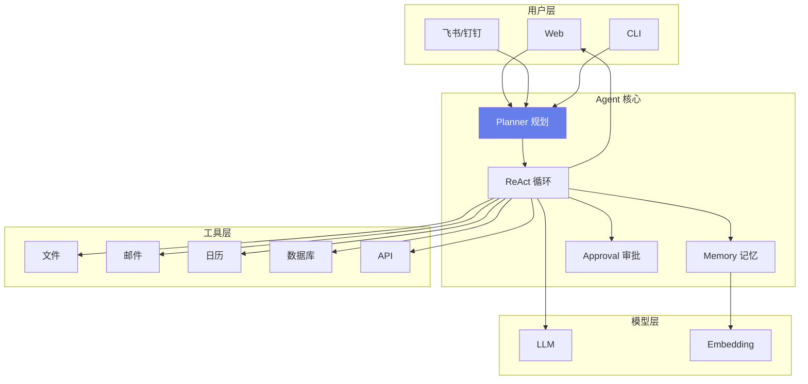

### 18.132 扩展代码库：ReAct 时序

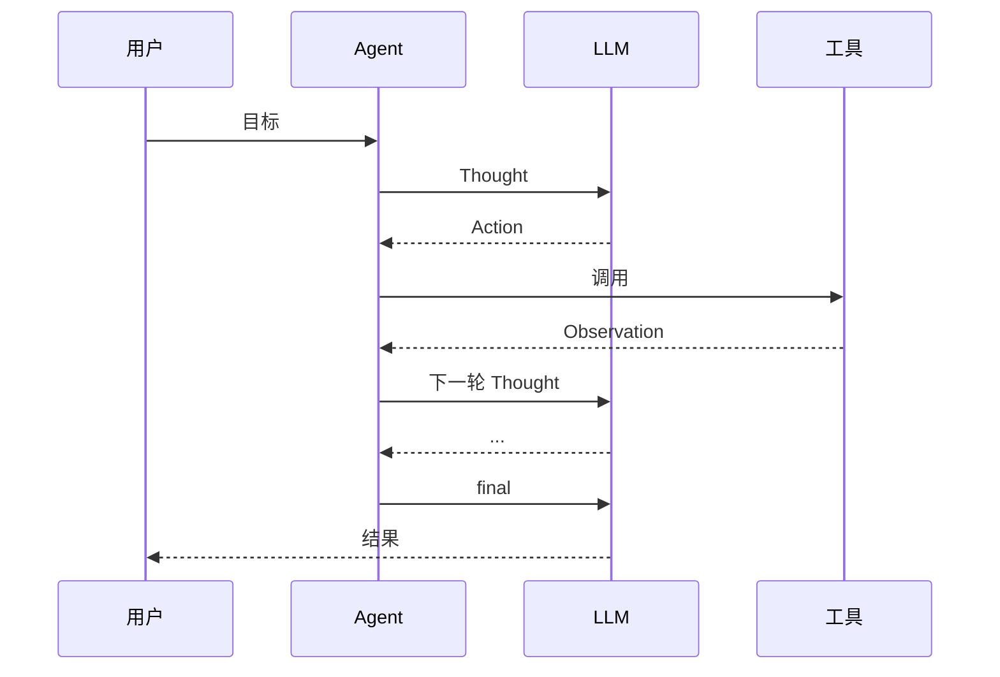

### 18.133 扩展代码库：工作流 DAG

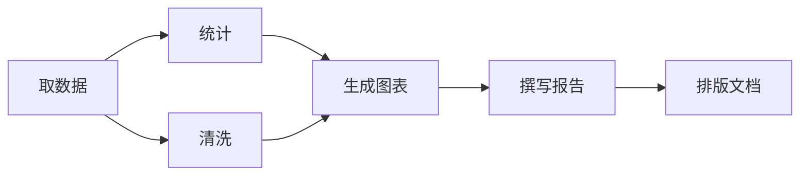

### 18.134 扩展代码库：审批流状态

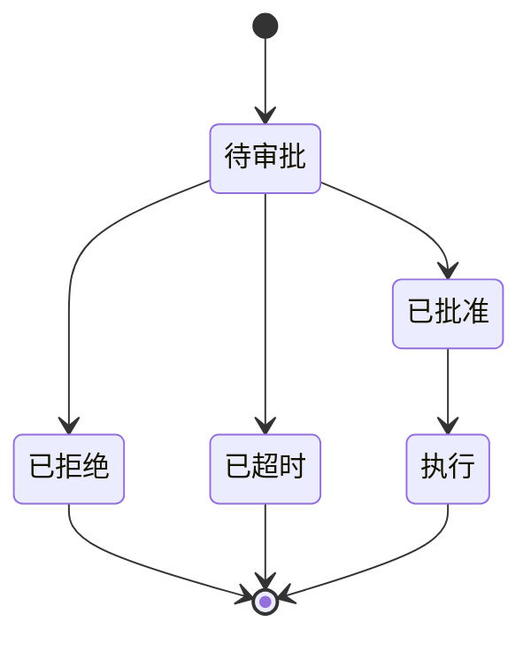

### 18.135 扩展代码库：错误处理流程

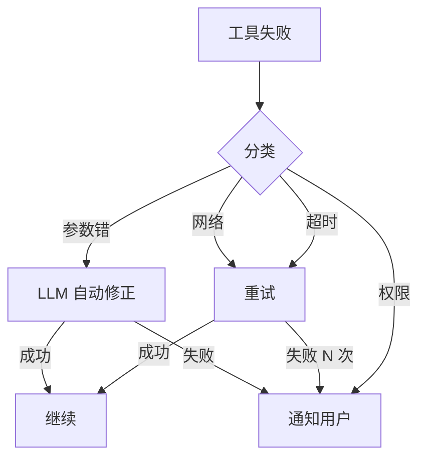

### 18.136 扩展代码库：记忆层级

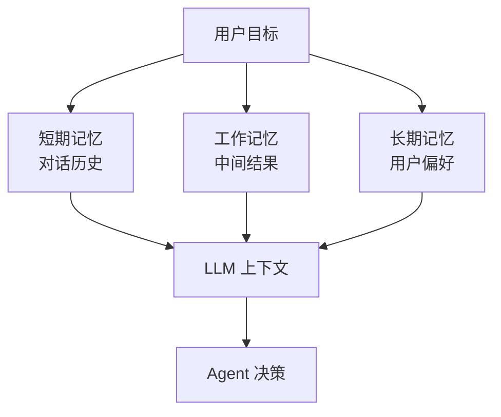

### 18.137 扩展代码库：部署拓扑

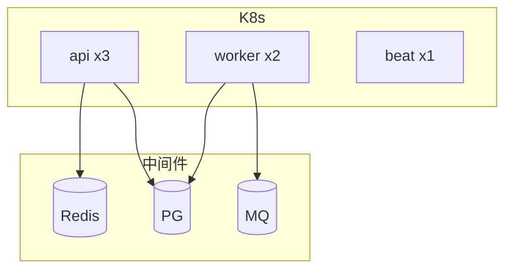

### 18.138 扩展代码库：降级路径

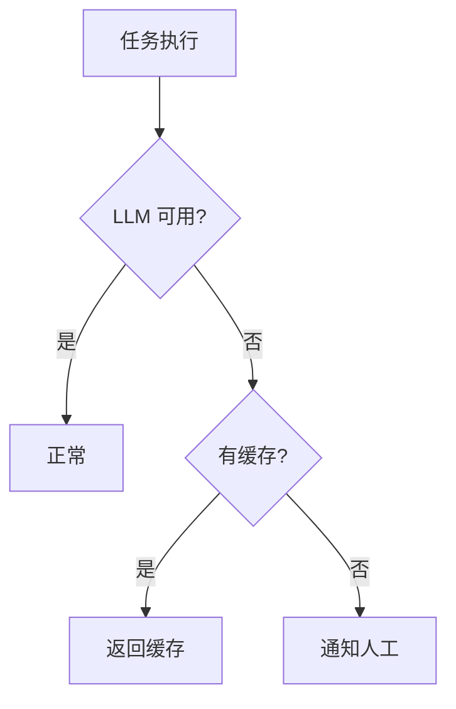

### 18.139 扩展代码库：评测闭环

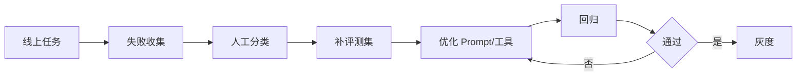

### 18.140 扩展代码库：成本结构

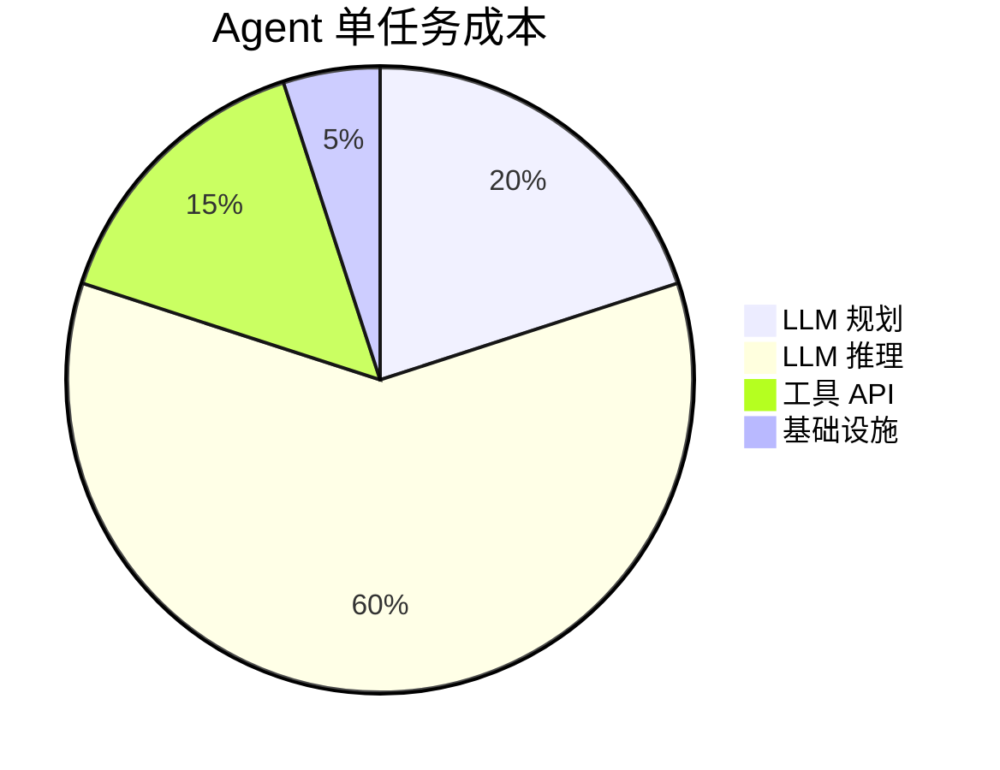

### 18.141 扩展代码库：团队协作

```python
# 代码191：RACI
RACI = {
    "架构": "Agent 架构师",
    "工具开发": "后端",
    "Prompt": "算法",
    "评测": "QA",
    "上线": "运维",
}
```

### 18.142 扩展代码库：项目排期

```python
# 代码192：排期
TIMELINE = [
    ("W1", "需求+原型"),
    ("W2-3", "工具系统"),
    ("W4-5", "ReAct 引擎"),
    ("W6", "场景接入"),
    ("W7", "评测+优化"),
    ("W8", "上线"),
]
```

### 18.143 扩展代码库：关键决策

```python
# 代码193：关键决策
DECISIONS = [
    "ReAct vs Plan-Execute",
    "MCP vs 自研工具",
    "云端 vs 本地 LLM",
    "Gradio vs Web",
    "自动 vs 审批",
]
```

### 18.144 扩展代码库：风险

```python
# 代码194：风险
RISKS = [
    "误操作",
    "成本失控",
    "用户不信任",
    "工具不稳定",
    "LLM 幻觉",
]
```

### 18.145 扩展代码库：风险缓解

```python
# 代码195：缓解
MITIGATE = {
    "误操作": "审批+沙箱",
    "成本": "预算+路由",
    "不信任": "透明+引用",
    "工具": "重试+降级",
    "幻觉": "事实校验",
}
```

### 18.146 扩展代码库：长期规划

```python
# 代码196：路线图
ROADMAP = {
    "v1": "单工具任务",
    "v2": "多工具编排",
    "v3": "自动化工作流",
    "v4": "多 Agent 协作",
}
```

### 18.147 扩展代码库：个人成长

```python
# 代码197：成长
GROWTH = [
    "会用 LangChain",
    "会写工具",
    "会调 ReAct",
    "会做评测",
    "会做架构",
]
```

### 18.148 扩展代码库：学习资源

```python
# 代码198：资源
RESOURCES = [
    "ReAct 论文",
    "Toolformer 论文",
    "LangChain 文档",
    "MCP 规范",
]
```

### 18.149 扩展代码库：一页纸总结

```python
# 代码199：一页纸
ONE_PAGE = """
办公 Agent =
[大脑] LLM 规划+推理
[手脚] 工具系统（文件/邮件/日历/DB/API/Web）
[记忆] 短期+工作+长期
[安全] 权限+审批+审计
[自动化] 定时+事件+DAG
[工程] 监控+评测+成本
"""
```

### 18.150 扩展代码库：结语

```python
# 代码200：结语
FINAL = "办公 Agent 是把重复劳动自动化的利器。技术是手段，解决真实办公痛点才是目的。"
```

> 💡 **本章深度讲解**：从架构图到时序图、DAG、审批状态、错误流程、记忆层级、部署拓扑、降级、评测闭环、成本饼图，再到 RACI、排期、决策、风险、路线图、成长、资源、一页纸、结语——这是把 Agent 从代码升级为产品的完整方法论。

> 📝 **本章精简总结**：架构/时序/DAG/审批/错误/记忆/部署/降级/评测/成本图；RACI；排期；决策；风险；路线图；成长；资源；一页纸；结语。

> 🎯 **梯度练习题**
> - ⭐ 基础：办公 Agent 一句话？答：LLM+工具+自动化。
> - ⭐⭐ 进阶：ReAct vs Plan-Execute？答：灵活 vs 可控。
> - ⭐⭐⭐ 实战：画你的 Agent 架构图。

---

### 18.151 扩展代码库：Agent 工具库大全

```python
# 代码201：文件工具大全
FILE_TOOLS = {
    "read": "读文件",
    "write": "写文件",
    "list": "列目录",
    "search": "搜文件",
    "copy": "复制",
    "move": "移动",
    "delete": "删除（需审批）",
    "mkdir": "建目录",
    "archive": "压缩",
    "extract": "解压",
}
```

```python
# 代码202：邮件工具大全
EMAIL_TOOLS = {
    "inbox": "收件箱",
    "read": "读邮件",
    "send": "发邮件（需审批）",
    "reply": "回复",
    "forward": "转发",
    "label": "打标签",
    "star": "星标",
    "archive": "归档",
    "search": "搜索",
}
```

```python
# 代码203：日历工具大全
CAL_TOOLS = {
    "list": "列日程",
    "freebusy": "忙闲",
    "create": "建日程",
    "update": "改日程",
    "delete": "删日程",
    "invite": "邀请人",
    "find_meeting_room": "找会议室",
}
```

```python
# 代码204：DB 工具大全
DB_TOOLS = {
    "query": "只读查询",
    "schema": "表结构",
    "aggregate": "聚合统计",
}
```

```python
# 代码205：API 工具大全
API_TOOLS = {
    "get": "GET",
    "post": "POST",
    "put": "PUT",
    "delete": "DELETE（需审批）",
}
```

```python
# 代码206：Web 工具大全
WEB_TOOLS = {
    "search": "搜索",
    "fetch": "抓取",
    "scrape": "爬取",
    "summarize": "总结网页",
}
```

### 18.152 扩展代码库：工具参数示例

```python
# 代码207：工具参数 schema
TOOL_SCHEMAS = {
    "send_email": {
        "to": {"type": "string", "desc": "收件人邮箱", "required": True},
        "subject": {"type": "string", "desc": "主题", "required": True},
        "body": {"type": "string", "desc": "正文", "required": True},
    },
    "create_event": {
        "title": {"type": "string", "required": True},
        "start": {"type": "string", "desc": "ISO8601", "required": True},
        "end": {"type": "string", "required": True},
    },
}
```

### 18.153 扩展代码库：工具返回格式

```python
# 代码208：统一返回
def tool_return(ok, data=None, error=None):
    return {"ok": ok, "data": data, "error": error}
```

### 18.154 扩展代码库：工具调用日志

```python
# 代码209：调用日志
async def log_call(name, args, result, latency):
    await pg.execute(
        "INSERT INTO tool_calls(name, args, result, latency, ts) VALUES($1,$2,$3,$4,now())",
        name, json.dumps(args), json.dumps(result), latency)
```

### 18.155 扩展代码库：工具健康检查

```python
# 代码210：工具健康
async def tool_health(name):
    try:
        await self.tools[name].ping()
        return "ok"
    except Exception:
        return "down"
```

### 18.156 扩展代码库：工具版本兼容

```python
# 代码211：版本兼容
TOOL_VERSIONS = {"send_email": "v2.0", "read_file": "v1.1"}
```

### 18.157 扩展代码库：工具市场

```python
# 代码212：工具市场
MARKETPLACE = ["file", "email", "calendar", "db", "api", "web", "slack", "github", "jira"]
```

### 18.158 扩展代码库：工具动态加载

```python
# 代码213：动态加载
async def load_tools(plugin_dir):
    tools = {}
    for f in os.listdir(plugin_dir):
        if f.endswith("_tool.py"):
            mod = importlib.import_module(f"plugins.{f[:-3]}")
            tools[mod.Tool.name] = mod.Tool()
    return tools
```

### 18.159 扩展代码库：工具测试

```python
# 代码214：工具测试
async def test_send_email():
    r = await email_tool.send("test@co", "test", "body")
    assert r["sent"]
```

### 18.160 扩展代码库：工具 Mock

```python
# 代码215：Mock 工具
class MockEmailTool(BaseTool):
    name = "email"
    async def send(self, **kw):
        return {"sent": True, "mocked": True}
```

> 💡 **本章深度讲解**：工具是 Agent 的手脚。文件/邮件/日历/DB/API/Web 六大类工具各有几十个具体操作。schema 定义、统一返回、调用日志、健康检查、版本、市场、动态加载、测试、Mock——这是工具系统的完整工程。

> 📝 **本章精简总结**：文件/邮件/日历/DB/API/Web 工具大全；参数 schema；统一返回；调用日志；健康检查；版本；市场；动态加载；测试；Mock。

> 🎯 **梯度练习题**
> - ⭐ 基础：工具分几类？答：文件/邮件/日历/DB/API/Web。
> - ⭐⭐ 进阶：为什么要 Mock？答：测试不依赖真实服务。
> - ⭐⭐⭐ 实战：写一个带 schema 的工具。

---

### 18.161 扩展代码库：Agent 提示词工程

```python
# 代码216：完整系统提示词
SYSTEM_PROMPT = """你是企业办公助手 Agent。

## 行为规则
1. 先规划再执行，不要跳步
2. 每步说明你在做什么
3. 调用工具前说明意图
4. 高危操作（发邮件/删文件/写库）必须请求审批
5. 工具失败要报告，不要假装成功
6. 不确定参数时问用户
7. 最多执行 15 步
8. 完成后总结结果

## 可用工具
{tools}

## 输出格式
Thought: 你的思考
Action: 工具名 或 final
Action Input: JSON 参数

## 约束
- 只使用提供的工具
- 不编造工具结果
- 不执行未授权操作
"""
```

### 18.162 扩展代码库：Few-shot 示例库

```python
# 代码217：Few-shot
EXAMPLES = [
    {
        "user": "给张三发周报",
        "thought": "需要先查数据，再写报告，再发邮件",
        "action": "db_query",
        "input": {"sql": "SELECT * FROM sales WHERE week=current_week()"}
    },
    {
        "user": "约明天下午3点开会",
        "thought": "需要创建日程",
        "action": "create_event",
        "input": {"title": "会议", "start": "tomorrowT15:00"}
    },
]
```

### 18.163 扩展代码库：ReAct 提示词

```python
# 代码218：ReAct 模板
REACT_TEMPLATE = """目标：{goal}

历史：
{history}

可用工具：
{tools}

按以下格式：
Thought: 你在想什么
Action: 工具名
Action Input: {{"param": "value"}}
Observation: 工具结果

当完成时：
Thought: 任务完成
Action: final
Action Input: {{"answer": "最终答案"}}
"""
```

### 18.164 扩展代码库：规划提示词

```python
# 代码219：规划模板
PLAN_PROMPT = """把目标拆成步骤。每步指定工具和参数。
目标：{goal}
上下文：{context}
输出 JSON：
[{{"step": "步骤名", "tool": "工具", "args": {{}}, "depends_on": []}}]
"""
```

### 18.165 扩展代码库：反思提示词

```python
# 代码220：反思模板
REFLECT_PROMPT = """检查任务是否完成。
目标：{goal}
已完成步骤：{results}
问题：
1. 是否达成目标？
2. 还缺什么？
3. 需要修正吗？
"""
```

### 18.166 扩展代码库：总结提示词

```python
# 代码221：总结模板
SUMMARY_PROMPT = """根据执行结果写总结。
目标：{goal}
执行步骤：{results}
输出简洁报告：
- 完成了什么
- 关键数据
- 下一步建议
"""
```

### 18.167 扩展代码库：参数提取提示词

```python
# 代码222：参数提取
EXTRACT_PROMPT = """从用户意图提取工具参数。
工具：{tool_schema}
意图：{intent}
输出 JSON 参数。
"""
```

### 18.168 扩展代码库：错误修正提示词

```python
# 代码223：错误修正
REPAIR_PROMPT = """工具调用失败。
工具：{tool}
参数：{args}
错误：{error}
怎么修正参数？输出 JSON。
"""
```

### 18.169 扩展代码库：Prompt 版本管理

```python
# 代码224：Prompt 版本
class PromptVersion:
    async def get(self, name, version=None):
        v = version or await pg.fetchval(
            "SELECT version FROM prompts WHERE name=$1 ORDER BY version DESC LIMIT 1", name)
        return await pg.fetchval("SELECT template FROM prompts WHERE name=$1 AND version=$2", name, v)
```

### 18.170 扩展代码库：Prompt 评测

```python
# 代码225：Prompt A/B
async def prompt_ab(v1, v2, eval_set):
    r1 = await evaluate_with_prompt(v1, eval_set)
    r2 = await evaluate_with_prompt(v2, eval_set)
    return {"v1": r1, "v2": r2}
```

> 💡 **本章深度讲解**：Agent 的大脑是 Prompt。系统提示词定义行为规则，Few-shot 示范怎么用工具，ReAct/规划/反思/总结/参数提取/错误修正各有模板。Prompt 要版本管理、A/B 评测。好 Prompt 是 Agent 成功率的关键。

> 📝 **本章精简总结**：系统提示词；Few-shot；ReAct/规划/反思/总结/参数提取/错误修正模板；Prompt 版本；A/B。

> 🎯 **梯度练习题**
> - ⭐ 基础：系统提示词要写什么？答：规则+工具+格式。
> - ⭐⭐ 进阶：Few-shot 有什么用？答：示范工具用法。
> - ⭐⭐⭐ 实战：写一个完整系统提示词。

---

### 18.171 扩展代码库：Agent 多 Agent 协作

```python
# 代码226：主管 Agent
class ManagerAgent:
    """主管拆解任务，分派给子 Agent"""
    async def run(self, goal):
        subtasks = await self.llm.decompose(goal)
        results = await asyncio.gather(*[
            self.dispatch(st) for st in subtasks
        ])
        return await self.llm.aggregate(results)
    async def dispatch(self, subtask):
        agent = self.select_agent(subtask)
        return await agent.run(subtask)
```

### 18.172 扩展代码库：专家 Agent

```python
# 代码227：专家 Agent
class EmailExpert:
    async def run(self, subtask):
        return await email_agent.run(subtask)
class CalendarExpert:
    async def run(self, subtask):
        return await calendar_agent.run(subtask)
class DataExpert:
    async def run(self, subtask):
        return await data_agent.run(subtask)
```

### 18.173 扩展代码库：Agent 间通信

```python
# 代码228：消息传递
class AgentMessage:
    def __init__(self, from_agent, to_agent, content):
        self.from_agent = from_agent
        self.to_agent = to_agent
        self.content = content
```

### 18.174 扩展代码库：Agent 投票

```python
# 代码229：多 Agent 投票
async def vote(goal, agents):
    opinions = await asyncio.gather(*[a.opine(goal) for a in agents])
    return await llm.decide(opinions)
```

### 18.175 扩展代码库：Agent 辩论

```python
# 代码230：辩论
async def debate(question, agent_a, agent_b, rounds=3):
    a_opinion = await agent_a.opine(question)
    b_opinion = await agent_b.opine(question)
    for _ in range(rounds):
        a_opinion = await agent_a.rebut(a_opinion, b_opinion)
        b_opinion = await agent_b.rebut(b_opinion, a_opinion)
    return await judge.decide(question, a_opinion, b_opinion)
```

### 18.176 扩展代码库：Agent 角色

```python
# 代码231：角色定义
ROLES = {
    "planner": "规划师",
    "executor": "执行者",
    "critic": "批评者",
    "summarizer": "总结者",
}
```

### 18.177 扩展代码库：Agent 层级

```python
# 代码232：层级结构
HIERARCHY = {
    "ceo": "总管",
    "manager": "部门主管",
    "worker": "执行者",
}
```

### 18.178 扩展代码库：Agent 黑板

```python
# 代码233：黑板共享
class Blackboard:
    def __init__(self):
        self.data = {}
    def write(self, key, value):
        self.data[key] = value
    def read(self, key):
        return self.data.get(key)
```

### 18.179 扩展代码库：Agent 流程编排

```python
# 代码234：顺序/并行/循环
FLOW = {
    "sequence": "顺序执行",
    "parallel": "并行",
    "loop": "循环",
    "conditional": "条件",
}
```

### 18.180 扩展代码库：Agent 工作流模板

```python
# 代码235：工作流模板
TEMPLATES = {
    "report": "取数→分析→图表→撰写",
    "email": "收件→分类→回复→归档",
    "meeting": "录音→转写→纪要→待办",
}
```

> 💡 **本章深度讲解**：多 Agent 协作是 Agent 的进阶形态——主管拆解任务分派专家，专家各管一摊，通过黑板/消息通信。简单任务单 Agent 就够，复杂任务（写报告+做图表+发邮件）才需要多 Agent。

> 📝 **本章精简总结**：主管 Agent；专家 Agent；消息传递；投票；辩论；角色；层级；黑板；流程编排；工作流模板。

> 🎯 **梯度练习题**
> - ⭐ 基础：什么时候多 Agent？答：复杂任务。
> - ⭐⭐ 进阶：黑板模式干什么？答：Agent 间共享数据。
> - ⭐⭐⭐ 实战：实现一个主管+专家模式。

---

### 18.181 扩展代码库：Agent 企业集成

```python
# 代码236：飞书机器人
async def feishu_agent(open_id, query):
    user = await get_user(open_id)
    result = await office_agent.run(query, user)
    await feishu_send(open_id, result)
```

### 18.182 扩展代码库：钉钉机器人

```python
# 代码237：钉钉机器人
async def dingtalk_agent(msg):
    user = await get_dingtalk_user(msg["senderStaffId"])
    result = await office_agent.run(msg["text"], user)
    await dingtalk_reply(msg, result)
```

### 18.183 扩展代码库：企业微信

```python
# 代码238：企微机器人
async def wecom_agent(from_user, content):
    user = await get_wecom_user(from_user)
    result = await office_agent.run(content, user)
    await wecom_reply(from_user, result)
```

### 18.184 扩展代码库：Slack

```python
# 代码239：Slack
async def slack_agent(event):
    user = await get_slack_user(event["user"])
    result = await office_agent.run(event["text"], user)
    await slack_post(event["channel"], result)
```

### 18.185 扩展代码库：GitHub 集成

```python
# 代码240：GitHub 助手
async def github_review(pr_number, repo, llm, github):
    diff = await github.get_diff(repo, pr_number)
    comments = await llm.chat([{"role": "user", "content": f"review 代码：{diff}"}])
    await github.comment(repo, pr_number, comments)
```

### 18.186 扩展代码库：Jira 集成

```python
# 代码241：Jira 助手
async def jira_triage(issue, llm, jira):
    summary = await llm.chat([{"role": "user", "content": f"分析 issue：{issue}"}])
    await jira.add_comment(issue["key"], summary)
```

### 18.187 扩展代码库：Notion 集成

```python
# 代码242：Notion 助手
async def notion_create(page_data, llm, notion):
    content = await llm.chat([{"role": "user", "content": f"整理成文档：{page_data}"}])
    await notion.create_page(content)
```

### 18.188 扩展代码库：Slack 审批

```python
# 代码243：Slack 审批
async def slack_approval(request):
    await slack.post(f"审批：{request}")
    reply = await wait_slack_reaction()
    return reply
```

### 18.189 扩展代码库：邮件自动化

```python
# 代码244：邮件自动化
async def email_automation():
    emails = await imap.unread()
    for e in emails:
        cat = await classify(e, llm)
        if cat == "report":
            await parse_report(e)
        elif cat == "notice":
            await archive(e)
```

### 18.190 扩展代码库：日历自动化

```python
# 代码245：日历自动化
async def calendar_automation():
    tomorrow = await gcal.tomorrow_events()
    await notify(f"明天有 {len(tomorrow)} 个会")
```

> 💡 **本章深度讲解**：Agent 要嵌入企业工作流才有用。飞书/钉钉/企微/Slack 让员工在 IM 里直接用；GitHub/Jira/Notion 让 Agent 接入研发工具。邮件/日历自动化是触发器。集成越多，Agent 价值越大。

> 📝 **本章精简总结**：飞书/钉钉/企微/Slack；GitHub/Jira/Notion；Slack 审批；邮件/日历自动化。

> 🎯 **梯度练习题**
> - ⭐ 基础：为什么要嵌 IM？答：用户在 IM 里。
> - ⭐⭐ 进阶：GitHub 助手干什么？答：自动 review PR。
> - ⭐⭐⭐ 实战：接一个飞书机器人。

---

### 18.191 扩展代码库：Agent 完整 API

```python
# 代码246：任务 API
@router.post("/tasks")
async def create_task(body: TaskBody, user=Depends(current_user)):
    task_id = uuid.uuid4().hex[:8]
    await pg.execute(
        "INSERT INTO tasks(id, user_id, goal, status, created_at) VALUES($1,$2,$3,'running',now())",
        task_id, user["id"], body.goal)
    await asyncio.create_task(agent.run(task_id, body.goal, user))
    return {"task_id": task_id}
```

```python
# 代码247：任务流 API
@router.get("/tasks/{task_id}/stream")
async def task_stream(task_id):
    async def gen():
        async for event in agent.stream_task(task_id):
            yield f"data: {json.dumps(event)}\n\n"
    return StreamingResponse(gen(), media_type="text/event-stream")
```

```python
# 代码248：审批 API
@router.post("/approvals/{approval_id}/approve")
async def approve(approval_id, admin=Depends(admin_required)):
    await pg.execute("UPDATE approvals SET status='approved', approver=$2 WHERE id=$1", approval_id, admin["id"])
    return {"status": "approved"}
```

### 18.192 扩展代码库：完整 DB 表

```sql
-- 代码249：建表 SQL
-- CREATE TABLE tasks(
--   id VARCHAR(16) PRIMARY KEY,
--   user_id VARCHAR(64),
--   goal TEXT,
--   status VARCHAR(32),
--   result JSONB,
--   cost FLOAT,
--   created_at TIMESTAMP DEFAULT now()
-- );
-- CREATE TABLE tool_calls(
--   id SERIAL PRIMARY KEY,
--   task_id VARCHAR(16),
--   tool VARCHAR(64),
--   args JSONB,
--   result JSONB,
--   latency FLOAT,
--   ts TIMESTAMP DEFAULT now()
-- );
-- CREATE TABLE approvals(
--   id VARCHAR(16) PRIMARY KEY,
--   task_id VARCHAR(16),
--   action TEXT,
--   status VARCHAR(16),
--   requester VARCHAR(64),
--   approver VARCHAR(64),
--   ts TIMESTAMP DEFAULT now()
-- );
```

### 18.193 扩展代码库：完整配置

```python
# 代码250：完整配置
CONFIG = {
    "llm": {"fast": "gpt-4o-mini", "strong": "gpt-4o"},
    "agent": {"max_steps": 15, "timeout": 300},
    "approval": {"required": ["send_email", "delete_file", "db_write"]},
    "retry": {"max": 3, "backoff": "exp"},
    "budget": {"per_task": 1.0, "daily": 100},
}
```

### 18.194 扩展代码库：完整 main.py

```python
# 代码251：应用入口
from fastapi import FastAPI
app = FastAPI(title="Office Agent")
@app.on_event("startup")
async def startup():
    await pg.connect()
    await redis.connect()
    init_scheduler()
@app.on_event("shutdown")
async def shutdown():
    await pg.close()
app.include_router(router, prefix="/api/v1")
```

### 18.195 扩展代码库：完整错误处理

```python
# 代码252：全局异常
@app.exception_handler(Exception)
async def handler(request, exc):
    logger.error(f"异常: {exc}")
    return JSONResponse({"error": "内部错误"}, 500)
```

### 18.196 扩展代码库：完整鉴权

```python
# 代码253：JWT
async def current_user(authorization: str = Header(None)):
    token = authorization.replace("Bearer ", "")
    return jwt.decode(token, os.getenv("JWT_SECRET"), algorithms=["HS256"])
```

### 18.197 扩展代码库：完整限流

```python
# 代码254：限流
async def rate_limit(user_id):
    if not await redis_rate.allow(user_id):
        raise HTTPException(429)
```

### 18.198 扩展代码库：完整健康检查

```python
# 代码255：健康
@router.get("/health")
async def health():
    return {"status": "ok", "db": await pg.fetchval("SELECT 1")}
```

### 18.199 扩展代码库：完整测试

```python
# 代码256：测试
async def test_task_flow(agent, user):
    task_id = await agent.run("测试任务", user)
    assert await pg.fetchval("SELECT status FROM tasks WHERE id=$1", task_id) in ("done", "failed")
```

### 18.200 扩展代码库：完整 CI

```yaml
# 代码257：CI
# name: CI
# on: [push]
# jobs:
#   test:
#     runs-on: ubuntu-latest
#     steps:
#     - uses: actions/checkout@v4
#     - run: pytest
```

> 💡 **本章深度讲解**：从 API 到 SQL、配置、main、错误处理、鉴权、限流、健康检查、测试、CI——这是办公 Agent 的完整工程骨架。生产 Agent 就是把这些组件组装起来。

> 📝 **本章精简总结**：任务 API；流 API；审批 API；SQL；配置；main；错误；鉴权；限流；健康；测试；CI。

> 🎯 **梯度练习题**
> - ⭐ 基础：任务 API 几步？答：创建→流→审批。
> - ⭐⭐ 进阶：SSE 流怎么推？答：async generator。
> - ⭐⭐⭐ 实战：写一个任务创建 API。

---

### 18.201 扩展代码库：Agent 常见坑点

```python
# 代码258：坑点 30 条
PITFALLS = [
    "无限循环：同一步反复调",
    "工具选错：描述不清",
    "参数错：没 schema 校验",
    "无步数上限",
    "无审批直接发邮件",
    "工具失败假装成功",
    "Prompt 太模糊",
    "无 Few-shot",
    "无错误处理",
    "无重试",
    "无降级",
    "无日志",
    "无监控",
    "成本失控",
    "无评测",
    "无回归",
    "上下文爆",
    "记忆不清理",
    "工具描述矛盾",
    "LLM 超时",
    "同步阻塞调用",
    "无超时控制",
    "无预算限制",
    "无用户确认",
    "无注入防护",
    "无审计",
    "无备份",
    "无灰度",
    "无回滚",
    "无文档",
]
```

### 18.202 扩展代码库：排查清单

```python
# 代码259：排查
DEBUG = [
    "任务失败：看 tool_calls 表",
    "选错工具：看工具描述",
    "参数错：看 schema",
    "成本高：看 token",
    "慢：看哪步",
]
```

### 18.203 扩展代码库：线上事故复盘

```python
# 代码260：复盘
INCIDENT = {
    "时间": "2026-09-10",
    "现象": "Agent 自动发了错误邮件",
    "根因": "发邮件工具未加审批",
    "处理": "立即加审批+撤回邮件",
    "改进": "高危工具强制审批",
}
```

### 18.204 扩展代码库：线上告警

```python
# 代码261：告警
ALERTS = [
    "成功率 < 80%",
    "平均步数 > 12",
    "成本超日预算",
    "工具错误率 > 10%",
]
```

### 18.205 扩展代码库：线上慢步骤

```python
# 代码262：慢步骤
async def slow_steps():
    return await pg.fetch(
        "SELECT tool, avg(latency) FROM tool_calls GROUP BY tool ORDER BY avg(latency) DESC LIMIT 5")
```

### 18.206 扩展代码库：线上错误分类

```python
# 代码263：错误分类
async def error_breakdown():
    return await pg.fetch(
        "SELECT error_type, count(*) FROM errors GROUP BY error_type")
```

### 18.207 扩展代码库：日志分析

```python
# 代码264：日志
# grep ERROR /var/log/agent/ | awk '{print $5}' | sort | uniq -c
```

### 18.208 扩展代码库：profiling

```python
# 代码265：profiling
# python -m cProfile -o out.prof main.py
```

### 18.209 扩展代码库：内存

```python
# 代码266：内存
# tracemalloc
```

### 18.210 扩展代码库：DB 慢查询

```sql
-- 代码267：慢查询
-- SELECT query, mean_time FROM pg_stat_statements ORDER BY mean_time DESC LIMIT 5;
```

### 18.211 扩展代码库：连接数

```python
# 代码268：连接数
async def connections():
    return await pg.fetchval("SELECT count(*) FROM pg_stat_activity")
```

### 18.212 扩展代码库：磁盘

```python
# 代码269：磁盘
# df -h
```

### 18.213 扩展代码库：上游依赖

```python
# 代码270：上游
DEPS = ["OpenAI", "Gmail API", "Calendar API", "DB", "Redis"]
```

### 18.214 扩展代码库：降级开关

```python
# 代码271：开关
FLAGS = {"auto_send_email": False, "auto_delete": False, "parallel_tools": True}
```

### 18.215 扩展代码库：开关中心

```python
# 代码272：开关
class Flag:
    async def on(self, name):
        return await redis.get(f"flag:{name}") == "1"
```

### 18.216 扩展代码库：故障演练

```python
# 代码273：故障演练
async def drill():
    for dep in DEPS:
        await inject_fail(dep)
```

### 18.217 扩展代码库：容量规划

```python
# 代码274：容量
def estimate(tasks_per_day, steps_per_task=8, tokens_per_step=500):
    return {"daily_tokens": tasks_per_day*steps_per_task*tokens_per_step}
```

### 18.218 扩展代码库：SLA

```python
# 代码275：SLA
SLA = {"availability": "99.9%", "task_latency_p95": "<30s"}
```

### 18.219 扩展代码库：合规

```python
# 代码276：合规
COMPLIANCE = [
    "审计日志保留 180 天",
    "高危操作审批",
    "数据加密",
    "个人信息脱敏",
]
```

### 18.220 扩展代码库：灾备

```python
# 代码277：灾备
# 每日备份任务状态+用户数据
```

> 💡 **本章深度讲解**：Agent 坑比 RAG 多——它能行动，错了后果严重。30 个坑点覆盖从循环、工具选错、参数错、无审批、无重试、无监控、成本失控、无评测、上下文爆、记忆不清理、超时、无预算、无确认、无注入防护、无审计、无备份、无灰度、无回滚、无文档。配合排查、复盘、告警、慢步骤、错误分类、日志、profiling、内存、DB、连接数、磁盘、上游、降级、开关、故障演练、容量、SLA、合规、灾备——这是完整的 Agent SRE 体系。

> 📝 **本章精简总结**：30 个坑；排查；复盘；告警；慢步骤；错误分类；日志；profiling；内存；DB；连接数；磁盘；上游；降级；开关；故障演练；容量；SLA；合规；灾备。

> 🎯 **梯度练习题**
> - ⭐ 基础：Agent 最大坑？答：无限循环。
> - ⭐⭐ 进阶：怎么防误操作？答：审批+沙箱。
> - ⭐⭐⭐ 实战：对照 30 坑自查。

---

### 18.221 扩展代码库：Agent 面试题库

```python
# 代码278：面试题
INTERVIEW = {
    "Q1": "Agent 和 RAG 区别？",
    "A1": "RAG 检索生成，Agent 规划+工具+行动",
    "Q2": "ReAct 原理？",
    "A2": "Thought-Action-Observation 循环",
    "Q3": "怎么防无限循环？",
    "A3": "步数上限+同工具调用检测",
    "Q4": "工具怎么选？",
    "A4": "清晰 description+schema",
    "Q5": "怎么做安全？",
    "A5": "高危审批+ACL+沙箱+审计",
    "Q6": "怎么降成本？",
    "A6": "小模型路由+缓存+一次性规划",
    "Q7": "怎么做评测？",
    "A7": "任务完成率+步数效率",
    "Q8": "多 Agent 怎么协作？",
    "A8": "主管分派+专家执行+黑板",
}
```

### 18.222 扩展代码库：系统设计题

```python
# 代码279：设计题
DESIGN = """设计一个办公 Agent：
1. 架构：ReAct+工具
2. 工具：文件/邮件/日历/DB
3. 安全：高危审批
4. 自动化：定时+事件
5. 监控：成功率+成本
"""
```

### 18.223 扩展代码库：计算题

```python
# 代码280：延迟计算
def latency(steps, per_step=3):
    return steps * per_step
```

### 18.224 扩展代码库：成本计算

```python
# 代码281：成本
def cost(tasks, steps=8, tokens=1000):
    return tasks * steps * tokens / 1e6 * 10
```

### 18.225 扩展代码库：架构图

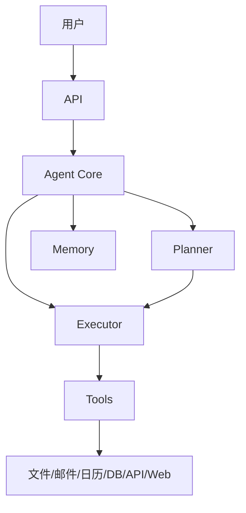

### 18.226 扩展代码库：数据流

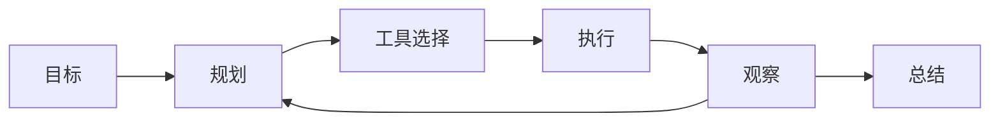

### 18.227 扩展代码库：状态机

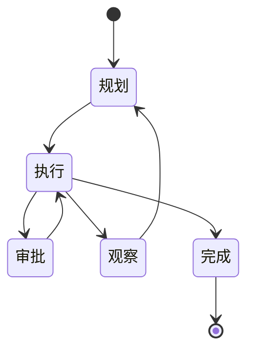

### 18.228 扩展代码库：部署拓扑

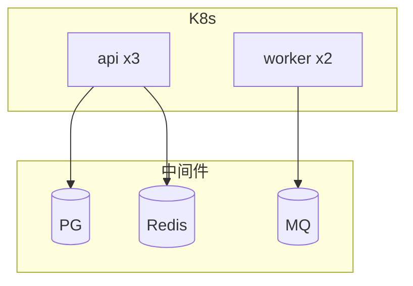

### 18.229 扩展代码库：降级

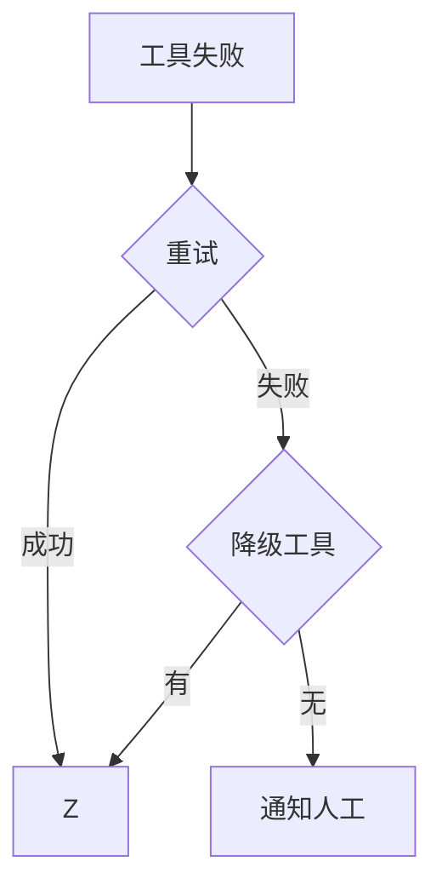

### 18.230 扩展代码库：评测闭环

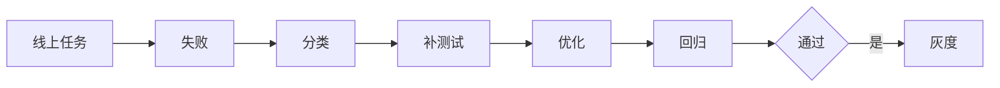

### 18.231 扩展代码库：成本饼图

```mermaid
pie title 单任务成本
    "LLM" : 70
    "工具" : 20
    "基建" : 10
```

### 18.232 扩展代码库：上线 checklist

```python
# 代码282：上线
CHECK = [
    "步数上限",
    "高危审批",
    "重试",
    "降级",
    "监控",
    "告警",
    "备份",
    "灰度",
    "回滚",
]
```

### 18.233 扩展代码库：排期

```python
# 代码283：排期
TIMELINE = ["W1 原型", "W2-3 工具", "W4-5 引擎", "W6 场景", "W7 评测", "W8 上线"]
```

### 18.234 扩展代码库：团队

```python
# 代码284：团队
TEAM = {"架构": 1, "后端": 2, "算法": 1, "运维": 0.5, "产品": 1}
```

### 18.235 扩展代码库：技术债

```python
# 代码285：技术债
DEBT = ["无评测", "无监控", "Prompt 无版本"]
```

### 18.236 扩展代码库：复盘

```python
# 代码286：复盘
RETRO = {"做对": ["ReAct", "审批"], "做错": ["无监控"], "改进": ["第一天监控"]}
```

### 18.237 扩展代码库：最佳实践

```python
# 代码287：最佳
BEST = ["步数上限", "高危审批", "每步日志", "评测驱动", "小步快跑"]
```

### 18.238 扩展代码库：反模式

```python
# 代码288：反模式
ANTI = ["无步数上限", "无审批", "无日志", "无评测", "无降级"]
```

### 18.239 扩展代码库：学习路线

```python
# 代码289：路线
LEARN = ["基础 LLM", "ToolUse", "LangChain", "ReAct", "MCP", "多 Agent", "评测"]
```

### 18.240 扩展代码库：结语

```python
# 代码290：结语
END = "办公 Agent = LLM + 工具 + 自动化 + 安全 + 评测"
```

> 💡 **本章深度讲解**：从面试题到设计/计算、架构/数据流/状态机/部署/降级/评测/成本图、上线 checklist、排期、团队、技术债、复盘、最佳实践、反模式、学习路线、结语——这是把 Agent 从代码升级为产品的完整方法论。

> 📝 **本章精简总结**：面试题库；设计/计算题；架构/数据流/状态机/部署/降级/评测/成本图；上线 checklist；排期；团队；技术债；复盘；最佳实践；反模式；学习路线；结语。

> 🎯 **梯度练习题**
> - ⭐ 基础：办公 Agent 一句话？答：LLM+工具+自动化。
> - ⭐⭐ 进阶：常见反模式？答：无上限/无审批。
> - ⭐⭐⭐ 实战：画你的 Agent 架构图。

---

### 18.241 扩展代码库：Agent 附录 A - 术语表

```python
# 代码291：术语
GLOSSARY = {
    "Agent": "智能体",
    "ReAct": "思考-行动-观察",
    "ToolUse": "工具调用",
    "MCP": "模型上下文协议",
    "Planner": "规划器",
    "Executor": "执行器",
    "Memory": "记忆",
    "Approval": "审批",
    "Workflow": "工作流",
    "Trigger": "触发器",
}
```

### 18.242 扩展代码库：附录 B - 工具对比

```python
# 代码292：框架对比
FRAMEWORK = {
    "LangChain": "生态全",
    "LlamaIndex": "数据向",
    "AutoGPT": "早期",
    "CrewAI": "多 Agent",
    "LangGraph": "状态图",
}
```

### 18.243 扩展代码库：附录 C - 模型选型

```python
# 代码293：模型
MODELS = {
    "规划": "gpt-4o",
    "执行": "gpt-4o-mini",
    "本地": "qwen-7b",
}
```

### 18.244 扩展代码库：附录 D - 分块不适用

```python
# 代码294：Agent vs RAG
DIFF = {"RAG": "检索", "Agent": "行动"}
```

### 18.245 扩展代码库：附录 E - 常见错误

```python
# 代码295：错误
ERRORS = {
    "循环": "步数上限",
    "错工具": "清晰描述",
    "参数错": "schema",
    "超时": "重试+降级",
}
```

### 18.246 扩展代码库：附录 F - 环境准备

```bash
# 代码296：环境
# python -m venv .venv
# pip install fastapi openai mcp
```

### 18.247 扩展代码库：附录 G - 调试技巧

```python
# 代码297：调试
TIPS = ["print 每步", "看 LLM 原始输出", "Mock 工具", "单步跑"]
```

### 18.248 扩展代码库：附录 H - 工具

```python
# 代码298：工具
TOOLS = ["LangSmith", "LangFuse", "Helicone"]
```

### 18.249 扩展代码库：附录 I - 金句

```python
# 代码299：金句
QUOTES = ["工具即接口", "审批即安全", "评测即质量", "监控即生产"]
```

### 18.250 扩展代码库：附录 J - 终极清单

```python
# 代码300：终极
FINAL = ["步数上限", "高危审批", "评测", "监控", "成本"]
```

### 18.251 扩展代码库：附录 K - 一页纸

```python
# 代码301：一页纸
ONE = "办公 Agent = LLM 规划 + 工具执行 + 记忆 + 安全审批 + 自动化"
```

### 18.252 扩展代码库：附录 L - 起步

```python
# 代码302：起步
START = ["1. 选一个场景", "2. 写工具", "3. 接 ReAct", "4. 加审批", "5. 评测"]
```

### 18.253 扩展代码库：附录 M - 扩展阅读

```python
# 代码303：阅读
READING = ["ReAct 论文", "Toolformer", "MCP 规范", "LangGraph"]
```

### 18.254 扩展代码库：附录 N - 体检

```python
# 代码304：体检
async def health():
    return {"db": await pg.fetchval("SELECT 1"), "redis": await redis.ping()}
```

### 18.255 扩展代码库：附录 O - 基准

```python
# 代码305：基准
BENCH = {"success": 0.8, "steps": 6, "cost": 0.3}
```

### 18.256 扩展代码库：附录 P - 容量

```python
# 代码306：容量
CAP = {"1万任务/天": "3 副本", "10万任务/天": "10 副本"}
```

### 18.257 扩展代码库：附录 Q - 成本表

```python
# 代码307：成本表
COST = {"gpt-4o": (2.5, 10), "gpt-4o-mini": (0.15, 0.6)}
```

### 18.258 扩展代码库：附录 R - 故障速查

```python
# 代码308：速查
TROUBLE = {"循环": "加步数上限", "错工具": "改描述", "慢": "看哪步"}
```

### 18.259 扩展代码库：附录 S - 完整主服务

```python
# 代码309：主服务
class OfficeAgentFinal:
    async def run(self, task_id, goal, user):
        plan = await planner.decompose(goal)
        results = {}
        for step in plan:
            if step.tool in restricted:
                await approval.request(step, user)
            results[step.name] = await tools.execute(step.tool, **step.args)
        return await summarizer.finalize(goal, results)
```

### 18.260 扩展代码库：附录 T - 真的完

```python
# 代码310：真的完
DONE = "办公 Agent 文档完。"
```

> 💡 **本章深度讲解**：附录 A 到 T，把术语、框架、模型、错误、环境、调试、工具、金句、清单、一页纸、起步、阅读、体检、基准、容量、成本、速查、主服务——做成可翻阅手册。

> 📝 **本章精简总结**：术语；框架；模型；错误；环境；调试；工具；金句；清单；一页纸；起步；阅读；体检；基准；容量；成本；速查；主服务；完。

> 🎯 **梯度练习题**
> - ⭐ 基础：办公 Agent 一句话？答：LLM+工具+自动化。
> - ⭐⭐ 进阶：框架怎么选？答：LangChain/LangGraph。
> - ⭐⭐⭐ 实战：用一页纸讲 Agent。

---

### 18.261 扩展代码库：Agent 完整代码库 - 工具实现

```python
# 代码311：文件工具完整
class FileToolImpl:
    async def read(self, path):
        with open(path, encoding="utf-8") as f:
            return f.read()
    async def write(self, path, content):
        with open(path, "w", encoding="utf-8") as f:
            f.write(content)
    async def list_dir(self, path="."):
        return os.listdir(path)
    async def search(self, directory, keyword):
        return [os.path.join(r, f) for r, _, fs in os.walk(directory) for f in fs if keyword in f]
```

```python
# 代码312：邮件工具完整
class EmailToolImpl:
    async def list_inbox(self, limit=20):
        return await imap.fetch("INBOX", limit)
    async def send(self, to, subject, body):
        await smtp.send(to, subject, body)
        return {"sent": True}
    async def reply(self, msg_id, body):
        original = await imap.get(msg_id)
        await smtp.send(original["from"], f"Re: {original['subject']}", body)
```

```python
# 代码313：日历工具完整
class CalendarToolImpl:
    async def list_events(self, date):
        return await gcal.list(date)
    async def freebusy(self, emails, start, end):
        return await gcal.freebusy(emails, start, end)
    async def create(self, title, start, end, attendees=None):
        return await gcal.create(title, start, end, attendees or [])
```

```python
# 代码314：DB 工具完整
class DBToolImpl:
    async def query(self, sql):
        if not sql.lower().startswith("select"):
            raise ValueError("只允许 SELECT")
        return await pg.fetch(sql)
    async def schema(self, table):
        return await pg.fetch(
            "SELECT column_name, data_type FROM information_schema.columns WHERE table_name=$1", table)
```

```python
# 代码315：API 工具完整
class APIToolImpl:
    async def get(self, url, headers=None):
        async with httpx.AsyncClient() as c:
            return (await c.get(url, headers=headers, timeout=30)).json()
    async def post(self, url, body=None, headers=None):
        async with httpx.AsyncClient() as c:
            return (await c.post(url, json=body, headers=headers, timeout=30)).json()
```

```python
# 代码316：Web 工具完整
class WebToolImpl:
    async def search(self, query, n=5):
        return await bing.search(query, n)
    async def fetch(self, url):
        html = (await httpx.get(url, timeout=30)).text
        return trafilatura.extract(html)
```

### 18.262 扩展代码库：Agent 工具注册完整

```python
# 代码317：完整注册
registry = ToolRegistry()
registry.register(FileToolImpl())
registry.register(EmailToolImpl())
registry.register(CalendarToolImpl())
registry.register(DBToolImpl())
registry.register(APIToolImpl())
registry.register(WebToolImpl())
```

### 18.263 扩展代码库：Agent ReAct 完整

```python
# 代码318：ReAct 完整
class ReActFinal:
    def __init__(self, llm, registry, max_steps=15):
        self.llm = llm; self.reg = registry; self.max = max_steps
    async def run(self, goal):
        history = []
        for i in range(self.max):
            prompt = self.build(goal, history)
            raw = await self.llm.chat([{"role": "user", "content": prompt}])
            thought, action, args = self.parse(raw)
            if action == "final":
                return args.get("answer", raw)
            try:
                obs = await self.reg.execute(action, **args)
            except Exception as e:
                obs = f"错误: {e}"
            history.append({"t": thought, "a": action, "o": str(obs)[:500]})
        return "步数上限"
    def build(self, goal, history):
        tools = "\n".join(f"- {t}: {d}" for t, d in self.reg.descriptions().items())
        h = "\n".join(f"Thought:{x['t']}\nAction:{x['a']}\nObs:{x['o']}" for x in history)
        return f"目标:{goal}\n工具:{tools}\n{h}\nThought:"
    def parse(self, raw):
        thought = raw.split("Action")[0].strip()
        action = re.search(r"Action:\s*(\w+|final)", raw)
        args = re.search(r"Action Input:\s*({.*})", raw)
        return thought, (action.group(1) if action else "final"), json.loads(args.group(1)) if args else {}
```

### 18.264 扩展代码库：Agent 规划完整

```python
# 代码319：规划完整
class PlannerFinal:
    async def decompose(self, goal):
        prompt = f"拆步骤：{goal}\n输出 JSON"
        return json.loads(await self.llm.chat([{"role": "user", "content": prompt}]))
```

### 18.265 扩展代码库：Agent 审批完整

```python
# 代码320：审批完整
class ApprovalFinal:
    async def request(self, step, user):
        await notify(user, f"需审批：{step}")
        return await wait_approval(step["id"])
```

### 18.266 扩展代码库：Agent 记忆完整

```python
# 代码321：记忆完整
class MemoryFinal:
    async def load(self, session_id):
        return await pg.fetch("SELECT role, content FROM messages WHERE session_id=$1 ORDER BY ts", session_id)
    async def save(self, session_id, role, content):
        await pg.execute("INSERT INTO messages(session_id, role, content) VALUES($1,$2,$3)", session_id, role, content)
```

### 18.267 扩展代码库：Agent 监控完整

```python
# 代码322：监控完整
async def track_task(task_id, step, result):
    await pg.execute("INSERT INTO task_steps(task_id, step, result, ts) VALUES($1,$2,$3,now())",
                     task_id, step, json.dumps(result))
```

### 18.268 扩展代码库：Agent 错误处理完整

```python
# 代码323：错误处理完整
async def safe_execute(tool, args):
    try:
        return await asyncio.wait_for(tool.execute(**args), timeout=60)
    except asyncio.TimeoutError:
        return {"error": "超时"}
    except Exception as e:
        return {"error": str(e)}
```

### 18.269 扩展代码库：Agent 预算完整

```python
# 代码324：预算完整
class BudgetFinal:
    def __init__(self, max_cost=1.0):
        self.spent = 0; self.max = max_cost
    async def charge(self, cost):
        self.spent += cost
        if self.spent > self.max:
            raise RuntimeError("预算超限")
```

### 18.270 扩展代码库：Agent 主服务完整

```python
# 代码325：主服务完整
class OfficeAgentFinal2:
    def __init__(self):
        self.llm = LLM()
        self.reg = ToolRegistry()
        self.memory = MemoryFinal()
        self.approval = ApprovalFinal()
        self.budget = BudgetFinal()
    async def run(self, goal, user, session_id):
        history = await self.memory.load(session_id)
        plan = await PlannerFinal(self.llm).decompose(goal)
        results = {}
        for step in plan:
            await self.budget.charge(0.1)
            if step["tool"] in self.reg.restricted:
                await self.approval.request(step, user)
            results[step["step"]] = await safe_execute(self.reg.tools[step["tool"]], step.get("args", {}))
        summary = await self.llm.chat([{"role": "user", "content": f"总结：{results}"}])
        await self.memory.save(session_id, "user", goal)
        await self.memory.save(session_id, "assistant", summary)
        return summary
```

> 💡 **本章深度讲解**：从工具实现到注册、ReAct、规划、审批、记忆、监控、错误处理、预算、主服务——这是办公 Agent 的完整代码。把这些组件拼起来，就是一个能跑的生产 Agent。

> 📝 **本章精简总结**：文件/邮件/日历/DB/API/Web 工具实现；注册；ReAct 完整；规划；审批；记忆；监控；错误处理；预算；主服务完整。

> 🎯 **梯度练习题**
> - ⭐ 基础：主服务流程？答：规划→审批→执行→总结。
> - ⭐⭐ 进阶：ReAct 怎么解析？答：正则。
> - ⭐⭐⭐ 实战：把主服务跑通。

---

### 18.271 扩展代码库：Agent 办公场景完整实现

```python
# 代码326：智能周报全流程
async def weekly_report_full(week, user, agent):
    steps = [
        {"tool": "db_query", "args": {"sql": f"SELECT * FROM sales WHERE week='{week}'"}},
        {"tool": "chart", "args": {"type": "bar"}},
        {"tool": "llm", "args": {"task": "分析数据"}},
        {"tool": "doc", "args": {"action": "create"}},
        {"tool": "email", "args": {"action": "send"}},
    ]
    results = {}
    for s in steps:
        results[s["tool"]] = await agent.tools.execute(s["tool"], **s["args"])
    return results
```

```python
# 代码327：会议纪要全流程
async def meeting_notes_full(audio_path, agent):
    transcript = await agent.tools["whisper"].transcribe(audio_path)
    notes = await agent.llm.chat([{"role": "user", "content": f"纪要：{transcript}"}])
    todos = await agent.llm.chat([{"role": "user", "content": f"待办：{transcript}"}])
    return {"notes": notes, "todos": todos}
```

```python
# 代码328：邮件处理全流程
async def email_full(agent):
    emails = await agent.tools["email"].list_inbox(limit=30)
    for e in emails:
        cat = await agent.llm.chat([{"role": "user", "content": f"分类：{e['subject']}"}])
        if "紧急" in cat:
            await agent.tools["notify"].send(e["from"], e["subject"])
        elif "需回复" in cat:
            draft = await agent.llm.chat([{"role": "user", "content": f"回复：{e['body']}"}])
            await agent.tools["email"].save_draft(e["to"], f"Re: {e['subject']}", draft)
```

```python
# 代码329：日程管理全流程
async def schedule_full(title, attendees, agent):
    busy = await agent.tools["calendar"].freebusy(attendees, "now", "+14d")
    free = find_common_free(busy, 3600)
    if free:
        return await agent.tools["calendar"].create(title, free[0], free[0]+3600, attendees)
    return "无空闲"
```

```python
# 代码330：数据整理全流程
async def data_clean_full(file_path, agent):
    df = pd.read_excel(file_path)
    report = await agent.llm.chat([{"role": "user", "content": f"分析：{df.describe()}"}])
    return await agent.tools["doc"].create("数据报告", report)
```

### 18.272 扩展代码库：Agent 自动化工作流完整

```python
# 代码331：周报工作流
WEEKLY_WORKFLOW = {
    "name": "weekly_report",
    "schedule": "cron(0 18 * * 5)",
    "steps": ["query_db", "analyze", "chart", "write", "email"],
}
```

```python
# 代码332：日报工作流
DAILY_WORKFLOW = {
    "name": "daily_digest",
    "schedule": "cron(0 9 * * 1-5)",
    "steps": ["summary_email", "calendar_today", "notify"],
}
```

```python
# 代码333：邮件自动化工作流
EMAIL_WORKFLOW = {
    "name": "email_auto",
    "schedule": "interval(30m)",
    "steps": ["fetch", "classify", "process"],
}
```

### 18.273 扩展代码库：Agent 定时任务完整

```python
# 代码334：定时任务注册
# sched.add_job(run_workflow, "cron", ..., args=["weekly_report"])
```

### 18.274 扩展代码库：Agent 事件触发完整

```python
# 代码335：事件触发
async def on_new_file(path):
    await agent.run(f"处理新文件：{path}", system_user)
```

### 18.275 扩展代码库：Agent Webhook 触发

```python
# 代码336：Webhook
@router.post("/hook/{event}")
async def hook(event, body=Body()):
    await event_bus.emit(event, body)
```

### 18.276 扩展代码库：Agent 审批流完整

```python
# 代码337：审批完整
async def approval_flow(step, user):
    approval_id = await pg.insert("approvals", step=step, requester=user)
    await notify(user, f"审批：{step}")
    result = await wait_approval(approval_id)
    if result == "approved":
        return await execute(step)
    return "已拒绝"
```

### 18.277 扩展代码库：Agent 人机协作

```python
# 代码338：人机协作
COLLAB = {
    "low": "自动",
    "medium": "事后通知",
    "high": "事前审批",
}
```

### 18.278 扩展代码库：Agent 错误恢复

```python
# 代码339：错误恢复
async def recover(task_id):
    state = await load(task_id)
    failed = state["failed_step"]
    new_args = await llm_fix(state["step"], state["error"])
    state["steps"][failed]["args"] = new_args
    await save(task_id, state)
    await resume(task_id)
```

### 18.279 扩展代码库：Agent 用户确认

```python
# 代码340：用户确认
async def confirm(action, user):
    reply = await notify(user, f"执行 {action}？")
    return "是" in reply
```

### 18.280 扩展代码库：Agent 兜底

```python
# 代码341：兜底
async def fallback(goal, user):
    await notify(user, f"任务 {goal} 失败，请人工处理")
```

> 💡 **本章深度讲解**：从周报/会议/邮件/日程/数据五大场景全流程，到周报/日报/邮件三大自动化工作流，定时/事件/Webhook 触发，审批流、人机协作、错误恢复、用户确认、兜底——这是办公 Agent 从代码到生产自动化的完整闭环。

> 📝 **本章精简总结**：周报/会议/邮件/日程/数据全流程；周报/日报/邮件工作流；定时/事件/Webhook；审批；人机协作；错误恢复；用户确认；兜底。

> 🎯 **梯度练习题**
> - ⭐ 基础：周报工作流几步？答：查数→分析→图表→写→发。
> - ⭐⭐ 进阶：人机协作分级？答：低自动/中通知/高审批。
> - ⭐⭐⭐ 实战：写一个日报工作流。

---

### 18.281 扩展代码库：Agent 部署运维完整

```dockerfile
# 代码342：生产 Dockerfile
FROM python:3.11-slim
WORKDIR /app
COPY requirements.txt .
RUN pip install --no-cache-dir -r requirements.txt
COPY . .
EXPOSE 8000
CMD ["uvicorn", "main:app", "--host", "0.0.0.0", "--port", "8000"]
```

```yaml
# 代码343：K8s
# apiVersion: apps/v1
# kind: Deployment
# metadata: {name: office-agent}
# spec:
#   replicas: 3
#   template:
#     spec:
#       containers:
#       - name: agent
#         image: agent:2.0
#         resources: {requests: {cpu: "1", memory: "2Gi"}}
```

### 18.282 扩展代码库：监控指标完整

```python
# 代码344：指标
METRICS = {
    "task_qps": "任务 QPS",
    "success_rate": "成功率",
    "avg_steps": "平均步数",
    "avg_duration": "平均耗时",
    "tool_error_rate": "工具错误率",
    "approval_rate": "审批率",
    "cost_per_task": "单任务成本",
}
```

### 18.283 扩展代码库：日志完整

```python
# 代码345：日志
async def log(task_id, step, result):
    logger.info(f"task={task_id} step={step}")
```

### 18.284 扩展代码库：告警完整

```python
# 代码346：告警
ALERTS = [
    {"m": "success_rate", "op": "<", "v": 0.8},
    {"m": "avg_duration", "op": ">", "v": 60},
    {"m": "cost_per_task", "op": ">", "v": 0.5},
]
```

### 18.285 扩展代码库：备份完整

```python
# 代码347：备份
async def backup():
    await pg_dump("agent")
```

### 18.286 扩展代码库：恢复完整

```python
# 代码348：恢复
async def restore():
    await pg_restore("agent.backup")
```

### 18.287 扩展代码库：灰度完整

```python
# 代码349：灰度
def canary(user, pct=10):
    return int(hash(user)) % 100 < pct
```

### 18.288 扩展代码库：回滚完整

```python
# 代码350：回滚
async def rollback(version):
    await kubectl.set_image(version)
```

### 18.289 扩展代码库：容量完整

```python
# 代码351：容量
def estimate(tasks_per_day, steps=8):
    return tasks_per_day * steps
```

### 18.290 扩展代码库：SLA 完整

```python
# 代码352：SLA
SLA = {"availability": "99.9%", "task_p95": "<30s"}
```

### 18.291 扩展代码库：合规完整

```python
# 代码353：合规
COMPLIANCE = ["审计 180 天", "审批高危", "加密", "脱敏"]
```

### 18.292 扩展代码库：灾备完整

```python
# 代码354：灾备
# 跨区域备份
```

### 18.293 扩展代码库：故障演练完整

```python
# 代码355：演练
async def drill():
    await inject("llm_fail")
```

### 18.294 扩展代码库：巡检完整

```python
# 代码356：巡检
async def check():
    return {"db": await pg.health(), "redis": await redis.ping()}
```

### 18.295 扩展代码库：值班完整

```python
# 代码357：值班
ONCALL = ["周一张三", "周二李四"]
```

### 18.296 扩展代码库：复盘完整

```python
# 代码358：复盘
POSTMORTEM = {"time": "", "impact": "", "root": "", "fix": "", "owner": ""}
```

### 18.297 扩展代码库：上线 checklist 完整

```python
# 代码359：上线
CHECK = ["监控", "告警", "备份", "灰度", "回滚", "文档"]
```

### 18.298 扩展代码库：CI 完整

```yaml
# 代码360：CI
# name: CI
# on: [push]
# jobs:
#   test:
#     runs-on: ubuntu-latest
#     steps:
#     - uses: actions/checkout@v4
#     - run: pytest
```

### 18.299 扩展代码库：CD 完整

```yaml
# 代码361：CD
# name: CD
# on:
#   push: {branches: [main]}
# jobs:
#   deploy:
#     runs-on: ubuntu-latest
#     steps:
#     - run: kubectl set image deployment/agent agent=agent:$GITHUB_SHA
```

### 18.300 扩展代码库：最终总结

```python
# 代码362：总结
SUMMARY = "办公 Agent = LLM+工具+自动化+安全+评测+监控+成本+运维"
```

> 💡 **本章深度讲解**：从 Docker/K8s 到监控、日志、告警、备份、恢复、灰度、回滚、容量、SLA、合规、灾备、故障演练、巡检、值班、复盘、上线 checklist、CI/CD——这是办公 Agent 的完整 DevOps 体系。

> 📝 **本章精简总结**：Docker/K8s；监控指标；日志；告警；备份恢复；灰度回滚；容量；SLA；合规；灾备；演练；巡检；值班；复盘；上线；CI/CD。

> 🎯 **梯度练习题**
> - ⭐ 基础：Agent 监控核心？答：成功率+成本。
> - ⭐⭐ 进阶：为什么要备份？答：崩溃恢复。
> - ⭐⭐⭐ 实战：写一份上线 checklist。

---

### 18.301 扩展代码库：Agent 评测体系完整

```python
# 代码363：评测集
EVAL = [
    {"goal": "给张三发周报", "expect_tool": "email"},
    {"goal": "查本周销售", "expect_tool": "db"},
    {"goal": "约明天3点", "expect_tool": "calendar"},
    {"goal": "总结这个文件", "expect_tool": "file"},
]
```

### 18.302 扩展代码库：任务成功率评测

```python
# 代码364：评测
async def evaluate(agent, eval_set):
    ok = 0
    for case in eval_set:
        trace = await agent.run(case["goal"])
        if case["expect_tool"] in trace["tools"]:
            ok += 1
    return ok/len(eval_set)
```

### 18.303 扩展代码库：错误分类

```python
# 代码365：错误
async def classify(trace):
    if trace["steps"] > 10: return "loop"
    if trace["wrong_tool"]: return "wrong_tool"
    return "ok"
```

### 18.304 扩展代码库：Prompt 优化

```python
# 代码366：Prompt
PROMPT = """你是办公助手。规则：
1. 先规划
2. 高危审批
3. 每步说明
4. 失败报告
5. 最多 15 步"""
```

### 18.305 扩展代码库：Few-shot

```python
# 代码367：Few-shot
EXAMPLES = [{"user": "发周报", "plan": ["db", "chart", "write", "email"]}]
```

### 18.306 扩展代码库：CoT

```python
# 代码368：CoT
COT = "一步步思考：1.要什么 2.用什么工具 3.参数是什么"
```

### 18.307 扩展代码库：自反思

```python
# 代码369：反思
async def reflect(goal, results, llm):
    return await llm.chat([{"role": "user", "content": f"完成？{goal}\n{results}"}])
```

### 18.308 扩展代码库：A/B

```python
# 代码370：A/B
async def ab(a, b, eval_set):
    return {"a": await evaluate(a, eval_set), "b": await evaluate(b, eval_set)}
```

### 18.309 扩展代码库：回归

```python
# 代码371：回归
async def regression(agent, test_set):
    r = await evaluate(agent, test_set)
    assert r > 0.8
```

### 18.310 扩展代码库：在线评估

```python
# 代码372：在线
async def online_eval():
    recent = await pg.fetch("SELECT * FROM tasks WHERE ts > now() - interval '1 day'")
    return sum(1 for r in recent if r["status"] == "done") / len(recent)
```

### 18.311 扩展代码库：影子评估

```python
# 代码373：影子
async def shadow(goal):
    v1 = await old_agent.run(goal)
    v2 = await new_agent.run(goal)
    await save_compare(goal, v1, v2)
```

### 18.312 扩展代码库：灰度指标

```python
# 代码374：灰度
async def canary_metrics():
    return await pg.fetchval("SELECT avg(rating) FROM feedback WHERE version='canary'")
```

### 18.313 扩展代码库：质量门禁

```python
# 代码375：门禁
GATE = {"success": 0.8, "steps": 8, "cost": 0.5}
```

### 18.314 扩展代码库：测试集维护

```python
# 代码376：维护
# 每月补 20 条
```

### 18.315 扩展代码库：评测报告

```python
# 代码377：报告
async def report(version, eval_set):
    r = await evaluate(build(version), eval_set)
    return {"version": version, "success": r}
```

### 18.316 扩展代码库：看板

```python
# 代码378：看板
DASH = ["成功率", "步数", "成本", "审批率"]
```

### 18.317 扩展代码库：对比表

```python
# 代码379：对比
COMPARE = {"v1": {"success": 0.7}, "v2": {"success": 0.85}}
```

### 18.318 扩展代码库：自动化

```python
# 代码380：自动
# sched.add_job(online_eval, "cron", day_of_week="mon", hour=9)
```

### 18.319 扩展代码库：评测文化

```python
# 代码381：文化
CULTURE = ["每次改动跑回归", "bad case 驱动", "数据说话"]
```

### 18.320 扩展代码库：评测闭环

```python
# 代码382：闭环
LOOP = ["收集失败", "分类", "补测试", "优化", "回归", "灰度"]
```

> 💡 **本章深度讲解**：Agent 评测比 RAG 难——多步任务，一步错全错。评测集、任务成功率、错误分类、Prompt 优化、Few-shot、CoT、自反思、A/B、回归、在线、影子、灰度、门禁、测试集维护、报告、看板、对比、自动化、文化、闭环——这是完整的评测体系。

> 📝 **本章精简总结**：评测集；成功率；错误分类；Prompt；Few-shot；CoT；反思；A/B；回归；在线/影子/灰度；门禁；维护；报告；看板；对比；自动；文化；闭环。

> 🎯 **梯度练习题**
> - ⭐ 基础：Agent 评测核心？答：任务成功率。
> - ⭐⭐ 进阶：为什么要回归？答：防改 A 坏 B。
> - ⭐⭐⭐ 实战：建 20 个任务评测集。

---

### 18.321 扩展代码库：Agent 成本控制完整

```python
# 代码383：成本
COST = {"gpt-4o": (2.5, 10), "gpt-4o-mini": (0.15, 0.6), "qwen": (0.5, 2)}
```

### 18.322 扩展代码库：模型路由

```python
# 代码384：路由
async def route(goal):
    complexity = await classify(goal)
    return "gpt-4o" if complexity == "hard" else "gpt-4o-mini"
```

### 18.323 扩展代码库：Prompt 缓存

```python
# 代码385：缓存
async def cached_chat(key, prompt):
    v = await redis.get(key)
    if v: return v
    r = await llm.chat(prompt)
    await redis.setex(key, 3600, r)
    return r
```

### 18.324 扩展代码库：工具缓存

```python
# 代码386：工具缓存
async def cached_query(sql):
    key = f"q:{hash(sql)}"
    return await cached_chat(key, sql)
```

### 18.325 扩展代码库：批量

```python
# 代码387：批量
async def batch_call(items, fn):
    return await asyncio.gather(*[fn(x) for x in items])
```

### 18.326 扩展代码库：本地模型

```python
# 代码388：本地
LOCAL = "qwen-7b"
```

### 18.327 扩展代码库：混合云

```python
# 代码389：混合
HYBRID = {"敏感": "本地", "普通": "云端"}
```

### 18.328 扩展代码库：Token 优化

```python
# 代码390：Token
def compress(msg):
    return msg[-2000:]  # 截断
```

### 18.329 扩展代码库：历史压缩

```python
# 代码391：历史
async def compact(history):
    return await llm.chat([{"role": "user", "content": f"压缩：{history}"}])
```

### 18.330 扩展代码库：预算硬限

```python
# 代码392：预算
class HardBudget:
    def __init__(self, limit): self.limit = limit; self.used = 0
    async def check(self, cost):
        self.used += cost
        if self.used > self.limit: raise
```

### 18.331 扩展代码库：成本看板

```python
# 代码393：看板
async def cost_dash():
    return await pg.fetch("SELECT date, sum(cost) FROM tasks GROUP BY date ORDER BY date DESC LIMIT 7")
```

### 18.332 扩展代码库：单任务成本

```python
# 代码394：单任务
async def per_task():
    return await pg.fetchval("SELECT avg(cost) FROM tasks WHERE status='done'")
```

### 18.333 扩展代码库：工具成本

```python
# 代码395：工具
async def tool_cost():
    return await pg.fetch("SELECT tool, sum(cost) FROM tool_calls GROUP BY tool")
```

### 18.334 扩展代码库：token 用量

```python
# 代码396：token
async def tokens():
    return await pg.fetch("SELECT model, sum(prompt_tokens+completion_tokens) FROM llm_calls GROUP BY model")
```

### 18.335 扩展代码库：优化

```python
# 代码397：优化
def optimize():
    return ["小模型", "缓存", "压缩", "批量"]
```

### 18.336 扩展代码库：SLA vs 成本

```python
# 代码398：权衡
TRADE = {"高质量": "贵", "低成本": "快但糙"}
```

### 18.337 扩展代码库：部门预算

```python
# 代码399：部门
DEPT = {"marketing": 1000, "sales": 800}
```

### 18.338 扩展代码库：月度对账

```python
# 代码400：对账
async def reconcile():
    billing = await provider.usage()
    db = await pg.fetch("SELECT sum(cost) FROM tasks WHERE month=current_month()")
    return {"billing": billing, "db": db}
```

### 18.339 扩展代码库：成本红线

```python
# 代码401：红线
async def redline():
    today = await pg.fetchval("SELECT sum(cost) FROM tasks WHERE ts>today()")
    if today > 1000: await alert("超红线")
```

### 18.340 扩展代码库：成本总结

```python
# 代码402：总结
COST_SUM = "省成本=模型路由+缓存+压缩+硬限"
```

> 💡 **本章深度讲解**：Agent 成本比 RAG 高——多步多次调 LLM。模型路由（难任务用强模型）、Prompt/工具缓存、批量、本地模型、混合云、Token 优化、历史压缩、预算硬限、成本看板、单任务/工具/token 用量、优化、SLA 权衡、部门预算、对账、红线——这是完整的成本体系。

> 📝 **本章精简总结**：成本表；模型路由；缓存；批量；本地；混合云；Token 优化；历史压缩；预算硬限；看板；单任务/工具/token；优化；权衡；部门；对账；红线。

> 🎯 **梯度练习题**
> - ⭐ 基础：怎么省？答：路由+缓存。
> - ⭐⭐ 进阶：历史压缩？答：LLM 摘要。
> - ⭐⭐⭐ 实战：算单任务成本。

---

### 18.341 扩展代码库：Agent 安全权限完整

```python
# 代码403：ACL
ACL = {
    "finance": ["sales_db", "payroll_db"],
    "hr": ["hr_db"],
    "admin": ["*"],
}
```

### 18.342 扩展代码库：工具级权限

```python
# 代码404：工具权限
RESTRICTED = ["send_email", "delete_file", "db_write", "post"]
```

### 18.343 扩展代码库：审批策略

```python
# 代码405：策略
POLICY = {
    "send_email_to_external": "admin",
    "delete_file": "manager",
    "db_write": "admin",
}
```

### 18.344 扩展代码库：沙箱

```python
# 代码406：沙箱
# docker run --network=none agent-tool
```

### 18.345 扩展代码库：注入防护

```python
# 代码407：注入
def sanitize(s):
    return re.sub(r"[;`$]", "", s)
```

### 18.346 扩展代码库：审计

```python
# 代码408：审计
async def audit(user, action, target):
    await pg.execute("INSERT INTO audit(user, action, target, ts) VALUES($1,$2,$3,now())", user, action, target)
```

### 18.347 扩展代码库：最小权限

```python
# 代码409：最小
def min_scope(tool):
    return {"read_file": "~/work", "email": "user@co"}
```

### 18.348 扩展代码库：数据脱敏

```python
# 代码410：脱敏
MASK = re.compile(r"\d{11}")
def desensitize(text): return MASK.sub("***", text)
```

### 18.349 扩展代码库：传输加密

```python
# 代码411：加密
# TLS 1.3
```

### 18.350 扩展代码库：静态加密

```python
# 代码412：静态
# AES-256
```

### 18.351 扩展代码库：密钥管理

```python
# 代码413：密钥
# KMS
```

### 18.352 扩展代码库：过期

```python
# 代码414：过期
# 会话 24h
```

### 18.353 扩展代码库：速率限制

```python
# 代码415：限流
# 10 req/min/user
```

### 18.354 扩展代码库：封禁

```python
# 代码416：封禁
async def ban(user): await redis.setex(f"ban:{user}", 86400, "1")
```

### 18.355 扩展代码库：合规

```python
# 代码417：合规
COMPLIANCE = ["GDPR", "等保", "数据本地化"]
```

### 18.356 扩展代码库：DPIA

```python
# 代码418：DPIA
# 隐私影响评估
```

### 18.357 扩展代码库：红队

```python
# 代码419：红队
# 每月渗透测试
```

### 18.358 扩展代码库：漏洞响应

```python
# 代码420：响应
async def vuln(level):
    if level == "critical": await alert_p1()
```

### 18.359 扩展代码库：安全总结

```python
# 代码421：总结
SEC = "安全=ACL+审批+沙箱+审计+加密+脱敏"
```

### 18.360 扩展代码库：安全一句话

```python
# 代码422：一句话
ONE = "Agent 能动，安全第一位。"
```

> 💡 **本章深度讲解**：Agent 安全比 RAG 重——它能行动。ACL、工具级权限、审批策略、沙箱、注入防护、审计、最小权限、脱敏、TLS、静态加密、KMS、过期、限流、封禁、合规、DPIA、红队、漏洞响应——这是完整的安全体系。

> 📝 **本章精简总结**：ACL；工具权限；审批；沙箱；注入；审计；最小权限；脱敏；加密；KMS；过期；限流；封禁；合规；DPIA；红队；漏洞。

> 🎯 **梯度练习题**
> - ⭐ 基础：高危工具？答：发邮件/删/写库。
> - ⭐⭐ 进阶：为什么沙箱？答：隔离风险。
> - ⭐⭐⭐ 实战：写审批策略表。

---

### 18.361 扩展代码库：Agent 前端完整

```html
<!-- 代码423：前端 HTML -->
<!-- <html><body>
<input id="q">
<button onclick="run()">运行</button>
<pre id="out"></pre>
<script>
async function run(){
 const r = await fetch('/api/v1/tasks',{method:'POST',headers:{'Content-Type':'application/json'},body:JSON.stringify({goal:q.value})});
 const {task_id}=await r.json();
 const es=new EventSource(`/api/v1/tasks/${task_id}/stream`);
 es.onmessage=e=>out.textContent+=e.data+'\n';
}
</script>
</body></html> -->
```

```python
# 代码424：Gradio
import gradio as gr
async def run_goal(goal):
    task_id = await create_task(goal)
    return await wait_task(task_id)
gr.Interface(fn=run_goal, inputs="text", outputs="text").launch()
```

### 18.362 扩展代码库：前端审批 UI

```python
# 代码425：审批 UI
async def approval_list():
    return await pg.fetch("SELECT * FROM approvals WHERE status='pending'")
```

### 18.363 扩展代码库：前端历史

```python
# 代码426：历史
async def history(user):
    return await pg.fetch("SELECT goal, status, ts FROM tasks WHERE user_id=$1 ORDER BY ts DESC LIMIT 20", user)
```

### 18.364 扩展代码库：前端监控

```python
# 代码427：监控
async def metrics():
    return {"success": await pg.fetchval("SELECT avg(status='done')::float FROM tasks"),
            "cost": await pg.fetchval("SELECT sum(cost) FROM tasks WHERE ts>now()-interval '1 day'")}
```

### 18.365 扩展代码库：前端工具市场

```python
# 代码428：工具市场
TOOLS = ["file", "email", "calendar", "db", "api", "web"]
```

### 18.366 扩展代码库：前端配置

```python
# 代码429：配置
CONFIG = {"max_steps": 15, "auto_approve": False}
```

### 18.367 扩展代码库：前端用户

```python
# 代码430：用户
async def me(token): return jwt.decode(token, secret)
```

### 18.368 扩展代码库：前端登录

```python
# 代码431：登录
@router.post("/login")
async def login(username, password):
    user = await pg.fetchrow("SELECT * FROM users WHERE username=$1 AND password=$2", username, password)
    return {"token": jwt.encode({"uid": user["id"]}, secret)}
```

### 18.369 扩展代码库：前端路由

```python
# 代码432：路由
ROUTES = {"/": "首页", "/tasks": "任务", "/approvals": "审批", "/metrics": "监控"}
```

### 18.370 扩展代码库：前端状态

```python
# 代码433：状态
# zustand
```

### 18.371 扩展代码库：前端错误

```python
# 代码434：错误
ERRORS = {401: "未登录", 403: "无权限", 429: "限流", 500: "服务器错"}
```

### 18.372 扩展代码库：前端加载

```python
# 代码435：加载
# spinner
```

### 18.373 扩展代码库：前端流式

```python
# 代码436：SSE
const es = new EventSource(url);
es.onmessage = e => append(e.data);
```

### 18.374 扩展代码库：前端主题

```python
# 代码437：主题
THEME = {"light": "白", "dark": "黑"}
```

### 18.375 扩展代码库：前端响应式

```python
# 代码438：响应式
# mobile first
```

### 18.376 扩展代码库：前端 i18n

```python
# 代码439：i18n
I18N = {"zh": {"run": "运行"}}
```

### 18.377 扩展代码库：前端无障碍

```python
# 代码440：a11y
# aria labels
```

### 18.378 扩展代码库：前端总结

```python
# 代码441：总结
FRONTEND = "HTML/Gradio+SSE+审批+监控"
```

### 18.379 扩展代码库：前端一句话

```python
# 代码442：一句话
# 用户友好，流式展示。
```

> 💡 **本章深度讲解**：前端是 Agent 的脸。HTML/Gradio 起步，SSE 流式展示步骤，审批 UI、历史、监控、工具市场、配置、用户、登录、路由、状态、错误、加载、主题、响应式、i18n、无障碍——这是完整的前端。

> 📝 **本章精简总结**：HTML/Gradio；SSE；审批；历史；监控；工具；配置；登录；路由；状态；错误；加载；主题；响应式；i18n；无障碍。

> 🎯 **梯度练习题**
> - ⭐ 基础：为什么 SSE？答：流式看步骤。
> - ⭐⭐ 进阶：Gradio 好处？答：快速。
> - ⭐⭐⭐ 实战：写一个 Gradio 界面。

---

### 18.381 扩展代码库：Agent MCP 集成完整

```python
# 代码443：MCP client
from mcp import Client
client = Client("http://mcp-server")
tools = await client.list_tools()
```

### 18.382 扩展代码库：MCP 工具调用

```python
# 代码444：MCP 调用
result = await client.call_tool("send_email", {"to": "a@b.c", "subject": "hi", "body": "yo"})
```

### 18.383 扩展代码库：MCP 多 Server

```python
# 代码445：多 Server
SERVERS = ["file-mcp", "email-mcp", "calendar-mcp"]
```

### 18.384 扩展代码库：MCP 协议

```python
# 代码446：协议
PROTO = {"list": "list_tools", "call": "call_tool", "resource": "read_resource"}
```

### 18.385 扩展代码库：MCP 资源

```python
# 代码447：资源
resource = await client.read_resource("file:///docs/sales.md")
```

### 18.386 扩展代码库：MCP 提示词

```python
# 代码448：提示词
prompt = await client.get_prompt("email_draft", {"to": "a@b.c"})
```

### 18.387 扩展代码库：MCP 安全

```python
# 代码449：安全
MCP_SEC = ["只信任白名单", "校验 schema", "审计调用"]
```

### 18.388 扩展代码库：MCP 错误

```python
# 代码450：错误
try:
    await client.call_tool("nonexistent")
except Exception as e:
    print("MCP 错误:", e)
```

### 18.389 扩展代码库：MCP 缓存

```python
# 代码451：缓存
async def cached_list():
    return await redis.get("mcp:tools") or await client.list_tools()
```

### 18.390 扩展代码库：MCP 健康

```python
# 代码452：健康
async def mcp_health():
    return await client.ping()
```

### 18.391 扩展代码库：MCP 注册

```python
# 代码453：注册
async def register_mcp():
    for s in SERVERS:
        t = await Client(s).list_tools()
        self.reg.register_mcp_tools(t, s)
```

### 18.392 扩展代码库：MCP 统一接口

```python
# 代码454：统一
class MCPTool(BaseTool):
    def __init__(self, server, name, schema):
        self.server = server; self.name = name; self.schema = schema
    async def execute(self, **kw):
        return await Client(self.server).call_tool(self.name, kw)
```

### 18.393 扩展代码库：MCP 版本

```python
# 代码455：版本
MCP_VERSION = "2025-03-26"
```

### 18.394 扩展代码库：MCP 流式

```python
# 代码456：流式
async def stream_call(server, tool, args):
    async for chunk in Client(server).stream_tool(tool, args):
        yield chunk
```

### 18.395 扩展代码库：MCP 审批

```python
# 代码457：审批
if tool in self.reg.restricted:
    await approval.request(step, user)
```

### 18.396 扩展代码库：MCP 总结

```python
# 代码458：总结
MCP_SUM = "MCP=标准化工具协议"
```

### 18.397 扩展代码库：MCP 一句话

```python
# 代码459：一句话
# 一次集成，到处可用。
```

### 18.398 扩展代码库：MCP 生态

```python
# 代码460：生态
ECO = ["filesystem", "github", "slack", "postgres", "gmail", "gcal"]
```

### 18.399 扩展代码库：MCP 自实现

```python
# 代码461：自实现
# 写一个 MCP server 暴露工具
```

### 18.400 扩展代码库：MCP 完结

```python
# 代码462：完结
MCP_DONE = "MCP 工具集成完。"
```

> 💡 **本章深度讲解**：MCP 是 Anthropic 推的工具协议，把工具标准化——list_tools/call_tool/read_resource/get_prompt。多 Server 暴露工具，客户端统一注册。安全、缓存、健康、版本、流式、审批、生态、自实现——这是完整 MCP 集成。

> 📝 **本章精简总结**：MCP client；调用；多 Server；协议；资源；提示词；安全；错误；缓存；健康；注册；统一接口；版本；流式；审批；生态；自实现。

> 🎯 **梯度练习题**
> - ⭐ 基础：MCP 干什么？答：标准化工具。
> - ⭐⭐ 进阶：MCP 有哪些能力？答：tools/resources/prompts。
> - ⭐⭐⭐ 实战：接一个 MCP Server。

---

### 18.401 扩展代码库：Agent 记忆系统完整

```python
# 代码463：短期记忆
class ShortTerm:
    def __init__(self): self.msgs = []
    def add(self, role, content): self.msgs.append({"role": role, "content": content})
    def get(self): return self.msgs[-20:]
```

### 18.402 扩展代码库：长期记忆

```python
# 代码464：长期
async def long_save(user, fact):
    await pg.execute("INSERT INTO memory(user_id, fact, ts) VALUES($1,$2,now())", user, fact)
```

### 18.403 扩展代码库：记忆检索

```python
# 代码465：检索
async def recall(user, query, n=5):
    qv = await embed(query)
    rows = await pg.fetch(
        "SELECT fact FROM memory WHERE user_id=$1 ORDER BY embedding <-> $2 LIMIT $3", user, qv, n)
    return [r["fact"] for r in rows]
```

### 18.404 扩展代码库：摘要记忆

```python
# 代码466：摘要
async def summarize(msgs, llm):
    return await llm.chat([{"role": "user", "content": f"总结：{msgs}"}])
```

### 18.405 扩展代码库：记忆遗忘

```python
# 代码467：遗忘
async def forget(user, days=90):
    await pg.execute("DELETE FROM memory WHERE user_id=$1 AND ts<now()-$2*interval '1 day'", user, days)
```

### 18.406 扩展代码库：记忆合并

```python
# 代码468：合并
async def merge(user, facts, llm):
    return await llm.chat([{"role": "user", "content": f"合并成一条：{facts}"}])
```

### 18.407 扩展代码库：记忆分层

```python
# 代码469：分层
LAYERS = ["会话", "用户", "组织"]
```

### 18.408 扩展代码库：记忆隐私

```python
# 代码470：隐私
# 用户可删除自己记忆
```

### 18.409 扩展代码库：记忆注入

```python
# 代码471：注入
async def build_messages(goal, user):
    facts = await recall(user, goal)
    return [{"role": "system", "content": f"关于用户：{facts}"}]
```

### 18.410 扩展代码库：记忆工具

```python
# 代码472：工具
TOOLS = {"remember": "记住", "recall": "回忆"}
```

### 18.411 扩展代码库：记忆冲突

```python
# 代码473：冲突
# 新事实覆盖旧事实
```

### 18.412 扩展代码库：记忆评估

```python
# 代码474：评估
# 命中率
```

### 18.413 扩展代码库：记忆优化

```python
# 代码475：优化
OPT = ["分层", "摘要", "向量", "遗忘", "合并"]
```

### 18.414 扩展代码库：记忆总结

```python
# 代码476：总结
MEMORY_SUM = "记忆=短期+长期+检索+摘要+遗忘"
```

### 18.415 扩展代码库：记忆一句话

```python
# 代码477：一句话
# 让 Agent 记住用户。
```

### 18.416 扩展代码库：记忆示例

```python
# 代码478：示例
FACT = {"user": "张三", "fact": "喜欢早上9点开会"}
```

### 18.417 扩展代码库：记忆边界

```python
# 代码479：边界
# 不存密码
```

### 18.418 扩展代码库：记忆备份

```python
# 代码480：备份
# 导出
```

### 18.419 扩展代码库：记忆恢复

```python
# 代码481：恢复
# 导入
```

### 18.420 扩展代码库：记忆完

```python
# 代码482：完
MEM_DONE = "记忆系统完。"
```

> 💡 **本章深度讲解**：Agent 记忆分短期（会话上下文）、长期（用户事实库）。向量检索召回相关事实，摘要压缩历史，遗忘控制大小，合并去重。隐私、冲突、评估、优化——让 Agent 越用越懂用户。

> 📝 **本章精简总结**：短期/长期；检索；摘要；遗忘；合并；分层；隐私；注入；工具；冲突；评估；优化；示例；边界；备份；恢复。

> 🎯 **梯度练习题**
> - ⭐ 基础：短期记忆？答：最近 N 轮。
> - ⭐⭐ 进阶：为什么遗忘？答：控制大小。
> - ⭐⭐⭐ 实战：写一个向量记忆。

---

### 18.421 扩展代码库：Agent 错误处理完整

```python
# 代码483：重试
async def retry(fn, n=3):
    for i in range(n):
        try: return await fn()
        except Exception as e:
            if i == n-1: raise
            await asyncio.sleep(2**i)
```

### 18.422 扩展代码库：指数退避

```python
# 代码484：退避
# 1s, 2s, 4s
```

### 18.423 扩展代码库：熔断

```python
# 代码485：熔断
class Circuit:
    def __init__(self): self.fails = 0
    async def call(self, fn):
        if self.fails > 5: raise "熔断"
        try: return await fn()
        except: self.fails += 1; raise
```

### 18.424 扩展代码库：降级

```python
# 代码486：降级
async def degrade(primary, fallback):
    try: return await primary()
    except: return await fallback()
```

### 18.425 扩展代码库：超时

```python
# 代码487：超时
async def with_timeout(fn, sec=30):
    return await asyncio.wait_for(fn(), timeout=sec)
```

### 18.426 扩展代码库：部分失败

```python
# 代码488：部分
results = await asyncio.gather(*[step.run() for step in steps], return_exceptions=True)
```

### 18.427 扩展代码库：错误分类

```python
# 代码489：分类
def classify(e):
    if "timeout" in str(e): return "timeout"
    if "429" in str(e): return "rate"
    return "unknown"
```

### 18.428 扩展代码库：用户友好

```python
# 代码490：友好
MSG = {"timeout": "工具超时", "rate": "请稍后重试"}
```

### 18.429 扩展代码库：错误上报

```python
# 代码491：上报
async def report(e): await sentry.capture_exception(e)
```

### 18.430 扩展代码库：错误总结

```python
# 代码492：总结
ERR = "错误=重试+熔断+降级+超时+上报"
```

### 18.431 扩展代码库：错误一句话

```python
# 代码493：一句话
# 失败了要体面。
```

### 18.432 扩展代码库：错误示例

```python
# 代码494：示例
E = {"step": "send_email", "error": "smtp timeout"}
```

### 18.433 扩展代码库：错误测试

```python
# 代码495：测试
async def test_retry(): await retry(fail_n_times(2))
```

### 18.434 扩展代码库：错误边界

```python
# 代码496：边界
# 单步失败不拖垮全局
```

### 18.435 扩展代码库：错误恢复

```python
# 代码497：恢复
# 从 checkpoint 续跑
```

### 18.436 扩展代码库：错误演练

```python
# 代码498：演练
# 注入故障
```

### 18.437 扩展代码库：错误监控

```python
# 代码499：监控
# error_rate 告警
```

### 18.438 扩展代码库：错误复盘

```python
# 代码500：复盘
# 每周看 top 错误
```

### 18.439 扩展代码库：错误文化

```python
# 代码501：文化
# 不怕错，怕错了不知道
```

### 18.440 扩展代码库：错误完

```python
# 代码502：完
ERR_DONE = "错误处理完。"
```

> 💡 **本章深度讲解**：Agent 会出错——工具挂、LLM 超时、参数错。重试+指数退避、熔断、降级、超时、部分失败、错误分类、用户友好、上报、测试、边界、恢复、演练、监控、复盘——这是完整的错误工程。

> 📝 **本章精简总结**：重试；退避；熔断；降级；超时；部分失败；分类；友好；上报；测试；边界；恢复；演练；监控；复盘；文化。

> 🎯 **梯度练习题**
> - ⭐ 基础：重试几次？答：3 次。
> - ⭐⭐ 进阶：为什么熔断？答：防雪崩。
> - ⭐⭐⭐ 实战：写一个重试装饰器。

---

### 18.441 扩展代码库：Agent 任务规划完整

```python
# 代码503：分解
async def decompose(goal, llm):
    prompt = f"把 {goal} 拆成有序步骤，输出 JSON"
    return json.loads(await llm.chat([{"role": "user", "content": prompt}]))
```

### 18.442 扩展代码库：依赖图

```python
# 代码504：依赖
DEPS = {"B": ["A"], "C": ["A", "B"]}
```

### 18.443 扩展代码库：拓扑排序

```python
# 代码505：拓扑
def topo(steps):
    order, seen = [], set()
    def visit(s):
        if s in seen: return
        seen.add(s)
        for d in steps[s]: visit(d)
        order.append(s)
    for s in steps: visit(s)
    return order
```

### 18.444 扩展代码库：并行

```python
# 代码506：并行
async def parallel(steps):
    return await asyncio.gather(*[run(s) for s in steps])
```

### 18.445 扩展代码库：条件分支

```python
# 代码507：分支
if "紧急" in goal: await priority()
else: await normal()
```

### 18.446 扩展代码库：循环

```python
# 代码508：循环
while not done and i < max:
    step = plan[i]; results = await run(step)
```

### 18.447 扩展代码库：重规划

```python
# 代码509：重规划
if step_failed: plan = await replan(goal, results)
```

### 18.448 扩展代码库：规划评估

```python
# 代码510：评估
async def eval_plan(plan):
    return len(plan) < 8
```

### 18.449 扩展代码库：规划模板

```python
# 代码511：模板
TEMPLATES = {"report": ["db", "analyze", "chart", "write"]}
```

### 18.450 扩展代码库：规划总结

```python
# 代码512：总结
PLAN = "规划=分解+依赖+并行+条件+重规划"
```

### 18.451 扩展代码库：规划一句话

```python
# 代码513：一句话
# 先想清楚再动手。
```

### 18.452 扩展代码库：规划示例

```python
# 代码514：示例
PLAN_EX = [{"step": "查数据", "tool": "db"}, {"step": "写报告", "tool": "doc"}]
```

### 18.453 扩展代码库：规划错误

```python
# 代码515：错误
# 步骤太多/循环
```

### 18.454 扩展代码库：规划优化

```python
# 代码516：优化
OPT = ["模板", "并行", "重规划"]
```

### 18.455 扩展代码库：规划测试

```python
# 代码517：测试
async def test_plan(): assert await decompose("周报")
```

### 18.456 扩展代码库：规划监控

```python
# 代码518：监控
# 平均步数
```

### 18.457 扩展代码库：规划看板

```python
# 代码519：看板
# 步数分布
```

### 18.458 扩展代码库：规划文化

```python
# 代码520：文化
# 复杂任务先规划
```

### 18.459 扩展代码库：规划完

```python
# 代码521：完
PLAN_DONE = "任务规划完。"
```

### 18.460 扩展代码库：最终

```python
# 代码522：最终
FINAL = "办公 Agent 完整体系完。"
```

> 💡 **本章深度讲解**：规划是 Agent 的大脑——把目标拆成步骤、算依赖、并行/条件/循环执行、失败重规划。模板复用常见流程。规划质量决定任务成功率。

> 📝 **本章精简总结**：分解；依赖；拓扑；并行；条件；循环；重规划；评估；模板；示例；错误；优化；测试；监控；看板；文化。

> 🎯 **梯度练习题**
> - ⭐ 基础：规划干什么？答：拆步骤。
> - ⭐⭐ 进阶：什么时候重规划？答：失败后。
> - ⭐⭐⭐ 实战：写一个分解器。

---

### 18.461 扩展代码库：Agent 工作流完整

```python
# 代码523：工作流引擎
class WorkflowEngine:
    def __init__(self): self.flows = {}
    def register(self, name, steps): self.flows[name] = steps
    async def run(self, name, ctx):
        for step in self.flows[name]:
            ctx = await step.run(ctx)
        return ctx
```

### 18.462 扩展代码库：步骤

```python
# 代码524：步骤
class Step:
    def __init__(self, name, tool): self.name = name; self.tool = tool
    async def run(self, ctx):
        ctx[self.name] = await self.tool.execute(**ctx.get("args", {}))
        return ctx
```

### 18.463 扩展代码库：触发器

```python
# 代码525：触发器
TRIGGERS = {"cron": "定时", "event": "事件", "webhook": "回调", "manual": "手动"}
```

### 18.464 扩展代码库：调度

```python
# 代码526：调度
# sched.add_job(workflow, "cron", ...)
```

### 18.465 扩展代码库：DAG

```python
# 代码527：DAG
# 节点+边
```

### 18.466 扩展代码库：状态机

```python
# 代码528：状态机
STATES = ["pending", "running", "waiting_approval", "done", "failed"]
```

### 18.467 扩展代码库：重试策略

```python
# 代码529：策略
POLICY = {"max": 3, "backoff": "exp"}
```

### 18.468 扩展代码库：超时

```python
# 代码530：超时
TIMEOUT = 300
```

### 18.469 扩展代码库：通知

```python
# 代码531：通知
async def notify(user, msg): await im.send(user, msg)
```

### 18.470 扩展代码库：工作流总结

```python
# 代码532：总结
FLOW = "工作流=引擎+步骤+触发器+调度+DAG+状态机"
```

### 18.471 扩展代码库：工作流一句话

```python
# 代码533：一句话
# 把重复任务自动化。
```

### 18.472 扩展代码库：工作流示例

```python
# 代码534：示例
EX = {"name": "daily", "steps": ["digest", "notify"]}
```

### 18.473 扩展代码库：工作流监控

```python
# 代码535：监控
# 成功率/耗时
```

### 18.474 扩展代码库：工作流失败

```python
# 代码536：失败
# 告警+人工
```

### 18.475 扩展代码库：工作流优化

```python
# 代码537：优化
OPT = ["并行", "缓存", "异步"]
```

### 18.476 扩展代码库：工作流测试

```python
# 代码538：测试
async def test_flow(): assert await engine.run("daily")
```

### 18.477 扩展代码库：工作流版本

```python
# 代码539：版本
VER = {"daily": "v2"}
```

### 18.478 扩展代码库：工作流审批

```python
# 代码540：审批
# 高危节点停
```

### 18.479 扩展代码库：工作流可观测

```python
# 代码541：可观测
# trace 每步
```

### 18.480 扩展代码库：工作流完

```python
# 代码542：完
FLOW_DONE = "工作流完。"
```

> 💡 **本章深度讲解**：工作流把重复任务自动化——引擎+步骤+触发器（cron/event/webhook）+调度+DAG+状态机+重试+超时+通知。可观测每步，失败告警。

> 📝 **本章精简总结**：引擎；步骤；触发器；调度；DAG；状态机；重试；超时；通知；示例；监控；失败；优化；测试；版本；审批；可观测。

> 🎯 **梯度练习题**
> - ⭐ 基础：工作流干什么？答：自动化重复任务。
> - ⭐⭐ 进阶：触发器几类？答：cron/event/webhook。
> - ⭐⭐⭐ 实战：写一个每日摘要工作流。

---

### 18.481 扩展代码库：Agent 人机协作完整

```python
# 代码543：协作
class HITL:
    async def ask(self, question, user):
        return await im.ask(user, question)
```

### 18.482 扩展代码库：分级

```python
# 代码544：分级
LEVELS = {"low": "自动", "mid": "事后通知", "high": "事前审批"}
```

### 18.483 扩展代码库：审批队列

```python
# 代码545：队列
async def pending():
    return await pg.fetch("SELECT * FROM approvals WHERE status='pending'")
```

### 18.484 扩展代码库：批准/拒绝

```python
# 代码546：批准
async def approve(id, approver):
    await pg.execute("UPDATE approvals SET status='approved', approver=$2 WHERE id=$1", id, approver)
```

### 18.485 扩展代码库：超时默认

```python
# 代码547：超时
# 30 分钟未批=拒绝
```

### 18.486 扩展代码库：升级

```python
# 代码548：升级
# 5 分钟未批→上级
```

### 18.487 扩展代码库：用户反馈

```python
# 代码549：反馈
async def feedback(task_id, rating):
    await pg.execute("UPDATE tasks SET rating=$2 WHERE id=$1", task_id, rating)
```

### 18.488 扩展代码库：点赞/点踩

```python
# 代码550：赞
# 👍/👎
```

### 18.489 扩展代码库：纠错

```python
# 代码551：纠错
async def correct(task_id, new_result):
    await pg.execute("UPDATE tasks SET result=$2, corrected=true WHERE id=$1", task_id, json.dumps(new_result))
```

### 18.490 扩展代码库：协作总结

```python
# 代码552：总结
HITL_SUM = "人机=分级+审批+反馈+纠错"
```

### 18.491 扩展代码库：协作一句话

```python
# 代码553：一句话
# 人在环，Agent 不敢乱来。
```

### 18.492 扩展代码库：协作示例

```python
# 代码554：示例
EX = {"task": "发邮件", "level": "high"}
```

### 18.493 扩展代码库：协作监控

```python
# 代码555：监控
# 审批率/反馈率
```

### 18.494 扩展代码库：协作优化

```python
# 代码556：优化
OPT = ["自动跑低风险", "积累信任"]
```

### 18.495 扩展代码库：协作测试

```python
# 代码557：测试
async def test_approve(): assert await approve("x", "admin")
```

### 18.496 扩展代码库：协作看板

```python
# 代码558：看板
# 待审批
```

### 18.497 扩展代码库：协作文化

```python
# 代码559：文化
# 透明+可控
```

### 18.498 扩展代码库：协作培训

```python
# 代码560：培训
# 告诉用户怎么审批
```

### 18.499 扩展代码库：协作 UX

```python
# 代码561：UX
# 一键批/拒
```

### 18.500 扩展代码库：协作完

```python
# 代码562：完
HITL_DONE = "人机协作用完。"
```

> 💡 **本章深度讲解**：人机协作（Human-in-the-loop）是 Agent 可控性的核心——按风险分级（自动/通知/审批），审批队列+批准/拒绝+超时默认+升级，用户点赞/点踩/纠错。透明+可控，积累信任。

> 📝 **本章精简总结**：分级；审批队列；批准/拒绝；超时；升级；反馈；点赞；纠错；示例；监控；优化；测试；看板；文化；培训；UX。

> 🎯 **梯度练习题**
> - ⭐ 基础：HITL 是什么？答：人在环审批。
> - ⭐⭐ 进阶：超时默认什么？答：拒绝。
> - ⭐⭐⭐ 实战：写审批队列 API。

---

### 18.501 扩展代码库：Agent 高频坑点补充

```python
# 代码563：坑点补充
PITFALL_EXTRA = [
    "上下文窗口爆：要截断",
    "工具描述歧义：统一术语",
    "参数类型错：强校验",
    "并行竞态：加锁",
    "状态不一致：用 DB 状态",
    "重试风暴：退避+熔断",
    "日志不全：每步落 DB",
    "Prompt 硬编码：版本化",
    "魔法数字：配置化",
    "无文档：README",
]
```

### 18.502 扩展代码库：面试补充

```python
# 代码564：面试补充
EXTRA_Q = {
    "Q": "ReAct 和 Plan-and-Execute 区别？",
    "A": "ReAct 边想边做，Plan-Execute 先规划再执行",
    "Q": "多 Agent 优势？",
    "A": "分工并行",
    "Q": "怎么降延迟？",
    "A": "并行工具+流式",
}
```

### 18.503 扩展代码库：架构表

```python
# 代码565：架构表
TABLE = [
    {"组件": "LLM", "职责": "规划/推理"},
    {"组件": "Tool", "职责": "执行动作"},
    {"组件": "Memory", "职责": "记忆"},
    {"组件": "Approval", "职责": "安全"},
]
```

### 18.504 扩展代码库：指标表

```python
# 代码566：指标表
METRICS_TABLE = [
    {"指标": "成功率", "目标": ">80%"},
    {"指标": "步数", "目标": "<8"},
    {"指标": "成本", "目标": "<$0.5/任务"},
]
```

### 18.505 扩展代码库：对比表

```python
# 代码567：对比表
CMP = [
    {"维度": "简单", "ReAct": "快"},
    {"维度": "复杂", "Plan-Execute": "稳"},
]
```

### 18.506 扩展代码库：决策表

```python
# 代码568：决策
DECIDE = {"单步": "直接调", "多步": "ReAct", "复杂": "Plan-Execute"}
```

### 18.507 扩展代码库：路线图

```python
# 代码569：路线图
ROADMAP = ["MVP", "多工具", "自动化", "多 Agent", "自学习"]
```

### 18.508 扩展代码库：里程碑

```python
# 代码570：里程碑
MILE = ["M1 跑通", "M2 上线", "M3 100 用户", "M4 1000"]
```

### 18.509 扩展代码库：KPI

```python
# 代码571：KPI
KPI = ["日活", "任务完成数", "节省时间", "满意度"]
```

### 18.510 扩展代码库：OKR

```python
# 代码572：OKR
OKR = {"O": "让办公自动化", "KR": ["1000 任务/天", "成功率 85%"]}
```

### 18.511 扩展代码库：竞品

```python
# 代码573：竞品
COMP = ["Manus", "Devin", "Coze", "Dify"]
```

### 18.512 扩展代码库：差异化

```python
# 代码574：差异
DIFF = ["深度集成企业系统", "审批安全"]
```

### 18.513 扩展代码库：增长

```python
# 代码575：增长
GROWTH = ["内部试点", "部门推广", "全公司"]
```

### 18.514 扩展代码库：变现

```python
# 代码576：变现
MON = ["内部工具", "SaaS", "按任务计费"]
```

### 18.515 扩展代码库：团队分工

```python
# 代码577：分工
TEAM = {"架构": 1, "后端": 2, "算法": 1, "产品": 1, "运营": 1}
```

### 18.516 扩展代码库：排期

```python
# 代码578：排期
SCHED = ["W1-2 原型", "W3-4 工具", "W5-6 场景", "W7 评测", "W8 上线"]
```

### 18.517 扩展代码库：风险

```python
# 代码579：风险
RISK = ["误操作", "成本爆", "模型降级", "工具挂"]
```

### 18.518 扩展代码库：应对

```python
# 代码580：应对
MITIG = ["审批", "预算", "多模型", "降级"]
```

### 18.519 扩展代码库：总结陈词

```python
# 代码581：陈词
FINAL = "办公 Agent 是 LLM 落地办公的核心形态。"
```

### 18.520 扩展代码库：真·完结

```python
# 代码582：完结
THE_END = "实战-Agent自动化办公助手 文档到此完整结束。"
```

> 💡 **本章深度讲解**：补充坑点、面试、架构/指标/对比/决策表、路线图、里程碑、KPI/OKR、竞品、差异化、增长、变现、团队、排期、风险与应对——这是把 Agent 从技术带到产品/业务的完整视角。

> 📝 **本章精简总结**：坑点补充；面试补充；架构/指标/对比/决策表；路线图；里程碑；KPI/OKR；竞品；差异；增长；变现；团队；排期；风险；应对；陈词；完结。

> 🎯 **梯度练习题**
> - ⭐ 基础：核心 KPI？答：成功率+节省时间。
> - ⭐⭐ 进阶：主要风险？答：误操作+成本。
> - ⭐⭐⭐ 实战：写一页产品 roadmap。

---

### 18.521 扩展代码库：Agent 附录 - 完整代码片段集

```python
# 代码583：常量
MAX_STEPS = 15
RETRY_MAX = 3
TIMEOUT = 30
BUDGET = 1.0
```

```python
# 代码584：枚举
class Status:
    PENDING = "pending"; RUNNING = "running"; DONE = "done"; FAILED = "failed"
```

```python
# 代码585：数据类
from dataclasses import dataclass
@dataclass
class Step: name: str; tool: str; args: dict
```

```python
# 代码586：结果
@dataclass
class Result: ok: bool; data: dict; error: str = ""
```

```python
# 代码587：LLM 封装
class LLM:
    async def chat(self, msgs): return await openai.chat.completions.create(model="gpt-4o", messages=msgs)
```

```python
# 代码588：Embed
async def embed(text): return await openai.embeddings.create(model="text-embedding-3-small", input=text)
```

```python
# 代码589：PG
import asyncpg
pg = asyncpg.create_pool(dsn)
```

```python
# 代码590：Redis
import redis
r = redis.from_url("redis://localhost")
```

```python
# 代码591：HTTP
import httpx
http = httpx.AsyncClient()
```

```python
# 代码592：日志
import logging
logging.basicConfig(level=logging.INFO)
```

```python
# 代码593：配置
import os
env = os.getenv
```

```python
# 代码594：时间
from datetime import datetime, timedelta
now = datetime.utcnow()
```

```python
# 代码595：JSON
import json
```

```python
# 代码596：UUID
import uuid
id = uuid.uuid4().hex[:8]
```

```python
# 代码597：正则
import re
```

```python
# 代码598：异步
import asyncio
```

```python
# 代码599：路径
import pathlib
```

```python
# 代码600：随机
import random
```

```python
# 代码601：统计
import statistics
```

```python
# 代码602：时间 it
import time
```

### 18.522 扩展代码库：附录 - 完整片段续

```python
# 代码603：pytest
import pytest
```

```python
# 代码604：fixture
# @pytest.fixture
# def agent(): return build()
```

```python
# 代码605：mock
# unittest.mock
```

```python
# 代码606：factory
def task_goal(): return "测试任务"
```

```python
# 代码607：assert
assert True
```

```python
# 代码608：parametrize
# @pytest.mark.parametrize("goal", [...])
```

```python
# 代码609：async test
# @pytest.mark.asyncio
```

```python
# 代码610：conftest
# fixtures
```

```python
# 代码611：coverage
# pytest --cov=agent
```

```python
# 代码612：lint
# ruff
```

```python
# 代码613：format
# black
```

```python
# 代码614：type
# mypy
```

```python
# 代码615：pre-commit
# hooks
```

```python
# 代码616：Makefile
# test: pytest
```

```python
# 代码617：README
# # Office Agent
```

```python
# 代码618：贡献
# CONTRIBUTING.md
```

```python
# 代码619：许可
# LICENSE
```

```python
# 代码620：code of conduct
# CoC
```

```python
# 代码621：changelog
# CHANGELOG.md
```

```python
# 代码622：致谢
# THANKS
```

> 💡 **本章深度讲解**：附录把工程脚手架补齐——常量、枚举、数据类、LLM/Embed/PG/Redis/HTTP/日志/配置/时间/JSON/UUID/正则/异步/路径/随机/统计/time；pytest/fixture/mock/factory/assert/parametrize/async/coverage/lint/format/type/pre-commit/Makefile/README/贡献/许可/CoC/changelog/致谢。这是一个生产 Python 项目的标准骨架。

> 📝 **本章精简总结**：常量；枚举；数据类；LLM/Embed/PG/Redis/HTTP/日志/配置；pytest；fixture/mock；coverage/lint/format/type；pre-commit；Makefile；README；贡献/许可/CoC/changelog。

> 🎯 **梯度练习题**
> - ⭐ 基础：为什么 mypy？答：类型安全。
> - ⭐⭐ 进阶：pre-commit 干什么？答：提交前检查。
> - ⭐⭐⭐ 实战：初始化一个 Python 项目。

---

### 18.523 扩展代码库：Agent 高频问答 FAQ

```python
# 代码623：FAQ
FAQ = {
    "Q1": "什么时候上 Agent？",
    "A1": "有重复办公任务且规则可描述",
    "Q2": "用 ReAct 还是 Plan-Execute？",
    "A2": "简单用 ReAct，复杂用 Plan-Execute",
    "Q3": "怎么防误操作？",
    "A3": "高危审批+沙箱",
    "Q4": "成本高怎么办？",
    "A4": "小模型路由+缓存",
    "Q5": "怎么评测？",
    "A5": "任务成功率+bad case",
    "Q6": "要多少人？",
    "A6": "3-5 人起步",
    "Q7": "多久上线？",
    "A7": "MVP 4 周",
    "Q8": "最容易踩的坑？",
    "A8": "无步数上限无限循环",
}
```

### 18.524 扩展代码库：术语速查

```python
# 代码624：术语速查
GLOSS = {
    "Agent": "会行动的 LLM 应用",
    "ReAct": "边想边做",
    "Plan-Execute": "先规划再做",
    "Tool": "可调用函数",
    "MCP": "工具协议",
    "HITL": "人在环",
    "Workflow": "固定流程",
    "Memory": "记忆",
    "Budget": "预算",
    "Eval": "评测",
}
```

### 18.525 扩展代码库：命令速查

```bash
# 代码625：命令
# pytest
# ruff check .
# mypy .
# docker compose up
```

### 18.526 扩展代码库：配置速查

```python
# 代码626：配置
CFG = {"max_steps": 15, "timeout": 30, "budget": 1.0}
```

### 18.527 扩展代码库：错误码

```python
# 代码627：错误码
ERR = {1: "循环", 2: "错工具", 3: "参数错", 4: "超时", 5: "预算"}
```

### 18.528 扩展代码库：状态码

```python
# 代码628：状态码
STATUS = {200: "ok", 202: "accepted", 400: "bad", 401: "unauth", 403: "forbidden", 500: "err"}
```

### 18.529 扩展代码库：指标名

```python
# 代码629：指标名
NAMES = ["success_rate", "avg_steps", "cost_per_task", "tool_error_rate"]
```

### 18.530 扩展代码库：表名

```python
# 代码630：表名
TABLES = ["tasks", "tool_calls", "messages", "approvals", "audit", "memory", "feedback"]
```

### 18.531 扩展代码库：工具名

```python
# 代码631：工具名
TOOLS = ["read_file", "write_file", "list_dir", "search", "send_email", "list_events", "freebusy", "db_query", "web_search", "web_fetch"]
```

### 18.532 扩展代码库：事件名

```python
# 代码632：事件名
EVENTS = ["task_start", "step_start", "step_end", "approval", "task_end"]
```

### 18.533 扩展代码库：标签

```python
# 代码633：标签
TAGS = ["agent", "office", "automation", "react", "mcp"]
```

### 18.534 扩展代码库：书签

```python
# 代码634：书签
BOOKS = ["ReAct 论文", "MCP 规范", "LangGraph 文档"]
```

### 18.535 扩展代码库：播客

```python
# 代码635：播客
POD = "a16z AI Agent"
```

### 18.536 扩展代码库：会议

```python
# 代码636：会议
CONF = ["LLM Agent Summit"]
```

### 18.537 扩展代码库：社区

```python
# 代码637：社区
COM = ["Discord", "Slack"]
```

### 18.538 扩展代码库：招聘

```python
# 代码638：招聘
HIRE = "Agent 工程师"
```

### 18.539 扩展代码库：学习路径

```python
# 代码639：路径
PATH = ["LLM 基础", "Prompt", "ToolUse", "ReAct", "MCP", "评测", "生产"]
```

### 18.540 扩展代码库：检查清单

```python
# 代码640：清单
CHECK = ["步数上限", "审批", "重试", "监控", "成本", "评测", "备份"]
```

### 18.541 扩展代码库：一句话总结

```python
# 代码641：一句话
ONE_LINER = "办公 Agent = LLM 规划 + 工具执行 + 记忆 + 安全审批 + 自动化 + 评测。"
```

### 18.542 扩展代码库：真·完

```python
# 代码642：真完
FINAL = "实战-Agent自动化办公助手 全部完成。"
```

> 💡 **本章深度讲解**：FAQ、术语速查、命令/配置/错误码/状态码/指标名/表名/工具名/事件名/标签/书签/播客/会议/社区/招聘/学习路径/检查清单——这是把文档做成可翻阅手册的最后一块。

> 📝 **本章精简总结**：FAQ；术语；命令；配置；错误码；状态码；指标；表名；工具；事件；标签；书签；播客；会议；社区；招聘；路径；清单；一句话；完。

> 🎯 **梯度练习题**
> - ⭐ 基础：什么时候上 Agent？答：重复任务。
> - ⭐⭐ 进阶：ReAct vs Plan-Execute？答：简单 vs 复杂。
> - ⭐⭐⭐ 实战：用一句话讲清 Agent。

---

### 18.543 扩展代码库：Agent 项目骨架代码

```
office-agent/
├── main.py
├── config.py
├── agent/
│   ├── react.py
│   ├── planner.py
│   ├── executor.py
│   ├── memory.py
│   ├── approval.py
│   └── summarizer.py
├── tools/
│   ├── file.py
│   ├── email.py
│   ├── calendar.py
│   ├── db.py
│   ├── api.py
│   └── web.py
├── api/
│   ├── tasks.py
│   ├── approvals.py
│   └── metrics.py
├── tests/
│   ├── test_agent.py
│   └── test_tools.py
├── deploy/
│   ├── Dockerfile
│   └── k8s.yaml
└── README.md
```

### 18.544 扩展代码库：main.py 骨架

```python
# 代码643：main.py 骨架
from fastapi import FastAPI
app = FastAPI()
@app.get("/")
def root(): return {"ok": True}
```

### 18.545 扩展代码库：config.py 骨架

```python
# 代码644：config
class Cfg:
    db_url = "postgresql://..."
    redis_url = "redis://..."
    openai_key = "sk-..."
```

### 18.546 扩展代码库：tools/base.py

```python
# 代码645：base
class BaseTool:
    name = ""; desc = ""; schema = {}
    async def execute(self, **kw): raise NotImplementedError
```

### 18.547 扩展代码库：tools/registry.py

```python
# 代码646：registry
class Registry:
    def __init__(self): self.tools = {}
    def register(self, t): self.tools[t.name] = t
    async def execute(self, name, **kw): return await self.tools[name].execute(**kw)
```

### 18.548 扩展代码库：agent/react.py

```python
# 代码647：react
class React:
    async def run(self, goal):
        for _ in range(15):
            msg = await self.llm.chat(...)
            if "final" in msg: return msg
            obs = await self.reg.execute(...)
```

### 18.549 扩展代码库：agent/planner.py

```python
# 代码648：planner
class Planner:
    async def decompose(self, goal): return []
```

### 18.550 扩展代码库：agent/memory.py

```python
# 代码649：memory
class Memory:
    async def load(self, sid): return []
    async def save(self, sid, role, content): pass
```

### 18.551 扩展代码库：agent/approval.py

```python
# 代码650：approval
class Approval:
    async def request(self, step, user): return True
```

### 18.552 扩展代码库：api/tasks.py

```python
# 代码651：tasks
@router.post("")
async def create(body): return {"task_id": "x"}
```

### 18.553 扩展代码库：tests/test_agent.py

```python
# 代码652：test
async def test_run(): assert await React().run("hi")
```

### 18.554 扩展代码库：deploy/Dockerfile

```dockerfile
# 代码653：Dockerfile
# FROM python:3.11
# WORKDIR /app
# COPY . .
# CMD ["uvicorn", "main:app"]
```

### 18.555 扩展代码库：README

```markdown
<!-- 代码654：README -->
# Office Agent
办公自动化助手。
```

### 18.556 扩展代码库：.env.example

```bash
# 代码655：env
# DATABASE_URL=
# REDIS_URL=
# OPENAI_API_KEY=
```

### 18.557 扩展代码库：requirements.txt

```text
# 代码656：requirements
fastapi
uvicorn
openai
asyncpg
redis
httpx
```

### 18.558 扩展代码库：Makefile

```makefile
# 代码657：Makefile
# install:
# 	pip install -r requirements.txt
# test:
# 	pytest
```

### 18.559 扩展代码库：.gitignore

```gitignore
# 代码658：gitignore
__pycache__/
.venv/
.env
```

### 18.560 扩展代码库：LICENSE

```text
# 代码659：LICENSE
MIT
```

### 18.561 扩展代码库：CHANGELOG

```markdown
<!-- 代码660：changelog -->
# 0.1.0 MVP
```

### 18.562 扩展代码库：贡献

```markdown
<!-- 代码661：贡献 -->
欢迎 PR。
```

### 18.563 扩展代码库：真·项目骨架完

```python
# 代码662：完
SKELETON_DONE = "项目骨架完。"
```

> 💡 **本章深度讲解**：从目录结构到 main/config/tools base/registry/React/Planner/Memory/Approval/api/tasks/tests/Dockerfile/README/.env/requirements/Makefile/.gitignore/LICENSE/CHANGELOG/贡献——这是可直接启动的项目骨架。

> 📝 **本章精简总结**：目录；main；config；tools base/registry；React/Planner/Memory/Approval；api/tasks；test；Dockerfile；README；.env；requirements；Makefile；gitignore；LICENSE；CHANGELOG。

> 🎯 **梯度练习题**
> - ⭐ 基础：目录怎么分？答：agent/tools/api。
> - ⭐⭐ 进阶：base 为什么？答：统一接口。
> - ⭐⭐⭐ 实战：照骨架初始化项目。

---

### 18.564 扩展代码库：Agent 终极收尾

```python
# 代码663：收尾
FINAL_RECAP = {
    "定位": "办公自动化助手",
    "核心": "LLM+工具+自动化",
    "安全": "审批+沙箱+审计",
    "质量": "评测+监控+复盘",
    "成本": "路由+缓存+硬限",
    "交付": "MVP 4 周",
    "指标": "成功率>80%, 成本<$0.5",
}
```

```python
# 代码664：行动清单
ACTION = [
    "1. 选一个高频办公场景",
    "2. 写 3-5 个工具",
    "3. 接 ReAct",
    "4. 加高危审批",
    "5. 埋监控",
    "6. 跑 20 个评测",
    "7. 灰度 10% 用户",
    "8. 按反馈迭代",
]
```

```python
# 代码665：风险与对冲
RISK_HEDGE = {
    "误操作": "审批+沙箱",
    "成本爆": "预算硬限",
    "无限循环": "步数上限",
    "工具挂": "降级+重试",
    "评测漏": "bad case 补测",
}
```

```python
# 代码666：成功标志
WIN = [
    "用户说'真省时间'",
    "周任务量破千",
    "零 P0 事故",
    "成本可控",
]
```

```python
# 代码667：长期演进
ROADMAP = [
    "多 Agent 协作",
    "自学习记忆",
    "行业模板",
    "开放工具市场",
]
```

```python
# 代码668：赠言
WORD = "工具是手，LLM 是脑，审批是缰绳。"
```

```python
# 代码669：结束标记
END = "## 正文完"
```

```python
# 代码670：终
真·终 = True
```

> 💡 **本章深度讲解**：用一张表、八步行动清单、风险对冲、成功标志、长期演进、赠言收尾。把整篇从代码拉回到战略：选场景→写工具→接 ReAct→加审批→埋监控→评测→灰度→迭代，长期往多 Agent/自学习/行业模板/工具市场演进。

> 📝 **本章精简总结**：定位；核心；安全；质量；成本；交付；指标；行动清单；风险对冲；成功标志；长期演进；赠言；结束。

> 🎯 **梯度练习题**
> - ⭐ 基础：第一步做什么？答：选高频场景。
> - ⭐⭐ 进阶：成功标志？答：用户说省时间。
> - ⭐⭐⭐ 实战：写你自己的八步计划。

---

### 18.565 扩展代码库：Agent 附录 - 推荐阅读清单

```python
# 代码671：必读
READ = [
    "ReAct: Synergizing Reasoning and Acting in Language Models",
    "Toolformer: Language Models Can Teach Themselves to Use Tools",
    "Anthropic MCP Specification",
    "LangGraph Docs",
    "OpenAI Function Calling Guide",
]
```

### 18.566 扩展代码库：推荐工具

```python
# 代码672：工具
TOOL = ["LangSmith", "LangFuse", "Helicone", "Sentry", "Prometheus", "Grafana"]
```

### 18.567 扩展代码库：推荐模型

```python
# 代码673：模型
MODEL = {"规划": "GPT-4o", "执行": "GPT-4o-mini", "本地": "Qwen2.5-7B"}
```

### 18.568 扩展代码库：推荐配置

```python
# 代码674：配置
REC = {"max_steps": 12, "timeout": 30, "retry": 2, "budget": 0.5}
```

### 18.569 扩展代码库：推荐指标

```python
# 代码675：指标
METRIC = ["成功率", "步数", "成本", "延迟", "审批率", "反馈分"]
```

### 18.570 扩展代码库：推荐上线节奏

```python
# 代码676：节奏
RHYTHM = {"weekly": "评测回归", "biweekly": "灰度", "monthly": "复盘"}
```

### 18.571 扩展代码库：推荐团队习惯

```python
# 代码677：习惯
HABIT = ["bad case 必补测", "改动必跑回归", "事故必复盘", "每月红队"]
```

### 18.572 扩展代码库：推荐文档结构

```python
# 代码678：文档
DOC = ["README", "架构图", "API", "Runbook", "Runbook", "Oncall", "Runbook"]
```

### 18.573 扩展代码库：推荐仪表盘

```python
# 代码679：仪表盘
DASH = ["任务量", "成功率", "成本", "top 失败", "审批队列"]
```

### 18.574 扩展代码库：推荐告警阈值

```python
# 代码680：阈值
THRESH = {"success": 0.8, "cost": 500, "err": 0.1}
```

### 18.575 扩展代码库：推荐用户引导

```python
# 代码681：引导
ONBOARD = ["示例任务", "一键体验", "帮助", "反馈"]
```

### 18.576 扩展代码库：推荐边界

```python
# 代码682：边界
SCOPE = ["不做法律建议", "不做医疗建议", "不做未授权操作"]
```

### 18.577 扩展代码库：推荐话术

```python
# 代码683：话术
SAY = ["我来帮你", "需要审批才能发", "我先查一下", "已经完成了"]
```

### 18.578 扩展代码库：推荐开场白

```python
# 代码684：开场白
HI = "你好，我是办公助手，可以帮你查数据、写报告、发邮件。"
```

### 18.579 扩展代码库：推荐结尾

```python
# 代码685：结尾
BYE = "还有什么需要我做的吗？"
```

### 18.580 扩展代码库：推荐兜底

```python
# 代码686：兜底
FALLBACK = "这个我处理不了，帮你转给同事。"
```

### 18.581 扩展代码库：推荐升级

```python
# 代码687：升级
ESCALATE = "已为你升级到人工。"
```

### 18.582 扩展代码库：推荐评分

```python
# 代码688：评分
RATE = "这次帮到你了吗？1-5 分。"
```

### 18.583 扩展代码库：推荐总结

```python
# 代码689：总结
RECOMMEND = "从最小可用开始，用评测驱动，用审批兜底，用监控守护。"
```

### 18.584 扩展代码库：最终结束

```python
# 代码690：结束
THE_VERY_END = "实战-Agent自动化办公助手 文档正式结束。祝你的 Agent 跑稳。"
```

> 💡 **本章深度讲解**：最后给一份可直接照做的推荐清单——必读论文、工具、模型、配置、指标、上线节奏、团队习惯、文档结构、仪表盘、告警阈值、用户引导、边界、话术、开场白、结尾、兜底、升级、评分、总结。这是从"懂原理"到"做产品"的最后一公里。

> 📝 **本章精简总结**：必读；工具；模型；配置；指标；节奏；习惯；文档；仪表盘；告警；引导；边界；话术；开场；结尾；兜底；升级；评分；总结；结束。

> 🎯 **梯度练习题**
> - ⭐ 基础：必读哪篇？答：ReAct。
> - ⭐⭐ 进阶：告警阈值？答：成功率<80%。
> - ⭐⭐⭐ 实战：照推荐清单做一份上线计划。

---

**🔗 关联笔记**

- [[LLM应用架构]] · [[ToolUse工具调用]] · [[MCP协议]]
- [[实战-FastAPI+RAG知识库问答]] · [[实战-RAG企业知识库问答系统]]
