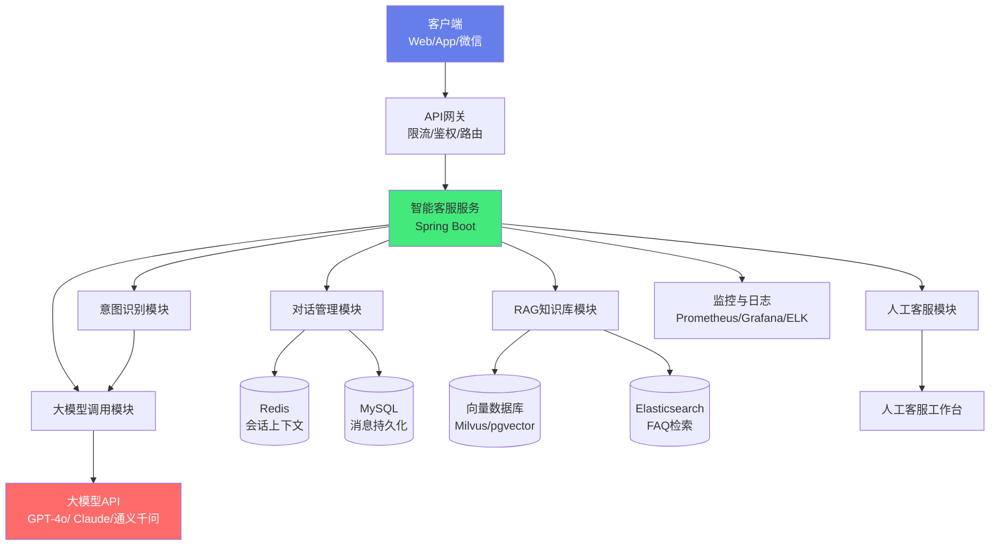

# 🤖 实战：Java 对接大模型智能客服

> **文档说明**：从零到一完整实战指南，讲解如何用 Java（Spring Boot）对接大模型 API 构建企业级智能客服系统，涵盖项目概述（目标定位 / 技术选型 / 架构设计 / 功能清单）、环境准备（JDK / Maven 依赖 / API Key 配置 / 项目初始化）、大模型 API 对接（OpenAI 兼容 API 调用 / 流式输出 SSE / 模型参数配置 / 错误处理与重试 / 超时控制 / 多模型支持）、智能客服核心功能（多轮对话上下文管理 / 会话状态管理 / 意图识别与路由 / 知识库问答 RAG 集成 / 常见问题 FAQ 匹配 / 人工客服转接 / 满意度评价）、系统设计（会话存储 Redis / 消息持久化 MySQL / 限流与熔断 / 内容安全审核 / 敏感词过滤 / 日志与审计 / 监控告警）、前端集成（WebSocket 实时通信 / SSE 流式输出 / 消息格式设计 / 打字机效果 / 已读未读 / 消息撤回）、部署与运维（Docker 容器化 / 配置中心 / 灰度发布 / 弹性扩缩 / 成本监控 / 模型用量统计）、优化与进阶（Prompt 工程优化 / 模型选型策略 / Token 成本控制 / 并发性能优化 / 缓存策略 / A/B 测试 / 效果评估）、完整代码示例（配置类 / 服务层 / Controller / DTO / 工具类）、常见问题与解决方案（API 超时 / 流式中断 / 上下文过长 / 幻觉控制 / 并发限流 / 成本超支）。
>
> **适用人群**：Java 后端开发者、AI 应用开发者、想构建智能客服的技术团队
>
> **前置知识**：[[SpringBoot实战]] · [[AI应用开发入门]] · [[实战-RAG企业知识库问答系统]]

---

## 一、项目概述

### 1.1 项目目标

构建一个企业级智能客服系统，具备以下能力：

- **多轮对话**：支持上下文理解的多轮对话
- **知识库问答**：基于企业知识库的精准问答（RAG）
- **意图识别**：自动识别用户意图，路由到对应处理流程
- **人工转接**：复杂问题自动或手动转接人工客服
- **流式输出**：打字机效果，提升用户体验
- **多渠道接入**：Web / App / 微信 / 钉钉等
- **数据分析**：对话统计、满意度分析、热点问题挖掘

### 1.2 技术选型

| 层级 | 技术 | 说明 |
|------|------|------|
| **后端框架** | Spring Boot 3.x | Java 主流 Web 框架 |
| **大模型 SDK** | LangChain4j / OpenAI Java SDK | 大模型 API 调用 |
| **数据库** | MySQL 8.0 | 会话、消息、知识库存储 |
| **缓存** | Redis 7.x | 会话上下文、限流、热点缓存 |
| **向量数据库** | Milvus / Pinecone / pgvector | RAG 知识库向量检索 |
| **实时通信** | WebSocket / SSE | 流式输出、实时消息 |
| **消息队列** | RabbitMQ / Kafka | 异步处理、削峰填谷 |
| **搜索引擎** | Elasticsearch | FAQ 全文检索、日志搜索 |
| **监控** | Prometheus + Grafana | 系统监控、模型用量监控 |
| **容器化** | Docker + Kubernetes | 部署与弹性扩缩 |

### 1.3 系统架构



### 1.4 功能清单

| 模块 | 功能 | 优先级 |
|------|------|--------|
| **对话管理** | 多轮对话、上下文管理、会话创建/结束 | P0 |
| **大模型调用** | API 调用、流式输出、参数配置、重试 | P0 |
| **知识库问答** | RAG 检索、文档上传、向量索引 | P0 |
| **意图识别** | 意图分类、路由、兜底 | P1 |
| **人工转接** | 自动转接、手动转接、工单 | P1 |
| **流式输出** | SSE/WebSocket、打字机效果 | P0 |
| **内容安全** | 敏感词过滤、内容审核、Prompt 注入防护 | P1 |
| **数据分析** | 对话统计、满意度、热点问题 | P2 |
| **多渠道** | Web、App、微信、钉钉 | P2 |
| **系统管理** | 模型配置、Prompt 管理、知识库管理 | P1 |

---

## 二、环境准备

### 2.1 Maven 依赖

```xml
<!-- pom.xml -->
<dependencies>
    <!-- Spring Boot Web -->
    <dependency>
        <groupId>org.springframework.boot</groupId>
        <artifactId>spring-boot-starter-web</artifactId>
    </dependency>
    
    <!-- Spring Boot Data Redis -->
    <dependency>
        <groupId>org.springframework.boot</groupId>
        <artifactId>spring-boot-starter-data-redis</artifactId>
    </dependency>
    
    <!-- Spring Boot Data JPA -->
    <dependency>
        <groupId>org.springframework.boot</groupId>
        <artifactId>spring-boot-starter-data-jpa</artifactId>
    </dependency>
    
    <!-- MySQL Driver -->
    <dependency>
        <groupId>com.mysql</groupId>
        <artifactId>mysql-connector-j</artifactId>
        <scope>runtime</scope>
    </dependency>
    
    <!-- LangChain4j（推荐，支持多模型） -->
    <dependency>
        <groupId>dev.langchain4j</groupId>
        <artifactId>langchain4j-open-ai</artifactId>
        <version>0.31.0</version>
    </dependency>
    <dependency>
        <groupId>dev.langchain4j</groupId>
        <artifactId>langchain4j</artifactId>
        <version>0.31.0</version>
    </dependency>
    
    <!-- 或使用 OpenAI 官方 Java SDK -->
    <!-- <dependency>
        <groupId>com.openai</groupId>
        <artifactId>openai-java-sdk</artifactId>
        <version>2.0.0</version>
    </dependency> -->
    
    <!-- WebSocket -->
    <dependency>
        <groupId>org.springframework.boot</groupId>
        <artifactId>spring-boot-starter-websocket</artifactId>
    </dependency>
    
    <!-- 工具类 -->
    <dependency>
        <groupId>cn.hutool</groupId>
        <artifactId>hutool-all</artifactId>
        <version>5.8.25</version>
    </dependency>
    
    <!-- JSON -->
    <dependency>
        <groupId>com.fasterxml.jackson.core</groupId>
        <artifactId>jackson-databind</artifactId>
    </dependency>
    
    <!-- 限流 -->
    <dependency>
        <groupId>com.github.vladimir-bukhtoyarov</groupId>
        <artifactId>bucket4j-core</artifactId>
        <version>7.6.0</version>
    </dependency>
</dependencies>
```

### 2.2 配置文件

```yaml
# application.yml
server:
  port: 8080
  servlet:
    context-path: /api

spring:
  application:
    name: ai-customer-service
  
  # 数据库
  datasource:
    url: jdbc:mysql://localhost:3306/ai_customer_service?useUnicode=true&characterEncoding=utf8&serverTimezone=Asia/Shanghai
    username: root
    password: your_password
    driver-class-name: com.mysql.cj.jdbc.Driver
    hikari:
      maximum-pool-size: 20
      minimum-idle: 5
      connection-timeout: 30000
  
  # Redis
  data:
    redis:
      host: localhost
      port: 6379
      password: your_redis_password
      database: 0
      timeout: 5000ms
      lettuce:
        pool:
          max-active: 20
          max-idle: 10
          min-idle: 5
  
  # JPA
  jpa:
    hibernate:
      ddl-auto: update
    show-sql: false
    properties:
      hibernate:
        format_sql: true
        dialect: org.hibernate.dialect.MySQLDialect

# 大模型配置
ai:
  openai:
    api-key: sk-your-api-key
    base-url: https://api.openai.com/v1  # 或兼容地址如 https://api.deepseek.com/v1
    model: gpt-4o-mini  # 默认模型
    temperature: 0.7
    max-tokens: 2000
    timeout: 60000  # 超时时间 ms
    max-retries: 3  # 最大重试次数
  
  # 多模型配置
  models:
    - name: gpt-4o
      provider: openai
      api-key: ${ai.openai.api-key}
      base-url: ${ai.openai.base-url}
      max-tokens: 4000
    - name: deepseek-chat
      provider: deepseek
      api-key: sk-deepseek-key
      base-url: https://api.deepseek.com/v1
      max-tokens: 4000

# 智能客服配置
customer-service:
  # 会话配置
  session:
    timeout: 1800  # 会话超时时间（秒）30分钟
    max-history: 20  # 最大历史消息数
    max-tokens: 4000  # 上下文最大 Token
  
  # 限流配置
  rate-limit:
    enabled: true
    max-requests-per-minute: 30  # 每分钟最大请求数
    max-concurrent: 10  # 最大并发数
  
  # 内容安全
  safety:
    enabled: true
    sensitive-words-file: classpath:sensitive-words.txt
    max-sensitive-hits: 3
  
  # 人工转接
  human-transfer:
    enabled: true
    trigger-keywords: ["人工", "客服", "转人工", "投诉"]
    working-hours: "09:00-22:00"

# 日志
logging:
  level:
    root: INFO
    com.example.aicustomerservice: DEBUG
    dev.langchain4j: INFO
  pattern:
    console: "%d{yyyy-MM-dd HH:mm:ss} [%thread] %-5level %logger{36} - %msg%n"
```

---

## 三、大模型 API 对接

### 3.1 配置类

```java
package com.example.aicustomerservice.config;

import dev.langchain4j.model.chat.ChatLanguageModel;
import dev.langchain4j.model.openai.OpenAiChatModel;
import org.springframework.beans.factory.annotation.Value;
import org.springframework.context.annotation.Bean;
import org.springframework.context.annotation.Configuration;

import java.time.Duration;

@Configuration
public class AiModelConfig {

    @Value("${ai.openai.api-key}")
    private String apiKey;

    @Value("${ai.openai.base-url}")
    private String baseUrl;

    @Value("${ai.openai.model}")
    private String model;

    @Value("${ai.openai.temperature:0.7}")
    private Double temperature;

    @Value("${ai.openai.max-tokens:2000}")
    private Integer maxTokens;

    @Value("${ai.openai.timeout:60000}")
    private Long timeout;

    /**
     * 同步聊天模型（非流式）
     */
    @Bean
    public ChatLanguageModel chatLanguageModel() {
        return OpenAiChatModel.builder()
                .apiKey(apiKey)
                .baseUrl(baseUrl)
                .modelName(model)
                .temperature(temperature)
                .maxTokens(maxTokens)
                .timeout(Duration.ofMillis(timeout))
                .logRequests(true)   // 生产环境建议关闭
                .logResponses(true)  // 生产环境建议关闭
                .build();
    }

    /**
     * 流式聊天模型（SSE 输出）
     */
    @Bean
    public dev.langchain4j.model.chat.StreamingChatLanguageModel streamingChatModel() {
        return OpenAiChatModel.builder()
                .apiKey(apiKey)
                .baseUrl(baseUrl)
                .modelName(model)
                .temperature(temperature)
                .maxTokens(maxTokens)
                .timeout(Duration.ofMillis(timeout))
                .build();
    }
}
```

### 3.2 大模型服务封装

```java
package com.example.aicustomerservice.service;

import dev.langchain4j.data.message.AiMessage;
import dev.langchain4j.data.message.ChatMessage;
import dev.langchain4j.data.message.SystemMessage;
import dev.langchain4j.data.message.UserMessage;
import dev.langchain4j.model.chat.ChatLanguageModel;
import dev.langchain4j.model.chat.StreamingChatLanguageModel;
import dev.langchain4j.model.output.Response;
import lombok.RequiredArgsConstructor;
import lombok.extern.slf4j.Slf4j;
import org.springframework.stereotype.Service;
import org.springframework.web.servlet.mvc.method.annotation.SseEmitter;

import java.io.IOException;
import java.util.ArrayList;
import java.util.List;
import java.util.concurrent.CompletableFuture;

@Slf4j
@Service
@RequiredArgsConstructor
public class AiModelService {

    private final ChatLanguageModel chatModel;
    private final StreamingChatLanguageModel streamingModel;

    /**
     * 同步调用（非流式）
     */
    public String chat(String systemPrompt, List<ChatMessage> history, String userMessage) {
        List<ChatMessage> messages = new ArrayList<>();
        
        // 添加系统提示词
        if (systemPrompt != null && !systemPrompt.isEmpty()) {
            messages.add(SystemMessage.from(systemPrompt));
        }
        
        // 添加历史消息
        if (history != null) {
            messages.addAll(history);
        }
        
        // 添加当前用户消息
        messages.add(UserMessage.from(userMessage));
        
        try {
            Response<AiMessage> response = chatModel.generate(messages);
            return response.content().text();
        } catch (Exception e) {
            log.error("大模型调用失败", e);
            throw new RuntimeException("AI 服务暂时不可用，请稍后重试", e);
        }
    }

    /**
     * 流式调用（SSE）
     */
    public SseEmitter streamChat(String systemPrompt, List<ChatMessage> history, String userMessage) {
        SseEmitter emitter = new SseEmitter(120000L); // 2分钟超时
        
        List<ChatMessage> messages = new ArrayList<>();
        if (systemPrompt != null && !systemPrompt.isEmpty()) {
            messages.add(SystemMessage.from(systemPrompt));
        }
        if (history != null) {
            messages.addAll(history);
        }
        messages.add(UserMessage.from(userMessage));
        
        StringBuilder fullResponse = new StringBuilder();
        
        streamingModel.generate(messages, new dev.langchain4j.model.StreamingResponseHandler<AiMessage>() {
            @Override
            public void onNext(String token) {
                try {
                    // 发送每个 token
                    emitter.send(SseEmitter.event()
                            .name("token")
                            .data(token));
                    fullResponse.append(token);
                } catch (IOException e) {
                    log.error("发送 SSE 数据失败", e);
                    emitter.completeWithError(e);
                }
            }

            @Override
            public void onComplete(Response<AiMessage> response) {
                try {
                    // 发送完成事件
                    emitter.send(SseEmitter.event()
                            .name("complete")
                            .data("[DONE]"));
                    emitter.complete();
                    log.info("流式响应完成，总长度: {} 字符", fullResponse.length());
                } catch (IOException e) {
                    log.error("发送完成事件失败", e);
                    emitter.completeWithError(e);
                }
            }

            @Override
            public void onError(Throwable error) {
                log.error("流式响应错误", error);
                try {
                    emitter.send(SseEmitter.event()
                            .name("error")
                            .data(error.getMessage()));
                } catch (IOException e) {
                    log.error("发送错误事件失败", e);
                }
                emitter.completeWithError(error);
            }
        });
        
        return emitter;
    }

    /**
     * 带重试的调用（简单实现）
     */
    public String chatWithRetry(String systemPrompt, List<ChatMessage> history, 
                                  String userMessage, int maxRetries) {
        int attempt = 0;
        Exception lastException = null;
        
        while (attempt < maxRetries) {
            try {
                return chat(systemPrompt, history, userMessage);
            } catch (Exception e) {
                lastException = e;
                attempt++;
                log.warn("大模型调用失败，第 {} 次重试", attempt, e);
                try {
                    Thread.sleep(1000L * attempt); // 指数退避
                } catch (InterruptedException ie) {
                    Thread.currentThread().interrupt();
                    break;
                }
            }
        }
        
        throw new RuntimeException("大模型调用失败，已重试 " + maxRetries + " 次", lastException);
    }
}
```

### 3.3 使用原生 HTTP 调用（不依赖 SDK）

```java
package com.example.aicustomerservice.service;

import com.fasterxml.jackson.databind.JsonNode;
import com.fasterxml.jackson.databind.ObjectMapper;
import com.fasterxml.jackson.databind.node.ArrayNode;
import com.fasterxml.jackson.databind.node.ObjectNode;
import lombok.RequiredArgsConstructor;
import lombok.extern.slf4j.Slf4j;
import org.springframework.beans.factory.annotation.Value;
import org.springframework.http.*;
import org.springframework.stereotype.Service;
import org.springframework.web.client.RestTemplate;
import org.springframework.web.servlet.mvc.method.annotation.SseEmitter;

import java.io.BufferedReader;
import java.io.InputStreamReader;
import java.net.HttpURLConnection;
import java.net.URL;
import java.util.List;
import java.util.Map;

@Slf4j
@Service
@RequiredArgsConstructor
public class OpenAiNativeService {

    @Value("${ai.openai.api-key}")
    private String apiKey;

    @Value("${ai.openai.base-url}")
    private String baseUrl;

    @Value("${ai.openai.model}")
    private String model;

    private final RestTemplate restTemplate = new RestTemplate();
    private final ObjectMapper objectMapper = new ObjectMapper();

    /**
     * 非流式调用
     */
    public String chat(List<Map<String, String>> messages) {
        try {
            HttpHeaders headers = new HttpHeaders();
            headers.setContentType(MediaType.APPLICATION_JSON);
            headers.setBearerAuth(apiKey);

            ObjectNode requestBody = objectMapper.createObjectNode();
            requestBody.put("model", model);
            requestBody.put("temperature", 0.7);
            requestBody.put("max_tokens", 2000);
            
            ArrayNode messagesArray = requestBody.putArray("messages");
            for (Map<String, String> msg : messages) {
                ObjectNode messageNode = objectMapper.createObjectNode();
                messageNode.put("role", msg.get("role"));
                messageNode.put("content", msg.get("content"));
                messagesArray.add(messageNode);
            }

            HttpEntity<String> entity = new HttpEntity<>(requestBody.toString(), headers);
            ResponseEntity<String> response = restTemplate.postForEntity(
                    baseUrl + "/chat/completions", entity, String.class);

            JsonNode root = objectMapper.readTree(response.getBody());
            return root.path("choices").get(0).path("message").path("content").asText();

        } catch (Exception e) {
            log.error("OpenAI API 调用失败", e);
            throw new RuntimeException("AI 服务调用失败", e);
        }
    }

    /**
     * 流式调用（原生 SSE）
     */
    public SseEmitter streamChat(List<Map<String, String>> messages) {
        SseEmitter emitter = new SseEmitter(120000L);

        CompletableFuture.runAsync(() -> {
            try {
                URL url = new URL(baseUrl + "/chat/completions");
                HttpURLConnection conn = (HttpURLConnection) url.openConnection();
                conn.setRequestMethod("POST");
                conn.setRequestProperty("Content-Type", "application/json");
                conn.setRequestProperty("Authorization", "Bearer " + apiKey);
                conn.setDoOutput(true);
                conn.setReadTimeout(120000);

                // 构建请求体
                ObjectNode requestBody = objectMapper.createObjectNode();
                requestBody.put("model", model);
                requestBody.put("stream", true);
                requestBody.put("temperature", 0.7);
                
                ArrayNode messagesArray = requestBody.putArray("messages");
                for (Map<String, String> msg : messages) {
                    ObjectNode messageNode = objectMapper.createObjectNode();
                    messageNode.put("role", msg.get("role"));
                    messageNode.put("content", msg.get("content"));
                    messagesArray.add(messageNode);
                }

                conn.getOutputStream().write(requestBody.toString().getBytes());

                // 读取流式响应
                try (BufferedReader reader = new BufferedReader(
                        new InputStreamReader(conn.getInputStream()))) {
                    String line;
                    while ((line = reader.readLine()) != null) {
                        if (line.startsWith("data: ")) {
                            String data = line.substring(6);
                            if ("[DONE]".equals(data)) {
                                emitter.send(SseEmitter.event().name("complete").data("[DONE]"));
                                break;
                            }
                            JsonNode json = objectMapper.readTree(data);
                            String content = json.path("choices").get(0)
                                    .path("delta").path("content").asText("");
                            if (!content.isEmpty()) {
                                emitter.send(SseEmitter.event().name("token").data(content));
                            }
                        }
                    }
                }
                emitter.complete();

            } catch (Exception e) {
                log.error("流式调用失败", e);
                emitter.completeWithError(e);
            }
        });

        return emitter;
    }
}
```

---

## 四、智能客服核心功能

### 4.1 会话管理

```java
package com.example.aicustomerservice.service;

import com.example.aicustomerservice.entity.Conversation;
import com.example.aicustomerservice.entity.Message;
import com.example.aicustomerservice.repository.ConversationRepository;
import com.example.aicustomerservice.repository.MessageRepository;
import dev.langchain4j.data.message.ChatMessage;
import dev.langchain4j.data.message.UserMessage;
import dev.langchain4j.data.message.AiMessage;
import lombok.RequiredArgsConstructor;
import lombok.extern.slf4j.Slf4j;
import org.springframework.beans.factory.annotation.Value;
import org.springframework.data.redis.core.StringRedisTemplate;
import org.springframework.stereotype.Service;
import org.springframework.transaction.annotation.Transactional;

import java.time.LocalDateTime;
import java.util.*;
import java.util.concurrent.TimeUnit;
import java.util.stream.Collectors;

@Slf4j
@Service
@RequiredArgsConstructor
public class ConversationService {

    private final ConversationRepository conversationRepo;
    private final MessageRepository messageRepo;
    private final StringRedisTemplate redisTemplate;

    @Value("${customer-service.session.timeout:1800}")
    private long sessionTimeout;

    @Value("${customer-service.session.max-history:20}")
    private int maxHistory;

    private static final String SESSION_KEY_PREFIX = "cs:session:";
    private static final String HISTORY_KEY_PREFIX = "cs:history:";

    /**
     * 创建会话
     */
    @Transactional
    public Conversation createConversation(String userId, String channel) {
        Conversation conversation = new Conversation();
        conversation.setId(UUID.randomUUID().toString());
        conversation.setUserId(userId);
        conversation.setChannel(channel);
        conversation.setStatus("ACTIVE");
        conversation.setCreatedAt(LocalDateTime.now());
        conversation.setUpdatedAt(LocalDateTime.now());
        conversationRepo.save(conversation);

        // 缓存会话状态
        redisTemplate.opsForValue().set(SESSION_KEY_PREFIX + conversation.getId(),
                "ACTIVE", sessionTimeout, TimeUnit.SECONDS);

        log.info("创建会话: userId={}, conversationId={}", userId, conversation.getId());
        return conversation;
    }

    /**
     * 保存消息
     */
    @Transactional
    public Message saveMessage(String conversationId, String role, String content,
                                Map<String, Object> metadata) {
        Message message = new Message();
        message.setId(UUID.randomUUID().toString());
        message.setConversationId(conversationId);
        message.setRole(role); // user / assistant / system
        message.setContent(content);
        message.setMetadata(metadata != null ? metadata.toString() : null);
        message.setCreatedAt(LocalDateTime.now());
        messageRepo.save(message);

        // 更新会话时间
        conversationRepo.updateUpdatedAt(conversationId, LocalDateTime.now());

        // 缓存到 Redis（用于快速获取历史）
        String historyKey = HISTORY_KEY_PREFIX + conversationId;
        redisTemplate.opsForList().rightPush(historyKey,
                role + ":" + content);
        redisTemplate.opsForList().trim(historyKey, -maxHistory, -1);
        redisTemplate.expire(historyKey, sessionTimeout, TimeUnit.SECONDS);

        return message;
    }

    /**
     * 获取历史消息（转换为 LangChain4j 格式）
     */
    public List<ChatMessage> getHistoryMessages(String conversationId) {
        // 先从 Redis 获取
        String historyKey = HISTORY_KEY_PREFIX + conversationId;
        List<String> cached = redisTemplate.opsForList().range(historyKey, 0, -1);

        if (cached != null && !cached.isEmpty()) {
            return cached.stream()
                    .map(s -> {
                        String[] parts = s.split(":", 2);
                        String role = parts[0];
                        String content = parts.length > 1 ? parts[1] : "";
                        if ("user".equals(role)) {
                            return (ChatMessage) UserMessage.from(content);
                        } else {
                            return (ChatMessage) AiMessage.from(content);
                        }
                    })
                    .collect(Collectors.toList());
        }

        // Redis 没有则从数据库获取
        List<Message> messages = messageRepo.findByConversationIdOrderByCreatedAt(conversationId);
        return messages.stream()
                .filter(m -> !"system".equals(m.getRole()))
                .map(m -> {
                    if ("user".equals(m.getRole())) {
                        return (ChatMessage) UserMessage.from(m.getContent());
                    } else {
                        return (ChatMessage) AiMessage.from(m.getContent());
                    }
                })
                .collect(Collectors.toList());
    }

    /**
     * 结束会话
     */
    @Transactional
    public void endConversation(String conversationId, String reason) {
        conversationRepo.updateStatus(conversationId, "ENDED", reason, LocalDateTime.now());
        redisTemplate.delete(SESSION_KEY_PREFIX + conversationId);
        log.info("结束会话: conversationId={}, reason={}", conversationId, reason);
    }

    /**
     * 检查会话是否活跃
     */
    public boolean isSessionActive(String conversationId) {
        String status = redisTemplate.opsForValue().get(SESSION_KEY_PREFIX + conversationId);
        return "ACTIVE".equals(status);
    }
}
```

### 4.2 客服对话服务

```java
package com.example.aicustomerservice.service;

import com.example.aicustomerservice.dto.ChatRequest;
import com.example.aicustomerservice.dto.ChatResponse;
import com.example.aicustomerservice.entity.Conversation;
import com.example.aicustomerservice.entity.Message;
import lombok.RequiredArgsConstructor;
import lombok.extern.slf4j.Slf4j;
import org.springframework.beans.factory.annotation.Value;
import org.springframework.stereotype.Service;
import org.springframework.web.servlet.mvc.method.annotation.SseEmitter;

import java.util.HashMap;
import java.util.Map;

@Slf4j
@Service
@RequiredArgsConstructor
public class CustomerService {

    private final ConversationService conversationService;
    private final AiModelService aiModelService;
    private final IntentService intentService;
    private final RagService ragService;
    private final SafetyService safetyService;
    private final RateLimitService rateLimitService;

    @Value("${customer-service.system-prompt:你是一个专业的客服助手...}")
    private String systemPrompt;

    /**
     * 非流式对话
     */
    public ChatResponse chat(ChatRequest request) {
        String conversationId = request.getConversationId();
        String userId = request.getUserId();
        String userMessage = request.getMessage();

        // 1. 限流检查
        if (!rateLimitService.tryAcquire(userId)) {
            return ChatResponse.error("请求过于频繁，请稍后再试");
        }

        // 2. 内容安全检查
        if (safetyService.containsSensitiveWords(userMessage)) {
            return ChatResponse.error("您的消息包含敏感内容，请修改后重试");
        }

        // 3. 会话管理
        if (conversationId == null || conversationId.isEmpty()) {
            Conversation conv = conversationService.createConversation(userId, request.getChannel());
            conversationId = conv.getId();
        }

        // 4. 保存用户消息
        Map<String, Object> meta = new HashMap<>();
        meta.put("channel", request.getChannel());
        conversationService.saveMessage(conversationId, "user", userMessage, meta);

        // 5. 意图识别
        String intent = intentService.detectIntent(userMessage);
        log.info("意图识别: conversationId={}, intent={}", conversationId, intent);

        // 6. 根据意图处理
        String response;
        if ("HUMAN_TRANSFER".equals(intent)) {
            // 转接人工
            response = "好的，正在为您转接人工客服，请稍候...";
            conversationService.saveMessage(conversationId, "assistant", response, null);
            return ChatResponse.of(conversationId, response, intent);
        } else if ("FAQ".equals(intent) || "KNOWLEDGE".equals(intent)) {
            // 知识库问答（RAG）
            String context = ragService.retrieveContext(userMessage);
            String enhancedPrompt = systemPrompt + "\n\n参考资料：\n" + context;
            response = aiModelService.chat(enhancedPrompt,
                    conversationService.getHistoryMessages(conversationId), userMessage);
        } else {
            // 普通对话
            response = aiModelService.chat(systemPrompt,
                    conversationService.getHistoryMessages(conversationId), userMessage);
        }

        // 7. 保存 AI 回复
        Map<String, Object> aiMeta = new HashMap<>();
        aiMeta.put("intent", intent);
        conversationService.saveMessage(conversationId, "assistant", response, aiMeta);

        return ChatResponse.of(conversationId, response, intent);
    }

    /**
     * 流式对话（SSE）
     */
    public SseEmitter streamChat(ChatRequest request) {
        String conversationId = request.getConversationId();
        String userId = request.getUserId();
        String userMessage = request.getMessage();

        // 限流检查
        if (!rateLimitService.tryAcquire(userId)) {
            SseEmitter emitter = new SseEmitter();
            try {
                emitter.send(SseEmitter.event().name("error").data("请求过于频繁"));
                emitter.complete();
            } catch (Exception e) {
                emitter.completeWithError(e);
            }
            return emitter;
        }

        // 内容安全检查
        if (safetyService.containsSensitiveWords(userMessage)) {
            SseEmitter emitter = new SseEmitter();
            try {
                emitter.send(SseEmitter.event().name("error").data("消息包含敏感内容"));
                emitter.complete();
            } catch (Exception e) {
                emitter.completeWithError(e);
            }
            return emitter;
        }

        // 会话管理
        if (conversationId == null || conversationId.isEmpty()) {
            Conversation conv = conversationService.createConversation(userId, request.getChannel());
            conversationId = conv.getId();
        }

        // 保存用户消息
        conversationService.saveMessage(conversationId, "user", userMessage, null);

        // RAG 检索
        String context = ragService.retrieveContext(userMessage);
        String enhancedPrompt = systemPrompt + "\n\n参考资料：\n" + context;

        // 流式调用
        final String finalConversationId = conversationId;
        SseEmitter emitter = aiModelService.streamChat(enhancedPrompt,
                conversationService.getHistoryMessages(conversationId), userMessage);

        // 注意：流式响应的完整内容需要在 complete 时保存
        // 实际实现中需要在 SSE 完成后保存完整回复
        // 这里简化处理

        return emitter;
    }
}
```

### 4.3 意图识别服务

```java
package com.example.aicustomerservice.service;

import lombok.RequiredArgsConstructor;
import lombok.extern.slf4j.Slf4j;
import org.springframework.stereotype.Service;

import java.util.Arrays;
import java.util.List;

@Slf4j
@Service
@RequiredArgsConstructor
public class IntentService {

    // 预定义意图
    private static final List<String> HUMAN_TRANSFER_KEYWORDS = 
            Arrays.asList("人工", "客服", "转人工", "投诉", "举报", "找客服", "真人");
    
    private static final List<String> FAQ_KEYWORDS = 
            Arrays.asList("怎么", "如何", "什么是", "为什么", "哪里", "能不能", "可以");
    
    private static final List<String> ORDER_KEYWORDS = 
            Arrays.asList("订单", "发货", "物流", "快递", "退款", "退货", "换货");

    private final AiModelService aiModelService;

    /**
     * 简单规则匹配（快速路径）
     */
    public String detectIntent(String message) {
        String lower = message.toLowerCase();
        
        // 1. 人工转接（最高优先级）
        for (String keyword : HUMAN_TRANSFER_KEYWORDS) {
            if (lower.contains(keyword)) {
                return "HUMAN_TRANSFER";
            }
        }
        
        // 2. 订单相关
        for (String keyword : ORDER_KEYWORDS) {
            if (lower.contains(keyword)) {
                return "ORDER";
            }
        }
        
        // 3. 知识库问答
        for (String keyword : FAQ_KEYWORDS) {
            if (lower.contains(keyword)) {
                return "KNOWLEDGE";
            }
        }
        
        // 4. 默认用大模型识别（慢路径，可异步）
        return detectIntentWithLLM(message);
    }

    /**
     * 大模型意图识别（更精准但慢）
     */
    private String detectIntentWithLLM(String message) {
        String prompt = """
                你是一个意图分类器。请将用户消息分类到以下意图之一：
                - GREETING: 问候/打招呼
                - FAQ: 常见问题/知识咨询
                - ORDER: 订单相关（查询/修改/取消）
                - COMPLAINT: 投诉/不满
                - HUMAN_TRANSFER: 要求人工客服
                - CHITCHAT: 闲聊
                - OTHER: 其他
                
                用户消息：%s
                
                只返回意图名称，不要解释。
                """.formatted(message);
        
        try {
            String result = aiModelService.chat(prompt, null, message).trim().toUpperCase();
            log.debug("LLM 意图识别结果: {}", result);
            return result;
        } catch (Exception e) {
            log.warn("LLM 意图识别失败，使用默认意图", e);
            return "CHITCHAT";
        }
    }
}
```

### 4.4 RAG 知识库服务（简化版）

```java
package com.example.aicustomerservice.service;

import lombok.RequiredArgsConstructor;
import lombok.extern.slf4j.Slf4j;
import org.springframework.stereotype.Service;

import java.util.List;

@Slf4j
@Service
@RequiredArgsConstructor
public class RagService {

    // 实际项目中应接入向量数据库（Milvus/pgvector/Pinecone）
    // 这里简化为模拟检索
    
    private final KnowledgeBaseService knowledgeBaseService;

    /**
     * 检索相关上下文
     */
    public String retrieveContext(String query) {
        // 1. 对查询进行向量化（实际用 embedding 模型）
        // float[] queryVector = embeddingModel.embed(query);
        
        // 2. 在向量数据库中检索 Top K 相似文档
        // List<Document> docs = vectorStore.similaritySearch(queryVector, 5);
        
        // 3. 重排序（可选，用 reranker 模型）
        // List<Document> reranked = reranker.rerank(query, docs);
        
        // 4. 拼接上下文
        // StringBuilder context = new StringBuilder();
        // for (Document doc : reranked) {
        //     context.append(doc.text()).append("\n\n");
        // }
        
        // 简化：从知识库服务获取
        List<String> relevantDocs = knowledgeBaseService.search(query, 5);
        
        StringBuilder context = new StringBuilder();
        for (int i = 0; i < relevantDocs.size(); i++) {
            context.append("【资料").append(i + 1).append("】\n")
                   .append(relevantDocs.get(i)).append("\n\n");
        }
        
        log.debug("RAG 检索到 {} 条相关文档", relevantDocs.size());
        return context.toString();
    }
}
```

---

## 五、Controller 层

### 5.1 对话 Controller

```java
package com.example.aicustomerservice.controller;

import com.example.aicustomerservice.dto.ChatRequest;
import com.example.aicustomerservice.dto.ChatResponse;
import com.example.aicustomerservice.service.CustomerService;
import lombok.RequiredArgsConstructor;
import lombok.extern.slf4j.Slf4j;
import org.springframework.http.MediaType;
import org.springframework.web.bind.annotation.*;
import org.springframework.web.servlet.mvc.method.annotation.SseEmitter;

@Slf4j
@RestController
@RequestMapping("/chat")
@RequiredArgsConstructor
public class ChatController {

    private final CustomerService customerService;

    /**
     * 非流式对话
     */
    @PostMapping("/send")
    public ChatResponse send(@RequestBody ChatRequest request) {
        log.info("收到对话请求: userId={}, conversationId={}", 
                request.getUserId(), request.getConversationId());
        return customerService.chat(request);
    }

    /**
     * 流式对话（SSE）
     */
    @PostMapping(value = "/stream", produces = MediaType.TEXT_EVENT_STREAM_VALUE)
    public SseEmitter stream(@RequestBody ChatRequest request) {
        log.info("收到流式对话请求: userId={}", request.getUserId());
        return customerService.streamChat(request);
    }

    /**
     * 结束会话
     */
    @PostMapping("/end/{conversationId}")
    public ChatResponse endConversation(@PathVariable String conversationId,
                                         @RequestParam(required = false) String reason) {
        customerService.endConversation(conversationId, reason);
        return ChatResponse.success("会话已结束");
    }

    /**
     * 满意度评价
     */
    @PostMapping("/feedback/{conversationId}")
    public ChatResponse feedback(@PathVariable String conversationId,
                                  @RequestParam int rating,
                                  @RequestParam(required = false) String comment) {
        customerService.saveFeedback(conversationId, rating, comment);
        return ChatResponse.success("感谢您的评价");
    }
}
```

### 5.2 DTO 定义

```java
package com.example.aicustomerservice.dto;

import lombok.Data;

@Data
public class ChatRequest {
    private String conversationId;  // 会话 ID（首次为空）
    private String userId;          // 用户 ID
    private String message;         // 用户消息
    private String channel;         // 渠道：web/app/wechat
    private String model;           // 指定模型（可选）
}
```

```java
package com.example.aicustomerservice.dto;

import lombok.AllArgsConstructor;
import lombok.Data;
import lombok.NoArgsConstructor;

@Data
@NoArgsConstructor
@AllArgsConstructor
public class ChatResponse {
    private boolean success;
    private String conversationId;
    private String message;
    private String intent;
    private String error;

    public static ChatResponse of(String conversationId, String message, String intent) {
        return new ChatResponse(true, conversationId, message, intent, null);
    }

    public static ChatResponse error(String error) {
        return new ChatResponse(false, null, null, null, error);
    }

    public static ChatResponse success(String message) {
        return new ChatResponse(true, null, message, null, null);
    }
}
```

---

## 六、系统设计要点

### 6.1 限流与熔断

```java
package com.example.aicustomerservice.service;

import io.github.bucket4j.Bandwidth;
import io.github.bucket4j.Bucket;
import io.github.bucket4j.Refill;
import lombok.extern.slf4j.Slf4j;
import org.springframework.beans.factory.annotation.Value;
import org.springframework.data.redis.core.StringRedisTemplate;
import org.springframework.stereotype.Service;

import java.time.Duration;
import java.util.Map;
import java.util.concurrent.ConcurrentHashMap;

@Slf4j
@Service
public class RateLimitService {

    private final Map<String, Bucket> buckets = new ConcurrentHashMap<>();
    
    @Value("${customer-service.rate-limit.max-requests-per-minute:30}")
    private int maxRequestsPerMinute;

    /**
     * 尝试获取令牌（本地限流）
     */
    public boolean tryAcquire(String userId) {
        Bucket bucket = buckets.computeIfAbsent(userId, k -> {
            Bandwidth limit = Bandwidth.classic(maxRequestsPerMinute,
                    Refill.greedy(maxRequestsPerMinute, Duration.ofMinutes(1)));
            return Bucket.builder().addLimit(limit).build();
        });
        return bucket.tryConsume(1);
    }

    /**
     * 分布式限流（Redis + Lua，实际生产用这个）
     */
    public boolean tryAcquireDistributed(String userId) {
        // 使用 Redis + Lua 脚本实现分布式令牌桶
        // 或使用 Redisson 的 RRateLimiter
        // 这里简化为本地实现
        return tryAcquire(userId);
    }
}
```

### 6.2 内容安全

```java
package com.example.aicustomerservice.service;

import jakarta.annotation.PostConstruct;
import lombok.extern.slf4j.Slf4j;
import org.springframework.beans.factory.annotation.Value;
import org.springframework.core.io.ClassPathResource;
import org.springframework.stereotype.Service;

import java.io.BufferedReader;
import java.io.InputStreamReader;
import java.nio.charset.StandardCharsets;
import java.util.HashSet;
import java.util.Set;

@Slf4j
@Service
public class SafetyService {

    private Set<String> sensitiveWords = new HashSet<>();

    @Value("${customer-service.safety.sensitive-words-file:classpath:sensitive-words.txt}")
    private String sensitiveWordsFile;

    @PostConstruct
    public void init() {
        try {
            ClassPathResource resource = new ClassPathResource("sensitive-words.txt");
            if (resource.exists()) {
                try (BufferedReader reader = new BufferedReader(
                        new InputStreamReader(resource.getInputStream(), StandardCharsets.UTF_8))) {
                    String line;
                    while ((line = reader.readLine()) != null) {
                        if (!line.trim().isEmpty()) {
                            sensitiveWords.add(line.trim());
                        }
                    }
                }
                log.info("加载敏感词 {} 个", sensitiveWords.size());
            }
        } catch (Exception e) {
            log.warn("加载敏感词文件失败", e);
        }
    }

    /**
     * 检查是否包含敏感词
     */
    public boolean containsSensitiveWords(String text) {
        if (text == null || text.isEmpty()) return false;
        for (String word : sensitiveWords) {
            if (text.contains(word)) {
                log.warn("检测到敏感词: {}", word);
                return true;
            }
        }
        return false;
    }

    /**
     * 过滤敏感词（替换为 ***）
     */
    public String filterSensitiveWords(String text) {
        if (text == null || text.isEmpty()) return text;
        String result = text;
        for (String word : sensitiveWords) {
            result = result.replace(word, "***");
        }
        return result;
    }

    /**
     * Prompt 注入检测（简单实现）
     */
    public boolean isPromptInjection(String text) {
        if (text == null) return false;
        String lower = text.toLowerCase();
        // 常见 Prompt 注入模式
        String[] patterns = {
                "ignore previous", "ignore all previous", "system prompt",
                "you are now", "act as", "disregard", "override",
                "忽略之前", "忽略以上", "你现在是", "系统提示"
        };
        for (String pattern : patterns) {
            if (lower.contains(pattern)) {
                log.warn("检测到可能的 Prompt 注入: {}", pattern);
                return true;
            }
        }
        return false;
    }
}
```

### 6.3 数据库表设计

```sql
-- 会话表
CREATE TABLE conversation (
    id VARCHAR(64) PRIMARY KEY COMMENT '会话ID',
    user_id VARCHAR(64) NOT NULL COMMENT '用户ID',
    channel VARCHAR(32) COMMENT '渠道: web/app/wechat',
    status VARCHAR(16) DEFAULT 'ACTIVE' COMMENT '状态: ACTIVE/ENDED',
    end_reason VARCHAR(256) COMMENT '结束原因',
    satisfaction_rating INT COMMENT '满意度评分 1-5',
    feedback_comment TEXT COMMENT '评价内容',
    created_at DATETIME DEFAULT CURRENT_TIMESTAMP,
    updated_at DATETIME DEFAULT CURRENT_TIMESTAMP ON UPDATE CURRENT_TIMESTAMP,
    INDEX idx_user_id (user_id),
    INDEX idx_status (status),
    INDEX idx_created_at (created_at)
) ENGINE=InnoDB DEFAULT CHARSET=utf8mb4 COMMENT='会话表';

-- 消息表
CREATE TABLE message (
    id VARCHAR(64) PRIMARY KEY COMMENT '消息ID',
    conversation_id VARCHAR(64) NOT NULL COMMENT '会话ID',
    role VARCHAR(16) NOT NULL COMMENT '角色: user/assistant/system',
    content TEXT NOT NULL COMMENT '消息内容',
    metadata TEXT COMMENT '元数据(JSON)',
    tokens INT COMMENT '消耗Token数',
    created_at DATETIME DEFAULT CURRENT_TIMESTAMP,
    INDEX idx_conversation_id (conversation_id),
    INDEX idx_role (role),
    INDEX idx_created_at (created_at)
) ENGINE=InnoDB DEFAULT CHARSET=utf8mb4 COMMENT='消息表';

-- 知识库表
CREATE TABLE knowledge_base (
    id BIGINT AUTO_INCREMENT PRIMARY KEY,
    title VARCHAR(256) NOT NULL COMMENT '标题',
    content TEXT NOT NULL COMMENT '内容',
    category VARCHAR(64) COMMENT '分类',
    vector_id VARCHAR(128) COMMENT '向量数据库ID',
    status VARCHAR(16) DEFAULT 'ACTIVE',
    created_at DATETIME DEFAULT CURRENT_TIMESTAMP,
    updated_at DATETIME DEFAULT CURRENT_TIMESTAMP ON UPDATE CURRENT_TIMESTAMP,
    INDEX idx_category (category),
    FULLTEXT idx_content (title, content) WITH PARSER ngram
) ENGINE=InnoDB DEFAULT CHARSET=utf8mb4 COMMENT='知识库';

-- 人工客服工单表
CREATE TABLE ticket (
    id BIGINT AUTO_INCREMENT PRIMARY KEY,
    conversation_id VARCHAR(64) NOT NULL,
    user_id VARCHAR(64) NOT NULL,
    agent_id VARCHAR(64) COMMENT '客服ID',
    subject VARCHAR(256) COMMENT '主题',
    description TEXT COMMENT '描述',
    priority VARCHAR(16) DEFAULT 'NORMAL' COMMENT '优先级: LOW/NORMAL/HIGH/URGENT',
    status VARCHAR(16) DEFAULT 'PENDING' COMMENT '状态: PENDING/PROCESSING/RESOLVED/CLOSED',
    created_at DATETIME DEFAULT CURRENT_TIMESTAMP,
    updated_at DATETIME DEFAULT CURRENT_TIMESTAMP ON UPDATE CURRENT_TIMESTAMP,
    INDEX idx_conversation_id (conversation_id),
    INDEX idx_status (status),
    INDEX idx_agent_id (agent_id)
) ENGINE=InnoDB DEFAULT CHARSET=utf8mb4 COMMENT='工单表';
```

---

## 七、前端集成（SSE 示例）

### 7.1 JavaScript SSE 客户端

```javascript
// 前端 SSE 流式对话示例
async function streamChat(message, conversationId) {
    const response = await fetch('/api/chat/stream', {
        method: 'POST',
        headers: { 'Content-Type': 'application/json' },
        body: JSON.stringify({
            conversationId: conversationId,
            userId: 'user123',
            message: message,
            channel: 'web'
        })
    });

    const reader = response.body.getReader();
    const decoder = new TextDecoder();
    let fullMessage = '';
    let buffer = '';

    while (true) {
        const { done, value } = await reader.read();
        if (done) break;

        buffer += decoder.decode(value, { stream: true });
        const lines = buffer.split('\n');
        buffer = lines.pop(); // 保留不完整的行

        for (const line of lines) {
            if (line.startsWith('data:')) {
                const data = line.slice(5).trim();
                if (data === '[DONE]') {
                    console.log('流式响应完成');
                    return fullMessage;
                }
                // 处理 token（打字机效果）
                fullMessage += data;
                appendToChatBox(data); // 逐字显示
            } else if (line.startsWith('event:error')) {
                console.error('流式响应错误');
            }
        }
    }
    return fullMessage;
}

// 打字机效果
function appendToChatBox(text) {
    const chatBox = document.getElementById('ai-response');
    chatBox.textContent += text;
    chatBox.scrollTop = chatBox.scrollHeight;
}
```

---

## 八、部署与运维

### 8.1 Dockerfile

```dockerfile
FROM eclipse-temurin:17-jdk-alpine
WORKDIR /app
COPY target/ai-customer-service-0.0.1-SNAPSHOT.jar app.jar
EXPOSE 8080
ENV JAVA_OPTS="-Xms512m -Xmx1024m -XX:+UseG1GC"
ENTRYPOINT ["sh", "-c", "java $JAVA_OPTS -jar app.jar"]
```

```text
### 8.2 docker-compose.yml
```

```yaml
version: '3.8'
services:
  ai-customer-service:
    build: .
    ports:
      - "8080:8080"
    environment:
      - SPRING_PROFILES_ACTIVE=prod
      - AI_OPENAI_API_KEY=${AI_OPENAI_API_KEY}
    depends_on:
      - mysql
      - redis
    restart: unless-stopped

  mysql:
    image: mysql:8.0
    environment:
      MYSQL_ROOT_PASSWORD: ${MYSQL_ROOT_PASSWORD}
      MYSQL_DATABASE: ai_customer_service
    ports:
      - "3306:3306"
    volumes:
      - mysql_data:/var/lib/mysql
    restart: unless-stopped

  redis:
    image: redis:7-alpine
    ports:
      - "6379:6379"
    volumes:
      - redis_data:/data
    restart: unless-stopped

volumes:
  mysql_data:
  redis_data:
```

### 8.3 监控指标

| 指标 | 说明 | 告警阈值 |
|------|------|---------|
| API 响应时间 | P50/P95/P99 | P99 > 10s |
| API 错误率 | 5xx / 总请求 | > 5% |
| 大模型调用成功率 | 成功 / 总调用 | < 95% |
| 大模型平均响应时间 | 首 token / 总时间 | 首 token > 5s |
| Token 消耗量 | 每日/每月 Token | 超预算 80% |
| 并发会话数 | 当前活跃会话 | > 系统容量 80% |
| 限流触发次数 | 被限流的请求数 | 突增告警 |
| 人工转接率 | 转人工 / 总会话 | > 30% |
| 满意度评分 | 平均评分 | < 3.5 |

---

## 九、优化与进阶

### 9.1 Prompt 优化

```css
# 系统提示词优化要点：
1. 明确角色设定（你是XX公司的专业客服）
2. 明确回答规则（只根据知识库回答，不编造）
3. 明确输出格式（简洁明了，关键信息标注）
4. 明确边界（不知道时建议转人工）
5. 加入 Few-shot 示例（1-3个典型问答）
6. 动态注入用户信息和上下文
```

### 9.2 成本控制策略

| 策略 | 说明 | 预期节省 |
|------|------|---------|
| **模型路由** | 简单问题用小模型（gpt-4o-mini），复杂问题用大模型 | 40-60% |
| **缓存** | 相同/相似问题缓存答案（Redis） | 20-40% |
| **Token 优化** | 精简 Prompt、限制 max_tokens、上下文压缩 | 15-30% |
| **批量处理** | 非实时任务批量调用 | 10-20% |
| **降级策略** | 大模型不可用时降级到 FAQ 匹配 | 保障可用性 |
| **用量监控** | 实时监控 Token 消耗，超预算告警 | 防止超额 |

### 9.3 模型选型建议

| 场景 | 推荐模型 | 原因 |
|------|---------|------|
| 日常客服问答 | gpt-4o-mini / 通义千问-plus | 性价比高，速度快 |
| 复杂问题推理 | gpt-4o / Claude 3.5 Sonnet | 推理能力强，准确率高 |
| 流式输出 | 所有支持 SSE 的模型 | 提升用户体验 |
| 多模态（图片） | gpt-4o / 通义千问-vl | 支持图片理解 |
| 低成本高并发 | gpt-3.5-turbo / 豆包 lite | 极低成本 |

---

## 十、常见问题与解决方案

| 问题 | 原因 | 解决方案 |
|------|------|---------|
| **API 超时** | 网络慢 / 模型响应慢 / 大请求 | 增加超时时间、流式输出、减小 max_tokens、重试机制 |
| **流式中断** | 网络波动 / 服务重启 / 超时 | 前端重连机制、SSE 心跳、增加超时 |
| **上下文过长** | 历史消息太多导致超 Token | 限制历史消息数、摘要压缩、滑动窗口 |
| **幻觉问题** | 模型编造不存在的信息 | RAG 增强、Prompt 约束（只根据资料回答）、引用标注 |
| **并发限流** | API 提供商限流 / 自身限流 | 限流排队、降级到小模型、缓存、增加配额 |
| **成本超支** | 调用量超预期 / 大模型滥用 | 用量监控、模型路由、缓存、预算告警 |
| **回答不一致** | 温度高 / Prompt 不明确 | 降低 temperature、优化 Prompt、增加约束 |
| **敏感内容** | 用户输入或模型输出违规 | 输入输出双向审核、敏感词过滤、内容安全 API |
| **Prompt 注入** | 用户尝试篡改系统提示词 | 输入检测、Prompt 隔离、系统提示词优先级声明 |
| **多轮失忆** | 上下文管理不当 | 会话 ID 关联、Redis 缓存历史、定期摘要 |

---

## 十一、关联笔记

### AI 项目实战
- [[实战-RAG企业知识库问答系统]] · [[实战-Agent自动化办公助手]] · [[实战-AI代码审查工具]]
- [[实战-多模态内容生成平台]] · [[实战-Java对接大模型智能客服]]

### AI 工程化
- [[AI应用开发入门]] · [[LLM服务架构]] · [[Prompt工程进阶]] · [[Prompt版本管理]]
- [[MCP协议实战指南]] · [[模型部署与推理优化]]

### 全栈技术
- [[SpringBoot实战]] · [[MyBatis-Plus实战]] · [[Redis缓存实战]]
- [[MySQL索引优化实战]] · [[WebSocket-实时通信]] · [[Docker容器化]]

### 前端
- [[JavaScript-ES6核心语法]] · [[Vue3-组合式API设计模式_backup_skeleton]] · [[AI生成内容的Loading与错误态]]

### 导航
- [[MOC-项目实战]] · [[MOC-AI工程化]] · [[MOC-项目实战]] · [[Home]] · [[学习路线总览]]

> 🔍 **核心认知深度解析**
>
> **作用**：Java 对接大模型智能客服实战解决的是「如何用 Java/Spring Boot 技术栈从零构建一个企业级智能客服系统，涵盖大模型 API 对接、多轮对话管理、RAG 知识库问答、意图识别、人工转接、流式输出、限流安全、部署运维等完整链路」的核心问题——这是 AI 应用落地最常见的场景之一，也是从「调用 API」到「生产级系统」的关键跨越。
>
> **底层原理**：①智能客服的核心架构是「对话管理 + 大模型调用 + 知识库增强」的三层结构——对话管理层负责会话状态、历史消息、用户信息的管理（用 Redis 缓存热点会话，MySQL 持久化所有消息）；大模型调用层负责 API 调用、流式输出、参数配置、错误重试（封装 SDK 或原生 HTTP，支持多模型切换）；知识库增强层（RAG）负责从企业知识库中检索相关上下文，注入到 Prompt 中减少幻觉（用向量数据库做语义检索，Top K 召回后重排序）。这三层解耦设计让系统可独立扩展——对话管理可以换存储方案，大模型可以换提供商，知识库可以换检索引擎。②流式输出（SSE）是提升用户体验的关键——大模型生成回答需要几秒到几十秒，如果等待完整响应再返回，用户会感到卡顿和焦虑；SSE（Server-Sent Events）让服务端逐 token 推送结果，前端实现打字机效果，用户感知到「AI 正在思考并回复」，大幅提升体验。SSE 基于 HTTP 长连接，比 WebSocket 更简单（单向通信，服务端推客户端），适合大模型流式输出场景；实现要点是设置合理的超时时间（通常 2 分钟）、处理网络中断的重连、在 complete 事件中保存完整回复。③RAG（检索增强生成）是解决大模型幻觉和知识过时的标准方案——大模型的训练数据有截止日期，且可能编造信息（幻觉），企业客服需要基于最新的产品信息和政策准确回答。RAG 的原理是：用户提问 → 对问题向量化 → 在向量数据库中检索最相似的 K 条文档 → 将检索到的文档作为上下文注入 Prompt → 大模型基于上下文回答。这样大模型「开卷考试」，答案基于企业真实资料，大幅减少幻觉。关键是检索质量——embedding 模型的选择、分块策略（chunk size/overlap）、Top K 数量、重排序（reranker）都直接影响最终答案质量。④意图识别是智能客服的「路由层」——不是所有问题都需要大模型回答，也不是所有问题都走同一个流程。意图识别将用户问题分类（问候/FAQ/订单/投诉/转人工/闲聊），然后路由到不同的处理流程：转人工直接创建工单，订单类调用订单系统 API，FAQ 走 RAG 检索，闲聊用小模型快速回复。意图识别可以用规则匹配（关键词，快速但不精准）+ 大模型分类（精准但慢）的混合方案——规则先匹配常见意图，匹配不到再用大模型。这种「快慢路径」设计在保证准确率的同时控制了成本和延迟。⑤限流与安全是生产级系统的「防护栏」——大模型 API 有调用成本和速率限制，不加限流可能被恶意调用导致成本暴增；用户输入可能包含敏感词或 Prompt 注入攻击，不加过滤可能导致系统被攻击或输出违规内容。限流用令牌桶算法（bucket4j），按用户 ID 限制每分钟请求数；安全包括输入敏感词过滤、输出内容审核、Prompt 注入检测（常见模式匹配）。这些防护措施在开发阶段容易被忽视，但在生产环境必不可少——一次攻击或一次成本暴增就可能造成严重损失。⑥会话管理的核心是「状态持久化 + 上下文窗口」——多轮对话需要记住历史消息，但大模型的上下文窗口有限（通常 4K-128K Token），不能把所有历史都塞进去。解决方案是：用 Redis 缓存最近 N 条消息（如 20 条）作为活跃上下文，用 MySQL 持久化所有消息；当历史过长时，用大模型对早期对话做摘要压缩，只保留摘要 + 最近消息；会话超时（如 30 分钟无活动）自动结束，下次创建新会话。这种「活跃窗口 + 全量持久化 + 摘要压缩」的设计平衡了上下文连贯性和 Token 成本。⑦成本控制是智能客服系统可持续运营的关键——大模型 API 按 Token 计费，一个日活 1 万的客服系统每天可能消耗数百万 Token，成本不可忽视。成本控制策略包括：模型路由（简单问题用小模型 gpt-4o-mini，复杂问题用大模型 gpt-4o）、缓存（相同/相似问题缓存答案，FAQ 类问题缓存命中率可达 30-50%）、Token 优化（精简 Prompt、限制 max_tokens、上下文压缩）、批量处理（非实时任务批量调用）、降级策略（大模型不可用时降级到 FAQ 匹配）。核心思路是「把钱花在刀刃上」——只有真正需要大模型能力的问题才调用大模型，其他能用规则/缓存/小模型解决的就不用大模型。
>
> **用法要点**：① 技术栈：Spring Boot 3.x + LangChain4j/OpenAI SDK + MySQL + Redis + 向量数据库(Milvus/pgvector) + SSE/WebSocket + Docker/K8s ② 项目结构：配置类(AiModelConfig)→服务层(AiModelService大模型调用/ConversationService会话管理/CustomerService客服对话/IntentService意图识别/RagService知识库/SafetyService安全/RateLimitService限流)→Controller(ChatController)→DTO(ChatRequest/ChatResponse)→Entity(Conversation/Message/KnowledgeBase/Ticket) ③ 大模型对接：同步调用(chat方法，SystemMessage+历史+UserMessage)、流式调用(streamChat，SseEmitter逐token发送onNext/onComplete/onError)、重试机制(指数退避chatWithRetry)、多模型支持(配置切换)、原生HTTP调用(不依赖SDK时用HttpURLConnection+BufferedReader读SSE) ④ 会话管理：创建会话(UUID+Redis缓存状态)、保存消息(MySQL持久化+Redis List缓存最近N条)、获取历史(Redis优先→MySQL兜底，转换为ChatMessage)、结束会话(更新状态+清缓存)、会话超时(30分钟无活动自动结束) ⑤ 客服流程：限流检查→内容安全检查→会话管理→保存用户消息→意图识别(规则快路径+LLM慢路径)→按意图处理(转人工/订单/RAG问答/普通对话)→保存AI回复→返回结果 ⑥ 流式对话：SSE端点(produces=TEXT_EVENT_STREAM_VALUE)、逐token推送(event:token)、完成事件(event:complete data:[DONE])、错误事件(event:error)、前端Fetch API+ReadableStream读取+打字机效果 ⑦ RAG集成：查询向量化(embedding模型)→向量检索(Top K相似文档)→重排序(reranker)→上下文拼接(注入Prompt)→大模型基于上下文回答 ⑧ 意图识别：预定义意图(GREETING/FAQ/ORDER/COMPLAINT/HUMAN_TRANSFER/CHITCHAT/OTHER)、规则匹配(关键词，快路径)、LLM分类(慢路径)、混合方案(规则优先，匹配不到用LLM) ⑨ 安全防护：敏感词过滤(输入输出双向)、Prompt注入检测(模式匹配)、内容审核(可选第三方API)、限流(令牌桶bucket4j按用户ID) ⑩ 数据库设计：conversation会话表(id/user_id/channel/status/satisfaction/created_at)、message消息表(id/conversation_id/role/content/metadata/tokens)、knowledge_base知识库表(title/content/category/vector_id)、ticket工单表(conversation_id/agent_id/priority/status) ⑪ 部署运维：Dockerfile(JDK17+G1GC)、docker-compose(应用+MySQL+Redis)、监控指标(响应时间/错误率/模型成功率/Token消耗/并发数/限流次数/转人工率/满意度) ⑫ 优化进阶：Prompt优化(角色+规则+格式+边界+Few-shot)、成本控制(模型路由/缓存/Token优化/批量/降级/监控)、模型选型(日常用mini/复杂用4o/多模态用vl/低成本用lite)、性能优化(连接池/异步/缓存/并发) ⑬ 常见问题：API超时(增加超时/流式/减小max_tokens)、流式中断(重连/心跳)、上下文过长(限制历史/摘要压缩)、幻觉(RAG增强/Prompt约束/引用)、并发限流(排队/降级/缓存)、成本超支(监控/路由/缓存)、回答不一致(降temperature/优化Prompt)、Prompt注入(检测/隔离/优先级声明)、多轮失忆(会话ID/Redis缓存/摘要)。

> 💡 **深度讲解**：Java 对接大模型智能客服最核心的智慧是「从调用 API 到生产级系统的工程化跨越——不是简单地把用户消息发给大模型再返回，而是需要对话管理、RAG 增强、意图路由、流式输出、限流安全、成本控制、监控运维等一整套工程体系」——很多人以为智能客服就是「调一下 OpenAI API」，但真正上线后会发现问题层出不穷：用户说上一句你忘了、大模型编造产品信息、API 超时用户等不及、被恶意调用成本暴增、敏感内容输出违规、高峰期系统崩溃。生产级智能客服系统需要解决这些工程问题，而不仅仅是 API 调用。三层架构（对话管理 + 大模型调用 + RAG 增强）的解耦设计是系统可扩展的基础——每一层都可以独立替换和升级，对话管理可以换存储方案，大模型可以换提供商，知识库可以换检索引擎，这种模块化设计在 AI 技术快速迭代的今天尤为重要（模型半年一更新，接口可能变化，解耦让升级成本最小化）。流式输出是用户体验的「胜负手」——大模型生成需要时间，等待完整响应会让用户焦虑，SSE 逐 token 推送的打字机效果让用户感知到「AI 正在回复」，等待感知时间大幅缩短，这是所有成功 AI 产品（ChatGPT、Claude、豆包）的标配。RAG 是企业客服的「灵魂」——没有 RAG 的智能客服只能回答通用问题，一涉及企业具体产品和政策就会幻觉或说不知道；RAG 让大模型「开卷考试」，基于企业真实资料回答，准确率和可信度大幅提升。检索质量是 RAG 的关键——embedding 模型、分块策略、Top K、重排序每一步都影响最终效果，需要持续调优。意图识别是「效率优化器」——不是所有问题都需要大模型，转人工直接建工单、订单查询调 API、常见问题走缓存，只有真正需要理解和生成的问题才调用大模型，这能降低 30-50% 的成本。限流与安全是「生命线」——一次 Prompt 注入攻击可能让系统泄露敏感信息，一次恶意调用可能导致成本暴增，这些防护在开发时容易被忽视但生产时必不可少。成本控制是「可持续运营的关键」——大模型按 Token 计费，日活 1 万的系统每天可能消耗数百万 Token，模型路由 + 缓存 + Token 优化能节省一半以上成本，把钱花在真正需要大模型能力的问题上。如果你想构建智能客服，建议从最小可用版本开始（API 调用 + 简单对话），然后逐步添加 RAG、意图识别、流式输出、限流安全、监控运维，每一步都解决一个实际问题，最终形成完整的生产级系统。

> 📝 **精简总结**：Java智能客服=对话管理+大模型调用+RAG增强三层架构。核心功能：多轮对话(Redis缓存+MySQL持久化)、流式输出(SSE逐token)、RAG问答(向量检索+上下文注入)、意图识别(规则+LLM路由)、人工转接、限流安全(令牌桶+敏感词+注入检测)。技术栈：Spring Boot+LangChain4j+MySQL+Redis+向量数据库+SSE+Docker。优化：Prompt工程、成本控制(模型路由/缓存/Token优化)、模型选型、监控运维。常见问题：超时/流式中断/上下文过长/幻觉/限流/成本/注入。

> **学习路径建议**：先学习 [[SpringBoot实战]] 掌握后端开发基础 → 学习 [[AI应用开发入门]] 理解 AI 应用开发 → 学习 [[Prompt工程进阶]] 掌握 Prompt 编写 → 学习 [[实战-RAG企业知识库问答系统]] 掌握 RAG 技术 → 学习本文档从零构建智能客服系统 → 实践：先做最小可用版本（API 调用 + 简单对话）→ 添加流式输出 → 集成 RAG 知识库 → 添加意图识别 → 完善限流安全 → 部署上线 → 持续优化成本和效果。

---

> **Java 对接大模型智能客服最核心的智慧是「从调用 API 到生产级系统的工程化跨越——不是简单地把用户消息发给大模型再返回，而是需要对话管理、RAG 增强、意图路由、流式输出、限流安全、成本控制、监控运维等一整套工程体系」——很多人以为智能客服就是调一下 OpenAI API，但真正上线后会发现问题层出不穷：用户说上一句忘了、大模型编造产品信息、API 超时用户等不及、被恶意调用成本暴增、敏感内容输出违规、高峰期系统崩溃，生产级系统需要解决这些工程问题而不仅仅是 API 调用。三层架构（对话管理+大模型调用+RAG 增强）的解耦设计是系统可扩展的基础——每一层都可以独立替换和升级，在 AI 技术快速迭代的今天尤为重要（模型半年一更新接口可能变化，解耦让升级成本最小化）。流式输出是用户体验的胜负手——大模型生成需要时间，等待完整响应会让用户焦虑，SSE 逐 token 推送的打字机效果让用户感知到 AI 正在回复，等待感知时间大幅缩短，这是所有成功 AI 产品的标配。RAG 是企业客服的灵魂——没有 RAG 的智能客服只能回答通用问题，一涉及企业具体产品和政策就会幻觉或说不知道，RAG 让大模型开卷考试基于企业真实资料回答，准确率和可信度大幅提升，检索质量是关键（embedding/分块/Top K/重排序每一步都影响效果）。意图识别是效率优化器——转人工直接建工单、订单查询调 API、常见问题走缓存，只有真正需要理解和生成的问题才调用大模型，能降低 30-50% 成本。限流与安全是生命线——一次 Prompt 注入可能泄露敏感信息，一次恶意调用可能成本暴增，这些防护开发时易忽视但生产时必不可少。成本控制是可持续运营的关键——模型路由+缓存+Token 优化能节省一半以上成本，把钱花在真正需要大模型能力的问题上。如果你想构建智能客服建议从最小可用版本开始（API 调用+简单对话），然后逐步添加 RAG、意图识别、流式输出、限流安全、监控运维，每一步都解决一个实际问题，最终形成完整的生产级系统。**

---

## 🔗 关联笔记

- [[MOC-AI项目实战]] — 返回本分类知识地图，查看更多相关文档

## 📖 前置知识

- [[SpringBoot实战]]
- [[AI应用开发入门]]
- [[实战-RAG企业知识库问答系统]]

## 🏷️ 相关标签

`#Java` `#SpringBoot` `#LLM` `#智能客服` `#OpenAI` `#实时通信`

[[Home|🏠 返回首页]] · [[MOC-AI项目实战|📚 返回分类]]
