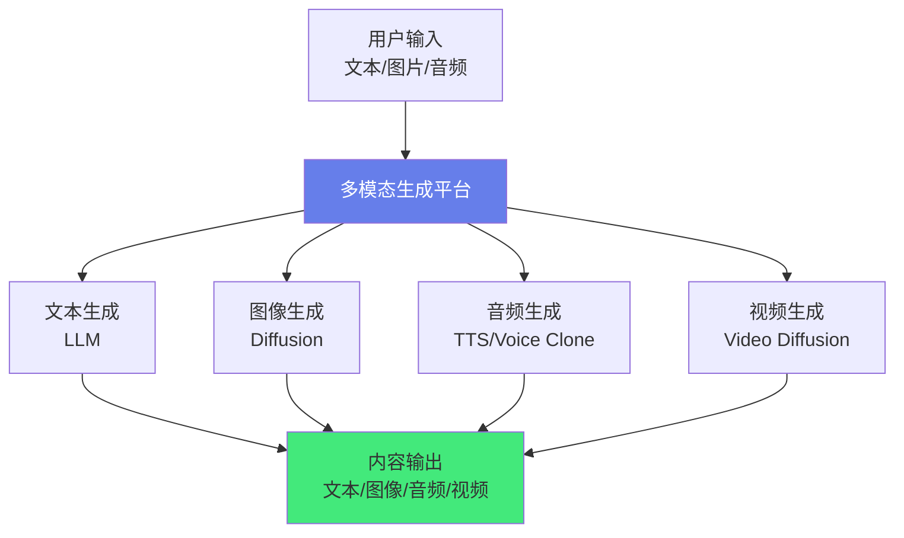
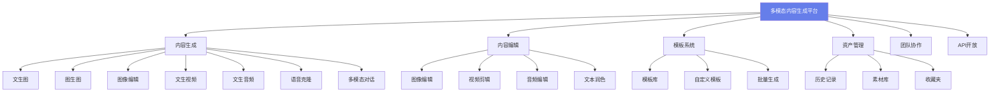
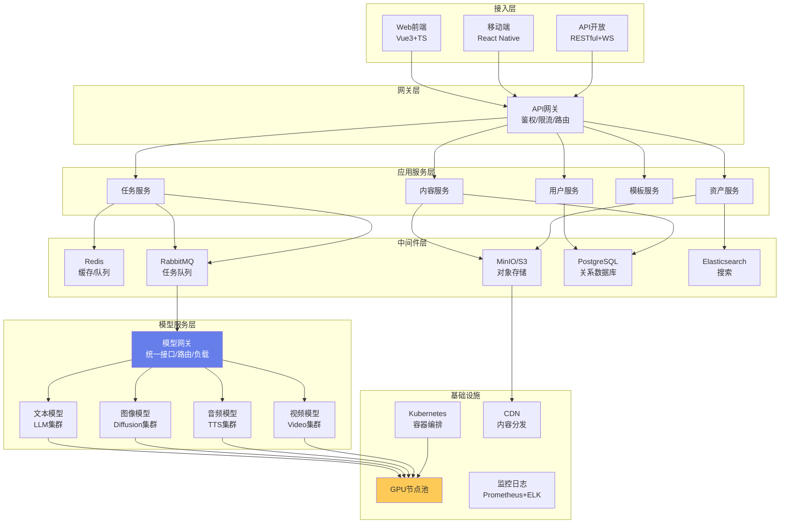
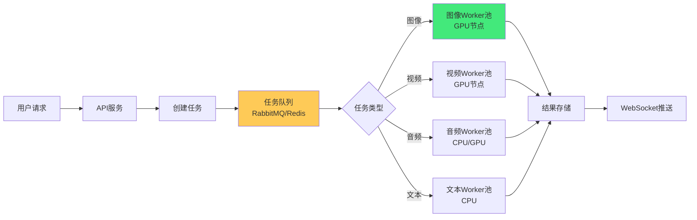
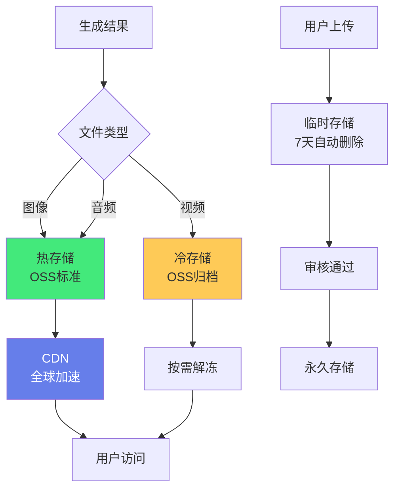

# 🎨 实战：多模态内容生成平台

> **文档说明**：系统讲解如何从零构建一个支持文本、图像、音频、视频等多种模态的 AI 内容生成平台，涵盖项目概述（什么是多模态内容生成平台 / 解决什么问题 / 适用场景 / 核心价值）、需求分析（核心功能清单 / 用户故事 / 技术挑战 / 非功能需求）、技术架构设计（整体架构图 / 技术栈选型 / 模块划分 / 数据流 / 部署架构）、多模态模型集成（文本生成 LLM / 图像生成 Diffusion / 音频生成 TTS / 视频生成 / 多模态理解模型 / 模型对比与选型）、核心功能实现（文生图 / 图生图 / 图像编辑 / 文生视频 / 文生音频 / 语音克隆 / 多模态对话 / 内容编辑 / 批量生成 / 模板系统）、模型管理层（模型注册中心 / 版本管理 / 模型路由 / 负载均衡 / 降级策略 / 健康检查）、任务调度系统（异步任务队列 / 优先级调度 / 并发控制 / 进度追踪 / 失败重试 / 超时管理 / GPU 资源调度）、存储与分发（原图存储 / 生成结果存储 / 模型文件存储 / CDN 分发 / 存储成本优化 / 生命周期管理）、前端创作界面（创作工作台 / 模板库 / 历史记录 / 素材管理 / 批量操作 / 实时预览 / 协作功能）、API 设计（RESTful API / WebSocket 进度推送 / 流式输出 / 批量接口 / 回调通知 / API 版本管理）、成本控制体系（模型推理成本 / 存储成本 / 带宽成本 / 预算管理 / 用量统计 / 成本优化策略）、安全与合规（内容审核 / 版权保护 / 用户数据安全 / API Key 管理 / 合规性 / 水印与溯源）、性能优化（模型推理优化 / 缓存策略 / CDN 加速 / 预生成 / 批量推理 / GPU 利用率优化）、扩展方向（更多模态 / AI Agent 创作 / 协作功能 / 插件生态 / 移动端 / 私有化部署）、项目总结与经验教训。
>
> **适用人群**：全栈开发者、AI 应用开发者、想构建 AIGC 产品的工程师、技术负责人
>
> **前置知识**：[[Transformer架构核心]] · [[AI应用开发入门]] · [[LLM服务架构]] · [[实战-Agent自动化办公助手]]

---

## 一、项目概述

### 1.1 什么是多模态内容生成平台

**多模态内容生成平台**是一个集成了多种 AI 生成模型（文本、图像、音频、视频）的一站式内容创作平台，用户可以通过自然语言或简单操作，生成和编辑各种形式的数字内容。



**核心特征**：
- 🎨 **多模态**：支持文本、图像、音频、视频等多种内容形式
- 🔗 **模态融合**：文本生成图像、图像生成视频、图文混合生成
- 🛠️ **一站式**：从创作到编辑到导出，全流程在一个平台完成
- 📦 **模板化**：预设模板，降低使用门槛
- 👥 **协作化**：支持团队协作和内容共享

### 1.2 解决什么问题

- ⏰ **内容生产效率低**：传统内容生产需要专业技能和大量时间
- 💰 **专业工具成本高**：Photoshop、Premiere 等工具学习成本和费用高
- 🎨 **创意门槛高**：非专业人士难以将创意转化为视觉内容
- 🔄 **多工具切换**：文本、图像、视频需要不同工具，流程割裂
- 📊 **批量生产难**：营销内容需要批量生成不同版本，手动效率低

### 1.3 适用场景

| 场景 | 示例 |
|------|------|
| **营销内容** | 海报、Banner、短视频、广告语、社交媒体图文 |
| **电商运营** | 商品图生成、模特图替换、详情页文案、产品视频 |
| **内容创作** | 博客配图、视频封面、播客音频、动画短片 |
| **教育培训** | 课件配图、教学视频、语音讲解、知识图表 |
| **游戏开发** | 概念图、角色设计、场景背景、音效生成 |
| **企业宣传** | 品牌视觉、宣传视频、PPT 配图、年报设计 |

---

## 二、需求分析

### 2.1 核心功能清单



### 2.2 用户故事

| 角色 | 用户故事 | 验收标准 |
|------|---------|---------|
| **营销人员** | 作为营销人员，我希望输入产品描述就能生成海报和广告语，这样可以快速产出营销素材 | 输入产品描述，30 秒内生成 4 张海报 + 广告语，可编辑和下载 |
| **电商运营** | 作为电商运营，我希望上传商品图就能生成不同场景的模特图，这样不用找模特拍摄 | 上传商品图，选择场景，生成 4 张模特试穿图，分辨率 ≥ 2K |
| **内容创作者** | 作为博主，我希望输入文章主题就能生成配图和封面，这样不用找设计师 | 输入主题，生成 4 张配图 + 1 张封面，支持风格选择 |
| **教师** | 作为教师，我希望输入课件内容就能生成讲解音频，这样可以制作有声课件 | 输入文本，选择音色，生成 MP3 音频，支持语速调节 |
| **开发者** | 作为开发者，我希望通过 API 集成生成能力，这样可以在自己的应用中使用 | 提供 RESTful API + WebSocket 进度，文档齐全，有 SDK |

### 2.3 技术挑战

| 挑战 | 说明 | 解决方案 |
|------|------|---------|
| **GPU 资源昂贵** | 图像/视频生成需要 GPU，成本高 | 按需调度 + 共享 GPU + 模型量化 + 云厂商竞价实例 |
| **生成延迟长** | 视频生成可能需要几分钟 | 异步任务 + 进度推送 + 排队机制 + 优先级调度 |
| **模型种类多** | 不同模态不同模型，接口不统一 | 模型抽象层 + 统一 API + 适配器模式 |
| **存储量大** | 生成的图像/视频文件大，存储成本高 | 压缩 + CDN + 生命周期管理 + 冷热分层 |
| **内容安全** | 生成内容可能违规或侵权 | 内容审核 + 水印 + 版权过滤 + 用户举报 |
| **并发控制** | GPU 资源有限，需要控制并发 | 任务队列 + 限流 + 优先级 + 弹性伸缩 |
| **模型更新** | 模型迭代快，需要无缝切换 | 模型版本管理 + 灰度发布 + A/B 测试 |

---

## 三、技术架构设计

### 3.1 整体架构



### 3.2 技术栈选型

| 层级 | 技术选型 | 说明 |
|------|---------|------|
| **前端** | Vue 3 + TypeScript + Element Plus + Pinia | 创作工作台、编辑器 |
| **图像编辑** | Fabric.js / Konva.js | 前端图像编辑画布 |
| **视频编辑** | Video.js / 自研时间轴 | 视频剪辑预览 |
| **后端** | Python FastAPI / Node.js NestJS | API 服务、任务调度 |
| **模型推理** | vLLM / TensorRT-LLM / Diffusers | 高吞吐模型推理 |
| **模型网关** | 自研 / LiteLLM | 多模型统一接口 |
| **任务队列** | Celery / RabbitMQ / Redis Stream | 异步生成任务 |
| **数据库** | PostgreSQL | 用户、任务、资产元数据 |
| **缓存** | Redis | 会话、任务状态、热点数据 |
| **对象存储** | MinIO / 阿里云 OSS / AWS S3 | 图像、视频、模型文件 |
| **搜索** | Elasticsearch | 模板、素材、历史记录搜索 |
| **容器编排** | Kubernetes + KubeRay / KServe | GPU 资源调度 |
| **CDN** | 阿里云 CDN / Cloudflare | 生成结果分发 |
| **监控** | Prometheus + Grafana + ELK | 指标、日志、告警 |
| **内容审核** | 阿里云内容安全 / 自研审核模型 | 生成内容合规检查 |

### 3.3 模块划分

| 模块 | 职责 | 关键接口 |
|------|------|---------|
| **用户服务** | 注册登录、权限、会员、用量 | `POST /login`、`GET /usage` |
| **内容服务** | 内容生成、编辑、存储、检索 | `POST /generate`、`GET /contents` |
| **任务服务** | 异步任务管理、进度、队列 | `POST /tasks`、`GET /tasks/:id` |
| **模型网关** | 模型路由、负载均衡、统一接口 | `POST /models/:type/generate` |
| **模板服务** | 模板管理、分类、推荐 | `GET /templates`、`POST /templates` |
| **资产服务** | 用户素材、历史记录、收藏 | `GET /assets`、`POST /upload` |
| **审核服务** | 内容审核、水印、版权检查 | `POST /moderate` |
| **计费服务** | 用量统计、扣费、预算 | `GET /billing`、`POST /recharge` |

---

## 四、多模态模型集成

### 4.1 模型对比与选型

| 模态 | 模型 | 特点 | 适用场景 | 延迟 | 成本 |
|------|------|------|---------|------|------|
| **文本** | GPT-4o / Claude 3.5 | 高质量、多语言 | 文案、对话、摘要 | 2-5s | 中 |
| **文本** | Qwen / Llama 3 | 开源、可私有化 | 敏感数据、定制 | 3-8s | 低 |
| **图像** | Stable Diffusion XL | 开源、可定制、生态好 | 通用图像生成 | 5-15s | 低 |
| **图像** | Midjourney API | 高质量、艺术感强 | 艺术创作、概念图 | 30-60s | 高 |
| **图像** | DALL-E 3 | 文字理解好、易用 | 简单图像生成 | 10-20s | 中 |
| **图像编辑** | InstructPix2Pix | 指令式编辑 | 图像修改、风格转换 | 5-10s | 低 |
| **音频** | OpenAI TTS | 自然、多音色 | 语音播报、有声书 | 2-5s | 低 |
| **音频** | ElevenLabs | 高保真、语音克隆 | 专业配音、克隆 | 3-8s | 中 |
| **音频** | ChatTTS / CosyVoice | 开源、中文好 | 中文语音、私有化 | 3-10s | 低 |
| **视频** | Runway Gen-3 / Pika | 高质量、短视频 | 创意视频、广告 | 30-120s | 高 |
| **视频** | Stable Video Diffusion | 开源、可定制 | 图生视频、研究 | 20-60s | 低 |
| **视频** | Sora（待开放） | 长视频、高质量 | 专业视频创作 | 60-300s | 高 |
| **多模态理解** | GPT-4o / Claude 3 | 图文理解、分析 | 图像描述、内容审核 | 3-8s | 中 |

### 4.2 模型网关设计

```python
# 模型网关：统一接口，屏蔽不同模型的差异
class ModelGateway:
    def __init__(self):
        self.providers = {
            "text": {"gpt-4o": OpenAIProvider(), "qwen": QwenProvider()},
            "image": {"sdxl": StableDiffusionProvider(), "dalle3": DALLEProvider()},
            "audio": {"openai-tts": OpenAITTProvider(), "elevenlabs": ElevenLabsProvider()},
            "video": {"runway": RunwayProvider(), "svd": SVDProvider()}
        }
        self.router = ModelRouter()  # 负载均衡 + 降级策略
    
    async def generate(self, modality: str, request: GenerateRequest) -> GenerateResult:
        # 1. 选择模型（根据请求参数 + 负载 + 可用性）
        model_name = self.router.select(modality, request)
        provider = self.providers[modality][model_name]
        
        # 2. 调用模型（适配器模式转换为统一接口）
        try:
            result = await provider.generate(request)
            return result
        except ModelError as e:
            # 3. 降级：尝试备用模型
            backup_model = self.router.get_backup(modality, model_name)
            if backup_model:
                return await self.providers[modality][backup_model].generate(request)
            raise e
    
    async def generate_stream(self, modality: str, request: GenerateRequest):
        # 流式生成（文本、音频支持流式）
        model_name = self.router.select(modality, request)
        provider = self.providers[modality][model_name]
        async for chunk in provider.generate_stream(request):
            yield chunk
```

### 4.3 模型适配器

```python
# 适配器模式：不同模型的 API 差异封装为统一接口
class StableDiffusionProvider(ImageModelProvider):
    async def generate(self, request: ImageGenerateRequest) -> ImageResult:
        # 调用 Stable Diffusion WebUI API / ComfyUI API
        payload = {
            "prompt": request.prompt,
            "negative_prompt": request.negative_prompt,
            "width": request.width,
            "height": request.height,
            "steps": request.steps or 30,
            "cfg_scale": request.cfg_scale or 7.5,
            "seed": request.seed or -1,
            "sampler_name": request.sampler or "Euler a",
            "override_settings": {"sd_model_checkpoint": request.model or "sd_xl_base_1.0"}
        }
        response = await self.client.post(f"{self.base_url}/sdapi/v1/txt2img", json=payload)
        data = response.json()
        return ImageResult(
            images=data["images"],
            parameters=data["parameters"],
            info=json.loads(data["info"])
        )
```

---

## 五、核心功能实现

### 5.1 文生图

```python
# 文生图 API
@app.post("/api/v1/generate/image")
async def generate_image(request: ImageGenerateRequest, user: User = Depends(get_current_user)):
    # 1. 扣减额度（预扣，失败退还）
    await billing_service.reserve_credits(user.id, request.credits_cost)
    
    # 2. 创建异步任务
    task = await task_service.create(
        user_id=user.id,
        type="text_to_image",
        params=request.dict(),
        status="pending"
    )
    
    # 3. 提交到任务队列（GPU 任务队列）
    await task_queue.publish(
        queue="image_generation",
        message={"task_id": task.id, "params": request.dict()},
        priority=request.priority or "normal"
    )
    
    return {"task_id": task.id, "status": "pending"}

# 任务执行（Worker 进程，GPU 节点）
async def image_generation_worker(task_id: str, params: dict):
    task = await task_service.get(task_id)
    try:
        await task_service.update(task_id, status="processing", progress=10)
        
        # 调用模型网关生成图像
        result = await model_gateway.generate("image", ImageGenerateRequest(**params))
        await task_service.update(task_id, progress=70)
        
        # 内容审核
        for img in result.images:
            moderation = await moderation_service.check_image(img)
            if not moderation.passed:
                raise ContentViolationError(moderation.reason)
        await task_service.update(task_id, progress=80)
        
        # 保存到对象存储 + 添加水印
        image_urls = []
        for i, img in enumerate(result.images):
            img_with_watermark = await watermark_service.add(img, user_id=task.user_id)
            url = await storage_service.upload(f"generated/{task.user_id}/{task_id}_{i}.png", img_with_watermark)
            image_urls.append(url)
        await task_service.update(task_id, progress=95)
        
        # 保存记录 + 实际扣费
        await content_service.create(task.user_id, task_id, image_urls, params)
        await billing_service.charge(task.user_id, params["credits_cost"])
        
        await task_service.update(task_id, status="completed", progress=100, result={"images": image_urls})
        
        # 回调通知（WebSocket 推送）
        await websocket_service.notify(task.user_id, {"type": "task_completed", "task_id": task_id})
        
    except Exception as e:
        await task_service.update(task_id, status="failed", error=str(e))
        await billing_service.refund(task.user_id, params["credits_cost"])  # 失败退还
        await websocket_service.notify(task.user_id, {"type": "task_failed", "task_id": task_id, "error": str(e)})
```

### 5.2 图生图与图像编辑

```python
# 图生图：基于参考图生成新图
@app.post("/api/v1/generate/image-to-image")
async def image_to_image(request: ImageToImageRequest):
    # 上传参考图
    ref_image_url = await storage_service.upload_temp(request.reference_image)
    
    # 调用模型（Stable Diffusion img2img）
    result = await model_gateway.generate("image", {
        "mode": "img2img",
        "prompt": request.prompt,
        "init_images": [ref_image_url],
        "denoising_strength": request.denoising_strength or 0.7,  # 0=完全保留原图, 1=完全重绘
        "width": request.width,
        "height": request.height
    })
    return result

# 局部重绘（Inpainting）
@app.post("/api/v1/generate/inpaint")
async def inpaint(request: InpaintRequest):
    # 用户上传原图 + 蒙版（需要重绘的区域）
    result = await model_gateway.generate("image", {
        "mode": "inpaint",
        "prompt": request.prompt,
        "init_images": [request.image],
        "mask": request.mask,  # 白色区域=需要重绘
        "inpainting_fill": "original",  # 蒙版外保留原图
        "mask_blur": 4
    })
    return result
```

### 5.3 文生音频（TTS）

```python
# 文本转语音
@app.post("/api/v1/generate/audio")
async def text_to_speech(request: TTSRequest):
    # 支持流式输出（边生成边播放）
    if request.stream:
        async def audio_stream():
            async for chunk in model_gateway.generate_stream("audio", request):
                yield chunk
        return StreamingResponse(audio_stream(), media_type="audio/mpeg")
    
    # 完整生成
    result = await model_gateway.generate("audio", request)
    audio_url = await storage_service.upload(f"audio/{user_id}/{task_id}.mp3", result.audio)
    return {"audio_url": audio_url, "duration": result.duration}

# 语音克隆
@app.post("/api/v1/generate/voice-clone")
async def voice_clone(request: VoiceCloneRequest):
    # 1. 用户上传参考音频（30秒-5分钟）
    voice_id = await voice_service.create_voice(
        user_id=user.id,
        name=request.voice_name,
        sample_audio=request.sample_audio
    )
    # 2. 用克隆的音色生成语音
    result = await model_gateway.generate("audio", {
        "text": request.text,
        "voice_id": voice_id,
        "stability": request.stability or 0.5,
        "similarity_boost": request.similarity or 0.75
    })
    return result
```

### 5.4 文生视频

```python
# 文生视频（耗时较长，完全异步）
@app.post("/api/v1/generate/video")
async def text_to_video(request: VideoGenerateRequest):
    task = await task_service.create(user_id=user.id, type="text_to_video", params=request.dict())
    await task_queue.publish(queue="video_generation", message={"task_id": task.id}, priority="low")
    return {"task_id": task.id, "estimated_time": "60-120秒"}

# 视频生成 Worker
async def video_generation_worker(task_id: str, params: dict):
    # 视频生成通常需要 1-5 分钟
    result = await model_gateway.generate("video", VideoGenerateRequest(**params))
    # 视频文件大，需要特殊处理（分片上传、转码）
    video_url = await storage_service.upload_large(f"video/{task_id}.mp4", result.video)
    # 生成封面图
    cover_url = await video_service.extract_cover(video_url)
    await task_service.update(task_id, status="completed", result={"video_url": video_url, "cover_url": cover_url})
```

### 5.5 批量生成

```python
# 批量生成（电商场景：一个商品生成 10 张不同场景图）
@app.post("/api/v1/generate/batch")
async def batch_generate(request: BatchGenerateRequest):
    task_ids = []
    for i, variant in enumerate(request.variants):
        task = await task_service.create(
            user_id=user.id,
            type=request.type,
            params={**request.base_params, **variant},
            batch_id=request.batch_id,
            batch_index=i
        )
        task_ids.append(task.id)
        await task_queue.publish(queue=f"{request.type}_generation", message={"task_id": task.id})
    
    return {"batch_id": request.batch_id, "task_ids": task_ids, "total": len(task_ids)}
```

---

## 六、任务调度系统

### 6.1 任务队列设计



### 6.2 优先级与并发控制

```python
class TaskScheduler:
    def __init__(self):
        self.queues = {
            "high": PriorityQueue(),    # 付费用户、VIP
            "normal": PriorityQueue(),  # 普通用户
            "low": PriorityQueue()      # 批量任务、免费用户
        }
        self.gpu_pool = GPUResourcePool(max_concurrent=8)  # GPU 并发数限制
    
    async def submit(self, task: Task):
        # 根据用户等级和任务类型确定优先级
        priority = self.calculate_priority(task)
        await self.queues[priority].put(task)
    
    async def dispatch_loop(self):
        while True:
            # 高优先级队列优先
            for priority in ["high", "normal", "low"]:
                if not self.queues[priority].empty():
                    # 检查 GPU 资源是否可用
                    if await self.gpu_pool.acquire():
                        task = await self.queues[priority].get()
                        await self.execute_task(task)
                        await self.gpu_pool.release()
                        break
            await asyncio.sleep(0.1)
    
    def calculate_priority(self, task: Task) -> str:
        if task.user.is_vip:
            return "high"
        if task.type == "batch" or task.user.is_free:
            return "low"
        return "normal"
```

### 6.3 进度追踪

```python
# 任务进度更新（WebSocket 推送给前端）
async def update_progress(task_id: str, progress: int, message: str = ""):
    await task_service.update(task_id, progress=progress, progress_message=message)
    task = await task_service.get(task_id)
    await websocket_service.notify(task.user_id, {
        "type": "task_progress",
        "task_id": task_id,
        "progress": progress,
        "message": message
    })

# 前端 WebSocket 接收
const ws = new WebSocket(`wss://api.example.com/ws?token=${token}`);
ws.onmessage = (event) => {
  const data = JSON.parse(event.data);
  if (data.type === 'task_progress') {
    updateTaskProgress(data.task_id, data.progress, data.message);
  } else if (data.type === 'task_completed') {
    showResult(data.task_id);
  }
};
```

---

## 七、存储与分发

### 7.1 存储架构



### 7.2 存储成本优化

| 策略 | 说明 | 节省比例 |
|------|------|---------|
| **图片压缩** | WebP 格式 + 质量 85%，体积减少 30-50% | 30-50% |
| **视频转码** | H.265 编码 + 自适应码率，体积减少 50% | 50% |
| **生命周期管理** | 30 天后转低频存储，90 天后转归档存储 | 60-80% |
| **CDN 缓存** | 热门内容 CDN 缓存，减少回源 | 带宽 70% |
| **去重** | 相同内容只存一份（基于内容哈希） | 视情况 |
| **临时文件清理** | 用户上传的临时文件 7 天自动删除 | 视情况 |

---

## 八、成本控制体系

### 8.1 成本构成

| 成本项 | 占比 | 优化方向 |
|--------|------|---------|
| **GPU 推理** | 50-70% | 模型量化、批处理、共享 GPU、竞价实例 |
| **存储** | 10-20% | 压缩、生命周期、冷热分层 |
| **带宽/CDN** | 10-15% | CDN 缓存、压缩、按需加载 |
| **API 调用** | 5-15% | 缓存、模型路由（小模型优先）、批量 |
| **其他** | 5% | 监控、日志、运维 |

### 8.2 用量与计费

```python
class BillingService:
    # 不同生成类型的积分消耗
    CREDIT_COST = {
        "text_to_image_standard": 1,     # 标准质量
        "text_to_image_hd": 3,            # HD 质量
        "image_to_image": 2,
        "text_to_audio": 0.5,
        "voice_clone": 5,
        "text_to_video_5s": 10,
        "text_to_video_10s": 20,
        "batch_discount": 0.8,            # 批量 8 折
    }
    
    async def reserve_credits(self, user_id: str, amount: float):
        """预扣积分（任务开始前）"""
        user = await user_service.get(user_id)
        if user.credits < amount:
            raise InsufficientCreditsError()
        user.credits -= amount
        user.reserved_credits += amount
        await user_service.save(user)
    
    async def charge(self, user_id: str, amount: float):
        """实际扣费（任务完成后）"""
        user = await user_service.get(user_id)
        user.reserved_credits -= amount
        await user_service.save(user)
        await usage_log_service.log(user_id, amount, "generation")
    
    async def refund(self, user_id: str, amount: float):
        """失败退还"""
        user = await user_service.get(user_id)
        user.credits += amount
        user.reserved_credits -= amount
        await user_service.save(user)
```

---

## 九、安全与合规

### 9.1 内容审核

```python
class ModerationService:
    async def check_image(self, image: bytes) -> ModerationResult:
        """多层内容审核"""
        # 1. 快速检测（本地模型，毫秒级）
        quick_result = await self.quick_model.detect(image)
        if quick_result.is_safe:
            return ModerationResult(passed=True)
        
        # 2. 精确检测（云服务商 API，秒级）
        cloud_result = await self.cloud_provider.check(image)
        if cloud_result.is_safe:
            return ModerationResult(passed=True)
        
        # 3. 人工审核（高风险内容）
        if cloud_result.risk_level == "high":
            await self.manual_review_queue.submit(image)
            return ModerationResult(passed=False, reason="内容审核中", pending_review=True)
        
        return ModerationResult(passed=False, reason=cloud_result.reason)
    
    async def check_text(self, text: str) -> ModerationResult:
        """文本审核（Prompt 和生成文本）"""
        # 敏感词过滤 + AI 审核
        return await self.ai_moderator.check(text)
```

### 9.2 水印与溯源

```python
class WatermarkService:
    async def add(self, image: bytes, user_id: str) -> bytes:
        """添加不可见水印（用于版权溯源）"""
        # 1. 可见水印（右下角平台 Logo）
        img_with_visible = self.add_visible_watermark(image, "AIGC Platform")
        
        # 2. 不可见数字水印（隐写术，用于溯源）
        watermark_data = json.dumps({"user_id": user_id, "timestamp": time.time()})
        img_with_invisible = self.add_invisible_watermark(img_with_visible, watermark_data)
        
        return img_with_invisible
    
    async def verify(self, image: bytes) -> dict:
        """验证水印，追溯生成者"""
        watermark_data = self.extract_invisible_watermark(image)
        if watermark_data:
            return json.loads(watermark_data)
        return None
```

---

## 十、前端创作界面

### 10.1 创作工作台

```vue
<template>
  <div class="workspace">
    <!-- 左侧：参数面板 -->
    <div class="param-panel">
      <el-tabs v-model="activeTab">
        <el-tab-pane label="文生图" name="txt2img">
          <el-input type="textarea" v-model="prompt" placeholder="描述你想生成的图像..." />
          <el-input type="textarea" v-model="negativePrompt" placeholder="负面提示词..." />
          <el-select v-model="style">
            <el-option label="写实" value="realistic" />
            <el-option label="动漫" value="anime" />
            <el-option label="油画" value="oil painting" />
          </el-select>
          <el-slider v-model="width" :min="512" :max="2048" :step="64" />
          <el-slider v-model="height" :min="512" :max="2048" :step="64" />
          <el-input-number v-model="steps" :min="10" :max="100" />
          <el-input-number v-model="cfgScale" :min="1" :max="20" :step="0.5" />
          <el-button type="primary" @click="generate" :loading="generating">
            生成（{{ creditsCost }} 积分）
          </el-button>
        </el-tab-pane>
      </el-tabs>
    </div>
    
    <!-- 中间：画布/预览 -->
    <div class="canvas-area">
      <div v-if="generating" class="generating">
        <el-progress type="circle" :percentage="progress" />
        <p>{{ progressMessage }}</p>
      </div>
      <div v-else class="result-grid">
        <div v-for="(img, i) in results" :key="i" class="result-item">
          
          <div class="result-actions">
            <el-button size="small" @click="download(img)">下载</el-button>
            <el-button size="small" @click="useAsReference(img)">参考</el-button>
            <el-button size="small" @click="variations(img)">变体</el-button>
          </div>
        </div>
      </div>
    </div>
    
    <!-- 右侧：历史记录 -->
    <div class="history-panel">
      <h3>历史记录</h3>
      <div v-for="item in history" :key="item.id" class="history-item" @click="loadHistory(item)">
        
        <span>{{ item.prompt.substring(0, 20) }}...</span>
      </div>
    </div>
  </div>
</template>
```

---

## 十一、项目总结与经验教训

### 11.1 关键经验

| 经验 | 说明 |
|------|------|
| **从单一模态开始** | 先做文生图跑通全流程，再逐步扩展音频、视频 |
| **异步是必须的** | 图像/视频生成耗时长，必须异步 + 进度推送 |
| **GPU 调度是核心** | GPU 资源贵，合理的队列和优先级能大幅降低成本 |
| **内容审核不可少** | 生成内容可能违规，多层审核 + 水印是合规基础 |
| **成本控制从第一天开始** | 积分系统 + 预算限制 + 模型路由，避免账单爆炸 |
| **用户体验关键在进度** | 生成过程中让用户看到进度和预计时间，减少焦虑 |
| **模型抽象层很重要** | 不同模型 API 差异大，适配器模式能快速切换模型 |
| **存储成本容易被忽视** | 图像/视频文件大，压缩 + 生命周期管理能省 50%+ |

### 11.2 常见坑

| 坑 | 表现 | 解决方案 |
|----|------|---------|
| **GPU 资源不足** | 任务排队时间长，用户体验差 | 弹性伸缩 + 竞价实例 + 优先级调度 |
| **生成质量不稳定** | 同样的 Prompt 生成结果差异大 | 固定 seed + 模型版本 + 参数模板 |
| **内容违规** | 生成违规内容被平台处罚 | 多层审核（快速+精确+人工）+ 水印 |
| **成本超支** | 免费用户滥用，GPU 账单爆炸 | 积分系统 + 速率限制 + 预算告警 |
| **大文件上传慢** | 用户上传参考图/视频超时 | 分片上传 + 断点续传 + 上传加速 |
| **模型切换中断** | 模型更新导致正在生成的任务失败 | 模型版本管理 + 灰度发布 + 任务重试 |
| **CDN 缓存旧内容** | 用户更新后看到旧图 | 文件名带内容哈希 + 缓存失效策略 |

---

## 十二、关联笔记

### AI 项目实战
- [[实战-Agent自动化办公助手]] · [[实战-AI代码审查工具]] · [[实战-RAG企业知识库问答系统]]
- [[实战-多模态内容生成平台]] · [[AI应用开发入门]]

### AI 工程化
- [[LLM服务架构]] · [[Prompt工程进阶]] · [[MCP协议实战指南]] · [[Prompt版本管理]]
- [[RAG检索增强生成]] · [[向量数据库选型与实战]] · [[模型部署与推理优化]]

### 全栈技术
- [[FastAPI后端开发]] · [[Vue3-组合式API]] · [[PostgreSQL实战]]
- [[Docker容器化]] · [[Redis缓存实战]] · [[Kubernetes入门与实践]]
- [[对象存储OSS实战]] · [[CDN加速原理]]

### 产品与项目
- [[从0到1产品落地路径]] · [[技术选型决策记录-ADR]] · [[独立开发者IndieHacker思路]]
- [[需求分析与用户故事]]

### 导航
- [[MOC-项目实战]] · [[MOC-项目实战]] · [[MOC-AI工程化]] · [[Home]] · [[学习路线总览]]

> 🔍 **核心认知深度解析**
>
> **作用**：多模态内容生成平台解决的是「如何集成多种 AI 生成模型（文本、图像、音频、视频），构建一个一站式的内容创作平台，让非专业用户也能高效生产高质量数字内容」的核心问题——这是 AIGC 时代最典型的应用形态，也是 AI 工程化能力的集大成实践。
>
> **底层原理**：①多模态平台的核心是「模型抽象层 + 异步任务调度 + GPU 资源管理」三位一体——模型抽象层（适配器模式）屏蔽不同模型的 API 差异，让上层业务用统一接口调用任意模型；异步任务调度（消息队列 + Worker 池）处理图像/视频生成的长延迟，保证 API 快速响应和进度可追踪；GPU 资源管理（Kubernetes + GPU 调度 + 优先级队列）解决 GPU 昂贵且有限的问题，通过合理调度降低成本、提升利用率。这三者是多模态平台的技术基石，缺一不可。②模型网关的本质是「AI 时代的 API 网关」——传统 API 网关处理的是 HTTP 请求的路由、鉴权、限流，模型网关处理的是 AI 生成请求的模型选择、负载均衡、降级重试、成本控制。不同模态（文本/图像/音频/视频）有不同的模型，同一模态有多个提供商（OpenAI/Anthropic/开源），模型网关统一封装这些差异，向上提供一致的接口，向下管理模型的可用性和成本。这是「关注点分离」原则在 AI 工程中的体现——业务层不需要知道用的是 GPT-4 还是 Qwen，只需要调用 `generate("text", request)`。③异步任务调度的本质是「解耦请求和计算」——用户发起生成请求后，API 立即返回 task_id，实际计算在后台 Worker 中异步执行，通过 WebSocket 推送进度和结果。这种设计的好处是：API 不会被长耗时任务阻塞（快速响应）、任务可以排队和优先级调度（GPU 资源有限时）、失败可以重试（Worker 崩溃不影响 API）、进度可以追踪（用户知道还要等多久）。这是所有长耗时计算系统的标准架构——从视频转码到 3D 渲染到 AI 生成，都是这个模式。④GPU 资源管理的核心是「在有限的 GPU 上最大化吞吐量」——GPU 是多模态平台最大的成本项（占 50-70%），优化 GPU 利用率直接降低成本。关键策略包括：模型量化（FP16/INT8 减少显存占用，让单卡跑更多并发）、批处理（把多个请求合并为一次推理，提升 GPU 利用率）、模型复用（同一模型的多个请求共享 GPU 显存）、弹性伸缩（根据队列长度自动增减 GPU 节点）、竞价实例（用云厂商的竞价 GPU 实例，成本降 50-70%）、优先级调度（VIP 用户优先，免费用户排队）。⑤内容审核是多模态平台的「生命线」——AI 生成内容可能包含违规（色情、暴力、政治敏感）、侵权（模仿特定艺术家风格、生成名人肖像）、虚假信息等，平台如果不审核，可能面临法律风险、应用商店下架、用户流失。多层审核架构是标准做法：快速检测（本地小模型，毫秒级，过滤明显违规）→ 精确检测（云服务商 API，秒级，准确判断）→ 人工审核（高风险内容，人工最终判断）。同时配合水印（可见+不可见）实现内容溯源，在版权纠纷时能证明内容来源和生成者。⑥成本控制的本质是「让每个生成请求的成本可预测、可控制」——AIGC 平台的成本是变动的（生成越多成本越高），如果不控制，免费用户滥用可能导致账单爆炸。核心机制是积分系统（每个生成类型消耗固定积分，用户充值或订阅获得积分）、预扣机制（任务开始前预扣积分，失败退还，防止用户超额）、预算告警（用户/平台维度的用量告警）、模型路由（简单请求用小模型，复杂请求用大模型，降低平均成本）、缓存（相同 Prompt 的生成结果缓存，避免重复计算）。⑦前端创作体验的关键是「降低创作门槛 + 提供专业控制」——多模态平台的用户既有小白（想要一键生成）也有专业用户（想要精细控制参数）。设计上要兼顾：模板系统（小白选模板一键生成）+ 高级参数面板（专业用户调整 steps/cfg/seed/采样器等）+ 实时预览（生成过程中看到进度和中间结果）+ 历史记录（方便回溯和复用）+ 批量操作（电商场景一次生成多张）。这种「简单的事情简单做，复杂的事情能做」的设计，是工具类产品的核心原则。
>
> **用法要点**：① 多模态平台核心=模型抽象层(适配器统一接口)+异步任务调度(队列+Worker+进度推送)+GPU资源管理(K8s+优先级+弹性伸缩) ② 模型选型：文本(GPT-4o/Claude/Qwen)、图像(SDXL开源可定制/Midjourney高质量/DALL-E3易用)、音频(OpenAI TTS/ElevenLabs高保真/ChatTTS中文开源)、视频(Runway/Pika高质量/SVD开源) ③ 模型网关=统一接口+模型路由(按请求/负载/可用性选择)+负载均衡+降级重试(主模型失败切备用)+成本控制 ④ 核心功能：文生图(prompt+参数→异步任务→审核→水印→存储→推送)、图生图(参考图+denoising强度)、局部重绘Inpainting(原图+蒙版)、文生音频TTS(支持流式+语音克隆)、文生视频(长耗时完全异步1-5分钟)、批量生成(一个商品多张图) ⑤ 任务调度=优先级队列(high/normal/low)+GPU并发限制+Worker池(按模态分池)+进度追踪(WebSocket实时推送)+失败重试+超时管理 ⑥ 存储=对象存储(OSS/S3/MinIO)+CDN分发+压缩(WebP/H.265)+生命周期管理(30天低频90天归档)+临时文件清理(7天)+去重(内容哈希) ⑦ 成本控制=积分系统(按类型扣费)+预扣退还(开始预扣失败退还)+模型路由(小模型优先)+缓存(相同Prompt)+GPU优化(量化/批处理/竞价实例)+预算告警 ⑧ 安全合规=多层内容审核(快速本地+精确云服务+人工高风险)+水印(可见Logo+不可见数字水印溯源)+版权过滤+用户数据安全+API Key管理 ⑨ 前端=创作工作台(左参数/中画布/右历史)+模板库+批量操作+实时预览+编辑器(Fabric.js图像/时间轴视频) ⑩ API设计=RESTful(创建任务/查询状态)+WebSocket(进度推送/结果通知)+流式输出(文本/音频)+批量接口+回调通知+版本管理 ⑪ 生产最佳实践：从单一模态开始跑通再扩展/异步必须/进度透明/模型版本管理/灰度发布/监控告警(GPU利用率/队列长度/失败率) ⑫ 常见坑：GPU不足(弹性+竞价+优先级)/质量不稳定(固定seed+模型版本)/内容违规(多层审核)/成本超支(积分+限流)/大文件上传(分片+断点续传)/模型切换中断(版本管理+重试)/CDN缓存旧内容(内容哈希文件名)。

> 💡 **深度讲解**：多模态内容生成平台最核心的智慧是「AIGC 平台的本质是 GPU 资源的调度器 + 模型能力的封装器——用户看到的是一键生成，背后是复杂的模型路由、任务排队、GPU 调度、内容审核、成本控制，好的平台让这些复杂性对用户完全透明」——很多人以为做 AIGC 平台就是「调用几个 API 拼个前端」，但实际上生产级的多模态平台是一个复杂的分布式系统，涉及 GPU 计算、异步调度、存储分发、成本控制、内容安全等多个领域。模型抽象层是平台的「第一块基石」——不同模型的 API 差异巨大（OpenAI 的函数调用、Stable Diffusion 的 WebUI API、ElevenLabs 的语音克隆），如果业务代码直接调用这些 API，切换模型或增加新模型时需要改大量代码。适配器模式 + 统一接口（`generate(modality, request)`）让业务层完全不关心底层用什么模型，模型网关负责路由、负载均衡、降级重试。这是「面向接口编程」在 AI 工程中的经典应用。异步任务调度是平台的「第二块基石」——图像生成需要 5-15 秒，视频生成需要 1-5 分钟，如果用同步 API，用户会超时、连接会断、服务器会被长连接占满。异步架构（提交任务立即返回 task_id + WebSocket 推送进度）是唯一可行的方案。这个模式不是 AI 特有的——视频转码、3D 渲染、大数据处理都是这个模式，核心思想是「解耦请求和计算，让快速响应和长耗时计算共存」。GPU 资源管理是平台的「第三块基石，也是最大的成本项」——GPU 占平台成本的 50-70%，优化 GPU 利用率直接决定平台能否盈利。关键是「在有限的 GPU 上最大化吞吐量」：模型量化让单卡跑更多并发、批处理让多个请求合并推理、弹性伸缩根据队列长度增减节点、竞价实例用半价 GPU、优先级调度让付费用户优先。这些策略组合起来，可以把单位生成成本降低 50% 以上。内容审核是平台的「生命线」——AI 生成内容的合规风险是真实存在的，违规内容可能导致应用下架、法律诉讼、用户流失。多层审核（快速+精确+人工）+ 水印溯源是标准做法，不要因为「影响用户体验」或「增加成本」而跳过审核——一次严重的合规事件可能让整个平台倒闭。在 AI 时代，多模态内容生成平台是「AI 落地」的最佳载体之一——它直接面向终端用户，创造实实在在的价值（节省时间、降低门槛、提升创意），同时也是技术复杂度最高的 AI 应用类型之一（涉及全栈 + AI + 分布式 + 运维 + 安全）。构建这样的平台，是全栈 + AI 工程师的终极练手项目。

> 📝 **精简总结**：多模态内容生成平台=模型抽象层(适配器统一接口)+异步任务调度(队列Worker进度推送)+GPU资源管理(K8s优先级弹性)。模型选型：文本(GPT-4o/Qwen)、图像(SDXL/Midjourney/DALL-E3)、音频(OpenAI TTS/ElevenLabs/ChatTTS)、视频(Runway/SVD)。核心功能：文生图/图生图/Inpainting/文生音频(流式+克隆)/文生视频(长异步)/批量生成。任务调度=优先级队列+GPU并发限制+Worker池+WebSocket进度+失败重试。存储=OSS+CDN+压缩+生命周期+去重。成本=积分系统+预扣退还+模型路由+缓存+GPU优化。安全=多层审核+水印溯源+版权过滤。前端=工作台(参数/画布/历史)+模板+批量+编辑器。经验：从单模态开始/异步必须/进度透明/模型版本管理/监控告警。坑：GPU不足/质量不稳定/内容违规/成本超支/大文件上传。

> **学习路径建议**：先学习 [[AI应用开发入门]] 和 [[LLM服务架构]] 打好基础 → 实践：调用一个文生图 API（如 Stable Diffusion WebUI）做简单的文生图应用 → 学习异步任务架构（Celery/RabbitMQ）和 WebSocket 进度推送 → 实践：实现异步生成 + 进度追踪 → 学习模型网关和适配器模式 → 实践：集成多个图像模型（SDXL + DALL-E）并实现统一接口和降级 → 学习 GPU 资源管理和 Kubernetes → 学习存储和 CDN → 实践：实现存储上传 + CDN 分发 + 成本优化 → 学习内容审核和安全合规 → 扩展到音频和视频模态 → 学习 [[实战-Agent自动化办公助手]] 了解 AI Agent 创作方向 → 形成完整的多模态平台能力。

---

> **多模态内容生成平台最核心的智慧是「AIGC 平台的本质是 GPU 资源的调度器 + 模型能力的封装器——用户看到的是一键生成，背后是复杂的模型路由、任务排队、GPU 调度、内容审核、成本控制，好的平台让这些复杂性对用户完全透明」——很多人以为做 AIGC 平台就是调用几个 API 拼个前端，但实际上生产级多模态平台是复杂的分布式系统，涉及 GPU 计算、异步调度、存储分发、成本控制、内容安全等多个领域。模型抽象层是第一块基石——不同模型 API 差异巨大，适配器模式+统一接口让业务层完全不关心底层用什么模型，模型网关负责路由、负载均衡、降级重试，这是面向接口编程在 AI 工程中的经典应用。异步任务调度是第二块基石——图像生成 5-15 秒，视频生成 1-5 分钟，同步 API 会超时断连，异步架构（提交返回 task_id + WebSocket 推送进度）是唯一可行方案，这个模式不是 AI 特有，视频转码、3D 渲染都是这个模式，核心是解耦请求和计算。GPU 资源管理是第三块基石也是最大成本项（占 50-70%），优化利用率直接决定能否盈利——模型量化让单卡跑更多并发、批处理合并推理、弹性伸缩增减节点、竞价实例半价 GPU、优先级调度付费用户优先，组合起来单位成本降 50%+。内容审核是生命线——AI 生成内容合规风险真实存在，多层审核+水印溯源是标准做法，不要因为影响体验或增加成本而跳过，一次严重合规事件可能让平台倒闭。在 AI 时代多模态内容生成平台是 AI 落地的最佳载体之一——直接面向终端用户创造实实在在价值，同时也是技术复杂度最高的 AI 应用类型之一（全栈+AI+分布式+运维+安全），构建这样的平台是全栈+AI工程师的终极练手项目。如果你想做 AIGC 产品，从单一模态开始跑通全流程，再逐步扩展——先能跑，再变好，再变全。**

---

## 🔗 关联笔记

- [[MOC-项目实战]] — 返回本分类知识地图，查看更多相关文档

## 📖 前置知识

- [[Transformer架构核心]]
- [[AI应用开发入门]]
- [[LLM服务架构]]
- [[实战-Agent自动化办公助手]]

## 🏷️ 相关标签

`#AI应用` `#多模态` `#文生图` `#图生图` `#文生视频` `#TTS`

[[Home|🏠 返回首页]] · [[MOC-项目实战|📚 返回分类]]
