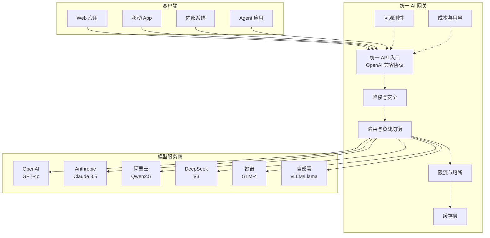
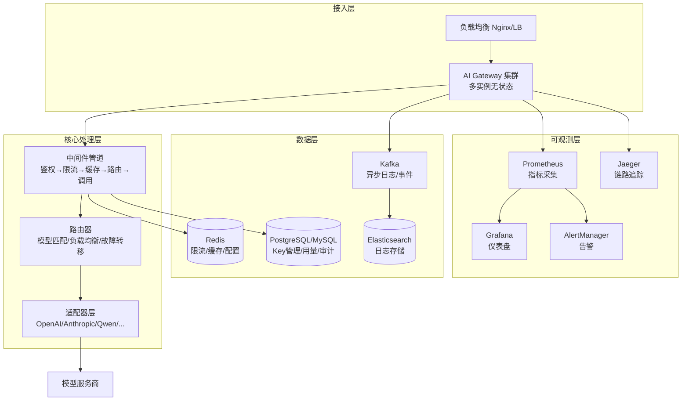

# 统一 AI 网关设计与实现

> **文档说明**：系统讲解统一 AI 网关的架构设计、核心功能模块、多模型路由、负载均衡、限流熔断、缓存、可观测性、安全鉴权，以及完整的技术实现方案。
>
> **适用人群**：AI 应用架构师、全栈工程师、需要构建企业级 AI 网关的开发者
>
> **前置知识**：[[AI网关与多模型路由]]、[[LLM接口封装与统一SDK]]、[[Gateway-网关路由与鉴权]]

---

## 一、概述

**统一 AI 网关**是企业 AI 应用的核心基础设施，位于客户端和各大模型服务商（OpenAI、Anthropic、阿里云、智谱、DeepSeek 等）之间，提供统一的 API 接口、多模型路由、负载均衡、限流熔断、缓存、日志监控、安全鉴权等能力，解决多模型管理复杂、成本不可控、稳定性差、安全风险高等问题。

### 1. 为什么需要统一 AI 网关

| 痛点 | 说明 | 网关解决方案 |
|------|------|------------|
| **多模型接口不统一** | 每家厂商 API 格式不同，切换成本高 | 统一 OpenAI 兼容协议，一套代码调用所有模型 |
| **成本不可控** | Token 消耗无感知，账单爆炸 | 用量统计、预算控制、成本告警、模型降级 |
| **稳定性差** | 单一服务商故障导致全站不可用 | 多服务商容灾、自动故障转移、重试降级 |
| **安全风险** | API Key 泄露、越权访问 | 统一鉴权、Key 管理、权限控制、审计日志 |
| **性能瓶颈** | 高并发下模型服务限流 | 限流、排队、缓存、批量请求 |
| **可观测性差** | 不知道调用了什么、花了多少 | 全链路追踪、指标监控、日志分析 |
| **数据合规** | 敏感数据发送到第三方 | 数据脱敏、内容审核、本地化部署 |

### 2. 网关在架构中的位置



### 3. 核心功能矩阵

| 功能模块 | 核心能力 | 优先级 |
|---------|---------|--------|
| **统一 API** | OpenAI 兼容协议、多模型适配、流式 SSE | P0 |
| **多模型路由** | 按模型名路由、按成本/延迟/质量智能路由 | P0 |
| **负载均衡** | 多 Key 轮询、权重分配、故障转移 | P0 |
| **鉴权安全** | API Key、JWT、权限控制、IP 白名单 | P0 |
| **限流熔断** | 全局限流、用户限流、QPS 限流、熔断降级 | P1 |
| **缓存** | Prompt 缓存、Response 缓存、语义缓存 | P1 |
| **可观测性** | 指标监控、链路追踪、日志、告警 | P1 |
| **成本管理** | 用量统计、预算控制、成本告警、账单 | P1 |
| **内容安全** | 输入输出审核、敏感词过滤、数据脱敏 | P2 |
| **模型管理** | 模型注册、上下线、版本管理、A/B 测试 | P2 |
| **插件生态** | 自定义中间件、钩子函数、扩展开发 | P2 |

---

## 二、架构设计

### 1. 整体架构



### 2. 技术选型

| 组件 | 推荐方案 | 说明 |
|------|---------|------|
| **开发语言** | Go / Python / Node.js | Go 性能最好，Python 生态好，Node.js 前后端统一 |
| **Web 框架** | Go: Gin/Fiber, Python: FastAPI, Node: Express/Fastify | 高性能异步框架 |
| **缓存** | Redis | 限流、缓存、配置中心 |
| **数据库** | PostgreSQL / MySQL | Key 管理、用量统计、审计日志 |
| **消息队列** | Kafka / RabbitMQ | 异步日志、事件通知 |
| **日志** | ELK / Loki | 日志收集和分析 |
| **监控** | Prometheus + Grafana | 指标监控和仪表盘 |
| **链路追踪** | Jaeger / Zipkin / OpenTelemetry | 分布式链路追踪 |
| **部署** | Docker + Kubernetes | 容器化部署，弹性伸缩 |
| **配置中心** | Nacos / Apollo / etcd | 动态配置，热更新 |

### 3. 无状态设计

网关本身设计为**无状态服务**：
- 所有状态存储在 Redis/DB 中
- 多实例水平扩展，请求可路由到任意实例
- 部署在 K8s 中，支持 HPA 自动扩缩容
- 配置通过配置中心动态下发，无需重启

---

## 三、核心模块实现

### 1. 统一 API 层

**OpenAI 兼容协议**是目前的事实标准，所有主流模型都支持或可适配。网关对外提供 OpenAI 兼容接口，内部适配不同厂商。

```python
# FastAPI 示例：统一聊天补全接口
from fastapi import FastAPI, Request, HTTPException
from fastapi.responses import StreamingResponse
import json

app = FastAPI(title="统一 AI 网关")

@app.post("/v1/chat/completions")
async def chat_completions(request: Request):
    body = await request.json()

    # 1. 鉴权
    api_key = request.headers.get("Authorization", "").replace("Bearer ", "")
    user = await auth_service.verify(api_key)

    # 2. 参数校验
    model = body.get("model")
    messages = body.get("messages")
    stream = body.get("stream", False)

    if not model or not messages:
        raise HTTPException(400, "model and messages are required")

    # 3. 限流检查
    await rate_limit_service.check(user.id, model)

    # 4. 缓存检查（非流式）
    if not stream:
        cached = await cache_service.get(model, messages)
        if cached:
            return cached

    # 5. 路由选择模型实例
    endpoint = await router_service.select(model, user)

    # 6. 调用模型
    if stream:
        return StreamingResponse(
            stream_chat(endpoint, body, user),
            media_type="text/event-stream"
        )
    else:
        result = await call_chat(endpoint, body)
        # 7. 写入缓存
        await cache_service.set(model, messages, result)
        # 8. 记录用量
        await usage_service.record(user.id, model, result["usage"])
        return result
```

### 2. 多模型路由

```python
class ModelRouter:
    """模型路由器：支持多种路由策略"""

    def __init__(self, redis):
        self.redis = redis

    async def select(self, model_name: str, user: dict) -> dict:
        """
        选择模型端点
        策略：1. 按模型名匹配 2. 负载均衡 3. 故障转移 4. 智能路由
        """
        # 1. 获取模型的所有可用端点
        endpoints = await self.get_endpoints(model_name)
        if not endpoints:
            raise HTTPException(404, f"Model {model_name} not found")

        # 2. 过滤健康的端点
        healthy = [e for e in endpoints if await self.is_healthy(e)]
        if not healthy:
            # 全部不健康，尝试降级模型
            fallback = await self.get_fallback_model(model_name)
            if fallback:
                return await self.select(fallback, user)
            raise HTTPException(503, "All model endpoints are unavailable")

        # 3. 负载均衡策略
        strategy = user.get("load_balance_strategy", "round_robin")
        if strategy == "round_robin":
            return await self.round_robin(healthy, model_name)
        elif strategy == "weighted":
            return self.weighted_select(healthy)
        elif strategy == "least_latency":
            return await self.least_latency(healthy)
        elif strategy == "random":
            return random.choice(healthy)

        return healthy[0]

    async def round_robin(self, endpoints: list, model_name: str) -> dict:
        """轮询负载均衡"""
        key = f"gateway:rr:{model_name}"
        idx = await self.redis.incr(key)
        return endpoints[idx % len(endpoints)]

    def weighted_select(self, endpoints: list) -> dict:
        """加权随机选择"""
        total_weight = sum(e.get("weight", 1) for e in endpoints)
        r = random.uniform(0, total_weight)
        for e in endpoints:
            r -= e.get("weight", 1)
            if r <= 0:
                return e
        return endpoints[-1]
```

### 3. 模型适配器

```python
class ModelAdapter:
    """模型适配器：将统一请求转换为各厂商格式，将响应转换为统一格式"""

    async def chat(self, endpoint: dict, body: dict) -> dict:
        provider = endpoint["provider"]
        adapter = self.get_adapter(provider)
        return await adapter.chat(endpoint, body)

    def get_adapter(self, provider: str):
        adapters = {
            "openai": OpenAIAdapter(),
            "anthropic": AnthropicAdapter(),
            "qwen": QwenAdapter(),
            "deepseek": DeepSeekAdapter(),
            "zhipu": ZhipuAdapter(),
            "vllm": VLLMAdapter(),  # 自部署 vLLM 也是 OpenAI 兼容
        }
        return adapters.get(provider, OpenAIAdapter())  # 默认 OpenAI 兼容


class AnthropicAdapter:
    """Anthropic Claude 适配器"""

    async def chat(self, endpoint: dict, body: dict) -> dict:
        # 1. 转换请求格式：OpenAI → Anthropic
        anthropic_body = {
            "model": endpoint["model"],
            "max_tokens": body.get("max_tokens", 4096),
            "temperature": body.get("temperature", 1),
            "messages": self.convert_messages(body["messages"]),
            "system": self.extract_system(body["messages"]),
        }

        # 2. 调用 Anthropic API
        async with httpx.AsyncClient() as client:
            resp = await client.post(
                f"{endpoint['base_url']}/v1/messages",
                headers={
                    "x-api-key": endpoint["api_key"],
                    "anthropic-version": "2023-06-01",
                    "content-type": "application/json",
                },
                json=anthropic_body,
                timeout=60,
            )
            resp.raise_for_status()
            data = resp.json()

        # 3. 转换响应格式：Anthropic → OpenAI
        return {
            "id": data["id"],
            "object": "chat.completion",
            "created": int(time.time()),
            "model": body["model"],
            "choices": [{
                "index": 0,
                "message": {
                    "role": "assistant",
                    "content": data["content"][0]["text"],
                },
                "finish_reason": data["stop_reason"],
            }],
            "usage": {
                "prompt_tokens": data["usage"]["input_tokens"],
                "completion_tokens": data["usage"]["output_tokens"],
                "total_tokens": data["usage"]["input_tokens"] + data["usage"]["output_tokens"],
            },
        }
```

### 4. 限流与熔断

```python
class RateLimitService:
    """限流服务：基于 Redis 的滑动窗口限流"""

    def __init__(self, redis):
        self.redis = redis

    async def check(self, user_id: str, model: str):
        # 1. 全局限流（所有用户总 QPS）
        await self._check_global(model)
        # 2. 用户级限流（每个用户的 QPM）
        await self._check_user(user_id, model)
        # 3. 模型级限流（每个模型的总 QPS）
        await self._check_model(model)

    async def _check_global(self, model: str):
        """全局限流：滑动窗口算法"""
        key = f"gateway:ratelimit:global:{model}"
        now = time.time()
        window = 60  # 60秒窗口
        limit = 1000  # 每分钟最多 1000 次

        # 移除窗口外的记录
        await self.redis.zremrangebyscore(key, 0, now - window)
        # 统计当前窗口内的请求数
        count = await self.redis.zcard(key)
        if count >= limit:
            raise HTTPException(429, "Global rate limit exceeded")
        # 记录当前请求
        await self.redis.zadd(key, {str(now): now})
        await self.redis.expire(key, window + 1)


class CircuitBreaker:
    """熔断器：保护模型服务不被拖垮"""

    def __init__(self, redis, failure_threshold=5, recovery_timeout=30):
        self.redis = redis
        self.failure_threshold = failure_threshold
        self.recovery_timeout = recovery_timeout

    async def call(self, endpoint: dict, func, *args, **kwargs):
        key = f"gateway:circuit:{endpoint['id']}"
        state = await self.redis.hgetall(key)

        # 检查熔断器状态
        if state.get("state") == "open":
            opened_at = float(state.get("opened_at", 0))
            if time.time() - opened_at < self.recovery_timeout:
                raise HTTPException(503, "Circuit breaker is open")
            # 半开状态：允许一个请求探测
            await self.redis.hset(key, "state", "half_open")

        try:
            result = await func(*args, **kwargs)
            # 成功：重置熔断器
            await self.redis.hset(key, mapping={"state": "closed", "failures": 0})
            return result
        except Exception as e:
            # 失败：增加失败计数
            failures = int(state.get("failures", 0)) + 1
            if failures >= self.failure_threshold or state.get("state") == "half_open":
                # 打开熔断器
                await self.redis.hset(key, mapping={
                    "state": "open",
                    "failures": failures,
                    "opened_at": time.time(),
                })
            else:
                await self.redis.hset(key, "failures", failures)
            raise e
```

### 5. 缓存层

```python
class CacheService:
    """缓存服务：Prompt 缓存 + Response 缓存 + 语义缓存"""

    def __init__(self, redis, embedder=None):
        self.redis = redis
        self.embedder = embedder  # 语义缓存需要 Embedding

    async def get(self, model: str, messages: list) -> dict | None:
        """精确匹配缓存：基于 Prompt 哈希"""
        key = self._make_key(model, messages)
        cached = await self.redis.get(key)
        if cached:
            return json.loads(cached)
        return None

    async def set(self, model: str, messages: list, response: dict, ttl=3600):
        key = self._make_key(model, messages)
        await self.redis.setex(key, ttl, json.dumps(response, ensure_ascii=False))

    def _make_key(self, model: str, messages: list) -> str:
        # 只缓存确定性参数（temperature=0）
        content = json.dumps(messages, ensure_ascii=False, sort_keys=True)
        return f"gateway:cache:{model}:{hashlib.md5(content.encode()).hexdigest()}"

    async def semantic_get(self, model: str, query: str, threshold=0.95) -> dict | None:
        """语义缓存：相似 Prompt 返回缓存结果"""
        if not self.embedder:
            return None
        query_emb = self.embedder.embed(query)
        # 从向量数据库搜索相似的历史 Prompt
        similar = await vector_store.search(query_emb, k=1, threshold=threshold)
        if similar:
            return similar[0].metadata["response"]
        return None
```

### 6. 流式响应（SSE）

```python
async def stream_chat(endpoint: dict, body: dict, user: dict):
    """流式响应：透传 SSE，同时记录用量"""
    body["stream"] = True
    completion_tokens = 0
    prompt_tokens = 0

    async with httpx.AsyncClient() as client:
        async with client.stream(
            "POST",
            f"{endpoint['base_url']}/v1/chat/completions",
            headers={"Authorization": f"Bearer {endpoint['api_key']}"},
            json=body,
            timeout=120,
        ) as resp:
            resp.raise_for_status()
            async for line in resp.aiter_lines():
                if line.startswith("data: "):
                    data = line[6:]
                    if data == "[DONE]":
                        yield f"data: {data}\n\n"
                        break
                    try:
                        chunk = json.loads(data)
                        # 统计 token（估算或从 usage 获取）
                        if chunk.get("usage"):
                            prompt_tokens = chunk["usage"].get("prompt_tokens", 0)
                            completion_tokens = chunk["usage"].get("completion_tokens", 0)
                    except json.JSONDecodeError:
                        pass
                    yield f"data: {data}\n\n"

    # 异步记录用量
    await usage_service.record(user.id, body["model"], {
        "prompt_tokens": prompt_tokens,
        "completion_tokens": completion_tokens,
        "total_tokens": prompt_tokens + completion_tokens,
    })
```

---

## 四、可观测性

### 1. 核心指标

| 指标 | 说明 | 告警阈值 |
|------|------|---------|
| **请求量 QPS** | 每秒请求数 | 突增 200% |
| **成功率** | 2xx/3xx 占比 | < 99% |
| **错误率** | 4xx/5xx 占比 | > 1% |
| **P50/P95/P99 延迟** | 响应延迟 | P99 > 30s |
| **Token 消耗** | 每分钟/每小时 Token 数 | 超预算 80% |
| **缓存命中率** | 缓存命中比例 | < 30%（可优化） |
| **限流拒绝率** | 429 占比 | > 5% |
| **模型可用性** | 各模型端点健康状态 | 任一不可用 |
| **单用户消耗** | Top 用户 Token 消耗 | 超个人预算 |

### 2. Prometheus 指标埋点

```python
from prometheus_client import Counter, Histogram, Gauge

# 请求计数
request_total = Counter(
    "ai_gateway_requests_total",
    "Total number of requests",
    ["model", "provider", "status", "user_id"]
)

# 延迟直方图
request_duration = Histogram(
    "ai_gateway_request_duration_seconds",
    "Request duration in seconds",
    ["model", "provider"],
    buckets=(0.1, 0.5, 1, 2, 5, 10, 30, 60, 120)
)

# Token 消耗
token_usage = Counter(
    "ai_gateway_token_usage_total",
    "Total token usage",
    ["model", "provider", "token_type"]  # prompt/completion
)

# 缓存命中
cache_hit = Counter(
    "ai_gateway_cache_hits_total",
    "Cache hits",
    ["model", "cache_type"]  # exact/semantic
)

# 使用示例
@app.middleware("http")
async def metrics_middleware(request, call_next):
    start = time.time()
    response = await call_next(request)
    duration = time.time() - start
    request_duration.labels(model=..., provider=...).observe(duration)
    request_total.labels(...).inc()
    return response
```

### 3. 链路追踪

```python
# OpenTelemetry 集成
from opentelemetry import trace
from opentelemetry.trace import SpanKind

tracer = trace.get_tracer("ai-gateway")

async def call_model(endpoint, body):
    with tracer.start_as_current_span(
        f"call_{endpoint['provider']}_{endpoint['model']}",
        kind=SpanKind.CLIENT,
    ) as span:
        span.set_attribute("model", endpoint["model"])
        span.set_attribute("provider", endpoint["provider"])
        span.set_attribute("messages_count", len(body["messages"]))

        try:
            result = await http_client.post(...)
            span.set_attribute("prompt_tokens", result["usage"]["prompt_tokens"])
            span.set_attribute("completion_tokens", result["usage"]["completion_tokens"])
            return result
        except Exception as e:
            span.record_exception(e)
            span.set_status(trace.StatusCode.ERROR)
            raise
```

---

## 五、安全与成本

### 1. API Key 管理

```python
class APIKeyService:
    """API Key 管理：创建、验证、吊销、权限控制"""

    async def create_key(self, user_id: str, name: str, permissions: list,
                         rate_limit: dict, budget: float) -> dict:
        """创建 API Key"""
        key = "sk-" + secrets.token_urlsafe(32)
        key_hash = hashlib.sha256(key.encode()).hexdigest()

        key_data = {
            "id": str(uuid.uuid4()),
            "user_id": user_id,
            "name": name,
            "key_hash": key_hash,  # 只存哈希，不存明文
            "permissions": permissions,  # ["chat:gpt-4o", "embedding:*"]
            "rate_limit": rate_limit,    # {"qpm": 100, "daily": 10000}
            "budget": budget,            # 月度预算（美元）
            "status": "active",
            "created_at": time.time(),
        }
        await db.insert("api_keys", key_data)
        return {"key": key, **key_data}  # 只返回一次明文

    async def verify(self, api_key: str) -> dict:
        """验证 API Key"""
        key_hash = hashlib.sha256(api_key.encode()).hexdigest()
        key_data = await db.find_one("api_keys", {"key_hash": key_hash})
        if not key_data or key_data["status"] != "active":
            raise HTTPException(401, "Invalid API key")
        # 检查预算
        await self._check_budget(key_data)
        return key_data

    async def _check_budget(self, key_data: dict):
        """检查月度预算"""
        month_start = datetime.now().replace(day=1, hour=0, minute=0, second=0)
        usage = await db.sum("usage", "cost", {
            "key_id": key_data["id"],
            "created_at": {"$gte": month_start.timestamp()}
        })
        if usage >= key_data["budget"]:
            raise HTTPException(402, "Monthly budget exceeded")
```

### 2. 成本计算

```python
class CostCalculator:
    """成本计算器：根据模型定价计算请求成本"""

    # 模型定价（每 1K token，美元）
    PRICING = {
        "gpt-4o": {"input": 0.005, "output": 0.015},
        "gpt-4o-mini": {"input": 0.00015, "output": 0.0006},
        "claude-3-5-sonnet": {"input": 0.003, "output": 0.015},
        "qwen2.5-72b": {"input": 0.0008, "output": 0.002},
        "deepseek-chat": {"input": 0.00014, "output": 0.00028},
        "glm-4": {"input": 0.0014, "output": 0.0014},
    }

    def calculate(self, model: str, usage: dict) -> float:
        """计算请求成本（美元）"""
        pricing = self.PRICING.get(model, {"input": 0.001, "output": 0.002})
        input_cost = usage["prompt_tokens"] / 1000 * pricing["input"]
        output_cost = usage["completion_tokens"] / 1000 * pricing["output"]
        return round(input_cost + output_cost, 6)
```

### 3. 内容安全

```python
class ContentSecurity:
    """内容安全：输入输出审核、敏感词过滤、数据脱敏"""

    SENSITIVE_PATTERNS = [
        (r'\b\d{11}\b', '***PHONE***'),        # 手机号
        (r'\b\d{18}[\dXx]\b', '***ID***'),      # 身份证
        (r'\b[\w.-]+@[\w.-]+\.\w+\b', '***EMAIL***'),  # 邮箱
        (r'\b\d{16,19}\b', '***CARD***'),        # 银行卡
    ]

    def mask_sensitive(self, text: str) -> str:
        """脱敏：替换敏感信息"""
        for pattern, replacement in self.SENSITIVE_PATTERNS:
            text = re.sub(pattern, replacement, text)
        return text

    async def moderate(self, text: str) -> dict:
        """内容审核：调用审核 API 检查违规内容"""
        # 可调用 OpenAI Moderation、阿里云内容安全、自建审核模型
        result = await moderation_api.check(text)
        return {
            "flagged": result["flagged"],
            "categories": result["categories"],
            "scores": result["category_scores"],
        }
```

---

## 六、部署与运维

### 1. Docker 部署

```dockerfile
FROM python:3.12-slim
WORKDIR /app
COPY requirements.txt .
RUN pip install --no-cache-dir -r requirements.txt
COPY . .
EXPOSE 8000
CMD ["uvicorn", "main:app", "--host", "0.0.0.0", "--port", "8000", "--workers", "4"]
```

```yaml
# docker-compose.yml
version: "3.8"
services:
  gateway:
    build: .
    ports:
      - "8000:8000"
    environment:
      - REDIS_URL=redis://redis:6379
      - DATABASE_URL=postgresql://user:pass@db:5432/gateway
      - LOG_LEVEL=info
    depends_on:
      - redis
      - db
    restart: unless-stopped

  redis:
    image: redis:7-alpine
    volumes:
      - redisdata:/data
    restart: unless-stopped

  db:
    image: postgres:16-alpine
    environment:
      - POSTGRES_USER=user
      - POSTGRES_PASSWORD=pass
      - POSTGRES_DB=gateway
    volumes:
      - dbdata:/var/lib/postgresql/data
    restart: unless-stopped

volumes:
  redisdata:
  dbdata:
```

### 2. Kubernetes 部署

```yaml
# deployment.yaml
apiVersion: apps/v1
kind: Deployment
metadata:
  name: ai-gateway
spec:
  replicas: 3
  selector:
    matchLabels:
      app: ai-gateway
  template:
    metadata:
      labels:
        app: ai-gateway
    spec:
      containers:
      - name: gateway
        image: myregistry/ai-gateway:1.0.0
        ports:
        - containerPort: 8000
        resources:
          requests:
            cpu: "500m"
            memory: "512Mi"
          limits:
            cpu: "2000m"
            memory: "2Gi"
        env:
        - name: REDIS_URL
          value: "redis://redis:6379"
        - name: DATABASE_URL
          valueFrom:
            secretKeyRef:
              name: gateway-secrets
              key: database-url
        livenessProbe:
          httpGet:
            path: /health
            port: 8000
          initialDelaySeconds: 10
          periodSeconds: 30
        readinessProbe:
          httpGet:
            path: /ready
            port: 8000
          initialDelaySeconds: 5
          periodSeconds: 10
---
apiVersion: v1
kind: Service
metadata:
  name: ai-gateway
spec:
  selector:
    app: ai-gateway
  ports:
  - port: 80
    targetPort: 8000
  type: ClusterIP
---
apiVersion: autoscaling/v2
kind: HorizontalPodAutoscaler
metadata:
  name: ai-gateway-hpa
spec:
  scaleTargetRef:
    apiVersion: apps/v1
    kind: Deployment
    name: ai-gateway
  minReplicas: 3
  maxReplicas: 20
  metrics:
  - type: Resource
    resource:
      name: cpu
      target:
        type: Utilization
        averageUtilization: 70
  - type: Resource
    resource:
      name: memory
      target:
        type: Utilization
        averageUtilization: 80
```

---

## 七、常见问题与排查

| 问题 | 原因 | 解决方案 |
|------|------|---------|
| 模型调用超时 | 模型服务慢 / 网络延迟 | 增加超时时间，设置重试，降级到更快的模型 |
| 429 限流 | 触发了模型服务商的限流 | 多 Key 轮询，排队机制，限流后自动重试 |
| 成本超支 | 大模型滥用 / 无预算控制 | 预算限制，成本告警，默认用小模型，大模型需审批 |
| 缓存不命中 | Prompt 微小变化导致哈希不同 | 语义缓存，Prompt 归一化，提高缓存 TTL |
| 流式中断 | 网络波动 / 模型服务断开 | 客户端重连，服务端心跳，断点续传 |
| 鉴权失败 | Key 过期 / 权限不足 | 检查 Key 状态，确认权限范围，重新生成 Key |
| 路由错误 | 模型名不匹配 / 端点配置错 | 检查模型注册配置，验证端点健康状态 |
| 数据不一致 | 多实例缓存不同步 | 用 Redis 集中存储，配置中心统一推送 |
| 安全漏洞 | 输入未校验 / 越权访问 | 输入校验，权限控制，内容审核，审计日志 |
| 性能瓶颈 | 单实例 CPU/内存打满 | 水平扩展，优化代码，异步处理非核心逻辑 |

---

## 八、关联笔记

### AI 工程化
- [[AI网关与多模型路由]] · [[LLM接口封装与统一SDK]] · [[SSE-流式响应对接LLM]]
- [[AI应用可观测性-Langfuse]] · [[成本控制与Token计费]] · [[提示词工程方法论]]
- [[vLLM-高吞吐推理引擎]] · [[模型服务化-OpenAI兼容API]]

### 后端与架构
- [[Gateway-网关路由与鉴权]] · [[高可用架构设计]] · [[高并发系统设计案例]]
- [[SpringBoot-自动装配原理]] · [[微服务架构核心概念]]

### 云原生
- [[Docker-核心原理与镜像优化]] · [[K8s-核心概念与架构]] · [[K8s-弹性伸缩HPA]]
- [[Prometheus监控体系]] · [[Nginx-反向代理与负载均衡]]

### Agent
- [[Agent核心概念-ReAct规划]] · [[Agent工具调用FunctionCalling]] · [[多Agent协作模式]]

### 实战
- [[实战-AI智能客服系统]] · [[实战-RAG企业知识库问答系统]] · [[秒杀系统架构设计]]

### 导航
- [[MOC-AI工程化]] · [[MOC-云原生与运维]] · [[全栈+AI工程双轨融合学习路线图]]

> **学习路径建议**：先掌握 [[LLM接口封装与统一SDK]] API 基础 → 学习 [[AI网关与多模型路由]] 路由概念 → 深入本文网关设计实现 → 实践 [[Docker-核心原理与镜像优化]] 容器化 → 研究 [[K8s-核心概念与架构]] 编排部署 → 完善 [[Prometheus监控体系]] 可观测性。

---

## 🔗 关联笔记

- [[MOC-项目实战]] — 返回本分类知识地图，查看更多相关文档

## 📖 前置知识

- [[AI网关与多模型路由]]
- [[LLM接口封装与统一SDK]]

## 🏷️ 相关标签

`#AI` `#架构设计` `#原子笔记`

[[Home|🏠 返回首页]] · [[MOC-项目实战|📚 返回分类]]
