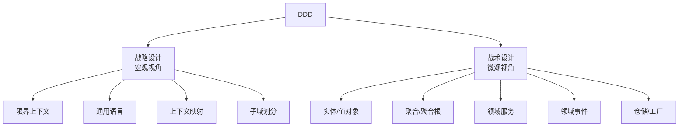
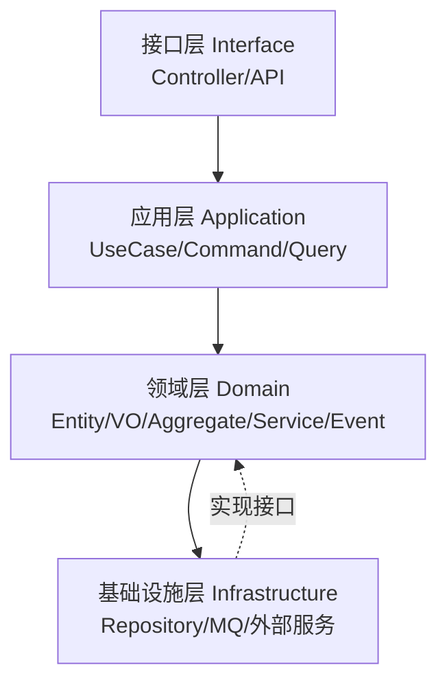

# DDD领域驱动设计实战

> **文档说明**：系统讲解领域驱动设计（DDD）的战略设计（限界上下文/通用语言/上下文映射）和战术设计（实体/值对象/聚合/领域服务/领域事件/仓储/工厂）、分层架构、DDD 与微服务的关系、实战案例，以及落地最佳实践和常见问题。
>
> **适用人群**：后端开发工程师、全栈开发者、架构师、希望提升复杂业务系统设计能力的开发者
>
> **前置知识**：[[微服务架构设计模式]]、[[云原生架构设计]]、[[分布式系统-高可用架构设计]]、[[SpringBoot-Web层设计]]

---

## 一、概述

### 1. 什么是 DDD

**DDD（Domain-Driven Design，领域驱动设计）** 是 Eric Evans 在 2003 年《领域驱动设计》一书中提出的软件开发方法论，核心思想是**以业务领域为核心驱动软件设计**，通过统一语言、模型驱动、分层架构等手段，应对复杂业务系统的设计挑战。

### 2. DDD 核心理念

| 理念 | 说明 |
|------|------|
| **领域优先** | 先理解业务领域，再考虑技术实现 |
| **统一语言** | 开发、测试、产品使用相同的业务术语 |
| **模型驱动** | 代码模型与业务模型一致 |
| **分层架构** | 领域层独立，不依赖技术细节 |
| **持续建模** | 模型随业务演进而迭代 |
| **限界上下文** | 每个模型有明确的适用边界 |

### 3. DDD 适用场景

| 适合 DDD | 不适合 DDD |
|---------|-----------|
| 业务复杂、规则多 | 简单 CRUD 系统 |
| 领域知识重要 | 技术驱动的系统（如中间件） |
| 长期维护、频繁迭代 | 一次性项目、原型 |
| 多团队协作 | 小团队、简单业务 |
| 微服务拆分 | 单体简单应用 |

---

## 二、战略设计

### 1. 战略设计 vs 战术设计



### 2. 子域（Subdomain）

将整个业务领域划分为多个子域：

| 子域类型 | 说明 | 示例（电商系统） |
|---------|------|----------------|
| **核心域** | 业务核心竞争力，投入最多资源 | 商品、订单、支付 |
| **支撑域** | 支持核心域，但不具竞争力 | 库存、物流、通知 |
| **通用域** | 通用功能，可采购第三方 | 认证、权限、日志 |

### 3. 限界上下文（Bounded Context）

**限界上下文**是 DDD 战略设计的核心，定义了每个模型的适用边界。在边界内，模型有明确的含义；跨边界时，同一术语可能有不同含义。

```json
电商系统限界上下文示例：
┌─────────────┐  ┌─────────────┐  ┌─────────────┐
│  商品上下文  │  │  订单上下文  │  │  用户上下文  │
│  Product    │  │  Order      │  │  User       │
│  - 商品     │  │  - 订单     │  │  - 用户     │
│  - 分类     │  │  - 订单项   │  │  - 账户     │
│  - 库存     │  │  - 支付     │  │  - 地址     │
└─────────────┘  └─────────────┘  └─────────────┘

注意："商品"在商品上下文中是完整实体（含描述、图片、属性）
     "商品"在订单上下文中只是值对象（商品ID、名称、价格快照）
```

**限界上下文划分原则**：
- [ ] 一个上下文对应一个业务能力
- [ ] 上下文内高内聚，上下文间低耦合
- [ ] 上下文大小适中（一个微服务通常对应一个上下文）
- [ ] 上下文边界与团队边界对齐（康威定律）

### 4. 通用语言（Ubiquitous Language）

**通用语言**是在限界上下文内，团队成员（开发、测试、产品、业务）共同使用的统一业务术语。

| 反例（技术语言） | 正例（通用语言） |
|----------------|----------------|
| `user_info` 表 | `用户` 实体 |
| `status=1` 表示已支付 | `订单已支付` 状态 |
| `insert order` | `创建订单` |
| `amount` 字段 | `订单金额` |

**实践要点**：
- [ ] 代码中的类名、方法名、变量名使用业务术语
- [ ] 数据库表名、字段名使用业务术语
- [ ] 会议、文档、代码使用相同术语
- [ ] 术语表维护，新人快速上手

### 5. 上下文映射（Context Mapping）

上下文映射描述限界上下文之间的关系和集成方式：

| 关系模式 | 说明 |
|---------|------|
| **合作关系（Partnership）** | 两个上下文协同演进，一起规划 |
| **共享内核（Shared Kernel）** | 共享部分模型和代码 |
| **客户-供应商（Customer-Supplier）** | 上游供应商，下游客户，下游影响上游 |
| **顺从者（Conformist）** | 下游完全遵循上游模型 |
| **防腐层（ACL）** | 下游通过防腐层隔离上游模型 |
| **开放主机服务（OHS）** | 上游提供标准协议/API |
| **发布语言（PL）** | 上下文间通过标准格式通信（如 REST、事件） |
| **另谋他路（Separate Ways）** | 两个上下文不集成 |

```text
上下文映射示例：
订单上下文 →（防腐层 ACL）→ 支付上下文（第三方支付）
订单上下文 →（发布语言 PL）→ 库存上下文（事件驱动）
用户上下文 ↔（共享内核）→ 认证上下文（共享用户模型）
```

---

## 三、战术设计

### 1. 战术设计构件

| 构件 | 说明 | 标识 |
|------|------|------|
| **实体（Entity）** | 有唯一标识，有生命周期 | ID 区分 |
| **值对象（Value Object）** | 无标识，由属性定义，不可变 | 属性值区分 |
| **聚合（Aggregate）** | 相关对象的集合，作为数据修改单元 | 聚合根 |
| **聚合根（Aggregate Root）** | 聚合的入口，外部只能访问聚合根 | 根实体 |
| **领域服务（Domain Service）** | 不属于任何实体的领域逻辑 | 无状态服务 |
| **领域事件（Domain Event）** | 领域中发生的重要事情 | 事件对象 |
| **仓储（Repository）** | 聚合的持久化抽象 | 接口 + 实现 |
| **工厂（Factory）** | 复杂对象的创建 | 创建逻辑封装 |

### 2. 实体（Entity）

```java
// 实体：有唯一标识，有生命周期
public class Order {
    private Long id;           // 唯一标识
    private OrderStatus status;
    private BigDecimal amount;
    private LocalDateTime createdAt;

    // 实体通过 ID 判断相等
    @Override
    public boolean equals(Object o) {
        if (this == o) return true;
        if (!(o instanceof Order)) return false;
        return id != null && id.equals(((Order) o).id);
    }

    @Override
    public int hashCode() {
        return getClass().hashCode();
    }

    // 业务方法（充血模型）
    public void pay(PaymentService paymentService) {
        if (status != OrderStatus.PENDING) {
            throw new IllegalStateException("订单状态不正确");
        }
        paymentService.pay(this);
        this.status = OrderStatus.PAID;
    }
}
```

### 3. 值对象（Value Object）

```java
// 值对象：无标识，不可变，由属性定义
public class Money {
    private final BigDecimal amount;
    private final String currency;

    public Money(BigDecimal amount, String currency) {
        if (amount == null || amount.compareTo(BigDecimal.ZERO) < 0) {
            throw new IllegalArgumentException("金额不能为负");
        }
        this.amount = amount;
        this.currency = currency;
    }

    // 值对象通过所有属性判断相等
    @Override
    public boolean equals(Object o) {
        if (this == o) return true;
        if (!(o instanceof Money)) return false;
        Money money = (Money) o;
        return amount.equals(money.amount) && currency.equals(money.currency);
    }

    // 不可变：操作返回新对象
    public Money add(Money other) {
        if (!currency.equals(other.currency)) {
            throw new IllegalArgumentException("货币不匹配");
        }
        return new Money(amount.add(other.amount), currency);
    }
}

// 地址值对象
public class Address {
    private final String province;
    private final String city;
    private final String district;
    private final String detail;
    // 不可变，无 setter
}
```

### 4. 聚合与聚合根

```java
// 聚合根：订单（Order）
// 聚合内：订单 + 订单项（OrderItem）
public class Order {
    private Long id;                    // 聚合根 ID
    private Long userId;
    private OrderStatus status;
    private List<OrderItem> items;      // 聚合内实体
    private Money totalAmount;
    private Address shippingAddress;    // 值对象

    // 外部只能通过聚合根操作聚合内对象
    public void addItem(Product product, int quantity) {
        // 业务规则：已支付订单不能修改
        if (status == OrderStatus.PAID) {
            throw new IllegalStateException("已支付订单不能修改");
        }
        // 业务规则：库存检查
        if (product.getStock() < quantity) {
            throw new IllegalArgumentException("库存不足");
        }
        items.add(new OrderItem(product.getId(), product.getName(),
            product.getPrice(), quantity));
        recalculateTotal();
    }

    // 聚合内一致性：修改订单项时重新计算总价
    private void recalculateTotal() {
        BigDecimal total = items.stream()
            .map(item -> item.getPrice().multiply(BigDecimal.valueOf(item.getQuantity())))
            .reduce(BigDecimal.ZERO, BigDecimal::add);
        this.totalAmount = new Money(total, "CNY");
    }

    // 不暴露订单项的直接修改
    public List<OrderItem> getItems() {
        return Collections.unmodifiableList(items);  // 只读视图
    }
}
```

**聚合设计原则**：
- [ ] **聚合要小**：聚合内对象不宜过多，小聚合更易维护
- [ ] **聚合根唯一入口**：外部只能通过聚合根访问聚合内对象
- [ ] **事务边界**：一个事务只修改一个聚合
- [ ] **跨聚合用事件**：聚合间通过领域事件最终一致
- [ ] **引用聚合根 ID**：聚合间引用用 ID，不用对象引用

### 5. 领域服务（Domain Service）

```java
// 领域服务：不属于任何实体的领域逻辑
public interface PaymentService {
    void pay(Order order);
    void refund(Order order);
}

// 转账服务（涉及多个聚合）
public class TransferService {
    private final AccountRepository accountRepository;

    public void transfer(Long fromAccountId, Long toAccountId, Money amount) {
        Account from = accountRepository.findById(fromAccountId)
            .orElseThrow(() -> new AccountNotFoundException(fromAccountId));
        Account to = accountRepository.findById(toAccountId)
            .orElseThrow(() -> new AccountNotFoundException(toAccountId));

        // 跨聚合操作：领域服务协调
        from.withdraw(amount);
        to.deposit(amount);

        accountRepository.save(from);
        accountRepository.save(to);
    }
}
```

**何时使用领域服务**：
- 业务逻辑涉及多个聚合或实体
- 业务逻辑是无状态的操作
- 业务逻辑需要外部服务（如支付、通知）

### 6. 领域事件（Domain Event）

```java
// 领域事件：领域中发生的重要事情
public class OrderPaidEvent {
    private final Long orderId;
    private final Long userId;
    private final Money amount;
    private final LocalDateTime paidAt;

    public OrderPaidEvent(Long orderId, Long userId, Money amount) {
        this.orderId = orderId;
        this.userId = userId;
        this.amount = amount;
        this.paidAt = LocalDateTime.now();
    }
}

// 聚合根发布事件
public class Order {
    private List<DomainEvent> domainEvents = new ArrayList<>();

    public void pay(PaymentService paymentService) {
        // ... 支付逻辑
        this.status = OrderStatus.PAID;
        // 发布领域事件
        domainEvents.add(new OrderPaidEvent(this.id, this.userId, this.totalAmount));
    }

    public List<DomainEvent> getDomainEvents() {
        return Collections.unmodifiableList(domainEvents);
    }
}

// 应用层处理事件
public class OrderApplicationService {
    public void payOrder(Long orderId) {
        Order order = orderRepository.findById(orderId);
        order.pay(paymentService);
        orderRepository.save(order);
        // 发布事件到消息队列
        eventPublisher.publish(order.getDomainEvents());
    }
}
```

### 7. 仓储（Repository）

```java
// 仓储接口：在领域层定义，基础设施层实现
public interface OrderRepository {
    Order findById(Long id);
    void save(Order order);
    void delete(Long id);
    List<Order> findByUserId(Long userId);
}

// 基础设施层实现（JPA）
@Repository
public class JpaOrderRepository implements OrderRepository {
    @Autowired
    private OrderJpaRepository jpaRepository;

    @Override
    public Order findById(Long id) {
        return jpaRepository.findById(id)
            .orElseThrow(() -> new OrderNotFoundException(id));
    }

    @Override
    public void save(Order order) {
        jpaRepository.save(order);
    }
}
```

> **仓储原则**：仓储只针对聚合根，不针对聚合内实体。

---

## 四、分层架构

### 1. DDD 四层架构



| 层级 | 职责 | 依赖方向 |
|------|------|---------|
| **接口层** | 接收请求、参数校验、返回响应 | 依赖应用层 |
| **应用层** | 用例编排、事务管理、事件发布 | 依赖领域层 |
| **领域层** | 核心业务逻辑、领域模型 | 不依赖其他层（核心） |
| **基础设施层** | 技术实现、外部集成 | 实现领域层接口 |

### 2. 依赖倒置原则

领域层定义接口（如 Repository），基础设施层实现接口。领域层不依赖基础设施层，通过依赖倒置解耦。

```text
领域层：定义 OrderRepository 接口
基础设施层：实现 JpaOrderRepository implements OrderRepository
应用层：注入 OrderRepository 接口，不关心具体实现
```

### 3. 代码结构示例

```text
src/main/java/com/example/order/
├── interfaces/          # 接口层
│   ├── controller/
│   │   └── OrderController.java
│   └── dto/
│       ├── CreateOrderRequest.java
│       └── OrderResponse.java
├── application/         # 应用层
│   ├── service/
│   │   └── OrderApplicationService.java
│   ├── command/
│   │   └── CreateOrderCommand.java
│   └── query/
│       └── OrderQueryService.java
├── domain/              # 领域层（核心）
│   ├── model/
│   │   ├── Order.java          # 聚合根
│   │   ├── OrderItem.java      # 实体
│   │   ├── Money.java          # 值对象
│   │   └── OrderStatus.java    # 枚举
│   ├── service/
│   │   └── PaymentService.java # 领域服务接口
│   ├── event/
│   │   └── OrderPaidEvent.java
│   └── repository/
│       └── OrderRepository.java # 仓储接口
└── infrastructure/      # 基础设施层
    ├── persistence/
    │   ├── JpaOrderRepository.java
    │   └── OrderPO.java         # 持久化对象
    ├── mq/
    │   └── RabbitEventPublisher.java
    └── external/
        └── PaymentServiceImpl.java
```

---

## 五、DDD 与微服务

### 1. 限界上下文与微服务

| DDD 概念 | 微服务对应 |
|---------|-----------|
| 限界上下文 | 微服务边界 |
| 聚合 | 微服务内的数据一致性单元 |
| 领域事件 | 微服务间异步通信 |
| 上下文映射 | 微服务间集成方式 |
| 通用语言 | 微服务内的统一术语 |

> **经验法则**：一个限界上下文对应一个微服务，但不是绝对的。大的上下文可拆为多个服务，小的上下文可合并。

### 2. 微服务拆分步骤

1. **事件风暴（Event Storming）**：梳理业务流程，识别领域事件
2. **识别聚合**：将相关事件和命令归为聚合
3. **划分限界上下文**：将相关聚合归为上下文
4. **上下文映射**：定义上下文间关系
5. **微服务拆分**：按上下文拆分微服务
6. **API 设计**：定义服务间接口和事件

---

## 六、实战案例：电商订单系统

### 1. 事件风暴结果

```text
领域事件：
- 商品已添加 → 订单已创建 → 订单已支付 → 库存已扣减 → 商品已发货 → 订单已完成

命令：
- 添加商品 → 创建订单 → 支付订单 → 扣减库存 → 发货

聚合：
- 订单聚合（Order + OrderItem）
- 商品聚合（Product）
- 库存聚合（Stock）
```

### 2. 限界上下文

| 上下文 | 聚合 | 职责 |
|--------|------|------|
| **订单上下文** | Order | 订单创建、支付、状态管理 |
| **商品上下文** | Product | 商品管理、分类、价格 |
| **库存上下文** | Stock | 库存扣减、回补、预警 |
| **支付上下文** | Payment | 支付、退款、对账 |

### 3. 核心代码

```java
// 订单聚合根
public class Order {
    private Long id;
    private Long userId;
    private OrderStatus status;
    private List<OrderItem> items;
    private Money totalAmount;
    private List<DomainEvent> events = new ArrayList<>();

    public static Order create(Long userId, List<OrderItem> items) {
        if (items == null || items.isEmpty()) {
            throw new IllegalArgumentException("订单项不能为空");
        }
        Order order = new Order();
        order.userId = userId;
        order.status = OrderStatus.PENDING;
        order.items = items;
        order.recalculateTotal();
        order.events.add(new OrderCreatedEvent(order.id, userId));
        return order;
    }

    public void pay() {
        if (status != OrderStatus.PENDING) {
            throw new IllegalStateException("只有待支付订单可以支付");
        }
        this.status = OrderStatus.PAID;
        this.events.add(new OrderPaidEvent(this.id, this.userId, this.totalAmount));
    }

    public void cancel(String reason) {
        if (status == OrderStatus.PAID || status == OrderStatus.SHIPPED) {
            throw new IllegalStateException("已支付/已发货订单不能取消");
        }
        this.status = OrderStatus.CANCELLED;
        this.events.add(new OrderCancelledEvent(this.id, reason));
    }
}
```

---

## 七、最佳实践

### 1. 战略设计实践

- [ ] **事件风暴**：用事件风暴梳理业务，识别领域事件和限界上下文
- [ ] **通用语言**：建立术语表，代码与业务术语一致
- [ ] **限界上下文**：上下文边界清晰，一个微服务对应一个上下文
- [ ] **上下文映射**：明确上下文间关系，防腐层隔离外部模型
- [ ] **核心域聚焦**：将资源投入核心域，支撑域和通用域可采购

### 2. 战术设计实践

- [ ] **充血模型**：实体包含业务逻辑，不是贫血的 POJO
- [ ] **小聚合**：聚合尽量小，一个事务只改一个聚合
- [ ] **值对象优先**：能用值对象就不用实体
- [ ] **领域事件**：跨聚合通过事件通信，最终一致
- [ ] **仓储只对聚合根**：不为聚合内实体单独建仓储
- [ ] **工厂封装创建**：复杂对象创建用工厂，保持封装性

### 3. 架构实践

- [ ] **领域层独立**：领域层不依赖任何框架和技术
- [ ] **依赖倒置**：领域层定义接口，基础设施层实现
- [ ] **应用层薄** | 应用层只做编排，不写业务逻辑
- [ ] **接口层隔离** | DTO 与领域模型分离，不暴露领域模型
- [ ] **模块化** | 按限界上下文划分模块，模块间通过接口通信

### 4. 落地建议

- [ ] **从核心域开始**：不要一上来全量 DDD，先从核心业务开始
- [ ] **渐进式引入**：在现有系统中逐步引入 DDD 概念
- [ ] **团队培训**：团队理解 DDD 理念，统一认知
- [ ] **避免过度设计**：简单业务不需要复杂的 DDD 模式
- [ ] **持续重构**：模型随业务演进而迭代，不是一次成型

---

## 八、常见问题与排查

| 问题 | 原因 | 解决方案 |
|------|------|---------|
| **聚合过大** | 聚合内对象过多，事务范围大 | 拆分为多个小聚合，用事件协调 |
| **贫血模型** | 实体只有 getter/setter，逻辑在 Service | 将业务逻辑移到实体/聚合中（充血模型） |
| **领域层依赖框架** | 领域层引入 Spring/JPA 注解 | 依赖倒置，PO 与领域对象分离 |
| **跨聚合事务** | 一个事务修改多个聚合 | 用领域事件 + 最终一致性 |
| **限界上下文划分不清** | 业务理解不深，边界模糊 | 事件风暴、重新梳理业务、咨询领域专家 |
| **值对象被当成实体** | 给值对象加了 ID | 移除 ID，用属性判断相等，设为不可变 |
| **仓储泄露持久化细节** | 仓储接口返回 PO/分页对象 | 仓储只返回聚合，分页用领域对象 |
| **应用层写业务逻辑** | 业务逻辑写在 ApplicationService | 将业务逻辑移到领域层，应用层只编排 |
| **领域事件丢失** | 事件发布在事务提交前 | 事务提交后发布事件（Outbox 模式） |
| **上下文间直接调用** | 服务间同步调用耦合高 | 优先异步事件，必要时同步调用加防腐层 |
| **DDD 过度设计** | 简单业务用了复杂模式 | 评估业务复杂度，简单 CRUD 不需要 DDD |
| **团队不理解** | 缺乏 DDD 培训和共识 | 培训、事件风暴、代码评审、术语表 |
| **数据库模型与领域模型不一致** | 直接用数据库表作为领域模型 | PO 与领域对象分离，转换器转换 |
| **聚合间引用对象** | 聚合内持有其他聚合的对象引用 | 改为引用聚合根 ID，需要时通过仓储加载 |

---

## 九、关联笔记

### 架构设计
- [[微服务架构设计模式]] · [[云原生架构设计]] · [[分布式系统-高可用架构设计]]
- [[分布式系统-CAP定理与一致性]] · [[分布式系统-服务网格ServiceMesh]]

### 微服务
- [[微服务核心组件知识点系统梳理_优化版]] · [[SpringCloud-Alibaba组件体系]]
- [[Nacos-注册中心与配置中心]] · [[Gateway-网关路由与鉴权]] · [[Sentinel-流量控制与熔断]]

### 后端
- [[SpringBoot-Web层设计]] · [[SpringBoot-自动装配原理]] · [[SpringBoot-配置管理与多环境]]
- [[SpringSecurity-认证授权]] · [[JWT与OAuth2认证授权]]

### 分布式
- [[分布式事务 知识点系统梳理_优化版]] · [[分布式锁知识点系统梳理_优化版]] · [[Raft共识算法详解]]

### 导航
- [[MOC-项目实战]] · [[MOC-后端开发]] · [[全栈+AI工程双轨融合学习路线图]]

> **学习路径建议**：先掌握 [[微服务架构设计模式]] 微服务基础 → 深入本文 DDD 领域驱动设计 → 实践事件风暴和限界上下文划分 → 学习 [[分布式事务 知识点系统梳理_优化版]] 跨聚合一致性 → 研究 [[SpringBoot-Web层设计]] 分层架构落地 → 应用于复杂业务系统的设计和微服务拆分。

---

## 🔗 关联笔记

- [[MOC-项目实战]] — 返回本分类知识地图，查看更多相关文档

## 📖 前置知识

- [[微服务架构设计模式]]
- [[云原生架构设计]]
- [[分布式系统-高可用架构设计]]

## 🏷️ 相关标签

`#架构设计` `#领域驱动设计` `#微服务` `#原子笔记`

[[Home|🏠 返回首页]] · [[MOC-项目实战|📚 返回分类]]
