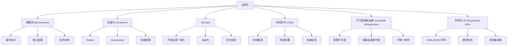
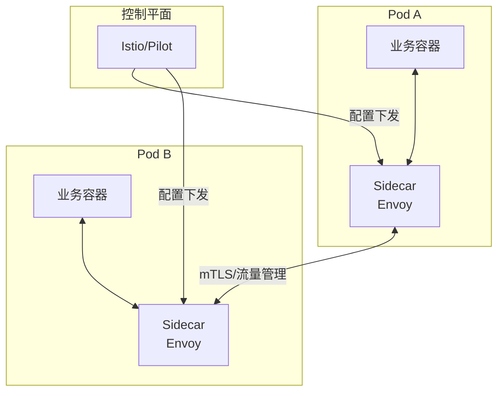
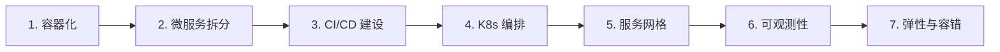

# 云原生架构设计

> **文档说明**：系统讲解云原生架构的设计理念、核心要素（微服务、容器化、DevOps、持续交付、不可变基础设施、声明式 API）、CNCF 技术栈全景、12-Factor 应用原则、云原生设计模式（服务网格、可观测性、弹性伸缩、容错）、架构迁移路径，以及生产级最佳实践和常见问题。
>
> **适用人群**：后端开发工程师、全栈开发者、架构师、DevOps 工程师
>
> **前置知识**：[[K8s-核心概念与架构]]、[[Docker-核心原理与镜像优化]]、[[微服务架构设计模式]]、[[高可用架构设计]]

---

## 一、概述

### 1. 什么是云原生

**云原生（Cloud Native）** 是一种构建和运行应用程序的方法论，充分利用云计算模型的优势，使应用能够在动态、可扩展的云环境中高效运行。CNCF（云原生计算基金会）定义云原生技术有利于各组织在公有云、私有云和混合云等新型动态环境中，构建和运行可弹性扩展的应用。

### 2. 云原生核心要素



### 3. CNCF 技术栈全景

| 层级 | 技术 | 说明 |
|------|------|------|
| **应用定义与开发** | Helm、Kustomize、Operator、Serverless | 应用打包、部署、无服务器 |
| **编排与管理** | Kubernetes、Service Mesh(Istio/Linkerd) | 容器编排、服务网格 |
| **运行时** | containerd、CRI-O、gVisor、Kata Containers | 容器运行时、安全容器 |
| **配置与自动化** | Terraform、Ansible、Pulumi、Argo CD | 基础设施即代码、GitOps |
| **可观测性** | Prometheus、Grafana、Jaeger、Fluentd、OpenTelemetry | 监控、日志、链路追踪 |
| **网络** | CNI(Calico/Flannel/Cilium)、CoreDNS、Ingress | 容器网络、DNS、入口 |
| **存储** | Rook、Longhorn、MinIO、CSI | 云原生存储 |
| **安全** | Falco、OPA、Cert-Manager、Vault | 运行时安全、策略、密钥 |

### 4. 云原生 vs 传统架构

| 维度 | 传统架构 | 云原生架构 |
|------|---------|-----------|
| **部署单元** | 物理机/虚拟机 | 容器 |
| **架构风格** | 单体/分层 | 微服务 |
| **基础设施** | 手动配置、可变 | 自动化、不可变 |
| **扩缩容** | 手动、慢 | 自动、秒级 |
| **发布方式** | 停机发布、周期长 | 滚动/蓝绿/金丝雀、频繁 |
| **故障恢复** | 人工介入、慢 | 自动自愈、快 |
| **资源利用率** | 低（预留峰值） | 高（按需弹性） |
| **运维方式** | 脚本+人工 | DevOps+自动化 |
| **可观测性** | 基础监控 | 全链路可观测 |

---

## 二、12-Factor 应用原则

12-Factor 是云原生应用的设计方法论，由 Heroku 提出：

| 因子 | 说明 | 实践 |
|------|------|------|
| **1. 基准代码** | 一份代码库，多环境部署 | Git 仓库，多分支/Tag |
| **2. 依赖** | 显式声明依赖，不依赖系统库 | package.json/pom.xml/go.mod |
| **3. 配置** | 配置存储在环境变量中 | ConfigMap/Secret，不硬编码 |
| **4. 后端服务** | 把后端服务当作附加资源 | 数据库/缓存/消息队列通过 URL 连接 |
| **5. 构建发布运行** | 严格分离构建、发布、运行阶段 | CI 构建镜像 → CD 发布 → K8s 运行 |
| **6. 进程** | 应用以一个或多个无状态进程运行 | 无状态，状态存外部存储 |
| **7. 端口绑定** | 通过端口绑定提供服务 | 容器暴露端口，Service 负载均衡 |
| **8. 并发** | 通过进程模型横向扩展 | 多副本 + HPA 自动伸缩 |
| **9. 易处理** | 快速启动和优雅终止 | 小镜像、健康检查、preStop 钩子 |
| **10. 开发生产等价** | 保持开发、预发布、生产环境尽可能相似 | 容器化保证环境一致 |
| **11. 日志** | 把日志当作事件流 | stdout/stderr 输出，集中收集 |
| **12. 管理进程** | 一次性管理任务在相同环境运行 | Job/CronJob 执行迁移/脚本 |

---

## 三、云原生设计模式

### 1. 服务网格（Service Mesh）

服务网格通过 Sidecar 代理处理服务间通信，实现流量管理、安全、可观测性与业务代码解耦。



| 功能 | 说明 |
|------|------|
| **流量管理** | 灰度发布、A/B 测试、流量镜像、故障注入 |
| **安全** | mTLS 加密、认证授权、RBAC |
| **可观测性** | 分布式追踪、指标采集、访问日志 |
| **弹性** | 超时、重试、熔断、限流 |

### 2. 可观测性（Observability）

云原生可观测性三大支柱：

| 支柱 | 工具 | 说明 |
|------|------|------|
| **指标 Metrics** | Prometheus + Grafana | 聚合数值，如 QPS、延迟、错误率 |
| **日志 Logs** | ELK/Loki + Fluentd | 离散事件，如请求日志、错误日志 |
| **追踪 Traces** | Jaeger/Zipkin + OpenTelemetry | 请求链路，如跨服务调用链 |

```yaml
# OpenTelemetry 自动埋点示例
apiVersion: opentelemetry.io/v1alpha1
kind: Instrumentation
metadata:
  name: my-instrumentation
spec:
  exporter:
    endpoint: http://otel-collector:4317
  propagators:
    - tracecontext
    - baggage
  sampler:
    type: parentbased_traceidratio
    argument: "0.1"  # 10% 采样率
```

### 3. 弹性伸缩

| 类型 | 说明 | K8s 实现 |
|------|------|---------|
| **HPA** | 水平 Pod 自动伸缩，根据 CPU/内存/自定义指标调整副本数 | HorizontalPodAutoscaler |
| **VPA** | 垂直 Pod 自动伸缩，调整容器资源请求/限制 | VerticalPodAutoscaler |
| **Cluster Autoscaler** | 集群节点自动伸缩，根据 Pod 调度需求增减节点 | cluster-autoscaler |
| **KEDA** | 事件驱动自动伸缩，根据消息队列长度、定时任务等伸缩 | KEDA |

```yaml
# HPA 示例
apiVersion: autoscaling/v2
kind: HorizontalPodAutoscaler
metadata:
  name: app-hpa
spec:
  scaleTargetRef:
    apiVersion: apps/v1
    kind: Deployment
    name: my-app
  minReplicas: 2
  maxReplicas: 10
  metrics:
    - type: Resource
      resource:
        name: cpu
        target:
          type: Utilization
          averageUtilization: 70
    - type: Pods
      pods:
        metric:
          name: http_requests_per_second
        target:
          type: AverageValue
          averageValue: 100
```

### 4. 容错模式

| 模式 | 说明 | 实现 |
|------|------|------|
| **重试 Retry** | 失败后自动重试，带退避策略 | Istio/Spring Retry |
| **超时 Timeout** | 设置请求超时，避免长时间等待 | 客户端/服务网格配置 |
| **熔断 Circuit Breaker** | 错误率过高时快速失败，保护下游 | Istio/Resilience4j/Sentinel |
| **限流 Rate Limiting** | 限制请求速率，防止过载 | Istio/Envoy/Sentinel |
| **降级 Fallback** | 服务不可用时返回兜底响应 | 业务代码/服务网格 |
| **舱壁 Bulkhead** | 资源隔离，防止故障蔓延 | 线程池隔离/连接池隔离 |

### 5. 不可变基础设施

- **容器镜像不可变**：镜像构建后不再修改，发布新版本用新镜像
- **基础设施即代码（IaC）**：Terraform/Pulumi 管理云资源
- **GitOps**：Git 作为唯一事实来源，Argo CD/Flux 自动同步
- **配置与代码分离**：配置通过 ConfigMap/Secret 注入，不打包进镜像

---

## 四、云原生迁移路径

### 1. 迁移阶段



| 阶段 | 目标 | 关键动作 |
|------|------|---------|
| **1. 容器化** | 应用运行在容器中 | Dockerfile、镜像优化、12-Factor 改造 |
| **2. 微服务拆分** | 单体拆分为微服务 | 领域驱动设计、API 网关、服务发现 |
| **3. CI/CD** | 自动化构建部署 | Jenkins/GitLab CI、流水线、制品库 |
| **4. K8s 编排** | 容器编排调度 | Deployment/Service/Ingress、配置管理 |
| **5. 服务网格** | 服务通信治理 | Istio/Linkerd、流量管理、mTLS |
| **6. 可观测性** | 全链路监控 | Prometheus/Grafana、Jaeger、ELK |
| **7. 弹性容错** | 高可用自适应 | HPA、熔断降级、混沌工程 |

### 2. 迁移策略

| 策略 | 说明 | 适用场景 |
|------|------|---------|
| **绞杀者模式** | 新功能用微服务，逐步替换旧系统 | 大型单体系统 |
| **分支抽象** | 抽象层隔离新旧实现 | 核心模块替换 |
| **直接重写** | 完全重写为云原生应用 | 小型系统、技术栈过时 |
| **侧边迁移** | 新旧并行运行，逐步切流 | 关键业务、零停机 |

---

## 五、生产最佳实践

### 1. 容器镜像最佳实践

- [ ] **多阶段构建**：编译和运行分离，减小镜像体积
- [ ] **使用基础镜像**：alpine/distroless，减小攻击面
- [ ] **非 root 用户**：容器不以 root 运行
- [ ] **分层缓存**：依赖层在前，代码层在后，利用构建缓存
- [ ] **镜像扫描**：CI 中扫描漏洞（Trivy/Clair）
- [ ] **固定版本**：基础镜像和依赖固定版本，避免 latest

### 2. K8s 配置最佳实践

- [ ] **资源请求/限制**：每个容器设置 CPU/内存 requests 和 limits
- [ ] **健康检查**：livenessProbe + readinessProbe + startupProbe
- [ ] **优雅终止**：preStop 钩子 + terminationGracePeriodSeconds
- [ ] **Pod 反亲和性**：多副本分散到不同节点
- [ ] **拓扑分布约束**：跨可用区/节点均匀分布
- [ ] **资源配额**：Namespace 设置 ResourceQuota 和 LimitRange
- [ ] **网络策略**：NetworkPolicy 限制 Pod 间通信

### 3. 安全最佳实践

- [ ] **RBAC 最小权限**：服务账号权限最小化
- [ ] **Secret 加密**：etcd 加密或外部密钥管理（Vault）
- [ ] **镜像签名**：镜像签名验证（Cosign）
- [ ] **运行时安全**：Falco 监控异常行为
- [ ] **策略引擎**：OPA/Gatekeeper 强制部署策略
- [ ] **网络隔离**：NetworkPolicy + mTLS

### 4. 成本优化

- [ ] **资源右 sizing**：根据实际使用调整 requests/limits
- [ ] **自动伸缩**：HPA + Cluster Autoscaler 按需伸缩
- [ ] **Spot 实例**：无状态服务使用竞价实例
- [ ] **存储分层**：热数据 SSD，冷数据 HDD/对象存储
- [ ] **资源回收**：定时清理未使用的资源
- [ ] **FinOps**：建立成本监控和优化机制

---

## 六、常见问题与排查

| 问题 | 原因 | 解决方案 |
|------|------|---------|
| **容器启动慢** | 镜像过大 / 启动脚本复杂 / 资源不足 | 优化镜像、简化启动、增加资源 |
| **Pod OOMKilled** | 内存 limit 过低 / 内存泄漏 | 增加 limit、排查泄漏、设置 VPA |
| **CPU 节流** | CPU limit 过低 / 突发流量 | 增加 limit、HPA 自动伸缩 |
| **滚动更新卡住** | readinessProbe 失败 / 资源不足 / maxUnavailable=0 | 检查健康检查、资源、调整策略 |
| **服务间调用延迟高** | 网络延迟 / 无服务网格 / 连接池配置 | 检查网络、Istio 遥测、优化连接池 |
| **日志丢失** | 容器重启 / 未集中收集 / 日志轮转 | 集中收集（Fluentd）、stdout 输出 |
| **监控盲区** | 指标不全 / 采样率低 / 无链路追踪 | OpenTelemetry 全链路、调整采样率 |
| **扩容不及时** | HPA 指标延迟 / 冷却时间 / 节点不足 | 调整指标、缩短窗口、Cluster Autoscaler |
| **配置漂移** | 手动修改 / 无 GitOps | 使用 GitOps（Argo CD）、禁止手动修改 |
| **安全漏洞** | 镜像漏洞 / 权限过大 / 未加密 | 镜像扫描、RBAC 最小权限、Secret 加密 |
| **成本过高** | 资源浪费 / 无自动伸缩 / 预留不足 | 资源右 sizing、HPA、Spot 实例、预留实例 |
| **多环境不一致** | 配置差异 / 镜像版本不同 | 容器化保证一致、GitOps 统一管理 |
| **故障恢复慢** | 无自愈 / 手动介入 / 数据恢复慢 | K8s 自愈、备份恢复策略、混沌工程验证 |

---

## 七、关联笔记

### 云原生
- [[Docker-核心原理与镜像优化]] · [[K8s-核心概念与架构]] · [[CI-CD持续集成与部署]]
- [[Nginx-反向代理与负载均衡]] · [[Prometheus监控体系]] · [[Helm包管理器]]

### 微服务
- [[微服务架构设计模式]] · [[SpringCloud-Alibaba组件体系]] · [[微服务核心组件知识点系统梳理_优化版]]
- [[Nacos-注册中心与配置中心]] · [[Gateway-网关路由与鉴权]] · [[Sentinel-流量控制与熔断]]

### 架构
- [[高可用架构设计]] · [[高并发系统设计案例]] · [[领域驱动设计DDD核心概念]]
- [[分布式系统-CAP定理与一致性]] · [[分布式系统-服务网格ServiceMesh]]

### 安全
- [[API安全最佳实践]] · [[Web安全-XSS-CSRF-SQL注入]] · [[零信任安全架构]]

### 导航
- [[MOC-云原生与运维]] · [[MOC-架构设计]] · [[全栈+AI工程双轨融合学习路线图]]

> **学习路径建议**：先掌握 [[Docker-核心原理与镜像优化]] 容器基础 → 学习 [[K8s-核心概念与架构]] 容器编排 → 深入本文云原生架构设计 → 实践 [[CI-CD持续集成与部署]] 自动化交付 → 研究 [[微服务架构设计模式]] 微服务拆分 → 应用于实际系统的云原生改造。

---

## 🔗 关联笔记

- [[MOC-项目实战]] — 返回本分类知识地图，查看更多相关文档

## 📖 前置知识

- [[K8s-核心概念与架构]]
- [[Docker-核心原理与镜像优化]]
- [[微服务架构设计模式]]

## 🏷️ 相关标签

`#架构设计` `#原子笔记`

[[Home|🏠 返回首页]] · [[MOC-项目实战|📚 返回分类]]
