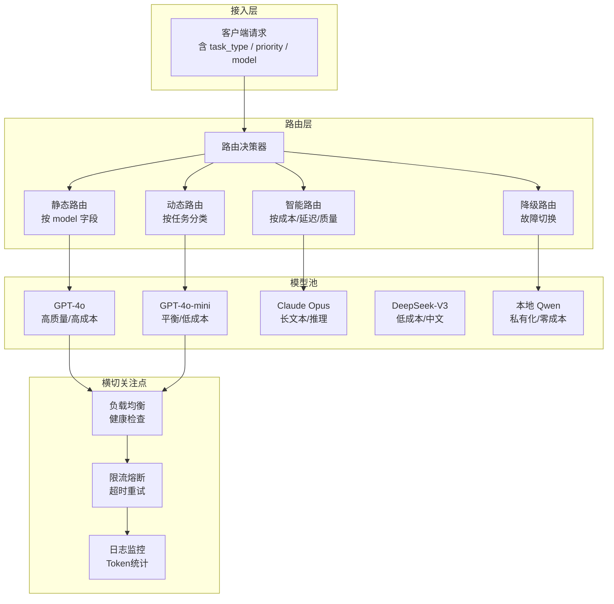

# 🔀 多模型路由与流式响应跨语言传递

> **文档说明**：系统讲解企业级 AI 网关中两大核心技术——多模型路由（根据任务类型/成本/延迟/质量动态选择最优模型）和流式响应跨语言传递（SSE 数据从 Python AI 服务经 Java 网关透传到前端不中断）。涵盖路由策略设计、降级容错、负载均衡、全链路流式透传原理、背压控制、断线重连、跨语言 Trace 传递和生产级最佳实践。
>
> **适用人群**：AI 平台架构师、全栈工程师、需要构建多模型 AI 网关的技术负责人
>
> **前置知识**：[[统一AI网关设计与实现]] · [[Python+Java混合AI架构实战]] · [[FastAPI-封装LLM流式接口]]

---

## 一、概述

### 1.1 问题背景

企业级 AI 应用面临两大核心挑战：

**挑战一：多模型选择**——市面上有几十种大模型（GPT-4o、Claude、DeepSeek、通义千问、豆包、Llama 等），各有优劣：
- 有的擅长代码（DeepSeek-Coder）
- 有的擅长推理（o1、Claude Opus）
- 有的便宜快速（GPT-4o-mini、DeepSeek-V3）
- 有的支持长上下文（Claude 200K、GPT-4o 128K）
- 有的本地化部署（Qwen、Llama）

如何根据任务类型、成本预算、延迟要求自动选择最优模型？这就是**多模型路由**要解决的问题。

**挑战二：流式响应跨语言传递**——AI 应用的典型架构是：前端（Vue/React）→ Java 网关（Spring Cloud Gateway）→ Python AI 服务（FastAPI）→ 大模型 API。大模型的流式输出（SSE）需要经过这几层透传，任何一层缓冲了响应，都会导致前端收不到打字机效果。如何保证端到端的流式透传不中断？这就是**流式响应跨语言传递**要解决的问题。

### 1.2 核心应用场景

| 场景 | 说明 | 典型产品 |
|------|------|---------|
| **AI 网关平台** | 统一接入多家模型 API，按策略路由，对外提供统一接口 | One API、New API、OpenRouter |
| **企业 AI 助手** | 不同部门/场景用不同模型，成本和质量平衡 | 企业内部 AI 平台 |
| **多模态应用** | 文本用 GPT-4o，图像用 DALL-E，语音用 Whisper，自动路由 | 多模态 AI 助手 |
| **代码助手** | 简单补全用小模型，复杂重构用大模型，自动切换 | AI 代码编辑器 |
| **高可用 AI 服务** | 主模型故障时自动降级到备用模型，保证服务不中断 | 企业级 AI API |
| **成本优化平台** | 根据任务复杂度智能选择模型，在质量和成本间最优平衡 | AI 成本管理平台 |

### 1.3 核心优势

| 优势 | 说明 |
|------|------|
| **成本最优** | 简单任务用便宜模型，复杂任务用好模型，整体成本降低 40-70% |
| **质量保障** | 按任务类型匹配最擅长的模型，输出质量更稳定 |
| **高可用** | 多模型互为备份，单模型故障自动降级，服务不中断 |
| **低延迟** | 简单任务用快速模型，首字延迟 <1s；复杂任务用好模型但可接受稍慢 |
| **统一接口** | 上层应用只对接一个网关，无需关心底层用哪家模型 |
| **可观测** | 网关层统一记录每个模型的调用量、Token、延迟、错误率，便于成本分析 |
| **流式体验** | 端到端 SSE 透传，打字机效果，首字延迟低，用户体验好 |

---

## 二、底层原理

### 2.1 多模型路由架构



### 2.2 路由策略详解

#### 策略一：静态路由（按 model 字段）

最简单的路由方式，客户端在请求中指定 `model` 字段，网关直接转发到对应模型。

```text
请求：{"model": "gpt-4o", "messages": [...]}
路由：直接转发到 OpenAI GPT-4o
```

**适用场景**：客户端明确知道要用哪个模型，开发者自己做选择。
**优点**：简单直接，可预测。
**缺点**：客户端需要了解所有模型的差异，无法自动优化成本。

#### 策略二：动态路由（按任务分类）

网关根据 `task_type` 字段（code/chat/reasoning/translation/summary 等）和 `priority`（fast/balanced/quality）自动选择模型。

```python
# 路由表示例
ROUTE_TABLE = {
    "code": {
        "fast": "deepseek-coder",      # 代码补全，要快
        "balanced": "gpt-4o-mini",     # 常规代码任务
        "quality": "gpt-4o"             # 复杂代码重构
    },
    "chat": {
        "fast": "deepseek-v3",
        "balanced": "gpt-4o-mini",
        "quality": "gpt-4o"
    },
    "reasoning": {
        "fast": "gpt-4o",
        "balanced": "gpt-4o",
        "quality": "o1-preview"          # 深度推理
    },
    "translation": {
        "fast": "gpt-4o-mini",
        "balanced": "gpt-4o-mini",
        "quality": "gpt-4o"
    },
    "long_context": {
        "fast": "claude-3-haiku",
        "balanced": "claude-3-sonnet",
        "quality": "claude-3-opus"       # 200K 长上下文
    }
}
```

**适用场景**：上层应用只知道任务类型，不知道该用哪个模型。
**优点**：客户端简单，网关统一管理模型选择，可随时调整路由表。
**缺点**：需要维护路由表，任务分类可能不准确。

#### 策略三：智能路由（按成本/延迟/质量动态决策）

最复杂的路由方式，网关实时收集各模型的延迟、成本、质量评分，根据当前请求的约束条件（最大成本、最大延迟、最低质量）动态选择最优模型。

```text
决策逻辑：
1. 收集所有可用模型的实时指标：
   - 平均延迟（P50/P95）
   - 单位 Token 成本
   - 质量评分（基于人工反馈或自动评估）
   - 当前负载（并发数、队列长度）
2. 根据请求约束筛选候选模型：
   - max_cost: 成本不超过 X
   - max_latency: 延迟不超过 Y 秒
   - min_quality: 质量评分不低于 Z
3. 在候选模型中选择最优（成本最低 / 延迟最低 / 质量最高）
4. 记录路由决策，用于后续分析和优化
```

**适用场景**：大规模 AI 平台，需要精细化成本控制和质量保障。
**优点**：全局最优，成本和质量自动平衡。
**缺点**：实现复杂，需要数据收集和分析系统。

#### 策略四：降级路由（故障切换）

当主模型不可用（超时、限流、API Key 失效）时，自动切换到备用模型。

```text
降级链：GPT-4o → GPT-4o-mini → DeepSeek-V3 → 本地 Qwen
```

**降级触发条件**：
- 连接超时 / 读取超时
- HTTP 429（限流）
- HTTP 5xx（服务端错误）
- API Key 余额不足
- 连续 N 次失败（熔断）

**降级注意事项**：
- 降级前发送特殊事件通知前端（`data: {"event": "fallback", "from": "gpt-4o", "to": "gpt-4o-mini"}`）
- 降级模型可能能力不同，需要调整 prompt（如缩短上下文）
- 记录降级事件，用于监控和告警

### 2.3 流式响应跨语言传递原理

#### 端到端流式链路

```bash
大模型 API (SSE)
    ↓ async for chunk
Python AI 服务 (FastAPI StreamingResponse)
    ↓ HTTP chunked transfer encoding
Java 网关 (Spring Cloud Gateway / WebFlux)
    ↓ HTTP chunked transfer encoding
Nginx 反向代理 (可选)
    ↓ HTTP chunked transfer encoding
前端 (EventSource / fetch ReadableStream)
```

**核心原则：每一层都不能缓冲完整响应，必须逐 chunk 转发。**

#### 各层流式透传关键配置

| 层级 | 关键配置 | 说明 |
|------|---------|------|
| **Python FastAPI** | `StreamingResponse(generator, media_type="text/event-stream")` | async generator 逐 chunk yield |
| **Java WebClient** | `bodyToFlux(String.class)` | 接收 SSE 流，不收集完整响应 |
| **Java Controller** | `produces = MediaType.TEXT_EVENT_STREAM_VALUE` + 返回 `Flux<String>` | Spring WebFlux 自动流式输出 |
| **Spring Cloud Gateway** | `removeResponseHeader("Content-Length")` + `setResponseHeader("X-Accel-Buffering", "no")` | 网关不缓冲 |
| **Nginx** | `proxy_buffering off; proxy_read_timeout 300s;` | 反向代理不缓冲 |
| **前端** | `fetch` + `response.body.getReader()` 或 `EventSource` | 逐块读取并渲染 |

#### 为什么会缓冲？常见陷阱

1. **Content-Length 头**：如果响应头包含 `Content-Length`，客户端会等待接收完所有字节才处理。流式响应必须用 `Transfer-Encoding: chunked`，不能有 `Content-Length`。
2. **Nginx proxy_buffering**：Nginx 默认开启缓冲，会先收集完整响应再发给客户端。必须 `proxy_buffering off`。
3. **Java WebClient collectList**：如果用 `bodyToMono` 或 `collectList`，会收集完整响应。必须用 `bodyToFlux` 逐元素处理。
4. **Spring MVC 而非 WebFlux**：Spring MVC（同步）不支持流式响应，必须用 WebFlux（响应式）。
5. **Gzip 压缩**：某些压缩算法需要完整数据才能压缩，会破坏流式。SSE 通常不压缩或用流式压缩。
6. **CDN/云厂商缓冲**：某些 CDN 默认缓冲响应，需要配置流式透传。

### 2.4 背压控制原理

流式传输中，如果生产者（大模型）比消费者（前端渲染）快，数据会在中间层堆积，导致内存增长。背压控制让消费者能通知生产者降速。

```bash
Python async generator → Java Flux → 前端 ReadableStream
     ↑ 背压              ↑ 背压           ↑ 背压
  (async for 自动等待)  (Flux 自动背压)  (reader.read() 阻塞)
```

- **Python asyncio**：`async for` 天然支持背压，如果下游消费慢，`yield` 会自动等待。
- **Java Reactor Flux**：`Flux` 基于 Reactive Streams 规范，天然支持背压，下游请求多少上游发多少。
- **前端 ReadableStream**：`reader.read()` 返回 Promise，消费完才读下一块，天然背压。

### 2.5 断线重连与续传

SSE 协议原生支持断线重连：
- 浏览器 `EventSource` 自动重连（默认 3 秒间隔）
- 服务器通过 `id:` 字段为每条消息编号
- 重连时浏览器发送 `Last-Event-ID` 头，服务器从该 ID 之后继续发送

```css
# 服务器发送
id: 42
data: 你好

# 断线后浏览器重连请求头
Last-Event-ID: 42

# 服务器从 id=43 继续发送
id: 43
data: 世界
```

**AI 流式场景的特殊处理**：
- 大模型流式输出通常不支持续传（模型已经生成了，不能重新从中间开始）
- 断线重连后通常需要重新发起请求
- 可以在前端缓存已接收的内容，重连后从断点继续（需要服务端支持）

---

## 三、实操示例

### 3.1 Python AI 服务：多模型路由 + 流式输出

```python
"""
Python AI 服务：多模型路由 + SSE 流式输出
支持静态路由、动态路由、降级路由
"""
from fastapi import FastAPI, Request, HTTPException
from fastapi.responses import StreamingResponse
from fastapi.middleware.cors import CORSMiddleware
from openai import AsyncOpenAI
from pydantic import BaseModel
from typing import Optional, List, Dict, Any
import json
import time
import asyncio
import logging

logging.basicConfig(level=logging.INFO)
logger = logging.getLogger(__name__)

app = FastAPI(title="AI 多模型路由服务", version="2.0.0")
app.add_middleware(CORSMiddleware, allow_origins=["*"], allow_methods=["*"], allow_headers=["*"])

# ============ 模型配置 ============
MODEL_CLIENTS = {
    "gpt-4o": AsyncOpenAI(api_key="sk-xxx", base_url="https://api.openai.com/v1"),
    "gpt-4o-mini": AsyncOpenAI(api_key="sk-xxx", base_url="https://api.openai.com/v1"),
    "deepseek-v3": AsyncOpenAI(api_key="sk-xxx", base_url="https://api.deepseek.com/v1"),
    "deepseek-coder": AsyncOpenAI(api_key="sk-xxx", base_url="https://api.deepseek.com/v1"),
    "qwen-plus": AsyncOpenAI(api_key="sk-xxx", base_url="https://dashscope.aliyuncs.com/compatible-mode/v1"),
    "doubao-pro": AsyncOpenAI(api_key="xxx", base_url="https://ark.cn-beijing.volces.com/api/v3"),
}

# 降级链：主模型 → 备用模型
FALLBACK_CHAIN = {
    "gpt-4o": ["gpt-4o-mini", "deepseek-v3", "qwen-plus"],
    "gpt-4o-mini": ["deepseek-v3", "qwen-plus", "doubao-pro"],
    "deepseek-v3": ["qwen-plus", "doubao-pro"],
}

# 动态路由表：task_type + priority → model
ROUTE_TABLE = {
    "code": {"fast": "deepseek-coder", "balanced": "gpt-4o-mini", "quality": "gpt-4o"},
    "chat": {"fast": "deepseek-v3", "balanced": "gpt-4o-mini", "quality": "gpt-4o"},
    "reasoning": {"fast": "gpt-4o", "balanced": "gpt-4o", "quality": "gpt-4o"},
    "translation": {"fast": "gpt-4o-mini", "balanced": "gpt-4o-mini", "quality": "gpt-4o"},
    "summary": {"fast": "deepseek-v3", "balanced": "gpt-4o-mini", "quality": "gpt-4o"},
}


# ============ 请求模型 ============
class ChatMessage(BaseModel):
    role: str
    content: str


class ChatRequest(BaseModel):
    messages: List[ChatMessage]
    model: Optional[str] = None           # 静态路由：指定模型
    task_type: Optional[str] = "chat"     # 动态路由：任务类型
    priority: Optional[str] = "balanced"  # 动态路由：优先级
    temperature: float = 0.7
    max_tokens: int = 2000
    stream: bool = True


# ============ 路由决策器 ============
def route_model(request: ChatRequest) -> str:
    """根据请求决定使用哪个模型"""
    # 1. 静态路由：客户端指定了 model
    if request.model and request.model in MODEL_CLIENTS:
        return request.model

    # 2. 动态路由：按 task_type + priority
    if request.task_type in ROUTE_TABLE:
        priority = request.priority if request.priority in ROUTE_TABLE[request.task_type] else "balanced"
        return ROUTE_TABLE[request.task_type][priority]

    # 3. 默认路由
    return "gpt-4o-mini"


# ============ 带降级的流式生成 ============
async def stream_with_fallback(
    request: ChatRequest,
    primary_model: str,
    trace_parent: str = ""
):
    """
    带降级的流式生成器
    尝试主模型，失败后按降级链切换
    """
    models_to_try = [primary_model] + FALLBACK_CHAIN.get(primary_model, [])
    last_error = None

    for model in models_to_try:
        if model not in MODEL_CLIENTS:
            continue

        try:
            client = MODEL_CLIENTS[model]
            logger.info(f"[AI] 使用模型: {model}, trace={trace_parent}")

            # 如果是降级模型，发送降级事件
            if model != primary_model:
                yield f"data: {json.dumps({'event': 'fallback', 'from': primary_model, 'to': model}, ensure_ascii=False)}\n\n"

            start_time = time.time()
            stream = await client.chat.completions.create(
                model=model,
                messages=[m.model_dump() for m in request.messages],
                stream=True,
                temperature=request.temperature,
                max_tokens=request.max_tokens,
            )

            full_content = ""
            async for chunk in stream:
                if chunk.choices and chunk.choices[0].delta.content:
                    content = chunk.choices[0].delta.content
                    full_content += content
                    yield f"data: {json.dumps({'content': content, 'model': model}, ensure_ascii=False)}\n\n"

            elapsed = time.time() - start_time
            logger.info(f"[AI] 模型 {model} 完成, 耗时 {elapsed:.2f}s, 输出 {len(full_content)} 字符")
            yield f"data: {json.dumps({'done': True, 'model': model, 'elapsed': round(elapsed, 2)}, ensure_ascii=False)}\n\n"
            return  # 成功，退出降级循环

        except Exception as e:
            last_error = e
            logger.warning(f"[AI] 模型 {model} 失败: {e}, 尝试降级...")
            # 继续尝试下一个模型
            continue

    # 所有模型都失败
    logger.error(f"[AI] 所有模型都失败: {last_error}")
    yield f"data: {json.dumps({'error': f'所有模型都不可用: {str(last_error)}', 'type': 'all_failed'}, ensure_ascii=False)}\n\n"


# ============ API 接口 ============
@app.post("/api/ai/chat/stream")
async def chat_stream(request: ChatRequest, http_request: Request):
    """流式对话接口（多模型路由 + 降级）"""
    trace_parent = http_request.headers.get("traceparent", "")

    # 路由决策
    model = route_model(request)
    logger.info(f"[Route] task_type={request.task_type}, priority={request.priority} → model={model}")

    return StreamingResponse(
        stream_with_fallback(request, model, trace_parent),
        media_type="text/event-stream",
        headers={
            "Cache-Control": "no-cache",
            "Connection": "keep-alive",
            "X-Accel-Buffering": "no",
            "X-Used-Model": model,
        },
    )


@app.get("/api/ai/models")
async def list_models():
    """获取可用模型列表"""
    return {"models": list(MODEL_CLIENTS.keys()), "route_table": ROUTE_TABLE}
```

### 3.2 Java 网关：流式透传（Spring Cloud Gateway）

```java
/**
 * Java 网关配置：AI 流式接口透传
 * 关键：不缓冲响应，逐 chunk 转发
 */
@Configuration
public class AiGatewayConfig {

    @Bean
    public RouteLocator aiRoutes(RouteLocatorBuilder builder) {
        return builder.routes()
            // AI 流式接口路由到 Python AI 服务
            .route("ai-stream", r -> r
                .path("/api/ai/**")
                .filters(f -> f
                    .stripPrefix(2)
                    // 关键：移除 Content-Length，否则客户端会等待完整响应
                    .removeResponseHeader("Content-Length")
                    // 关键：告诉 Nginx 不要缓冲
                    .setResponseHeader("X-Accel-Buffering", "no")
                    // 透传 traceparent（全链路追踪）
                    .preserveHostHeader()
                )
                .uri("lb://ai-python-service")  // Nacos 服务发现
            )
            .build();
    }
}

/**
 * 全局过滤器：透传 traceparent，记录流式请求日志
 */
@Component
public class AiStreamFilter implements GlobalFilter, Ordered {

    private static final Logger log = LoggerFactory.getLogger(AiStreamFilter.class);

    @Override
    public Mono<Void> filter(ServerWebExchange exchange, GatewayFilterChain chain) {
        ServerHttpRequest request = exchange.getRequest();
        String path = request.getURI().getPath();

        // 只处理 AI 流式接口
        if (!path.startsWith("/api/ai/")) {
            return chain.filter(exchange);
        }

        String traceParent = request.getHeaders().getFirst("traceparent");
        if (traceParent == null) {
            // 生成新的 traceparent
            String traceId = UUID.randomUUID().toString().replace("-", "");
            String spanId = UUID.randomUUID().toString().replace("-", "").substring(0, 16);
            traceParent = "00-" + traceId + "-" + spanId + "-01";
        }

        // 将 traceparent 透传给下游
        ServerHttpRequest modifiedRequest = request.mutate()
            .header("traceparent", traceParent)
            .build();

        log.info("[AI Stream] path={}, traceparent={}", path, traceParent);

        // 响应中也返回 traceId
        exchange.getResponse().getHeaders().add("X-Trace-Id", traceParent);

        return chain.filter(exchange.mutate().request(modifiedRequest).build());
    }

    @Override
    public int getOrder() {
        return -100;
    }
}
```

### 3.3 Java 业务服务：调用 Python AI 服务（WebClient 流式）

```java
/**
 * Java 业务服务调用 Python AI 服务（WebClient 流式接收）
 * 关键：bodyToFlux 逐元素接收，不收集完整响应
 */
@Service
@Slf4j
public class AiServiceClient {

    private final WebClient webClient;

    public AiServiceClient(@Value("${ai.service.url}") String aiServiceUrl) {
        this.webClient = WebClient.builder()
            .baseUrl(aiServiceUrl)
            .defaultHeader("Content-Type", "application/json")
            .codecs(config -> config.defaultCodecs().maxInMemorySize(16 * 1024 * 1024))
            .build();
    }

    /**
     * 流式对话：将 Python 的 SSE 流转给前端
     * 返回 Flux<String>，Spring WebFlux 自动作为流式响应
     */
    public Flux<String> chatStream(ChatRequest request, String traceParent) {
        return webClient.post()
            .uri("/api/ai/chat/stream")
            .header("traceparent", traceParent)
            .bodyValue(request)
            .retrieve()
            .bodyToFlux(String.class)  // 关键：bodyToFlux 逐行接收 SSE
            .doOnNext(chunk -> log.debug("AI chunk: {}", chunk.substring(0, Math.min(chunk.length(), 50))))
            .doOnError(e -> log.error("AI 流式调用失败", e))
            .timeout(Duration.ofSeconds(120))
            .onErrorResume(e -> Flux.just(
                "data: " + JsonUtil.toJson(Map.of("error", "AI服务异常: " + e.getMessage(), "type", "gateway_error")) + "\n\n"
            ));
    }

    /**
     * 非流式调用：等待完整结果
     */
    public Mono<String> chat(ChatRequest request, String traceParent) {
        return webClient.post()
            .uri("/api/ai/chat")
            .header("traceparent", traceParent)
            .bodyValue(request)
            .retrieve()
            .bodyToMono(String.class)
            .timeout(Duration.ofSeconds(60));
    }
}

/**
 * Controller：暴露流式接口给前端
 */
@RestController
@RequestMapping("/api/chat")
@Slf4j
public class ChatController {

    @Autowired
    private AiServiceClient aiServiceClient;

    /**
     * 流式对话接口
     * produces = TEXT_EVENT_STREAM_VALUE 是关键
     */
    @PostMapping(value = "/stream", produces = MediaType.TEXT_EVENT_STREAM_VALUE)
    public Flux<String> chatStream(
            @RequestBody ChatRequest request,
            @RequestHeader("traceparent") String traceParent,
            @RequestHeader("X-User-Id") String userId) {

        log.info("用户 {} 请求流式对话, traceId={}", userId, traceParent);
        request.setUserId(userId);

        return aiServiceClient.chatStream(request, traceParent);
    }
}
```

### 3.4 Nginx 配置：流式透传

```nginx
# Nginx 配置：AI 流式接口反向代理
# 关键：proxy_buffering off，否则 Nginx 会缓冲响应

server {
    listen 443 ssl http2;
    server_name ai.example.com;

    # SSL 配置（略）

    # AI 流式接口
    location /api/ai/ {
        # 关键：关闭代理缓冲，实现流式透传
        proxy_buffering off;
        proxy_cache off;

        # 关键：长超时，AI 生成可能耗时很久
        proxy_read_timeout 300s;
        proxy_send_timeout 300s;

        # 关键：HTTP/1.1 + Connection keep-alive
        proxy_http_version 1.1;
        proxy_set_header Connection "";

        # 透传必要的 header
        proxy_set_header Host $host;
        proxy_set_header X-Real-IP $remote_addr;
        proxy_set_header X-Forwarded-For $proxy_add_x_forwarded_for;
        proxy_set_header traceparent $http_traceparent;

        # 透传 SSE 相关响应头
        proxy_pass_header X-Accel-Buffering;
        proxy_pass_header Cache-Control;

        proxy_pass http://ai_gateway_backend;
    }

    # 普通接口（可以开启缓冲）
    location /api/ {
        proxy_pass http://backend;
    }
}

upstream ai_gateway_backend {
    server 10.0.0.1:8080;
    server 10.0.0.2:8080;
    # 流式接口不需要 ip_hash（无状态）
}
```

### 3.5 前端：流式接收（fetch + ReadableStream）

```typescript
/**
 * 前端：SSE 流式接收
 * 方式一：EventSource（简单，但只支持 GET）
 * 方式二：fetch + ReadableStream（支持 POST，推荐）
 */

interface StreamOptions {
  url: string;
  messages: Array<{ role: string; content: string }>;
  model?: string;
  taskType?: string;
  priority?: string;
  onContent: (content: string) => void;      // 收到内容时回调（打字机效果）
  onDone?: (info: any) => void;               // 完成时回调
  onError?: (error: string) => void;          // 错误时回调
  onFallback?: (from: string, to: string) => void;  // 降级时回调
  signal?: AbortSignal;                        // 取消信号
}

/**
 * 流式对话（fetch + ReadableStream，支持 POST）
 */
export async function streamChat(options: StreamOptions): Promise<void> {
  const { url, messages, model, taskType, priority, onContent, onDone, onError, onFallback, signal } = options;

  try {
    const response = await fetch(url, {
      method: 'POST',
      headers: {
        'Content-Type': 'application/json',
        'traceparent': generateTraceParent(),  // 生成 traceparent
      },
      body: JSON.stringify({ messages, model, task_type: taskType, priority, stream: true }),
      signal,
    });

    if (!response.ok) {
      throw new Error(`HTTP error! status: ${response.status}`);
    }

    const reader = response.body!.getReader();
    const decoder = new TextDecoder('utf-8');
    let buffer = '';
    let fullContent = '';

    while (true) {
      const { done, value } = await reader.read();
      if (done) break;

      buffer += decoder.decode(value, { stream: true });

      // SSE 消息以 \n\n 分隔
      const lines = buffer.split('\n\n');
      buffer = lines.pop() || '';  // 保留不完整的消息

      for (const line of lines) {
        if (!line.startsWith('data: ')) continue;

        const dataStr = line.slice(6);
        if (dataStr === '[DONE]') continue;

        try {
          const data = JSON.parse(dataStr);

          // 内容事件
          if (data.content) {
            fullContent += data.content;
            onContent(fullContent);  // 传递完整内容（前端渲染打字机效果）
          }

          // 降级事件
          if (data.event === 'fallback') {
            console.warn(`模型降级: ${data.from} → ${data.to}`);
            onFallback?.(data.from, data.to);
          }

          // 完成事件
          if (data.done) {
            onDone?.({ content: fullContent, model: data.model, elapsed: data.elapsed });
            return;
          }

          // 错误事件
          if (data.error) {
            onError?.(data.error);
            return;
          }
        } catch (e) {
          console.warn('解析 SSE 数据失败:', dataStr, e);
        }
      }
    }
  } catch (error: any) {
    if (error.name === 'AbortError') {
      console.log('请求已取消');
      return;
    }
    onError?.(error.message || '未知错误');
  }
}

/**
 * 生成 W3C TraceContext traceparent
 */
function generateTraceParent(): string {
  const traceId = crypto.getRandomValues(new Uint8Array(16));
  const spanId = crypto.getRandomValues(new Uint8Array(8));
  const toHex = (bytes: Uint8Array) => Array.from(bytes).map(b => b.toString(16).padStart(2, '0')).join('');
  return `00-${toHex(traceId)}-${toHex(spanId)}-01`;
}

// 使用示例
// await streamChat({
//   url: '/api/chat/stream',
//   messages: [{ role: 'user', content: '你好' }],
//   taskType: 'chat',
//   priority: 'balanced',
//   onContent: (text) => { resultElement.textContent = text; },
//   onDone: (info) => { console.log('完成:', info); },
//   onError: (err) => { console.error('错误:', err); },
// });
```

### 3.6 智能路由：基于实时指标的动态决策

```python
"""
智能路由：基于实时指标（延迟/成本/质量/负载）动态选择模型
"""
import time
from collections import defaultdict
from dataclasses import dataclass, field

@dataclass
class ModelMetrics:
    """模型实时指标"""
    model: str
    latency_p50: float = 2.0      # P50 延迟（秒）
    latency_p95: float = 5.0      # P95 延迟（秒）
    cost_per_1k_tokens: float = 0.002  # 每 1K Token 成本（美元）
    quality_score: float = 0.8    # 质量评分（0-1）
    current_load: int = 0         # 当前并发数
    error_rate: float = 0.01      # 错误率
    last_updated: float = field(default_factory=time.time)

    def update_latency(self, latency: float):
        """更新延迟指标（滑动窗口）"""
        self.latency_p50 = self.latency_p50 * 0.9 + latency * 0.1
        self.latency_p95 = max(self.latency_p95 * 0.95, latency * 0.05)
        self.last_updated = time.time()


class SmartRouter:
    """智能路由器"""

    def __init__(self):
        self.metrics: dict[str, ModelMetrics] = {}

    def register_model(self, model: str, cost_per_1k: float, quality: float):
        self.metrics[model] = ModelMetrics(
            model=model,
            cost_per_1k_tokens=cost_per_1k,
            quality_score=quality
        )

    def route(
        self,
        available_models: list[str],
        max_cost: float = None,      # 最大成本（美元/1K tokens）
        max_latency: float = None,   # 最大 P95 延迟（秒）
        min_quality: float = None,   # 最低质量评分
        optimize: str = "cost"       # 优化目标：cost / latency / quality / balanced
    ) -> str:
        """
        智能路由决策
        1. 按约束筛选候选模型
        2. 按优化目标排序
        3. 返回最优模型
        """
        candidates = []
        for model in available_models:
            if model not in self.metrics:
                continue
            m = self.metrics[model]

            # 按约束筛选
            if max_cost and m.cost_per_1k_tokens > max_cost:
                continue
            if max_latency and m.latency_p95 > max_latency:
                continue
            if min_quality and m.quality_score < min_quality:
                continue
            if m.error_rate > 0.1:  # 错误率过高，跳过
                continue

            candidates.append(m)

        if not candidates:
            # 没有满足约束的模型，返回成本最低的
            return min(available_models, key=lambda m: self.metrics.get(m, ModelMetrics(m)).cost_per_1k_tokens)

        # 按优化目标排序
        if optimize == "cost":
            candidates.sort(key=lambda m: m.cost_per_1k_tokens)
        elif optimize == "latency":
            candidates.sort(key=lambda m: m.latency_p50)
        elif optimize == "quality":
            candidates.sort(key=lambda m: -m.quality_score)
        else:  # balanced：综合评分
            for m in candidates:
                m.composite_score = (
                    (1 - m.cost_per_1k_tokens / 0.1) * 0.4 +  # 成本权重 40%
                    (1 - m.latency_p50 / 10) * 0.3 +            # 延迟权重 30%
                    m.quality_score * 0.3                         # 质量权重 30%
                )
            candidates.sort(key=lambda m: -getattr(m, 'composite_score', 0))

        return candidates[0].model

    def record_result(self, model: str, latency: float, success: bool):
        """记录调用结果，更新指标"""
        if model in self.metrics:
            m = self.metrics[model]
            m.update_latency(latency)
            m.error_rate = m.error_rate * 0.95 + (0 if success else 1) * 0.05


# 使用示例
# router = SmartRouter()
# router.register_model("gpt-4o", cost_per_1k=0.03, quality=0.95)
# router.register_model("gpt-4o-mini", cost_per_1k=0.0005, quality=0.82)
# router.register_model("deepseek-v3", cost_per_1k=0.0002, quality=0.80)
#
# best_model = router.route(
#     available_models=["gpt-4o", "gpt-4o-mini", "deepseek-v3"],
#     max_cost=0.01,
#     max_latency=5.0,
#     optimize="balanced"
# )
```

---

## 四、常见问题与排查

| 问题现象 | 可能原因 | 解决方案 |
|---------|---------|---------|
| **前端收不到流式数据，等待全部生成后才显示** | Nginx/网关缓冲了响应；`Content-Length` 头存在；用了 Spring MVC 而非 WebFlux | Nginx `proxy_buffering off`；网关 `removeResponseHeader("Content-Length")`；Java 用 WebFlux `Flux` 而非 MVC；确认 `Transfer-Encoding: chunked` |
| **流式输出卡顿，不流畅** | 中间层有缓冲；网络延迟高；前端渲染阻塞；大模型生成慢 | 检查每一层是否都关闭缓冲；前端用 `requestAnimationFrame` 批量渲染；考虑用更快的模型；增大 `num_candidates`（如果是 RAG） |
| **模型降级时前端显示混乱** | 降级前未通知前端；降级模型输出格式不同；前端未处理降级事件 | 降级前发送 `data: {"event":"fallback","from":"...","to":"..."}`；前端监听降级事件，显示提示；统一所有模型的 SSE 输出格式 |
| **跨语言 TraceId 断链** | Java 网关未透传 `traceparent` header；Python 服务未读取和传递；日志格式不统一 | 网关过滤器透传 `traceparent`；Python 中间件读取并传递给下游；统一日志格式（JSON，含 traceId/spanId）；接入 OpenTelemetry |
| **高并发下流式连接数过多** | 未限制并发；连接未及时释放；单实例性能瓶颈 | 网关层限制并发连接数；设置合理的超时（120s）；Python 服务水平扩展；用消息队列处理长耗时任务 |
| **路由决策不准确，成本超预算** | 路由表配置不合理；未实时监控成本；智能路由指标不准 | 定期分析各模型调用量和成本；设置成本上限告警；校准智能路由的质量评分；A/B 测试不同路由策略 |
| **SSE 连接意外断开** | 网络不稳定；代理超时；服务端异常；客户端休眠 | Nginx `proxy_read_timeout 300s`；前端实现断线重连（EventSource 自动或手动 fetch）；服务端发送心跳（`data: {"event":"ping"}`）；捕获错误并提示用户 |
| **Python async generator 内存泄漏** | 客户端断开后生成器未关闭；异常时未清理资源；客户端引用未释放 | 使用 `async with` 管理资源；捕获 `GeneratorExit` 做清理；设置超时自动关闭；监控 Python 进程内存 |
| **Java WebClient 流式接收超时** | 默认超时太短；大模型生成耗时久；未设置读取超时 | `timeout(Duration.ofSeconds(120))`；WebClient 配置 `responseTimeout`；区分连接超时和读取超时 |
| **多模型 API Key 管理混乱** | Key 硬编码；不同环境混用；Key 泄露风险 | 使用配置中心（Nacos/Apollo）管理 Key；K8s Secret；环境变量隔离；定期轮换 Key；最小权限原则 |
| **模型质量评估不准确** | 人工评估成本高；自动评估指标单一；未按任务类型评估 | 建立自动化评估集（MMLU/GSM8K/自定义）；按任务类型分别评估；结合人工反馈校准；用 LLM-as-Judge 自动评估 |
| **灰度发布新模型时流量分配不准** | 路由权重配置错误；未按用户/请求哈希分流；灰度规则不清晰 | 用 Nacos 动态配置路由权重；按用户 ID 哈希分流（保证同一用户体验一致）；设置灰度规则（内部员工→5%→20%→100%）；监控新模型错误率和延迟 |

---

## 五、进阶与最佳实践

### 5.1 负载均衡与健康检查

```python
"""
同模型多实例负载均衡 + 健康检查
适用于本地部署模型或多 API Key 轮询
"""
import asyncio
from collections import deque
from dataclasses import dataclass

@dataclass
class ModelInstance:
    name: str
    base_url: str
    api_key: str
    healthy: bool = True
    weight: int = 1
    consecutive_failures: int = 0

class LoadBalancer:
    """加权轮询负载均衡器 + 健康检查"""

    def __init__(self, instances: list[ModelInstance]):
        self.instances = instances
        self.queue = deque()
        self._rebuild_queue()

    def _rebuild_queue(self):
        """根据权重重建轮询队列"""
        self.queue.clear()
        for inst in self.instances:
            if inst.healthy:
                for _ in range(inst.weight):
                    self.queue.append(inst)

    def get_instance(self) -> ModelInstance:
        """获取下一个健康实例"""
        if not self.queue:
            self._rebuild_queue()
        if not self.queue:
            raise Exception("没有可用的模型实例")
        inst = self.queue.popleft()
        self.queue.append(inst)  # 放回队尾
        return inst

    def mark_success(self, inst: ModelInstance):
        """标记成功"""
        inst.consecutive_failures = 0
        if not inst.healthy:
            inst.healthy = True
            self._rebuild_queue()

    def mark_failure(self, inst: ModelInstance):
        """标记失败，连续3次失败则熔断"""
        inst.consecutive_failures += 1
        if inst.consecutive_failures >= 3:
            inst.healthy = False
            self._rebuild_queue()
            # 30秒后半开探测
            asyncio.create_task(self._half_open(inst))

    async def _half_open(self, inst: ModelInstance, delay: float = 30):
        """熔断后半开探测"""
        await asyncio.sleep(delay)
        inst.healthy = True
        inst.consecutive_failures = 0
        self._rebuild_queue()
```

### 5.2 全链路可观测性

```text
可观测性三支柱（跨语言统一）：
├── 日志（Logging）
│   ├── Java：Logback + JSON encoder → 含 traceId/spanId/userId/model
│   ├── Python：structlog + json → 含 traceId/spanId/userId/model
│   └── 统一收集：ELK / Loki
├── 指标（Metrics）
│   ├── AI 调用指标：QPS / 延迟 P50/P95/P99 / Token 用量 / 错误率
│   ├── 路由指标：各模型调用占比 / 降级次数 / 成本统计
│   ├── 流式指标：活跃连接数 / 平均首字延迟 / 平均生成速度
│   └── 收集：Prometheus + Grafana
└── 追踪（Tracing）
    ├── 标准：W3C TraceContext（traceparent header）
    ├── Java：OpenTelemetry Java Agent / SkyWalking
    ├── Python：OpenTelemetry Python SDK
    └── 全链路：前端 → 网关 → Java → Python → 大模型 API
```

**关键告警规则**：
- AI 接口错误率 > 5% → P1 告警
- 流式首字延迟 P95 > 5s → P2 告警
- 单模型连续降级 > 10 次/分钟 → P1 告警
- 日成本超出预算 20% → P2 告警
- 活跃流式连接数 > 阈值 → P2 告警

### 5.3 成本优化策略

| 策略 | 具体措施 | 预期节省 |
|------|---------|---------|
| **模型分级** | 简单任务用 mini，复杂任务用 pro | 40-60% |
| **智能路由** | 按成本/延迟/质量动态选择 | 20-30% |
| **缓存** | 相同问题缓存结果，命中率 20-30% | 20-30% |
| **Token 优化** | Prompt 压缩、max_tokens 合理设置、上下文裁剪 | 10-20% |
| **本地模型** | 通用任务用本地开源模型（Qwen/DeepSeek） | 60-80% |
| **批处理** | 非实时任务批量推理，提高 GPU 利用率 | 30-50% |
| **降级链** | 主模型故障时降级到便宜模型 | 避免服务中断 |
| **用量监控** | 实时监控各模型 Token 用量，设置预算告警 | 避免超支 |

### 5.4 安全最佳实践

1. **API Key 安全**：
   - 不硬编码，用配置中心/Secret 管理
   - 每个环境独立 Key，最小权限
   - 定期轮换，监控异常调用
   - 网关层统一管理 Key，不暴露给前端

2. **内容安全**：
   - 输入审核：防 Prompt 注入、防敏感信息输入
   - 输出审核：防有害内容生成、防敏感信息泄露
   - 数据脱敏：用户数据传入模型前脱敏（手机号、身份证）

3. **访问控制**：
   - 网关层 JWT 鉴权，所有 AI 接口需要登录
   - 按用户/角色限制模型访问权限（如只有管理员能用 GPT-4o）
   - 按用户限流，防止滥用

4. **审计日志**：
   - 记录每次调用：用户、模型、输入摘要、输出摘要、Token、时间
   - 不可篡改，保留 6 个月以上
   - 支持按用户/时间/模型检索

### 5.5 生产环境部署清单

| 类别 | 检查项 | 状态 |
|------|--------|------|
| **路由** | 静态/动态/降级路由配置完成 | ☐ |
| **路由** | 路由表可动态配置（Nacos/Apollo） | ☐ |
| **路由** | 智能路由指标收集和校准 | ☐ |
| **流式** | Python FastAPI StreamingResponse 正确配置 | ☐ |
| **流式** | Java WebFlux bodyToFlux 不缓冲 | ☐ |
| **流式** | 网关移除 Content-Length，设置 X-Accel-Buffering: no | ☐ |
| **流式** | Nginx proxy_buffering off，proxy_read_timeout 300s | ☐ |
| **流式** | 前端 fetch ReadableStream 逐块渲染 | ☐ |
| **降级** | 每个主模型配置降级链 | ☐ |
| **降级** | 降级前发送事件通知前端 | ☐ |
| **降级** | 熔断机制（连续失败自动剔除） | ☐ |
| **可观测** | 全链路 traceparent 透传 | ☐ |
| **可观测** | 结构化日志（含 traceId/model/userId） | ☐ |
| **可观测** | Prometheus 指标 + Grafana 看板 | ☐ |
| **可观测** | 告警规则配置（错误率/延迟/成本） | ☐ |
| **安全** | API Key 用 Secret 管理，不硬编码 | ☐ |
| **安全** | 网关层鉴权 + 限流 | ☐ |
| **安全** | 输入输出内容审核 | ☐ |
| **安全** | 审计日志记录 | ☐ |
| **成本** | 模型分级路由（简单用 mini，复杂用 pro） | ☐ |
| **成本** | 日/周/月成本统计和预算告警 | ☐ |
| **成本** | 缓存高频相同请求 | ☐ |
| **高可用** | 多实例部署 + 负载均衡 | ☐ |
| **高可用** | 健康检查 + 自动剔除不健康实例 | ☐ |
| **高可用** | 前端断线重连机制 | ☐ |

---

## 六、关联笔记

### AI 网关与架构
- [[统一AI网关设计与实现]] · [[Python+Java混合AI架构实战]] · [[FastAPI-封装LLM流式接口]]
- [[AI网关与多模型路由]]

### 流式与实时
- [[SSE-流式响应对接LLM]] · [[WebSocket-SSE联调实战]] · [[LLM接口封装与统一SDK]]

### 项目实战
- [[Elasticsearch向量检索]] · [[RAG检索增强生成]] · [[Java AI Agent开发知识点系统梳理_优化版]]

### 导航
- [[MOC-项目实战]] · [[MOC-架构设计案例]] · [[MOC-AI与效率工具]] · [[MOC-综合导航]] · [[Home]]

> 💡 **深度讲解**：多模型路由与流式响应跨语言传递是企业级 AI 平台的两大核心技术。多模型路由的本质是**在成本、质量、延迟三者间做动态权衡**——没有最好的模型，只有最适合当前任务的模型。静态路由简单可控，动态路由平衡了灵活性和复杂度，智能路由是终极形态但需要数据积累。流式响应跨语言传递的本质是**端到端的零缓冲透传**——任何一层缓冲都会破坏打字机效果，关键是每一层都用流式 API（Python async generator、Java Flux、Nginx proxy_buffering off、前端 ReadableStream），并移除 Content-Length 头。两者结合，就能构建一个既智能又流畅的企业级 AI 网关。

> 📝 **精简总结**：多模型路由三种策略——静态（按 model 字段）、动态（按 task_type+priority 查路由表）、智能（按实时成本/延迟/质量指标决策），外加降级链（主模型故障自动切换备用）。流式跨语言传递关键——Python `StreamingResponse` + `async generator` → Java `WebClient.bodyToFlux` + `Flux<String>` → 网关 `removeResponseHeader("Content-Length")` + `X-Accel-Buffering: no` → Nginx `proxy_buffering off` → 前端 `fetch` + `ReadableStream`。全链路 `traceparent` 透传实现跨语言追踪。

> **学习路径建议**：先掌握 [[FastAPI-封装LLM流式接口]] 理解 Python 侧流式 → 学习 [[SSE-流式响应对接LLM]] 理解 SSE 协议 → 学习 [[Python+Java混合AI架构实战]] 理解跨语言架构 → 用本文档的多模型路由和流式透传代码搭建完整网关 → 在真实项目中实践智能路由、降级容错和可观测性。

---

> **多模型路由让 AI 更聪明，流式透传让 AI 更流畅。两者结合，就是企业级 AI 平台的核心竞争力。**

---

## 🔗 关联笔记

- [[MOC-项目实战]] — 返回本分类知识地图，查看更多相关文档

## 📖 前置知识

- [[统一AI网关设计与实现]]
- [[Python+Java混合AI架构实战]]
- [[FastAPI-封装LLM流式接口]]

## 🏷️ 相关标签

`#多模型路由` `#流式响应` `#实时通信` `#跨语言` `#AI网关` `#架构设计`

[[Home|🏠 返回首页]] · [[MOC-项目实战|📚 返回分类]]
