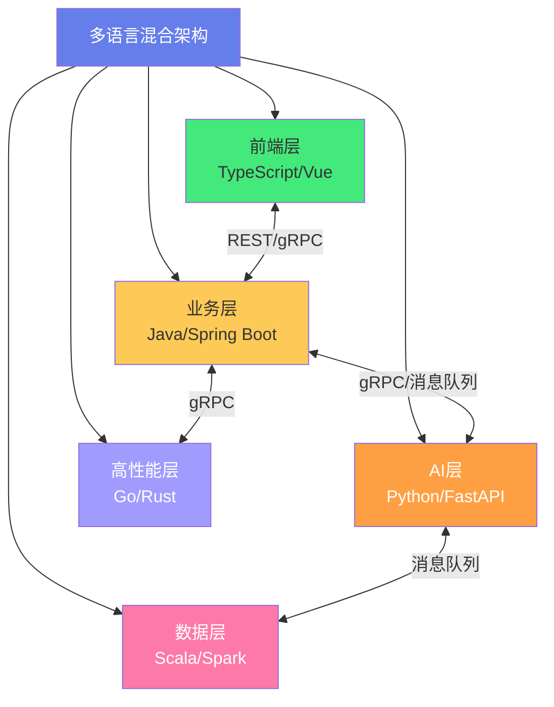
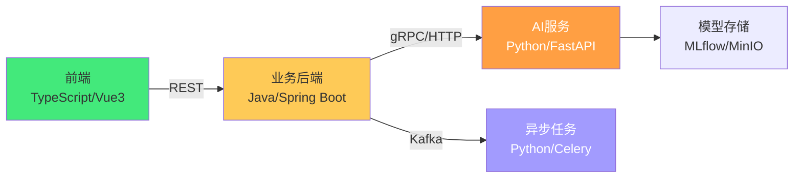
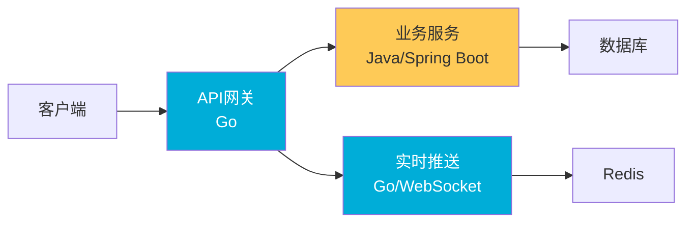
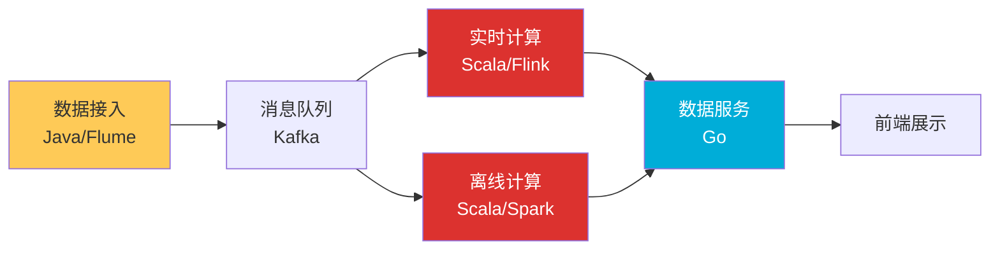
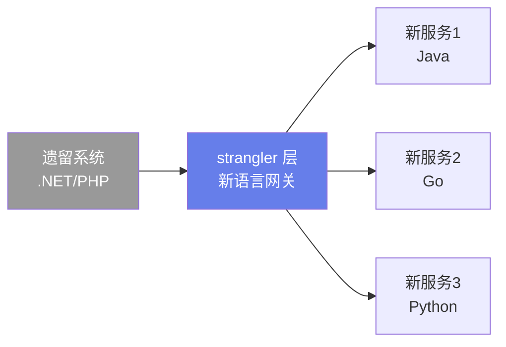
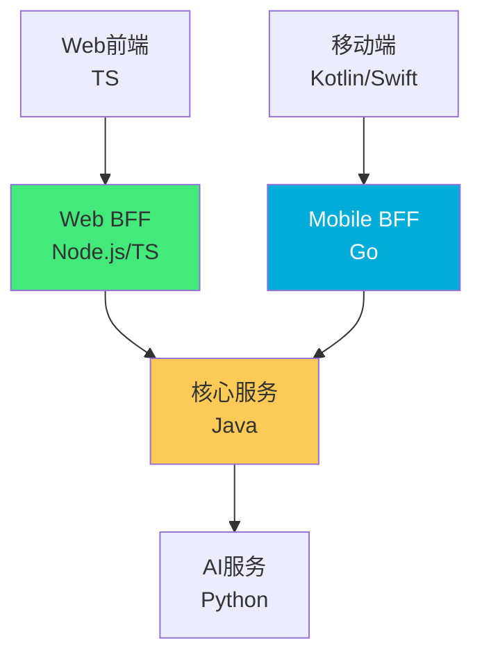
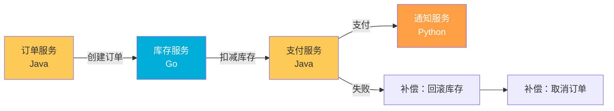
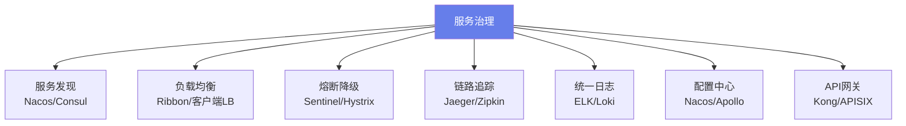
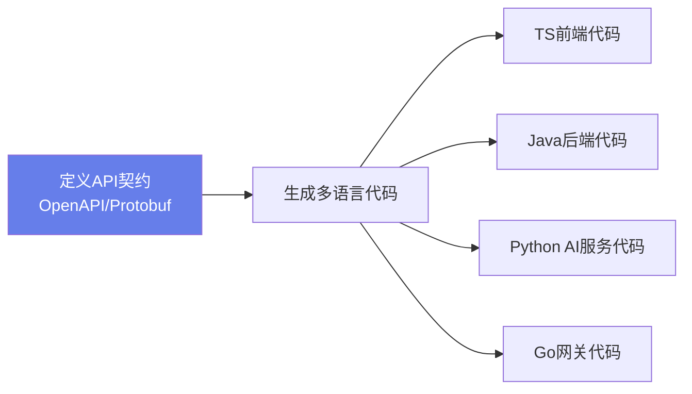
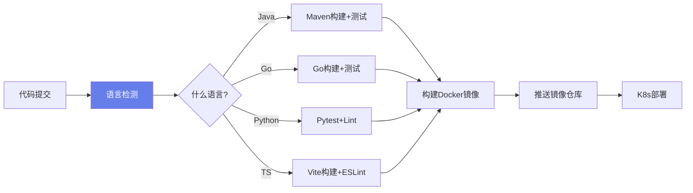

# 🌐 多语言混合架构设计

> **文档说明**：系统讲解在一个系统中同时使用多种编程语言（如 Java + Python + Go、TypeScript + Java + Python、前端 + 后端 + AI 服务）的混合架构设计方法，涵盖多语言架构的概念与驱动力（语言优势互补/团队技能/生态系统/性能需求/遗留系统）、常见多语言组合模式（Java+Python+Go 数据平台/TS+Java+Python AI 应用/Go+Rust 高性能系统/Strangler Fig 渐进迁移）、架构通信模式（共享数据库/REST API/gRPC/消息队列解耦/GraphQL/事件驱动/BFF 后端 for 前端）、跨语言通信机制详解（REST JSON/gRPC Protobuf/Kafka/RabbitMQ/Redis Pub-Sub/WebSocket）、数据一致性保障（分布式事务/2PC/TCC/Saga 模式/最终一致性/事件溯源/CAP 权衡）、服务治理（服务发现 Nacos/Consul/负载均衡/熔断降级 Sentinel/链路追踪 Jaeger/统一日志 ELK）、多语言团队协作（API 契约优先 OpenAPI/Protobuf/代码生成/统一规范/接口版本管理）、部署与运维（容器化 Docker/K8s/统一监控 Prometheus+Grafana/CI-CD 多语言流水线）、典型实战案例（电商系统 Java 核心+Go 高并发+Python 推荐/AI 应用 TS 前端+Java 业务+Python AI 服务/数据平台 Java 接入+Scala 计算+Go 网关）、技术选型决策框架（语言评估矩阵/ Conway 定律/团队技能/生态成熟度/性能需求）、常见问题与最佳实践。
>
> **适用人群**：架构师、技术负责人、全栈工程师、需要设计多语言系统的高级开发者
>
> **前置知识**：[[微服务架构设计]] · [[分布式系统设计]] · [[消息队列与异步通信]]

---

## 一、概述

### 1.1 什么是多语言混合架构

**多语言混合架构（Polyglot Architecture）** 是指在一个软件系统中同时使用多种编程语言，每种语言负责其最擅长的部分，通过明确定义的接口协同工作。



### 1.2 为什么需要多语言

| 驱动力 | 说明 | 示例 |
|--------|------|------|
| **语言优势互补** | 每种语言有其最擅长的领域 | Python 做 AI，Go 做高并发，Java 做业务 |
| **团队技能** | 团队成员熟悉不同语言 | 前端团队用 TS，后端团队用 Java |
| **生态系统** | 特定领域有成熟的语言生态 | 数据科学用 Python（Pandas/TF），JVM 用 Java |
| **性能需求** | 特定模块需要极致性能 | 网关用 Go/Rust，核心业务用 Java |
| **遗留系统** | 旧系统用某种语言，逐步迁移 | 从 .NET 迁移到 Java，中间共存 |
| **快速原型** | 新功能用高效语言验证 | 用 Python 快速验证 AI 功能，再用 Go 重写 |

### 1.3 单语言 vs 多语言

| 维度 | 单语言架构 | 多语言架构 |
|------|-----------|-----------|
| **开发效率** | 高（统一技术栈） | 中（需要跨语言协作） |
| **性能优化** | 受限于单一语言 | 高（各模块用最优语言） |
| **团队协作** | 简单 | 复杂（需要接口契约） |
| **运维复杂度** | 低 | 高（多套运行时/监控） |
| **人才招聘** | 窄（只招一种语言） | 宽（可招不同背景） |
| **技术债** | 低 | 中（接口维护成本） |
| **适用场景** | 中小型系统、单一领域 | 大型系统、多领域、AI+业务 |

---

## 二、常见多语言组合

### 2.1 AI 应用组合：TS + Java + Python



**职责划分**：
- **TypeScript/Vue3**：前端界面、对话式 UI、实时交互
- **Java/Spring Boot**：业务逻辑、用户管理、权限、数据持久化
- **Python/FastAPI**：AI 推理、模型调用、RAG 检索
- **Python/Celery**：异步任务（模型训练、批量处理）

### 2.2 高并发系统组合：Java + Go



**职责划分**：
- **Go**：API 网关（高并发代理）、WebSocket 实时推送、限流熔断
- **Java**：核心业务逻辑、事务处理、复杂领域模型

### 2.3 数据平台组合：Java + Scala + Go



### 2.4 渐进迁移组合：Strangler Fig 模式



**原理**：用新语言逐步替换旧系统的功能，通过「扼杀者层」路由请求，旧功能逐步下线，最终完全迁移。

---

## 三、架构通信模式

### 3.1 通信模式对比

| 模式 | 耦合度 | 性能 | 适用场景 |
|------|--------|------|---------|
| **共享数据库** | 高 | 高 | 简单系统、紧耦合模块 |
| **REST API** | 中 | 中 | 通用服务间调用、外部接口 |
| **gRPC** | 中 | 高 | 内部服务高频调用、多语言 |
| **消息队列** | 低 | 高 | 异步解耦、事件驱动、削峰 |
| **GraphQL** | 中 | 中 | BFF 层、灵活数据查询 |
| **事件驱动** | 极低 | 高 | 微服务解耦、最终一致性 |

### 3.2 REST API（最通用）

```text
客户端 ──HTTP JSON──> 服务A ──HTTP JSON──> 服务B
```

**优点**：简单通用、调试方便、缓存友好
**缺点**：文本协议开销大、无强类型契约、同步阻塞

### 3.3 gRPC（高性能多语言首选）

```text
客户端 ──HTTP/2 二进制──> 服务A ──HTTP/2 二进制──> 服务B
         Protobuf序列化              Protobuf序列化
```

**优点**：
- 二进制序列化，体积小、速度快
- HTTP/2 多路复用，支持流式
- Protobuf 强类型契约，自动生成多语言代码
- 支持四种调用模式（一元/服务端流/客户端流/双向流）

**缺点**：浏览器不直接支持（需要 gRPC-Web）、调试不如 REST 方便

```protobuf
// user.proto — 一份定义，生成 Java/Go/Python/TS 代码
syntax = "proto3";

service UserService {
  rpc GetUser(GetUserRequest) returns (User);
  rpc ListUsers(ListUsersRequest) returns (stream User);
}

message GetUserRequest {
  string id = 1;
}

message User {
  string id = 1;
  string name = 2;
  string email = 3;
}
```

### 3.4 消息队列（异步解耦）

```text
服务A ──生产──> Kafka/RabbitMQ ──消费──> 服务B
                              ──消费──> 服务C
```

**优点**：完全解耦、异步非阻塞、削峰填谷、保证最终一致
**缺点**：增加系统复杂度、消息顺序/重复/丢失问题

### 3.5 BFF（Backend for Frontend）



**原理**：为不同前端提供专用的后端层，聚合后端服务、裁剪数据、适配前端需求，前端团队可以用自己熟悉的语言开发 BFF。

---

## 四、数据一致性

### 4.1 多语言下的一致性挑战

多语言架构中，数据分散在不同服务、不同数据库中，一致性是最大挑战：

| 方案 | 一致性 | 性能 | 复杂度 | 适用 |
|------|--------|------|--------|------|
| **2PC/XA** | 强一致 | 低 | 高 | 金融、必须强一致 |
| **TCC** | 最终一致 | 中 | 高 | 资金交易 |
| **Saga** | 最终一致 | 高 | 中 | 长事务、跨服务 |
| **本地消息表** | 最终一致 | 高 | 低 | 通用异步场景 |
| **事件溯源** | 最终一致 | 高 | 高 | 审计、复杂领域 |

### 4.2 Saga 模式（推荐）



**原理**：将长事务拆分为多个本地事务，每个事务有对应的补偿操作，失败时按逆序执行补偿。

### 4.3 本地消息表（简单可靠）

```text
1. 业务操作 + 写入本地消息表（同一事务）
2. 后台任务扫描消息表，发送到 MQ
3. 消费者处理消息，确认后标记已处理
4. 失败重试，保证最终一致
```

---

## 五、服务治理

### 5.1 服务治理全景



### 5.2 多语言服务治理要点

| 治理能力 | 多语言方案 | 说明 |
|---------|-----------|------|
| **服务发现** | Nacos/Consul（多语言 SDK） | 所有语言都能注册和发现 |
| **负载均衡** | 客户端 LB（各语言实现）或服务端 LB（网关） | 推荐服务端 LB，减少各语言重复实现 |
| **熔断降级** | Sentinel（多语言）/ 服务端网关限流 | 网关层统一限流熔断 |
| **链路追踪** | OpenTelemetry（多语言标准） | 统一 Trace 格式，跨语言传递 TraceID |
| **统一日志** | JSON 格式日志 + ELK/Loki | 所有语言输出统一 JSON 日志 |
| **配置中心** | Nacos/Apollo（多语言 SDK） | 统一配置管理 |

### 5.3 OpenTelemetry（跨语言可观测性标准）

```typescript
// TypeScript
import { trace } from '@opentelemetry/api';

const span = trace.getTracer('app').startSpan('user.login');
// ... 业务逻辑
span.end();
```

```java
// Java
Span span = tracer.spanBuilder("user.login").startSpan();
// ... 业务逻辑
span.end();
```

```python
# Python
from opentelemetry import trace

tracer = trace.get_tracer(__name__)
with tracer.start_as_current_span("user.login"):
    # ... 业务逻辑
    pass
```

> OpenTelemetry 提供统一的 API 和 SDK，支持几乎所有主流语言，TraceID 通过 HTTP Header（`traceparent`）跨语言传递。

---

## 六、多语言团队协作

### 6.1 API 契约优先（Contract First）



**核心原则**：先定义接口契约，再生成各语言代码，确保接口一致。

### 6.2 OpenAPI（REST 契约）

```yaml
# api.yaml — 一份定义，生成多语言客户端/服务端
openapi: 3.0.0
info:
  title: User API
  version: 1.0.0
paths:
  /users/{id}:
    get:
      parameters:
        - name: id
          in: path
          required: true
          schema:
            type: string
      responses:
        '200':
          description: 用户信息
          content:
            application/json:
              schema:
                $ref: '#/components/schemas/User'
components:
  schemas:
    User:
      type: object
      properties:
        id: { type: string }
        name: { type: string }
```

**代码生成工具**：
- `openapi-generator`：生成 50+ 语言的客户端/服务端代码
- `openapi-typescript`：生成 TypeScript 类型
- `springdoc-openapi`：Java Spring Boot 集成

### 6.3 Protobuf（gRPC 契约）

```bash
# 生成多语言代码
protoc --java_out=./java --go_out=./go --python_out=./python --ts_out=./ts user.proto
```

### 6.4 协作规范

| 规范 | 说明 |
|------|------|
| **统一 API 版本管理** | `/v1/`、`/v2/`，向后兼容优先 |
| **统一错误码** | 所有语言返回相同的错误码格式 |
| **统一日期/时间格式** | ISO 8601（`2026-08-28T14:30:00Z`） |
| **统一分页格式** | `page`/`pageSize`/`total` |
| **统一鉴权** | JWT Token，所有服务统一验证 |
| **API 文档自动生成** | 从契约生成文档，保持同步 |

---

## 七、部署与运维

### 7.1 容器化统一

所有语言的服务都打包为 Docker 镜像，统一运行环境：

```dockerfile
# Java 服务
FROM eclipse-temurin:17-jre
COPY target/app.jar /app.jar
ENTRYPOINT ["java", "-jar", "/app.jar"]

# Go 服务
FROM gcr.io/distroless/static
COPY app /app
ENTRYPOINT ["/app"]

# Python 服务
FROM python:3.11-slim
COPY requirements.txt .
RUN pip install -r requirements.txt
COPY . .
ENTRYPOINT ["uvicorn", "main:app", "--host", "0.0.0.0"]
```

### 7.2 K8s 统一编排

所有服务部署在同一个 K8s 集群，统一管理：
- **Deployment**：多语言服务统一编排
- **Service**：服务发现和负载均衡
- **Ingress**：统一入口路由
- **ConfigMap/Secret**：统一配置管理
- **HPA**：自动扩缩容

### 7.3 多语言 CI/CD



---

## 八、技术选型决策框架

### 8.1 语言评估矩阵

| 评估维度 | 权重 | Java | Go | Python | TypeScript | Rust |
|---------|------|------|-----|--------|-----------|------|
| **性能** | 20% | 8 | 9 | 5 | 6 | 10 |
| **开发效率** | 20% | 7 | 8 | 9 | 9 | 5 |
| **生态成熟度** | 15% | 10 | 8 | 10(AI) | 10(前端) | 6 |
| **团队技能** | 15% | ? | ? | ? | ? | ? |
| **并发支持** | 10% | 8 | 10 | 6 | 7 | 9 |
| **运维成本** | 10% | 7 | 9 | 6 | 7 | 8 |
| **人才招聘** | 10% | 10 | 7 | 9 | 10 | 4 |

> 团队技能是最重要的维度——再优秀的语言，如果团队不会用，也是负担。

### 8.2 选型原则

1. **核心业务用最熟悉的语言**：降低风险，保证质量
2. **特定领域用最优语言**：AI 用 Python，高并发用 Go，前端用 TS
3. **控制语言数量**：3-4 种是上限，太多会失控
4. **新语言先试点**：在非核心模块验证，再推广
5. **考虑 Conway 定律**：团队结构决定系统架构，语言选择要匹配团队
6. **避免为了技术而技术**：不要因为「Go 很火」就引入 Go，要有明确的业务理由

---

## 九、典型案例

### 9.1 电商系统：Java + Go + Python

| 模块 | 语言 | 理由 |
|------|------|------|
| 商品/订单/用户 | Java | 复杂业务逻辑、事务、生态成熟 |
| API 网关/秒杀 | Go | 高并发、低延迟、轻量 |
| 推荐系统/搜索 | Python | ML 生态（TensorFlow/PyTorch） |
| 实时通知 | Go | WebSocket 高并发 |
| 前端 | TypeScript/Vue | 前端标准 |

### 9.2 AI SaaS：TS + Java + Python

| 模块 | 语言 | 理由 |
|------|------|------|
| Web 前端 | TypeScript/Vue3 | 对话式 UI、实时交互 |
| BFF 层 | Node.js/TS | 前端团队全栈、聚合 AI 服务 |
| 业务后端 | Java/Spring Boot | 用户/计费/权限/数据 |
| AI 推理服务 | Python/FastAPI | LLM 调用、RAG、模型推理 |
| 向量数据库 | Python 服务 | 文档切片、Embedding、检索 |
| 异步任务 | Python/Celery | 文档处理、批量 Embedding |

### 9.3 实时协作：TS + Go + Java

| 模块 | 语言 | 理由 |
|------|------|------|
| 前端编辑器 | TypeScript/Vue3 | CRDT 客户端、富文本 |
| WebSocket 网关 | Go | 高并发长连接、低延迟 |
| 协作服务 | Go | 操作广播、房间管理 |
| 业务服务 | Java | 文档管理、权限、版本 |
| 存储 | Java + MongoDB | 文档持久化、操作日志 |

---

## 十、常见问题

| 问题 | 解决方案 |
|------|---------|
| **接口不一致** | API 契约优先，从 OpenAPI/Protobuf 生成代码 |
| **数据格式不兼容** | 统一 JSON/Protobuf，统一日期/分页/错误码 |
| **调试困难** | 统一链路追踪（OpenTelemetry），统一日志格式 |
| **运维复杂** | 全部容器化，K8s 统一编排，统一监控 |
| **团队沟通成本高** | 明确接口边界，API 文档先行，定期跨团队评审 |
| **性能瓶颈定位难** | 全链路 Trace + 各语言统一 metrics（Prometheus） |
| **技术债累积** | 控制语言数量，定期技术评审，避免「每个服务一种语言」 |
| **本地开发环境复杂** | Docker Compose 一键启动，devcontainer 统一开发环境 |
| **安全风险** | 统一鉴权（JWT）、统一网关、各语言安全扫描 |

---

## 十一、最佳实践

1. **接口契约优先**：先定义 API，再写代码，从契约生成多语言代码
2. **控制语言数量**：3-4 种是合理上限，每种要有明确的使用场景
3. **核心业务用成熟语言**：不要用新语言写核心交易逻辑
4. **异步解耦优先**：跨语言调用优先用消息队列，减少同步依赖
5. **统一可观测性**：OpenTelemetry + Prometheus + ELK，所有语言统一
6. **容器化一切**：Docker + K8s 屏蔽语言差异
7. **网关层统一治理**：限流、熔断、鉴权在网关层统一处理
8. **文档即代码**：OpenAPI/Protobuf 纳入版本管理，自动生成文档
9. **渐进式引入**：新语言先在边缘服务试点，成熟后再推广
10. **团队技能匹配**：选型时团队技能是第一优先级
11. **避免分布式单体**：服务拆分要合理，不要把单体拆成「分布式单体」
12. **定期架构评审**：每季度 review 技术栈，及时清理无用语言/服务

---

## 十二、关联笔记

### 架构与分布式
- [[微服务架构设计]] · [[分布式系统设计]] · [[消息队列与异步通信]]
- [[高并发系统设计案例_backup_skeleton]] · [[实时协作系统设计]] · [[软件架构设计原则]]

### 全栈+AI
- [[AI应用开发入门]] · [[LLM服务架构]] · [[RAG检索增强生成]]
- [[Java AI Agent开发知识点系统梳理_优化版]] · [[全栈项目实战]]

### 后端与运维
- [[NestJS框架入门]] · [[SpringBoot核心原理]] · [[Docker容器化]]
- [[Kubernetes入门与实践]] · [[CI-CD持续集成与部署]]

### 导航
- [[MOC-项目实战]] · [[MOC-架构设计]] · [[Home]] · [[学习路线总览]]

> 🔍 **知识点深度解析**
>
> **作用**：多语言混合架构解决的是「如何在一个系统中合理使用多种编程语言，让每种语言发挥其最大优势，同时通过清晰的接口和治理机制控制复杂度，实现 1+1>2 的效果」的核心问题——在全栈+AI 时代，单一语言无法覆盖所有场景（前端需要 TS，AI 需要 Python，高并发需要 Go，复杂业务需要 Java），多语言混合架构成为必然选择，但也带来了接口不一致、数据一致性、运维复杂等挑战。
>
> **底层原理**：①多语言架构的本质是「关注点分离 + 最优工具选择」——不同语言有不同的设计哲学和优势领域：Python 简洁高效、AI 生态无敌；Java 稳定成熟、企业级生态完善、强类型适合复杂业务；Go 高并发、低延迟、部署简单；TypeScript 前端标准、类型安全；Rust 极致性能、内存安全。多语言架构就是让每个模块用最适合的语言，而不是用一种语言硬扛所有场景。这和「微服务」的思想一致——不是为了拆而拆，而是为了让每个部分用最优的技术方案。②跨语言通信的核心是「接口契约 + 序列化协议」——不同语言之间不能直接调用函数，必须通过网络通信。REST API 用 JSON 作为通用格式，简单但效率低；gRPC 用 Protobuf 二进制序列化，效率高且有强类型契约，是多语言内部通信的首选；消息队列（Kafka/RabbitMQ）用异步消息解耦，适合事件驱动和削峰。关键是「契约优先」——先定义接口（OpenAPI/Protobuf），再生成各语言代码，确保接口一致。③数据一致性在多语言架构中更加困难——不同语言的服务可能使用不同的数据库，分布式事务无法用单一语言的事务机制解决。Saga 模式、本地消息表、事件溯源是常用的最终一致性方案。核心思想是「接受最终一致性，用补偿机制替代强一致性」——强一致性（2PC）在多语言、多数据库场景下性能差、复杂度高，最终一致性更适合微服务架构。④服务治理的关键是「标准化」——多语言环境下，不能依赖某一种语言的框架（如 Spring Cloud）来做服务治理，需要用语言无关的标准：OpenTelemetry 做链路追踪（所有语言都有 SDK），Prometheus 做 metrics（统一 exposition 格式），JSON 格式日志 + ELK 做日志分析，Nacos/Consul 做服务发现（多语言 SDK），API 网关做统一的限流熔断。网关层统一治理是降低多语言复杂度的有效手段——把通用能力（鉴权、限流、熔断）放在网关，各语言服务只关注业务。⑤团队协作的核心是「Conway 定律」——系统架构反映团队沟通结构。多语言架构需要跨语言团队协作，接口边界必须清晰，API 文档必须先行。「契约优先」的开发模式（先写 OpenAPI/Protobuf，再生成代码）是多语言协作的最佳实践——它让接口成为「单一事实来源」，所有语言都从同一份契约生成代码，避免了接口不一致的问题。⑥运维层面，容器化是屏蔽语言差异的关键——Docker 把 Java/Go/Python/TS 服务都打包成统一的镜像，K8s 统一编排和调度，Prometheus/Grafana 统一监控，CI/CD 流水线自动构建部署。容器化让运维团队不需要懂每种语言，只需要管理容器和集群。⑦技术选型的核心原则是「团队技能 > 语言优势」——很多团队在选型时过度关注语言的技术优势，忽略了团队是否掌握。再优秀的语言，如果团队不会用、踩坑多、招人难，就是负担。合理的选型是：核心业务用团队最熟悉的语言，特定领域用该领域最优的语言，控制语言总数在 3-4 种，新语言先在边缘服务试点。
>
> **用法要点**：① 多语言驱动力：语言优势互补/团队技能/生态/性能/遗留系统/快速原型 ② 常见组合：AI应用(TS+Java+Python)/高并发(Java+Go)/数据平台(Java+Scala+Go)/渐进迁移(Strangler Fig) ③ 通信模式：共享数据库(高耦合)/REST(通用)/gRPC(高性能多语言首选)/消息队列(异步解耦)/GraphQL(BFF)/事件驱动 ④ gRPC：Protobuf契约+HTTP/2+二进制序列化+四种调用模式，一份proto生成多语言代码 ⑤ 数据一致性：2PC(强一致低性能)/TCC/Saga(推荐)/本地消息表(简单可靠)/事件溯源 ⑥ 服务治理：Nacos服务发现/网关统一限流熔断/OpenTelemetry链路追踪(跨语言标准)/JSON统一日志/配置中心 ⑦ 团队协作：API契约优先(OpenAPI/Protobuf生成代码)/统一错误码日期分页/API版本管理/文档自动生成 ⑧ 部署运维：Docker统一容器化/K8s统一编排/多语言CI-CD流水线 ⑨ 选型框架：评估矩阵(性能/效率/生态/团队技能/并发/运维/招聘)，团队技能第一优先级，控制3-4种语言，新语言先试点 ⑩ 典型案例：电商(Java核心+Go网关秒杀+Python推荐)/AI SaaS(TS前端+Node BFF+Java业务+Python AI)/实时协作(TS编辑器+Go WS网关+Java业务) ⑪ 常见问题：接口不一致(契约优先)/调试难(OpenTelemetry)/运维复杂(容器化K8s)/沟通成本(接口边界+文档)/技术债(控制语言数量+定期评审) ⑫ 最佳实践：契约优先/控制语言数量/核心业务用成熟语言/异步解耦/统一可观测性/容器化/网关统一治理/文档即代码/渐进引入/团队技能匹配/避免分布式单体/定期架构评审。

> 💡 **深度讲解**：多语言混合架构最核心的智慧是「用最合适的工具做最合适的事，同时用标准化的接口和治理把复杂度控制在可管理范围内——不是为了多语言而多语言，而是为了让每个模块发挥最大价值」——很多团队对多语言架构有两种极端态度：一种是「语言统一论」，认为全公司只用一种语言最好，结果是 AI 功能用 Java 写得痛苦不堪、高并发网关用 Java 性能上不去；另一种是「技术追星论」，什么语言火就用什么，结果系统里有 8 种语言，没人能维护，接口一团糟。正确的态度是「务实的多语言」——核心业务用团队最熟悉、最稳定的语言（通常是 Java），特定领域用该领域最优的语言（AI 用 Python、高并发用 Go、前端用 TS），控制总数在 3-4 种，通过契约优先、容器化、统一治理来控制复杂度。多语言架构的最大挑战不是技术，而是「协作和治理」——技术上 gRPC、消息队列、容器化都很成熟，但跨语言团队的沟通、接口的一致性、数据的一致性、运维的统一性，这些才是真正的难点。这就是为什么「契约优先」如此重要——它把接口从「口头约定」变成「代码生成的事实」，从根源上避免了接口不一致。「网关统一治理」也很重要——把鉴权、限流、熔断这些通用能力放在网关层，各语言服务不需要重复实现，也不需要为每种语言找对应的 SDK。在 AI 时代，多语言混合架构已经从「可选项」变成了「必选项」——前端用 TypeScript/Vue 做对话式 UI，业务用 Java/Spring Boot 做用户和计费，AI 用 Python/FastAPI 做推理和 RAG，高并发网关用 Go——这是 AI SaaS 的标准架构。掌握多语言混合架构设计，就是掌握了「如何构建复杂的、跨领域的现代系统」的能力——这是从「高级开发者」到「架构师」的关键一步。

> 📝 **精简总结**：多语言混合架构=一个系统用多种语言，各取所长，通过接口和治理控制复杂度。驱动力：语言优势/团队技能/生态/性能/遗留系统。常见组合：AI应用(TS+Java+Python)/高并发(Java+Go)/数据平台(Java+Scala+Go)/Strangler Fig渐进迁移。通信：REST(通用)/gRPC(高性能多语言首选Protobuf)/消息队列(异步解耦)/BFF。一致性：Saga/本地消息表/最终一致性。治理：Nacos服务发现/网关统一限流熔断/OpenTelemetry跨语言追踪/JSON统一日志/容器化K8s。协作：API契约优先(OpenAPI/Protobuf生成代码)/统一错误码日期分页。选型：团队技能第一，控制3-4种，新语言先试点。最佳实践：契约优先/异步解耦/统一可观测性/容器化/网关治理/文档即代码/定期评审。

> **学习路径建议**：先学习 [[微服务架构设计]] 和 [[分布式系统设计]] 打好分布式基础 → 学习本文档的多语言组合和通信模式 → 实践：用 REST API 连接一个 Java 服务和一个 Python 服务 → 学习 gRPC 和 Protobuf → 实践：用 gRPC 实现 Java+Go+Python 的多语言通信 → 学习消息队列（Kafka/RabbitMQ）和 Saga 模式 → 实践：用消息队列实现异步解耦和最终一致性 → 学习 OpenTelemetry 和容器化（Docker/K8s） → 实践：搭建多语言服务的统一监控和部署 → 研究一个真实的 AI SaaS 架构（TS+Java+Python） → 形成「从接口设计到部署运维」的完整多语言架构能力。

---

> **多语言混合架构的本质是「用最合适的工具做最合适的事，同时用标准化的接口和治理把复杂度控制在可管理范围内——不是为了多语言而多语言，而是为了让每个模块发挥最大价值」——在全栈+AI 时代，单一语言已经无法覆盖所有场景：前端需要 TypeScript 做对话式 UI，AI 需要 Python 调用大模型和 RAG，高并发网关需要 Go 的低延迟，复杂业务需要 Java 的稳定生态和强类型。多语言混合架构已经从「可选项」变成了「必选项」。但多语言架构的最大挑战不是技术，而是协作和治理——gRPC、消息队列、容器化这些技术都很成熟，但跨语言团队的沟通、接口一致性、数据一致性、运维统一性，这些才是真正的难点。这就是为什么「契约优先」如此重要——把接口从口头约定变成代码生成的事实，从根源上避免不一致。「网关统一治理」也很关键——把鉴权、限流、熔断放在网关层，各语言服务不需要重复实现。技术选型上要避免两种极端：「语言统一论」（全公司一种语言，结果 AI 用 Java 写得痛苦）和「技术追星论」（什么火用什么，结果 8 种语言没人能维护）。正确的态度是务实的多语言：核心业务用最熟悉的语言，特定领域用最优的语言，控制 3-4 种，新语言先试点。团队技能永远是选型的第一优先级——再优秀的语言，团队不会用就是负担。在 AI 时代，TS+Java+Python 已经是 AI SaaS 的标准架构，掌握多语言混合架构设计，就是从高级开发者到架构师的关键一步。从今天开始，审视你的系统——是不是有些模块在用不合适的语言硬扛？是不是可以引入一种更合适的语言？但记住：先试点，再推广，用契约和治理控制复杂度。**

---

## 🔗 关联笔记

- [[MOC-项目实战]] — 返回本分类知识地图，查看更多相关文档

## 📖 前置知识

- 无特殊前置知识要求，具备基础编程概念即可

## 🏷️ 相关标签

`#微服务` `#分布式系统` `#项目实战` `#多语言架构` `#混合技术栈` `#gRPC`

[[Home|🏠 返回首页]] · [[MOC-项目实战|📚 返回分类]]
