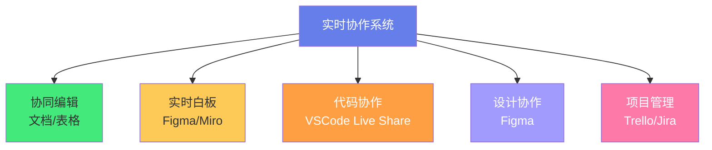
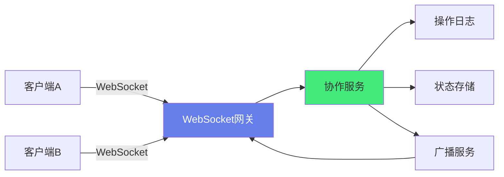
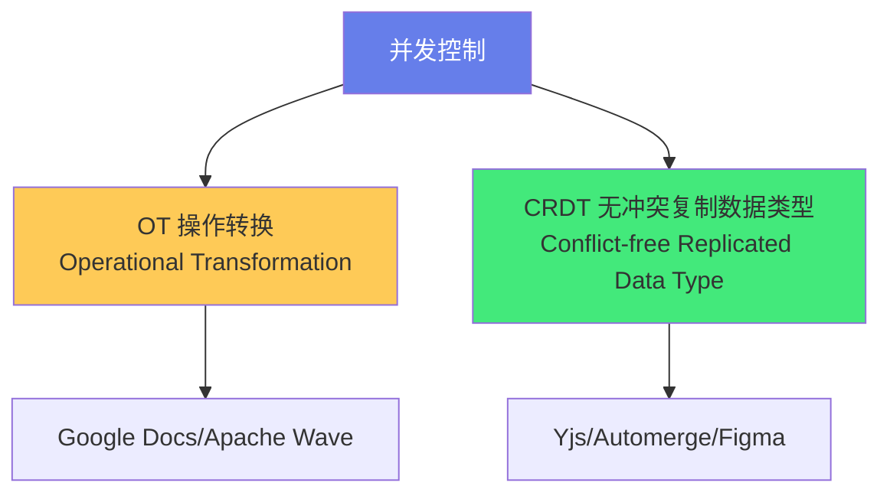
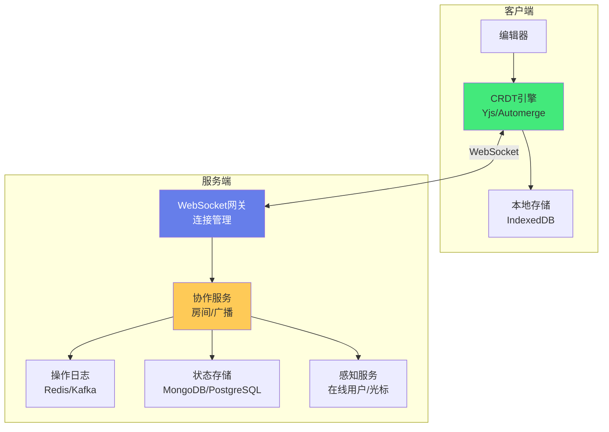
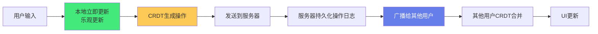
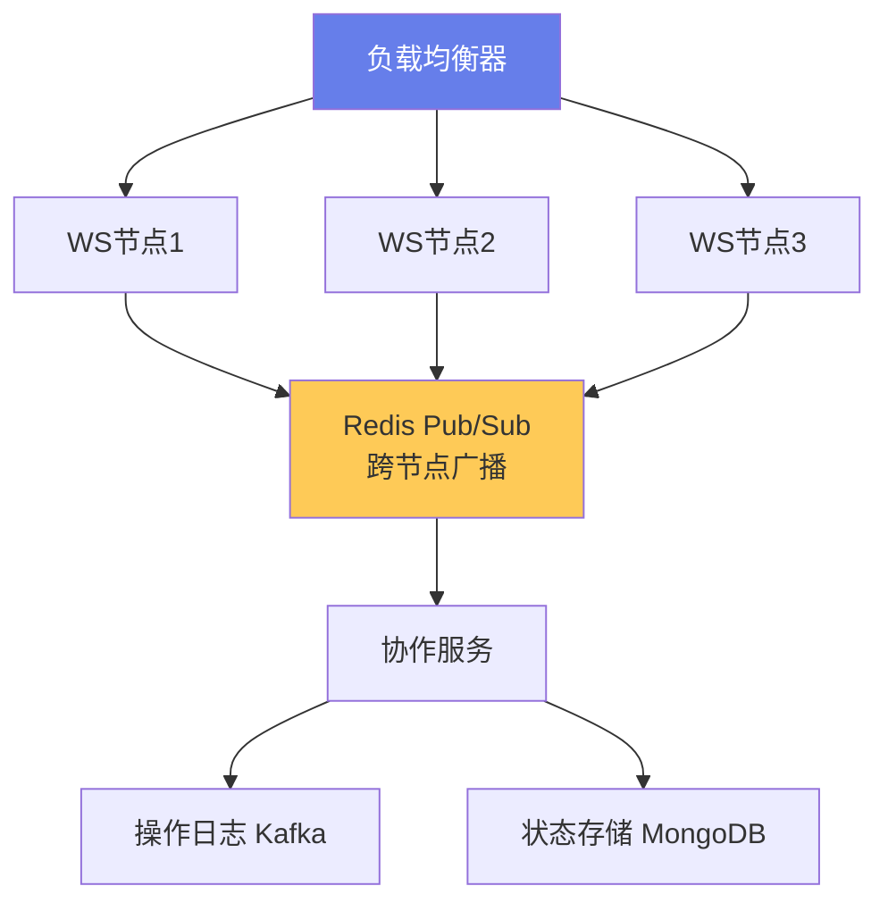

# 🤝 实时协作系统设计

> **文档说明**：系统讲解实时协作系统（在线文档、协同编辑、实时白板、代码协作等）的架构设计与核心技术，涵盖实时协作的应用场景与核心挑战（并发冲突/网络延迟/离线支持/状态一致性）、实时通信技术对比（WebSocket / SSE / WebRTC / 长轮询）、并发控制两大算法体系（OT 操作转换 / CRDT 无冲突复制数据类型）、OT 算法原理（操作变换/位置变换/转换函数）、CRDT 原理（LSEQ/Logoot/Automerge/Yjs 实现思路）、状态同步架构（中心化服务器 / P2P / 混合模式）、在线用户与光标/选区同步、冲突解决策略（自动合并/手动解决/最后写入胜出）、离线支持与增量合并、性能优化（操作压缩/增量同步/虚拟滚动/防抖）、典型系统架构（WebSocket 网关 + 操作日志 + 状态存储 + 广播机制）、技术选型对比（Yjs / Automerge / ShareDB / Socket.IO / Convergence）、实战案例（协同文档编辑器 / 实时白板 / 代码协作平台）、可扩展性设计（水平扩展/分片/操作日志持久化）、常见问题与最佳实践。
>
> **适用人群**：架构师、高级前端/后端开发者、需要设计实时协作产品的技术负责人、全栈工程师
>
> **前置知识**：[[WebSocket-实时通信]] · [[分布式系统设计]] · [[软件架构设计原则]]

---

## 一、概述

### 1.1 什么是实时协作系统

**实时协作系统**允许多个用户同时编辑同一份内容（文档、白板、代码、设计稿等），并实时看到彼此的修改。



**典型产品**：Google Docs、Figma、Notion、飞书文档、腾讯文档、VSCode Live Share、Miro。

### 1.2 核心挑战

| 挑战 | 说明 |
|------|------|
| **并发冲突** | 多人同时修改同一位置，如何合并？ |
| **网络延迟** | 操作不能等服务器确认，要本地立即响应（乐观更新） |
| **离线支持** | 断网后继续编辑，联网后自动合并 |
| **状态一致性** | 所有用户最终看到相同的内容 |
| **在线感知** | 显示其他用户的光标、选区、在线状态 |
| **性能** | 大文档、高频操作下保持流畅 |
| **可扩展性** | 支持大量并发用户和文档 |

### 1.3 核心指标

- **延迟**：本地操作到他人看到的时间（目标 < 100ms）
- **一致性**：所有用户最终状态一致（最终一致性）
- **可用性**：断网可继续编辑
- **并发用户数**：单文档支持的同时编辑人数

---

## 二、实时通信技术

### 2.1 技术对比

| 技术 | 双向 | 延迟 | 复杂度 | 适用场景 |
|------|------|------|--------|---------|
| **WebSocket** | ✅ 全双工 | 低 | 中 | 实时协作首选 |
| **SSE** | ❌ 单向（服务器→客户端） | 低 | 低 | 实时通知、数据流 |
| **WebRTC** | ✅ P2P | 极低 | 高 | P2P 协作、音视频 |
| **长轮询** | ✅ 模拟 | 高 | 低 | 兼容旧浏览器 |
| **HTTP/2 流** | ✅ | 中 | 中 | 渐进式更新 |

### 2.2 WebSocket 架构



**WebSocket 消息类型**：
```json
// 操作消息
{ "type": "op", "docId": "123", "op": { "type": "insert", "pos": 10, "text": "hello" }, "version": 42 }

// 光标消息
{ "type": "cursor", "docId": "123", "userId": "u1", "pos": 15, "selection": [10, 15] }

// 在线状态
{ "type": "presence", "docId": "123", "userId": "u1", "status": "join" }

// 确认消息
{ "type": "ack", "opId": "op_001", "version": 43 }
```

---

## 三、并发控制：OT vs CRDT

实时协作的核心是**并发控制算法**，主要有两大体系：



### 3.1 OT（操作转换）

**核心思想**：当并发操作发生时，通过「转换函数」调整操作的位置，使其在不同执行顺序下得到相同结果。

**示例**：
```text
初始文档："abc"
用户A在位置1插入"X" → "aXbc"
用户B在位置1插入"Y" → "aYbc"

如果不转换：
A先执行："aXbc"，B的操作(在位置1插入Y) → "aYXbc"（错误！）
B先执行："aYbc"，A的操作(在位置1插入X) → "aXYbc"（错误！）

OT转换后：
A先执行："aXbc"，B的操作转换为(在位置2插入Y) → "aXYbc" ✅
B先执行："aYbc"，A的操作转换为(在位置2插入X) → "aYXbc"？

实际上OT需要更复杂的转换函数确保一致性...
```

**OT 的特点**：
- ✅ 操作体积小（只传增量）
- ✅ 服务器集中控制，一致性强
- ❌ 算法复杂，转换函数难写对
- ❌ 需要中心服务器，P2P 支持差
- ❌ 离线支持复杂

**代表产品**：Google Docs、Apache Wave、ShareDB。

### 3.2 CRDT（无冲突复制数据类型）

**核心思想**：设计一种数据结构，使得并发操作天然可交换、可结合、幂等，无论执行顺序如何，最终状态一致。

**CRDT 的两种类型**：

| 类型 | 说明 | 代表 |
|------|------|------|
| **基于状态（State-based）** | 同步整个状态，合并函数取并集/最大值 | G-Counter、PN-Counter |
| **基于操作（Op-based）** | 同步操作，操作可交换 | LSEQ、Logoot、RGA |

**Yjs（最流行的 CRDT 库）的原理**：
- 每个字符有唯一 ID（客户端ID + 时钟）
- 插入操作携带左右邻居的 ID
- 删除是墓碑标记（不真正删除）
- 并发插入通过 ID 排序确定顺序

**CRDT 的特点**：
- ✅ 算法保证无冲突，无需转换
- ✅ 天然支持 P2P 和离线
- ✅ 实现相对简单（用库即可）
- ❌ 元数据开销大（每个字符带 ID）
- ❌ 内存占用较高（墓碑不删除）
- ❌ 某些场景下操作体积大

**代表产品/库**：Yjs、Automerge、Figma、Notion。

### 3.3 OT vs CRDT 对比

| 维度 | OT | CRDT |
|------|-----|------|
| **一致性** | 强（服务器控制） | 最终一致（算法保证） |
| **P2P 支持** | 差 | 好 |
| **离线支持** | 复杂 | 天然支持 |
| **实现复杂度** | 高（转换函数难） | 低（用库） |
| **内存占用** | 低 | 较高（元数据+墓碑） |
| **操作体积** | 小 | 中（带 ID） |
| **服务器依赖** | 强 | 弱 |
| **代表** | Google Docs | Figma/Notion/Yjs |
| **推荐场景** | 中心化、强一致 | P2P、离线、快速开发 |

> **现代趋势**：CRDT（尤其是 Yjs）越来越流行，因为实现简单、离线友好、P2P 支持好。

---

## 四、Yjs 实战

### 4.1 Yjs 核心概念

```typescript
import * as Y from 'yjs'

// 创建文档
const ydoc = new Y.Doc()

// 共享文本类型
const ytext = ytext.getText('shared-text')
ytext.observe((event) => {
  console.log('文本变化：', event)
})

// 操作文本
ytext.insert(0, 'Hello')
ytext.insert(5, ' World')
console.log(ytext.toString())  // 'Hello World'

// 共享数组
const yarray = ydoc.getArray('items')
yarray.push(['item1', 'item2'])

// 共享 Map
const ymap = ydoc.getMap('state')
ymap.set('cursor', { x: 10, y: 20 })
```

### 4.2 同步与持久化

```typescript
import { WebsocketProvider } from 'y-websocket'
import { IndexeddbPersistence } from 'y-indexeddb'

// WebSocket 同步
const wsProvider = new WebsocketProvider(
  'ws://localhost:1234',
  'room-123',
  ydoc
)

// 本地持久化（IndexedDB）
const persistence = new IndexeddbPersistence('doc-123', ydoc)
persistence.on('synced', () => {
  console.log('本地数据已加载')
})

// 感知（在线用户/光标）
wsProvider.awareness.setLocalStateField('user', {
  name: 'Alice',
  color: '#ff0000'
})
```

### 4.3 光标与选区同步

```typescript
// 监听其他用户的感知状态
wsProvider.awareness.on('change', (changes) => {
  const states = wsProvider.awareness.getStates()
  states.forEach((state, clientId) => {
    console.log(`用户 ${clientId}:`, state.user?.name, state.cursor)
  })
})

// 更新自己的光标
function updateCursor(pos: number) {
  wsProvider.awareness.setLocalStateField('cursor', { pos })
}
```

---

## 五、系统架构设计

### 5.1 典型架构



### 5.2 核心组件

| 组件 | 职责 | 技术选型 |
|------|------|---------|
| **WebSocket 网关** | 管理连接、消息路由 | Socket.IO / ws / 云厂商 API 网关 |
| **协作服务** | 房间管理、操作广播、版本控制 | Node.js / Go / Java |
| **操作日志** | 持久化所有操作，支持回放 | Kafka / Redis Stream / MongoDB |
| **状态存储** | 存储文档快照和最终状态 | MongoDB / PostgreSQL / Redis |
| **感知服务** | 在线用户、光标、选区 | Redis（Pub/Sub + Hash） |
| **本地存储** | 离线支持、快速加载 | IndexedDB / localStorage |

### 5.3 操作流程



**关键设计**：
1. **乐观更新**：本地立即响应，不等服务器确认（低延迟）
2. **操作日志**：所有操作持久化，支持回放和冲突解决
3. **CRDT 合并**：客户端和服务端都用相同的 CRDT 算法合并
4. **快照**：定期保存文档快照，加速加载（不用从头回放所有操作）

---

## 六、关键技术点

### 6.1 在线感知（Presence）

```typescript
// 感知状态结构
interface PresenceState {
  userId: string
  userName: string
  color: string
  cursor?: { pos: number; selection?: [number, number] }
  lastActive: number
}

// 心跳机制
setInterval(() => {
  wsProvider.awareness.setLocalStateField('lastActive', Date.now())
}, 30000)

// 超时移除离线用户
const OFFLINE_TIMEOUT = 60000
setInterval(() => {
  const states = wsProvider.awareness.getStates()
  states.forEach((state, clientId) => {
    if (Date.now() - state.lastActive > OFFLINE_TIMEOUT) {
      // 标记为离线
    }
  })
}, 10000)
```

### 6.2 离线支持

```typescript
// 1. 断网时继续编辑（CRDT 本地操作）
// 2. 操作存在 IndexedDB（y-indexeddb 自动处理）
// 3. 联网后自动同步（y-websocket 自动重连和同步）

// 手动处理重连
wsProvider.on('status', ({ status }) => {
  if (status === 'connected') {
    console.log('已连接，开始同步离线操作')
  } else if (status === 'disconnected') {
    console.log('已断开，可继续离线编辑')
  }
})
```

### 6.3 大文档性能优化

| 优化 | 说明 |
|------|------|
| **虚拟滚动** | 只渲染可视区域的内容 |
| **操作压缩** | 合并连续的小操作为一个大操作 |
| **快照加载** | 先加载快照，再增量同步后续操作 |
| **防抖** | 高频操作（如鼠标移动）防抖发送 |
| **分片** | 大文档按章节/段落分片 |
| **二进制协议** | 用二进制替代 JSON，减少体积 |
| **GC 回收** | 定期清理 CRDT 墓碑（Yjs 的 gc 选项） |

### 6.4 冲突解决

| 策略 | 说明 | 适用场景 |
|------|------|---------|
| **自动合并** | CRDT/OT 自动合并 | 文本编辑（大多数情况） |
| **最后写入胜出** | LWW，后操作覆盖先操作 | 简单字段、设置项 |
| **手动解决** | 提示用户选择 | 复杂冲突、代码合并 |
| **分支合并** | 创建分支，用户手动合并 | Git 风格协作 |

---

## 七、技术选型

### 7.1 协作引擎

| 库 | 类型 | 语言 | 特点 |
|----|------|------|------|
| **Yjs** | CRDT | JS/TS | 最流行、生态好、性能优 |
| **Automerge** | CRDT | JS/TS/Rust | 不可变数据、JSON 风格 |
| **ShareDB** | OT | JS | 基于 JSON0 OT，成熟稳定 |
| **Convergence** | OT | JS | 全功能协作平台 |
| **Teletype** | CRDT | JS | Atom 团队的 P2P 协作 |

### 7.2 实时通信

| 库 | 特点 |
|----|------|
| **Socket.IO** | 自动重连、房间、降级到长轮询 |
| **ws** | 轻量、高性能 WebSocket |
| **y-websocket** | Yjs 官方 WebSocket 连接器 |
| **y-webrtc** | Yjs 的 P2P 连接器 |
| **Centrifugo** | 实时消息服务器（Go） |

### 7.3 推荐组合

| 场景 | 推荐方案 |
|------|---------|
| **快速开发** | Yjs + y-websocket + y-indexeddb + Socket.IO |
| **P2P 协作** | Yjs + y-webrtc + Automerge |
| **强一致/大规模** | OT（ShareDB）+ WebSocket 网关 + 操作日志 |
| **企业级** | Convergence + 自建 WebSocket 集群 |

---

## 八、实战案例

### 8.1 协同文档编辑器

```text
技术栈：Vue3 + Yjs + y-websocket + Quill/Tiptap + Node.js
架构：
- 前端：Tiptap 编辑器 + Yjs 绑定（y-tiptap）
- 同步：y-websocket 连接协作服务器
- 存储：y-indexeddb 本地持久化 + 服务器快照
- 感知：y-protocols/awareness 同步光标和用户
```

### 8.2 实时白板

```text
技术栈：Canvas/WebGL + Yjs + WebSocket
核心：
- 图形元素用 Y.Array 存储
- 每个元素有唯一 ID（Yjs 自动生成）
- 拖拽操作用 Y.Map 的属性更新
- 缩放/平移用本地状态（不同步）
- 光标用 awareness 同步
```

### 8.3 代码协作平台

```text
技术栈：Monaco Editor + Yjs + WebRTC + 语言服务
核心：
- 代码文本用 Y.Text
- 多文件用 Y.Map<Y.Text>
- 光标/选区用 awareness
- 运行环境用 Docker 容器隔离
- 语音/视频用 WebRTC
```

---

## 九、可扩展性设计

### 9.1 水平扩展



**关键设计**：
- **WebSocket 粘性会话**：同一文档的用户路由到同一节点（减少跨节点通信）
- **Redis Pub/Sub**：跨节点广播操作和感知
- **文档分片**：超大文档按章节分片到不同节点
- **操作日志分区**：按 docId 分区，支持水平扩展

### 9.2 操作日志与快照

```text
操作日志（持久化所有操作）：
- 用于回放、审计、冲突解决
- 定期归档冷数据

快照（定期保存文档状态）：
- 加载时先取快照，再同步快照后的操作
- 减少加载时间（不用从头回放）
- 快照频率：每 N 个操作或每 M 分钟
```

---

## 十、常见问题

| 问题 | 解决方案 |
|------|---------|
| **操作丢失** | 客户端本地持久化 + 服务器 ack 确认 + 超时重传 |
| **顺序不一致** | CRDT 保证最终一致，OT 服务器排序 |
| **光标跳动** | 用 CRDT 的稳定位置（字符 ID）而非索引 |
| **大文档卡顿** | 虚拟滚动 + 操作压缩 + 快照加载 + 分片 |
| **离线合并冲突** | CRDT 自动合并，复杂场景提示用户 |
| **WebSocket 断连** | 自动重连 + 本地缓存 + 增量同步 |
| **多人光标闪烁** | 光标更新防抖（100ms）+ 插值动画 |
| **服务器广播风暴** | 按房间过滤 + 批量合并 + 限流 |
| **内存泄漏** | 及时清理离线用户感知 + CRDT GC |

---

## 十一、最佳实践

1. **优先用 CRDT（Yjs）**：实现简单、离线友好、生态成熟
2. **乐观更新**：本地立即响应，不等服务器（低延迟是核心体验）
3. **本地持久化**：IndexedDB 存储，支持离线和快速加载
4. **操作日志必存**：所有操作持久化，支持回放和审计
5. **感知单独处理**：光标/在线状态用 awareness，不混入文档操作
6. **虚拟滚动**：大文档必须用虚拟滚动，否则渲染卡顿
7. **二进制协议**：生产环境用二进制（Yjs 自带编码），减少传输体积
8. **心跳+超时**：在线用户用心跳，超时标记离线
9. **限流防抖**：鼠标移动、滚动等高频操作防抖发送
10. **测试并发**：用多浏览器/多标签测试并发编辑场景

---

## 十二、关联笔记

### 架构与分布式
- [[WebSocket-实时通信]] · [[分布式系统设计]] · [[软件架构设计原则]]
- [[高并发系统设计案例_backup_skeleton]] · [[微服务架构设计]] · [[消息队列与异步通信]]

### 前端与实时
- [[Vue3-组合式API]] · [[TypeScript-类型系统进阶]] · [[VueUse-工具函数库]]
- [[前端性能优化实战]]

### 项目实战
- [[MVP最小可行产品]] · [[技术债务管理]] · [[全栈项目实战]]

### 导航
- [[MOC-项目实战]] · [[MOC-架构设计]] · [[Home]] · [[学习路线总览]]

> 🔍 **知识点深度解析**
>
> **作用**：实时协作系统设计解决的是「如何让多个用户同时编辑同一份内容并实时看到彼此修改，同时保证一致性、低延迟和离线可用性」的复杂分布式系统问题——这是前端架构中最具挑战性的领域之一，涉及并发控制算法（OT/CRDT）、实时通信、分布式状态同步、离线合并等多个技术维度。
>
> **底层原理**：①实时协作的核心矛盾是「一致性 vs 延迟」——强一致性需要等服务器确认（高延迟），低延迟需要本地立即更新（可能不一致）。解决方案是「乐观更新 + 最终一致性」：本地立即更新（乐观），通过算法保证所有用户最终状态一致（最终一致）。Google Docs 的延迟 < 100ms，但所有用户最终看到相同内容，就是这个原理。②OT（操作转换）的核心是「转换函数」——当两个并发操作在不同客户端以不同顺序执行时，转换函数调整操作的位置参数，使得无论执行顺序如何，最终结果相同。OT 的难点在于转换函数必须满足「收敛性（Convergence）」「意图保持（Intention Preservation）」「因果保留（Causality Preservation）」三个性质，这在数学上很难证明正确，Google Docs 的 OT 算法经过多年迭代才稳定。③CRDT（无冲突复制数据类型）的核心是「设计可交换的数据结构」——CRDT 的操作天然满足交换律（a+b = b+a）、结合律、幂等性，因此无论以什么顺序执行、重复执行多少次，最终状态都相同。这避免了 OT 的复杂转换函数，但代价是每个数据项需要携带唯一 ID 和元数据（如客户端 ID + 逻辑时钟），内存和带宽开销较大。Yjs 通过优化的 ID 编码和垃圾回收（GC）大幅降低了开销。④实时协作系统的架构本质是「操作日志 + 状态机复制」——每个客户端维护一个文档状态机，操作作为日志条目广播，所有客户端按相同规则（CRDT/OT）应用操作，最终状态一致。服务器是「广播中枢」和「日志持久化」，不做复杂的冲突解决（CRDT 把冲突解决下推到客户端）。这种架构天然支持水平扩展和 P2P。⑤在线感知（Presence）和文档操作是两个独立的数据流——文档操作需要持久化和强一致，感知数据（光标/在线状态）是临时的、可丢失的，不需要持久化。将两者分离可以简化系统：文档操作用 CRDT + 操作日志，感知用 Redis Pub/Sub + 心跳超时。⑥离线支持的核心是「本地持久化 + 增量同步」——断网时操作存在本地（IndexedDB），联网后将本地未同步的操作发送给服务器，同时拉取服务器的新操作，CRDT 自动合并两边的操作。这要求操作必须是「可交换」的（CRDT 满足），否则离线合并会产生冲突。
>
> **用法要点**：① 核心挑战：并发冲突/网络延迟/离线支持/状态一致性/在线感知/性能/可扩展 ② 通信技术：WebSocket首选(全双工低延迟)，SSE单向，WebRTC P2P，长轮询兼容 ③ 并发控制：OT(操作转换/Google Docs/强一致但复杂) vs CRDT(无冲突/Yjs/Automerge/离线P2P友好)，现代推荐CRDT ④ Yjs实战：Y.Doc+Y.Text/Y.Array/Y.Map，y-websocket同步，y-indexeddb持久化，awareness感知 ⑤ 架构：WebSocket网关+协作服务+操作日志(Kafka/Redis)+状态存储(MongoDB)+感知服务(Redis) ⑥ 操作流程：用户输入→本地乐观更新→CRDT生成操作→发送服务器→持久化日志→广播其他用户→CRDT合并→UI更新 ⑦ 在线感知：awareness同步光标/选区/在线状态，心跳+超时移除离线 ⑧ 离线支持：IndexedDB本地存储+自动重连+CRDT自动合并 ⑨ 性能优化：虚拟滚动/操作压缩/快照加载/防抖/分片/二进制协议/GC回收 ⑩ 冲突解决：自动合并(CRDT/OT)/最后写入胜出(LWW)/手动解决/分支合并 ⑪ 技术选型：Yjs+y-websocket+y-indexeddb快速开发，y-webrtc P2P，ShareDB OT强一致 ⑫ 可扩展：WebSocket粘性会话+Redis Pub/Sub跨节点广播+文档分片+操作日志分区 ⑬ 最佳实践：优先CRDT/乐观更新/本地持久化/操作日志必存/感知分离/虚拟滚动/二进制协议/心跳超时/限流防抖/并发测试。

> 💡 **深度讲解**：实时协作系统最核心的智慧是「用最终一致性换取低延迟，用算法保证并发操作的无损合并」——在分布式系统中，CAP 定理告诉我们不能同时满足强一致性、可用性和分区容错。实时协作选择了「AP（可用性+分区容错）+ 最终一致性」——用户可以随时编辑（高可用），断网也能继续（分区容错），但所有用户最终看到相同内容（最终一致性）。这种选择是正确的，因为对于协作编辑来说，「立即响应」比「瞬时一致」更重要——用户不能接受打一个字等 200ms 才显示，但可以接受他人的修改延迟 100ms 出现。OT 和 CRDT 是实现最终一致性的两条技术路线：OT 通过服务器集中控制和复杂的转换函数保证一致性，CRDT 通过数学上可交换的数据结构天然保证一致性。近年来 CRDT（尤其是 Yjs）越来越流行，因为它把复杂性封装在库中，开发者不需要自己写转换函数，而且天然支持 P2P 和离线。实时协作系统的另一个深层智慧是「操作日志即真相」——所有操作都持久化为不可变的日志，文档状态只是日志的「投影」。这种「事件溯源（Event Sourcing）」架构有很多好处：可以回放任意时刻的状态、可以审计操作历史、可以通过重放日志修复状态、可以水平扩展（日志分区）。理解了实时协作系统的设计，你就理解了分布式系统中「状态同步」和「并发控制」的核心思想——这些思想不仅适用于协作编辑，也适用于任何需要多节点状态同步的系统（分布式数据库、协同设计工具、实时游戏等）。

> 📝 **精简总结**：实时协作系统设计=多人同时编辑+实时同步+最终一致。核心挑战：并发冲突/延迟/离线/一致性/在线感知/性能。通信：WebSocket首选。并发控制：OT(操作转换/Google Docs/强一致复杂) vs CRDT(无冲突/Yjs/Automerge/离线P2P友好，现代推荐)。Yjs：Y.Doc+Y.Text，y-websocket同步，y-indexeddb持久化，awareness感知。架构：WS网关+协作服务+操作日志+状态存储+感知服务。流程：乐观更新→CRDT操作→广播→合并→UI更新。离线：IndexedDB+自动重连+CRDT合并。性能：虚拟滚动/操作压缩/快照/防抖/分片/二进制。选型：Yjs+y-websocket快速开发，ShareDB强一致。可扩展：粘性会话+Redis Pub/Sub+分片。最佳实践：优先CRDT/乐观更新/本地持久化/操作日志/感知分离/虚拟滚动。

> **学习路径建议**：先学习 [[WebSocket-实时通信]] 掌握实时通信基础 → 学习本文档的 OT/CRDT 原理和系统架构 → 实践：用 Yjs + y-websocket + Tiptap 搭一个简单的协同文档 → 学习 [[分布式系统设计]] 深化分布式理解 → 实践：添加离线支持（y-indexeddb）和光标同步（awareness） → 学习操作日志和事件溯源 → 实践：搭建多节点 WebSocket 集群（Redis Pub/Sub） → 研究 Figma/Google Docs 的技术博客 → 进阶：设计一个实时白板或代码协作平台。

---

> **实时协作系统的本质是「用最终一致性换取即时响应，用算法保证并发操作的无损合并，让多人协作像单人编辑一样流畅」——在单人编辑时代，我们不需要考虑并发、冲突、同步这些问题；但在多人协作时代，这些问题成为核心挑战。实时协作系统的设计体现了分布式系统最核心的权衡：**一致性 vs 延迟 vs 可用性**。强一致性意味着每次操作都要等所有节点确认（慢），高可用意味着随时可以编辑（可能冲突），最终一致性是两者的平衡点——本地立即响应，后台静默同步，最终所有人看到相同内容。OT 和 CRDT 是实现最终一致性的两大算法体系，近年来 CRDT（尤其是 Yjs）因为实现简单、离线友好、P2P 支持好而成为主流选择。实时协作系统的架构也体现了「事件溯源」的思想——操作日志是真相，文档状态只是投影。这种架构让系统具备了回放、审计、修复、扩展的能力。理解实时协作系统，不仅是为了做一个协同文档，更是理解分布式系统中「状态同步」和「并发控制」的通用思想——这些思想在分布式数据库、实时游戏、协同设计、IoT 设备同步等领域都有应用。在 AI 时代，实时协作系统有了新的可能性：AI 可以作为「虚拟协作者」加入文档，实时辅助写作、编程、设计；AI 可以自动合并冲突、总结变更、生成协作记录。但底层的实时同步和并发控制原理不变——掌握了这些原理，你就能在任何时代设计出优秀的实时协作产品。从今天开始，用 Yjs 搭一个最简单的协同文档——你会发现，曾经觉得「高大上」的实时协作，其实离你并不远。**

---

## 🔗 关联笔记

- [[MOC-项目实战]] — 返回本分类知识地图，查看更多相关文档

## 📖 前置知识

- [[WebSocket实时通信]]
- [[分布式系统设计]]
- [[软件架构设计原则]]

## 🏷️ 相关标签

`#实时协作` `#协同编辑` `#CRDT` `#OT` `#实时通信` `#架构设计`

[[Home|🏠 返回首页]] · [[MOC-项目实战|📚 返回分类]]
