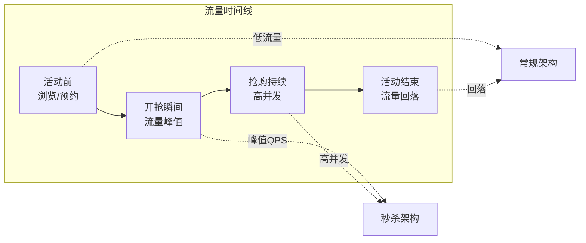
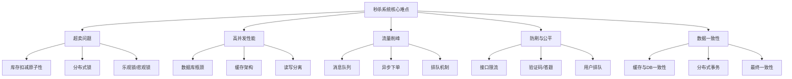
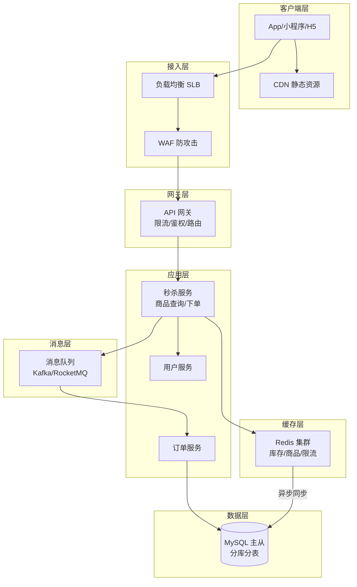
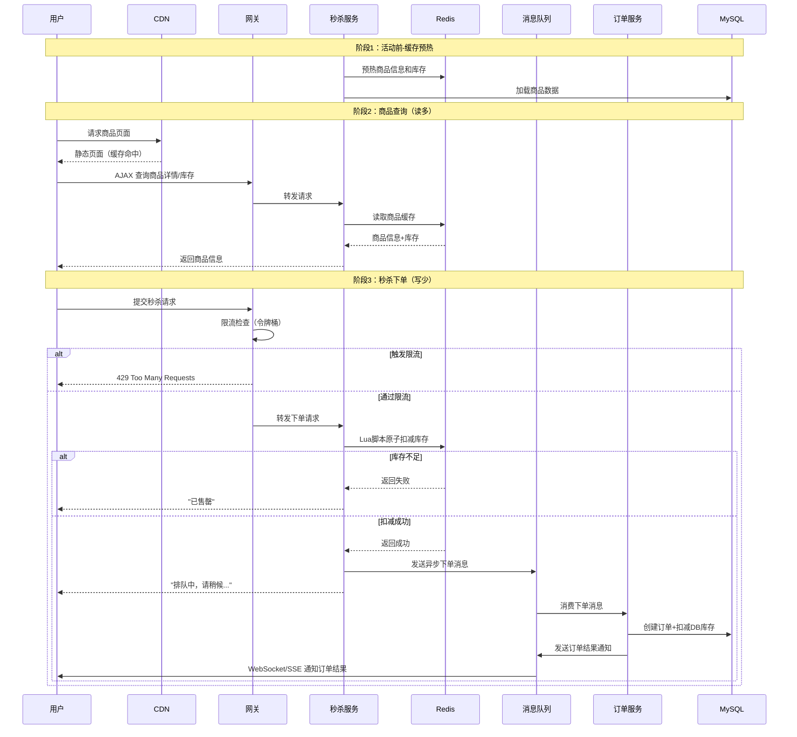
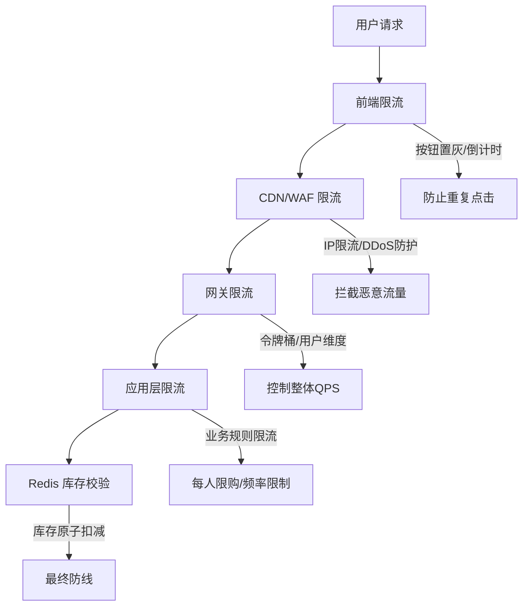
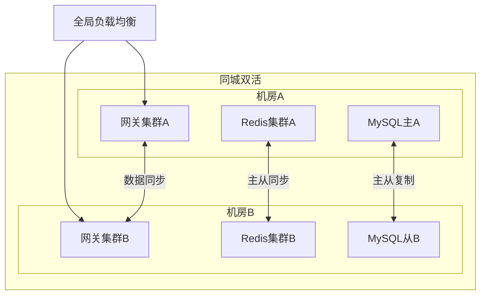

# 秒杀系统架构设计

> **文档说明**：系统讲解秒杀系统的架构设计、核心难点、分层解决方案、关键技术实现，以及从简单到复杂的演进路径。
>
> **适用人群**：后端架构师、需要设计高并发系统的全栈工程师、面试准备者
>
> **前置知识**：[[高并发系统设计案例]]、[[Redis-分布式锁与缓存穿透]]、[[消息队列-Kafka与RabbitMQ]]

---

## 一、概述

**秒杀系统**是电商平台在特定时间点以极低价格限量销售商品的营销活动，其核心特征是**瞬时高并发**——数万甚至数百万用户在同一时刻争抢少量库存。秒杀系统是典型的高并发架构设计案例，涵盖了缓存、消息队列、分布式锁、限流、降级等几乎所有高并发技术。

### 1. 秒杀系统的核心特征

| 特征 | 说明 | 技术挑战 |
|------|------|---------|
| **瞬时高并发** | 数万~数百万 QPS 在几秒内爆发 | 系统容量规划、弹性伸缩 |
| **读多写少** | 99% 是查询请求，1% 是下单请求 | 缓存架构、读写分离 |
| **库存有限** | 商品数量远少于用户数 | 超卖控制、库存扣减 |
| **响应敏感** | 用户期望毫秒级响应 | 异步处理、快速失败 |
| **公平性** | 先到先得，防止作弊 | 限流、防刷、排队 |
| **高可用** | 活动期间不能宕机 | 降级、熔断、多活 |

### 2. 秒杀的典型流量曲线



| 阶段 | 流量特征 | 系统策略 |
|------|---------|---------|
| 活动前 | 平稳增长，预约/提醒 | 缓存预热、库存预热、容量评估 |
| 开抢瞬间 | 瞬时峰值，QPS 暴增 10-100 倍 | 全链路限流、异步排队、快速失败 |
| 抢购持续 | 高并发持续数分钟~数小时 | 消息队列削峰、异步下单、库存扣减 |
| 活动结束 | 流量快速回落 | 数据一致性校验、订单收尾、统计分析 |

---

## 二、核心难点分析

### 1. 五大核心难点



### 2. 超卖问题（最核心）

**超卖**是指卖出的商品数量超过实际库存，根本原因是并发下的库存扣减不是原子操作。

```text
// 错误示例：先查后改，并发下超卖
Thread 1: SELECT stock FROM goods WHERE id=1  → stock=1
Thread 2: SELECT stock FROM goods WHERE id=1  → stock=1
Thread 1: UPDATE goods SET stock=0 WHERE id=1  → 扣减成功
Thread 2: UPDATE goods SET stock=0 WHERE id=1  → 扣减成功（超卖！）
```

**解决方案演进**：

| 方案 | 原理 | 并发性能 | 适用场景 |
|------|------|---------|---------|
| 悲观锁 | `SELECT ... FOR UPDATE` | 低（行锁串行） | 低并发 |
| 乐观锁 | `UPDATE ... WHERE stock>0` | 中（CAS 重试） | 中并发 |
| Redis 原子扣减 | `DECR` 原子操作 | 高（内存操作） | 高并发（推荐） |
| Redis + Lua | 原子脚本扣减+校验 | 极高 | 高并发（最佳） |
| 分段库存 | 库存分多段，分散竞争 | 极高 | 超高并发 |

### 3. 数据库瓶颈

秒杀场景下数据库是最大瓶颈：
- 单 MySQL 实例写 QPS 上限约 5000-8000
- 秒杀峰值可能达到 10万+ QPS
- 直接打数据库必然宕机

**解决思路**：将请求拦截在数据库之外，能不查 DB 就不查，能异步就异步。

---

## 三、分层架构设计

### 1. 整体架构



### 2. 各层职责

| 层级 | 组件 | 核心职责 | 关键技术 |
|------|------|---------|---------|
| **客户端层** | CDN/App | 静态资源缓存、按钮置灰、倒计时 | CDN、前端限流、防重复点击 |
| **接入层** | SLB/WAF | 负载均衡、DDoS 防护、HTTPS 卸载 | 四层负载、WAF 规则 |
| **网关层** | API Gateway | 统一限流、鉴权、路由、降级 | 令牌桶限流、熔断降级 |
| **应用层** | 秒杀服务 | 商品查询、库存校验、下单请求 | 无状态服务、水平扩展 |
| **缓存层** | Redis | 库存扣减、商品缓存、限流计数 | 集群、Lua 脚本、持久化 |
| **消息层** | MQ | 异步下单、流量削峰、解耦 | 顺序消息、事务消息 |
| **数据层** | MySQL | 持久化存储、订单数据 | 主从复制、分库分表 |

---

## 四、核心流程设计

### 1. 秒杀完整流程



### 2. 库存扣减核心实现（Redis + Lua）

```java
// Redis Lua 脚本：原子扣减库存 + 防重复购买
// KEYS[1] = 库存key, KEYS[2] = 已购买用户集合key
// ARGV[1] = 商品ID, ARGV[2] = 用户ID, ARGV[3] = 扣减数量
local stockKey = KEYS[1]
local boughtKey = KEYS[2]
local userId = ARGV[2]
local quantity = tonumber(ARGV[3])

-- 1. 检查用户是否已购买（防重复秒杀）
if redis.call('SISMEMBER', boughtKey, userId) == 1 then
    return -1  // 已购买
end

-- 2. 检查库存
local stock = tonumber(redis.call('GET', stockKey) or '0')
if stock < quantity then
    return 0  // 库存不足
end

-- 3. 原子扣减
redis.call('DECRBY', stockKey, quantity)
redis.call('SADD', boughtKey, userId)
return 1  // 成功
```

```java
// Java 调用 Lua 脚本
@Service
public class SeckillService {

    @Autowired
    private RedisTemplate<String, String> redisTemplate;

    private DefaultRedisScript<Long> seckillScript;

    @PostConstruct
    public void init() {
        seckillScript = new DefaultRedisScript<>();
        seckillScript.setScriptText(LUA_SCRIPT);
        seckillScript.setResultType(Long.class);
    }

    public SeckillResult seckill(Long goodsId, Long userId) {
        String stockKey = "seckill:stock:" + goodsId;
        String boughtKey = "seckill:bought:" + goodsId;

        Long result = redisTemplate.execute(
            seckillScript,
            Arrays.asList(stockKey, boughtKey),
            String.valueOf(goodsId),
            String.valueOf(userId),
            "1"
        );

        switch (result.intValue()) {
            case 1:
                // 扣减成功，发送异步下单消息
                sendOrderMessage(goodsId, userId);
                return SeckillResult.success("排队中");
            case 0:
                return SeckillResult.fail("已售罄");
            case -1:
                return SeckillResult.fail("您已购买过");
            default:
                return SeckillResult.fail("系统繁忙");
        }
    }
}
```

### 3. 异步下单流程

```java
// 订单消费者
@Component
@RocketMQMessageListener(topic = "seckill-order", consumerGroup = "order-consumer")
public class OrderConsumer implements RocketMQListener<SeckillOrderMessage> {

    @Autowired
    private OrderService orderService;
    @Autowired
    private RedisTemplate<String, String> redisTemplate;

    @Override
    public void onMessage(SeckillOrderMessage message) {
        try {
            // 1. 创建订单（DB 事务内扣减库存）
            Order order = orderService.createSeckillOrder(
                message.getGoodsId(),
                message.getUserId()
            );

            // 2. 通知用户订单结果（WebSocket/SSE/轮询）
            notifyUser(message.getUserId(), order);

        } catch (Exception e) {
            // 3. 下单失败，回补 Redis 库存
            redisTemplate.opsForValue().increment(
                "seckill:stock:" + message.getGoodsId()
            );
            redisTemplate.opsForSet().remove(
                "seckill:bought:" + message.getGoodsId(),
                String.valueOf(message.getUserId())
            );
            log.error("秒杀下单失败，已回补库存", e);
        }
    }
}
```

---

## 五、限流与防刷

### 1. 全链路限流体系



| 限流层级 | 限流维度 | 算法 | 阈值示例 |
|---------|---------|------|---------|
| 前端 | 用户操作 | 按钮置灰 | 点击后 3 秒不可再点 |
| CDN/WAF | IP | 固定窗口 | 单 IP 100 次/分钟 |
| 网关 | 全局限流 | 令牌桶 | 总 QPS 10000 |
| 网关 | 用户维度 | 滑动窗口 | 单用户 5 次/秒 |
| 应用 | 业务规则 | 计数器 | 每人限购 1 件 |
| Redis | 库存 | 原子扣减 | 库存 > 0 才通过 |

### 2. 防刷策略

| 策略 | 原理 | 效果 |
|------|------|------|
| **验证码/答题** | 下单前需输入验证码或回答问题，增加机器成本 | 拦截 80%+ 机器流量 |
| **用户排队** | 请求进入排队队列，按顺序处理 | 平滑流量，保证公平 |
| **IP 黑名单** | 识别异常 IP 并封禁 | 拦截已知刷票 IP |
| **设备指纹** | 识别同一设备多账号操作 | 防止批量注册刷票 |
| **行为分析** | 分析点击频率、间隔等行为特征 | 识别异常用户 |
| **动态接口地址** | 秒杀接口地址动态生成，防止脚本预写 | 增加脚本难度 |

### 3. 验证码实现

```java
// 图形验证码 + 答题验证
@RestController
@RequestMapping("/seckill")
public class SeckillController {

    @GetMapping("/captcha")
    public Result<CaptchaVO> getCaptcha(Long goodsId, Long userId) {
        // 1. 生成数学题验证码（如 "3 + 5 = ?"）
        String captcha = generateMathCaptcha();
        String answer = calculateAnswer(captcha);

        // 2. 验证码存入 Redis，有效期 60 秒
        redisTemplate.opsForValue().set(
            "seckill:captcha:" + goodsId + ":" + userId,
            answer, 60, TimeUnit.SECONDS
        );

        // 3. 返回验证码图片（Base64）
        String image = generateCaptchaImage(captcha);
        return Result.success(new CaptchaVO(image));
    }

    @PostMapping("/order")
    public Result<SeckillResult> seckill(
            @RequestBody SeckillRequest request) {
        // 1. 校验验证码
        String cachedAnswer = redisTemplate.opsForValue().get(
            "seckill:captcha:" + request.getGoodsId() + ":" + request.getUserId()
        );
        if (cachedAnswer == null || !cachedAnswer.equals(request.getCaptcha())) {
            return Result.fail("验证码错误或已过期");
        }
        // 验证码使用后立即删除，防止重复使用
        redisTemplate.delete("seckill:captcha:" + request.getGoodsId() + ":" + request.getUserId());

        // 2. 执行秒杀
        return Result.success(seckillService.seckill(request.getGoodsId(), request.getUserId()));
    }
}
```

---

## 六、缓存预热与数据一致性

### 1. 缓存预热

```java
// 活动开始前预热缓存
@Component
public class SeckillCachePreloader {

    @Autowired
    private GoodsService goodsService;
    @Autowired
    private RedisTemplate<String, String> redisTemplate;

    // 活动开始前 30 分钟触发
    @Scheduled(cron = "0 30 9 * * ?")  // 每天 9:30
    public void preloadCache() {
        // 1. 查询今日秒杀商品
        List<SeckillGoods> goodsList = goodsService.getTodaySeckillGoods();

        for (SeckillGoods goods : goodsList) {
            // 2. 预热商品信息
            redisTemplate.opsForValue().set(
                "seckill:goods:" + goods.getId(),
                JSON.toJSONString(goods),
                2, TimeUnit.HOURS
            );

            // 3. 预热库存
            redisTemplate.opsForValue().set(
                "seckill:stock:" + goods.getId(),
                String.valueOf(goods.getStock()),
                2, TimeUnit.HOURS
            );

            // 4. 预热已购买用户集合（空集合）
            redisTemplate.delete("seckill:bought:" + goods.getId());
        }

        log.info("秒杀缓存预热完成，共 {} 个商品", goodsList.size());
    }
}
```

### 2. 数据一致性保证

秒杀场景采用**最终一致性**，不追求强一致：

| 数据 | 一致性策略 | 说明 |
|------|-----------|------|
| Redis 库存 | 强一致（原子扣减） | Lua 脚本保证原子性 |
| DB 库存 | 最终一致 | 异步消费 MQ 后扣减 |
| 订单数据 | 强一致 | DB 事务保证 |
| 缓存与 DB | 最终一致 | 定时对账 + 失败回补 |

**对账机制**：

```java
// 定时对账：校验 Redis 库存与 DB 库存一致性
@Scheduled(fixedRate = 60000)  // 每分钟
public void reconcileStock() {
    List<SeckillGoods> activeGoods = goodsService.getActiveSeckillGoods();
    for (SeckillGoods goods : activeGoods) {
        // Redis 库存
        Integer redisStock = Integer.valueOf(
            redisTemplate.opsForValue().get("seckill:stock:" + goods.getId())
        );
        // DB 库存（已扣减的）
        Integer dbStock = goodsService.getStock(goods.getId());
        // 已下单但未完成的数量
        Long pendingCount = orderService.countPendingOrders(goods.getId());

        // 校验：Redis库存 = DB库存 - 待处理订单数
        int expectedRedisStock = dbStock - pendingCount.intValue();
        if (!redisStock.equals(expectedRedisStock)) {
            log.warn("库存不一致: goodsId={}, redis={}, expected={}",
                goods.getId(), redisStock, expectedRedisStock);
            // 自动修正（以 DB 为准）
            redisTemplate.opsForValue().set(
                "seckill:stock:" + goods.getId(),
                String.valueOf(expectedRedisStock)
            );
        }
    }
}
```

---

## 七、降级与高可用

### 1. 降级策略

| 降级场景 | 降级策略 | 用户体验 |
|---------|---------|---------|
| 秒杀服务不可用 | 返回静态"活动太火爆"页面 | 无法下单，但不报错 |
| Redis 不可用 | 切换到 DB 直接扣减（乐观锁） | 性能下降，但功能可用 |
| MQ 不可用 | 同步创建订单（降级为同步） | 响应变慢，但功能可用 |
| 订单服务不可用 | 记录请求，稍后补偿 | 延迟下单，需通知用户 |
| 数据库不可用 | 只接受请求，活动后批量处理 | 极端降级，事后补偿 |

### 2. 熔断配置

```yaml
# Resilience4j 熔断配置
resilience4j:
  circuitbreaker:
    instances:
      seckillService:
        sliding-window-size: 100
        minimum-number-of-calls: 20
        failure-rate-threshold: 50
        wait-duration-in-open-state: 30s
        permitted-number-of-calls-in-half-open-state: 5
  timelimiter:
    instances:
      seckillService:
        timeout-duration: 3s  # 秒杀接口 3 秒超时
```

### 3. 多活部署



---

## 八、系统容量评估

### 1. 容量估算公式

```text
假设：
- 活动商品库存：1000 件
- 预约用户：100 万人
- 开抢瞬间在线率：50% = 50 万人
- 每人平均点击：3 次
- 峰值 QPS = 50万 × 3 / 10秒 = 15万 QPS

各层容量规划：
- CDN/WAF：承接 100% 流量 = 15万 QPS
- 网关限流：放行 10% = 1.5万 QPS（其余快速失败）
- 应用层：处理 1.5万 QPS
- Redis：库存扣减 1.5万 QPS（集群可支撑 10万+ QPS）
- MQ：异步下单 1000 条（库存只有 1000）
- MySQL：订单创建 1000 条（异步，无压力）
```

### 2. 压测要点

- [ ] 全链路压测，模拟真实流量曲线
- [ ] 压测各层限流阈值是否准确
- [ ] 验证 Redis 集群在峰值下的稳定性
- [ ] 验证 MQ 堆积和消费能力
- [ ] 验证降级熔断是否正常触发
- [ ] 验证数据库主从延迟
- [ ] 验证网络带宽是否足够

---

## 九、常见问题与排查

| 问题 | 原因 | 解决方案 |
|------|------|---------|
| 超卖 | 库存扣减非原子 / Redis 与 DB 不一致 | 使用 Lua 原子脚本，定时对账 |
| 少卖 | 下单失败未回补库存 / MQ 消息丢失 | 失败回补机制，MQ 事务消息 |
| 响应慢 | 同步下单 / 数据库直连 | 异步化，缓存前置 |
| 系统宕机 | 流量超过容量 / 单点故障 | 限流降级，多活部署 |
| 刷单作弊 | 接口被脚本调用 | 验证码、设备指纹、行为分析 |
| 数据不一致 | 缓存与 DB 不同步 | 最终一致性 + 定时对账 |
| MQ 消息丢失 | 生产者未确认 / 消费者异常 | 事务消息 + 消费重试 + 死信队列 |
| Redis 雪崩 | 大量 key 同时过期 | 过期时间加随机值，多级缓存 |

---

## 十、关联笔记

### 高并发与架构
- [[高并发系统设计案例]] · [[高可用架构设计]] · [[性能优化方法论]]
- [[架构设计原则-SOLID]] · [[分布式事务解决方案]]

### 中间件
- [[Redis-分布式锁与缓存穿透]] · [[Redis-数据结构与持久化]]
- [[消息队列-Kafka与RabbitMQ]] · [[数据库分库分表策略]]

### 后端
- [[SpringBoot-Web开发与RESTful]] · [[Gateway-网关路由与鉴权]]
- [[SpringBoot-自动装配原理]] · [[关系型数据库索引原理]]

### 云原生
- [[K8s-核心概念与架构]] · [[K8s-弹性伸缩HPA]] · [[Prometheus监控体系]]

### 实战
- [[秒杀系统架构设计]] · [[支付系统架构设计]] · [[IM即时通讯架构]]

### 导航
- [[MOC-后端开发]] · [[MOC-云原生与运维]] · [[全栈+AI工程双轨融合学习路线图]]

> **学习路径建议**：先掌握 [[高并发系统设计案例]] 理解通用高并发架构 → 学习本文秒杀系统专项设计 → 深入 [[Redis-分布式锁与缓存穿透]] 缓存技术 → 研究 [[消息队列-Kafka与RabbitMQ]] 异步削峰 → 实践 [[数据库分库分表策略]] 数据层扩展。

---

## 🔗 关联笔记

- [[MOC-项目实战]] — 返回本分类知识地图，查看更多相关文档

## 📖 前置知识

- [[高并发系统设计案例]]
- [[Redis-分布式锁与缓存穿透]]

## 🏷️ 相关标签

`#架构设计` `#并发` `#原子笔记`

[[Home|🏠 返回首页]] · [[MOC-项目实战|📚 返回分类]]
