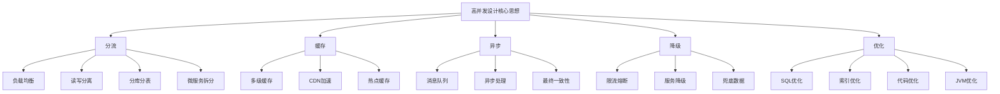
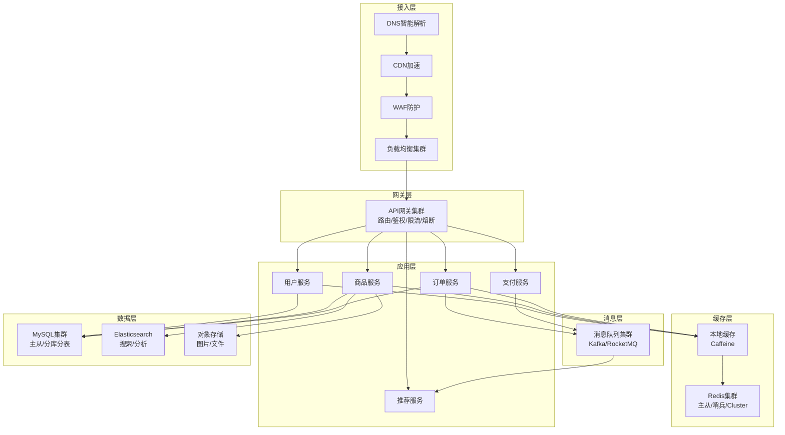
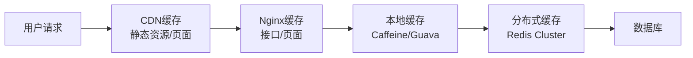
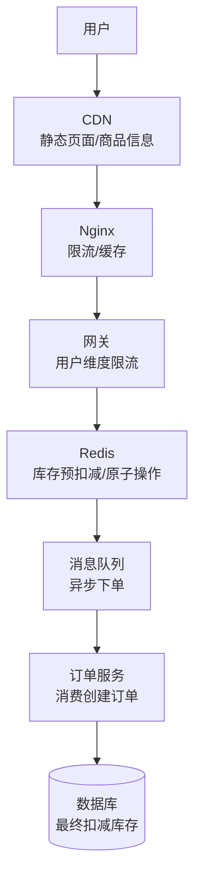
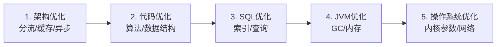

# 高并发系统设计案例

> **文档说明**：系统讲解高并发系统的设计方法论，包括性能指标、分层架构、缓存策略、数据库优化、消息队列解耦、服务治理、限流降级，以及秒杀、电商、社交等典型高并发场景的完整设计案例。
>
> **适用人群**：后端开发工程师、系统架构师、需要设计高并发系统的开发者、准备面试的同学
>
> **前置知识**：[[高可用架构设计]]、[[数据库分库分表策略]]、[[Redis数据结构与应用场景]]

---

## 一、概述

**高并发（High Concurrency）** 是指系统在短时间内承受大量请求的能力，是互联网系统设计的核心挑战之一。高并发设计的目标是在有限的资源下，通过合理的架构设计和技术选型，让系统能够承受尽可能大的请求量，同时保持可接受的响应时间和可用性。

### 1. 核心性能指标

| 指标 | 英文 | 说明 | 典型目标 |
|------|------|------|---------|
| **响应时间** | RT (Response Time) | 请求从发出到收到响应的时间 | P99 < 500ms |
| **吞吐量** | TPS/QPS | 每秒处理的请求数/事务数 | 根据业务规模 |
| **并发用户数** | Concurrent Users | 同时在线的用户数 | 根据业务规模 |
| **可用性** | Availability | 系统正常服务的时间比例 | 99.9%+ |
| **错误率** | Error Rate | 请求失败的比例 | < 0.1% |
| **资源利用率** | Resource Utilization | CPU/内存/IO/网络使用率 | CPU 60-70% |

**性能指标之间的关系**：
- 响应时间越短 → 单位时间处理请求越多 → 吞吐量越高
- 并发用户数增加 → 响应时间可能上升 → 吞吐量可能下降（资源瓶颈）
- 可用性和性能需要平衡（过度追求性能可能降低可用性）

### 2. 高并发设计的核心思想



| 思想 | 说明 | 具体手段 |
|------|------|---------|
| **分流** | 将流量分散到多个节点，避免单点瓶颈 | 负载均衡、读写分离、分库分表、微服务 |
| **缓存** | 将热点数据放在离用户更近、更快的地方 | CDN、Nginx缓存、本地缓存、Redis缓存 |
| **异步** | 将非实时操作异步化，快速响应 | 消息队列、异步线程、事件驱动 |
| **降级** | 在系统压力过大时，牺牲非核心功能保核心 | 限流、熔断、降级开关、兜底数据 |
| **优化** | 提升单个请求的处理效率 | SQL优化、索引优化、代码优化、JVM优化 |

### 3. 高并发系统分层架构



---

## 二、缓存策略

### 1. 多级缓存架构



| 缓存层级 | 位置 | 速度 | 容量 | 适用场景 |
|---------|------|------|------|---------|
| **浏览器缓存** | 客户端 | 极快 | 小 | 静态资源、不变页面 |
| **CDN 缓存** | 边缘节点 | 极快 | 大 | 静态资源、热点页面、图片视频 |
| **Nginx 缓存** | 反向代理 | 快 | 中 | 接口响应、页面片段 |
| **本地缓存** | 应用内存 | 极快 | 小 | 热点数据、配置、字典 |
| **分布式缓存** | Redis 集群 | 快 | 大 | 业务数据、会话、计数器 |
| **数据库缓存** | MySQL Buffer Pool | 中 | 大 | 热数据页、索引 |

### 2. 缓存模式

| 模式 | 说明 | 优点 | 缺点 | 适用场景 |
|------|------|------|------|---------|
| **Cache Aside（旁路缓存）** | 读：先查缓存，没有查DB再写缓存；写：先更新DB再删缓存 | 简单，最常用 | 缓存和DB可能短暂不一致 | 大多数场景（推荐） |
| **Read Through（读穿透）** | 缓存层负责读DB并回填 | 应用层简单 | 缓存层需实现读逻辑 | 缓存框架支持时 |
| **Write Through（写穿透）** | 写时同时写缓存和DB | 缓存和DB一致 | 写延迟增加 | 一致性要求高 |
| **Write Behind（写回）** | 写时只写缓存，异步刷DB | 写性能极高 | 可能丢数据，一致性差 | 写多读少，可容忍丢失 |

**Cache Aside 标准流程**（最常用）：

```text
读操作：
1. 查询缓存
2. 缓存命中 → 直接返回
3. 缓存未命中 → 查询数据库
4. 数据库返回 → 写入缓存（设置过期时间）
5. 返回数据

写操作：
1. 更新数据库
2. 删除缓存（不是更新缓存！）
3. 返回成功
```

**为什么是删除缓存而不是更新缓存？**
- 删除缓存简单，下次读取时自动回填最新数据
- 更新缓存可能导致并发写时缓存被旧值覆盖
- 删除缓存是最终一致性的标准做法

### 3. 缓存三大问题及解决方案

| 问题 | 说明 | 解决方案 |
|------|------|---------|
| **缓存穿透** | 查询不存在的数据，请求直达DB | 布隆过滤器、缓存空值（短TTL） |
| **缓存击穿** | 热点key过期，大量请求同时打DB | 互斥锁（只让一个请求查DB）、热点key永不过期+异步更新 |
| **缓存雪崩** | 大量key同时过期，或Redis宕机 | 过期时间加随机值、多级缓存、Redis高可用、限流降级 |

**缓存穿透 - 布隆过滤器**：
```java
// Guava BloomFilter
BloomFilter<String> bloomFilter = BloomFilter.create(
    Funnels.stringFunnel(StandardCharsets.UTF_8),
    1000000,  // 预期插入数量
    0.01      // 误判率
);

// 初始化：将所有存在的商品ID加入布隆过滤器
for (Long productId : allProductIds) {
    bloomFilter.put(String.valueOf(productId));
}

// 查询时先判断
public Product getProduct(Long id) {
    // 布隆过滤器判断不存在 → 一定不存在，直接返回
    if (!bloomFilter.mightContain(String.valueOf(id))) {
        return null;
    }
    // 可能存在 → 查缓存/DB
    return productMapper.selectById(id);
}
```

**缓存击穿 - 互斥锁**：
```java
public Product getProductWithLock(Long id) {
    String key = "product:" + id;
    String lockKey = "lock:product:" + id;

    // 1. 查缓存
    Product product = redisTemplate.opsForValue().get(key);
    if (product != null) {
        return product;
    }

    // 2. 缓存未命中，尝试获取互斥锁
    boolean locked = redisTemplate.opsForValue()
        .setIfAbsent(lockKey, "1", 10, TimeUnit.SECONDS);

    if (locked) {
        try {
            // 3. 获取锁成功，查数据库
            product = productMapper.selectById(id);
            if (product != null) {
                redisTemplate.opsForValue().set(key, product, 30, TimeUnit.MINUTES);
            } else {
                // 缓存空值，防止穿透
                redisTemplate.opsForValue().set(key, new Product(), 5, TimeUnit.MINUTES);
            }
            return product;
        } finally {
            // 4. 释放锁
            redisTemplate.delete(lockKey);
        }
    } else {
        // 5. 未获取锁，等待后重试
        try {
            Thread.sleep(50);
        } catch (InterruptedException e) {
            Thread.currentThread().interrupt();
        }
        return getProductWithLock(id);  // 递归重试
    }
}
```

**缓存雪崩 - 随机过期时间**：
```java
// 设置过期时间时加随机值，避免同时过期
public void setWithRandomTTL(String key, Object value, long baseTTL) {
    long randomTTL = baseTTL + ThreadLocalRandom.current().nextLong(0, baseTTL / 10);
    redisTemplate.opsForValue().set(key, value, randomTTL, TimeUnit.SECONDS);
}

// 使用示例：基础30分钟 + 0~3分钟随机
setWithRandomTTL("product:" + id, product, 1800);
```

### 4. 缓存一致性

缓存和数据库的一致性是高并发系统的经典问题。

| 方案 | 一致性 | 复杂度 | 说明 |
|------|--------|--------|------|
| **先更新DB再删缓存** | 最终一致 | 低 | 标准方案，有短暂不一致窗口 |
| **先删缓存再更新DB** | 最终一致 | 低 | 有并发问题（读请求回填旧值） |
| **延迟双删** | 最终一致 | 中 | 删缓存→更新DB→延迟再删缓存 |
| **订阅binlog** | 最终一致 | 高 | 监听DB binlog，异步删除/更新缓存 |
| **强一致（2PC）** | 强一致 | 极高 | 分布式事务，性能差，不推荐 |

**推荐方案**：先更新数据库，再删除缓存（Cache Aside 标准）。对于一致性要求高的场景，使用延迟双删或订阅 binlog。

**延迟双删**：
```java
@Transactional
public void updateProduct(Product product) {
    // 1. 先删缓存
    redisTemplate.delete("product:" + product.getId());

    // 2. 更新数据库
    productMapper.updateById(product);

    // 3. 延迟再删缓存（防止并发读回填旧值）
    threadPool.schedule(() -> {
        redisTemplate.delete("product:" + product.getId());
    }, 500, TimeUnit.MILLISECONDS);
}
```

---

## 三、数据库优化

### 1. 读写分离

```mermaid
graph TB
    App[应用] --> Proxy[数据库代理<br/>MyCat/ShardingSphere]
    Proxy -->|写| Master[(主库)]
    Proxy -->|读| Slave1[(从库1)]
    Proxy -->|读| Slave2[(从库2)]
    Master -->|binlog复制| Slave1
    Master -->| Slave2
```

| 方案 | 说明 | 优点 | 缺点 |
|------|------|------|------|
| **客户端路由** | 应用层判断读写，连接不同库 | 简单，无中间件 | 代码耦合，需处理连接 |
| **代理层路由** | MyCat/ShardingSphere Proxy 自动路由 | 对应用透明 | 多一层代理，延迟增加 |
| **框架支持** | ShardingSphere-JDBC / Spring 动态数据源 | 灵活 | 需配置 |

**读写分离的问题**：
- **主从延迟**：写主库后立即读从库可能读不到最新数据 → 关键读走主库 / 强制主库读 / 半同步复制
- **一致性**：从库数据可能落后 → 对一致性要求高的读走主库

### 2. 分库分表

详见 [[数据库分库分表策略]]。核心策略：
- **垂直分库**：按业务模块拆分（用户库、订单库、商品库）
- **水平分表**：单表数据量大时按规则拆分（取模/范围/一致性哈希）
- **分库分表工具**：ShardingSphere（推荐）、MyCat、Vitess

### 3. SQL 优化

| 优化方向 | 具体手段 |
|---------|---------|
| **索引优化** | 为 WHERE/JOIN/ORDER BY/GROUP BY 建索引，联合索引最左前缀，覆盖索引 |
| **查询优化** | 避免 SELECT *，只查需要的列；避免大表 JOIN；子查询改 JOIN；LIMIT 分页优化 |
| **表结构优化** | 合适的字段类型，避免 NULL，避免大字段，垂直拆表 |
| **执行计划** | EXPLAIN 分析，关注 type/key/rows/Extra |
| **慢查询日志** | 开启 slow_query_log，定期分析慢 SQL |

**深分页优化**：
```sql
-- ❌ 深分页性能差（扫描 100010 行）
SELECT * FROM order ORDER BY id LIMIT 100000, 10;

-- ✅ 游标分页（基于上一页最后一个ID）
SELECT * FROM order WHERE id > 100000 ORDER BY id LIMIT 10;

-- ✅ 延迟关联（先查ID再关联）
SELECT o.* FROM order o
INNER JOIN (SELECT id FROM order ORDER BY id LIMIT 100000, 10) t
ON o.id = t.id;
```

---

## 四、消息队列解耦

### 1. 消息队列的作用

| 作用 | 说明 | 示例 |
|------|------|------|
| **解耦** | 生产者和消费者不需要知道对方存在 | 订单创建后发消息，库存/积分/通知各自消费 |
| **异步** | 非实时操作异步处理，快速响应 | 下单后异步发短信/邮件/推送 |
| **削峰** | 高峰期请求先入队，消费者按能力处理 | 秒杀订单先入队，后端按库存能力消费 |
| **缓冲** | 保护下游服务不被突发流量打垮 | 日志收集先入队，再批量写入ES |

### 2. 消息队列选型

详见 [[消息队列-Kafka与RabbitMQ]]。

| MQ | 吞吐量 | 延迟 | 可靠性 | 适用场景 |
|----|--------|------|--------|---------|
| **Kafka** | 极高（百万级/s） | 中（批量） | 高 | 日志、大数据流、事件溯源 |
| **RocketMQ** | 高（十万级/s） | 低 | 极高（事务消息） | 电商、金融、事务消息 |
| **RabbitMQ** | 中（万级/s） | 极低（微秒） | 高 | 业务解耦、任务分发、路由 |
| **Pulsar** | 极高 | 低 | 高 | 云原生、多租户 |

### 3. 消息可靠性

| 环节 | 可靠性保障 |
|------|-----------|
| **生产端** | 发送确认（ACK）、重试机制、本地消息表 |
| **Broker** | 持久化、多副本、刷盘策略 |
| **消费端** | 手动ACK、幂等消费、死信队列、重试机制 |
| **最终一致性** | 本地消息表 + 定时补偿、事务消息（RocketMQ） |

**幂等消费实现**：
```java
// 消费消息时保证幂等（避免重复消费）
@RabbitListener(queues = "order.queue")
public void handleOrderMessage(OrderMessage message, Channel channel,
                                 @Header(AmqpHeaders.DELIVERY_TAG) long tag) throws IOException {
    try {
        // 1. 幂等检查：用消息ID去重
        if (redisTemplate.opsForValue().setIfAbsent(
                "msg:consumed:" + message.getMessageId(), "1", 24, TimeUnit.HOURS)) {
            // 2. 处理业务逻辑
            orderService.processOrder(message.getOrderId());
        }
        // 3. 手动ACK
        channel.basicAck(tag, false);
    } catch (Exception e) {
        // 4. 处理失败，NACK 并重试（或入死信队列）
        channel.basicNack(tag, false, true);
    }
}
```

---

## 五、典型高并发场景设计

### 1. 秒杀系统设计

详见 [[秒杀系统架构设计]]。

**核心挑战**：瞬时高并发（平时 QPS 100，秒杀时 QPS 10万+）、库存超卖、服务雪崩。

**核心方案**：



| 环节 | 方案 |
|------|------|
| **前端** | 按钮置灰、倒计时、静态页面CDN、验证码防刷 |
| **接入层** | Nginx限流、WAF防护、黑名单 |
| **网关层** | 用户维度限流（每人每秒1次）、Token校验 |
| **库存层** | Redis原子操作（DECR）预扣库存，避免超卖 |
| **下单层** | 消息队列异步下单，削峰填谷 |
| **数据层** | 数据库最终扣减库存，乐观锁防超卖 |
| **结果查询** | 轮询/长轮询/WebSocket 查询下单结果 |

**Redis 原子扣减库存**：
```java
// Lua 脚本保证原子性：检查库存 > 0 才扣减
String script = """
    local stock = tonumber(redis.call('GET', KEYS[1]))
    if stock == nil or stock <= 0 then
        return -1
    end
    redis.call('DECR', KEYS[1])
    return stock - 1
    """;

public Long seckill(Long productId, Long userId) {
    String stockKey = "seckill:stock:" + productId;
    String userKey = "seckill:user:" + productId + ":" + userId;

    // 1. 防重复购买（每人限购1件）
    if (redisTemplate.opsForSet().isMember(userKey, userId.toString())) {
        return -2L;  // 已购买
    }

    // 2. 原子扣减库存
    Long result = redisTemplate.execute(
        new DefaultRedisScript<>(script, Long.class),
        Collections.singletonList(stockKey));

    if (result != null && result >= 0) {
        // 3. 扣减成功，标记用户已购买
        redisTemplate.opsForSet().add(userKey, userId.toString());
        // 4. 发送消息异步下单
        mqService.sendSeckillOrder(productId, userId);
    }
    return result;
}
```

### 2. 电商订单系统设计

**核心挑战**：高并发下单、分布式事务、库存一致性、订单状态流转。

**核心方案**：

| 模块 | 方案 |
|------|------|
| **商品服务** | 商品信息缓存（Redis）、库存分桶（避免单点竞争） |
| **订单服务** | 订单号雪花算法、订单分库分表（按用户ID） |
| **库存服务** | Redis预扣 + DB最终扣、乐观锁、库存分桶 |
| **支付服务** | 支付回调幂等、超时未支付自动取消 |
| **消息服务** | 订单创建/支付/取消事件驱动，异步解耦 |

**订单状态机**：
```text
待支付 → 已支付 → 已发货 → 已完成
  ↓         ↓
已取消    退款中 → 已退款
```

### 3. 社交Feed流设计

**核心挑战**：大V粉丝百万级，发一条动态需要推送给百万粉丝，读扩散 vs 写扩散。

| 方案 | 说明 | 优点 | 缺点 | 适用 |
|------|------|------|------|------|
| **读扩散（拉模式）** | 发动态只写自己的Feed，用户读时拉取所有关注的人的动态 | 写简单，省存储 | 读复杂，延迟高 | 普通用户 |
| **写扩散（推模式）** | 发动态时推送到所有粉丝的收件箱 | 读简单，延迟低 | 写复杂，大V推送慢 | 普通用户 |
| **推拉结合** | 普通用户写扩散，大V读扩散 | 兼顾读写 | 实现复杂 | 大规模社交 |

**推拉结合方案**：
- 粉丝数 < 阈值（如1万）：写扩散，推送到粉丝收件箱
- 粉丝数 ≥ 阈值：读扩散，只写自己的Feed，粉丝读时合并拉取
- 用户登录时：合并"推模式收件箱" + "关注的大V的Feed"

---

## 六、服务治理

### 1. 限流

详见 [[Gateway-网关路由与鉴权]] 限流章节。多级限流：Nginx → 网关 → 服务 → 数据库。

### 2. 熔断降级

详见 [[高可用架构设计]] 熔断章节。核心：服务故障时快速失败，返回降级结果，防止雪崩。

### 3. 服务隔离

| 隔离方式 | 说明 | 工具 |
|---------|------|------|
| **线程池隔离** | 不同服务用不同线程池，避免互相影响 | Hystrix、Resilience4j |
| **信号量隔离** | 用信号量控制并发数 | Resilience4j、Sentinel |
| **舱壁模式** | 资源隔离，一个服务故障不影响其他 | 线程池/信号量/进程隔离 |
| **服务拆分** | 按业务拆分为独立服务 | 微服务架构 |

### 4. 容量规划

| 步骤 | 说明 |
|------|------|
| **评估峰值QPS** | 根据业务预估峰值（如秒杀10万QPS） |
| **单实例容量** | 压测单实例能承受的QPS（如500 QPS） |
| **实例数量** | 峰值QPS / 单实例QPS × 冗余系数（1.5~2） |
| **数据库容量** | 连接数、TPS、存储容量评估 |
| **缓存容量** | 热点数据量、内存容量评估 |
| **带宽容量** | 出入带宽评估 |
| **压测验证** | 全链路压测验证容量规划 |

---

## 七、性能优化方法论

### 1. 优化优先级



**原则**：先架构优化（收益最大），再代码/SQL优化，最后JVM/OS优化（收益最小）。不要本末倒置。

### 2. 性能分析工具

| 层面 | 工具 | 说明 |
|------|------|------|
| **应用层** | Arthas、JProfiler、VisualVM | Java 应用诊断 |
| **数据库层** | EXPLAIN、慢查询日志、show profile | SQL 分析 |
| **系统层** | top、vmstat、iostat、netstat、pidstat | 系统资源监控 |
| **网络层** | tcpdump、Wireshark、iftop | 网络分析 |
| **全链路** | SkyWalking、Pinpoint、Jaeger | 分布式链路追踪 |
| **压测** | JMeter、Gatling、wrk、ab | 压力测试 |

### 3. 常见性能瓶颈

| 瓶颈 | 表现 | 解决方案 |
|------|------|---------|
| **CPU 瓶颈** | CPU 使用率高，负载高 | 算法优化、异步处理、增加实例 |
| **内存瓶颈** | Full GC 频繁，OOM | 内存泄漏排查、JVM调优、增加内存 |
| **IO 瓶颈** | iowait 高，磁盘读写慢 | 索引优化、分库分表、SSD、缓存 |
| **网络瓶颈** | 带宽打满，连接数高 | 压缩、CDN、连接池优化、增加带宽 |
| **数据库瓶颈** | 慢查询多，锁等待 | 索引优化、SQL优化、读写分离、分库分表 |
| **锁瓶颈** | 线程阻塞，并发上不去 | 锁粒度优化、无锁设计、乐观锁、分段锁 |

---

## 八、常见问题与排查

| 问题 | 原因 | 解决方案 |
|------|------|---------|
| 接口响应慢 | 慢SQL / 未命中缓存 / 远程调用慢 | EXPLAIN分析SQL，检查缓存命中率，链路追踪定位 |
| 数据库CPU高 | 慢查询 / 锁等待 / 连接数过多 | 慢查询日志，优化SQL，检查锁，连接池配置 |
| Redis内存满 | 数据量过大 / 大key / 内存碎片 | 配置淘汰策略，拆分大key，内存碎片整理 |
| 消息积压 | 消费者处理慢 / 消费者故障 | 扩容消费者，优化消费逻辑，死信队列 |
| 服务雪崩 | 下游服务故障未熔断 | 配置熔断降级，超时控制，隔离 |
| 超卖 | 并发扣减库存无原子性 | Redis原子操作，数据库乐观锁，分布式锁 |
| 重复消费 | 消息重试 / 消费者重启 | 消费幂等（消息ID去重） |
| 缓存不一致 | 并发读写 / 删除缓存失败 | 延迟双删，订阅binlog，最终一致性容忍 |
| 连接数耗尽 | 连接池配置不合理 / 连接泄漏 | 调整连接池，检查连接泄漏，超时回收 |
| Full GC频繁 | 内存泄漏 / 大对象 / 堆内存不足 | 内存泄漏分析，GC调优，增加堆内存 |

---

## 九、关联笔记

### 架构
- [[高可用架构设计]] · [[微服务架构核心概念]] · [[分布式事务解决方案]]
- [[领域驱动设计DDD]] · [[技术选型决策指南]]

### 数据库
- [[关系型数据库索引原理]] · [[数据库分库分表策略]] · [[事务隔离级别与MVCC]]
- [[MySQL-性能优化实战]] · [[Redis数据结构与应用场景]]

### 中间件
- [[消息队列-Kafka与RabbitMQ]] · [[Redis-分布式锁与缓存穿透]]
- [[数据库连接池-HikariCP与Druid]]

### 后端
- [[SpringBoot-自动装配原理]] · [[Gateway-网关路由与鉴权]] · [[SpringCache-缓存抽象]]
- [[统一AI网关设计与实现]]

### 云原生
- [[Docker-核心原理与镜像优化]] · [[K8s-核心概念与架构]] · [[K8s-弹性伸缩HPA]]
- [[Prometheus监控体系]] · [[Nginx-反向代理与负载均衡]]

### 实战
- [[秒杀系统架构设计]] · [[秒杀系统架构设计]] · [[支付系统架构设计]]

### 导航
- [[MOC-后端开发]] · [[MOC-云原生与运维]] · [[全栈+AI工程双轨融合学习路线图]]

> **学习路径建议**：先掌握 [[高可用架构设计]] 高可用基础 → 深入本文高并发设计 → 学习 [[关系型数据库索引原理]] 和 [[数据库分库分表策略]] 数据库优化 → 研究 [[Redis数据结构与应用场景]] 和 [[消息队列-Kafka与RabbitMQ]] 中间件 → 实践 [[秒杀系统架构设计]] 和 [[秒杀系统架构设计]] 典型场景 → 完善 [[Prometheus监控体系]] 可观测性。

---

## 🔗 关联笔记

- [[MOC-项目实战]] — 返回本分类知识地图，查看更多相关文档

## 📖 前置知识

- [[高可用架构设计]]
- [[数据库分库分表策略]]

## 🏷️ 相关标签

`#架构设计` `#系统设计` `#原子笔记`

[[Home|🏠 返回首页]] · [[MOC-项目实战|📚 返回分类]]
