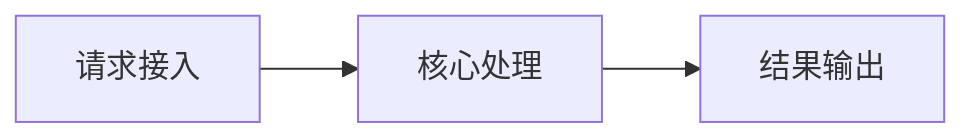

# API 契约测试与 Mock

> **文档说明**：本文档系统讲解API 契约测试与 Mock的核心概念、底层原理、实操用法、常见问题与最佳实践，帮助读者从入门到精通。
>
> **适用人群**：项目实战方向开发者、需要系统掌握该技术的工程师
>
> **前置知识**：具备相关领域基础概念即可阅读

---

## 一、概述

契约测试验证服务提供者和消费者是否遵守共同API约定。Mock服务让前端在后端未完成时独立开发。
### 1. 核心应用场景

- **异步处理**：将耗时操作从主流程剥离，提升响应速度
- **系统解耦**：通过消息中间件实现模块间松耦合
- **流量削峰**：高并发场景下缓冲请求，保护后端服务
- **定时任务**：支持周期性任务调度，替代传统cron

### 2. 核心优势

| 优势 | 说明 |
|------|------|
| 高性能 | 基于高效的并发模型，支持大规模任务处理 |
| 高可用 | 支持任务重试、失败转移，确保任务不丢失 |
| 易扩展 | Worker水平扩展，应对增长的任务量 |
| 可观测 | 提供监控面板，实时追踪任务状态 |

## 二、底层原理

消费者驱动契约（CDC）：消费者定义期望，提供者验证。Mock服务拦截HTTP请求返回预设响应，支持延迟、错误、动态数据。
### 1. 核心流程



<div style="background:linear-gradient(135deg,#ffecd2,#fcb69f);border-radius:16px;padding:20px;margin:16px 0;font-family:-apple-system,'Segoe UI','PingFang SC','Microsoft YaHei',sans-serif;color:#fff;overflow:hidden;box-shadow:0 8px 28px rgba(0,0,0,.14),0 3px 10px rgba(0,0,0,.08)">
<style>@keyframes flow{0%{transform:translateX(-10px);opacity:0}15%{transform:translateX(0);opacity:1}85%{transform:translateX(0);opacity:1}100%{transform:translateX(10px);opacity:0}}.flow-step{display:inline-block;background:rgba(255,255,255,.2);border:2px solid rgba(255,255,255,.5);border-radius:8px;padding:10px 14px;margin:4px;text-align:center;font-weight:600;font-size:13px;animation:flow 4s ease-in-out infinite;min-width:80px}.flow-arrow{display:inline-block;font-size:20px;animation:flow 4s ease-in-out infinite;vertical-align:middle}</style>
<div style="text-align:center;font-size:15px;font-weight:700;margin-bottom:14px;padding-bottom:10px;border-bottom:1.5px solid rgba(255,255,255,.22);letter-spacing:1px;text-shadow:0 1px 3px rgba(0,0,0,.12)">API 契约测试与 Mock核心流程</div>
<div style="text-align:center;white-space:nowrap;overflow-x:auto"><span class="flow-step" style="animation-delay:0.0s">请求接入</span><span class="flow-arrow">→</span><span class="flow-step" style="animation-delay:0.4s">核心处理</span><span class="flow-arrow">→</span><span class="flow-step" style="animation-delay:0.8s">结果输出</span></div>
</div>

## 三、实操示例

### Mockoon Mock 服务
JSON配置路由和响应，支持动态参数和状态码。

### Vite 开发代理
```typescript
server: { proxy: { '/api': { target: 'http://localhost:3001', changeOrigin: true } } }
```
### Pact 契约测试
消费者侧定义interaction，提供者侧验证，契约文件纳入版本控制。

## 四、常见问题与排查

- Mock数据与真实接口不一致 → 从OpenAPI生成Mock
- 契约测试维护成本高 → 只对核心接口做契约测试
- Mock无法模拟复杂场景 → 使用可编程Mock（MSW）
### 常见问题排查表

| 问题现象 | 可能原因 | 解决方案 |
|---------|---------|---------|
| Mock数据与真实接口不一致 | 配置/环境/依赖问题 | 从OpenAPI生成Mock |
| 契约测试维护成本高 | 配置/环境/依赖问题 | 只对核心接口做契约测试 |
| Mock无法模拟复杂场景 | 配置/环境/依赖问题 | 使用可编程Mock（MSW） |

- 契约测试维护成本高 → 只对核心接口做契约测试
- Mock无法模拟复杂场景 → 使用可...
>
> **原理**：通过核心机制实现关键功能
>
> **用法要点**：① - Mock数据与真实接口不一致 → 从OpenAPI生成Mock
- 契约测试维护成本高 → 只对

---

## 五、进阶与最佳实践

- MSW（Mock Service Worker）浏览器层Mock
- 契约文件CI自动验证
- Mock支持动态响应
- 定期同步Mock和真实接口
### 生产环境最佳实践

1. **配置管理**：使用配置中心管理敏感信息，避免硬编码
2. **监控告警**：接入APM监控，设置关键指标告警阈值
3. **日志规范**：结构化日志输出，包含traceId便于链路追踪
4. **资源限制**：设置合理的超时、重试、熔断策略
5. **版本管理**：API版本化，平滑升级避免破坏性变更

- 契约文件CI自动验证
- Mock支持动态响应
- 定期同步Mock和真实接口
###...
>
> **原理**：通过核心机制实现关键功能
>
> **用法要点**：① - MSW（Mock Service Worker）浏览器层Mock
- 契约文件CI自动验证
- 

---

## 六、关联笔记

[[前后端联调规范与流程]] · [[Mock服务与接口模拟-Mockoon]] · [[API设计规范-OpenAPI]]

---

## 🔗 关联笔记

- [[MOC-项目实战]] — 返回本分类知识地图，查看更多相关文档

## 📖 前置知识

- [['前后端联调规范与流程']]

## 🏷️ 相关标签

`#项目实战`

[[Home|🏠 返回首页]] · [[MOC-项目实战|📚 返回分类]]
