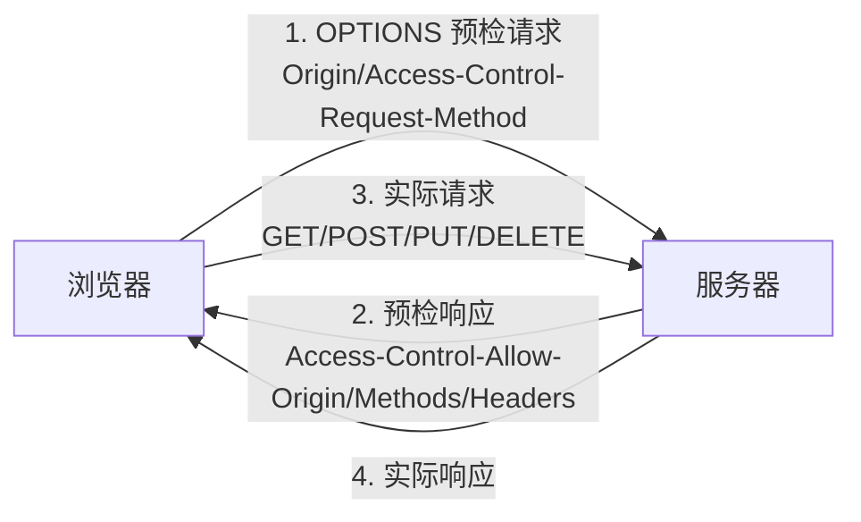

# CORS跨域解决方案实战

> **文档说明**：系统讲解 CORS（跨域资源共享）的原理、同源策略、简单请求与预检请求、CORS 响应头详解、Spring Boot/Nginx 配置、带凭证跨域、文件上传跨域、常见问题排查，以及生产级最佳实践。
>
> **适用人群**：全栈开发者、前端开发工程师、后端开发工程师、需要处理跨域问题的开发者
>
> **前置知识**：[[前后端联调规范与流程]]、[[RESTfulAPI设计原则]]、[[API安全最佳实践]]、[[计算机网络-HTTP协议详解]]

---

## 一、概述

### 1. 同源策略

**同源策略（Same-Origin Policy）** 是浏览器的安全机制，限制不同源的文档或脚本如何交互。同源指**协议、域名、端口**三者完全相同。

| URL | 是否同源 | 原因 |
|-----|---------|------|
| `http://example.com/a` vs `http://example.com/b` | ✅ 同源 | 协议、域名、端口相同 |
| `http://example.com` vs `https://example.com` | ❌ 跨域 | 协议不同 |
| `http://example.com` vs `http://api.example.com` | ❌ 跨域 | 域名不同 |
| `http://example.com:8080` vs `http://example.com:3000` | ❌ 跨域 | 端口不同 |
| `http://example.com` vs `http://example.com:80` | ✅ 同源 | 80 是 HTTP 默认端口 |

### 2. 什么是 CORS

**CORS（Cross-Origin Resource Sharing，跨域资源共享）** 是 W3C 标准，允许服务器声明哪些源有权限访问其资源，是跨域问题的标准解决方案。

### 3. 跨域场景

| 场景 | 说明 |
|------|------|
| **前后端分离** | 前端 `app.example.com` 调用 API `api.example.com` |
| **微服务前端** | 前端调用多个不同域名的微服务 |
| **第三方 API** | 调用第三方服务（支付、地图、短信） |
| **CDN 资源** | 静态资源从 CDN 域名加载 |
| **文件上传** | 上传文件到对象存储（OSS/S3） |
| **WebSocket** | 连接不同域名的 WebSocket 服务 |

---

## 二、CORS 请求类型

### 1. 简单请求（Simple Request）

满足以下全部条件的请求为简单请求，浏览器直接发送，不发预检：

| 条件 | 说明 |
|------|------|
| **方法** | GET、POST、HEAD 之一 |
| **请求头** | 仅 Accept、Accept-Language、Content-Language、Content-Type |
| **Content-Type** | 仅 `application/x-www-form-urlencoded`、`multipart/form-data`、`text/plain` |

```text
简单请求流程：
1. 浏览器直接发送请求，携带 Origin 头
2. 服务器返回响应，携带 Access-Control-Allow-Origin 头
3. 浏览器检查响应头，决定是否允许前端读取响应
```

### 2. 预检请求（Preflight Request）

不满足简单请求条件的请求，浏览器会先发送 OPTIONS 预检请求，服务器确认后才发送实际请求。



**预检请求头**：

| 请求头 | 说明 |
|--------|------|
| `Origin` | 请求来源 |
| `Access-Control-Request-Method` | 实际请求的方法 |
| `Access-Control-Request-Headers` | 实际请求的自定义头 |

**预检响应头**：

| 响应头 | 说明 |
|--------|------|
| `Access-Control-Allow-Origin` | 允许的源 |
| `Access-Control-Allow-Methods` | 允许的方法 |
| `Access-Control-Allow-Headers` | 允许的自定义头 |
| `Access-Control-Max-Age` | 预检结果缓存时间（秒） |

---

## 三、CORS 响应头详解

| 响应头 | 说明 | 示例 |
|--------|------|------|
| `Access-Control-Allow-Origin` | 允许的源，`*` 表示所有源（不能与凭证共用） | `https://app.example.com` |
| `Access-Control-Allow-Methods` | 允许的 HTTP 方法 | `GET, POST, PUT, DELETE, OPTIONS` |
| `Access-Control-Allow-Headers` | 允许的请求头 | `Content-Type, Authorization` |
| `Access-Control-Expose-Headers` | 允许前端读取的响应头 | `X-Total-Count, X-Request-Id` |
| `Access-Control-Max-Age` | 预检结果缓存时间 | `86400`（1天） |
| `Access-Control-Allow-Credentials` | 是否允许携带凭证（Cookie） | `true` |

```text
### 1. Access-Control-Allow-Origin
```

```css
# 允许所有源（不能带凭证）
Access-Control-Allow-Origin: *

# 允许特定源
Access-Control-Allow-Origin: https://app.example.com

# 动态匹配（服务端根据 Origin 头返回）
Access-Control-Allow-Origin: https://app.example.com
Vary: Origin  # 重要：告知浏览器响应因 Origin 不同
```

> **注意**：`*` 不能与 `Access-Control-Allow-Credentials: true` 同时使用。带凭证时必须指定具体源。

```text
### 2. Access-Control-Allow-Credentials
```

```css
# 允许携带 Cookie/Authorization
Access-Control-Allow-Credentials: true

前端需配合：
fetch(url, { credentials: 'include' })
axios.defaults.withCredentials = true
```

```text
### 3. Access-Control-Expose-Headers
```

默认前端只能读取基本响应头（Cache-Control、Content-Language、Content-Type、Expires、Last-Modified、Pragma）。自定义头需显式暴露：

```text
Access-Control-Expose-Headers: X-Total-Count, X-Request-Id, X-Page-Count
```

---

## 四、Spring Boot CORS 配置

### 1. 全局配置（推荐）

```java
@Configuration
public class CorsConfig {

    @Bean
    public CorsFilter corsFilter() {
        CorsConfiguration config = new CorsConfiguration();

        // 允许的源（带凭证时不能用 *）
        config.setAllowedOrigins(List.of(
            "https://app.example.com",
            "https://admin.example.com"
        ));
        // 或使用模式匹配
        // config.setAllowedOriginPatterns(List.of("https://*.example.com"));

        // 允许的方法
        config.setAllowedMethods(List.of("GET", "POST", "PUT", "DELETE", "OPTIONS"));

        // 允许的头
        config.setAllowedHeaders(List.of("*"));

        // 暴露的响应头
        config.setExposedHeaders(List.of("X-Total-Count", "X-Request-Id"));

        // 允许携带凭证
        config.setAllowCredentials(true);

        // 预检缓存时间
        config.setMaxAge(3600L);

        UrlBasedCorsConfigurationSource source = new UrlBasedCorsConfigurationSource();
        source.registerCorsConfiguration("/**", config);
        return new CorsFilter(source);
    }
}
```

### 2. WebMvcConfigurer 配置

```java
@Configuration
public class WebConfig implements WebMvcConfigurer {

    @Override
    public void addCorsMappings(CorsRegistry registry) {
        registry.addMapping("/api/**")
            .allowedOrigins("https://app.example.com")
            .allowedMethods("GET", "POST", "PUT", "DELETE", "OPTIONS")
            .allowedHeaders("*")
            .exposedHeaders("X-Total-Count")
            .allowCredentials(true)
            .maxAge(3600);
    }
}
```

### 3. 注解方式（局部）

```java
@RestController
@RequestMapping("/api/users")
@CrossOrigin(origins = "https://app.example.com", allowCredentials = "true")
public class UserController {

    @GetMapping
    @CrossOrigin(origins = "https://special.example.com")  // 方法级覆盖
    public List<User> list() {
        return userService.list();
    }
}
```

### 4. Spring Security 配置

```java
@Configuration
public class SecurityConfig {

    @Bean
    public SecurityFilterChain filterChain(HttpSecurity http) throws Exception {
        http
            .cors(cors -> cors.configurationSource(corsConfigurationSource()))
            .csrf(csrf -> csrf.disable())  // API 服务禁用 CSRF
            // ... 其他配置
        return http.build();
    }

    @Bean
    public CorsConfigurationSource corsConfigurationSource() {
        CorsConfiguration config = new CorsConfiguration();
        config.setAllowedOriginPatterns(List.of("https://*.example.com"));
        config.setAllowedMethods(List.of("*"));
        config.setAllowedHeaders(List.of("*"));
        config.setAllowCredentials(true);
        config.setMaxAge(3600L);

        UrlBasedCorsConfigurationSource source = new UrlBasedCorsConfigurationSource();
        source.registerCorsConfiguration("/**", config);
        return source;
    }
}
```

---

## 五、Nginx CORS 配置

### 1. 简单配置

```nginx
location /api/ {
    # 简单请求
    if ($request_method = 'OPTIONS') {
        add_header 'Access-Control-Allow-Origin' 'https://app.example.com';
        add_header 'Access-Control-Allow-Methods' 'GET, POST, PUT, DELETE, OPTIONS';
        add_header 'Access-Control-Allow-Headers' 'Content-Type, Authorization';
        add_header 'Access-Control-Max-Age' 86400;
        add_header 'Content-Type' 'text/plain; charset=utf-8';
        add_header 'Content-Length' 0;
        return 204;
    }

    # 实际请求
    add_header 'Access-Control-Allow-Origin' 'https://app.example.com' always;
    add_header 'Access-Control-Allow-Credentials' 'true' always;
    add_header 'Access-Control-Expose-Headers' 'X-Total-Count' always;

    proxy_pass http://backend;
}
```

### 2. 动态 Origin 匹配

```nginx
location /api/ {
    # 允许的域名列表
    set $cors_origin "";
    if ($http_origin ~* "^https://(app|admin|m)\.example\.com$") {
        set $cors_origin $http_origin;
    }

    if ($request_method = 'OPTIONS') {
        add_header 'Access-Control-Allow-Origin' $cors_origin;
        add_header 'Access-Control-Allow-Methods' 'GET, POST, PUT, DELETE, OPTIONS';
        add_header 'Access-Control-Allow-Headers' 'Content-Type, Authorization';
        add_header 'Access-Control-Allow-Credentials' 'true';
        add_header 'Access-Control-Max-Age' 86400;
        return 204;
    }

    add_header 'Access-Control-Allow-Origin' $cors_origin always;
    add_header 'Access-Control-Allow-Credentials' 'true' always;
    add_header 'Vary' 'Origin' always;

    proxy_pass http://backend;
}
```

---

## 六、前端跨域配置

### 1. Fetch API

```javascript
// 带凭证的跨域请求
fetch('https://api.example.com/users', {
  method: 'GET',
  credentials: 'include',  // 携带 Cookie
  headers: {
    'Content-Type': 'application/json',
    'Authorization': 'Bearer token'
  }
})
```

### 2. Axios

```javascript
// 全局配置
import axios from 'axios'

const api = axios.create({
  baseURL: 'https://api.example.com',
  withCredentials: true,  // 携带 Cookie
  timeout: 10000
})

// 请求拦截器
api.interceptors.request.use(config => {
  const token = localStorage.getItem('token')
  if (token) {
    config.headers.Authorization = `Bearer ${token}`
  }
  return config
})
```

### 3. 开发环境代理（Vite）

```typescript
// vite.config.ts
export default defineConfig({
  server: {
    proxy: {
      '/api': {
        target: 'http://localhost:8080',
        changeOrigin: true,
        rewrite: (path) => path.replace(/^\/api/, '')
      },
      '/ws': {
        target: 'ws://localhost:8080',
        ws: true  // WebSocket 代理
      }
    }
  }
})
```

### 4. Webpack DevServer 代理

```javascript
// vue.config.js
module.exports = {
  devServer: {
    proxy: {
      '/api': {
        target: 'http://localhost:8080',
        changeOrigin: true,
        pathRewrite: { '^/api': '' }
      }
    }
  }
}
```

---

## 七、特殊场景

### 1. 带 Cookie 跨域

```text
条件：
1. 服务端：Access-Control-Allow-Credentials: true
2. 服务端：Access-Control-Allow-Origin 必须是具体源（不能是 *）
3. 前端：credentials: 'include' 或 withCredentials: true
4. Cookie：SameSite=None; Secure（跨站 Cookie 必须）

Set-Cookie: session=abc123; Path=/; HttpOnly; Secure; SameSite=None
```

### 2. 文件上传跨域

```javascript
// FormData 文件上传（简单请求，multipart/form-data）
const formData = new FormData()
formData.append('file', file)

fetch('https://api.example.com/upload', {
  method: 'POST',
  body: formData,  // 不要手动设置 Content-Type
  credentials: 'include'
})
```

> **注意**：FormData 上传时不要手动设置 `Content-Type`，浏览器会自动设置含 boundary 的 Content-Type。

### 3. 自定义请求头

```javascript
// 自定义头会触发预检请求
fetch(url, {
  headers: {
    'X-Request-Id': '123',  // 自定义头，触发预检
    'Authorization': 'Bearer token'  // 也会触发预检
  }
})

// 服务端需配置：
// Access-Control-Allow-Headers: X-Request-Id, Authorization
```

### 4. 跨域下载文件

```javascript
// 跨域下载文件（需暴露 Content-Disposition）
async function downloadFile(url) {
  const response = await fetch(url, { credentials: 'include' })
  const blob = await response.blob()
  const disposition = response.headers.get('Content-Disposition')
  const filename = disposition?.split('filename=')[1]?.replace(/"/g, '') || 'download'

  const link = document.createElement('a')
  link.href = URL.createObjectURL(blob)
  link.download = filename
  link.click()
  URL.revokeObjectURL(link.href)
}

// 服务端需配置：
// Access-Control-Expose-Headers: Content-Disposition
```

---

## 八、常见问题与排查

| 问题 | 原因 | 解决方案 |
|------|------|---------|
| **No 'Access-Control-Allow-Origin' header** | 响应缺少 CORS 头 / Origin 不匹配 | 配置 Allow-Origin，检查 Origin 是否在白名单 |
| **预检请求 403/401** | OPTIONS 请求被拦截（Spring Security/过滤器） | 放行 OPTIONS 请求，Security 配置 cors() |
| **带 Cookie 跨域失败** | Allow-Origin 是 * / 前端未设 credentials | Allow-Origin 设具体源，前端 withCredentials=true |
| **Cookie 跨域不携带** | SameSite 不是 None / 非 HTTPS | SameSite=None; Secure，HTTPS 传输 |
| **自定义头读不到** | 未配置 Expose-Headers | 配置 Access-Control-Expose-Headers |
| **预检请求频繁** | Max-Age 未设置 / 太短 | 设置 Access-Control-Max-Age 缓存预检 |
| **文件上传跨域失败** | 手动设置 Content-Type / 方法不允许 | 不手动设 Content-Type，允许 POST |
| **重定向后跨域失败** | 重定向丢失 CORS 头 | 重定向目标也配置 CORS |
| **CDN 缓存错误响应** | Vary 头未设置 | 添加 Vary: Origin 头 |
| **本地开发跨域** | 前后端端口不同 | 配置 devServer proxy 或后端 CORS |
| **OPTIONS 请求到 Controller** | 未正确处理预检 | 用 CorsFilter 或 Spring Security cors() 自动处理 |
| **多域名动态匹配** | 写死单一域名 | 服务端动态读取 Origin 头，白名单校验后返回 |
| **移动端 WebView 跨域** | WebView 安全策略 | 配置 WebView 允许跨域（Android: setAllowUniversalAccessFromFileURLs） |
| **SSE 跨域** | EventSource 不支持自定义头 | Token 放 URL 参数，配置 CORS |
| **WebSocket 跨域** | 握手 Origin 校验失败 | WebSocket 配置 allowedOrigins |

### 排查步骤

```bash
1. 打开浏览器 DevTools → Network
2. 找到失败的请求，查看状态码
3. 如果是 OPTIONS 预检失败：
   - 检查预检响应头是否正确
   - 检查服务器是否处理了 OPTIONS
4. 如果是实际请求失败：
   - 检查 Access-Control-Allow-Origin 是否匹配
   - 检查 Allow-Credentials 配置
5. 查看 Console 面板的具体错误信息
6. 用 curl 模拟请求验证服务端响应头
   curl -I -H "Origin: https://app.example.com" https://api.example.com/users
```

---

## 九、最佳实践

### 1. 安全规范

- [ ] **明确指定源**：生产环境不要用 `*`，明确指定允许的域名
- [ ] **白名单校验**：服务端校验 Origin 头，不在白名单拒绝
- [ ] **Vary: Origin**：响应因 Origin 不同时必须加 Vary 头
- [ ] **限制方法**：只允许需要的 HTTP 方法，不要用 `*`
- [ ] **限制头**：只允许需要的请求头
- [ ] **凭证谨慎**：带凭证时必须指定具体源，不能用 `*`
- [ ] **HTTPS**：生产环境使用 HTTPS，Cookie 设 Secure

### 2. 性能优化

- [ ] **预检缓存**：设置 `Access-Control-Max-Age` 减少预检请求
- [ ] **简单请求优先**：能用简单请求就不用自定义头
- [ ] **CDN 配置**：CDN 层配置 CORS，避免回源
- [ ] **合并请求**：减少跨域请求次数

### 3. 开发规范

- [ ] **开发环境代理**：本地开发用 devServer proxy，避免配置后端 CORS
- [ ] **环境区分**：开发/测试/生产环境的 CORS 源不同，用配置管理
- [ ] **统一配置**：后端统一 CORS 配置，不要每个 Controller 单独配
- [ ] **文档说明**：API 文档说明 CORS 配置和允许的源

---

## 十、关联笔记

### 联调规范
- [[前后端联调规范与流程]] · [[WebSocket-SSE联调实战]] · [[接口测试与Postman实战]]

### 后端
- [[SpringBoot-Web层设计]] · [[SpringSecurity-认证授权]] · [[RESTfulAPI设计原则]]
- [[API安全最佳实践]] · [[Gateway-网关路由与鉴权]]

### 前端
- [[Axios网络请求封装]] · [[Vue3-组合式API设计模式]] · [[前端工程化知识点系统梳理_优化版]]
- [[Vite-构建原理与插件开发]]

### 安全
- [[Web安全-XSS-CSRF-SQL注入]] · [[CSP内容安全策略]] · [[前端敏感数据保护]]

### 导航
- [[MOC-项目实战]] · [[MOC-前端开发]] · [[MOC-后端开发]] · [[全栈+AI工程双轨融合学习路线图]]

> **学习路径建议**：先掌握 [[计算机网络-HTTP协议详解]] HTTP 基础 → 深入本文 CORS 跨域解决方案 → 学习 [[前后端联调规范与流程]] 联调规范 → 实践 [[SpringBoot-Web层设计]] 后端配置 → 研究 [[Gateway-网关路由与鉴权]] 网关层 CORS → 应用于前后端分离项目的跨域问题解决。

---

## 🔗 关联笔记

- [[MOC-项目实战]] — 返回本分类知识地图，查看更多相关文档

## 📖 前置知识

- [[前后端联调规范与流程]]
- [[RESTfulAPI设计原则]]
- [[API安全最佳实践]]

## 🏷️ 相关标签

`#联调` `#跨域` `#前端` `#原子笔记`

[[Home|🏠 返回首页]] · [[MOC-项目实战|📚 返回分类]]
