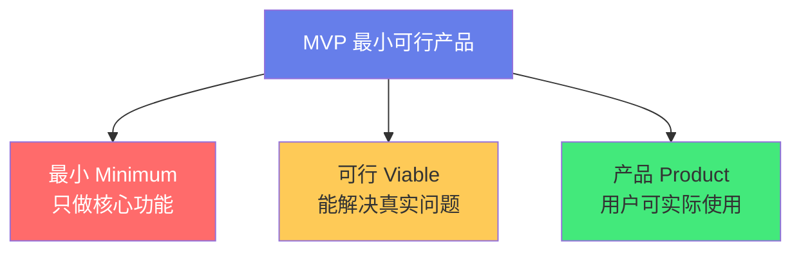
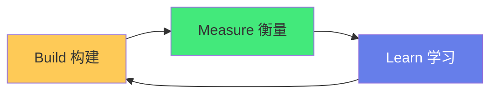

# 🚀 MVP 最小可行产品

> **文档说明**：系统讲解 MVP（Minimum Viable Product，最小可行产品）的核心理念、设计方法、构建步骤与实战案例，涵盖 MVP 的起源与定义（Frank Robinson 2001 年提出，Eric Ries《精益创业》推广）、MVP 的核心哲学（用最小成本验证关键假设/快速学习/用户反馈驱动迭代）、MVP 与完整产品的本质区别、MVP 的六大设计原则（聚焦核心价值/只做一个痛点/可衡量/可学习/尽早发布/持续迭代）、MVP 的七种类型（落地页 Landing Page/视频演示/手动服务 Concierge/单一功能 MVP/开源原型/众筹预购/ Wizard of Oz 绿野仙踪）、MVP 的标准构建流程（识别核心假设→定义成功指标→构建最小版本→定向发布→收集反馈→数据分析→迭代或转向）、MVP 的常见误区（MVP=简陋产品/MVP=功能越少越好/MVP 不需要设计/MVP 只做一次就够）、MVP 的衡量指标（虚荣指标 vs 可执行指标/激活率/留存率/推荐率 NPS/付费转化率）、MVP 与精益创业（Build-Measure-Learn 循环）、MVP 与敏捷开发的关系、经典 MVP 实战案例（Dropbox 视频演示/Zappos 手动拍照/Airbnb 早餐/Groupon 团购/Buffer 落地页）、MVP 的技术选型策略（快速构建优先/低代码工具/全栈框架/云服务）、从 MVP 到 PMF（产品市场匹配）的迭代路径、MVP 的发布与推广策略、常见问题与最佳实践。
>
> **适用人群**：创业者、产品经理、独立开发者、全栈工程师、想验证产品想法的任何人
>
> **前置知识**：[[敏捷开发与Scrum]] · [[产品需求分析与PRD撰写]]

---

## 一、概述

### 1.1 什么是 MVP

**MVP（Minimum Viable Product，最小可行产品）** 是指用**最小的成本**构建一个**刚好能验证核心假设**的产品版本，通过早期用户反馈来**快速学习**和迭代。



**起源**：
- 2001 年，**Frank Robinson** 首次提出 MVP 概念
- 2011 年，**Eric Ries** 在《精益创业》（The Lean Startup）中推广普及
- 核心思想：**不要花几个月做一个没人要的产品**

### 1.2 MVP 的核心公式

```text
MVP = 最小功能集 + 可验证假设 + 快速学习循环
```

**MVP 不是**：
- ❌ 简陋的、半成品的产品
- ❌ 功能越少越好的产品
- ❌ 不需要设计和用户体验的产品
- ❌ 做一次就完事的产品

**MVP 是**：
- ✅ 刚好能验证核心假设的最小版本
- ✅ 能解决用户真实问题的可用产品
- ✅ 有明确衡量指标的实验
- ✅ 持续迭代的起点

### 1.3 为什么需要 MVP

| 传统方式 | MVP 方式 |
|---------|---------|
| 花 6 个月做完整产品 | 花 2 周做 MVP |
| 发布后才发现没人要 | 2 周后就知道方向对不对 |
| 投入大量资源后失败 | 小成本验证，快速转向 |
| 基于假设做决策 | 基于数据和反馈做决策 |

> **核心价值**：MVP 把「产品失败」的成本从「几十万+几个月」降到「几千+几周」。

---

## 二、MVP 的设计原则

### 2.1 六大原则

| 原则 | 说明 |
|------|------|
| **聚焦核心价值** | 只做解决用户核心问题的功能，砍掉一切「锦上添花」 |
| **一个痛点** | 一个 MVP 只解决一个最痛的问题，不要试图解决所有问题 |
| **可衡量** | 每个 MVP 都要有明确的成功指标（不是「用户喜欢」这种模糊指标） |
| **可学习** | MVP 的目的是「学习」，不是「完美」——每次发布都要回答一个问题 |
| **尽早发布** | 当产品「刚好能用」时就发布，不要等到「完美」 |
| **持续迭代** | MVP 是起点不是终点，根据反馈持续优化 |

### 2.2 功能取舍：MoSCoW 方法

| 优先级 | 说明 | MVP 包含？ |
|--------|------|-----------|
| **Must have** | 必须有，没有就不解决核心问题 | ✅ 必须包含 |
| **Should have** | 应该有，但可以后续加 | ❌ 后续迭代 |
| **Could have** | 可以有，有更好 | ❌ 后续迭代 |
| **Won't have** | 这次不做 | ❌ 明确排除 |

**示例：一个笔记应用的 MVP**
- Must：创建笔记、查看笔记列表、删除笔记
- Should：搜索、标签、富文本编辑
- Could：云同步、多端、分享
- Won't：AI 写作、团队协作、插件系统

---

## 三、MVP 的七种类型

### 3.1 落地页 MVP（Landing Page）

**做法**：做一个介绍产品的网页，收集邮箱预约，验证需求。

**案例**：Buffer（社交媒体调度工具）
- 创始人先做了一个落地页，介绍「即将推出的 Buffer」
- 用户输入邮箱预约
- 预约人数达到预期后，才开始开发
- 成本：几天时间，几乎零开发成本

### 3.2 视频演示 MVP

**做法**：做一个演示视频，展示产品功能（可能还没开发），收集预约。

**案例**：Dropbox
- 创始人 Drew Houston 做了一个 3 分钟演示视频
- 视频展示了 Dropbox 的文件同步功能
- 视频发布后，预约用户从 5000 涨到 75000
- 成本：一个视频，验证了巨大的需求

### 3.3 手动服务 MVP（Concierge MVP）

**做法**：用人工手动提供服务，假装是自动化产品，验证用户是否愿意付费。

**案例**：Zappos（鞋类电商）
- 创始人 Nick Swinmurn 去当地鞋店拍照
- 放到网站上，如果有人下单，他再去店里买鞋寄给用户
- 没有库存、没有仓库、没有系统，但验证了「有人愿意在线买鞋」
- 后来被亚马逊以 12 亿美元收购

### 3.4 单一功能 MVP

**做法**：只做产品的一个核心功能，其他功能全部砍掉。

**案例**：Instagram
- 最初是一个叫 Burbn 的签到应用（类似 Foursquare）
- 发现用户最喜欢「拍照+滤镜+分享」
- 砍掉所有其他功能，只保留这一个核心
- 上线 3 个月 100 万用户，后来被 Facebook 10 亿美元收购

### 3.5 绿野仙踪 MVP（Wizard of Oz）

**做法**：用户以为是自动化产品，实际背后是人在操作。

**案例**：早期的 Amazon Mechanical Turk、很多 AI 产品的早期版本
- 用户上传照片，以为 AI 在处理
- 实际是后台人工在标注
- 验证了用户需求后，再用真正的 AI 替代人工

### 3.6 众筹预购 MVP

**做法**：在 Kickstarter/Indiegogo 上发起众筹，验证用户是否愿意付费。

**案例**：Pebble 智能手表、Oculus Rift
- 产品还没做出来，先发起众筹
- 如果众筹成功，说明有真实付费需求
- 用众筹的钱来开发产品

### 3.7 开源/原型 MVP

**做法**：发布一个开源原型或 Figma 原型，收集开发者/用户反馈。

- 开源项目：GitHub 上发布 MVP，看 Star 和 Issue
- 设计原型：Figma 原型 + 用户测试，看用户是否理解和喜欢

---

## 四、MVP 构建流程

### 4.1 六步流程


### 第一步：识别核心假设

每个产品想法都基于一些**假设**，MVP 要验证最关键的那个：

| 假设类型 | 问题 | 示例 |
|---------|------|------|
| **用户假设** | 谁是用户？他们真的有这个问题吗？ | 「年轻白领有健康饮食需求」 |
| **问题假设** | 这个问题足够痛吗？用户愿意解决吗？ | 「用户愿意为健康餐付费」 |
| **解决方案假设** | 我们的方案能解决问题吗？ | 「订阅制健康餐能解决」 |
| **商业模式假设** | 用户愿意付费吗？能盈利吗？ | 「用户愿意每月付 300 元」 |

> 找到「最危险的假设」——如果这个假设不成立，整个产品就不成立。MVP 优先验证它。

### 第二步：定义成功指标

**虚荣指标 vs 可执行指标**：

| 虚荣指标（无意义） | 可执行指标（有意义） |
|------------------|-------------------|
| 网站访问量 | 注册转化率 |
| 下载量 | 次日留存率 |
| 用户总数 | 周活跃用户（WAU） |
| 页面浏览量 | 核心功能使用率 |
| 媒体报道数 | 付费转化率 |
| 融资额 | 净推荐值（NPS） |

**MVP 的核心指标**：
- **激活率**：注册后完成核心动作的用户比例
- **留存率**：次日/7日/30日留存
- **付费转化率**：免费用户转付费的比例
- **NPS（净推荐值）**：用户愿意推荐的程度
- **获客成本（CAC）**：获取一个用户的成本

### 第三步：构建最小版本

**构建原则**：
- 时间盒：限制在 2-4 周内完成
- 只做 Must have 的功能
- 用最快的技术方案（低代码/模板/全栈框架）
- 不要过度设计架构（MVP 可能被扔掉）

**技术选型策略**：
| 场景 | 推荐方案 |
|------|---------|
| 快速验证想法 | 低代码（Webflow/Notion/Airtable） |
| 简单 Web 应用 | Next.js/Nuxt + Supabase/Firebase |
| 移动端 | Flutter/React Native + BaaS |
| AI 应用 | Next.js + OpenAI API + Vercel |
| 内部工具 | Retool/飞书多维表格 |

### 第四步：定向发布

**不要一上来就全量发布**：
1. **种子用户**：先给 10-50 个目标用户使用
2. **灰度发布**：逐步扩大用户范围
3. **邀请制**：控制用户质量，收集深度反馈
4. **特定渠道**：在目标用户聚集的社区发布

### 第五步：收集反馈数据

**定量数据**：
- 埋点分析（Google Analytics/Mixpanel/友盟）
- 核心指标仪表盘
- A/B 测试

**定性反馈**：
- 用户访谈（1对1，每周至少 5 个）
- 问卷调查（NPS/满意度）
- 用户行为观察（看用户怎么用）
- 客服反馈/用户社群

### 第六步：迭代或转向

根据数据决定下一步：

```text
数据好 → 加大投入，增加功能，扩大用户
数据一般 → 优化现有功能，提升体验
数据差 → 分析原因，调整方向（Pivot 转向）
```

**转向（Pivot）类型**：
- 客户转向：换目标用户群
- 问题转向：换解决的问题
- 方案转向：换解决方案
- 商业模式转向：换盈利方式

---

## 五、MVP 与精益创业

```text
### 5.1 Build-Measure-Learn 循环
```



MVP 是精益创业「构建-衡量-学习」循环的核心载体：
- **Build**：构建 MVP
- **Measure**：衡量用户行为和指标
- **Learn**：从数据中学习，决定下一步

**创新会计（Innovation Accounting）**：
- 不是用传统财务指标（收入/利润）衡量
- 用「学习里程碑」衡量：验证了什么假设？学到了什么？

### 5.2 MVP 与敏捷开发的关系

| 维度 | 敏捷开发 | MVP |
|------|---------|-----|
| **目标** | 快速响应变化，持续交付 | 验证假设，快速学习 |
| **范围** | 整个产品开发过程 | 产品的第一个版本 |
| **方法** | Scrum/Kanban/迭代 | 精益创业/BML 循环 |
| **关系** | MVP 可以用敏捷方法来构建 | MVP 是敏捷的「第一个增量」 |

---

## 六、经典案例

### 6.1 Dropbox：视频演示 MVP

- **问题**：文件同步是个好主意吗？
- **MVP**：3 分钟演示视频，展示产品功能
- **结果**：预约用户从 5000 → 75000（一夜增长 15 倍）
- **成本**：一个视频，几乎零开发
- **启示**：在写代码之前，先用最便宜的方式验证需求

### 6.2 Zappos：手动服务 MVP

- **问题**：有人愿意在线买鞋吗？
- **MVP**：去鞋店拍照放网上，有人下单再去买鞋寄出
- **结果**：验证了需求，后来成为最大鞋类电商
- **成本**：几乎零库存、零系统
- **启示**：先用人工跑通流程，验证后再自动化

### 6.3 Airbnb：早餐+住宿 MVP

- **问题**：会议期间酒店满房，有人愿意租充气床垫吗？
- **MVP**：创始人在自己公寓放 3 个充气床垫，提供早餐
- **结果**：3 个客人每人付 80 美元，验证了需求
- **成本**：几个充气床垫+早餐
- **启示**：从最小的场景开始，亲自服务用户

### 6.4 Instagram：单一功能 MVP

- **问题**：Burbn（签到应用）功能太多，用户不知道用什么
- **MVP**：砍掉所有功能，只保留「拍照+滤镜+分享」
- **结果**：3 个月 100 万用户，18 个月被 Facebook 10 亿美元收购
- **启示**：少即是多，聚焦核心功能

### 6.5 Buffer：落地页 MVP

- **问题**：有人愿意为社交媒体调度工具付费吗？
- **MVP**：做一个落地页，展示「即将推出」，收集邮箱
- **结果**：收集到足够邮箱后，加了一个「套餐选择」页面，看有多少人愿意付费
- **成本**：两个网页
- **启示**：分阶段验证，先验证需求，再验证付费意愿

---

## 七、常见误区

| 误区 | 真相 |
|------|------|
| **MVP = 简陋产品** | MVP 是「刚好够用」，不是「粗制滥造」。核心体验必须好。 |
| **MVP = 功能越少越好** | 功能少但必须能解决核心问题。不能用的产品不是 MVP。 |
| **MVP 不需要设计** | MVP 更需要好设计——用户第一次体验差就不会回来了。 |
| **MVP 只做一次** | MVP 是迭代的起点，不是终点。每个版本都是一个 MVP。 |
| **MVP 要保密** | MVP 要尽早给用户用，收集反馈。保密等于没有学习。 |
| **MVP 要全功能** | MVP 故意只做部分功能，目的是验证假设而非满足所有需求。 |
| **MVP 失败就是产品失败** | MVP 失败是好事——用小成本避免了大失败，快速转向。 |
| **MVP 只适合创业公司** | 大公司内部创新也应该用 MVP 思维验证新业务。 |

---

## 八、从 MVP 到 PMF

### 8.1 什么是 PMF

**PMF（Product-Market Fit，产品市场匹配）**：产品满足了市场的真实需求，用户自发增长、留存高、愿意付费。

**Marc Andreessen 的定义**：
> "Product-market fit means being in a good market with a product that can satisfy that market."
> 「产品市场匹配意味着在一个好的市场里，有一个能满足市场的产品。」

### 8.2 MVP → PMF 的路径


**PMF 的信号**：
- 用户留存率高（次日 >40%，30日 >20%）
- 用户自发推荐（NPS > 50）
- 获客成本低（用户自发增长）
- 付费转化率高（>5%）
- 用户「离不开」你的产品

---

## 九、MVP 检查清单

在发布 MVP 前，确认：

- [ ] 明确了最危险的假设是什么
- [ ] 定义了可衡量的成功指标
- [ ] 只包含 Must have 的功能
- [ ] 核心体验流畅可用（不是半成品）
- [ ] 有数据埋点和反馈收集机制
- [ ] 有种子用户名单（10-50 人）
- [ ] 设定了时间盒（2-4 周）
- [ ] 准备好根据反馈迭代或转向
- [ ] 团队对「MVP 的目的是学习」有共识

---

## 十、关联笔记

### 产品与项目
- [[敏捷开发与Scrum]] · [[产品需求分析与PRD撰写]] · [[用户研究与需求分析]]
- [[技术债务管理]] · [[项目管理方法论]]

### 创业与商业
- [[精益创业方法论]] · [[商业模式画布]] · [[增长黑客入门]]

### 技术与实现
- [[全栈项目实战]] · [[低代码与无代码平台]] · [[云服务与部署]]

### 导航
- [[MOC-项目实战]] · [[MOC-产品与模板]] · [[Home]] · [[学习路线总览]]

> 🔍 **知识点深度解析**
>
> **作用**：MVP 最小可行产品解决的是「如何用最小的成本和最快的速度验证一个产品想法是否可行，避免投入大量资源做一个没人要的产品」的核心问题——传统产品开发是「先做完整产品再发布」，但 90% 的产品失败是因为「做了没人要的东西」。MVP 通过「先做最小版本验证假设」，将失败成本降到最低，将学习速度提到最高。
>
> **底层原理**：①MVP 的认知科学基础是「验证优于规划」——人类对未来的预测能力极其有限（尤其是对用户行为和市场反应），任何「我觉得用户会喜欢」都是假设。MVP 的核心是「用实验替代猜测」——与其花 6 个月规划一个「完美产品」，不如花 2 周做一个 MVP，用真实数据验证假设。这和科学方法是一样的：提出假设→设计实验→收集数据→验证或证伪。②MVP 的经济学基础是「实物期权（Real Option）」——MVP 给你一个「选择权」：如果数据好，继续投入（行权）；如果数据差，快速转向（放弃行权，损失有限）。没有 MVP，你就是在「all in」一个未经证实的假设，风险极大。MVP 把「二元决策（做或不做）」变成了「渐进决策（先验证再投入）」，大幅降低了不确定性。③MVP 的「最小」和「可行」之间的平衡是核心难点——太「最小」则产品不可用，用户体验差，无法验证真实需求；太「可行」则成本高、周期长，失去了 MVP 的意义。正确的做法是：**核心体验必须完整可用，周边功能全部砍掉**。例如一个笔记应用的 MVP 必须能「创建-保存-查看」笔记（核心闭环），但可以没有搜索、标签、云同步。④MVP 的衡量指标必须是「可执行指标」而非「虚荣指标」——访问量、下载量、用户总数这些指标看起来好看，但不能告诉你「产品是否解决了用户问题」。真正的可执行指标是「激活率」（用户是否用了核心功能）、「留存率」（用户是否回来）、「付费率」（用户是否愿意付钱）。这些指标直接反映了产品的真实价值。⑤MVP 的七种类型本质是「不同成本的验证方式」——落地页和视频是「零代码验证」（最便宜，验证需求），手动服务和绿野仙踪是「人工验证」（中等成本，验证付费意愿），单一功能和开源原型是「代码验证」（较高成本，验证体验）。选择哪种类型取决于「你要验证什么假设」和「你有多少资源」。⑥从 MVP 到 PMF 是一个「持续迭代」的过程，不是「发布 MVP 就成功了」——大多数产品需要经历多次 MVP 迭代和可能的转向（Pivot）才能找到 PMF。Instagram 从 Burbn 转向照片分享，Slack 从游戏公司转向协作工具，都是多次迭代后的结果。MVP 的价值不仅是「验证一个想法」，更是「建立快速学习的能力」。
>
> **用法要点**：① MVP定义：最小成本验证核心假设的产品版本，不是简陋产品 ② 六大原则：聚焦核心价值/一个痛点/可衡量/可学习/尽早发布/持续迭代 ③ 功能取舍：MoSCoW方法(Must/Should/Could/Won't)，MVP只做Must ④ 七种类型：落地页/视频演示/手动服务Concierge/单一功能/绿野仙踪Wizard of Oz/众筹预购/开源原型 ⑤ 六步流程：识别核心假设(最危险的)→定义可执行指标(激活/留存/付费/NPS)→构建最小版本(2-4周时间盒)→定向发布(种子用户10-50)→收集反馈(定量+定性)→迭代或转向(Pivot) ⑥ 核心指标：激活率/次日留存/7日留存/付费转化率/NPS，避免虚荣指标(访问量/下载量) ⑦ 经典案例：Dropbox(视频)/Zappos(手动拍照)/Airbnb(充气床垫)/Instagram(砍功能)/Buffer(落地页) ⑧ 常见误区：MVP≠简陋/≠功能越少越好/≠不需要设计/≠只做一次/≠要保密 ⑨ 与精益创业：MVP是Build-Measure-Learn循环的核心 ⑩ PMF：从MVP迭代到产品市场匹配，信号是高留存/高NPS/自发增长/高付费 ⑪ 技术选型：快速验证用低代码，简单应用用Next.js+Supabase，AI应用用Next.js+OpenAI+Vercel ⑫ 检查清单：明确假设/定义指标/只做Must/核心体验可用/有埋点/有种子用户/时间盒/准备迭代。

> 💡 **深度讲解**：MVP 最核心的智慧是「承认自己的无知，用实验替代猜测，用小成本验证大假设」——大多数人做产品的方式是「我有一个好想法→我觉得用户会喜欢→我花半年做出来→发布后发现没人用」。这本质上是「傲慢」——假设自己能预测用户行为和市场反应。但无数创业失败案例告诉我们：**大多数产品想法是错的**，不是因为执行不好，而是因为假设本身就不成立。MVP 的本质是「谦逊」——承认自己不知道答案，用最小的实验去寻找答案。MVP 的另一个深层智慧是「学习比完美更重要」——很多人追求「完美的第一个版本」，但完美需要时间，而时间是创业最宝贵的资源。一个「刚好能用」的 MVP 今天发布，比一个「完美」的产品 3 个月后发布更有价值，因为今天发布就能开始收集反馈，3 个月后发布可能已经错过了市场窗口。在 AI 时代，MVP 的成本进一步降低——AI 可以帮你快速生成代码、写文案、做设计，一个人在一周内就能做出过去需要一个团队几个月的 MVP。但 MVP 的核心逻辑没有变：**先验证假设，再投入资源**。AI 让「构建」变快了，但「验证」的逻辑不变——你仍然需要真实用户、真实数据、真实反馈。理解了 MVP，你就理解了「精益创业」的核心，也理解了「为什么大公司内部创新也应该用 MVP 思维」——因为无论公司大小，「做没人要的东西」都是最大的浪费。

> 📝 **精简总结**：MVP最小可行产品=用最小成本验证核心假设的产品版本，不是简陋产品。六大原则：聚焦核心/一个痛点/可衡量/可学习/尽早发布/持续迭代。功能取舍用MoSCoW(Must/Should/Could/Won't)，只做Must。七种类型：落地页/视频演示/手动服务Concierge/单一功能/绿野仙踪/众筹/开源原型。六步流程：识别最危险假设→定义可执行指标(激活/留存/付费/NPS)→2-4周构建最小版本→种子用户定向发布→定量+定性收集反馈→迭代或转向Pivot。经典案例：Dropbox视频/Zappos手动拍照/Airbnb充气床垫/Instagram砍功能/Buffer落地页。误区：MVP≠简陋/≠功能少/≠不需要设计/≠只做一次。与精益创业Build-Measure-Learn循环结合。目标是从MVP迭代到PMF(产品市场匹配)。核心：用实验替代猜测，小成本验证大假设。

> **学习路径建议**：先学习 [[产品需求分析与PRD撰写]] 理解需求分析 → 学习本文档的 MVP 方法论 → 学习 [[精益创业方法论]] 深化理解 → 实践：为你的一个想法做一个落地页 MVP（收集邮箱验证需求） → 实践：如果需求验证通过，做一个单一功能 MVP（2-4周） → 学习 [[敏捷开发与Scrum]] 用敏捷方法迭代 → 实践：定义可执行指标，收集用户反馈 → 学习 [[增长黑客入门]] 和 [[商业模式画布]] → 从 MVP 迭代到 PMF → 形成自己的「产品验证方法论」。

---

> **MVP 最小可行产品的本质是「用最小的实验替代最大的猜测，用最快的学习替代最慢的失败」——在产品开发中，最昂贵的失败不是「产品做得不好」，而是「做了一个没人要的产品」。前者可以通过迭代改善，后者意味着所有投入都打了水漂。MVP 的核心就是避免这种「方向性失败」——在投入大量资源之前，用最小的成本验证最关键的假设。这听起来简单，但做起来很难，因为它要求你「承认自己可能是错的」，要求你「克制做更多功能的冲动」，要求你「接受不完美的第一个版本」。但正是这种克制和谦逊，让 MVP 成为创业和创新最有效的方法论。Dropbox 用一个视频验证了需求，Zappos 用手动拍照验证了电商模式，Airbnb 用三个充气床垫验证了共享经济，Instagram 用砍掉 90% 功能验证了照片分享的价值——这些亿万级产品的起点，都是一个「小到可笑」的 MVP。在 AI 时代，构建 MVP 的成本前所未有地低——AI 可以帮你写代码、做设计、生成内容，一个人一周就能做出过去需要团队几个月的产品。但 MVP 的核心逻辑没有变：**先验证，再投入**。AI 让「做」变容易了，但「验证」仍然需要真实用户、真实数据、真实反馈。不要因为 AI 让构建变快了，就跳过验证直接做完整产品——那是用更快的速度冲向错误的方向。从今天开始，下次你有一个「好想法」时，不要急着写代码，先问自己：「这个想法最危险的假设是什么？我能用什么最便宜的方式验证它？」——这就是 MVP 思维，也是每个创业者和创新者最应该具备的思维方式。**

---

## 🔗 关联笔记

- [[MOC-项目实战]] — 返回本分类知识地图，查看更多相关文档

## 📖 前置知识

- [[敏捷开发与Scrum]]
- [[产品需求分析与PRD撰写]]

## 🏷️ 相关标签

`#MVP` `#最小可行产品` `#精益创业` `#产品思维` `#产品管理` `#创业`

[[Home|🏠 返回首页]] · [[MOC-项目实战|📚 返回分类]]
