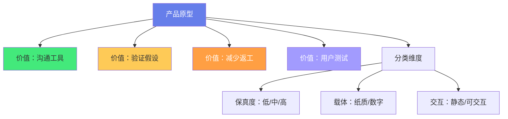
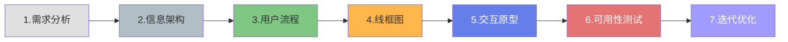
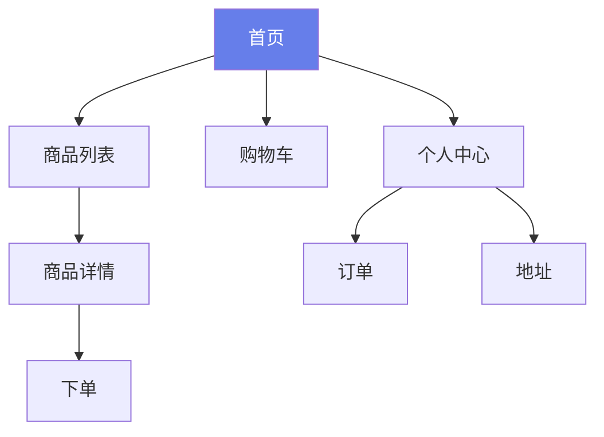
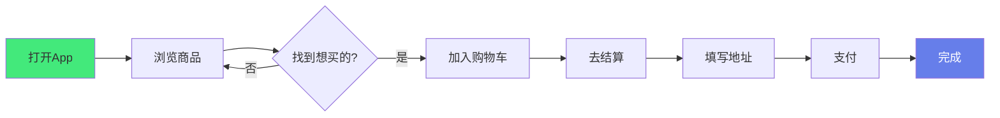
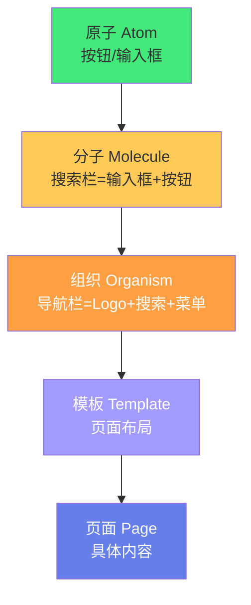

# 🎨 产品原型设计方法

> **文档说明**：系统讲解产品原型设计的完整方法论与实操技巧，涵盖原型的概念与价值（沟通工具/验证假设/减少返工/用户测试）、原型的四大分类（低保真/中保真/高保真 + 纸质/数字 + 静态/可交互 + 快速/精细）、原型设计完整流程（需求分析→信息架构→用户流程→线框图→交互原型→可用性测试→迭代）、低保真原型方法（草图/纸原型/线框图/Balsamiq）、高保真原型工具详解（Figma/Sketch/Axure RP/Adobe XD/墨刀）、交互原型设计（页面跳转/微交互/状态管理/动效/手势）、设计系统与组件库在原型中的应用（原子设计/组件复用/样式变量）、用户测试与迭代（可用性测试/AB测试/反馈收集）、常见原型设计模式（导航模式/表单设计/列表与卡片/反馈提示/空状态/加载状态/错误处理/权限状态）、移动端与 Web 端原型差异、AI 辅助原型设计（AI 生成线框图/AI 设计建议/AI 用户测试）、常见误区与最佳实践。
>
> **适用人群**：产品经理、UI/UX 设计师、全栈开发者、创业者、需要从 0 到 1 设计产品的团队
>
> **前置知识**：[[MVP最小可行产品]] · [[用户体验设计基础]]

---

## 一、概述

### 1.1 什么是产品原型

**产品原型（Prototype）** 是产品最终形态的模拟表达，用于在开发前展示产品的结构、功能、交互和视觉，是「在写代码之前先把产品做出来」的核心工具。



### 1.2 为什么需要原型

| 不做原型的代价 | 做原型的收益 |
|--------------|------------|
| 开发到一半发现流程不通 | 原型阶段就发现问题，成本低 |
| 设计师/开发/产品理解不一致 | 原型是「共同语言」，减少歧义 |
| 用户不买账，上线后才知道 | 原型阶段就能做用户测试 |
| 反复修改，开发成本高 | 改原型比改代码快 100 倍 |
| 功能堆砌，没有重点 | 原型聚焦核心流程，验证 MVP |

> 「用代码写原型的成本是用纸笔的 100 倍，是用 Figma 的 10 倍。越早验证，成本越低。」

### 1.3 原型的保真度


| 保真度 | 特点 | 工具 | 适用阶段 |
|--------|------|------|---------|
| **低保真** | 快速、粗略、只表达结构 | 纸笔、白板、Balsamiq | 概念验证、团队讨论 |
| **中保真** | 灰模、有布局、无视觉 | Figma 线框、Sketch | 流程确认、交互设计 |
| **高保真** | 接近最终产品、可交互 | Figma 原型、Axure、代码 | 用户测试、开发交付 |

---

## 二、原型设计完整流程

### 2.1 七步法



### 2.2 各阶段详解

#### 第一步：需求分析

- 明确目标用户是谁
- 解决什么核心问题
- 核心功能有哪些（MVP 范围）
- 成功指标是什么

**输出**：需求文档、用户故事、功能列表

#### 第二步：信息架构（IA）

- 梳理内容分类和层级
- 设计导航结构
- 确定页面之间的关系

**输出**：站点地图（Sitemap）、内容结构图



#### 第三步：用户流程

- 画出核心任务的用户操作路径
- 标注每个步骤的页面和决策点
- 识别异常流程和分支

**输出**：用户流程图（User Flow）



#### 第四步：线框图（Wireframe）

- 用黑白灰画出页面布局
- 标注功能区域和元素
- 不关注视觉细节

**输出**：线框图（每个核心页面）

#### 第五步：交互原型

- 添加页面跳转和交互
- 模拟真实操作体验
- 可点击、可滑动

**输出**：可交互原型（Figma Prototype / Axure）

#### 第六步：可用性测试

- 找 5-8 个目标用户测试
- 观察用户操作，记录问题
- 收集反馈和改进建议

**输出**：测试报告、问题清单

#### 第七步：迭代优化

- 根据测试结果修改原型
- 再次测试验证
- 直到核心流程顺畅

---

## 三、低保真原型方法

### 3.1 草图（Sketch）

最快的原型方式，用纸笔或白板快速画出想法：

```text
┌─────────────────────┐
│  [Logo]    搜索  购物车│
├─────────────────────┤
│  ┌────┐ ┌────┐      │
│  │图1 │ │图2 │  推荐  │
│  └────┘ └────┘      │
│  ┌────┐ ┌────┐      │
│  │图3 │ │图4 │      │
│  └────┘ └────┘      │
├─────────────────────┤
│ 首页 分类 购物车 我的 │
└─────────────────────┘
```

**要点**：
- 不要追求美观，追求速度
- 用方框代表图片，横线代表文字
- 标注关键交互和说明
- 适合团队头脑风暴

### 3.2 纸原型（Paper Prototype）

用纸剪出页面元素，手动操作模拟交互：

- 打印或画出多个页面状态
- 用手移动元素模拟跳转
- 可以让用户「点击」纸面，测试者手动切换页面
- 成本极低，适合快速验证

### 3.3 线框图工具

| 工具 | 特点 | 适用 |
|------|------|------|
| **Balsamiq** | 手绘风格，专注结构 | 低保真线框图 |
| **Figma** | 全能，从线框到高保真 | 全流程 |
| **Sketch** | macOS 专属，插件丰富 | 中高保真 |
| **墨刀** | 国产，简单易用 | 快速原型 |
| **Axure RP** | 交互强大，适合复杂逻辑 | 高保真交互 |

---

## 四、高保真原型工具

### 4.1 Figma（推荐）

**核心能力**：
- 矢量设计 + 原型交互一体化
- 实时协作（多人同时编辑）
- 组件库和设计系统
- 自动布局（Auto Layout）
- 原型演示和评论
- 插件生态丰富

**Figma 原型交互**：
```text
选中元素 → 右侧面板 Prototype → 添加交互
- Trigger: On Click / On Hover / While Pressing
- Action: Navigate to / Open overlay / Swap with
- Animation: Instant / Dissolve / Smart Animate
```

### 4.2 Axure RP

**核心能力**：
- 强大的条件逻辑和变量
- 动态面板（Dynamic Panel）
- 中继器（Repeater）模拟数据列表
- 适合复杂业务系统原型
- 生成 HTML 可直接分享

### 4.3 工具选择

| 场景 | 推荐工具 |
|------|---------|
| 互联网产品/APP | Figma |
| 复杂企业系统 | Axure RP |
| 快速验证 MVP | 墨刀 / Figma |
| macOS 团队 | Sketch |
| 纯线框图 | Balsamiq |

---

## 五、交互原型设计

### 5.1 交互类型

| 交互 | 说明 | 示例 |
|------|------|------|
| **页面跳转** | 点击后跳转到新页面 | 点击商品→商品详情 |
| **覆盖层** | 弹出浮层，不离开当前页 | 弹窗、抽屉、菜单 |
| **切换** | 同一区域内容切换 | Tab 切换、轮播 |
| **滚动** | 页面内滚动 | 长列表、详情页 |
| **拖拽** | 拖动元素 | 排序、滑块、删除 |
| **手势** | 移动端手势 | 左滑删除、下拉刷新 |

### 5.2 状态设计

每个页面/组件都要考虑多种状态：

| 状态类型 | 说明 |
|---------|------|
| **默认状态** | 正常显示 |
| **加载状态** | 数据加载中（骨架屏/Loading） |
| **空状态** | 没有数据（引导操作） |
| **错误状态** | 加载失败/网络错误 |
| **成功状态** | 操作成功反馈 |
| **禁用状态** | 不可操作 |
| **悬停状态** | 鼠标悬停（Web） |
| **按下状态** | 点击中反馈 |

### 5.3 微交互

微交互是提升体验的关键细节：
- 按钮点击的缩放反馈
- 列表项的左滑删除
- 下拉刷新的动画
- 页面切换的转场
- 输入框的聚焦动效

> 「微交互是产品的『呼吸』——它让静态的界面变得有生命。」

---

## 六、设计系统与组件库

### 6.1 原子设计（Atomic Design）



### 6.2 原型中的组件复用

- 建立基础组件库（按钮、输入框、卡片、列表）
- 用组件（Component）而非复制粘贴
- 修改主组件，所有实例自动更新
- 定义样式变量（颜色、字体、间距）

### 6.3 设计规范文档

- 颜色规范（主色/辅助色/语义色/中性色）
- 字体规范（字号/字重/行高）
- 间距规范（4px/8px 基准）
- 圆角、阴影、图标规范
- 组件使用说明

---

## 七、用户测试与迭代

### 7.1 可用性测试方法

| 方法 | 说明 | 成本 |
|------|------|------|
| ** moderated 测试** | 主持人引导，观察用户操作 | 中 |
| **unmoderated 测试** | 用户自行操作，录屏记录 | 低 |
| **5 秒测试** | 展示 5 秒，问用户记住了什么 | 极低 |
| **A/B 测试** | 两个版本对比 | 中 |
| **启发式评估** | 专家按 Nielsen 10 原则检查 | 低 |

### 7.2 测试流程

1. **确定测试任务**：3-5 个核心任务
2. **招募用户**：5-8 个目标用户（5 个就能发现 85% 问题）
3. **执行测试**：让用户完成任务，观察记录
4. **分析问题**：按严重程度排序
5. **修改原型**：优先解决严重问题
6. **再次测试**：验证修改效果

### 7.3 Nielsen 10 大可用性启发

1. 系统状态可见性
2. 系统与现实世界匹配
3. 用户控制与自由
4. 一致性与标准
5. 预防错误
6. 识别而非回忆
7. 使用灵活性与效率
8. 美观与极简设计
9. 帮助用户识别、诊断错误
10. 帮助与文档

---

## 八、常见原型设计模式

### 8.1 导航模式

| 模式 | 适用 | 示例 |
|------|------|------|
| **底部 Tab** | 移动端核心功能 | 微信/淘宝 |
| **侧边抽屉** | 不常用功能 | 设置/菜单 |
| **顶部导航** | Web 端 | 官网/后台 |
| **汉堡菜单** | 移动端次要导航 | 资讯类 App |
| **标签页** | 平级内容切换 | 首页/分类/发现 |

### 8.2 表单设计

- 分组和分步（长表单分步）
- 实时校验（输入时即校验）
- 明确的错误提示
- 自动填充（地址、手机号）
- 输入联想和搜索
- 提交按钮状态（禁用/加载/成功）

### 8.3 列表与卡片

- 列表：信息密集、操作多
- 卡片：视觉丰富、浏览型
- 无限滚动 vs 分页
- 下拉刷新 + 上拉加载
- 空状态引导
- 骨架屏加载

### 8.4 反馈与状态

| 状态 | 设计要点 |
|------|---------|
| **加载** | 骨架屏 > Loading > 空白 |
| **空** | 插画 + 引导文案 + 操作按钮 |
| **错误** | 说明原因 + 解决建议 + 重试按钮 |
| **成功** | 简短提示 + 下一步引导 |
| **禁用** | 视觉变灰 +  tooltip 说明原因 |

---

## 九、移动端 vs Web 端

| 维度 | 移动端 | Web 端 |
|------|--------|--------|
| **屏幕** | 小，竖屏 | 大，横屏 |
| **交互** | 触摸、手势 | 鼠标、键盘 |
| **导航** | 底部 Tab/抽屉 | 顶部导航/侧边栏 |
| **输入** | 软键盘、语音 | 物理键盘 |
| **性能** | 网络/电量敏感 | 相对宽松 |
| **适配** | 多机型适配 | 响应式/多分辨率 |

---

## 十、AI 辅助原型设计

### 10.1 AI 工具

| 工具 | 能力 |
|------|------|
| **Figma AI** | 自动生成界面、重命名图层、总结评论 |
| **Galileo AI** | 文字描述生成高保真 UI |
| **Uizard** | 手绘草图转数字原型 |
| **v0 by Vercel** | 文字生成 React 组件 |
| **Magician** | Figma 插件，AI 生成图标/文案 |

### 10.2 AI 工作流

1. 用 AI 快速生成初始线框图
2. 人工调整布局和流程
3. 用 AI 生成文案和占位内容
4. 用 AI 做可用性分析
5. 人工精修和用户测试

> AI 是「加速器」，不是「替代者」——AI 能快速生成方案，但判断什么是好设计、理解用户真实需求，仍然需要人。

---

## 十一、常见误区

| 误区 | 正确做法 |
|------|---------|
| **一开始就做高保真** | 先低保真验证流程，再逐步提升保真度 |
| **原型太完美，不敢改** | 原型就是用来改的，越早期改成本越低 |
| **只画 happy path** | 必须考虑异常流程（空/错/加载/无权限） |
| **忽略加载和空状态** | 每个页面都要有完整的状态设计 |
| **原型即最终设计** | 原型是验证工具，不是最终交付物 |
| **不做用户测试** | 原型的核心价值就是测试，不测试等于白做 |
| **功能堆砌** | 聚焦 MVP，先验证核心假设 |
| **一个人闭门造车** | 尽早让团队和用户参与反馈 |

---

## 十二、最佳实践

1. **从低保真开始**：纸笔/白板快速验证概念，不要一开始就用 Figma
2. **聚焦核心流程**：先做 3-5 个核心任务的流程，不要面面俱到
3. **状态要完整**：每个页面考虑默认/加载/空/错误/成功/禁用状态
4. **用组件复用**：建立组件库，不要复制粘贴
5. **可交互优先**：能点击的原型比静态图有价值 10 倍
6. **尽早用户测试**：5 个用户就能发现 85% 的问题
7. **迭代而非完美**：原型是迭代工具，每次测试后优化
8. **标注说明**：复杂交互要加注释，方便开发理解
9. **版本管理**：保留历史版本，方便对比和回退
10. **交付规范**：给开发的原型要标注尺寸、间距、颜色、交互

---

## 十三、关联笔记

### 产品与设计
- [[MVP最小可行产品]] · [[用户体验设计基础]] · [[技术债务管理]]
- [[产品需求文档写作]] · [[设计系统构建]]

### 项目实战
- [[全栈项目实战]] · [[实时协作系统设计]] · [[从0到1产品开发]]

### 工具与效率
- [[Figma设计技巧]] · [[VSCode-自定义Snippet与快捷键]]

### 导航
- [[MOC-项目实战]] · [[MOC-产品与模板]] · [[Home]] · [[学习路线总览]]

> 🔍 **知识点深度解析**
>
> **作用**：产品原型设计方法解决的是「如何在写代码之前，用最低成本验证产品假设、对齐团队认知、测试用户体验，从而减少开发返工和产品失败风险」的核心问题——原型是「产品的预览版」，让你在投入大量开发资源之前就能看到、摸到、测试产品，是产品开发中 ROI 最高的环节之一。
>
> **底层原理**：①原型的核心价值是「低成本试错」——修改一个 Figma 原型需要几分钟，修改一行代码需要几分钟到几小时，修改一个已经上线的产品需要几天到几周。原型把「试错成本」从开发阶段提前到设计阶段，成本降低 10-100 倍。这就是「左移测试（Shift Left Testing）」的思想——问题发现得越早，修复成本越低。②保真度递增的原理是「渐进式承诺」——一开始不要承诺太多细节（低保真只表达结构），随着验证深入逐步增加细节（中保真加交互，高保真加视觉）。如果一开始就做高保真，你会陷入「沉没成本谬误」——花了太多时间做视觉，反而不愿意修改有问题的流程。低保真原型的「粗糙感」反而鼓励修改和尝试。③用户测试的「5 人法则」——Nielsen Norman Group 的研究表明，5 个用户就能发现 85% 的可用性问题，超过 5 人后边际收益递减。这是因为同一类用户遇到的问题高度重叠，不需要测试很多人就能发现主要问题。关键是找「对的用户」（目标用户），而非「多的用户」。④原子设计（Atomic Design）的本质是「模块化复用」——把界面拆解为原子（按钮/输入框）→分子（搜索栏）→组织（导航栏）→模板→页面，每一层都可以复用。这和编程中的「组件化」思想一致——基础组件复用，组合出复杂界面，修改基础组件就能全局更新。设计系统就是原子设计的制度化落地。⑤交互原型的「状态机」原理——每个页面/组件都有多个状态（默认/加载/空/错误/成功/禁用），状态之间通过用户操作或系统事件转换。好的原型设计就是画好这个「状态机」，确保每个状态都有对应的 UI 和反馈。很多原型只画了「默认状态」，忽略了异常状态，导致开发时才发现问题。⑥AI 辅助原型设计的本质是「模式生成」——AI 基于大量设计数据学习了常见的布局、组件、配色模式，可以根据文字描述快速生成符合规范的界面。但 AI 不理解「为什么这样设计」，也无法判断某个设计是否适合你的特定用户和场景。AI 是「加速器」，帮你快速产出方案，但「判断什么是好设计」仍然需要人的经验和用户测试。
>
> **用法要点**：① 原型价值：沟通工具/验证假设/减少返工/用户测试 ② 保真度：低保真(草图/纸原型/概念验证)→中保真(线框图/流程确认)→高保真(可交互/用户测试) ③ 七步流程：需求分析→信息架构(站点地图)→用户流程(流程图)→线框图→交互原型→可用性测试→迭代优化 ④ 低保真方法：草图(纸笔最快)/纸原型(手动操作)/Balsamiq(手绘风) ⑤ 高保真工具：Figma(推荐，协作+组件+原型)/Axure(复杂逻辑)/Sketch(macOS)/墨刀(快速) ⑥ 交互类型：页面跳转/覆盖层/切换/滚动/拖拽/手势 ⑦ 状态设计：默认/加载(骨架屏)/空(引导)/错误(原因+重试)/成功/禁用/悬停/按下 ⑧ 设计系统：原子设计(原子→分子→组织→模板→页面)/组件复用/样式变量/规范文档 ⑨ 用户测试：5人发现85%问题/moderated或unmoderated/Nielsen 10原则/按严重度排序修改 ⑩ 设计模式：导航(底部Tab/抽屉/顶部)/表单(分步+实时校验)/列表卡片(骨架屏+空状态)/反馈(各状态完整) ⑪ 移动端vs Web：触摸vs鼠标/底部导航vs顶部/小屏vs大屏 ⑫ AI辅助：Figma AI/Galileo/Uizard/v0，AI生成方案人工判断 ⑬ 误区：一开始高保真/只画happy path/忽略异常状态/不做用户测试/功能堆砌 ⑭ 最佳实践：从低保真开始/聚焦核心流程/状态完整/组件复用/可交互优先/尽早测试/迭代/标注说明/版本管理/交付规范。

> 💡 **深度讲解**：产品原型设计最核心的智慧是「用最低的成本、最快的速度验证最关键的假设——原型不是『缩小版的产品』，而是『产品的假设验证工具』」——很多人做原型的误区是把它当成「最终设计稿」，追求像素级完美、视觉精美、交互完整。但原型的真正价值是「验证」：验证用户是否需要这个功能，验证流程是否顺畅，验证交互是否易懂。验证得越早、越快、越便宜，产品成功的概率就越高。这就是「左移」思想——把测试和验证从开发后、上线后，提前到开发前的原型阶段。一个好的原型流程是「保真度递增」的：用纸笔草图验证概念（5分钟），用线框图验证流程（1天），用高保真原型验证交互和视觉（3-5天），最后才写代码。每一步都在验证上一步的假设，确认后才进入下一步，避免在错误的方向上投入过多。原型设计的另一个深层智慧是「状态思维」——一个页面不是只有「正常显示」这一种状态，还有加载、空、错误、成功、禁用、无权限等多种状态。很多产品体验差，就是因为只设计了「正常状态」，异常状态要么空白、要么报错、要么卡死。好的原型设计师会为每个页面画好完整的状态机，确保用户在任何情况下都有清晰的反馈和下一步引导。在 AI 时代，原型设计的效率被极大提升——AI 可以根据文字描述快速生成线框图和界面，可以自动生成文案和占位内容，可以做初步的可用性分析。但 AI 无法替代「用户测试」——它不知道你的特定用户会在哪里困惑，不知道你的业务场景有什么特殊约束。AI 是「加速器」，让你更快地产出方案，但「判断什么是好设计」和「理解用户真实需求」仍然需要人的经验和真实的用户反馈。掌握原型设计方法，就是掌握了「从想法到产品」的最短路径——让你在写代码之前就知道产品是否可行，让团队在开发之前就对齐认知，让用户在上线之前就参与进来。

> 📝 **精简总结**：产品原型设计=低成本验证产品假设的方法论。核心价值：沟通/验证/减少返工/用户测试。保真度：低保真(草图/纸原型)→中保真(线框图)→高保真(可交互)。七步流程：需求分析→信息架构→用户流程→线框图→交互原型→可用性测试→迭代。工具：Figma(推荐)/Axure(复杂)/Balsamiq(线框)/墨刀(快速)。交互：跳转/覆盖/切换/滚动/拖拽/手势。状态：默认/加载(骨架屏)/空(引导)/错误(原因+重试)/成功/禁用。设计系统：原子设计(原子→分子→组织→模板→页面)/组件复用。用户测试：5人发现85%问题/Nielsen 10原则。设计模式：导航/表单/列表卡片/反馈状态。AI辅助：Figma AI/Galileo/Uizard，AI生成+人工判断。误区：一开始高保真/只画正常流程/忽略异常状态/不测试。最佳实践：从低保真开始/聚焦核心流程/状态完整/组件复用/可交互/尽早测试/迭代。

> **学习路径建议**：先学习 [[MVP最小可行产品]] 理解产品验证思维 → 学习本文档的原型分类和七步流程 → 实践：用纸笔为一个想法画草图和用户流程 → 学习 Figma 基础（[[Figma设计技巧]]） → 实践：用 Figma 做一个中保真线框图 → 学习交互设计和状态设计 → 实践：做一个可交互的高保真原型 → 学习 [[用户体验设计基础]] 和可用性测试 → 实践：找 5 个用户做测试，根据反馈迭代 → 学习设计系统和原子设计 → 实践：建立自己的组件库 → 形成「想法→草图→原型→测试→迭代」的完整能力。

---

> **产品原型设计的本质是「用最低的成本、最快的速度验证最关键的假设——原型不是缩小版的产品，而是产品的假设验证工具」——在产品开发中，最昂贵的错误不是「代码写得不好」，而是「做了用户不需要的东西」。原型的存在就是为了在写代码之前回答一个问题：「这个东西有人用吗？好用吗？」如果答案是否定的，修改原型只需要几分钟；如果等到上线后才发现，修改成本可能是几十万、几百万，甚至产品直接失败。这就是「左移测试」的核心思想——问题发现得越早，修复成本越低。好的原型设计遵循「保真度递增」原则：从纸笔草图（验证概念）到线框图（验证流程）到高保真交互原型（验证体验），每一步都在验证上一步的假设，确认后才投入更多资源。这种渐进式承诺避免了「沉没成本谬误」——不会因为在视觉上花了太多时间而不愿意修改有问题的流程。原型设计的另一个关键是「状态思维」——每个页面不只有「正常状态」，还有加载、空、错误、成功、禁用、无权限等多种状态。体验差的产品往往只设计了正常状态，异常状态要么空白要么报错。好的原型设计师会画好完整的状态机，确保用户在任何情况下都有清晰的反馈。在 AI 时代，原型设计的效率被极大提升——AI 可以根据文字描述快速生成界面，自动生成文案，做初步分析。但 AI 无法替代用户测试——它不知道你的特定用户会在哪里困惑。AI 是加速器，让你更快产出方案，但判断什么是好设计、理解用户真实需求，仍然需要人的经验和真实反馈。掌握原型设计，就是掌握了「从想法到产品」的最短路径——让你在写代码之前就知道产品是否可行，让团队在开发之前就对齐认知，让用户在上线之前就参与进来。从今天开始，下次你有一个产品想法，不要急着写代码——先拿纸笔，画一张草图，问自己：这个流程顺畅吗？用户会在哪里卡住？然后用原型去验证，而不是用上线去验证。**

---

## 🔗 关联笔记

- [[MOC-项目实战]] — 返回本分类知识地图，查看更多相关文档

## 📖 前置知识

- [[MVP最小可行产品]]
- [[用户体验设计基础]]

## 🏷️ 相关标签

`#产品原型` `#原型设计` `#线框图` `#交互设计` `#Figma` `#用户体验`

[[Home|🏠 返回首页]] · [[MOC-项目实战|📚 返回分类]]
