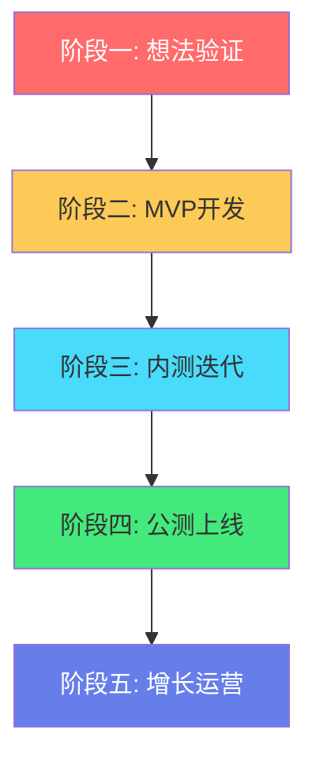
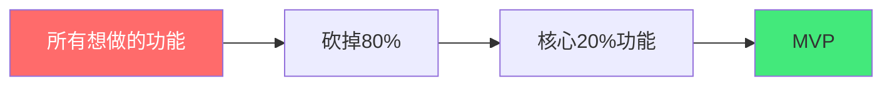
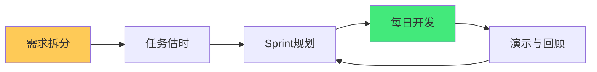
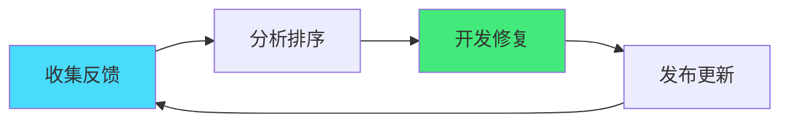
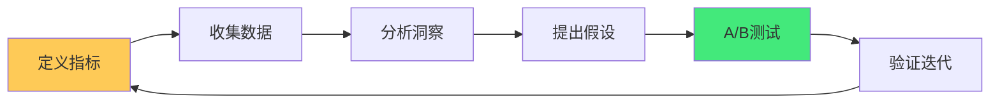
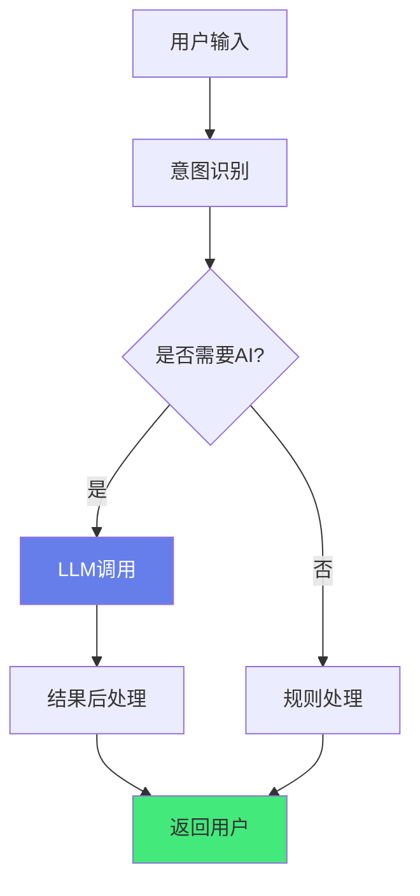

# 🚀 从 0 到 1 产品落地路径

> **文档说明**：系统讲解一个产品从想法到上线的完整落地路径，涵盖产品落地五阶段模型（想法验证 → MVP 开发 → 内测迭代 → 公测上线 → 增长运营）、第一阶段想法验证（需求分析 / 用户调研 / 竞品分析 / 可行性评估 / 产品定位与价值主张）、第二阶段 MVP 开发（MVP 定义与核心功能取舍 / 技术选型 / 架构设计 / 敏捷开发 / 功能优先级排序 MoSCoW）、第三阶段内测迭代（种子用户招募 / 反馈收集机制 / 快速迭代循环 / Bug 修复 / 数据埋点与分析）、第四阶段公测上线（灰度发布策略 / 性能优化 / 安全审计 / 文档与帮助中心 / 客服与运营准备）、第五阶段增长运营（用户增长渠道 / 留存优化 / 变现模式设计 / 数据驱动决策 / 持续迭代机制）、全栈开发者的产品视角（技术决策如何影响产品 / 快速验证的技术栈选择 / 用 AI 赋能产品开发）、AI 时代的产品落地（AI 功能验证方法 / LLM 集成策略 / Prompt 工程 / 模型选型与成本控制）、项目管理与协作（敏捷开发 Scrum / 任务拆分 / 里程碑管理 / 风险识别与应对）、常见陷阱与避坑指南（过度设计 / 范围蔓延 / 忽视用户反馈 / 技术债积累 / 过早优化 / 完美主义陷阱）、产品落地检查清单、最佳实践。
>
> **适用人群**：全栈开发者、独立开发者、产品经理、创业者、想从 0 到 1 做产品的技术人
>
> **前置知识**：[[需求分析与用户故事]] · [[产品原型设计方法]]

---

## 一、概述

### 1.1 什么是「从 0 到 1」

从 0 到 1 不是「写代码」，而是「验证一个想法是否能解决真实问题、是否有人愿意用、是否能持续运营」的完整过程。


**关键认知**：
- 💡 **想法不值钱，执行才值钱**——每个人都有想法，能落地的才是产品
- 🎯 **先验证再开发**——不要花 6 个月做一个没人要的产品
- 🔄 **迭代是常态**——1.0 不是终点，是起点
- 📊 **数据驱动**——用数据说话，不要凭感觉

### 1.2 产品落地五阶段



| 阶段 | 目标 | 周期 | 核心产出 |
|------|------|------|---------|
| **想法验证** | 确认需求真实存在 | 1-2 周 | 需求文档、竞品分析、用户画像 |
| **MVP 开发** | 做出最小可用产品 | 2-6 周 | 可运行的核心功能 |
| **内测迭代** | 验证产品价值，快速优化 | 2-4 周 | 迭代后的产品、用户反馈 |
| **公测上线** | 面向公众发布 | 1-2 周 | 正式上线的产品 |
| **增长运营** | 获取用户，持续增长 | 持续 | 增长策略、运营数据 |

---

## 二、阶段一：想法验证

### 2.1 需求分析

**核心问题**：这个需求是真实的吗？是痛点还是伪需求？

```typescript
// 需求验证清单
const requirementCheck = {
  isRealPain: '用户是否真的在为此痛苦？',
  frequency: '用户多久遇到一次这个问题？',
  severity: '问题有多严重？',
  currentSolution: '用户现在怎么解决的？',
  willingnessToPay: '用户愿意付费解决吗？',
  marketSize: '有多少人有这个问题？'
}
```

**验证方法**：
- 🗣️ **用户访谈**：找 10-20 个目标用户聊天，不要推销，只听
- 📝 **问卷调查**：用问卷星/Google Forms 收集量化数据
- 🔍 **搜索趋势**：百度指数/Google Trends 看需求趋势
- 💬 **社区观察**：知乎/V2EX/Reddit 看用户在抱怨什么

### 2.2 竞品分析

| 维度 | 分析内容 |
|------|---------|
| **直接竞品** | 做同样事情的产品 |
| **间接竞品** | 用不同方式解决同样问题的产品 |
| **替代方案** | 用户现在用什么（Excel/手工/其他工具） |
| **差异化机会** | 竞品没做好的地方 |

**竞品分析模板**：
```markdown
## 竞品：XXX
- 核心功能：...
- 优点：...
- 缺点：...
- 用户评价：...
- 我们的机会：...
```

### 2.3 产品定位

**一句话定位公式**：
```text
为 [目标用户] 提供 [核心价值]，通过 [差异化方式]，
不同于 [竞品]，我们 [独特优势]。
```

**示例**：
> 为独立开发者提供 AI 驱动的知识库管理工具，通过自然语言交互和自动知识图谱，
> 不同于 Notion，我们更专注于技术知识的结构化和关联发现。

---

## 三、阶段二：MVP 开发

### 3.1 什么是 MVP

**MVP（Minimum Viable Product，最小可行产品）**：用最少的功能验证核心价值假设。



**MVP 原则**：
- ✂️ **做减法**：只保留验证核心假设必需的功能
- ⚡ **快**：2-6 周必须上线，超过就砍功能
- 🎯 **聚焦**：一个核心场景做到极致，不要面面俱到
- 📊 **可衡量**：定义成功指标（如注册率、留存率）

### 3.2 功能优先级：MoSCoW 方法

| 优先级 | 含义 | MVP 中 |
|--------|------|--------|
| **Must have** | 必须有，没有就不成立 | ✅ 做 |
| **Should have** | 应该有，但可以延后 | ❌ 不做 |
| **Could have** | 可以有，有时间再做 | ❌ 不做 |
| **Won't have** | 这次不做 | ❌ 不做 |

**示例**：
```markdown
## AI 知识库 MVP 功能
- Must have: 文档上传、AI 问答、搜索
- Should have: 知识图谱、多用户协作
- Could have: 移动端、插件生态
- Won't have: 离线模式、企业SSO
```

### 3.3 技术选型（快速验证导向）

| 层面 | 推荐选择 | 理由 |
|------|---------|------|
| **前端** | Vue3 + Vite + Element Plus | 开发快、生态全 |
| **后端** | Node.js (NestJS) 或 Python (FastAPI) | 全栈统一语言 / AI 生态好 |
| **数据库** | PostgreSQL | 关系型+JSON，够用 |
| **认证** | 第三方登录（GitHub/Google） | 省去注册流程 |
| **部署** | Vercel / Railway / Docker | 一键部署，免运维 |
| **AI** | OpenAI API / 国内大模型 API | 不用自己训练 |
| **监控** | Sentry + 简单埋点 | 快速发现问题 |

> **原则**：MVP 阶段用最熟悉、最快的技术栈，不要为了「学习新技术」而选择不熟悉的。

### 3.4 敏捷开发



- **Sprint**：1-2 周一个迭代
- **任务拆分**：每个任务不超过 1 天
- **每日站会**：昨天做了什么、今天做什么、有什么阻碍
- **演示**：每个 Sprint 结束演示可运行的产品

---

## 四、阶段三：内测迭代

### 4.1 种子用户招募

**种子用户特征**：
- 是目标用户（有真实需求）
- 愿意反馈（不嫌弃产品粗糙）
- 有影响力（能帮你传播）

**招募渠道**：
- 朋友圈/社群（最直接）
- 知乎/V2EX/Reddit 发帖
- 竞品用户群
- 早期用户邀请制

### 4.2 反馈收集机制

| 方式 | 工具 | 用途 |
|------|------|------|
| **应用内反馈** | 反馈按钮 / 表单 | 主动收集 |
| **用户访谈** | 微信/电话 | 深度理解 |
| **行为数据** | 埋点 / 热力图 | 看用户实际操作 |
| **崩溃日志** | Sentry | 发现技术问题 |
| **社群讨论** | 微信群/Discord | 持续互动 |

### 4.3 快速迭代循环



**迭代节奏**：
- Bug 修复：24 小时内
- 小功能优化：3-5 天
- 大功能迭代：1-2 周

**反馈处理原则**：
- 不要用户说什么就做什么——要理解背后的需求
- 多个用户提到同一个问题 → 优先处理
- 单个用户的特殊需求 → 记录，评估普遍性
- 技术债要持续还，不要积累

### 4.4 数据埋点

**核心指标（AARRR）**：
| 指标 | 说明 | 目标 |
|------|------|------|
| **Acquisition 获取** | 用户从哪来 | 渠道转化率 |
| **Activation 激活** | 首次核心行为 | 激活率 > 40% |
| **Retention 留存** | 次日/7日/30日留存 | 次日留存 > 30% |
| **Revenue 收入** | 付费转化 | 付费率 > 3% |
| **Referral 推荐** | 用户推荐 | K 因子 > 1 |

---

## 五、阶段四：公测上线

### 5.1 灰度发布策略


- 每一步观察 24-48 小时
- 核心指标异常立即回滚
- 准备好回滚方案

### 5.2 上线前检查清单

```markdown
## 技术
- [ ] 性能压测（QPS、响应时间）
- [ ] 安全审计（XSS、SQL注入、权限）
- [ ] 数据库备份策略
- [ ] 监控告警配置
- [ ] 日志收集

## 产品
- [ ] 核心流程走查
- [ ] 帮助中心/使用文档
- [ ] 常见问题 FAQ
- [ ] 客服渠道（邮箱/社群）

## 运营
- [ ] 上线公告文案
- [ ] 社交媒体预热
- [ ] 应用商店/平台提交
- [ ] 首批用户运营计划
```

### 5.3 性能优化

上线前必须做的性能优化：
- 前端：代码分割、懒加载、资源压缩、CDN
- 后端：数据库索引、缓存（Redis）、接口优化
- 数据库：慢查询优化、连接池配置
- 服务器：负载均衡、自动扩缩容

---

## 六、阶段五：增长运营

### 6.1 用户增长渠道

| 渠道 | 类型 | 适合阶段 |
|------|------|---------|
| **内容营销** | 博客/视频/教程 | 长期，低成本 |
| **社交媒体** | 知乎/小红书/Twitter | 快速，需内容 |
| **SEO** | 搜索引擎优化 | 长期，高价值 |
| **付费广告** | Google/百度/社交广告 | 快速，需预算 |
| **推荐机制** | 邀请奖励/病毒传播 | 产品驱动 |
| **合作伙伴** | 交叉推广/集成 | 资源互换 |
| **社区运营** | 用户群/论坛 | 留存+口碑 |

### 6.2 留存优化

**留存是增长的基础**——留存不好，获客越多浪费越多。

| 阶段 | 策略 |
|------|------|
| **新用户留存** | Onboarding 引导、首次价值体验 |
| **中期留存** | 功能发现、使用习惯培养 |
| **长期留存** | 核心价值持续、社区归属 |
| **流失召回** | 邮件/Push 提醒、新功能通知 |

### 6.3 变现模式

| 模式 | 示例 | 适合产品 |
|------|------|---------|
| **订阅制** | SaaS 月付/年付 | 工具类、效率类 |
| **一次性购买** | 买断制 | 专业工具 |
| **免费+增值** | Freemium | 大众工具 |
| **交易抽成** | 平台抽佣 |  marketplace |
| **广告** | 展示广告 | 内容类、流量大 |
| **API 计费** | 按调用量 | 开发者工具 |

### 6.4 数据驱动决策



- 每个功能改动都要有数据假设
- 用 A/B 测试验证，不要凭感觉
- 建立数据看板，每周 review

---

## 七、AI 时代的产品落地

### 7.1 AI 功能验证

AI 功能的特殊性：**效果不确定、成本高、用户期望管理难**。

**验证方法**：
1. **先用 API 验证**：不要自己训练模型，先用 GPT-4/Claude API 验证需求
2. **Prompt 工程**：好的 Prompt 能提升 30%+ 效果
3. **人工兜底**：AI 输出不确定时，有人工审核或兜底方案
4. **成本控制**：监控 Token 用量，设置上限和告警

### 7.2 LLM 集成策略



- 不是所有功能都需要 AI——能用规则解决的不要用 LLM
- AI 调用要加缓存（相同问题不要重复调用）
- 设置超时和降级方案（AI 不可用时用规则兜底）
- 监控 AI 输出质量（用户反馈、人工抽检）

---

## 八、常见陷阱与避坑

| 陷阱 | 表现 | 避坑方法 |
|------|------|---------|
| **过度设计** | 架构太复杂，开发慢 | MVP 用最简单方案 |
| **范围蔓延** | 不断加功能，永远做不完 | 严格执行 MoSCoW，新需求进 backlog |
| **忽视用户** | 闭门造车，不跟用户聊 | 每周至少跟 3 个用户聊天 |
| **技术债** | 为了快写烂代码 | 每个 Sprint 留 20% 时间还债 |
| **过早优化** | 还没用户就优化性能 | 先有用户，再优化瓶颈 |
| **完美主义** | 1.0 想做到完美 | 先上线，再迭代 |
| **盲目追新** | 什么技术新用什么 | 用最熟悉的技术做 MVP |
| **不做埋点** | 上线后不知道用户怎么用 | MVP 就加核心埋点 |
| **忽视安全** | 不做权限、不加密 | 基础安全必须做（认证、加密、备份） |
| **一个人扛** | 什么都自己做 | 能外包的外包，能自动化的自动化 |

---

## 九、产品落地检查清单

### 想法验证阶段
- [ ] 访谈了至少 10 个目标用户
- [ ] 完成了竞品分析
- [ ] 写了一句话产品定位
- [ ] 定义了核心成功指标

### MVP 开发阶段
- [ ] 用 MoSCoW 确定了 Must have 功能
- [ ] 选择了熟悉的技术栈
- [ ] 拆分了任务，每个不超过 1 天
- [ ] 设置了 2-6 周的 deadline
- [ ] 加了核心数据埋点

### 内测迭代阶段
- [ ] 招募了 20+ 种子用户
- [ ] 建立了反馈收集渠道
- [ ] 每周迭代一次
- [ ] 修复了所有 P0/P1 Bug
- [ ] 核心指标达到预期

### 公测上线阶段
- [ ] 完成了性能压测
- [ ] 完成了安全检查
- [ ] 写了帮助文档和 FAQ
- [ ] 配置了监控告警
- [ ] 准备了灰度发布方案

### 增长运营阶段
- [ ] 确定了 1-2 个核心增长渠道
- [ ] 建立了数据看板
- [ ] 设计了变现模式
- [ ] 建立了用户社群
- [ ] 每周 review 数据并迭代

---

## 十、最佳实践

1. **先验证再开发**——用 1 周验证需求，避免 6 个月做没人要的产品
2. **MVP 做减法**——砍掉 80% 功能，只保留核心 20%
3. **快速上线，持续迭代**——1.0 不是终点，是起点
4. **跟用户做朋友**——每周跟用户聊天，用户是最好的产品经理
5. **数据驱动**——用数据决策，不要凭感觉
6. **技术债持续还**——每个 Sprint 留时间还债，不要积累
7. **不要过早优化**——先有用户，再找瓶颈优化
8. **AI 先用 API 验证**——不要一上来就训练模型
9. **建立反馈闭环**——收集→分析→开发→发布→再收集
10. **保持专注**——一次只做一件事，做好了再做下一件
11. **接受不完美**——1.0 一定有问题，上线了才能发现
12. **记录决策过程**——为什么做这个、为什么不做那个，写下来

---

## 十一、关联笔记

### 产品与项目
- [[需求分析与用户故事]] · [[产品原型设计方法]] · [[全栈项目实战]]
- [[敏捷开发与Scrum]] · [[项目管理与协作]]

### 技术实现
- [[技术选型与架构设计]] · [[CI-CD持续集成与部署]] · [[Docker容器化]]
- [[AI应用开发入门]] · [[LLM服务架构]]

### 增长与运营
- [[用户增长策略]] · [[数据分析与埋点]] · [[产品运营方法论]]

### 导航
- [[MOC-项目实战]] · [[MOC-产品与模板]] · [[Home]] · [[学习路线总览]]

> 🔍 **知识点深度解析**
>
> **作用**：从 0 到 1 产品落地路径解决的是「如何将一个想法转化为真实可用、有用户、能持续增长的产品，避免在错误的方向上浪费时间和资源」的核心问题——产品落地不是写代码，而是一个「验证假设→快速开发→收集反馈→持续迭代」的系统性过程，每个阶段有不同的目标和方法。
>
> **底层原理**：①从 0 到 1 的本质是「假设验证」——产品开发本质上是一系列假设的验证过程：假设用户有这个需求（验证需求）、假设这个功能能解决需求（验证 MVP）、假设用户愿意持续使用（验证留存）、假设有足够多的用户（验证市场规模）。每个阶段的目标就是验证一个核心假设，验证通过才进入下一阶段，验证不通过就调整方向或放弃。这种「精益创业」的思想核心是「快速失败、低成本试错」——用最小的成本验证假设，避免在错误的方向上投入过多。②MVP（最小可行产品）的本质是「学习工具，不是缩小版产品」——很多人以为 MVP 是「功能少一点的完整版」，这是错误的。MVP 的真正目的是「用最少的努力获得最多的学习」——它只需要包含验证核心假设必需的功能，其他功能全部砍掉。MVP 不需要完美，不需要好看，甚至不需要完整——它只需要能让用户完成核心行为，从而验证「用户是否真的需要这个」。③MoSCoW 优先级方法的本质是「强制取舍」——产品开发中最大的敌人是「范围蔓延」（scope creep）——不断有人说「这个功能也很重要」「加一个吧」，结果产品永远做不完。MoSCoW 强制将功能分为 Must/Should/Could/Won't 四档，MVP 阶段只做 Must have，其他全部延后。这种「强制分类」迫使团队思考「什么是真正必需的」，避免范围蔓延。④内测迭代的本质是「构建-测量-学习」循环（Build-Measure-Learn）——这是精益创业的核心循环：构建一个功能（Build），测量用户反应（Measure），从中学习（Learn），然后决定是继续优化还是调整方向（Pivot）。这个循环转得越快，产品成长越快。内测阶段的目标就是把这个循环跑起来——种子用户提供反馈，团队快速迭代，每个循环都让产品更接近用户真实需求。⑤灰度发布的本质是「控制风险的渐进式发布」——直接全量上线有风险：如果有严重 Bug，所有用户都受影响。灰度发布通过逐步扩大用户比例（1%→10%→50%→100%），在每一步观察核心指标，如果异常就回滚，将风险控制在最小范围。这和「蓝绿部署」「金丝雀发布」是同一类思想——用渐进式发布控制上线风险。⑥AARRR 漏斗模型的本质是「用户生命周期的量化管理」——Acquisition（获取）→Activation（激活）→Retention（留存）→Revenue（收入）→Referral（推荐），每个环节都有转化率，整个漏斗的乘积就是最终的增长效率。数据分析的核心就是找到漏斗中转化率最低的环节，针对性优化。留存是漏斗的核心——留存不好，前面获客越多浪费越多，所以「留存是增长的基础」。
>
> **用法要点**：① 五阶段：想法验证(1-2周)→MVP开发(2-6周)→内测迭代(2-4周)→公测上线(1-2周)→增长运营(持续) ② 想法验证：用户访谈(10-20人)/问卷/搜索趋势/社区观察，确认需求真实+愿意付费 ③ 竞品分析：直接竞品/间接竞品/替代方案/差异化机会 ④ 产品定位：一句话公式(为谁提供什么价值，通过什么方式，不同于谁) ⑤ MVP：最小可行产品，砍掉80%只留核心20%，2-6周必须上线 ⑥ MoSCoW：Must(做)/Should(延后)/Could(有时间)/Won't(不做)，MVP只做Must ⑦ 技术选型：用最熟悉最快的栈，Vue3+Vite/Node或Python/PostgreSQL/Vercel部署/AI用API ⑧ 敏捷开发：1-2周Sprint/任务≤1天/每日站会/每Sprint演示 ⑨ 内测：种子用户(目标用户+愿反馈+有影响力)/反馈渠道(应用内+访谈+数据+日志+社群)/快速迭代(Bug24h/小功能3-5天) ⑩ 数据埋点AARRR：获取/激活(>40%)/留存(次日>30%)/收入(>3%)/推荐(K>1) ⑪ 公测：灰度发布(1%→10%→50%→100%)/上线检查清单(技术+产品+运营)/性能优化 ⑫ 增长：渠道(内容/社交/SEO/广告/推荐/合作/社区)/留存(Onboarding/功能发现/社区/召回)/变现(订阅/买断/Freemium/抽成/广告/API) ⑬ AI产品：先用API验证/Prompt工程/人工兜底/成本控制/不是所有功能都需要AI/加缓存+超时降级 ⑭ 避坑：过度设计/范围蔓延/忽视用户/技术债/过早优化/完美主义/盲目追新/不做埋点/忽视安全/一个人扛 ⑮ 最佳实践：先验证再开发/MVP做减法/快速上线持续迭代/跟用户聊天/数据驱动/持续还债/不过早优化/AI先用API/反馈闭环/保持专注/接受不完美/记录决策。

> 💡 **深度讲解**：从 0 到 1 产品落地最核心的智慧是「想法不值钱，执行才值钱——而且不是闷头执行，是带着验证思维的执行，每一步都在验证假设，每一步都在降低风险」——很多技术人做产品的误区是「拿到想法就开始写代码」，花了几个月做了一个功能齐全的产品，上线后发现没人用。正确的做法是「先验证再开发」——用 1-2 周跟用户聊天、做竞品分析、确认需求真实存在，然后用 2-6 周做一个只有核心功能的 MVP，上线给种子用户用，根据反馈快速迭代。这个过程中最重要的能力不是「写代码」，而是「做减法」——MVP 阶段要砍掉 80% 的功能，只保留验证核心假设必需的 20%。很多人舍不得砍，觉得「这个功能也很重要」，结果 MVP 变成了「缩小版的完整版」，开发周期拉长，上线时间推迟，验证假设的成本变高。记住：MVP 的目的是「学习」，不是「交付」——它是一个学习工具，帮你理解用户真实需求，而不是一个要做到完美的产品。内测迭代阶段的核心是「跟用户做朋友」——每周跟至少 3 个用户聊天，看他们怎么用你的产品，听他们抱怨什么。用户是最好的产品经理——他们不会直接告诉你「应该做什么功能」，但他们的行为和抱怨会告诉你「哪里有问题」。数据驱动是另一个关键——不要凭感觉做决策，每个功能改动都要有数据假设，用 A/B 测试验证。建立数据看板，每周 review，用数据说话。在 AI 时代，产品落地有了新的特点：AI 功能效果不确定（同一个 Prompt 不同时间输出可能不同）、成本高（Token 费用）、用户期望管理难（用户以为 AI 无所不能）。所以 AI 产品更需要「先验证再开发」——先用 API 验证需求和效果，不要一上来就训练模型；Prompt 工程能提升 30%+ 效果，比换模型更划算；要有兜底方案（AI 不可用时用规则处理）；要监控成本，设置 Token 用量上限。从 0 到 1 是一段充满不确定性的旅程，但也是最有成就感的旅程——当你看到第一个用户用你的产品解决了真实问题，那种感觉是无与伦比的。记住：先验证，再开发；做减法，快上线；跟用户，用数据；接受不完美，持续迭代。

> 📝 **精简总结**：从0到1产品落地=五阶段验证过程。想法验证(1-2周)：用户访谈+竞品分析+产品定位，确认需求真实。MVP开发(2-6周)：最小可行产品，MoSCoW只做Must，用最熟技术栈，2-6周上线。内测迭代(2-4周)：种子用户+反馈收集+快速迭代+数据埋点AARRR。公测上线(1-2周)：灰度发布+检查清单+性能优化。增长运营(持续)：渠道选择+留存优化+变现模式+数据驱动A/B测试。AI产品：先用API验证/Prompt工程/兜底方案/成本控制。避坑：过度设计/范围蔓延/忽视用户/技术债/过早优化/完美主义。最佳实践：先验证再开发/MVP做减法/快速上线持续迭代/跟用户聊天/数据驱动/接受不完美。

> **学习路径建议**：先学习 [[需求分析与用户故事]] 和 [[产品原型设计方法]] 打好产品基础 → 学习本文档的五阶段模型 → 实践：选一个想法，用 1 周做需求验证（用户访谈+竞品分析） → 学习 MVP 定义和 MoSCoW 方法 → 实践：用 2-4 周做一个 MVP 并上线 → 学习内测迭代和数据埋点 → 实践：招募种子用户，收集反馈，迭代 2-3 轮 → 学习增长运营和 AARRR 模型 → 实践：制定增长策略，执行并复盘 → 学习 AI 产品落地（LLM 集成/Prompt 工程/成本控制） → 形成自己的「从 0 到 1」方法论。

---

> **从 0 到 1 产品落地最核心的智慧是「想法不值钱，执行才值钱——而且不是闷头执行，是带着验证思维的执行，每一步都在验证假设，每一步都在降低风险」——很多技术人做产品的误区是拿到想法就开始写代码，花几个月做了功能齐全的产品，上线发现没人用。正确做法是先验证再开发：用 1-2 周跟用户聊天、做竞品分析、确认需求真实，然后用 2-6 周做只有核心功能的 MVP，上线给种子用户用，根据反馈快速迭代。这个过程中最重要的能力不是写代码，而是做减法——MVP 阶段砍掉 80% 功能，只保留验证核心假设必需的 20%。很多人舍不得砍，觉得这个功能也重要，结果 MVP 变成缩小版完整版，开发周期拉长，验证成本变高。记住：MVP 的目的是学习，不是交付——它是学习工具，帮你理解用户真实需求，不是要做到完美的产品。内测阶段核心是跟用户做朋友——每周跟至少 3 个用户聊天，看他们怎么用，听他们抱怨什么，用户是最好的产品经理。数据驱动是另一个关键——不要凭感觉决策，每个功能改动都要有数据假设，用 A/B 测试验证，建立数据看板每周 review。AI 时代产品落地有新特点：AI 效果不确定、成本高、用户期望难管理，所以更需要先验证再开发——先用 API 验证，Prompt 工程比换模型划算，要有兜底方案，监控成本。从 0 到 1 是充满不确定性的旅程，也是最有成就感的旅程——当你看到第一个用户用你的产品解决了真实问题，那种感觉无与伦比。记住：先验证再开发，做减法快上线，跟用户用数据，接受不完美持续迭代。如果你现在有一个想法，不要等「准备好」——今天就去跟 3 个目标用户聊天，这是从 0 到 1 的第一步。**

---

## 🔗 关联笔记

- [[MOC-项目实战]] — 返回本分类知识地图，查看更多相关文档

## 📖 前置知识

- [[需求分析与用户故事]]
- [[产品原型设计方法]]

## 🏷️ 相关标签

`#产品落地` `#MVP` `#从0到1` `#产品思维` `#项目管理` `#敏捷开发`

[[Home|🏠 返回首页]] · [[MOC-项目实战|📚 返回分类]]
