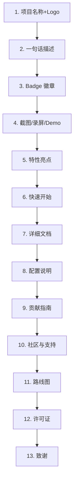

# 开源项目 README 规范

> **文档说明**：系统讲解开源项目 README 的完整写作规范，包括标准结构、各章节写作要点、Badge 使用、截图/录屏、安装与使用说明、贡献指南、许可证选择，以及完整可复用的 README 模板（含填写示例），帮助开发者写出专业、清晰、高吸引力的开源项目文档。
>
> **适用人群**：开源项目维护者、需要编写项目文档的开发者、技术写作者
>
> **前置知识**：[[项目启动文档模板]]、Markdown 语法基础

---

## 一、概述

### 1. README 的重要性

README 是开源项目的**门面**，是用户接触项目的第一个文档。一个好的 README 可以：

| 价值 | 说明 |
|------|------|
| **吸引用户** | 30 秒内让用户理解项目是什么、解决什么问题 |
| **降低门槛** | 清晰的安装和使用说明，让用户 5 分钟内跑起来 |
| **建立信任** | 完整的文档、活跃的维护、明确的许可证 |
| **吸引贡献者** | 清晰的贡献指南，让新人知道如何参与 |
| **SEO 友好** | 关键词丰富，搜索引擎容易收录 |
| **减少 Issue** | 常见问题在 README 中解答，减少重复提问 |

**差的 README 表现**：
- 只有一句话描述，不知道怎么安装和使用
- 没有截图，不知道长什么样
- 安装步骤缺失或过时
- 没有许可证，不知道能否商用
- 没有贡献指南，不知道如何提 PR
- 全是英文拼写错误和格式混乱

### 2. README 标准结构



| 章节 | 必要性 | 说明 |
|------|--------|------|
| **项目名称 + Logo** | 必须 | 项目名、Logo、标语 |
| **一句话描述** | 必须 | 用一句话说明项目是什么、解决什么问题 |
| **Badge** | 推荐 | 构建状态、版本、覆盖率、许可证、下载量等 |
| **截图/录屏/Demo** | 强烈推荐 | 可视化展示项目效果 |
| **特性亮点** | 必须 | 列出 3-7 个核心特性 |
| **快速开始** | 必须 | 安装、配置、运行的最小步骤 |
| **详细文档** | 推荐 | 链接到完整文档（Wiki/官网/Docs 目录） |
| **配置说明** | 推荐 | 环境变量、配置文件选项 |
| **贡献指南** | 推荐 | 如何提交 Issue、PR、代码规范 |
| **社区与支持** | 推荐 | Discord/Slack/微信群、讨论区、联系方式 |
| **路线图** | 可选 | 未来计划、已完成/进行中/待开发 |
| **许可证** | 必须 | MIT/Apache/GPL 等，附 LICENSE 文件 |
| **致谢** | 可选 | 感谢贡献者、灵感来源、使用的开源项目 |

### 3. 不同类型项目的 README 侧重点

| 项目类型 | 侧重点 | 必备内容 |
|---------|--------|---------|
| **CLI 工具** | 安装命令、用法示例、配置 | 安装、用法、选项说明、截图 |
| **库/框架** | API 文档、快速上手、示例代码 | 安装、快速开始、API 参考、示例 |
| **Web 应用** | 功能截图、部署方式、Demo 链接 | 截图、Demo、部署、配置 |
| **移动端应用** | 下载链接、功能截图、构建说明 | 截图、下载、构建步骤 |
| **VSCode 插件** | 功能演示、配置选项、快捷键 | 截图/GIF、配置、快捷键 |
| **算法/学习项目** | 目录结构、知识点覆盖、学习路径 | 目录说明、知识点列表、学习路线 |
| **模板/脚手架** | 使用方式、生成结果、自定义选项 | 一键生成命令、生成结果展示、自定义 |

---

## 二、各章节写作规范

### 1. 项目名称与 Logo

```markdown
# 项目名称


```

**规范**：
- 一级标题就是项目名称（与 GitHub 仓库名一致）
- Logo 建议尺寸 200x200 像素，PNG 透明背景
- Logo 放在标题下方或右侧
- 如果没有 Logo，可以用文字 Logo（大字号 + 特殊字体）或 emoji

### 2. 一句话描述

```markdown
> 用一句话（不超过 50 字）说明项目是什么、解决什么问题。
```

**好的示例**：
- > 🚀 基于 Vite + Vue3 + TypeScript 的企业级中后台前端解决方案
- > 🔍 用 Rust 编写的极速代码搜索工具，比 grep 快 100 倍
- > 📊 一个轻量级的 Python 数据可视化库，3 行代码生成交互式图表

**差的示例**：
- > 这是一个很好的项目
- > 我的第一个开源项目
- > 用于做一些事情的工具

**写作要点**：
- 包含**技术栈**（什么语言/框架）
- 包含**核心功能**（做什么）
- 包含**独特价值**（为什么用它而不是别的）
- 可以加 emoji 增加视觉吸引力
- 不超过 50 字，一句话说完

### 3. Badge 徽章

Badge 是 README 中最常见的视觉元素，用于展示项目状态和指标。

**常用 Badge 来源**：

| 类型 | 服务 | 示例 |
|------|------|------|
| **构建状态** | GitHub Actions |  |
| **版本** | npm / PyPI / crates.io |  |
| **覆盖率** | Coveralls / Codecov |  |
| **许可证** | Shields.io |  |
| **下载量** | npm / PyPI |  |
| **Star** | Shields.io |  |
| **Fork** | Shields.io |  |
| **代码质量** | CodeFactor / LGTM |  |
| **语言** | Shields.io |  |
| **PRs Welcome** | Shields.io |  |
| **Discord** | Shields.io |  |

**完整示例**：
```markdown
[](https://github.com/user/repo/actions)
[](https://codecov.io/gh/user/repo)
[](https://www.npmjs.com/package/repo)
[](https://www.npmjs.com/package/repo)
[](LICENSE)
[](#贡献指南)
```

**规范**：
- Badge 放在一句话描述下方
- 不超过 8 个，只放最重要的
- 每个 Badge 都应该是可点击的（链接到对应页面）
- 使用统一的风格（建议都用 shields.io）
- 不要放已经失效或过时的 Badge

### 4. 截图/录屏/Demo

**可视化是 README 中最有说服力的部分**。

```markdown
## 📸 截图


*主界面展示*


*设置页面*

## 🎥 演示

[](https://www.youtube.com/watch?v=xxx)

## 🔗 在线 Demo

[👉 点击体验在线 Demo](https://demo.example.com)
```

**规范**：
- 截图清晰，分辨率至少 1280x800
- 每张截图加简短说明
- GIF 录屏不超过 5MB，时长 10-30 秒
- 在线 Demo 链接放在显眼位置
- 截图可以加边框和阴影，更美观
- 使用工具：[CleanShot X](https://cleanshot.com/)、[Kap](https://getkap.co/)、[LICEcap](https://www.cockos.com/licecap/)

### 5. 特性亮点

```markdown
## ✨ 特性

- ⚡ **极速**：基于 Rust 编写，启动时间 < 10ms
- 🎨 **美观**：内置 10+ 主题，支持自定义配色
- 🔌 **可扩展**：插件系统，支持 100+ 社区插件
- 📦 **轻量**：核心仅 5MB，无外部依赖
- 🌍 **跨平台**：支持 macOS / Linux / Windows
- 🔒 **安全**：端到端加密，数据本地存储
- 📝 **可配置**：YAML 配置文件，支持环境变量
```

**规范**：
- 3-7 个特性，不要太多
- 每个特性用 emoji + **加粗标题** + 简短说明
- 突出与竞品的差异点
- 按重要性排序
- 不要夸大其词，要真实可验证

### 6. 快速开始

这是 README 中**最重要**的部分，用户看完特性后最想知道的就是"怎么用"。

```markdown
## 🚀 快速开始

### 环境要求

- Node.js >= 18.0.0
- npm >= 9.0.0 或 pnpm >= 8.0.0
- 操作系统：macOS / Linux / Windows

### 安装

```
```bash
# 使用 npm
npm install my-package
```

## 使用 pnpm
pnpm add my-package

## 使用 yarn
yarn add my-package
```css

### 快速使用

```
import { createApp } from 'my-package'

const app = createApp({
  // 配置选项
  port: 3000,
  debug: true,
})

app.start()
```css

### 运行示例

```
```bash
# 克隆仓库
git clone https://github.com/user/repo.git
cd repo
```

```bash
# 安装依赖
npm install
```

```bash
# 运行示例
npm run example
```
```css

### Docker 部署

```
```bash
# 拉取镜像
docker pull user/repo:latest
```

```bash
# 运行容器
docker run -d \
  --name my-app \
  -p 3000:3000 \
  -v /path/to/config:/app/config \
```
  user/repo:latest
```
```

**规范**：
- 先列环境要求（版本号）
- 安装命令要完整可复制
- 最小使用示例（3-10 行代码能跑起来）
- 提供多种安装方式（npm/pnpm/yarn/Docker）
- 代码块标注语言（```bash、```javascript）
- 步骤要按顺序，用户一步步跟着做就能成功
- 不要省略步骤，不要假设用户知道

### 7. 配置说明

```markdown
## ⚙️ 配置

### 配置文件

项目使用 `config.yaml` 作为配置文件，放在项目根目录。

```
## 服务配置
server:
  host: 0.0.0.0
  port: 3000
  debug: false

## 数据库配置
database:
  type: postgresql
  host: localhost
  port: 5432
  name: mydb
  user: postgres
  password: ${DB_PASSWORD}

## 日志配置
logging:
  level: info
  format: json
  output: /var/log/myapp.log
```

### 环境变量

| 变量名 | 说明 | 默认值 | 必填 |
|--------|------|--------|------|
| `PORT` | 服务端口 | `3000` | 否 |
| `DB_HOST` | 数据库地址 | `localhost` | 是 |
| `DB_PASSWORD` | 数据库密码 | - | 是 |
| `LOG_LEVEL` | 日志级别 | `info` | 否 |
| `DEBUG` | 调试模式 | `false` | 否 |
```

### 8. 贡献指南

```markdown
## 🤝 贡献指南

我们欢迎所有形式的贡献！无论是提交 Bug、提出新功能、改进文档还是提交代码。

### 提交 Issue

- 使用 [Issue 模板](.github/ISSUE_TEMPLATE/)
- 提供完整的复现步骤、环境信息、截图
- 搜索已有 Issue，避免重复

### 提交 Pull Request

1. Fork 本仓库
2. 创建特性分支：`git checkout -b feature/amazing-feature`
3. 提交更改：`git commit -m 'feat: add amazing feature'`
4. 推送到分支：`git push origin feature/amazing-feature`
5. 发起 Pull Request

### 开发环境搭建

```
```bash
# 克隆仓库
git clone https://github.com/user/repo.git
cd repo
```

```bash
# 安装依赖
npm install
```

```bash
# 运行开发服务器
npm run dev
```

```bash
# 运行测试
npm run test
```

```bash
# 运行 Lint
npm run lint
```
```

### 代码规范

- 遵循 [ESLint 配置](.eslintrc.js)
- 提交信息遵循 [Conventional Commits](https://www.conventionalcommits.org/)
- 新增功能需要添加测试
- 更新相关文档

### 行为准则

本项目遵循 [Contributor Covenant](CODE_OF_CONDUCT.md) 行为准则。
```

### 9. 社区与支持

```markdown
## 💬 社区与支持

- 💬 [Discord 社区](https://discord.gg/xxx) — 实时交流
- 📧 [邮件列表](mailto:community@example.com) — 深度讨论
- 📚 [文档](https://docs.example.com) — 完整使用文档
- ❓ [FAQ](docs/FAQ.md) — 常见问题解答
- 🐛 [Issue Tracker](https://github.com/user/repo/issues) — Bug 反馈
- 💡 [Discussions](https://github.com/user/repo/discussions) — 功能建议

### 联系方式

- 维护者：[@username](https://github.com/username)
- 邮箱：maintainer@example.com
- 推特：[@project](https://twitter.com/project)
```

### 10. 路线图

```markdown
## 🗺️ 路线图

### ✅ 已完成

- [x] v1.0 核心功能
- [x] 插件系统
- [x] 多主题支持
- [x] Docker 部署

### 🚧 进行中

- [ ] v2.0 架构重构
- [ ] WebSocket 支持
- [ ] 移动端适配

### 📋 计划中

- [ ] 多语言国际化
- [ ] 企业版功能
- [ ] 云服务托管

### 💡 待评估

- [ ] AI 功能集成
- [ ] 区块链支持
```

### 11. 许可证

```markdown
## 📄 许可证

本项目基于 [MIT License](LICENSE) 开源。

```
MIT License

Copyright (c) 2026 Project Name

Permission is hereby granted, free of charge, to any person obtaining a copy
...
```
```

**常见许可证选择**：

| 许可证 | 商用 | 修改 | 分发 | 专利授权 | 传染性 | 适用场景 |
|--------|------|------|------|---------|--------|---------|
| **MIT** | ✅ | ✅ | ✅ | ❌ | 无 | 最宽松，推荐大多数项目 |
| **Apache 2.0** | ✅ | ✅ | ✅ | ✅ | 无 | 需要专利保护的项目 |
| **BSD 3-Clause** | ✅ | ✅ | ✅ | ❌ | 无 | 学术/研究项目 |
| **GPL 3.0** | ✅ | ✅ | ✅ | ✅ | 强 | 希望衍生作品也开源 |
| **LGPL 3.0** | ✅ | ✅ | ✅ | ✅ | 弱 | 库项目，允许闭源调用 |
| **MPL 2.0** | ✅ | ✅ | ✅ | ✅ | 文件级 | 混合开源/闭源 |

**推荐**：个人/小项目用 MIT，企业/需要专利保护用 Apache 2.0。

### 12. 致谢

```markdown
## 🙏 致谢

感谢以下项目和个人：

- [Vue.js](https://vuejs.org/) — 前端框架
- [Vite](https://vitejs.dev/) — 构建工具
- [Tailwind CSS](https://tailwindcss.com/) — CSS 框架
- [@contributor1](https://github.com/contributor1) — 核心贡献者
- [@contributor2](https://github.com/contributor2) — 文档贡献者

也感谢所有提交 Issue、PR 和参与讨论的社区成员！

## ⭐ Star 历史

[](https://star-history.com/#user/repo&Date)
```

---

## 三、完整 README 模板

以下是一个可直接复制使用的完整 README 模板：

```markdown
# 项目名称


> 一句话描述项目是什么、解决什么问题（不超过50字）。

[](https://github.com/user/repo/actions)
[](https://codecov.io/gh/user/repo)
[](https://www.npmjs.com/package/repo)
[](LICENSE)
[](#贡献指南)

## 📸 截图


## ✨ 特性

- ⚡ **特性1**：简短说明
- 🎨 **特性2**：简短说明
- 🔌 **特性3**：简短说明
- 📦 **特性4**：简短说明
- 🌍 **特性5**：简短说明

## 🚀 快速开始

### 环境要求

- Node.js >= 18.0.0
- npm >= 9.0.0

### 安装

\`\`\`bash
npm install my-package
\`\`\`

### 使用

\`\`\`javascript
import { createApp } from 'my-package'

const app = createApp({ port: 3000 })
app.start()
\`\`\`

## ⚙️ 配置

| 配置项 | 说明 | 默认值 |
|--------|------|--------|
| `port` | 服务端口 | `3000` |
| `debug` | 调试模式 | `false` |

## 📚 文档

完整文档请访问 [docs.example.com](https://docs.example.com)。

## 🤝 贡献指南

欢迎贡献！请阅读 [CONTRIBUTING.md](CONTRIBUTING.md) 了解详情。

## 💬 社区

- [Discord](https://discord.gg/xxx)
- [Discussions](https://github.com/user/repo/discussions)

## 🗺️ 路线图

查看 [ROADMAP.md](ROADMAP.md) 了解未来计划。

## 📄 许可证

本项目基于 [MIT License](LICENSE) 开源。

## 🙏 致谢

感谢所有贡献者！
```

---

## 四、README 优化技巧

### 1. 可读性优化

| 技巧 | 说明 |
|------|------|
| **使用 emoji** | 每个章节标题加 emoji，视觉更友好 |
| **表格** | 配置项、对比用表格，比列表更清晰 |
| **代码块** | 所有命令和代码都用代码块，标注语言 |
| **折叠** | 长内容用 `<details>` 折叠，默认收起 |
| **目录** | 长 README 加目录（TOC），方便跳转 |
| **分隔线** | 章节之间用 `---` 分隔 |
| **引用块** | 重要提示用 `>` 引用块 |

### 2. 折叠内容示例

```markdown
<details>
<summary>点击展开高级配置</summary>

## 高级配置

这里是详细的高级配置说明...

</details>
```

### 3. 目录（TOC）生成

```markdown
## 📖 目录

- [特性](#-特性)
- [快速开始](#-快速开始)
- [配置](#️-配置)
- [文档](#-文档)
- [贡献指南](#-贡献指南)
- [许可证](#-许可证)
```

或使用工具自动生成：[gh-md-toc](https://github.com/ekalinin/github-markdown-toc)

### 4. 常见错误

| 错误 | 正确做法 |
|------|---------|
| 只有标题没有内容 | 每个章节都要有实质内容 |
| 安装命令过时 | 定期验证命令是否可用 |
| 截图链接失效 | 图片放在仓库 docs/images 目录 |
| 没有许可证 | 必须有 LICENSE 文件 + README 中说明 |
| 全是英文没有中文 | 根据目标用户选择语言，或双语 |
| 拼写错误和语法错误 | 写完后用工具检查（Grammarly） |
| 太长（超过 500 行） | 详细内容移到 docs/ 目录，README 只放核心 |
| 没有更新日期 | 可以加最后更新时间 |

### 5. README 检查清单

- [ ] 项目名称和 Logo
- [ ] 一句话描述（包含技术栈+功能+价值）
- [ ] Badge（构建/版本/覆盖率/许可证）
- [ ] 截图或录屏
- [ ] 特性列表（3-7个）
- [ ] 环境要求
- [ ] 安装命令（多种方式）
- [ ] 最小使用示例
- [ ] 配置说明
- [ ] 贡献指南
- [ ] 社区联系方式
- [ ] 许可证（LICENSE 文件）
- [ ] 所有链接可访问
- [ ] 所有命令可执行
- [ ] 无拼写错误
- [ ] 格式统一美观

---

## 五、关联笔记

### 项目管理
- [[项目启动文档模板]] · [[项目复盘模板]] · [[敏捷开发与Scrum]]
- [[产品需求文档写作]] · [[技术选型与架构设计]]

### 开源与协作
- [[代码评审规范]] · [[Git分支管理与工作流]] · [[开源贡献]]
- [[开源项目维护指南]] · [[个人知识IP构建]]

### 文档写作
- [[技术文档写作指南]] · [[Markdown写作规范]] · [[技术笔记写作规范]]

### 导航
- [[MOC-项目实战-四级展开]] · [[MOC-产品与模板]] · [[MOC-全栈项目]]

> **学习路径建议**：先阅读本文 README 规范 → 使用模板编写项目 README → 参考优秀开源项目的 README（如 Vue、React、Vite）→ 结合 [[项目启动文档模板]] 完善项目文档 → 实践中持续优化。

---

## 🔗 关联笔记

- [[MOC-项目实战]] — 返回本分类知识地图，查看更多相关文档

## 📖 前置知识

- [[项目启动文档模板]]
- [[项目复盘模板]]

## 🏷️ 相关标签

`#项目实战` `#开源项目` `#README` `#文档规范` `#模板`

[[Home|🏠 返回首页]] · [[MOC-项目实战|📚 返回分类]]
