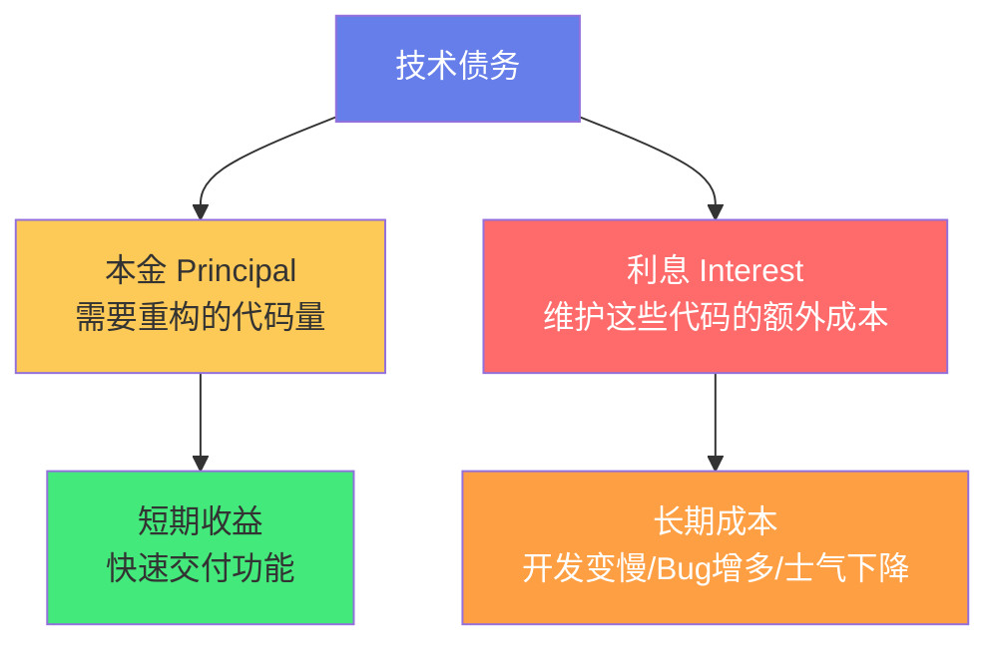
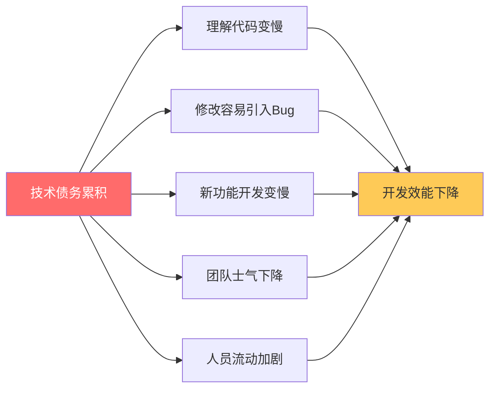
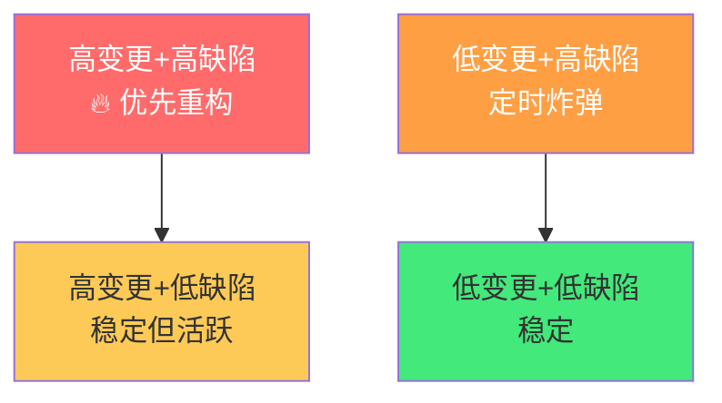
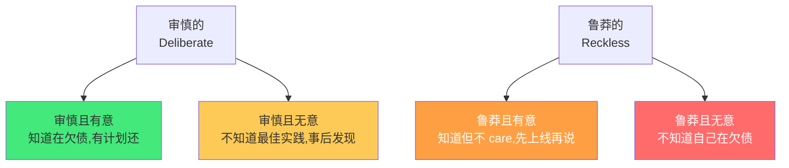

# 🏦 技术债务管理

> **文档说明**：系统讲解技术债务（Technical Debt）的识别、量化、优先级评估、偿还策略与预防机制，涵盖技术债务的起源与定义（Ward Cunningham 1992 年提出，用金融债务隐喻软件开发中的短期妥协）、技术债务的七大类型（代码债务/设计债务/架构债务/测试债务/文档债务/基础设施债务/依赖债务）、技术债务的成因（时间压力/缺乏经验/需求变化/技术演进/人员流动/缺乏标准/过度工程）、技术债务的影响（开发速度下降/Bug 率上升/团队士气/系统脆弱性/业务风险/人才流失）、技术债务的识别与量化（代码质量扫描 SonarQube/圈复杂度/重复代码/测试覆盖率/依赖过时度/变更频率×缺陷率矩阵）、技术债务的优先级评估（影响×概率矩阵/利息模型/四象限分类/债务利息计算）、技术债务的偿还策略（逐步重构/大爆炸重写/童子军规则/专项迭代/绞杀者模式 Strangler Fig）、技术债务与业务的沟通（用业务语言描述/ROI 分析/可视化看板/将技术债务纳入迭代）、Martin Fowler 的技术债务四象限（审慎/鲁莽 × 有意/无意）、技术债务的预防机制（代码审查 Code Review/自动化测试/CI-CD 流水线/编码标准/架构决策记录 ADR/技术雷达）、常见误区（技术债务=坏代码/必须全部偿还/重写是唯一方案/技术债务是技术团队的事）、技术债务看板模板、实战案例分析、常见问题与最佳实践。
>
> **适用人群**：技术负责人、架构师、高级开发者、项目经理、产品经理、关注工程效能的团队
>
> **前置知识**：[[代码审查与质量保障]] · [[软件架构设计原则]] · [[重构-改善既有代码的设计]]

---

## 一、概述

### 1.1 什么是技术债务

**技术债务（Technical Debt）** 由编程先驱 **Ward Cunningham** 于 1992 年首次提出，用「金融债务」隐喻软件开发中的短期妥协：

> "Shipping first time code is like going into debt. A little debt speeds development so long as it is paid back promptly with a rewrite... The danger occurs when the debt is not repaid. Every minute spent on not-quite-right code counts as interest on that debt."
>
> 「第一次交付的代码就像负债。一点点债务能加速开发，只要及时通过重构偿还……危险在于债务不被偿还。每一分钟花在『不太对』的代码上，都是在为这笔债务支付利息。」



**核心隐喻**：
- **本金（Principal）**：需要重构/修复的代码量
- **利息（Interest）**：每次维护这些代码时付出的额外成本（理解慢、修改难、Bug 多）
- **合理举债**：为了快速交付而暂时妥协，但计划偿还
- **债务危机**：债务累积到利息超过团队产能，开发陷入停滞

### 1.2 技术债务不是「坏代码」

| 维度 | 技术债务 | 坏代码 |
|------|---------|--------|
| **意图** | 有意的短期妥协（有计划偿还） | 无意的低质量（缺乏能力/意识） |
| **可接受性** | 适度的技术债务是合理的 | 任何时候都不应该有 |
| **处理方式** | 管理（量化/优先级/偿还计划） | 立即修复 |
| **类比** | 房贷（合理负债，有还款计划） | 高利贷（无计划，越滚越大） |

> 关键区别：**技术债务是「知情的妥协」，坏代码是「无知的结果」**。团队应该管理技术债务，消灭坏代码。

---

## 二、技术债务的类型

### 2.1 七大类型

| 类型 | 说明 | 示例 |
|------|------|------|
| **代码债务** | 代码层面的低质量 | 重复代码、过长函数、命名混乱、魔法数字、死代码 |
| **设计债务** | 模块/类设计不合理 | 紧耦合、违反 SOLID、上帝类、霰弹手术式修改 |
| **架构债务** | 系统架构层面的问题 | 单体过大、分层混乱、技术选型过时、缺乏扩展性 |
| **测试债务** | 测试覆盖不足或质量低 | 单元测试缺失、集成测试脆弱、测试只测 happy path |
| **文档债务** | 文档缺失或过时 | API 文档缺失、架构文档过时、README 不完整 |
| **基础设施债务** | 开发/运维基础设施落后 | 手动部署、无 CI/CD、环境不一致、监控缺失 |
| **依赖债务** | 第三方依赖过时或有风险 | 使用已停止维护的库、版本过旧、存在已知漏洞 |

### 2.2 债务的「利息」表现



---

## 三、技术债务的成因

### 3.1 常见成因

| 成因 | 说明 | 是否可避免 |
|------|------|-----------|
| **时间压力** | 为赶截止日期，跳过测试/重构/文档 | 部分可避免（合理排期） |
| **需求变化** | 业务快速变化，原设计不再适用 | 不可避免（业务本质） |
| **缺乏经验** | 开发者能力不足，写出低质量代码 | 可避免（培训/Code Review） |
| **技术演进** | 新技术出现，旧技术栈过时 | 不可避免（技术发展规律） |
| **人员流动** | 核心人员离开，知识丢失 | 部分可避免（文档/知识共享） |
| **缺乏标准** | 没有编码规范/架构规范 | 可避免（建立标准） |
| **过度工程** | 为不存在的需求做复杂设计 | 可避免（YAGNI 原则） |
| **缺少重构文化** | 只加新功能，从不重构 | 可避免（建立重构习惯） |

### 3.2 技术债务是不可避免的

技术债务无法完全消除，因为：
- 业务需求永远在变化（今天的好设计明天可能就不适用）
- 技术永远在演进（今天的最佳实践明天可能就过时）
- 团队永远有新人（经验不足会产生债务）
- 时间永远有限（不可能每次都做到完美

> 目标不是「零技术债务」，而是「可控的技术债务」——知道欠了什么、欠了多少、什么时候还。

---

## 四、技术债务的识别与量化

### 4.1 代码质量扫描工具

| 工具 | 语言 | 功能 |
|------|------|------|
| **SonarQube** | 多语言 | 代码质量/安全/技术债务评分（最全面） |
| **ESLint** | JS/TS | 代码规范/潜在问题 |
| **Pylint/Flake8** | Python | 代码规范/复杂度 |
| **Checkstyle/PMD** | Java | 代码规范/坏味道 |
| **GolangCI-Lint** | Go | 多 linter 聚合 |
| **Clang-Tidy** | C/C++ | 代码分析 |

### 4.2 量化指标

| 指标 | 说明 | 健康阈值 |
|------|------|---------|
| **圈复杂度（Cyclomatic Complexity）** | 函数的独立路径数 | 函数 ≤ 10，类 ≤ 100 |
| **重复代码率** | 重复代码占比 | ≤ 5% |
| **测试覆盖率** | 被测试覆盖的代码比例 | 核心模块 ≥ 80% |
| **代码坏味道数** | SonarQube 等工具检测的问题数 | 持续下降趋势 |
| **依赖过时度** | 过时/有漏洞的依赖数量 | 0 个 critical 漏洞 |
| **变更频率×缺陷率** | 高频变更且高缺陷的文件（热点） | 识别后优先重构 |
| **技术债务比率** | SonarQube 计算的修复成本/开发成本 | ≤ 5% |

### 4.3 热点分析：变更频率 × 缺陷率



- **高变更+高缺陷**：最危险，优先重构（每次修改都在积累利息）
- **低变更+高缺陷**：定时炸弹，修改时会爆炸，计划重构
- **高变更+低缺陷**：活跃但稳定，保持关注
- **低变更+低缺陷**：稳定，不需要动

---

## 五、技术债务的优先级评估

### 5.1 影响 × 概率矩阵

| | 高影响 | 低影响 |
|---|--------|--------|
| **高概率** | 🔴 立即处理 | 🟡 计划处理 |
| **低概率** | 🟡 计划处理 | 🟢 接受/记录 |

### 5.2 利息模型评估

```text
债务优先级 = 利息（每次维护的额外成本）× 变更频率 × 业务影响
```

- **高利息+高频变更**：最该还（每次都在付高额利息）
- **高利息+低频变更**：可以暂缓（很少触发利息）
- **低利息+高频变更**：逐步改善（童子军规则）
- **低利息+低频变更**：接受债务（不值得投入）

### 5.3 Martin Fowler 技术债务四象限



| 象限 | 说明 | 应对 |
|------|------|------|
| **审慎且有意** | 知情妥协，有偿还计划 | 合理管理，按计划偿还 |
| **审慎且无意** | 不知道更好的方法 | 培训/学习，逐步改善 |
| **鲁莽且有意** | 知道但不做 | 团队文化问题，需要管理层介入 |
| **鲁莽且无意** | 完全不知道在欠债 | 最危险，需要建立质量意识和工具 |

---

## 六、技术债务的偿还策略

### 6.1 四种策略

| 策略 | 说明 | 适用场景 | 风险 |
|------|------|---------|------|
| **逐步重构** | 在开发新功能时顺便重构周边代码 | 大多数情况 | 低 |
| **专项迭代** | 安排专门的迭代/冲刺只做重构 | 债务集中、需要大块时间 | 中 |
| **大爆炸重写** | 从零重写整个系统 | 系统完全无法维护 | 高（经常失败） |
| **绞杀者模式** | 新功能用新架构，逐步替换旧系统 | 遗留系统现代化 | 中 |

### 6.2 童子军规则（Boy Scout Rule）

> **「离开时让营地比你发现时更干净。」**

每次修改代码时，顺便改善周边的小问题：
- 重命名一个不清晰的变量
- 提取一个过长的函数
- 补充一个缺失的单元测试
- 修复一个附近的警告

**效果**：不需要专门的重构时间，代码质量持续改善。

### 6.3 绞杀者模式（Strangler Fig）


- 新功能用新架构/新技术栈开发
- 通过 API 网关/外观模式协调新旧系统
- 逐步将旧系统功能迁移到新系统
- 旧系统功能被「绞杀」殆尽后下线

**优点**：风险可控，持续交付，不需要「大爆炸」切换。

### 6.4 大爆炸重写的警示

大爆炸重写的失败率极高（约 70%+），原因：
- 旧系统的「隐藏逻辑」难以完全理解
- 重写期间业务需求仍在变化
- 新系统可能引入新的技术债务
- 团队士气在漫长的重写中消耗

**原则**：除非系统完全无法维护且业务允许长时间投入，否则不要大爆炸重写。

---

## 七、与业务沟通技术债务

### 7.1 用业务语言描述

| 技术语言 | 业务语言 |
|---------|---------|
| 代码耦合严重 | 新功能开发需要 2 周而非 2 天 |
| 测试覆盖率低 | 每次发版有 30% 概率出 Bug |
| 架构过时 | 无法支持高并发，可能在促销时宕机 |
| 依赖有漏洞 | 存在数据泄露风险，可能违反合规要求 |
| 技术债务比率 15% | 每 100 小时开发有 15 小时在「还债」 |

### 7.2 将技术债务纳入迭代

- 每个迭代预留 **15-20%** 的时间处理技术债务
- 技术债务任务和功能任务一起排优先级
- 用「用户故事」格式描述技术债务：
  > 「作为开发者，我希望重构订单模块，以便新功能开发时间从 5 天降到 2 天。」

### 7.3 可视化技术债务看板

```text
┌─────────────────────────────────────────────┐
│           技术债务看板                        │
├──────────┬────────┬────────┬────────────────┤
│ 债务项    │ 类型   │ 优先级 │ 状态            │
├──────────┼────────┼────────┼────────────────┤
│ 订单模块  │ 架构   │ 🔴高   │ 本迭代重构中    │
│ 用户服务  │ 代码   │ 🟡中   │ 下个迭代计划    │
│ 旧版MySQL │ 依赖   │ 🟡中   │ Q4 升级计划     │
│ 测试覆盖  │ 测试   │ 🟢低   │ 持续改善        │
└──────────┴────────┴────────┴────────────────┘
```

---

## 八、技术债务的预防

### 8.1 预防机制

| 机制 | 说明 | 效果 |
|------|------|------|
| **代码审查（Code Review）** | 合并前他人审查代码 | 拦截大部分代码债务 |
| **自动化测试** | 单元/集成/端到端测试 | 防止回归，支持重构 |
| **CI/CD 流水线** | 自动构建/测试/部署 | 标准化质量门禁 |
| **编码标准** | 统一的代码规范和风格 | 减少代码债务 |
| **架构决策记录（ADR）** | 记录重要架构决策及原因 | 减少架构债务，避免遗忘 |
| **技术雷达** | 定期评估技术栈的采纳/试用/弃用 | 管理依赖债务 |
| **定期重构** | 每个迭代预留重构时间 | 持续偿还债务 |
| **知识共享** | 文档/分享/结对编程 | 减少人员流动带来的债务 |

### 8.2 架构决策记录（ADR）

ADR 是一个简短文档，记录重要的架构决策：

```markdown
# ADR-001: 选择 PostgreSQL 作为主数据库

## 状态
已采纳（2026-01-15）

## 背景
系统需要存储结构化业务数据，支持事务和复杂查询。

## 决策
选择 PostgreSQL 作为主数据库。

## 理由
- 支持完整的 ACID 事务
- JSON 字段支持半结构化数据
- 开源免费，社区活跃
- 团队已有 PostgreSQL 经验

## 后果
- 正面：事务一致性好，生态成熟
- 负面：水平扩展需要额外方案（Citus/读写分离）
```

> ADR 的价值：6 个月后你不会忘记「为什么当初选了这个技术」，避免重复讨论和盲目推翻。

---

## 九、常见误区

| 误区 | 真相 |
|------|------|
| **技术债务=坏代码** | 技术债务是知情的妥协，坏代码是无知的结果。前者需要管理，后者需要消灭。 |
| **必须全部偿还** | 适度的技术债务是合理的（像房贷），目标是可控而非清零。 |
| **重写是唯一方案** | 大爆炸重写失败率极高。优先用逐步重构/绞杀者模式。 |
| **技术债务是技术团队的事** | 技术债务直接影响业务交付速度和质量，需要业务和技术共同管理。 |
| **重构会影响交付** | 不重构才会越来越慢。短期重构换长期速度。 |
| **新技术能解决债务** | 换技术栈可能引入新债务。问题的根源往往是流程和文化，不是技术。 |
| **技术债务只在大项目有** | 任何项目都有技术债务，小项目也需要管理意识。 |
| **债务量化不重要** | 无法量化就无法管理。用工具和指标让技术债务可见。 |

---

## 十、实战案例

### 10.1 案例：电商系统的技术债务管理

**背景**：一个快速发展的电商平台，3 年从 0 到日订单 10 万，代码量 50 万行，技术债务严重。

**问题识别**：
- SonarQube 扫描：技术债务比率 22%（修复需 4400 小时）
- 热点分析：订单模块变更频率最高，缺陷率也最高
- 新功能开发时间从平均 3 天增加到 10 天

**偿还策略**：
1. **立即处理**：订单模块重构（高变更+高缺陷），安排 2 个迭代专项
2. **逐步改善**：其他模块用童子军规则，每个迭代 20% 时间
3. **绞杀者模式**：新的营销活动系统用微服务架构，逐步从单体剥离
4. **预防机制**：建立 Code Review 流程、CI 质量门禁、ADR 记录

**结果**：
- 6 个月后技术债务比率降到 12%
- 新功能开发时间恢复到 4 天
- 线上 Bug 率下降 40%

### 10.2 案例：避免大爆炸重写

**背景**：团队想重写一个 5 年的遗留系统，预估需要 6 个月。

**风险分析**：
- 旧系统有大量未文档化的业务逻辑
- 业务需求每月都在变化
- 6 个月内无法交付任何新功能

**替代方案**：绞杀者模式
- 新功能用新架构开发（微服务+新数据库）
- 通过 API 网关协调新旧系统
- 每季度迁移一个旧模块到新架构
- 18 个月后旧系统下线

**结果**：持续交付新功能，风险可控，最终成功迁移。

---

## 十一、技术债务管理清单

### 11.1 团队自检清单

- [ ] 我们知道当前有哪些技术债务吗？（有清单/看板）
- [ ] 我们量化了技术债务吗？（SonarQube/覆盖率/复杂度）
- [ ] 我们对技术债务排了优先级吗？（影响×概率/利息模型）
- [ ] 每个迭代有预留时间处理技术债务吗？（15-20%）
- [ ] 我们有 Code Review 流程吗？（拦截新债务）
- [ ] 我们有自动化测试吗？（支持安全重构）
- [ ] 我们记录架构决策吗？（ADR）
- [ ] 业务方理解技术债务的影响吗？（用业务语言沟通）
- [ ] 我们有技术债务的可视化吗？（看板/报告）
- [ ] 我们定期回顾技术债务趋势吗？（月度/季度）

---

## 十二、关联笔记

### 工程实践
- [[代码审查与质量保障]] · [[重构-改善既有代码的设计]] · [[软件架构设计原则]]
- [[CI-CD流水线设计]] · [[GitHub-Actions流水线设计]] · [[设计模式-创建型模式]]

### 项目管理
- [[敏捷开发与Scrum]] · [[项目管理方法论]] · [[团队协作与沟通]]

### 导航
- [[MOC-项目实战]] · [[MOC-云原生与运维]] · [[Home]] · [[学习路线总览]]

> 🔍 **知识点深度解析**
>
> **作用**：技术债务管理解决的是「如何在快速交付和代码质量之间取得平衡，通过识别、量化、优先级排序和有计划的偿还，让技术债务处于可控范围，避免债务累积到拖垮开发效能」的核心问题——软件开发中，为了快速交付而做短期妥协是不可避免的，但如果不主动管理这些妥协，它们会像复利一样累积，最终导致开发速度急剧下降、Bug 频发、团队士气低落，甚至系统无法维护。技术债务管理提供了一套从识别到预防的完整方法论。
>
> **底层原理**：①技术债务的金融隐喻核心是「本金+利息」——本金是需要重构的代码量，利息是每次维护这些代码时付出的额外成本（理解慢、修改难、Bug多）。和金融债务一样，适度的债务是合理的（为了抓住机会快速交付），但债务必须有偿还计划，否则利息会越滚越大，最终超过团队的偿还能力（「债务危机」）。这个隐喻之所以强大，是因为它让非技术人员也能理解「为什么需要花时间重构」——就像还房贷，不还利息会越欠越多。②技术债务不可避免的根源是「不确定性」——业务需求在变化（今天的好设计明天可能不适用），技术在演进（今天的最佳实践明天可能过时），团队在变化（新人会产生新债务）。因此目标不是「零债务」，而是「可控的债务」——知道欠了什么、欠了多少、什么时候还。这和金融管理中的「负债管理」是同一个逻辑：不是不负债，而是把负债控制在可偿还范围内。③技术债务的优先级评估本质是「成本-收益分析」——用「利息×变更频率×业务影响」计算债务的实际成本，优先偿还高利息+高频变更的债务（每次都在付高额利息），接受低利息+低频变更的债务（很少触发，不值得投入）。这和投资决策是一样的：把有限的资源投入到回报率最高的地方。④大爆炸重写失败率高的根源是「第二系统效应（Second-System Effect）」——Fred Brooks 在《人月神话》中指出，设计师在设计第二个系统时，往往会过度设计，把第一个系统中所有想做但没做的功能都加进去，导致新系统臃肿、延期、甚至失败。加上旧系统的「隐藏逻辑」难以完全理解、业务需求持续变化，大爆炸重写的风险极高。绞杀者模式通过「渐进式迁移」规避了这些风险。⑤技术债务预防的核心是「左移（Shift Left）」——在开发流程的早期（设计/编码/审查阶段）就拦截质量问题，而不是等到后期测试或上线后才发现。Code Review、自动化测试、CI 质量门禁、编码标准都是「左移」的实践。左移的成本远低于右移（后期修复）——研究表明，需求阶段修复一个问题的成本是上线后修复的 1/100。⑥与业务沟通技术债务的关键是「翻译」——技术人员说「代码耦合严重」，业务人员听不懂；但说「新功能开发需要 2 周而非 2 天」，业务人员立刻就能理解。将技术指标翻译为业务指标（交付时间/Bug率/宕机风险/合规风险），是技术管理者的核心能力之一。
>
> **用法要点**：① 技术债务定义：Ward Cunningham 1992年提出，金融债务隐喻，本金(需重构代码)+利息(维护额外成本)，是知情的短期妥协≠坏代码 ② 七大类型：代码债务/设计债务/架构债务/测试债务/文档债务/基础设施债务/依赖债务 ③ 成因：时间压力/需求变化/缺乏经验/技术演进/人员流动/缺乏标准/过度工程，不可完全消除，目标是可控 ④ 识别量化：SonarQube扫描，圈复杂度(函数≤10)/重复率(≤5%)/测试覆盖率(核心≥80%)/依赖漏洞/热点分析(变更频率×缺陷率) ⑤ 优先级：影响×概率矩阵，利息模型(利息×变更频率×业务影响)，Fowler四象限(审慎/鲁莽×有意/无意) ⑥ 偿还策略：逐步重构(大多数)/专项迭代(债务集中)/大爆炸重写(高风险慎用)/绞杀者模式(遗留系统现代化)，童子军规则(每次修改顺便改善) ⑦ 业务沟通：用业务语言(开发时间/Bug率/宕机风险)，每迭代预留15-20%，技术债务看板可视化 ⑧ 预防：Code Review/自动化测试/CI-CD/编码标准/ADR架构决策记录/技术雷达/定期重构/知识共享 ⑨ 误区：技术债务≠坏代码/不必全部偿还/重写不是唯一方案/不是技术团队单方面的事/重构不影响交付反而提升速度 ⑩ 自检清单：债务清单/量化/优先级/迭代预留/Code Review/测试/ADR/业务沟通/可视化/定期回顾。

> 💡 **深度讲解**：技术债务管理最核心的智慧是「技术债务不是要消灭的敌人，而是要管理的工具——适度的、有计划的债务能加速交付，失控的、无计划的债务会拖垮团队」——很多团队对技术债务有两种极端态度：一种是「完全不管」，只加新功能从不重构，最终代码变成「大泥球」，开发速度越来越慢，直到加不动任何新功能；另一种是「完美主义」，追求零债务，每个功能都要做到最佳设计，导致交付速度极慢，错过市场窗口。正确的态度是「管理」——像管理财务一样管理技术债务：知道欠了什么（识别）、欠了多少（量化）、哪些该先还（优先级）、什么时候还（计划）、怎么预防新债（机制）。技术债务管理的另一个深层智慧是「沟通」——技术债务之所以经常被忽视，是因为技术人员用技术语言描述它（「耦合严重」「架构过时」），而业务决策者关心的是业务指标（「多久能上线」「会不会出 Bug」「会不会宕机」）。优秀的技术管理者能把技术债务「翻译」成业务语言：「这个模块的技术债务导致新功能开发从 2 天变成 2 周」「这个依赖有安全漏洞，可能导致数据泄露和合规罚款」。当技术债务用业务语言表达时，它就不再是「技术团队的内部问题」，而是「业务风险和成本问题」，自然会获得资源支持。在快速变化的互联网行业，技术债务管理能力是技术团队成熟度的核心标志——初级团队只会写功能，中级团队会写测试和文档，高级团队会主动管理技术债务，让系统在快速迭代中保持健康。技术债务管理不是「额外的工作」，而是「让开发可持续的核心工作」。

> 📝 **精简总结**：技术债务管理=Ward Cunningham提出的金融债务隐喻，本金(需重构代码)+利息(维护额外成本)，是知情妥协≠坏代码。七大类型：代码/设计/架构/测试/文档/基础设施/依赖。成因：时间压力/需求变化/技术演进等，不可完全消除，目标是可控。识别量化：SonarQube/圈复杂度/重复率/覆盖率/热点分析(变更×缺陷)。优先级：影响×概率矩阵/利息模型/Fowler四象限。偿还策略：逐步重构(童子军规则)/专项迭代/大爆炸重写(慎用)/绞杀者模式(推荐)。业务沟通：翻译为业务语言(交付时间/Bug率/风险)，每迭代预留15-20%，看板可视化。预防：Code Review/自动化测试/CI-CD/编码标准/ADR/技术雷达。误区：≠坏代码/不必清零/重写非唯一方案/不是技术单方面的事。核心：管理而非消灭，可控而非清零。

> **学习路径建议**：先学习 [[代码审查与质量保障]] 和 [[重构-改善既有代码的设计]] → 学习本文档掌握技术债务管理方法论 → 实践：用 SonarQube 或类似工具扫描你的项目，识别技术债务 → 实践：建立技术债务清单和优先级排序 → 实践：在当前迭代中用童子军规则改善 3 个小问题 → 学习 [[软件架构设计原则]] 和 [[CI-CD流水线设计]] 建立预防机制 → 实践：为你的团队建立 Code Review 流程和 CI 质量门禁 → 学习 ADR 架构决策记录 → 进阶：学习绞杀者模式和遗留系统现代化 → 形成团队级的技术债务管理规范。

---

> **技术债务管理的本质是「在快速交付和长期健康之间取得平衡，用管理财务债务的智慧来管理代码中的妥协」——软件开发中最常见的矛盾是「快」和「好」的矛盾：业务要求快速交付，技术要求代码质量。很多团队把这看成非此即彼的选择——要么快但烂，要么好但慢。但技术债务管理告诉我们：这不是二选一，而是一个「平衡术」——适度的、有计划的技术债务能让你更快地交付（就像合理的房贷能让你提前住上房子），但必须有偿还计划，否则利息会越滚越大，最终拖垮整个项目。Ward Cunningham 在 1992 年提出这个隐喻时，可能没有想到它会成为软件工程最重要的概念之一——因为它触及了软件开发的核心矛盾：**在不确定性中做决策**。我们永远无法预知未来的需求变化和技术演进，所以今天的「最佳实践」明天可能就变成「技术债务」。承认这一点，然后主动管理它，而不是假装它不存在，这就是成熟的工程文化。技术债务管理不是「技术团队的额外工作」，而是「让开发可持续的核心能力」——一个不管理技术债务的团队，就像一个不管理财务的人，可能短期内看起来很风光（交付快），但长期一定会陷入债务危机（开发停滞、Bug 频发、人员流失）。从今天开始，花 30 分钟扫描你的项目，列出技术债务清单，排一个优先级，然后在下次迭代中还掉最紧急的那一笔——你会发现，还债不是负担，而是投资——投资于未来的开发速度和团队士气。**

---

## 🔗 关联笔记

- [[MOC-项目实战]] — 返回本分类知识地图，查看更多相关文档

## 📖 前置知识

- [[代码审查与质量保障]]
- [[软件架构设计原则]]
- [[重构-改善既有代码的设计]]

## 🏷️ 相关标签

`#技术债务` `#代码质量` `#重构` `#软件架构` `#项目管理` `#工程效能`

[[Home|🏠 返回首页]] · [[MOC-项目实战|📚 返回分类]]
