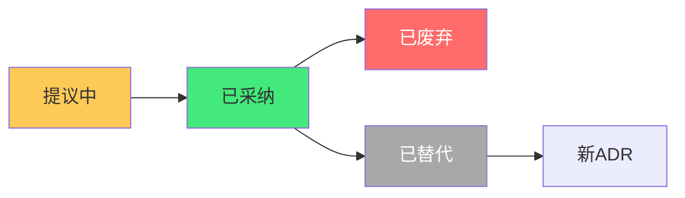
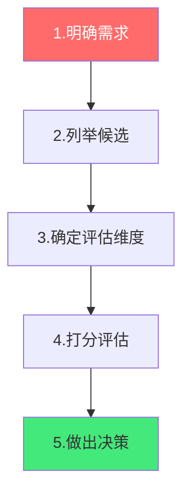

# 📋 技术选型决策记录（ADR）

> **文档说明**：系统讲解 ADR（Architecture Decision Record，架构决策记录）的概念、价值、结构与实战用法，涵盖 ADR 概述（什么是 ADR / 为什么需要 / 何时写 / 谁来写）、ADR 标准结构（标题 / 状态 / 背景 / 决策 / 后果 / 替代方案 / 参考资料）、ADR 模板（可直接复制使用）、技术选型方法论（需求分析 / 候选方案列举 / 评估维度 / 打分矩阵 / 决策逻辑）、常见技术选型场景实战（前端框架 / 后端语言 / 数据库 / 缓存 / 消息队列 / 部署方案 / AI 模型选型）、ADR 完整示例（多个真实决策记录）、技术选型原则（团队熟悉度 / 生态成熟度 / 性能 / 可维护性 / 成本 / 社区活跃度 / 学习曲线）、技术债记录与追踪、ADR 管理与维护（编号 / 状态流转 / 存放位置 / 评审机制）、常见陷阱（追新 / 过度设计 / 一人决策 / 不记录原因）与最佳实践。
>
> **适用人群**：全栈开发者、技术负责人、架构师、项目经理、独立开发者
>
> **前置知识**：[[从0到1产品落地路径]] · [[技术选型与架构设计]]

---

## 一、ADR 概述

### 1.1 什么是 ADR

**ADR（Architecture Decision Record，架构决策记录）** 是一种记录重要技术决策的轻量级文档，每个 ADR 记录一个决策：为什么做这个决策、考虑了哪些方案、决策的后果是什么。


**核心要素**：
- 📝 **记录决策**：不仅记录「选了什么」，更记录「为什么选」
- 🔄 **可追溯**：新人可以理解为什么这样设计，避免重复讨论
- ⚖️ **透明化**：决策过程对团队透明，减少争议
- 📚 **知识沉淀**：技术决策成为团队知识库的一部分

### 1.2 为什么需要 ADR

| 没有 ADR 的痛点 | 有 ADR 的好处 |
|----------------|-------------|
| 「为什么用这个技术？」反复讨论 | 新人看 ADR 就理解决策背景 |
| 人员离职后决策原因丢失 | 决策原因永久记录 |
| 同一个问题反复争论 | 已决策的问题不再讨论 |
| 技术债不知道为什么欠下 | 技术债有记录和偿还计划 |
| 架构演变无迹可寻 | 可以看到架构的演变历程 |

### 1.3 何时写 ADR

**应该写 ADR 的场景**：
- 选择核心技术栈（框架、语言、数据库）
- 架构设计决策（微服务 vs 单体、同步 vs 异步）
- 引入新的中间件或工具
- 重大技术债决策（「先这样，以后重构」）
- 放弃某个技术方案的决策
- 安全相关决策

**不需要写 ADR 的场景**：
- 日常编码选择（变量名、代码风格）
- 不影响全局的局部实现
- 已经有明确规范的选择

---

## 二、ADR 标准结构

### 2.1 标准模板

```markdown
# ADR-001: [决策标题]

- **状态**：已采纳 / 已废弃 / 已替代
- **日期**：2026-08-28
- **决策者**：[姓名/团队]

## 背景

描述面临的问题和需要做决策的场景。
包括业务需求、技术约束、现有系统情况。

## 决策

我们决定采用 [方案A]。

具体说明决策内容。

## 替代方案

### 方案 A：[名称]
- 优点：...
- 缺点：...

### 方案 B：[名称]
- 优点：...
- 缺点：...

### 方案 C：[名称]
- 优点：...
- 缺点：...

## 评估矩阵

| 维度 | 权重 | 方案A | 方案B | 方案C |
|------|------|-------|-------|-------|
| 团队熟悉度 | 30% | 8 | 5 | 6 |
| 生态成熟度 | 20% | 9 | 7 | 8 |
| 性能 | 20% | 7 | 9 | 6 |
| 可维护性 | 15% | 8 | 6 | 7 |
| 成本 | 15% | 6 | 8 | 9 |
| **加权总分** | 100% | **7.75** | 6.85 | 7.05 |

## 后果

### 正面影响
- ...

### 负面影响 / 风险
- ...
- 缓解措施：...

### 技术债
- [ ] 记录需要后续优化的点

## 参考资料
- [链接1]
- [链接2]
```

### 2.2 状态流转



| 状态 | 说明 |
|------|------|
| **提议中** | 正在讨论，尚未决策 |
| **已采纳** | 决策通过，正在执行 |
| **已废弃** | 决策被放弃，不再执行 |
| **已替代** | 被新的 ADR 替代（需标注替代者） |

---

## 三、技术选型方法论

### 3.1 选型五步法



**第一步：明确需求**
- 业务需求是什么？（QPS、数据量、用户数）
- 技术约束是什么？（团队技能、预算、时间）
- 非功能需求？（性能、可用性、安全性）

**第二步：列举候选方案**
- 至少列举 2-3 个候选方案
- 包括主流方案和非主流方案
- 包括「不做」这个选项（有时不引入新技术是最好的决策）

**第三步：确定评估维度**
根据项目情况选择维度并分配权重：

| 维度 | 说明 | 常见权重 |
|------|------|---------|
| **团队熟悉度** | 团队是否有经验 | 20-30% |
| **生态成熟度** | 社区、文档、插件 | 15-20% |
| **性能** | 速度、并发、资源占用 | 15-25% |
| **可维护性** | 代码质量、调试、升级 | 10-15% |
| **成本** | 授权费、云服务费、人力 | 10-15% |
| **学习曲线** | 上手难度 | 5-10% |
| **社区活跃度** | Issue 响应、版本更新 | 5-10% |

**第四步：打分评估**
- 每个维度 1-10 分
- 加权计算总分
- 分数接近时看关键维度

**第五步：做出决策**
- 分数最高的方案通常是推荐方案
- 但不要只看分数——考虑战略因素、长期趋势
- 记录决策原因和异议

---

## 四、ADR 实战示例

### 4.1 ADR-001：前端框架选择

```markdown
# ADR-001: 前端框架选择 Vue 3 而非 React

- **状态**：已采纳
- **日期**：2026-01-15
- **决策者**：前端团队

## 背景

新项目需要选择前端框架。团队有 3 名前端，其中 2 人有 Vue 2 经验，
1 人有 React 经验。项目是 AI 知识库管理系统，需要快速迭代。

## 决策

选择 Vue 3 + TypeScript + Vite + Element Plus。

## 替代方案

### 方案 A：Vue 3
- 优点：团队熟悉、上手快、中文文档好、Element Plus 组件丰富
- 缺点：生态比 React 略小、高级岗位招聘稍难

### 方案 B：React 18
- 优点：生态最大、社区最活跃、招聘容易
- 缺点：团队不熟悉、学习曲线陡、需要选更多库（路由/状态管理）

### 方案 C：Svelte
- 优点：性能好、代码量少
- 缺点：生态小、团队无人用过、风险高

## 评估矩阵

| 维度 | 权重 | Vue3 | React | Svelte |
|------|------|------|-------|--------|
| 团队熟悉度 | 30% | 9 | 5 | 2 |
| 生态成熟度 | 20% | 8 | 10 | 5 |
| 开发效率 | 20% | 9 | 7 | 8 |
| 性能 | 10% | 8 | 8 | 10 |
| 招聘 | 10% | 7 | 9 | 4 |
| 学习曲线 | 10% | 9 | 6 | 8 |
| **加权总分** | 100% | **8.5** | 7.3 | 5.9 |

## 后果

### 正面影响
- 团队可快速上手，项目启动快
- Element Plus 提供完整组件库，减少 UI 开发量
- 中文社区活跃，问题容易解决

### 负面影响
- 未来招聘高级前端时候选人池比 React 小
- 部分前沿库可能先支持 React

### 技术债
- [ ] 关注 Vue 3 生态发展，定期评估是否需要引入 React 子项目
```

### 4.2 ADR-002：数据库选择

```markdown
# ADR-002: 数据库选择 PostgreSQL 而非 MySQL

- **状态**：已采纳
- **日期**：2026-01-20
- **决策者**：后端团队

## 背景

AI 知识库系统需要存储文档、向量、用户数据。需要支持 JSON 字段、
全文搜索、未来可能需要向量检索。

## 决策

选择 PostgreSQL 16，使用 pgvector 扩展支持向量检索。

## 替代方案

### 方案 A：PostgreSQL + pgvector
- 优点：支持 JSON、全文搜索、向量检索，一个数据库搞定
- 缺点：团队 MySQL 经验更多

### 方案 B：MySQL + 独立向量数据库
- 优点：团队熟悉 MySQL
- 缺点：需要维护两个数据库，数据同步复杂

### 方案 C：MongoDB + 向量数据库
- 优点：文档型存储灵活
- 缺点：事务支持弱、团队不熟悉、需要额外向量库

## 评估矩阵

| 维度 | 权重 | PG+pgvector | MySQL+Milvus | MongoDB+Milvus |
|------|------|-------------|--------------|----------------|
| 功能满足度 | 30% | 10 | 7 | 6 |
| 运维复杂度 | 20% | 9 | 5 | 4 |
| 团队熟悉度 | 20% | 6 | 9 | 5 |
| 性能 | 15% | 8 | 8 | 7 |
| 成本 | 15% | 9 | 6 | 5 |
| **加权总分** | 100% | **8.75** | 7.05 | 5.55 |

## 后果

### 正面影响
- 一个数据库满足所有需求（关系+JSON+全文+向量）
- 减少运维复杂度和数据同步问题
- pgvector 社区活跃，RAG 场景成熟

### 负面影响
- 团队需要学习 PostgreSQL 特性
- pgvector 在超大规模（亿级向量）性能不如专用向量库

### 技术债
- [ ] 监控向量检索性能，超过 1000 万向量时评估迁移到专用向量库
- [ ] 团队安排 PostgreSQL 培训
```

### 4.3 ADR-003：AI 模型选型

```markdown
# ADR-003: AI 模型选择多模型策略而非单一模型

- **状态**：已采纳
- **日期**：2026-02-01
- **决策者**：AI 团队

## 背景

AI 知识库系统需要 LLM 支持问答、摘要、生成。需要平衡效果、
成本、延迟和合规性。

## 决策

采用多模型策略：
- 复杂推理：GPT-4o / Claude 3.5 Sonnet
- 日常问答：国内大模型（通义千问/文心一言）
- 简单任务：开源模型（Qwen2-7B 自部署）

通过统一 SDK 封装，可动态切换。

## 替代方案

### 方案 A：单一 GPT-4o
- 优点：效果最好、最稳定
- 缺点：成本高、国内访问不稳定、数据合规风险

### 方案 B：单一国内大模型
- 优点：合规、成本低、访问稳定
- 缺点：复杂推理效果不如 GPT-4

### 方案 C：多模型策略（采纳）
- 优点：成本效果平衡、容灾、可按场景选模型
- 缺点：实现复杂、需要抽象层

## 后果

### 正面影响
- 成本降低 60%（80% 请求用便宜模型）
- 容灾能力：一个模型不可用时自动切换
- 合规：国内数据用国内模型

### 负面影响
- 需要维护模型抽象层和路由逻辑
- 不同模型输出格式不一致，需要适配

### 技术债
- [ ] 建立模型效果评估体系，定期对比各模型
- [ ] 实现智能路由（根据问题复杂度自动选模型）
```

---

## 五、技术选型原则

### 5.1 核心原则

| 原则 | 说明 |
|------|------|
| **团队熟悉度优先** | 团队会用的技术比最好的技术更重要 |
| **够用就好** | 不要为 1% 的场景引入 99% 的复杂度 |
| **生态大于技术** | 成熟的生态比优秀的技术更重要 |
| **可观测性** | 选容易监控、调试、排查的技术 |
| **渐进式引入** | 新技术先在非核心模块试点，再推广 |
| **避免锁定** | 优先选有标准/开源替代的技术 |
| **总成本考量** | 不仅看 license 费，还要看运维、学习、迁移成本 |

### 5.2 反模式

| 反模式 | 说明 |
|--------|------|
| **追新** | 什么技术新用什么，不考虑稳定性 |
| **过度设计** | 为 10 万用户设计架构，实际只有 100 用户 |
| **一人决策** | 技术负责人拍板，不听取团队意见 |
| **不记录原因** | 只记录选了什么，不记录为什么选 |
| **不评估替代方案** | 直接选第一个想到的方案 |
| **忽视学习曲线** | 低估团队学习新技术的时间成本 |

---

## 六、技术债记录

### 6.1 技术债 ADR

技术债决策也应该写 ADR，记录「为什么先这样做」和「什么时候还」：

```markdown
# ADR-010: 技术债 - 用户认证先使用 Session 而非 JWT

- **状态**：已采纳（技术债）
- **日期**：2026-03-01
- **预计偿还**：2026 Q4

## 背景

项目初期需要快速上线用户系统。JWT + 刷新令牌实现复杂，
Session 实现简单但不利于水平扩展。

## 决策

先使用 Session + Redis 存储，后续迁移到 JWT。

## 偿还条件
- 用户量超过 10 万，需要多实例部署时
- 或 2026 Q4 例行重构时

## 后果
- 上线速度快 2 周
- 未来需要做一次认证系统重构
```

### 6.2 技术债追踪

在项目中维护技术债清单：

| ADR 编号 | 描述 | 引入时间 | 预计偿还 | 状态 |
|---------|------|---------|---------|------|
| ADR-010 | Session 认证 | 2026-03 | 2026 Q4 | 待偿还 |
| ADR-015 | 同步调用订单服务 | 2026-04 | 用户量>5万 | 待偿还 |

---

## 七、ADR 管理与维护

### 7.1 存放位置

```text
docs/
└── adr/
    ├── 001-前端框架选择.md
    ├── 002-数据库选择.md
    ├── 003-AI模型选型.md
    └── README.md  # ADR 索引
```

### 7.2 命名规范

- 文件名：`NNN-简短标题.md`（三位数字编号）
- 编号递增，不重复使用
- 废弃的 ADR 保留，状态改为「已废弃」或「已替代」

### 7.3 评审机制

- 重要 ADR 团队评审后再采纳
- 每周站会同步是否有新决策需要记录
- 每季度回顾 ADR，检查技术债偿还情况

---

## 八、常见问题

| 问题 | 回答 |
|------|------|
| **ADR 要写多长？** | 500-1000 字为宜，重点说清「为什么」 |
| **谁来写 ADR？** | 决策者或提出者写，团队评审 |
| **小项目需要 ADR 吗？** | 核心决策仍需记录，可以更简短 |
| **决策变了怎么办？** | 旧 ADR 标记为「已替代」，写新 ADR |
| **ADR 要所有人同意吗？** | 不需要一致同意，但要记录异议 |
| **可以事后补 ADR 吗？** | 可以，但尽量决策时就记录 |

---

## 九、最佳实践

1. **决策就记录**：做出重要技术决策后立刻写 ADR，不要等
2. **重点写「为什么」**：「选了什么」不重要，「为什么选」才重要
3. **至少列 2 个替代方案**：说明你考虑过其他选择
4. **用打分矩阵**：让决策过程可量化、可复现
5. **记录后果和风险**：不仅写好处，也要写坏处和缓解措施
6. **技术债必须记录**：「先这样以后改」必须写下来，否则永远不会改
7. **ADR 是活文档**：状态会变，定期回顾和更新
8. **团队参与**：决策前讨论，决策后告知，不要一人拍板
9. **不要过度形式化**：ADR 是工具不是负担，简单有效就好
10. **存放在代码仓库**：ADR 和代码一起版本控制，随项目演进

---

## 十、关联笔记

### 项目与架构
- [[从0到1产品落地路径]] · [[技术选型与架构设计]] · [[微服务架构设计]]
- [[项目管理与协作]] · [[敏捷开发与Scrum]]

### 技术栈
- [[Vue3-组合式API]] · [[SpringBoot快速入门]] · [[PostgreSQL进阶]]
- [[Redis缓存与队列]] · [[主流大模型对比与选型]]

### 工程化
- [[CI-CD持续集成与部署]] · [[Docker容器化]] · [[技术债管理]]

### 导航
- [[MOC-项目实战]] · [[MOC-产品与模板]] · [[Home]] · [[学习路线总览]]

> 🔍 **知识点深度解析**
>
> **作用**：ADR（架构决策记录）解决的是「如何记录重要技术决策的背景、过程和原因，让团队成员（包括未来的新人）理解为什么这样选，避免重复讨论和决策原因丢失」的核心问题——技术选型是项目中最容易产生争议和反复的环节，ADR 通过结构化的记录让决策透明化、可追溯。
>
> **底层原理**：①ADR 的本质是「决策的版本控制」——就像代码用 Git 记录变更历史一样，ADR 记录架构决策的历史。每个 ADR 有编号、有状态、有日期，决策变更时旧 ADR 不删除而是标记为「已替代」，新 ADR 记录新的决策。这样可以看到架构的演变历程，理解每个决策的上下文。这种「不可变历史 + 状态标记」的设计和事件溯源（Event Sourcing）思想一致——不修改历史，只追加新记录。②技术选型打分矩阵的本质是「多准则决策分析（MCDA）」——当有多个评估维度（性能、成本、团队熟悉度等）且各维度重要性不同时，通过加权打分将多维问题降维为单一分数，使决策可量化、可复现。权重分配反映了项目的优先级（初创项目团队熟悉度权重高，大型系统性能权重高）。打分不是为了「精确」，而是为了「结构化思考」——强迫决策者明确每个维度的评价，而不是凭感觉。③ADR 的「背景-决策-后果」结构体现了「理性决策」的框架——背景说明问题空间，决策说明选择，后果说明影响（包括正面和负面）。这种结构避免了「只说好处不说风险」的决策偏差，强制决策者考虑负面影响和技术债。特别是「后果」部分的技术债记录，是防止「先这样以后改」变成「永远不改」的关键机制。④技术债 ADR 的本质是「显式化隐式决策」——很多技术债是隐式的（开发者心里知道「这里以后要重构」但没写下来），结果是永远不会重构。技术债 ADR 将隐式决策显式化：记录为什么先这样做、预计什么时候偿还、偿还条件是什么。这样技术债从「个人记忆」变成「团队共识」，有明确的追踪和偿还计划。⑤「至少列 2 个替代方案」的原则本质是「避免锚定效应」——认知心理学中的锚定效应指人们倾向于第一个想到的方案，不认真考虑其他选择。强制列替代方案（包括「不做」这个选项）可以打破锚定，让决策更全面。很多时候，「不引入新技术」是最好的决策，但如果不把它列为方案，就不会被认真考虑。
>
> **用法要点**：① ADR结构：标题+状态(提议中/已采纳/已废弃/已替代)+日期+决策者+背景+决策+替代方案+评估矩阵+后果(正面/负面/技术债)+参考 ② 何时写：核心技术栈/架构设计/新中间件/重大技术债/放弃方案/安全决策 ③ 选型五步法：明确需求→列举候选(≥2个+不做选项)→确定评估维度和权重→打分评估(1-10分加权)→做出决策(分数+战略因素) ④ 评估维度：团队熟悉度(20-30%)/生态成熟度(15-20%)/性能(15-25%)/可维护性(10-15%)/成本(10-15%)/学习曲线(5-10%)/社区活跃度(5-10%) ⑤ 选型原则：团队熟悉度优先/够用就好/生态大于技术/可观测性/渐进式引入/避免锁定/总成本考量 ⑥ 反模式：追新/过度设计/一人决策/不记录原因/不评估替代/忽视学习曲线 ⑦ 技术债ADR：记录为什么先这样+预计偿还时间+偿还条件，维护技术债清单追踪 ⑧ 管理：docs/adr/目录/NNN-标题.md命名/编号递增不重复/废弃保留改状态/季度回顾 ⑨ 常见问题：500-1000字/决策者写/小项目也需要核心决策/决策变了旧ADR标已替代写新ADR/不需一致同意但记录异议/可事后补但尽量决策时记 ⑩ 最佳实践：决策就记录/重点写为什么/至少2个替代方案/用打分矩阵/记录后果和风险/技术债必须记录/ADR是活文档/团队参与/不过度形式化/存代码仓库。

> 💡 **深度讲解**：ADR 最核心的智慧是「记录为什么比记录是什么更重要——技术会过时，但决策的原因和思考过程永远有价值」——很多团队不写 ADR，觉得「选了什么技术大家都知道」，但半年后新人问「为什么用 MongoDB 而不是 PostgreSQL？」，没有人能说清楚——可能是当时 CTO 拍脑袋选的，可能是因为前一个工程师熟悉，可能是因为赶时间。没有 ADR，决策原因就随人员流动丢失了，团队会反复讨论同一个问题，或者不敢改动「不知道为什么这样设计」的代码。ADR 的价值在「决策变更时」最明显——当你想推翻一个旧决策时，先看 ADR 理解当时为什么这样选，如果当时的约束已经变了（用户量增长了、团队技能变了、新技术出现了），就可以有依据地变更；如果当时的原因仍然成立，就不要轻易变更。这避免了「为了改而改」的架构折腾。打分矩阵是 ADR 中最有价值的工具之一——它不是为了得到一个「精确的分数」（技术选型不可能精确量化），而是为了「结构化思考」。当你强迫自己为每个方案的每个维度打分时，你会发现自己之前没有意识到的偏好和盲点。比如你以为自己选 A 是因为性能好，但打分后发现其实是因为团队熟悉度高——这让决策的真实原因显式化。技术债 ADR 是另一个关键点——「先这样以后重构」是软件开发中最常见的谎言，因为「以后」永远不会来。把技术债写进 ADR，记录「为什么先这样」「什么时候还」「偿还条件是什么」，让技术债从个人记忆变成团队共识，才能真正被追踪和偿还。在 AI 时代，技术选型更加频繁和重要——AI 模型选型、向量数据库选型、RAG 框架选型，每个决策都影响产品效果和成本。ADR 让这些决策有迹可循，避免「这个模型是谁选的？为什么选这个？」的尴尬。ADR 不需要写很长——500-1000 字说清楚「为什么」就够了。它不是给别人看的文档，而是给未来的自己和团队看的「决策记忆」。从今天开始，下次你做重要技术决策时，花 15 分钟写一篇 ADR——半年后你会感谢自己。

> 📝 **精简总结**：ADR=架构决策记录，记录技术决策的为什么。结构：标题+状态+背景+决策+替代方案+评估矩阵+后果+技术债。选型五步法：明确需求→列举候选→确定维度权重→打分→决策。评估维度：团队熟悉度/生态/性能/可维护性/成本/学习曲线。原则：团队熟悉度优先/够用就好/生态大于技术/渐进引入/避免锁定。技术债ADR：记录原因+偿还时间+条件，显式化追踪。管理：docs/adr/NNN-标题.md/编号递增/废弃保留改状态。最佳实践：决策就记录/重点写为什么/至少2个替代方案/打分矩阵/记录后果风险/技术债必须记录/团队参与/存代码仓库。

> **学习路径建议**：先理解 ADR 的概念和价值 → 学习 ADR 标准结构和模板 → 实践：为你最近做的一个技术决策补写一篇 ADR → 学习技术选型方法论和打分矩阵 → 实践：面对一个技术选型，用五步法完整分析 → 研究优秀开源项目的 ADR（如 Nginx、React、Vue 的决策记录） → 在项目中建立 ADR 目录和流程 → 形成「重要决策必写 ADR」的团队习惯。

---

> **ADR 最核心的智慧是「记录为什么比记录是什么更重要——技术会过时，但决策的原因和思考过程永远有价值」——很多团队不写 ADR，觉得选了什么技术大家都知道，但半年后新人问为什么用 MongoDB 而不是 PostgreSQL，没有人能说清楚——可能是 CTO 拍脑袋，可能是前工程师熟悉，可能是赶时间。没有 ADR，决策原因随人员流动丢失，团队反复讨论同一问题，或不敢改动不知道为什么这样设计的代码。ADR 的价值在决策变更时最明显——想推翻旧决策时，先看 ADR 理解当时为什么这样选，如果约束变了（用户量增长、团队技能变了、新技术出现了），就有依据地变更；如果原因仍成立，就不要轻易变更，避免为了改而改的架构折腾。打分矩阵不是为了精确分数（技术选型不可能精确量化），而是为了结构化思考——强迫自己为每个方案每个维度打分时，会发现之前没意识到的偏好和盲点。技术债 ADR 是另一个关键点——「先这样以后重构」是软件开发中最常见的谎言，因为以后永远不会来。把技术债写进 ADR，记录为什么先这样、什么时候还、偿还条件，让技术债从个人记忆变成团队共识，才能真正被追踪偿还。AI 时代技术选型更频繁重要——AI 模型、向量数据库、RAG 框架，每个决策都影响效果和成本，ADR 让这些决策有迹可循。ADR 不需要写很长，500-1000 字说清楚为什么就够了，它不是给别人看的文档，而是给未来自己和团队看的决策记忆。从今天开始，下次做重要技术决策时花 15 分钟写一篇 ADR——半年后你会感谢自己。**

---

## 🔗 关联笔记

- [[MOC-项目实战]] — 返回本分类知识地图，查看更多相关文档

## 📖 前置知识

- [[从0到1产品落地路径]]
- [[技术选型与架构设计]]

## 🏷️ 相关标签

`#ADR` `#技术选型` `#架构决策` `#决策记录` `#项目管理` `#技术债`

[[Home|🏠 返回首页]] · [[MOC-项目实战|📚 返回分类]]
